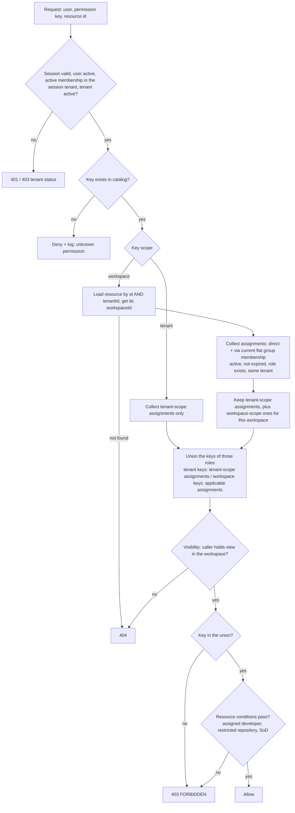

# Identity Authorization (Roles, Permissions, Assignments) — Module Specification

**Status:** Draft — review decisions (2026-11-11) applied; awaiting final sign-off. Nothing here is Implemented.
**Owner:** TBD
**Last updated:** 2026-11-11
**Related ADRs:** ADR-003 (tenant isolation), ADR-004 (finding identity), ADR-002 (modular monolith)
**Template:** `docs/technical/MODULE_SPECIFICATION_TEMPLATE.md` (the template lives under `technical/`)

> **Provenance and status labels.** Every requirement carries a label from `docs/README.md`: **Confirmed** (stated in the docs or in your instructions), **Recommended** (my proposal), **Open** (needs your decision). Former open questions that were resolved with a Recommended default were confirmed in full on 2026-11-11 (§15, rows 1–23) and carry **Confirmed (2026-11-11)**; Q24 and Q25 replace two of those defaults. Only Confirmed items are requirements; items still labelled Recommended (the permission catalog and default bundles, §5.2 to §5.5 and the API/event/frontend proposals) remain proposals unless a §15 row confirms them.
>
> **Missing inputs.** `docs/TENANT_APP_WIREFRAME_SPEC.md` and `docs/ROOT_CONSOLE_WIREFRAME_SPEC.md` do not exist in the repository, so their §4 tables could not be used. The role/permission tables below are instead derived from `docs/product/PROJECT_CONTEXT.md`, `docs/design/TENANT_APPLICATION_DESIGN.md` (per-screen "Users" lines), `docs/design/ROOT_CONSOLE_DESIGN.md`, `docs/technical/SECURITY_GUIDELINES.md`, and the deleted prototype's matrix preserved in `docs/architecture/AUTHORIZATION.md`. **All of those tables are Recommended.** If the wireframe specs exist elsewhere, send them and I will reconcile.
>
> **Placement.** Written to `docs/AUTHORIZATION.md` as requested. `docs/architecture/AUTHORIZATION.md` (prototype notes, stale) overlaps in name; once this is approved, replace or remove that file and update the `CLAUDE.md` index. Module specs normally live under `docs/modules/<module>/`; say if you want it moved there.

## Review decisions (2026-11-11)

Applied from your review. Each is **Confirmed**.

| # | Decision | Where applied |
|---|---|---|
| 1 | **Users are global; tenant access goes through `tenant_memberships`.** A user may belong to several tenants. The session carries the *active tenant*; switching tenant re-resolves permissions (nothing carries over). | AUTHZ-020, §5.1, §5.7, §5.11, §6.1, §6.5, §7, §8 |
| 2 | **`expiresAt` (nullable) on user and group role assignments**; the resolver ignores expired assignments. No scheduler or notification logic yet. | AUTHZ-018, §5.7, §6.1, §7 |
| 3 | **Grant-only model: no deny rules.** Segregation of duties stays an explicit rule (reviewer ≠ approver on the same finding decision). | AUTHZ-019, §5.8 |
| 4 | **Groups are flat** (no nesting). | AUTHZ-021, §5.7, §7 |
| 5 | **The Admin built-in role does NOT include `approval.approve` / `approval.reject` by default**; tenants can grant them through a custom role. (Your wording was `finding.approve`; in this catalog the keys are `approval.approve` and `approval.reject`. `finding.review` stays with Admin.) | §5.4, §5.6, §5.7, §14 |
| 6 | **Every other open question used the Recommended default, now Confirmed (2026-11-11)** (exceptions Q24 and Q25). | §15 |

**Assumption I had to make for decision 5 (please confirm).** Rule AUTHZ-009 (no escalation: you can only grant what you hold) would stop an Admin, who lacks `approval.approve`, from creating or assigning a custom role that contains it. To make decision 5 workable, a tenant Admin (holder of `role.manage` / `role_assignment.manage_tenant`, or `workspace.manage_members` inside a workspace) **may define and assign roles containing any tenant or workspace catalog key to other subjects**, never to themselves (SOD-3), and `platform.*` is never assignable. Segregation of duties still applies at the moment of approval.

## 1. Purpose

Define who may do what in QmentisAI: a centralized, backend-enforced authorization model for **tenant** users (permissions, built-in and custom roles, user/group assignments at tenant or workspace scope, effective-permission resolution, segregation of duties, 403/404 behavior) and, separately, for **platform** users of the Root Console (`platform.*`).

## 2. Scope

### In scope
- Permission key catalog: tenant scope, workspace scope, and separate `platform.*` scope.
- Seven built-in tenant roles and their default permission bundles; tenant-defined custom roles.
- User and group role assignments at tenant or workspace scope.
- Effective-permission resolution; resource-level conditions.
- Segregation of duties (SoD) for TP/FP review and approval.
- 401 / 403 / 404 rules; auditing and caching rules of authorization data.
- Platform roles and support-access grants (specified at the same level of detail, deliberately separate).

### Out of scope
- Authentication, sessions, MFA, SSO (identity module spec).
- Tenant, subscription and entitlement enforcement (a separate gate evaluated after authorization; see §6).
- UI visual design; Prisma schema (logical model only, §7).
- Finding lifecycle rules other than the authorization conditions listed here.

## 3. Actors and permissions

| Actor | Authorization concern | Permissions area | Status |
|---|---|---|---|
| Tenant Admin | Administers the tenant: users, groups, roles, assignments, integrations, settings; does **not** approve TP/FP decisions unless granted through a custom role (decision 5) | tenant + workspace | Confirmed (role exists) |
| Manager | Manages workspaces, repositories, pipelines | workspace (+ create workspaces) | Confirmed (role exists); bundle Recommended |
| Lead | Approves/rejects TP/FP decisions | workspace | Confirmed |
| Security Analyst | Reviews findings, records TP/FP | workspace | Confirmed |
| Dev Lead | Manages repositories, drives remediation | workspace | Confirmed (role); bundle Recommended |
| Developer | Remediates assigned findings | workspace | Confirmed (role); bundle Recommended |
| Guest / Viewer | Read-only | workspace | Confirmed |
| Custom role holder | Whatever the tenant defines, within limits (§5.6) | tenant + workspace | Confirmed (custom roles exist) |
| Platform Super Admin | Root Console administration | `platform.*` only | Confirmed |
| Platform Support | Read-oriented support, diagnostics through scoped access | `platform.*` only | Confirmed (Q21: only Super Admin and Support exist) |
| System (workers) | Executes jobs | none: workers revalidate tenant and resource; they never act with user privileges | Confirmed (WORKER_ARCHITECTURE) |

Authorization uses built-in roles, tenant-defined custom roles and workspace-specific assignments; **group membership alone does not grant permissions; role assignments to groups do** (Confirmed, PROJECT_CONTEXT).

## 4. Functional requirements

| ID | Requirement | Priority | Status |
|---|---|---|---|
| AUTHZ-001 | Deny by default; every protected operation checks a named permission in the correct scope on the backend | Must | Confirmed |
| AUTHZ-002 | One permission catalog, defined in code, shared by API and UI; permission keys are stable identifiers | Must | Recommended |
| AUTHZ-003 | Seven built-in roles with default bundles; built-in roles are immutable by tenants | Must | Roles Confirmed; immutability Recommended |
| AUTHZ-004 | Tenant-defined custom roles (create, edit, delete) built from the tenant/workspace catalog | Must | Confirmed |
| AUTHZ-005 | Assign roles to users and to groups at tenant scope or workspace scope | Must | Confirmed |
| AUTHZ-006 | Group membership alone grants nothing | Must | Confirmed |
| AUTHZ-007 | Effective permissions are resolved server-side per request from current assignments (§6.1) | Must | Recommended |
| AUTHZ-008 | A workspace-scope assignment applies only to its workspace and only for workspace-scope permissions | Must | Recommended |
| AUTHZ-009 | No privilege escalation: nobody can grant, edit or assume a role containing a permission they do not hold in that scope, **except** that tenant Admins may define and assign roles containing any catalog key to other subjects (never themselves, never `platform.*`), see Review decisions | Must | Recommended; exception per decision 5 (assumption to confirm) |
| AUTHZ-010 | Protect the last tenant Admin from removal, demotion or deactivation | Must | Confirmed (SECURITY_GUIDELINES) |
| AUTHZ-011 | SoD: the user who recorded a TP/FP decision cannot approve or reject that decision | Must | Confirmed (decision 3) |
| AUTHZ-012 | 403 vs 404 rule of §5.9, identical error bodies for "missing" and "not visible" | Must | Recommended |
| AUTHZ-013 | Platform permissions (`platform.*`) are separate; tenant roles never grant them and platform roles never grant tenant data access | Must | Confirmed (ADR-003) |
| AUTHZ-014 | Cross-tenant support access only through an explicit, reasoned, time-limited, audited grant | Must | Confirmed (TENANT_ISOLATION) |
| AUTHZ-015 | Audit role, assignment, group-membership, custom-role and SoD events (§11) | Must | Confirmed (SECURITY_GUIDELINES) |
| AUTHZ-016 | Role/assignment changes take effect for new requests promptly; cached authorization data is tenant-scoped and event-invalidated | Must | Recommended |
| AUTHZ-017 | UI navigation defined once in `@qmentisai/shared`, evaluated by the central authorization engine; UI never checks role names | Must | Confirmed (your instruction / CLAUDE.md) |
| AUTHZ-018 | Assignments carry a nullable `expiresAt`; the resolver ignores expired assignments. No scheduler, expiry job or notification yet | Must | Confirmed (decision 2) |
| AUTHZ-019 | Grant-only model: no explicit deny rules | Must | Confirmed (decision 3) |
| AUTHZ-020 | Users are global; a user reaches a tenant only through an active `tenant_memberships` row; a user may belong to several tenants. The session carries the active tenant; switching it re-resolves permissions and invalidates tenant-scoped caches and realtime rooms | Must | Confirmed (decision 1) |
| AUTHZ-021 | Groups are flat (no nesting) | Must | Confirmed (decision 4) |

## 5. Business rules

### 5.1 Principles (Confirmed unless noted)
1. **Deny by default.** No assignment, no permission.
2. Authorization is enforced in the backend; the UI may hide or disable for usability only.
3. The tenant comes from the authenticated context (the session's **active tenant**, validated against an active tenant membership on every request), never from the request body or a message (TENANT_ISOLATION). A tenant id inside a job is untrusted until resource ownership is verified.
4. Permission checks use permission keys, never role names. Roles are only bundles of keys.
5. Workspace-scope checks derive the workspace from the **resource** (loaded by id **and** tenant), never from a client-supplied workspace id alone (Recommended).

### 5.2 Permission key format (Recommended)
- `resource.action`, lower snake_case: `workspace.manage_members`, `finding.review`.
- Platform keys are namespaced: `platform.resource.action`. No tenant key starts with `platform.`.
- Each key has exactly one **scope**: *tenant* (organization-wide), *workspace* (evaluated per workspace) or *platform*.
- The catalog is code-defined and versioned; roles store key lists. Unknown keys found in stored roles are ignored and logged. Adding a key requires deciding its default bundles.
- Distinct duties stay distinct keys: view ≠ review ≠ approve ≠ assign ≠ remediate; view ≠ connect/disconnect; workspace administration ≠ tenant administration.

### 5.3 Permission catalog and default bundles — tenant scope (Recommended)
Legend: A Admin, M Manager, L Lead, SA Security Analyst, DL Dev Lead, Dev Developer, V Guest/Viewer. ✓ = included in the default bundle.

| Key | Meaning | A | M | L | SA | DL | Dev | V |
|---|---|:-:|:-:|:-:|:-:|:-:|:-:|:-:|
| `dashboard.view` | Open the tenant overview (data limited to accessible workspaces) | ✓ | ✓ | ✓ | ✓ | ✓ | ✓ | ✓ |
| `workspace.create` | Create workspaces | ✓ | ✓ | | | | | |
| `directory.search` | Minimal user/group lookup (name only) for pickers | ✓ | ✓ | | | | | |
| `user.view` / `user.manage` | List tenant users / invite, change, deactivate | ✓ | | | | | | |
| `group.view` / `group.manage` | List groups / create, edit, manage members | ✓ | | | | | | |
| `role.view` / `role.manage` | See roles / create, edit, delete custom roles | ✓ | | | | | | |
| `role_assignment.manage_tenant` | Create/revoke tenant-scope assignments | ✓ | | | | | | |
| `integration.view` / `integration.manage` | Tenant integrations | ✓ | | | | | | |
| `tenant_settings.view` / `tenant_settings.manage` | Organization settings | ✓ | | | | | | |
| `usage.view` | Usage and consumption | ✓ | | | | | | |
| `audit_log.view_all` | Tenant-wide audit log | ✓ | | | | | | |

### 5.4 Permission catalog and default bundles — workspace scope (Recommended)

| Key | Meaning | A | M | L | SA | DL | Dev | V |
|---|---|:-:|:-:|:-:|:-:|:-:|:-:|:-:|
| `workspace.view` | See the workspace (**gate for seeing anything inside it**) | ✓ | ✓ | ✓ | ✓ | ✓ | ✓ | ✓ |
| `workspace.update` | Edit details | ✓ | ✓ | | | | | |
| `workspace.archive` | Archive / restore | ✓ | ✓ | | | | | |
| `workspace.manage_members` | Add/remove members and groups, assign workspace roles | ✓ | ✓ | | | | | |
| `workspace.view_roles` | See the workspace role matrix | ✓ | ✓ | | | | | |
| `workspace.view_activity` | Workspace activity | ✓ | ✓ | ✓ | ✓ | ✓ | | |
| `policy.view` / `policy.manage` | See / change workspace policy overrides | view: all; manage: A, M | | | | | | |
| `repository.view` | See repositories | ✓ | ✓ | ✓ | ✓ | ✓ | ✓ | ✓ |
| `repository.connect` | Connect from a provider | ✓ | ✓ | | | ✓ | | |
| `repository.sync` | Sync, test/rotate webhook | ✓ | ✓ | ✓ | | ✓ | | |
| `repository.toggle` | Enable/disable | ✓ | ✓ | ✓ | | | | |
| `repository.update` | Edit settings | ✓ | ✓ | | | ✓ | | |
| `repository.manage_access` | Restrict repository to groups | ✓ | ✓ | | | | | |
| `repository.disconnect` | Disconnect / revoke provider access | ✓ | ✓ | | | | | |
| `pipeline.view` | See pipelines | ✓ | ✓ | ✓ | ✓ | ✓ | ✓ | ✓ |
| `pipeline.manage` | Create, change, enable/disable | ✓ | ✓ | ✓ | | ✓ | | |
| `pipeline.delete` | Delete a pipeline (destroys execution/finding history association) | ✓ | ✓ | | | | | |
| `execution.view` | Executions and scan history | ✓ | ✓ | ✓ | ✓ | ✓ | ✓ | ✓ |
| `execution.run` / `execution.cancel` | Start / cancel executions | ✓ | ✓ | ✓ | | ✓ | | |
| `scan.run_manual` | Start manual DAST / Asset Discovery | ✓ | ✓ | ✓ | | ✓ | | |
| `finding.view` | See findings and evidence (secrets stay redacted) | ✓ | ✓ | ✓ | ✓ | ✓ | ✓ | ✓ |
| `finding.comment` | Comment on findings | ✓ | ✓ | ✓ | ✓ | ✓ | ✓ | |
| `security_review.view` | See the review queue | ✓ | ✓ | ✓ | ✓ | | | |
| `finding.review` | Record a TP/FP decision | ✓ | | | ✓ | | | |
| `approval.view` | See the approval queue | ✓ | ✓ | ✓ | | | | |
| `approval.approve` / `approval.reject` | Approve / reject a TP/FP decision (**not** in the default Admin bundle, decision 5) | | | ✓ | | | | |
| `finding.assign` | Assign an approved TP for remediation | ✓ | | | | ✓ | | |
| `remediation.view` | See remediation work | ✓ | ✓ | ✓ | ✓ | ✓ | ✓ | |
| `finding.remediate` | Work on and submit a fix | ✓ | | | | ✓ | ✓ | |
| `finding.suppress` / `finding.accept_risk` | Suppress / accept risk (workflow not yet specified) | ✓ | | ✓ | | | | |
| `report.view` | See reports | ✓ | ✓ | ✓ | ✓ | ✓ | ✓ | ✓ |
| `report.export` | Export reports (audited) | ✓ | ✓ | ✓ | | | | |
| `audit_log.view` | Workspace audit log | ✓ | | | | | | |

**Role intent (Recommended).** Admin: full control of administration and operations, but not approval of security decisions by default (decision 5; a tenant can grant `approval.approve`/`approval.reject` through a custom role). Manager: administers workspaces, repositories and pipelines but takes no security decisions. Lead: approves/rejects and operates pipelines. Security Analyst: reviews only. Dev Lead: repositories, pipelines and remediation (assign + fix). Developer: fixes findings. Viewer: read-only. A tenant-defined **Auditor** (view + activity + audit + export) is the natural first custom role.

### 5.5 Platform scope (separate; Recommended)

Platform permissions are evaluated only for platform principals (Root Console users). Tenant roles never contain `platform.*`; platform roles never grant access to tenant data except through a support-access grant (§5.10).

| Key | Meaning | Super Admin | Support |
|---|---|:-:|:-:|
| `platform.tenant.view` | List/open tenants (metadata only) | ✓ | ✓ |
| `platform.tenant.create` / `.update` | Provision / edit tenants | ✓ | |
| `platform.tenant.suspend` / `.reactivate` / `.deactivate` | Lifecycle (typed confirmation in UI, audited) | ✓ | |
| `platform.tenant.restore` | Restore a deactivated tenant inside its retention window (Q25). Distinct from `.reactivate` (suspended to active); **Super Admin only**, never Support | ✓ | |
| `platform.plan.view` / `.manage` | Plans and versions | ✓ | view |
| `platform.subscription.view` / `.manage` | Tenant subscriptions and history | ✓ | view |
| `platform.license.view` / `.manage` | License grants | ✓ | view |
| `platform.entitlement.view` / `.manage` | Entitlements | ✓ | view |
| `platform.quota.view` / `.manage` | Quotas | ✓ | view |
| `platform.usage.view` | Usage and quotas | ✓ | ✓ |
| `platform.user.view` / `.manage` | Platform users and their roles | ✓ | |
| `platform.integration_catalog.view` / `.manage` | Global integration catalog | ✓ | view |
| `platform.config.view` / `.manage` | Global configuration and feature flags | ✓ | view |
| `platform.monitoring.view` | Jobs, queues, errors | ✓ | ✓ |
| `platform.audit_log.view` | Platform audit log | ✓ | |
| `platform.support.request_access` | Request a scoped, time-limited tenant diagnostics grant | ✓ | ✓ |
| `platform.support.use_access` | Use an active grant to view diagnostics in one tenant | grant-bound | grant-bound |
| `platform.support.approve_access` | Approve a support-access request (second person) | ✓ | |

Only a Platform Super Admin role is Confirmed; Support is named in the design docs; other platform roles (Billing, read-only Auditor) are not defined: **Confirmed (2026-11-11)** (Q21): only Super Admin and Support exist. Platform users are stored and authenticated separately from tenant users, in `platform_users` (**Confirmed (2026-11-11)**, Q19); tenant users are the global `users` with tenant memberships (decision 1).

### 5.6 Built-in and custom roles

**Built-in roles (Recommended rules).** Admin, Manager, Lead, Security Analyst, Dev Lead, Developer, Guest/Viewer. Defined in code with their default bundles (§5.3, §5.4); not editable or deletable by tenants; bundle changes ship with a release and are announced (a changed bundle changes effective permissions for every holder).

**Custom roles (Confirmed that they exist; rules Recommended).**
- Tenant-owned; unique name per tenant; description required.
- A role is two permission sets: tenant-scope keys and workspace-scope keys. Only catalog keys of those scopes; **never `platform.*`**.
- The author may include only permissions they themselves hold in the same scope (no escalation), **except tenant Admins**, who may include any catalog key of tenant or workspace scope so that keys deliberately absent from Admin (such as `approval.approve`/`approval.reject`) can be granted to others (decision 5; assumption to confirm). Nobody may assign themselves a role that adds permissions they lack (SOD-3).
- Created by cloning a built-in role or from scratch; edits apply to all holders immediately.
- Deleting a role that has active assignments is blocked until they are reassigned.
- Creating/editing/deleting requires `role.manage` and is audited with a before/after key diff.
- A custom role holding both `finding.review` and `approval.approve` is allowed (SoD is enforced per decision, §5.8) but the UI warns. (Confirmed (2026-11-11), Q11.)

### 5.7 Assignments (Confirmed unless noted)
- Subjects: **user** or **group**. Scopes: **tenant** or **workspace**.
- Tenant-scope assignment of role R grants R's tenant-scope keys, and R's workspace-scope keys in **every** workspace of the tenant (Recommended). Because only Admin carries tenant administration keys by default, tenant-wide Manager/Lead/etc. do not gain organization administration (the earlier concern). Non-Admin tenant-wide assignments are allowed (Confirmed (2026-11-11), Q3).
- Workspace-scope assignment grants R's **workspace-scope keys only**, in that workspace only. Tenant-scope keys in the role are ignored at workspace scope, so a workspace Admin is never a tenant Admin (Recommended).
- Assignment = (tenant, subject, role, scope, workspace?) unique, kept in two tables (`user_role_assignments`, `group_role_assignments`); the subject user must have an **active tenant membership** in that tenant (decision 1); created by someone allowed to manage it: `role_assignment.manage_tenant` (tenant scope) or `workspace.manage_members` in that workspace, plus the escalation check (AUTHZ-009, with the tenant-Admin exception).
- Group membership grants nothing by itself; a user gains a group's roles only while the group has the assignment **and** the user is a member (Confirmed). Groups are flat: membership is not inherited through other groups (decision 4).
- Assignments of inactive users or users without an active membership, suspended assignments, **expired assignments** (`expiresAt` in the past, decision 2), deleted roles or removed group memberships contribute nothing. There are no deny rules: effective permissions are the union of what applicable assignments grant (decision 3). Archived workspaces: reads follow permissions; mutations are denied except restore by `workspace.archive` (Confirmed (2026-11-11), Q20).
- Every workspace keeps at least one active workspace-scope Admin assignment (Confirmed (2026-11-11), Q22); the tenant must always keep at least one active tenant Admin (Confirmed for the latter).

### 5.8 Segregation of duties
- **SOD-1 (required).** The user who recorded a TP/FP decision on a finding cannot approve or reject **that decision**, even if they hold `approval.approve`/`approval.reject` (for example a person who is both Analyst and Lead through different assignments or groups, or an Admin who was granted approval through a custom role). Compare **user ids**, not roles or assignment paths. Applies to every client of the API (UI, tokens, API keys owned by the same user).
- **SOD-2 (Confirmed, Q10).** A decision awaiting approval cannot be edited by its reviewer; the reviewer may withdraw it. A rejected decision returns to review; any eligible approver other than the current reviewer decides the next version.
- **SOD-3 (Confirmed, Q10).** No self-escalation: a user cannot assign themselves a role that adds permissions they do not hold, nor approve their own role-change or support-access request.
- **No override.** Not even Admin bypasses SOD-1. No "break-glass" path exists in v1 (Confirmed (2026-11-11), Q10).
- A SoD denial is a 403 (the caller can see the item), recorded in the audit log with both user ids and the decision id.
- Consequence (default applied, Q10): a tenant whose only reviewer is also its only approver cannot approve that reviewer's decisions; a second eligible person is required.

### 5.9 403 vs 404 rule (rule Recommended, implemented and covered by the security suite; error-body content Confirmed, Q13)
The rule prevents confirming that a resource exists to someone who may not see it.

| Situation | Response |
|---|---|
| No valid session | `401 UNAUTHENTICATED` |
| Resource does not exist **in the caller's tenant**, or exists in another tenant | `404 RESOURCE_NOT_FOUND` (identical body) |
| Exists in the tenant but the caller lacks visibility: no `workspace.view` in its workspace, or the repository is restricted to groups the caller is not in without `repository.manage_access` | `404 RESOURCE_NOT_FOUND` (identical body) |
| Caller can **see** the resource (has the relevant `*.view` in its workspace) but lacks the permission for the action | `403 FORBIDDEN` |
| SoD, escalation guard, or other policy refusal for a visible resource | `403 FORBIDDEN` with a safe `details.reason` |
| Create/list under a parent (`POST /workspaces/{id}/repositories`) | parent not visible → 404; visible but no create permission → 403 |
| Collection endpoints of workspace-scoped data | never 403: return only visible items (possibly empty); `400` for invalid filters |
| Collection endpoints of tenant-scoped data (users, roles, audit log) | `403` when the caller lacks the tenant permission |
| Tenant suspended or deactivated | `403` (Confirmed (2026-11-11), Q14: `TENANT_SUSPENDED`); reads/writes denied except as policy allows |
| Tenant principal calling `/api/v1/platform/*` | `404` (the platform surface is not revealed); platform principal lacking the permission → `403` |

Implementation constraints: look the resource up with `id` **and** `tenantId` first; use the same response body, headers and comparable work for "missing" and "not visible" (no timing oracle); log the real reason server-side with the correlation id; never include permission names or resource details in a 404. Whether 403 bodies may name the required permission is Open (Q13).

### 5.10 Platform and support access (Confirmed principles, mechanics Recommended)
- Root Console uses separate platform permissions (ADR-003). A platform user has no tenant roles through that identity.
- Support diagnostics require an explicit **grant**: tenant, scope, stated reason, requester, approver (`platform.support.approve_access`, a different person), start and expiry (default 1 h, maximum 8 h), read-only unless a future spec says otherwise. Every use and the grant lifecycle are audited and visible to the tenant's Admins (Confirmed (2026-11-11), Q15).

### 5.11 Evaluation preconditions (Recommended)
Before roles are even considered: valid session; user active; **active tenant membership for the session's active tenant** (decision 1); tenant active; tenant entitlement/quota checks (feature availability) are a **separate** gate after authorization and never grant permissions.

## 6. Workflows

### 6.1 Effective-permission resolution

Resource-level conditions (Recommended):

| Condition | Rule |
|---|---|
| Assigned remediation | `finding.remediate` for a Developer applies to findings assigned to them; Dev Lead and Admin apply workspace-wide |
| Restricted repository | members outside the repository's groups cannot see it unless they hold `repository.manage_access` |
| SoD | §5.8 |
| Archived workspace | mutations denied except restore |
| Pipeline-scoped findings | authorization is evaluated on the finding's own pipeline/workspace; findings are never merged across pipelines (ADR-004) |

### 6.2 Assignment lifecycle
1. Actor with the managing permission selects subject, role and scope.
2. Backend validates tenant, subject membership/status, role existence, workspace, and the escalation check (actor must hold every key of the role in that scope).
3. Insert assignment; write audit entry; emit `identity.role_assignment.created`.
4. Listeners invalidate cached effective permissions for the subject (and group members), update Socket.IO room membership, and refresh sessions where needed.
5. Revocation mirrors this; revoking the last tenant Admin is refused (AUTHZ-010).

### 6.3 Custom-role lifecycle
Create/clone → edit (escalation check against the editor, key diff audited) → assign → delete only when unassigned. Built-in roles can only be cloned.

### 6.4 SoD at approval
Approver submits approve/reject → backend loads the decision (tenant-scoped) → standard resolution (§6.1) → compare `decision.reviewedByUserId` with the caller's user id → equal ⇒ 403 `FORBIDDEN` (`reason: separation_of_duties`), audited; otherwise record the approval in one transaction and emit `security.approval.completed`.

### 6.5 Tenant switch (decision 1)
A user with several memberships chooses an active tenant. The backend verifies an **active** `tenant_memberships` row for the target tenant, updates the session's active tenant, and records an audit entry. Nothing carries over from the previous tenant: effective permissions are re-resolved on the next request from the new tenant's assignments, tenant-scoped caches are keyed by the new tenant, and the client leaves the old tenant's realtime rooms and joins the new tenant's. A user with no active membership in any tenant can authenticate but has no tenant context.

## 7. Data model (logical; not a Prisma schema)

| Entity | Key fields | Notes |
|---|---|---|
| `Permission` | key, scope (tenant/workspace/platform), description | **Code-defined** (`@qmentisai/shared`) and mirrored into a read-only `permissions` table for integrity and the UI |
| `Role` | id, tenantId (null for built-in), key/slug, name, description, kind (built_in/custom), createdBy, timestamps | unique name per owner (tenant or built-in); built-in rows are seeded by release; bundle = `role_permissions` rows |
| `User` | id, email (globally unique), name, status, credential fields (nullable until the identity module defines them), timestamps | **Global**: no tenantId (decision 1) |
| `TenantMembership` | id, tenantId, userId, status (invited/active/suspended/removed), timestamps | unique (tenantId, userId); the gate for every tenant-scoped assignment and group membership |
| `UserRoleAssignment` | id, tenantId, userId, roleId, scopeType (tenant/workspace), workspaceId?, status, expiresAt? (decision 2), createdBy, timestamps | unique (tenantId, userId, roleId, scope); workspaceId required iff scope is workspace; indexes (tenantId, userId), (tenantId, workspaceId), (expiresAt) |
| `GroupRoleAssignment` | same as above with groupId instead of userId | group membership alone grants nothing |
| `Group` / `GroupMember` | tenantId, groupId, userId | flat (decision 4); a member must have an active tenant membership |
| `Session` | id, userId, activeTenantId?, token hash, createdAt, lastSeenAt, expiresAt, revokedAt | carries the active tenant (decision 1) |
| `PlatformRole` / `PlatformUser` | role: id, key, name, permissions[]; user: id, email, name, status, role | separate store from tenant users and roles (Confirmed (2026-11-11), Q19) |
| `PlatformRoleAssignment` | one role per platform user in v1 (a column on `platform_users`) | no tenant columns; split into a join table if multiple roles are needed |
| `SupportAccessGrant` | id, tenantId, scope, reason, requestedBy, approvedBy, startsAt, expiresAt, revokedAt | audited; read-only |
| `AuthorizationAudit` | (existing audit log) actor, action, target, before/after, correlationId | immutable |

Rules: every tenant-owned row carries `tenantId` and is queried with it (TENANT_ISOLATION); `workspaceId` must belong to the same tenant (validated on write); role-permission lists are validated against the catalog on write; retention of audit data: Confirmed (2026-11-11) (Q18), no deletion job in v1.

## 8. API contract (Recommended; paths under `/api/v1`)

| Method and path | Permission | Scope / notes |
|---|---|---|
| `GET /permissions` | `role.view` | read-only catalog with scope and description |
| `GET /roles`, `GET /roles/{roleId}` | `role.view` | built-in and own custom roles |
| `POST /roles`, `PATCH /roles/{roleId}`, `DELETE /roles/{roleId}` | `role.manage` | custom only; escalation check; 409 `ROLE_IN_USE` on delete |
| `GET /role-assignments?scope=tenant` | `role.view` | tenant-scope assignments; pagination, filters `subjectType`, `roleId` |
| `POST /role-assignments`, `DELETE /role-assignments/{id}` | `role_assignment.manage_tenant` | tenant scope; 409 `LAST_TENANT_ADMIN` |
| `GET /workspaces/{workspaceId}/role-assignments` | `workspace.view_roles` | workspace scope |
| `POST /workspaces/{workspaceId}/role-assignments`, `DELETE …/{id}` | `workspace.manage_members` | workspace scope; escalation check |
| `GET /groups`, `POST /groups`, `PATCH /groups/{id}`, `PUT/DELETE /groups/{id}/members/{userId}` | `group.view` / `group.manage` | membership alone grants nothing |
| `GET /me/permissions?workspaceId=` | authenticated | effective permissions for the UI; **advisory**, never authoritative |
| `GET /me/tenants`, `PUT /me/active-tenant` | authenticated | list own memberships; switch the session's active tenant (requires an active membership; re-resolves permissions; audited) |
| `GET /users/{userId}/effective-permissions?workspaceId=` | `user.view` | explainable resolution for admins (Confirmed (2026-11-11), Q16) |
| `GET/POST /platform/roles`, `GET/POST /platform/users`, `…/role-assignments` | `platform.user.view` / `.manage` | platform principals only |
| `POST /platform/support-access`, `POST …/{id}/approve`, `POST …/{id}/revoke` | `platform.support.*` | reason, expiry, approver ≠ requester |

Common rules (API_STANDARDS): Zod validation of params/query/body; standard envelope with `meta.correlationId`; pagination, explicit filter/sort; idempotency keys on assignment creation. **Error codes** (existing: `FORBIDDEN`, `RESOURCE_NOT_FOUND`, `UNAUTHENTICATED`, `CONFLICT`); proposed additions to `@qmentisai/contracts`: `LAST_TENANT_ADMIN`, `ROLE_IN_USE`, `ROLE_ESCALATION`, `TENANT_SUSPENDED`; SoD is `FORBIDDEN` with `details.reason` (Confirmed (2026-11-11), Q14).

## 9. Events and asynchronous work (Recommended)

| Event | Emitted when | Consumers and effect |
|---|---|---|
| `identity.role_assignment.created` / `.revoked` | assignment change | invalidate effective-permission cache; update Socket.IO rooms; audit |
| `identity.role.created` / `.updated` / `.deleted` | custom role change | invalidate cache for all holders; audit |
| `identity.group_member.added` / `.removed` | membership change | invalidate cache for that user; room membership |
| `identity.user.deactivated` | user deactivated | revoke sessions/tokens; drop from rooms; invalidate |
| `identity.tenant_membership.added` / `.suspended` / `.removed` | membership change | invalidate caches for that user and tenant; revoke the user's sessions' active tenant if it was this one; leave realtime rooms |
| `platform.support_access.granted` / `.revoked` | grant lifecycle | notify tenant Admins; audit |

Standard job/event envelope; handlers idempotent; tenant context revalidated; delivered through the transactional outbox; retries for transient failures only. Permission changes must not rely on the event being processed to be **safe**: the request-time check always reads current assignments (or a cache entry invalidated within a bounded TTL, Confirmed (2026-11-11), Q17).

## 10. Frontend requirements
- Navigation is defined **once** in `@qmentisai/shared` and evaluated by the central authorization engine with the effective permissions from `GET /me/permissions`; components never check role names and never re-implement rules (CLAUDE.md, Confirmed).
- Organization layout items need tenant-scope keys; workspace layout items are evaluated in the active workspace (Recommended; matches the earlier navigation work, to be re-specified in the frontend phase).
- `PermissionGate`/`ProtectedRoute` for actions and routes; disabled controls explain why; unauthorized and not-found states are distinct and match §5.9.
- Role and assignment screens: roles with permission matrix (read-only for built-in), custom-role editor with key diff, assignments by user and by group, SoD and last-Admin warnings, escalation-limited role pickers.
- All data views: loading, empty, error, unauthorized states. Frontend checks are never the security boundary.

## 11. Security and privacy
- **Tenant isolation:** every authorization query includes `tenantId`; effective-permission cache keys are tenant-scoped (`qmentis:t:<tenantId>:authz:...`); Socket.IO rooms are tenant/workspace-scoped and updated on revocation.
- **No client authority:** permissions are never read from tokens or request bodies; tokens carry identity only (or short-lived hints that are re-checked).
- **Audit (Confirmed list):** role changes, assignment and group-membership changes, custom-role CRUD, approvals and TP/FP decisions, SoD denials, support access, exports, failed privileged attempts. Audit entries are immutable and carry correlation ids; no secrets in them.
- **Untrusted input:** role names, descriptions and group names are validated and escaped everywhere they are rendered or logged.
- **Platform separation:** separate stores, separate token audience/claims, no shared navigation (ADR-003, FRONTEND_ARCHITECTURE).
- Rate-limit privileged and authentication-adjacent endpoints (assignment changes, effective-permission lookups).

## 12. Observability
- Structured authorization-decision logs at `debug`/`info` for denials with: correlation id, user id, tenant id, permission key, workspace id, reason code (`no_assignment`, `not_visible`, `sod`, `escalation`, `tenant_inactive`); never secrets.
- Metrics: allow/deny counts by reason code, cache hit rate, resolution latency, assignment changes, last-Admin and SoD blocks.
- Alerts (Recommended): spikes in 403/404 by one principal (probing), assignments to tenant Admin, support-access grants.

## 13. Dependencies
Identity/authentication (sessions, user status); tenant context (ADR-003); workspace and group management; audit logging; Redis (cache, locks) and RabbitMQ (events) via `@qmentisai/infra`; `@qmentisai/shared` (permission keys, navigation) and `@qmentisai/contracts` (error codes, schemas); entitlements module (separate gate); Findings/Review modules (SoD data: `reviewedByUserId`).

## 14. Acceptance criteria
- [ ] Permission catalog exists as one code-defined list with scope per key; no `platform.*` key is assignable to a tenant role.
- [ ] Every default bundle matches the approved matrix; built-in roles are immutable.
- [ ] A group member with no assignment on the group has no permissions; adding the assignment grants them; removing the member revokes them.
- [ ] A workspace-scope assignment never confers tenant-scope permissions or access to another workspace.
- [ ] The same user holds different roles in two workspaces and gets different results in each.
- [ ] Escalation attempts (grant/edit/assume a role above one's own permissions) are refused and audited.
- [ ] An expired assignment grants nothing; the same request succeeds before expiry and fails after, with no job involved.
- [ ] A user with memberships in two tenants gets different effective permissions per active tenant; switching tenant requires an active membership and shares no cache or room state between tenants.
- [ ] The default Admin role cannot approve or reject; a custom role containing `approval.approve` granted by an Admin to another user can; the Admin cannot grant it to themselves.
- [ ] There is no code path that denies a permission another assignment grants (grant-only model).
- [ ] The last tenant Admin cannot be removed, demoted or deactivated.
- [ ] A reviewer cannot approve or reject their own TP/FP decision through any role, group, client or API key; the denial is a 403 and audited.
- [ ] 401/403/404 follow §5.9; "missing" and "not visible" responses are indistinguishable (body, headers, comparable timing).
- [ ] Cross-tenant resource ids return 404 for every protected endpoint.
- [ ] Revoking a role or deactivating a user takes effect for new requests within the agreed bound and removes the user from realtime rooms.
- [ ] Platform endpoints are unreachable (404) for tenant principals; support access requires reason, approval, expiry and is audited.
- [ ] Navigation and route guards use the shared definitions and the central engine; no role-name checks in UI code.
- [ ] Every authorization-relevant mutation is audited.

## 15. Decisions log (former open questions)

Status: **Resolved** = the owner's decision in the 2026-11-11 review; **Confirmed (2026-11-11)** = a former *Confirmed (2026-11-11)* that the owner confirmed in full on 2026-11-11, with the two exceptions recorded as Q24 and Q25 (which replace the earlier MFA-lockout default and the earlier "deactivated is terminal" default). Questions 1–23 keep their original numbers. Inline labels such as *Recommended* in §§3–14 are not rewritten here; where they refer to a row of this log, the log governs, and the labels are updated when those sections are next revised.

| Q | Question | Status | Decision / default applied |
|---|---|---|---|
| 1 | Where are the wireframe specs? | Confirmed (2026-11-11) | The derived tables stand until the wireframe specs are provided; reconcile then |
| 2 | Does Admin hold review/approve? | Resolved (decision 5) | Admin keeps `finding.review`; loses `approval.approve`/`approval.reject` by default |
| 3 | Tenant-wide non-Admin assignments? | Confirmed (2026-11-11) | Allowed for any role; only Admin carries tenant administration keys, so a tenant-wide Manager gains none |
| 4 | Who assigns remediation? | Confirmed (2026-11-11) | Dev Lead (and Admin); not Lead |
| 5 | Developer scope for remediation | Confirmed (2026-11-11) | Only findings assigned to them |
| 6 | Guest/Viewer capabilities | Confirmed (2026-11-11) | Read-only incl. redacted evidence; no comments, no activity, no export |
| 7 | Suppression and accepted risk | Confirmed (2026-11-11) | Provisional keys (`finding.suppress`, `finding.accept_risk`: Admin, Lead); full workflow and SoD deferred to the Findings spec |
| 8 | Manual scans (DAST, Asset Discovery) | Confirmed (2026-11-11) | `scan.run_manual`: Admin, Manager, Lead, Dev Lead; no approval step |
| 9 | Groups | Resolved (decision 4) + Confirmed (2026-11-11) | Flat; groups managed by Admin (`group.manage`); manual membership only (SSO/SCIM sync deferred) |
| 10 | SoD edge cases | Confirmed (2026-11-11) | No break-glass, no override; only SOD-1..3; a second eligible approver is required |
| 11 | Custom-role limits | Confirmed (2026-11-11) | Review + approve in one role is allowed with a UI warning; roles are tenant-wide (no per-workspace roles); no count limit in v1 |
| 12 | Assignment features | Resolved (decisions 2, 3) + Confirmed (2026-11-11) | `expiresAt` yes (data only); no deny rules; no approval workflow for tenant-scope grants |
| 13 | 403 body content | Confirmed (2026-11-11) | Generic message and `details.reason` code; never the permission key |
| 14 | New error codes | Confirmed (2026-11-11) | Add `LAST_TENANT_ADMIN`, `ROLE_IN_USE`, `ROLE_ESCALATION`, `TENANT_SUSPENDED`; SoD is `FORBIDDEN` with `details.reason: separation_of_duties` |
| 15 | Support access | Confirmed (2026-11-11) | Default 1 h, maximum 8 h, second approver required, tenant Admins notified, read-only |
| 16 | Effective-permission explain endpoint | Confirmed (2026-11-11) | Included for `user.view` holders, audited |
| 17 | Staleness bound | Confirmed (2026-11-11) | Per-request resolution; any cache is tenant-scoped with TTL ≤ 30 s and event invalidation; revocation also removes realtime room membership |
| 18 | Audit retention | Confirmed (2026-11-11) | Retain indefinitely until a compliance decision; no deletion job in v1 |
| 19 | Users across tenants; platform identity | Resolved (decision 1) + Confirmed (2026-11-11) | Users global with `tenant_memberships`; platform users in a separate `platform_users` store |
| 20 | Archived workspaces | Confirmed (2026-11-11) | Reads follow permissions; mutations denied except restore (`workspace.archive`) |
| 21 | Platform roles | Confirmed (2026-11-11) | Only Super Admin and Support; Support never bypasses approval |
| 22 | Last workspace Admin | Confirmed (2026-11-11) | Every workspace keeps at least one workspace-scope Admin assignment |
| 23 | `directory.search` as its own key | Confirmed (2026-11-11) | Kept as a separate tenant-scope key |
| 24 | MFA failure handling (replaces the earlier "5 wrong codes per user per 15 minutes, then refuse even the right code" default) | Confirmed (2026-11-11) | **No hard account lock.** Second-factor and sign-in failures are throttled **progressively, per account and per IP**: each consecutive failure lengthens the delay before the next attempt is evaluated (429 `RATE_LIMITED` with `retryAfterSeconds`), up to a cap, so someone who knows a platform password can slow the real user but never lock them out. Failures are audited (`platform.auth.mfa_failed`). **Implemented (ADR-010)** with configurable defaults; the cap math (33 MFA guesses per account per day at the defaults) is in ADR-010. **Open:** the final values (`OPEN_DECISIONS.md`), the user-facing notification channel (the outbox does not exist yet) and an administrative reset. Tenant-user MFA policy stays Open |
| 25 | Deactivated tenants (replaces the earlier "deactivated is terminal" default) | Confirmed (2026-11-11) | A deactivated tenant **can be reactivated by a Platform Super Admin until its retention window expires; after that deactivation is terminal.** Reactivation is audited with a reason; before the window ends the tenant's data is retained untouched. **Implemented.** **Open / configurable:** the window length (provisional default 30 days; see `OPEN_DECISIONS.md`) and the effect of expiry on data (retention and purge belong to the Compliance decision; ADR-009 notes crypto-shredding as an option) |

Still genuinely open (configurable values, do not guess): the progressive-throttling parameters (Q24), the deactivation retention window and the effect of its expiry (Q25), and tenant-user MFA policy. Nothing blocks implementation.

## 16. Implementation notes
**Identity (2026-11-11):** mock authentication, sessions, tenant context, `GET /api/v1/me` (+ `/me/tenants`, `PUT /me/active-tenant`) and the platform auth context are implemented in `apps/api` (modules `identity`, `platform-identity`, `authorization`). Sessions: random 256-bit token in an HttpOnly cookie, only its SHA-256 hash stored (`sessions` / `platform_sessions`, separate cookies `qm_session` / `qm_platform_session` and paths); idle + absolute expiry. Tenant is derived only from `session.activeTenantId`; suspended/deactivated tenants → 403 `TENANT_SUSPENDED`; no active tenant → 403 `TENANT_CONTEXT_REQUIRED` on tenant routes. Every route must declare `config.audience` (`public|user|tenant|platform`), enforced at startup. Tenant session on a platform route → 404; platform session on a tenant route → 401. Deviation: seeded users have no credentials, so the mock provider checks a shared password from `MOCK_AUTH_PASSWORD` / `MOCK_PLATFORM_AUTH_PASSWORD` (refused in production). SSO/MFA hooks: `auth/providers`, `auth/mfa-policy.js`, `authMethod`/`mfaVerifiedAt` on sessions. Superseded by the next paragraph for guards and resolver.

**Tenant lifecycle decision (Q25, 2026-11-11), implemented:** `POST /platform/tenants/{id}/restore` (permission `platform.tenant.restore`, Super Admin only) returns a deactivated tenant to `trial` or `active` while `now < deactivatedAt + retention window` (`TENANT_DEACTIVATION_RETENTION_SECONDS`; **the window length is Open**, 30 days is a provisional placeholder). The window is checked only when the action is taken (and when allowed actions are listed); there is no purge job and what happens to data at expiry stays Open. After the window the action answers `409 TENANT_DEACTIVATION_EXPIRED` and the tenant stays deactivated. `reactivate` still works only from `suspended`. Tenant sessions of a deactivated tenant are refused (`TENANT_SUSPENDED`) until it is restored. Platform permissions: 28 to 29; catalog 82 keys.

**Entitlements active (2026-11-11):** the seed publishes the entitlement catalog (`workspaces.max`, `users.max`, `scans.monthly`), the quota definition `scans.monthly`, one default plan with version 1 and assigns it to the demo tenant. All values are **placeholders** (plan names, prices and quota values are Open decisions). Because catalog keys are now governed, a tenant without a current subscription fails closed: creating a workspace or inviting a user answers `403 ENTITLEMENT_REQUIRED`, and exceeding a limit answers `403 QUOTA_EXCEEDED` (`details.entitlement`, `details.limit`). Provisioning a tenant without `planVersionId` therefore gives it no workspaces or seats until a plan is assigned.

**Administrator role by capability (2026-11-11):** provisioning a tenant and creating a workspace no longer look up a role named "admin". The first tenant administrator receives the built-in role that holds the tenant administrator keys (`role.manage` and `role_assignment.manage_tenant`), and a workspace owner the one that holds every workspace-scope key except the approval decisions (`TENANT_ADMINISTRATOR_KEYS`, `WORKSPACE_ADMINISTRATOR_KEYS` in `@qmentisai/shared`); if several roles qualify the one with the fewest permissions wins.

**Platform tenants (2026-11-11):** `GET/POST /platform/tenants`, `GET /platform/tenants/{id}`, `POST /platform/tenants/{id}/suspend|reactivate|deactivate` and `GET /platform/plans` (module `platform-tenants`) use `platform.tenant.view|create|suspend|reactivate|deactivate` and `platform.plan.view`; details and defaults applied: `docs/modules/access-management/SCREENS.md`.

**Platform MFA (2026-11-11):** Root Console sign-in is mandatory two-step. `requiresMfa({ audience: "platform" })` is always true: a platform session without `mfaVerifiedAt` gets 401 `details.reason: mfa_required` on every platform route, so no profile or data is returned. The mock verifier is `POST /api/v1/platform/auth/mfa/verify` with the 6-digit code `MOCK_PLATFORM_MFA_CODE` (required while mock auth is enabled). A correct code revokes the unverified session and issues a NEW verified one (the pre-MFA token is dead); wrong codes are audited (`platform.auth.mfa_failed`). **Decision Q24 (2026-11-11):** there is no hard account lock; failures are throttled progressively per account and per IP (parameters Open/configurable). The progressive per-account and per-IP throttle is implemented (ADR-010). Tenant sessions have no MFA requirement yet (Open: per-tenant policy). A real provider (TOTP, WebAuthn, or an IdP asserting MFA) replaces the mock by setting `mfaVerifiedAt`.

**Access management (2026-11-11):** the central engine (`resolveEffectivePermissions`, `can`, escalation helpers) lives in `@qmentisai/shared`; `apps/api` enforces it with `authorize(permissionKey, scopeResolver)`, an immutable audit service, entitlement/quota helpers and CRUD for users, groups, roles, role assignments, workspaces and workspace members. Details, defaults applied and deviations: `docs/modules/access-management/SPEC.md`. Not implemented: SoD checks on approvals (no findings yet), permission caching, Idempotency-Key, Socket.IO room updates.

**Express 5 transport (2026-11-11, ADR-007):** the enforcement described here moved from Fastify hooks to Express middleware without changing behavior: `authorize(permissionKey, scopeResolver)` is route middleware (it carries `.permission` for the contract), runs after authentication, tenant context and validation, and still answers 404 for a workspace the caller cannot see and 403 when visible but not permitted. Tenant and platform routes are separate routers with separate authentication middleware (tenant session on a platform route 404, platform session on a tenant route 401, platform requires verified MFA). `pnpm test:security` (68 checks, 16 controls, integrity) passes unchanged on the Express server. One ordering change: validation now follows authentication (unauthenticated callers see 401 for invalid input).

The rest of this section describes the earlier history.  A prototype of this model existed in an earlier frontend/mock-services phase and was deleted; its matrix is the main input to the Recommended tables above, with these changes: tenant-wide access is no longer implied by role names (assignment scope decides), `platform.*` is separated, SoD and the 403/404 rule are explicit, and several keys were added (`pipeline.delete`, `execution.cancel`, `scan.run_manual`, `finding.comment`, `finding.suppress`, `finding.accept_risk`, `directory.search`, `usage.view`, `role_assignment.manage_tenant`). Record deviations here when implementation starts.

**Update 2026-11-11:** review decisions 1–6 applied (see the section after the status note). The Prisma schema and seed implement this spec; schema-level details and deviations are recorded in `packages/db/README.md`.
