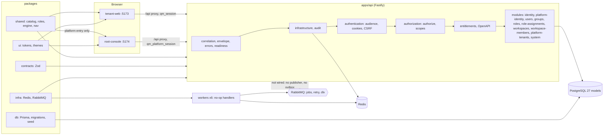

# Status report: Phases 1-4

Date: 2026-11-11. *Point-in-time report; later decisions are ADR-007 (Express 5) and ADR-008 (security suite). Correction made after the contract snapshot: the system routes live under `/api/v1/system/`, not `/api/v1/`.* Read-only audit of the repository at `/home/narendra/qmentisai-sec` (not a git repository). Nothing in code, schema, config or other docs was changed by this audit; the only file written is this one. Verification used throwaway infrastructure outside the repo (PostgreSQL 18 on port 55432, API, two Vite servers, headless Chrome, scratch scripts in the session scratchpad), all stopped and deleted afterwards. The forced `turbo build` left git-ignored `dist/` folders in the two frontends.

Sources read: `CLAUDE.md`, `AGENTS.md`, `docs/technical/IMPLEMENTATION_PLAN.md`, `docs/AUTHORIZATION.md`, `docs/modules/*`, `docs/decisions/OPEN_DECISIONS.md`, and the whole repository.

**Two things to know first**
1. `docs/TENANT_APP_WIREFRAME_SPEC.md` and `docs/ROOT_CONSOLE_WIREFRAME_SPEC.md` do not exist in this repository, although you and several docs refer to them. Screen IDs T-06, T-07, T-08, T-40, T-44, R-04, R-05, R-06 were therefore **interpreted** from `docs/design/TENANT_APPLICATION_DESIGN.md`, `ROOT_CONSOLE_DESIGN.md` and `FRONTEND_ARCHITECTURE.md` (mapping in `docs/modules/access-management/SCREENS.md`). T-00a, T-00b, T-01 and T-05 were interpreted the same way in the earlier tenant foundation work.
2. The repository has no version control. There is no history, no review trail and no recovery point.

---

## 1. PHASE COMPLETION (docs/technical/IMPLEMENTATION_PLAN.md, phases 1-4)

Legend: Done / Partial / Missing / Deviates.

### Phase 1: Repository foundation

| Item | Status | Evidence | Notes |
|---|---|---|---|
| Create pnpm monorepo | Done | `pnpm-workspace.yaml`, `package.json` (pnpm 12.11.2), `apps/*`, `packages/*`, `pnpm-lock.yaml` | Layout is the one you chose (`apps/{api,workers,tenant-web,root-console}`, `packages/{shared,contracts,db,infra,ui,config}`). It **deviates from the docs**: ADR-006 and `AGENT_INSTRUCTIONS.md` still say `apps/backend`. `CLAUDE.md` notes this and says the docs "still need a doc update"; that update was never done. |
| Configure Turborepo | Done | `turbo.json` | Tasks `dev`, `build`, `lint`. Only the two frontends define `build`; API, workers and packages run as plain JavaScript. |
| JavaScript ES Module conventions | Done | every manifest has `"type": "module"` | 0 `.ts`/`.tsx`/`tsconfig`, 0 `.cjs`, 0 `require()` / `module.exports`. |
| ESLint and Prettier | Done | `packages/config/eslint/{base,react}.js`, `packages/config/prettier.js`, per-package `eslint.config.js` | `turbo run lint --force`: 10/10 pass. `prettier --check .`: pass. |
| Shared package skeletons | Done (exceeded) | `packages/{shared,contracts,db,infra,ui,config}` | No longer skeletons; each holds real code. |
| Project documentation | Partial | `CLAUDE.md`, `AGENTS.md`, `README.md`, a README per app/package, `docs/` | Docs drift: see section 2 (stale prototype notes, `CLAUDE.md` index, seed header comment, missing wireframe specs). |

### Phase 2: Backend foundation

| Item | Status | Evidence | Notes |
|---|---|---|---|
| Fastify application bootstrap | Done | `apps/api/src/app.js`, `server.js`, `plugins/*` | Per-call `buildApp`, no global mutable state. |
| Configuration validation | Done | `apps/api/src/config/index.js` | Zod; fails fast; names variables, never values. Cross-field production rules. |
| Centralized logging and error handling | Done | `lib/logging.js`, `plugins/{correlation,envelope,error-handler}.js`, `errors/app-error.js` | Pino with redaction, correlation id, stable error codes, no stack/SQL leaks. |
| Prisma and PostgreSQL connection | Done | `packages/db` (`prisma/schema/*.prisma`, `src/client.js`, `repository.js`, `transaction.js`) | 27 models, 4 migrations; applied and seeded on a throwaway PG 18 in this audit. **Your own database was never migrated** (no `packages/db/.env`). |
| Redis abstraction | Done | `packages/infra/src/redis/{client,cache,lock,rate-limit}.js`, key builders in `packages/shared/src/keys.js` | Live-verified against local Redis (`/ready` reports redis up). The API only uses it for login throttling; cache and locks have no consumers yet. |
| RabbitMQ abstraction | **Partial** | `packages/infra/src/rabbitmq/{connection,publisher,consumer,retry,topology,idempotency}.js` | Code complete (envelope validation, retry tiers, DLQ, idempotency). **Never verified against a live broker**: RabbitMQ is not installed here (`check:connections` FAIL ECONNREFUSED :5672). Nothing in the API publishes a message. |
| API versioning and OpenAPI | Done | `/api/v1` prefix, `plugins/openapi.js`, `lib/openapi.js` | OpenAPI 3.0.3 generated from Zod: 43 paths, 61 operations, two cookie security schemes, standard error responses. Disabled by default in production. |
| Shared event and validation contracts | **Partial** | `packages/contracts/src/{envelope,errors,job-envelope,queues}.js` | Job envelope, API envelopes and 15 error codes exist. The domain-event envelope in `EVENT_CONTRACTS.md` (`occurredAt`, `actor`) is **not reconciled** with the job envelope (acknowledged in a code comment). No per-event payload schemas; modules only declare event-name constants (`modules/*/events/index.js`) that nothing publishes. No transactional outbox. |

### Phase 3: Identity and tenant foundations

| Item | Status | Evidence | Notes |
|---|---|---|---|
| Authentication and sessions | **Partial / Deviates** | `apps/api/src/auth/*`, `plugins/authentication.js`, modules `identity`, `platform-identity` | **Mock provider only**: seeded users sign in with one shared password from env (`MOCK_AUTH_PASSWORD`); no credential store, password hashing, reset or SSO. Mock auth is refused in production, so production cannot sign in at all. Sessions are sound: random 256-bit token in an HttpOnly cookie, only the SHA-256 hash stored, idle (1 h) and absolute (8 h) expiry, rotation on login. Platform sign-in has mandatory MFA (mock code `MOCK_PLATFORM_MFA_CODE`), enforced server-side. No tenant MFA. No expired-session cleanup job. |
| Tenant context | Done | `auth/context.js`, `plugins/authentication.js` | Tenant only from `session.activeTenantId`; suspended/deactivated tenants refused (`TENANT_SUSPENDED`); active membership required. Verified (section 4). |
| Users and groups | Done | `modules/users`, `modules/groups` | Tenant view of users = memberships (invite, suspend, reactivate, remove, explain permissions). Flat groups with members. Global user profile editing, SCIM and invitation e-mail delivery do not exist. |
| Roles and permissions | Done | `packages/shared/src/{permissions,roles}.js`, `modules/{roles,role-assignments}` | 81-key catalog, 7 built-in roles, custom roles CRUD, tenant and workspace assignments with expiry, escalation guard. No API for platform roles/users (`platform.user.*` keys unused). |
| Workspace membership | Done | `modules/workspaces`, `modules/workspace-members` | Roster + role assignments; last-workspace-administrator invariant. |
| Authorization policies | **Partial** | `packages/shared/src/authorization.js`, `plugins/authorization.js`, `authz/*` | Central engine, `authorize(key, scope)` with the 404/403 rule, SOD-3 (no self-escalation), last-tenant-admin and last-workspace-admin invariants. **SOD-1 and SOD-2 (reviewer is not approver) are not implemented** (no findings/approvals exist yet). No permission cache (resolved per request). No `directory.search` endpoint. |
| Audit logging | **Partial** | `apps/api/src/audit/*`, migration `20261111190000_*` | Strict transactional writes; PostgreSQL triggers reject UPDATE/DELETE/TRUNCATE. Covers sign-in/out, MFA, roles, assignments, users, groups, workspaces, tenant lifecycle. **No read API or UI** for either audit log; failed tenant sign-ins are not audited; export actions are defined but unused; no retention policy. |
| Subscription and entitlement checks | **Partial** | `apps/api/src/entitlements/*`, `plugins/entitlements.js`, model `TenantQuotaUsage` | `checkEntitlement`, `assertEntitlement`, `assertWithinLimit`, `consumeQuota`, `releaseQuota` (atomic SQL). Used by workspace create/restore and user invitation. **No seeded entitlements/plans**, and the keys `workspaces.max` / `users.max` are not in any catalog, so by the "ungoverned = allowed" default **nothing is limited out of the box**. No platform API/UI to manage plans, entitlements or quotas; `usage_events`/`usage_ledger`/`usage_aggregates` from `DATABASE_DESIGN.md` do not exist. |

### Phase 4: Frontend foundations

| Item | Status | Evidence | Notes |
|---|---|---|---|
| Tenant React/Vite application | Done (foundation) | `apps/tenant-web/src` | Vite 7, React 19. |
| Root Console React/Vite application | Done (foundation) | `apps/root-console/src` | Separate app, port 5174, own sessions and permission model. |
| Tailwind CSS and shadcn/ui | Done / Deviates | `components/ui/*`, `components.json` | Tailwind v4 CSS-first. shadcn/ui components are **hand-written in its new-york style**; the CLI was never run. TanStack Table and Recharts (approved stack) are not installed. |
| Shared design tokens | Done / Deviates | `packages/ui/src/{tokens,preset,root-theme}.css` | The violet Root theme **replaces** the original rule in `DESIGN_SYSTEM.md` §7; the decision is recorded there but the violet values were derived by me. |
| Routing, layouts and navigation | Done | `app/router.jsx`, `app/routes.jsx`, `components/layout/*`, `packages/shared/src/{navigation,platform-navigation}.js` | Nav defined once in `@qmentisai/shared`, evaluated by the engine. Two layouts in the tenant app. |
| Authentication integration | Done | `features/auth/*` in both apps | Login, `/me` bootstrap, guards, tenant chooser, MFA screen, blocked-tenant page. Mock auth underneath. |
| API client and permission-aware UI | Done | `lib/api/*`, `PermissionGate`, `DisabledWithReason`, `RequirePermission`, `PlatformPermissionGate` | Gaps: API client, UI primitives and state components are **duplicated** across the two apps; single JS chunk of ~676 kB (tenant) and ~630 kB (root); no tests. |

Screens built, mapped to IDs (interpreted, see the note above):

| ID | Screen | App | State |
|---|---|---|---|
| T-01 | Sign in | tenant-web | Done |
| T-00a / T-00b | Organization shell / Workspace shell | tenant-web | Done |
| T-05 | 403 / 404 / error states | tenant-web | Done |
| T-06 | Organization overview | tenant-web | Done (no security tiles: no findings module) |
| T-07 | Workspaces list | tenant-web | Done (no repository/pipeline/findings columns) |
| T-08 | Create workspace | tenant-web | Partial: Details, Members & access, Review; the Policies step is missing (no policy API) |
| T-40 | Members & groups | tenant-web | Done |
| T-44 | Workspace settings | tenant-web | Done |
| (none) | Platform sign-in + MFA | root-console | Done |
| R-04 | Tenants list | root-console | Done |
| R-05 | Provision tenant | root-console | Done |
| R-06 | Tenant detail + lifecycle | root-console | Done (no support-access section) |

---

## 2. WHERE WORK STOPPED

**Last completed step.** Screens T-06, T-07, T-08, T-40, T-44 and R-04, R-05, R-06, with the new `platform-tenants` API module, `LinkButton`, dialog/tabs/select/textarea/confirm-dialog primitives, and docs updates. After that, this audit (no code changes).

**Last files changed** (all 2026-11-11 13:13-13:23): `docs/technical/TECH_STACK.md`, `docs/modules/access-management/SCREENS.md`, `docs/development/PROGRESS_TRACKER.md`, `docs/AUTHORIZATION.md`, `apps/{api,tenant-web,root-console}/README.md`, `apps/tenant-web/src/features/workspaces/{pages/create-workspace-page.jsx,components/add-access-dialog.jsx,pages/workspaces-page.jsx}`, `apps/tenant-web/src/features/organization/pages/overview-page.jsx`, `apps/{tenant-web,root-console}/src/components/common/link-button.jsx`, `apps/root-console/src/features/tenants/**`, `apps/{tenant-web,root-console}/src/app/providers.jsx`.

**Started but unfinished / stubs** (none breaks lint or build):
- "Coming soon" placeholder pages, reachable only with the permission. Tenant: Users & groups, Groups, Integrations, Roles & permissions (org and workspace), Organization settings, Audit logs, Repositories, Pipelines, Policies, Activity. Root: Monitoring, Subscriptions, Licenses, Entitlements, Usage & quotas, Platform users, Integration catalog, Global configuration, Support, Platform audit logs. The Root dashboard is a shell.
- All six workers run `createNoopHandler` (`apps/workers/src/handlers/noop.js`): validated job in, log line out.
- `modules/*/events/index.js` constants are never published; `modules/identity/listeners/index.js` is an empty `registerIdentityListeners`.
- Create-workspace has no Policies step; support-access banner exists as a component only (no grants on the server).
- Stale text: `packages/db/prisma/seed.js` header says nobody can sign in and authentication is unspecified (it is now mock-authenticated); `docs/architecture/AUTHORIZATION.md` is the deleted prototype's description and conflicts with the real spec `docs/AUTHORIZATION.md`; `CLAUDE.md` still says the repo "holds the Phase 1 skeleton plus docs" and its docs index omits `docs/AUTHORIZATION.md` and `docs/modules/access-management/*`; `docs/development/PROGRESS_TRACKER.md` still carries prototype-era history lines.
- Failing lint/build: none (section 4).
- Verification scripts (isolation matrix, per-role nav, browser flows) live only in the session scratchpad, not in the repo, so they cannot be re-run by anyone else.

**Decisions applied as "Recommended default" that you have not explicitly confirmed.**
Confirmed by you: AUTHORIZATION decisions 1-6 (global users + memberships, expiry on assignments, grant-only, flat groups, Admin lacks approve/reject), the repo layout, "no credentials in seed", "no Docker/CI/test-case structures", and your instruction to build the Root violet theme.

Everything below is my default; each is revisitable:
- `docs/AUTHORIZATION.md` §15, Q1-Q23 (all rows marked "Recommended — default applied"), notably Q10 no SoD break-glass, Q13 403 bodies never name permissions, Q17 per-request resolution (no cache), Q18 audit kept indefinitely, Q22 every workspace keeps an administrator.
- "Tenant administrator" = holds both `role.manage` and `role_assignment.manage_tenant`; exempt from the escalation check except for self-grants.
- Invitations require the invitee's acceptance (also applies to a tenant's first administrator); a new invited user is created in the global `users` table immediately.
- Entitlement semantics: a key absent from the catalog is allowed; a catalogued key without a grant is denied; an unconfigured quota is refused. Keys `workspaces.max`, `users.max`; archived workspaces do not count toward the limit.
- `ROLE_ESCALATION` returns only a count of missing keys; assignment creation has no `Idempotency-Key` (duplicates return 409).
- Platform MFA is mandatory with a shared mock code; 5 wrong codes per user per 15 minutes then 429 (even for the right code).
- Platform nav permission mapping (dashboard to `platform.tenant.view`, Subscription to `platform.subscription.view`, Usage to `platform.usage.view`, Support to `platform.support.request_access`).
- Root violet values (`#6d28d9` / `#a78bfa`, sidebar `#0b0d10`).
- Tenant lifecycle: deactivated is terminal; reactivation returns to trial when a trial subscription exists else active; reason of 5-500 characters; server-checked typed tenant name for suspend/deactivate; provisioning default status trial.
- Workspace creator's chosen owner becomes workspace Admin automatically; removing a roster member also deletes their workspace-scope assignments; adding a group member is escalation-checked; no hard delete of workspaces.
- Users DTO hides names of invited (not yet accepted) members; the audit triggers mean users with audit rows cannot be hard-deleted.
- Session TTL 8 h / idle 1 h; login throttle 10 per account and 50 per IP per 15 min; cookie names/paths; `networkMode: "always"` in both frontends; `lucide-react` pinned to 1.65.0 instead of the newest release.
- Screen-ID interpretation (above).

---

## 3. CURRENT ARCHITECTURE (as built)

### 3.1 Monorepo (depth 3)

```
.                              pnpm 12 + Turborepo monorepo; Node >=22.12 (.nvmrc "22"); no git
├── CLAUDE.md, AGENTS.md       standing agent instructions
├── docs/                      source of truth (architecture, design, ADRs, AUTHORIZATION, modules/access-management)
├── apps/
│   ├── api/                   Fastify modular monolith (src/{app,server,config,auth,authz,audit,entitlements,plugins,lib,errors,modules})
│   ├── workers/               6 queue consumers (pipeline, analysis, scan, notification, usage, scheduler) + shared runtime
│   ├── tenant-web/            Tenant Application (React + Vite + Tailwind v4), port 5173
│   └── root-console/          Root Console (platform admin), port 5174
└── packages/
    ├── shared/                permission catalog (81), role bundles, authorization engine, tenant + platform navigation, key builders
    ├── contracts/             Zod: error codes, API envelopes, job envelope, queue names
    ├── db/                    Prisma schema (27 models), 4 migrations, seed, client + tenant-scoped repository helpers
    ├── infra/                 server-only Redis (cache, lock, rate limit) and RabbitMQ (publisher, consumer, retry, DLQ) abstractions
    ├── ui/                    design tokens (tokens.css), Tailwind v4 preset, Root theme
    └── config/                shared ESLint flat configs and Prettier config
```

~14,000 lines of JavaScript/CSS/Prisma outside `node_modules` (api 7.6k, tenant-web 5.0k, root-console 3.5k, db 2.0k, infra 1.0k, shared 0.9k, workers 0.3k).

### 3.2 Backend

**Plugin order** (`apps/api/src/app.js`): correlation, envelope (`reply.success/paginated`), error handler, readiness, infrastructure (db, redis, rate limiter, publisher), audit, authentication (cookie, CORS + Origin/CSRF check, audience hook, `app.auth`), authorization (`app.authz.authorize`, `context`, scopes), entitlements, OpenAPI, modules. Every route must declare `config.audience` (`public | user | tenant | platform`); the server refuses to start otherwise.

**Registered modules (9):** `system`, `identity`, `platform-identity`, `users`, `groups`, `roles`, `role-assignments`, `workspaces`, `workspace-members`, `platform-tenants` (listed in `modules/index.js`; full folder convention per module, listeners empty).

**Routes** (61 operations: 10 public, 43 tenant session, 8 platform session). "Key" = permission required; "ws" = checked inside the workspace from the URL.

| Method and path | Audience | Required permission |
|---|---|---|
| GET `/health`, `/ready` (unversioned); GET `/api/v1/system/info`, `/api/v1/system/modules`, `/api/v1/system/modules/:name` | public | none |
| POST `/api/v1/auth/login`, `/auth/logout` | public | none (login throttled) |
| GET `/me`, `/me/permissions`, `/me/invitations`, `/me/tenants` | user | session only |
| POST `/me/invitations/:tenantId/accept`; PUT `/me/active-tenant` | user | session only (active membership / pending invitation) |
| GET `/users`, `/users/:id`, `/users/:id/effective-permissions` | tenant | `user.view` |
| POST `/users`; PATCH, DELETE `/users/:id` | tenant | `user.manage` |
| GET `/groups`, `/groups/:id`, `/groups/:id/members` | tenant | `group.view` |
| POST `/groups`; PATCH, DELETE `/groups/:id`; PUT, DELETE `/groups/:id/members/:userId` | tenant | `group.manage` |
| GET `/permissions`, `/roles`, `/roles/:id` | tenant | `role.view` |
| POST `/roles`; PATCH, DELETE `/roles/:id` | tenant | `role.manage` (+ escalation guard) |
| GET `/role-assignments` | tenant | `role.view` |
| POST `/role-assignments`; PATCH, DELETE `/role-assignments/:id` | tenant | `role_assignment.manage_tenant` (+ escalation guard) |
| GET `/workspaces` | tenant | none; returns only visible workspaces |
| POST `/workspaces` | tenant | `workspace.create` (+ `workspaces.max` entitlement) |
| GET `/workspaces/:id` | tenant | `workspace.view` (ws) |
| PATCH `/workspaces/:id` | tenant | `workspace.update` (ws) |
| POST `/workspaces/:id/archive`, `/restore` | tenant | `workspace.archive` (ws) |
| GET `/workspaces/:id/members` | tenant | `workspace.view` (ws) |
| PUT, DELETE `/workspaces/:id/members/:userId` | tenant | `workspace.manage_members` (ws) |
| GET `/workspaces/:id/role-assignments` | tenant | `workspace.view_roles` (ws) |
| POST `/workspaces/:id/role-assignments`; PATCH, DELETE `…/:assignmentId` | tenant | `workspace.manage_members` (ws, + escalation guard) |
| POST `/api/v1/platform/auth/login`, `/auth/mfa/verify`, `/auth/logout` | public | none (login and MFA throttled) |
| GET `/platform/me` | platform | platform session with verified MFA |
| GET `/platform/tenants`, `/platform/tenants/:id` | platform | `platform.tenant.view` |
| POST `/platform/tenants` | platform | `platform.tenant.create` |
| POST `/platform/tenants/:id/suspend`, `/reactivate`, `/deactivate` | platform | `platform.tenant.suspend`, `.reactivate`, `.deactivate` |
| GET `/platform/plans` | platform | `platform.plan.view` |

### 3.3 Database

27 models in `packages/db/prisma/schema/*.prisma` (28 tables incl. `_prisma_migrations`), PostgreSQL 18 verified. UUID ids, `timestamptz`, snake_case via `@map`, composite tenant foreign keys on `(tenantId, id)`.

| Domain | Models (tenantId?) and key unique constraints |
|---|---|
| Identity | `User` (global, no tenantId; unique email, lowercase CHECK), `TenantMembership` (yes; unique tenantId+userId), `Group` (yes; unique tenantId+name), `GroupMember` (yes; unique groupId+userId), `Permission` (no; key PK), `Role` (nullable for built-in; unique ownerKey+key, ownerKey+name; ownership CHECK), `RolePermission` (nullable), `UserRoleAssignment`, `GroupRoleAssignment` (yes; unique tenantId+subject+roleId+scopeKey; scope CHECK; `expiresAt`), `Session` (no tenantId; `activeTenantId` nullable; unique tokenHash), `AuditLog` (yes; immutable by trigger) |
| Organization | `Workspace` (yes; unique tenantId+name, tenantId+id), `WorkspaceMember` (yes; unique workspaceId+userId) |
| Platform / commercial | `Tenant` (unique slug), `SubscriptionPlan`, `PlanVersion`, `EntitlementCatalog`, `PlanEntitlement`, `QuotaDefinition` (none have tenantId); `TenantSubscription`, `TenantEntitlement`, `TenantQuota`, `TenantQuotaUsage` (yes; usage unique tenantId+quota+period, CHECK used >= 0) |
| Platform identity | `PlatformRole`, `PlatformUser` (unique email), `PlatformSession`, `PlatformAuditLog` (immutable by trigger; tenantId nullable) |

**Migrations (4):** `20261111000000_init_placeholder`, `20261111120000_platform_identity_foundation` (schema + hand-written CHECKs), `20261111180000_sessions_auth_method_platform_sessions`, `20261111190000_quota_usage_and_audit_immutability` (quota usage table + immutability triggers). Applied to a throwaway PG 18 in this audit; **not applied to your database**.

**Seed** (`packages/db/prisma/seed.js`, idempotent): 81 permissions, 7 built-in roles (159 role-permission rows), 2 platform roles, 1 platform super admin (`superadmin@qmentis.example`), 1 tenant "Demo Tenant" (`demo`), 2 workspaces ("Payments Platform", "Identity & Access"), 7 users `demo.{admin,manager,lead,analyst,devlead,developer,viewer}@demo.example` (one per built-in role), 2 groups ("Security Team" with the analyst and a group assignment of Security Analyst in Identity & Access; a second group with no assignment), 10 user assignments, 1 group assignment. No credentials stored (0 password hashes). No plans, entitlements, quotas or Support platform user.

### 3.4 Authorization

- **Catalog:** 81 keys: 16 tenant, 37 workspace, 28 platform (`packages/shared/src/permissions.js`, platform keys in `platform-permissions.js`).
- **Built-in tenant roles (bundle size):** Admin 51 (no `approval.approve`/`approval.reject`), Manager 32, Lead 24, Security Analyst 13, Dev Lead 20, Developer 11, Viewer 8. **Platform roles:** Super Admin 28, Support 12 (view-only plus support-access keys).
- **Resolver** (`resolveEffectivePermissions`, pure): preconditions (active user, usable tenant, active membership) else empty; collect user + flat-group assignments of this tenant that are active and unexpired; tenant-scope assignment grants tenant keys plus workspace keys in every workspace; workspace-scope assignment grants workspace keys only there; platform/unknown keys ignored; a workspace is visible only with `workspace.view`. Output `{ tenant, allWorkspaces, workspaces[] }`. `can()` throws on unknown keys or scope mismatch. Resolved per request (no cache).
- **Enforcement:** `authorize(key, scopeResolver)` loads the resource with the session's tenant, then: not found or not visible, 404 (identical body); visible but not permitted, 403 (no permission names in bodies). Key/scope mismatch fails at startup.
- **Invariants:** last tenant administrator (409 `LAST_TENANT_ADMIN`, advisory-locked, rolled back), last workspace administrator (409), built-in roles immutable, role in use cannot be deleted (409), nobody changes their own access through the user API.
- **Segregation of duties:** SOD-3 (no self-escalation) implemented in role create/edit, assignments and group membership. **SOD-1/SOD-2 not implemented** (no findings or approvals exist).
- **Platform vs tenant:** separate cookies (`qm_session` path `/api/v1`, `qm_platform_session` path `/api/v1/platform`), tables, audiences and resolvers; tenant principal on platform routes gets 404, platform principal on tenant routes gets 401; platform sessions require verified MFA; frontends import disjoint navigation (ESLint blocks the Root Console from the shared package root).

### 3.5 Messaging, cache and workers

- **RabbitMQ topology per queue `<q>`:** exchanges `qmentis.jobs`, `qmentis.retry`, `qmentis.dlx` (all direct, durable); queues `qmentis.<q>`, `qmentis.<q>.retry.1..4` (TTL = backoff ceiling, dead-letter back to jobs), `qmentis.<q>.dlq`. Queues: `pipeline`, `analysis`, `scan`, `notification`, `usage`, `scheduler`.
- **Envelope** (`jobEnvelopeSchema`): `messageId, eventType, schemaVersion, tenantId?, workspaceId?, repositoryId?, pipelineId?, executionId?, taskId?, correlationId, createdAt, initiator{type,id}, idempotencyKey?, payload`; validated at producer and consumer; tenant-less messages go to the DLQ unless platform-level.
- **Retry:** transient vs non-retryable classification (unknown = non-retryable), default 5 attempts, base 1 s, max 60 s, equal jitter, bounded; DLQ keeps terminal failures; idempotency via a Redis store (done-TTL 86400 s).
- **Redis keys:** tenant data `qmentis:t:<tenantId>:{cache|lock|rl|idem}:…`; platform-only `qmentis:p:<namespace>:…` (login throttle `qmentis:p:rl:<bucket>:<hash>`); rooms `t:<tenantId>[:w:<workspaceId>]`.
- **Workers:** six entry points (`apps/workers/src/<name>/main.js`), each connecting to Redis and RabbitMQ, consuming its queue with `createNoopHandler`, graceful shutdown on SIGINT/SIGTERM. They do nothing else. **Nothing in the API publishes**; no outbox.

### 3.6 Frontends

**Tenant app** (`apps/tenant-web`), routes: `/login`, `/select-tenant`, `/` (landing redirect), `/overview`, `/workspaces`, `/workspaces/new`, `/users`, `/groups`, `/integrations`, `/roles`, `/settings`, `/audit-logs`, `/repositories` (legacy redirect), `/workspaces/:id` (to `/dashboard`), `/workspaces/:id/{edit→settings,dashboard,repositories,pipelines,policies,members,roles,activity,settings}`, `*` (404).
**Nav `implemented: true`:** Organization: overview, workspaces, users, integrations, roles, settings, audit-logs. Workspace: dashboard, repositories, pipelines, policies, members, workspace-roles, activity, workspace-settings. **Hidden (`implemented: false`):** executions, findings, security-reviews, approvals, remediation, reports, workspace-integrations.
**Root Console** (`apps/root-console`), routes: `/login`, `/mfa`, `/dashboard`, `/monitoring`, `/tenants`, `/tenants/new`, `/tenants/:tenantId`, `/subscriptions`, `/licenses`, `/entitlements`, `/usage`, `/platform-users`, `/integration-catalog`, `/config`, `/support`, `/audit-logs`, `/dev/components` (dev builds only). All 12 `PLATFORM_NAV_GROUPS` items are `implemented: true` (10 are placeholders).
**Permission-aware UI:** `RequirePermission` / `RequirePlatformPermission` on every route; `PermissionGate` on New workspace (overview, list); `DisabledWithReason` on Add access, Remove, Revoke, Save, Archive/Restore (tenant) and lifecycle buttons (Root); `PlatformPermissionGate` on Provision tenant. **Tokens:** `packages/ui/src/tokens.css`, `preset.css` (Tailwind v4 theme), `root-theme.css` (violet, `html[data-app="root"]`).

### 3.7 Diagram



---

## 4. VERIFICATION (run, not fixed)

### 4.1 Build and start

| Check | Result |
|---|---|
| `pnpm install --frozen-lockfile` | **PASS** (lockfile current, supply-chain policy verified) |
| `turbo run lint --force` | **PASS** 10/10 |
| `turbo run build --force` | **PASS** 2/2 (only the two frontends define `build`); warnings: single JS chunks of 676 kB (tenant) and 630 kB (root) above 500 kB |
| `prettier --check .` | **PASS** |
| API start (PG 18 throwaway + local Redis) | **PASS**: `/health` 200, `/ready` reports database up and redis up |
| `check:connections` | postgresql **PASS**, redis **PASS**, rabbitmq **FAIL** (ECONNREFUSED 127.0.0.1:5672; not installed) |
| tenant-web / root-console dev servers | **PASS**: both 200; `/api` proxy reaches the API (401 as expected) |
| Workers (6) | **FAIL as expected without a broker**: each exits **1** after bounded connect retries with a fatal ECONNREFUSED log and a clean "Shutting down / Stopped"; missing config exits 1 with a clear message. Consumption itself was **not** verified live. |
| Earlier-written browser suite (`verify-web`) | 46 assertions pass; 1 **stale** assertion fails: it looks for a button labelled "Add member", renamed to "Add access" in the T-40 rework. Not a product regression (the script aborted at that point, after the nav matrix completed). |

### 4.2 Tenant navigation per seeded role (real browser, logged in through the UI)

| Role | Organization layout | Workspace layout (every visible workspace) |
|---|---|---|
| Admin | Main: Organization overview, Workspaces. Administration: Users & groups, Integrations, Roles & permissions, Organization settings, Audit logs | Workspace: Dashboard, Repositories, Pipelines. Security: Policies. Workspace administration: Members & groups, Roles & permissions, Activity, Settings (both workspaces) |
| Manager | Main: Workspaces | same as Admin, only in Payments Platform |
| Lead | Main: Workspaces | Dashboard, Repositories, Pipelines; Policies; Members & groups, Activity (Payments Platform only) |
| Security Analyst | Main: Workspaces | as Lead, both workspaces |
| Dev Lead | Main: Workspaces | as Lead, both workspaces |
| Developer | Main: Workspaces | Dashboard, Repositories, Pipelines; Policies; Members & groups (both) |
| Viewer | Main: Workspaces | as Developer (both) |

Only Admin lands on the overview; everyone else lands on Workspaces. No role ever sees Executions, Findings, Security reviews, Approvals, Remediation or Reports.

### 4.3 Tenant isolation (68 checks, expected vs actual)

All 68 matched. Highlights (status codes are expected = actual):

| Scenario | Expected | Actual |
|---|---|---|
| Tenant A admin on tenant B's workspace (GET, PATCH, archive, members, role-assignments, delete assignment) | 404 | 404 |
| Tenant A admin on tenant B's user (GET, PATCH suspend, DELETE, effective-permissions) | 404 | 404 |
| Tenant A admin on tenant B's group (GET, PATCH, DELETE, members) and custom role (GET, PATCH, DELETE, clone) | 404 | 404 |
| Tenant A assigning a role to B's user/group, using B's role, adding B's user to A's group/workspace | 404 | 404 |
| Switching the active tenant to B (no membership); accepting a non-existent invitation | 404 | 404 |
| Setting a workspace owner who belongs to tenant B | 400 | 400 |
| Lists never contain B's rows; `x-tenant-id: B` header ignored; `?tenantId=B` rejected; `tenantId` in body rejected | clean / 400 / 400 | clean / 400 / 400 |
| Tenant B admin on tenant A's workspace, user, group, assignment | 404 | 404 |
| Manager (sees only Payments) on the hidden Identity workspace: GET, PATCH, archive, members, assign | 404 | 404 |
| Hidden workspace vs non-existent workspace | identical body | identical body |
| Visible workspace, missing permission: developer PATCH, viewer PUT member, viewer POST workspace, viewer GET users, lead PUT member | 403 | 403 |
| Assignment of workspace X used under workspace Y; workspace assignment id on the tenant route | 404 | 404 |
| Admin granting themselves a role with keys they lack | 403 `ROLE_ESCALATION` | 403 `ROLE_ESCALATION` |
| Platform route with a **tenant** session (GET me, GET tenants, POST tenants) | 404 | 404 |
| Tenant route with a **platform** session (GET me, workspaces, users); platform cookie value under the tenant cookie name | 401 | 401 |
| No session on tenant and platform routes | 401 | 401 |
| Platform session before MFA is verified | 401 with `mfa_required`, no data | 401 with `mfa_required`, no data (re-confirmed; my first run reported a false mismatch caused by the script rotating the pre-MFA session) |
| Tenant user signing in to platform and the reverse | 401 | 401 |
| Cross-site Origin on an unsafe request | 403 | 403 |
| Suspended tenant: existing session and API calls | 403 `TENANT_SUSPENDED` | 403 `TENANT_SUSPENDED`; tenant A unaffected (200) |

---

## 5. GAPS AND RISKS

**Compliance with `CLAUDE.md` constraints**

| Constraint | Result |
|---|---|
| No TypeScript | Compliant (0 files) |
| No CommonJS | Compliant (0 `.cjs`, 0 `require`/`module.exports`) |
| No role-name checks | Compliant for authorization and navigation. Two data lookups use the built-in role key `"admin"` to grant initial ownership (`modules/workspaces/services/index.js:84`, `modules/platform-tenants/services/index.js:138`); not an access decision, but it couples to a role key |
| Pinned versions | Compliant: all 11 manifests use `catalog:`, `workspace:*` or exact versions; catalog entries exact; lockfile committed |
| Queries always scoped by tenant | Compliant. A heuristic scan found 8 call sites without `tenantId` nearby; all are scoped through a `where` built earlier, or intentionally global: a user's own memberships by `userId` (`identity` repository), and the Root Console's metadata-and-counts access (`platform-tenants`) |
| No Docker/Compose/deployment/CI, no test-case structures | Compliant (none found: no Dockerfile, compose, CI, `*.test.*`, test config or `test` scripts) |

**High**
1. **No version control.** No history, review or rollback for ~14k lines and 4 migrations.
2. **Authentication is mock only.** One shared password, no credential store, hashing, reset or SSO; mock auth is refused in production, so nothing can be used outside development. SSO providers remain an Open decision.
3. **Messaging is unproven and unused.** RabbitMQ was never verified live, workers are no-ops, the API publishes nothing, there is no outbox, and the two envelopes (job vs domain event) are unreconciled. Phase 5 depends on all of it.
4. **No automated regression protection for security-critical behavior.** Tenant isolation, authorization and MFA were verified by scratch scripts that live outside the repo. Your constraint rules out "test-case structures", so this is a conscious tension that needs a decision.
5. **No module specs per the CLAUDE.md workflow for several modules.** Identity/sessions, platform identity + MFA, and platform tenants were built from the authorization spec and then documented in notes (`AUTHORIZATION.md` §16, `SCREENS.md`) rather than from `MODULE_SPECIFICATION_TEMPLATE.md` first; `docs/modules/access-management/SPEC.md` was written after implementation.

**Medium**
6. Wireframe specs referenced by you and the docs do not exist; screen IDs are interpreted.
7. No `Idempotency-Key` support (required by API standards for side-effecting operations); duplicates rely on unique constraints.
8. No global rate limit, no security headers (no helmet), no `trustProxy`: behind a proxy every client may share one IP for the IP-based login limit. The in-memory limiter is per process (only used without Redis).
9. Platform MFA throttle is per user: someone who knows a platform password can lock that user's MFA for the 15-minute window (documented trade-off).
10. Entitlements are effectively off: no catalog entries or plans seeded, `workspaces.max`/`users.max` unconfigured, no platform API or UI to manage plans/entitlements/quotas, no usage tables.
11. Audit gaps: no read API/UI for either log, failed tenant sign-ins not audited, no retention; immutability triggers mean users with audit rows can never be hard-deleted.
12. No directory-lookup endpoint (`directory.search`): a workspace admin without tenant `user.view` cannot pick people to add.
13. Invitations have no delivery channel; the invitee must already know to sign in and accept.
14. Docs drift: stale prototype `docs/architecture/AUTHORIZATION.md`, outdated `CLAUDE.md` index and layout note, ADR-006 / `AGENT_INSTRUCTIONS.md` still say `apps/backend`.
15. Code duplicated across the two frontends (API client, UI primitives, state components); each ships a single ~630-680 kB chunk.
16. Expired and revoked sessions are never purged.
17. Provisioning and workspace creation fail with a generic 500 if the built-in `admin` role row is missing or renamed.

**Low**
18. `package.json` `engines.node >=22.12.0` but `react-router 8.5.1` needs >=22.22; `.nvmrc` is the loose `22`.
19. Seed header comment is stale; `PROGRESS_TRACKER.md` carries prototype-era history.
20. Empty `listeners/` stubs and unpublished event constants.
21. `/info` and `/modules` are public and disclose service and module names.
22. TanStack Table and Recharts not installed; shadcn CLI never run.
23. `lucide-react` pinned to 1.65.0 (newest release was too recent for the release-age safeguard).
24. No i18n; accessibility checked by lint and a handful of assertions only.
25. Shared dev cookies across `localhost` ports (names/paths differ and the Root Console treats a tenant cookie as signed-out).

---

## 6. NEXT STEPS

**Fix before Phase 5 (in order)**
1. **Put the repository under version control** (`git init`, first commit). Your decision; Phase 5 changes should be reviewable.
2. **Install RabbitMQ locally and verify the messaging layer live** (publish, consume, retry tiers, DLQ, idempotency) and the six workers end to end. Phase 5 execution and worker orchestration cannot start on an unproven layer.
3. **Decide how security-critical invariants stay protected**: either approve a small committed verification-script folder (isolation matrix, authorization, MFA; not a test-case framework) or accept the risk explicitly.
4. **Decide credential storage for provider integrations** (encryption approach and key source; object-storage provider is an Open decision). Repository connections store tokens and webhook secrets.
5. **Reconcile the event contracts** (job envelope vs domain-event envelope) and implement the transactional outbox, at least for tenant/workspace/membership events, or defer in writing.
6. **Confirm or change the Recommended defaults** that matter most: capability-based administrator exemption, invitation acceptance, entitlement defaults, deactivated-is-terminal, platform MFA throttle, 403 body content.
7. **Harden the HTTP edge before webhooks exist:** `Idempotency-Key`, global rate limit, security headers, `trustProxy`, raw-body signature verification for webhook routes.
8. **Seed a minimal entitlement catalog and a default plan** (`workspaces.max`, `users.max`) so limits are real, and add the missing platform-side plan/entitlement management API when needed.
9. **Docs hygiene:** update `CLAUDE.md` (index, layout, status), ADR-006 and `AGENT_INSTRUCTIONS.md` layout, archive `docs/architecture/AUTHORIZATION.md`, refresh the seed header and the progress tracker, and either provide the wireframe specs or declare the interpreted mapping authoritative.
10. Smaller: purge expired sessions, align `engines`/`.nvmrc`, add `directory.search`.

**Recommended first Phase 5 module: Repository connections** (module 5 in `docs/modules/README.md`; "Tenant and workspace management" from Phase 5 is already built). Run the spec step first and stop for review:

> Using `docs/technical/MODULE_SPECIFICATION_TEMPLATE.md`, draft `docs/modules/repository-integrations/SPEC.md` for **Repository connections** (GitHub, GitLab, Bitbucket). Inputs: `docs/architecture/INTEGRATION_ARCHITECTURE.md`, `docs/design/TENANT_APPLICATION_DESIGN.md` §3.3, §3b.2, §3b.3, `docs/AUTHORIZATION.md` (existing keys `repository.view|connect|sync|toggle|update|manage_access|disconnect`), `docs/technical/SECURITY_GUIDELINES.md`, `docs/architecture/TENANT_ISOLATION.md`, and `docs/modules/access-management/SPEC.md` (for how this project does audit, entitlements and authorize). Cover: provider adapter interface and per-provider capability matrix (marked "verify before implementing"); credential model and encryption (secrets never returned or logged; present options and a recommendation for key management); connection lifecycle (connect wizard steps, validate, sync, disable, disconnect with typed confirmation); webhook registration, signature verification, replay protection and tenant resolution without trusting the payload; RabbitMQ jobs for sync and validation using the job envelope (queue, idempotency key, retry classification, DLQ behavior); data model additions with `tenantId` and composite parent links (connection, repository, webhook delivery); API endpoints under `/api/v1` with the permission and 404/403 behavior for each; entitlement keys and quota behavior; audit actions; screens and states for the tenant app (list, wizard, details, settings); events (names, versions, outbox); open decisions with options and a recommendation; acceptance criteria. Mark every assumption Recommended or Open and do not promote any. **Spec only, no code. Stop for my review.**
