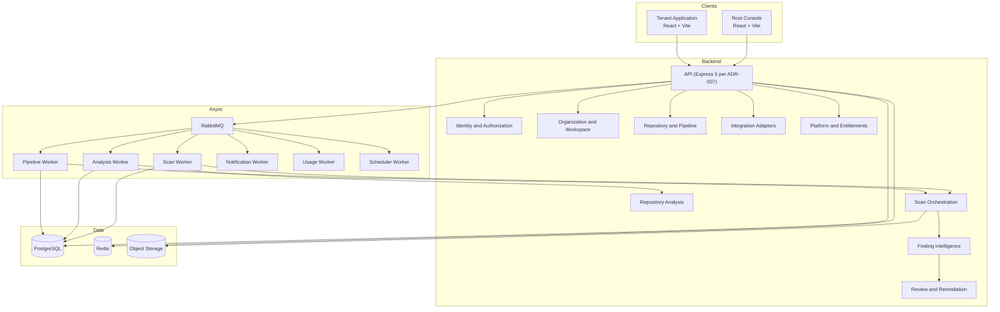

# QmentisAI Overall System Architecture

## 1. Architecture style

Recommended initial architecture:
- Modular monolith for backend business capabilities.
- Separate API and worker entry points.
- Separate Tenant Application and Root Console frontends.
- Shared PostgreSQL database with strict logical boundaries.
- Redis for cache and coordination.
- RabbitMQ for durable asynchronous jobs.
- Provider adapters for integrations and scan engines.

Do not split every domain into a microservice at the start.

## 2. Logical architecture

## 3. Application boundaries

### Root Console
Platform-level administration only. It must not use tenant-facing permissions as a substitute for platform authorization.

### Tenant Application
Tenant users operate within tenant and workspace permissions. Every request must be scoped to the authenticated tenant and authorized resource.

### Backend
One initial application (Express 5 per ADR-007) with domain modules. Platform and tenant modules are logically separated.

### Workers
Independent process entry points consuming durable messages. They reuse domain services and contracts but do not bypass authorization, tenant status or entitlement checks.

## 4. Repository-to-pipeline relationship

One repository may have N pipelines. Each matching event creates a separate execution for each matching pipeline. Immutable repository metadata or diff artifacts may be reused only when repository version and access constraints match. Execution records and finding identities remain pipeline-specific.

## 5. Data ownership

- Platform-owned records: tenant provisioning, plans, subscriptions, platform users and global configuration.
- Tenant-owned records: workspaces, repositories, pipelines, scans, findings, reviews and tenant integrations.
- Shared technical services must preserve ownership context in queries, messages, cache keys, exports and real-time events.

## 6. Architectural constraints

- PostgreSQL is the source of truth for durable business state.
- RabbitMQ is the durable asynchronous transport.
- Redis is not the only store for execution state.
- Socket.IO communicates authorized updates; it is not the source of truth.
- Repository content and external payloads are untrusted input.
- AI analysis must receive bounded context and must not execute repository instructions.
