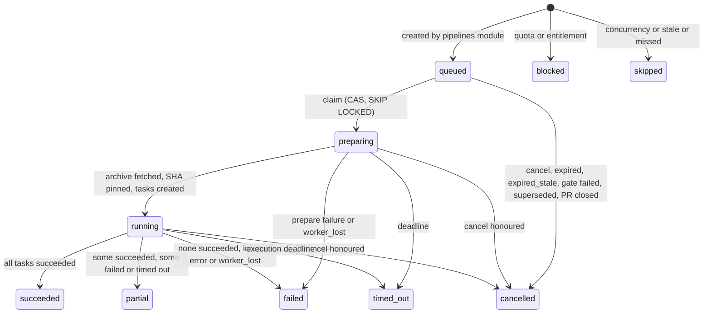
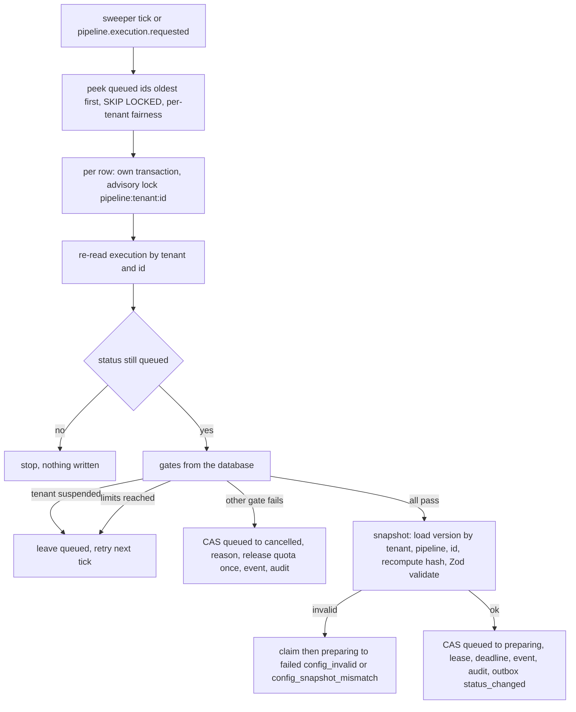
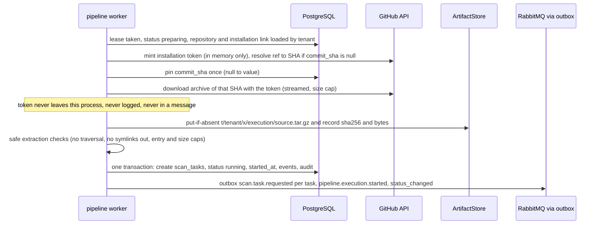

# Executions and scan orchestration — Module Specification

**Status:** **Approved (2026-11-16)** by the owner: "Executions spec approved with all recommended conflict resolutions (1-8 of section 0) and all EQ recommendations (section 15), plus these additions" (worker lease and heartbeat, one-time stale-queue sweep, Socket.IO session authentication, T-30 out of scope and a themed log panel). **Built so far: part A (spike, section 17.x), part B (database layer, section 17.y) and part C (the orchestrator behind a flag, section 17.z), all 2026-11-16.** The implementation plan is the owner's parts A to I in section 16. Every item of the body that is marked "Recommended" because it implements a conflict resolution (CF-n) or an open question (EQ-n) is now **Confirmed (owner, 2026-11-16)**; items marked **Open** that are not an EQ (platform and tenant active-execution limits, hard vs soft quota, object-storage provider, retention purge job, DLQ tooling) remain Open and are not promoted.
**Owner:** Product owner (decisions); Claude Code (specification)
**Last updated:** 2026-11-16 (approval and additions)
**Related ADRs:** ADR-002 (modular monolith, separate workers), ADR-003 (tenant isolation), ADR-004 (finding identity is per pipeline), ADR-007 (Express 5), ADR-008 (security suite), ADR-009 (no secrets in messages, SecretStore), ADR-011 (outbox, one message family, idempotent consumers, ownership re-validation)

**Labels** (`docs/README.md`, `CLAUDE.md`): **Confirmed** = stated in the docs, an accepted ADR, the owner's instruction (the brief of 2026-11-16 is cited as "owner brief") or a fact of the built code (verified, section 17); **Recommended** = my proposal, not a requirement until the owner accepts it; **Open** = needs a decision (section 15). Only Confirmed items are requirements. Where two sources disagree, section 0 records it and the spec stops there instead of choosing silently.

**Sources** (short names): `docs/modules/pipelines-triggers/SPEC.md` (PT), `SCREENS.md` (PTS); `docs/modules/repositories-github/SPEC.md` (SCM); `docs/modules/access-management/SPEC.md` (AM); `docs/AUTHORIZATION.md` (AZ §5.4, §5.9, §5.11, decision log); `docs/TENANT_APP_WIREFRAME_SPEC.md` (WF §1.3, §4, §5, §6 prompts T-27 to T-30); `docs/architecture/WORKER_ARCHITECTURE.md` (WA), `TENANT_ISOLATION.md` (TI), `BACKEND_ARCHITECTURE.md` (BA), `INTEGRATION_ARCHITECTURE.md` (IA), `OVERALL_ARCHITECTURE.md` (OA); `docs/technical/EVENT_CONTRACTS.md` (EC), `API_STANDARDS.md` (AS), `SECURITY_GUIDELINES.md` (SG), `DATABASE_DESIGN.md` (DD), `TECH_STACK.md`; `docs/decisions/` ADR-002, 003, 004, 008, 009, 011 and `OPEN_DECISIONS.md` (OD); `docs/design/DESIGN_SYSTEM.md`, `UX_GUIDELINES.md`; `docs/product/` PROJECT_CONTEXT, PRODUCT_REQUIREMENTS, FEATURE_CATALOG, GLOSSARY.

## Decisions taken from the owner brief (2026-11-16)

All **Confirmed (owner brief)**. Everything not in this table is Recommended or Open.

| Id | Decision |
|---|---|
| B1 | Lifecycle: `queued -> preparing -> running -> succeeded \| failed \| cancelled \| timed_out \| partial`; allowed transitions only; terminal states immutable; every transition persisted and audited; no state is ever inferred from Redis |
| B2 | The pipeline worker claims `queued` executions by compare-and-set (`SKIP LOCKED`), re-validates tenant lifecycle, entitlement, repository status and the configuration-version snapshot before starting, and recovers interrupted executions on restart without duplicating side effects (`processed_messages` plus the execution claim) |
| B3 | Per-execution `scan_tasks` (SCA, SBOM, SAST, Secrets) created from the configuration snapshot; each task idempotent and individually retryable; results ingested into `scan_results`; the execution outcome is aggregated (all pass, any fail, partial when some tasks error but others complete) |
| B4 | The platform fetches the code archive with the installation token **outside** the scan sandbox; scans receive only the archive; `untrusted_fork` executions get no credentials; scans never execute repository code (PT R-8) |
| B5 | Timeouts (execution 30 min default, 120 min cap; scan task 15 min) are enforced by the worker; on timeout the execution becomes `timed_out` and partial results are kept |
| B6 | Cancellation, immediate or graceful (from the pipeline configuration): the request is persisted, the worker honours it at safe points; cancelling a queued execution releases its quota; cancelling a running one stops its tasks |
| B7 | An incremental, aborted or timed-out scan **never** marks findings fixed. This module defines the `scan_results` shape and the `pipeline.execution.completed` event, **not** finding identity (ADR-004) |
| B8 | Socket.IO delivers authorized live updates (tenant and workspace scoped rooms, permission checked on join); it is never the source of truth |
| B9 | APIs: list executions (cursor pagination; filters status, pipeline, trigger, date), detail, cancel, retry (the manual scan request T-30 was part of the brief and is **removed from this module by the approval addition (d)**); all authorized, tenant and workspace scoped, audited |
| B10 | Messaging: consume `pipeline.execution.requested`; emit started/completed/failed; DLQ and retry classification; the broker topology uses the shared declaration (`packages/infra/src/rabbitmq/topology.js`, mandatory publish) and this spec states the additions |
| B11 | Security-suite additions are specified here, not written (section 14.1) |
| B12 | Lists: cursor pagination with a "Load more" footer and no total counts; no placeholders for modules that do not exist (PTS decision C6) |

## Decisions applied at approval (Confirmed (owner, 2026-11-16))

1. **Conflicts CF-1 to CF-14 (section 0)** are resolved as recommended (the owner named 1 to 8; CF-9 to CF-14 were low risk and are resolved the same way). In short: `partial` added, `cancelling` never written; transition-guarded trigger and relaxed CHECKs; no new permission keys; one `pipeline.execution.completed` for every terminal outcome; the sweeper claims directly; Postgres capped logs and results behind `ArtifactStore`/`LogStore` interfaces; hidden screens per C6; cursor-only lists.
2. **Open questions EQ-1 to EQ-15 (section 15)** are decided as recommended (EQ-1 option C, EQ-3 option A, EQ-4 option A, EQ-7 default off + separate `scan-untrusted` queue + broker timeout raised, EQ-9 short id, EQ-12 option A, EQ-14 yes). EQ-8 and EQ-10 are decided in the stronger form of the additions below.
3. **Addition (a), worker lease and heartbeat:** `preparing` and `running` executions hold a lease on the `executions` row; an expired lease is reclaimed exactly once by compare-and-set; the reclaimer resumes only idempotent work or fails the execution `worker_lost`; a lease epoch fences zombie writers (EXEC-028, EXEC-029, ER-27 to ER-30, sections 6.1, 6.4, 7.2, 7.3).
4. **Addition (b), stale queue:** on the first orchestrator enable an audited one-time sweep cancels queued rows older than 24 h with reason `expired_stale`; the orchestrator never starts a stale-commit run, also for rows that age out later (EXEC-030, ER-31 to ER-33, section 6.4).
5. **Addition (c), Socket.IO:** session-cookie authentication only, no token in URL or auth payload, Origin validated as the HTTP edge does, every join authorized server-side with a server-derived room name, refusal and disconnect on repeated failures, disconnect on session revoke or expiry, hint-only events (EXEC-031, RT-006 to RT-009, section 9.4).
6. **Addition (d), scope:** T-30 and DAST/Asset Discovery are **out of this module entirely** (a separate manual-scan module later); the log viewer is a themed mono panel and the `LogTerminal` extension is withdrawn: the terminal exception of the design system is the audit log only (EXEC-027 removed from scope, CF-7, CF-9, EQ-8, EQ-10).
7. **Plan:** the owner's parts A to I (section 16) are the authoritative implementation plan; the draft's parts A to N are mapped into them.

## 0. Conflicts with existing docs and code (all resolved: Confirmed (owner, 2026-11-16))

Each row names what disagrees, the evidence, and the resolution. **All fourteen are resolved as written in the last column, Confirmed (owner, 2026-11-16)**, with the amendments of CF-7 and CF-9 from the additions (T-30 out of scope; no `LogTerminal`). Existing docs that the resolutions contradict (for example `API_STANDARDS.md` totals, `EVENT_CONTRACTS.md` names) are updated in part I; until then this spec wins for this module.

| Id | Conflict | Evidence | Resolution (Confirmed (owner, 2026-11-16)) |
|---|---|---|---|
| CF-1 | **Status set.** The owner lifecycle has `partial` and no `cancelling`. The built enum `execution_status` has `queued, blocked, skipped, cancelled, preparing, cancelling, running, succeeded, failed, timed_out` (no `partial`). PT §7.5 reserved `cancelling` for the execution module but said the reserved names are Recommended and "the next module may rename" them. `cancelling` is also referenced by `IN_FLIGHT` in `apps/workers/src/pipeline/execution-request.js` (the `skip` concurrency policy), by `executionsQuerySchema` in `apps/api/src/modules/pipelines/schemas/index.js`, and PT §13 H4/H7 | `packages/db/prisma/schema/pipelines.prisma` (enum `ExecutionStatus`), migration `20261112120000_pipelines_triggers_executions` | Add `partial` (`ALTER TYPE ... ADD VALUE`). **Do not use `cancelling` as a state**: a cancel request is persisted as columns on a `running` (or `preparing`) execution (`cancel_requested_at`, `cancel_requested_by_user_id`, `cancel_mode`, `cancel_grace_until`), exactly the owner's machine. The enum value stays (PostgreSQL cannot drop an enum value without rebuilding the type) and a CHECK forbids writing it (`status <> 'cancelling'`). The UI derives "Cancelling" from the columns. Alternative if the owner wants it as a state: keep `cancelling` as `running -> cancelling -> cancelled` and add it to section 6.1 |
| CF-2 | **Built `executions` constraints and trigger vs the new machine.** (a) Trigger `executions_snapshot_immutable` allows only `status`, `status_reason`, `updated_at` and a one-time `commit_sha` to change and validates **no transition**; the new lifecycle needs more mutable columns and a transition guard. (b) CHECK `executions_status_reason_check` requires a reason only for `blocked, skipped, cancelled`. (c) CHECKs `executions_origin_check`, `executions_ref_check`, `executions_requested_by_check` and the unique indexes on `scm_event_id` / `schedule_slot` make a **retry** of a push or pull-request execution impossible (a retry has no new SCM event, is a user action on a non-manual trigger, and would repeat the unique key). (d) `quota_consumed` is immutable, so a release cannot be recorded on the row | Migration SQL above; `packages/db/prisma/schema/pipelines.prisma` | Replace the trigger with a transition-guarded one (section 7.3); extend the reason CHECK to every terminal status; add `retry_of_execution_id` and relax (c) with explicit predicates and partial unique indexes (section 7.2); add `quota_released_at` (one-time null to value). All additive except the replaced trigger and the relaxed CHECKs, which are called out in the migration plan |
| CF-3 | **Permission keys.** `execution.view`, `execution.run`, `execution.cancel` and `scan.run_manual` exist (`packages/shared/src/permissions.js`, `roles.js`; AZ §5.4). **There is no `execution.retry` and no key for logs or artifacts.** `scan.run_manual` is defined as "Start manual DAST and Asset Discovery scans" (AZ decision 8, PT PIPE-007), whereas the owner brief names it for the generic "manual scan request (T-30)". The pipeline "Run now" is `execution.run` (PT decision C3) and exists (`POST /pipelines/{id}/runs`) | `permissions.js` lines 64 to 67; `roles.js`; AZ decision 8 | No new keys. Retry needs `execution.run` (it starts an execution). Logs need `execution.view`. `scan.run_manual` is untouched and belongs to the later manual-scan module (CF-7). If the owner wants `execution.retry` or `execution.view_logs`, it is a catalog change (permissions.js, roles.js, AZ §5.4, AZ decision log) in part B of the plan (not requested) |
| CF-4 | **Event names.** EC lists `pipeline.execution.requested`, `.started`, `.completed`, `scan.task.requested`, `scan.task.completed` and **no** `pipeline.execution.failed`; the brief says "emit started/completed/failed". `packages/contracts/src/message-types.js` registers only `pipeline.execution.requested` | `docs/technical/EVENT_CONTRACTS.md`; `message-types.js` | `pipeline.execution.completed` is emitted for **every** terminal outcome and carries `status` (`succeeded, failed, partial, cancelled, timed_out`); no separate `...failed` type, so a consumer has one event to ingest from. `started` as in EC. Two further hint-only events feed Socket.IO (section 9.1). If the owner wants a literal `pipeline.execution.failed`, it is added as a second event for `failed` and `timed_out` only |
| CF-5 | **PT hand-over H3 (sweeper).** PT §13.2 H3 says the module must "re-announce old `queued` rows (new `messageId`, idempotent)"; the brief says the worker **claims** queued rows with compare-and-set. The no-op consumer of queue `pipeline` has been acknowledging and discarding `pipeline.execution.requested` since the pipelines module shipped, so `queued` rows may already be old | `apps/workers/src/pipeline/index.js` (no-op handler), PT §13.2 | The sweeper claims directly (no re-announcement); the message is only a fast-path wake-up that calls the same claim. **Backlog hazard**: rows queued before the orchestrator ships must not suddenly start with stale commits. Resolved by ER-9 (maximum queue age, `queue_expired`) **and** the owner's addition (b): a persisted first-enable marker and a one-time audited sweep with reason `expired_stale` (ER-31), and a claim that never starts a stale row (ER-32) |
| CF-6 | **Retention and storage.** PT Q18 (Confirmed): execution metadata 13 months, **logs and raw outputs 90 days**, purge job Open. DD says large report artifacts do not belong in hot relational tables and require an object-storage abstraction; OD "Object storage provider" is Open; **no storage abstraction exists in code** (`packages/infra/src` has `hash, logging, rabbitmq, redis, scm, secrets` only). The archive hand-off between the fetch step and the scan worker, execution logs and SBOM/raw reports all need a store | `docs/technical/DATABASE_DESIGN.md` line 88; `OPEN_DECISIONS.md` | The 90-day and 13-month periods are carried unchanged (ER-17). Introduce an `ArtifactStore` and a `LogStore` **interface** with a local-filesystem driver for development and a bounded Postgres log table for v1 (section 7.5); production object storage stays Open (EQ-4). Raw outputs and SBOM documents are **not stored** in v1 |
| CF-7 | **T-30 is not a pipeline run.** WF T-30 is "Run manual scan (DAST / Asset Discovery)"; `executions` requires a pipeline, repository and configuration snapshot; DAST and Asset Discovery have no engine, target model or target-ownership/SSRF policy; PT excludes them from pipelines (PIPE-007) | WF T-30; PT §2 | **T-30 is removed from this module's scope entirely** (owner addition (d)). It is a separate manual-scan module later, with its own model, target verification and SSRF policy. This module contains no T-30 contract, no screen, no `scan.run_manual` route, no button; `SCREENS.md` keeps a one-line pointer only. `scan.run_manual` stays in the catalog untouched |
| CF-8 | **Wireframe vs C6, privacy and R-8.** (a) T-28 "New findings" column and T-29 "Findings" tab / "Finding normalization" stage need the Findings module, "Repository analysis" and "Scan decisioning" stages need the Analysis module: decision C6 hides them. (b) T-28 "PR #214 **by j.doe**": PT §11 does not copy `authorLogin`/`pusherLogin` into executions. (c) T-29 "Artifacts (SBOM, raw reports)" needs storage that does not exist (CF-6). (d) T-29 "Execution #482": no execution number exists. (e) T-29 route `/executions/:id` vs PT decision C4 (workspace-nested routes win) | WF T-28/T-29; PTS decisions C4, C6; PT §11 | Hide (a) and (c); show "PR #214" without author (b); short id in mono instead of a number (d, EQ-9); route `/workspaces/:workspaceId/executions/:executionId` with the WF route as a redirect alias (e) |
| CF-9 | **Log viewer vs the design system.** WF T-29 asks for a "dark mono log viewer". DESIGN_SYSTEM allows the always-dark whole-row-mono panel **only inside `AuditTerminal`** ("ONLY") | `docs/design/DESIGN_SYSTEM.md` (Audit-log terminal exception) | **The log viewer is a themed (follows light/dark) mono panel using existing tokens** (owner addition (d), EQ-10 option A). The `LogTerminal` extension is **removed** from the spec, the screens and the plan; the terminal exception stays the audit log only and is not amended |
| CF-10 | **Pagination totals.** AS "Cursor pagination" says every cursor response also carries `page`, `pageSize`, `totalItems`, `totalPages`; the brief and UX_GUIDELINES ("show total only where cheap") want no totals on this list | `docs/technical/API_STANDARDS.md` lines 78 to 87 | `GET /executions` and the event/log lists are **cursor-only**: `meta.pagination = { limit, nextCursor, hasMore }`, no `page`/`totalItems`/`totalPages`; same signed-cursor kit. AS gets one sentence in part M |
| CF-11 | **Existing minimal list.** `GET /pipelines/{id}/executions` (offset, totals, `execution.view`) is built and used by the pipeline Executions tab | `apps/api/src/modules/pipelines/routes/index.js` | Kept unchanged until the tab moves to `GET /executions?pipelineId=`; deprecated in the contract snapshot afterwards (part G). Its DTO gains the new statuses automatically |
| CF-12 | **Row click.** UX_GUIDELINES says table rows open a right-side drawer with "Open full page"; the pipelines and repositories lists navigate straight to a page | UX_GUIDELINES "Tables"; PTS | Executions rows navigate to T-29 (a live page, not a quick look). Flagged as a deliberate deviation |
| CF-13 | **Message wording "execution.started/completed/failed"** in the brief uses unqualified names; the catalog uses domain-qualified `pipeline.execution.*` | EC, `message-types.js` | Qualified names are used (EC wins) |
| CF-14 | **PT `execution.cancellation` field vs `cancelling` state and PT `maxActive`.** PT §5.8 says `maxActive` and the cancellation grace (`PIPELINE_CANCEL_GRACE_SECONDS`, 60) are "execution-module configuration"; they are not yet defined anywhere. Also PT §5.8 leaves open whether `supersede` cancels a **running** execution | PT §5.8, H4 | Defined here (ER-12, ER-14); supersede of running executions is Open (EQ-1) |

**What was checked and has no conflict:** retention periods (Q18) are carried unchanged; timeouts 30/120/15 minutes match PT Q11; fork rules match PT Q5/Q6 and §5.4.1; the entitlement helper `releaseQuota` exists; `buildTenantRoom` exists for Socket.IO rooms; `DAST`/`Asset Discovery` stay manual-only.

## 1. Purpose

Run what the pipelines module only **requests**. Take a durable `queued` execution request, claim it exactly once, re-validate that it is still allowed to run, fetch the code safely, create and drive its scan tasks, enforce timeouts and cancellation, ingest task results, aggregate the outcome, and publish the facts other modules need (live status for the UI, the completed execution for the Findings module). It also owns the screens T-28 (Executions list), T-29 (Execution detail, live) and the Executions tab of the pipeline detail, and the authorized real-time channel. It does **not** define scan engines (adapters are later modules), does not create findings or their identity (ADR-004), does not analyse repository changes (Analysis module), and does not write anything back to GitHub.

## 2. Scope

### In scope
- Execution lifecycle state machine, its database enforcement, history and audit (sections 6.1, 7.3). **Confirmed** (B1)
- Claim, sweeper, re-validation, recovery, retry classification (sections 6.2 to 6.4). **Confirmed** (B2), mechanics Recommended
- Scan tasks, their states, ordering, attempts, results and aggregation (sections 5.3, 6.5, 7.4). **Confirmed** (B3), mechanics Recommended
- The platform fetch step and the scan context contract (section 6.6). **Confirmed** (B4)
- Timeouts, cancellation, retry-of-execution, quota release (sections 5.5 to 5.9). **Confirmed** (B5, B6), mechanics Recommended
- Result shape and the `pipeline.execution.completed` event (section 9). **Confirmed** (B7)
- Execution APIs (section 8), Socket.IO channel (section 9.4), screens T-28, T-29 and the pipeline Executions tab (`SCREENS.md`)
- Broker topology additions (section 9.3), security-suite plan (section 14.1)

### Out of scope (later modules or deferred)
- Scan engines, rule packs and engine versions (Scan engine integration module). This module defines the adapter **contract** only (ER-6) and a catalog entry per scan type that already exists (`default`, PT §5.7).
- Repository and dependency analysis, changed-file lists, scan decisioning (Analysis module).
- Findings, fingerprints, lifecycle, baseline definition, the "fixed" decision (Findings module; hand-overs in section 13.2).
- Notifications, dashboards and reports; policies and gates beyond storing `failOn` (the gate result is the Findings/Policies concern).
- **T-30 manual DAST / Asset Discovery scan: not part of this module at all** (CF-7; a separate manual-scan module later). No contract, screen or route here.
- Retention purge job (Open since PT Q18), object-storage provider selection (OD; the adapter is deferred, part E), Docker/Kubernetes sandboxing (CLAUDE.md out of scope; the sandbox here is a logical boundary, ER-5).
- Writing status checks, comments or check runs to GitHub (no write permission; PT §5.4.1 item 3).

## 3. Actors and permissions

All keys exist (CF-3); no catalog change is required by this draft. Scope of every key is the **workspace** of the execution (AZ §5.4).

| Actor (default roles) | Action | Permission | Default holders |
|---|---|---|---|
| Any workspace member | List executions, open one, see tasks, status history, logs | `execution.view` | all seven roles (Admin, Manager, Lead, Security Analyst, Dev Lead, Developer, Viewer) |
| Admin, Manager, Lead, Dev Lead | Cancel an execution (queued: immediately; preparing/running: request) | `execution.cancel` | Admin, Manager, Lead, Dev Lead |
| Admin, Manager, Lead, Dev Lead | Retry an execution (creates a **new** execution) | `execution.run` (not a new key; CF-3) | Admin, Manager, Lead, Dev Lead |
| Needed with the above | See the pipeline and repository an execution belongs to | `pipeline.view`, `repository.view` | all seven roles |
| System (pipeline worker, scan worker, sweeper, realtime worker) | Claim, drive, record, emit | none (workers have no user) | n/a |
| Platform operator | No access to tenant executions; a platform session on a tenant route is 401; no route under `/api/v1/platform` | n/a | n/a |

**Rules (Confirmed, AZ §5.9, ADR-003):** an execution in a workspace the caller cannot see, in another tenant, or that does not exist answers the **same 404**; a visible workspace without the permission answers **403** with the generic body; collections are filtered to workspaces where the caller holds `execution.view` and never answer 403. Item routes resolve the execution with a new **`executionScope()`** resolver in `apps/api/src/authz/scopes.js` (loads by `id` **and** `tenantId`, yields the workspace scope, mirroring `pipelineScope`). Segregation of duties: none applies (SOD-1..3 concern review decisions and role escalation, AZ decision 10); cancel and retry need no second person.

**Who may see what** (the logs and results of an execution are visible to every holder of `execution.view`; EQ-6 decided: no stricter key):

| Role | T-28 list, T-29 detail, logs | Cancel | Retry |
|---|---|---|---|
| Admin, Manager, Lead, Dev Lead | yes | yes | yes |
| Security Analyst, Developer, Viewer | yes (read only) | disabled with reason | disabled with reason |

## 4. Functional requirements

| ID | Requirement | Priority | Status |
|---|---|---|---|
| EXEC-001 | The execution status machine is exactly the table of section 6.1; the transition function is a pure table in `@qmentisai/shared` used by API, workers and UI, and the database enforces the same table (trigger) | Must | Confirmed (B1); placement Recommended |
| EXEC-002 | Terminal states (`succeeded, failed, partial, cancelled, timed_out`, plus the creation-time `blocked, skipped`) are immutable: no column changes after the row is terminal (the guard rejects every UPDATE) | Must | Confirmed (B1) |
| EXEC-003 | Every status change writes one `execution_events` row and one audit entry in the **same transaction** as the change; nothing infers a state from Redis; Redis is never read or written for execution state | Must | Confirmed (B1) |
| EXEC-004 | A claim is a compare-and-set `queued -> preparing` taken with `FOR UPDATE SKIP LOCKED` selection; exactly one worker wins; redelivered messages and parallel sweepers lose and acknowledge | Must | Confirmed (B2); PT H1 |
| EXEC-005 | Before a claim succeeds the worker re-validates, from the database and never from a message: tenant usable, workspace active, repository `active` and enabled, pipeline not deleted and enabled, entitlement, and the configuration-version snapshot (exists for this tenant and pipeline, hash matches, schema valid). Failure cancels or fails the execution with a stable reason and releases quota (section 6.2) | Must | Confirmed (B2); PT H2 |
| EXEC-006 | Interrupted work is recovered after a restart or a lost lease without duplicating side effects: no second set of tasks, no second archive, no second outbox message, no second quota change (section 6.4) | Must | Confirmed (B2) |
| EXEC-007 | Scan tasks are created once per enabled scan type from the **snapshot** (not from the pipeline's current configuration), with a unique `(tenant, execution, scan_type)` | Must | Confirmed (B3) |
| EXEC-008 | Each task has attempts; a transient failure retries up to `maxAttempts`; each attempt is idempotent and recorded; the final result is ingested exactly once | Must | Confirmed (B3); limits Recommended |
| EXEC-009 | The execution outcome is aggregated from task outcomes by the table of section 5.4 | Must | Confirmed (B3); exact rule Confirmed (owner; EQ-3) |
| EXEC-010 | The fetch step runs in the pipeline worker with the installation token held in memory only; the scan receives only the archive reference; `untrusted_fork` executions receive no credential anywhere; scans never execute repository code | Must | Confirmed (B4, PT R-8, PT §5.4.1) |
| EXEC-011 | The execution deadline (default 1800 s, cap 7200 s) and each task deadline (default 900 s) are enforced by the worker; at the execution deadline the status becomes `timed_out` and the results already ingested are kept | Must | Confirmed (B5) |
| EXEC-012 | A cancel request is persisted before anything else happens; queued executions cancel immediately and release quota exactly once; preparing/running ones are cancelled at safe points; the mode (`immediate`, `graceful`) comes from the configuration snapshot, never from the client | Must | Confirmed (B6) |
| EXEC-013 | `partial`, `failed`, `timed_out` and `cancelled` executions, incremental executions and `untrusted_fork` executions are never eligible to resolve findings; the completed event carries `resolutionEligible` and the facts, not finding identity | Must | Confirmed (B7, PT PIPE-014, ADR-004) |
| EXEC-014 | `scan_results` have the shape of section 7.4; result items contain no secret value and no finding identity; results of an incomplete task are marked incomplete | Must | Confirmed (B7); shape Recommended |
| EXEC-015 | Live updates use Socket.IO rooms scoped by tenant and workspace (and execution), joined only server-side after a permission check, carrying hints only (ids, enums, revision), never log text; the UI still reads the truth from the API | Must | Confirmed (B8) |
| EXEC-016 | `GET /executions` is cursor-paginated (signed cursor, `limit` 25/50/100), filters status, pipeline, trigger type, date range; no total counts | Must | Confirmed (B9, B12) |
| EXEC-017 | `GET /executions/{id}` returns the execution, its tasks and the cancel state; events and logs have their own cursor-paginated endpoints | Must | Confirmed (B9) |
| EXEC-018 | `POST /executions/{id}/cancel` (`execution.cancel`) and `POST /executions/{id}/retry` (`execution.run`, `Idempotency-Key` required) are authorized, tenant and workspace scoped and audited, including denials on visible executions | Must | Confirmed (B9); retry key Confirmed (owner; EQ-5) |
| EXEC-019 | The worker consumes `pipeline.execution.requested`, emits `pipeline.execution.started` and `pipeline.execution.completed`; messages are validated at producer and consumer, retried by class, dead-lettered with a reason; topology additions go through `BROKER_TOPOLOGY` with mandatory publish | Must | Confirmed (B10) |
| EXEC-020 | Ownership of tenant, workspace, repository, pipeline, execution and task is re-validated by the worker on every message and every claim; `tenantId` from a message is never authority | Must | Confirmed (ADR-003, ADR-011, CLAUDE.md) |
| EXEC-021 | The executions screens implement loading, empty, empty-by-filter, error and unauthorized states, no placeholders for missing modules, and the design rules (mint only for the primary action, status never by colour alone) | Must | Confirmed (B12, UX_GUIDELINES) |
| EXEC-022 | Retry creates a **new** execution (`retry_of_execution_id`) with the same ref, pinned commit and configuration snapshot, consuming new quota; the original stays immutable | Should | Confirmed (owner; EQ-5) |
| EXEC-023 | A maximum queue age cancels stale `queued` rows (`queue_expired`) and releases their quota, so an old backlog never starts | Should | Confirmed (owner; CF-5, EQ-2) |
| EXEC-024 | Platform and per-tenant active-execution limits and the pipeline `maxActive` are enforced at claim time | Should | `maxActive` Confirmed (PT §5.8); platform/tenant limits Open (OD "Execution concurrency limits") |
| EXEC-025 | A log store with per-execution caps and write-time redaction; logs are readable through the API with a cursor | Should | Confirmed (owner; CF-6, EQ-4) |
| EXEC-026 | The orchestrator is switched off by default (`EXECUTION_ORCHESTRATOR_ENABLED=false`) and claims only scan types whose engine adapter is registered, so the module can ship before any engine exists without failing every queued execution | Should | Confirmed (owner, EQ-7) |
| EXEC-027 | ~~Manual DAST / Asset Discovery scan request (T-30)~~ **Removed from scope** (owner addition (d)); a separate manual-scan module later. The id is retired, not reused | n/a | Removed (Confirmed (owner, 2026-11-16)) |
| EXEC-028 | **Worker lease and heartbeat.** An execution in `preparing` or `running` holds a lease on its row (`lease_owner`, `lease_expires_at`, `heartbeat_at`, `lease_epoch`); the holder renews it every `EXECUTION_HEARTBEAT_SECONDS` (default 10) to `now() + EXECUTION_LEASE_TTL_SECONDS` (default 60); the configuration is refused at start unless TTL > 3 x heartbeat; the database clock is the only clock | Must | Confirmed (owner addition (a)) |
| EXEC-029 | **Reclaim exactly once and fencing.** An expired lease is reclaimable by exactly one worker through a compare-and-set on `(id, tenant_id, lease_epoch)` that increments the epoch; every write by a lease holder carries its epoch and is rejected (0 rows, nothing recorded) after a reclaim; the reclaimer resumes only idempotent work with no half-done side effect, otherwise it fails the execution with reason `worker_lost` (rules ER-27 to ER-30) | Must | Confirmed (owner addition (a)) |
| EXEC-030 | **Stale queue.** On the first orchestrator enable a persisted, one-time, audited sweep cancels every `queued` row older than the threshold (24 h) with status `cancelled` and reason `expired_stale` through the normal cancel path, releasing quota exactly once; the orchestrator never starts a run whose request is older than the threshold, including rows that age out later (rules ER-31 to ER-33) | Must | Confirmed (owner addition (b)) |
| EXEC-031 | **Socket.IO authentication and authorization.** The connection is authenticated from the session cookie only (no token in the URL or the auth payload), the Origin is validated as the HTTP edge does, every room join is authorized server-side by tenant, workspace and permission with the room name derived by the server from the validated principal, failures refuse the join and repeated failures disconnect, session revoke/expiry/permission loss disconnects or unsubscribes, events are hints only (section 9.4) | Must | Confirmed (owner addition (c)) |

## 5. Business rules

### 5.1 Ownership of state (Confirmed unless marked)

| Rule | Text |
|---|---|
| ER-1 | **The database is the only source of execution and task state.** Redis holds locks and rate limits only; no read of execution state from Redis, no write of it. Messages are wake-ups. Socket.IO is a display hint (B1, B8, OA line 110) |
| ER-2 | Every execution-scoped query includes the trusted tenant; every child row (task, attempt, result, log, event) carries `tenant_id` and the composite chain `(tenant, workspace, repository, pipeline, execution)` is a foreign key, so the database refuses a row whose chain does not match (ADR-003; same pattern as the pipelines tables) |
| ER-3 | Workers never use `tenantId` from a message as authority: the `verify` hook (`apps/workers/src/ownership/index.js`) gets one `RESOURCE_CHECKS` entry per new message type (section 9.1) and the handler re-loads everything by `(tenant_id, id)` again (ADR-011) |

### 5.2 Claim and re-validation (B2; mechanics Recommended)

| Rule | Text |
|---|---|
| ER-4 | The claim selects candidates with `SELECT id, tenant_id ... WHERE status = 'queued' ... ORDER BY requested_at FOR UPDATE SKIP LOCKED LIMIT n` inside a transaction (platform-wide peek that returns identifiers only, the pattern of `peekDue` in `apps/workers/src/scheduler/schedule-repository.js`), then **per row, in its own transaction**, takes the pipeline advisory lock (`pipeline:<tenant>:<id>`, the key every pipelines writer uses), re-reads the row **by tenant and id**, runs the gates of section 6.2 and performs `UPDATE ... SET status = 'preparing' ... WHERE id = ? AND tenant_id = ? AND status = 'queued'`; `count = 1` means this worker won |
| ER-5 | **Logical scan sandbox (no container).** A scan task receives a `ScanContext` that contains only: ids, scan type, engine id and profile, severity threshold, deadlines, the archive reference (a tenant-scoped storage key, never a URL with credentials) and the exclusion patterns of the snapshot. It receives **no** SecretStore handle, no GitHub token, no installation or private-key material, no database client other than the result writer of its own task, and no network access to tenant systems is added by the platform. The scan worker's configuration schema (`apps/workers/src/config.js` family) must not require or accept SecretStore or GitHub App variables, so the process cannot read them. Physical isolation (separate process pool, container) is a deployment decision outside this spec (Docker is out of scope); the queue split of ER-7 keeps it possible |
| ER-6 | **Engine adapter contract (shape only).** `runTask(context, { signal, log, emit }) -> { status, items[], summary }`; the adapter must honour `signal` (abort at the deadline or on cancel), write logs only through `log` (redacted), never spawn the repository's code (R-8), and return normalized items of section 7.4. Adapters are registered in an engine registry keyed by catalog engine id; an unregistered engine makes the task `failed` with reason `engine_unavailable` (EXEC-026 prevents this from happening in bulk) |
| ER-7 | `untrusted_fork` task messages go to a separate queue `scan-untrusted` (same handler, separate consumers), so infrastructure can later place them in a hardened pool without a code change. **Recommended**; the fallback is the single `scan` queue with `trust` in the message (EQ-7b) |
| ER-8 | A claim is refused (the row stays `queued`) when the pipeline already has `maxActive` active executions (`preparing` + `running`), or the tenant or the platform active limit is reached. The sweeper retries on the next tick; this never changes status. Platform and tenant limits are configurable placeholders (EXEC-024, OD) |
| ER-9 | **Maximum queue age.** A `queued` row older than `EXECUTION_QUEUE_MAX_AGE_SECONDS` (Recommended default 86400) is cancelled with reason `queue_expired` and its quota released. This is the steady-state rule; the first deployment is made safe by the one-time sweep ER-31 and the never-start rule ER-32 (CF-5). The threshold is the same value; configurable (EQ-2 decided) |
| ER-10 | Pinning the commit: for schedule and manual executions (`commit_sha` null, PT H5) the preparing step resolves the ref to a SHA with the installation token and writes it once (null to value, allowed by the trigger today). A ref that no longer exists fails the execution with `ref_not_found`. For pull requests the stored `head_sha` is used; no re-read (EQ-12 decided, option A) |
| ER-27 | **Lease and heartbeat (Confirmed, owner addition (a)).** `claim` (`queued -> preparing`) sets `lease_owner` (worker instance id, no secrets), `lease_epoch = lease_epoch + 1` (starts 0 at creation, 1 after the claim), `heartbeat_at = now()` and `lease_expires_at = now() + EXECUTION_LEASE_TTL_SECONDS`. The holder renews with `UPDATE ... SET heartbeat_at = now(), lease_expires_at = now() + ttl WHERE id = ? AND tenant_id = ? AND lease_epoch = :held AND lease_owner = :me AND status IN ('preparing','running')` every `EXECUTION_HEARTBEAT_SECONDS`; 0 rows means the lease is lost and the holder stops at once without writing anything else. Both values are platform settings: **recommended defaults heartbeat 10 s, lease TTL 60 s; rule: TTL must be greater than 3 x heartbeat** (the worker configuration schema refuses to start otherwise; with the defaults a holder survives two missed heartbeats). All times are the database's `now()`, never the worker's. The same fields exist per `scan_task` (ER-12 attempts) with the task's own attempt as its fence. A heartbeat is not a transition: no `status_rev` change, no event row, no audit entry |
| ER-28 | **Reclaim exactly once.** A lease is expired when `lease_expires_at < now()` on a `preparing`/`running` row. The reclaimer (the sweeper, section 6.4 step 3) performs `UPDATE executions SET lease_owner = :me, lease_epoch = lease_epoch + 1, heartbeat_at = now(), lease_expires_at = now() + ttl WHERE id = ? AND tenant_id = ? AND lease_epoch = :observed AND lease_expires_at < now() AND status IN ('preparing','running')`. Exactly one concurrent reclaimer sees `count = 1`; every other sees 0 and does nothing. The winner immediately writes an `execution_events` row `recovered` (or, when it fails the execution, the terminal transition) and the audit entry `execution.lease_reclaimed`, in the same transaction as the epoch change. A reclaim is never repeated for the same observed epoch |
| ER-29 | **Resume or fail (exact rule).** After winning the reclaim the worker evaluates, in this order, and does the first that applies: (1) `cancel_requested_at` set: honour it (terminal `cancelled`, ER-14 rules) ; (2) `deadline_at` passed: terminal `timed_out`; (3) `reclaim_count` (events of type `recovered` for this execution) is already `EXECUTION_MAX_RECLAIMS` (Recommended 2): terminal `failed`, reason `worker_lost`; (4) the step table below says **resume**: continue under the new epoch and write the `recovered` event; (5) otherwise terminal `failed`, reason `worker_lost`. Step table: **`preparing`, before the archive exists**: resume (re-resolve is skipped when `commit_sha` is already pinned: pinning is null-to-value once, so it is idempotent). **`preparing`, archive upload in progress**: the store writes to a temporary name and renames; a leftover temporary object is deleted and the fetch is redone from the pinned SHA (idempotent: deterministic key, put-if-absent); resume. **`preparing`, archive complete** (`archive_sha256` recorded and the object matches it): resume at extraction/task creation. **`preparing`, `archive_sha256` recorded but the object missing or not matching**: a half-done side effect that cannot be proven safe: **fail `worker_lost`**. **`preparing`, tasks and `running` are created in one transaction**, so there is no half state; a reclaimed row still `preparing` has no tasks and resumes. **`running`**: the reclaimer re-reads all task rows; a task whose result row exists is finalized (no re-run); a task with an expired task lease and **no result row** is re-queued with `attempt + 1` only if `attempt < max_attempts` **and** the adapter is declared idempotent (all v1 adapters must be: read-only static analysis of the archive, ER-6) , else the task becomes `failed` with reason `worker_lost`; then the aggregator runs (table 5.4), so one failed task may yield `partial`/`failed` by the normal rule. The execution itself fails with `worker_lost` (instead of aggregating) only when its own state is indeterminate: the aggregator cannot be run because the archive needed by a re-queued task is gone, or step (3) applies. The reason code `worker_lost` and the choice are recorded in the event row (`details`: `{ epoch, step, decision: resume|fail }`) |
| ER-30 | **Fencing (zombie writer).** A holder may be paused (GC, network partition, stopped VM) past its TTL and wake up after a reclaim. Every write a holder performs on the execution or its children goes through a shared data-access function that takes the held `(executionId, leaseEpoch)` and, in the same transaction, runs `SELECT ... FROM executions WHERE tenant_id = ? AND id = ? AND lease_epoch = :held AND status IN ('preparing','running') FOR SHARE`; no row means `LeaseLostError`: nothing is written, the holder stops, the message (if any) is acknowledged. Terminal transitions and status changes include `lease_epoch = :held` in their CAS `WHERE`. Task attempts are fenced by `(task_id, attempt)`: result, attempt close and task terminal writes require `attempt = scan_tasks.attempt AND status = 'running'`; a reclaim increments `attempt`, so a late write of the old attempt affects 0 rows. The database backs this up: the `scan_results` insert is refused unless its `(scan_task_id, attempt)` equals the task's current running attempt (section 7.3). A late write by the old holder is therefore rejected, never merged, and leaves no event, audit, outbox or quota effect |
| ER-31 | **First-enable stale sweep (Confirmed, owner addition (b)).** The first time the orchestrator is enabled, before it claims anything, one worker runs a **one-time sweep**: every `queued` execution with `requested_at < now() - EXECUTION_STALE_QUEUE_THRESHOLD_SECONDS` (default 86400, 24 h) is cancelled through the normal cancel path (the shared `cancelQueued` function: CAS `queued -> cancelled`, `status_reason = 'expired_stale'`, quota released exactly once via `quota_released_at`, `execution_events` row, audit entry `execution.expired` with `details.reason = expired_stale` and system actor, outbox `status_changed`). `expired_stale` is distinct from `queue_expired` (ER-9, rows that age out later) and from `user_cancelled`. **First-enable marker (persisted, never inferred from the environment):** table `execution_orchestrator_markers` (platform-level, no tenant column, written only by the system) with a primary key `marker_key` (`orchestrator.first_enabled`), `first_enabled_at`, `sweep_started_at`, `sweep_completed_at`, `swept_count`. The worker inserts the row with `INSERT ... ON CONFLICT DO NOTHING`; only the inserter (or a worker that finds `sweep_started_at` set and `sweep_completed_at` null, after the sweeper lease below expires) runs the sweep; `EXECUTION_ORCHESTRATOR_ENABLED` is only the switch to look at the marker, not the marker. The sweep runs in batches (`EXECUTION_SWEEP_BATCH_SIZE`, per-row own transaction, tenant-scoped re-read, `FOR UPDATE SKIP LOCKED` peek of ids only); it is **idempotent**: a crash mid-sweep is continued by the next start (rows already cancelled are not `queued` any more; the CAS of an already-handled row affects 0 rows, so no second release, event or audit entry), and a completed sweep (`sweep_completed_at` set) is never run again, even if the flag is switched off and on. While the marker exists but `sweep_completed_at` is null the claim step does not claim (it waits for the sweep). Disabling and re-enabling later does not re-sweep: rows that aged meanwhile are handled by ER-9 and ER-32 |
| ER-32 | **Never start a stale run (Confirmed).** The claim refuses a row whose `requested_at < now() - EXECUTION_STALE_QUEUE_THRESHOLD_SECONDS`: the gate cancels it with `queue_expired` (quota released once), and the claim CAS itself carries `requested_at >= now() - threshold` in its `WHERE`, so even a race between the gate and the claim cannot start it. This applies to every row at every tick, including rows that age out after the first-enable sweep, retried or re-queued rows (a retry has a new `requested_at`) and rows left `queued` because a tenant was suspended or limits were reached |
| ER-33 | **Quota on lease loss.** A reclaim, a resume and a `worker_lost` failure never consume or release quota by themselves: release happens only through the terminal CAS that sets `quota_released_at` (ER 5.9). `worker_lost` from `preparing` before any task started is platform-caused and releases the unit once; `worker_lost` from `running` (work was done) does not. Replays and zombie writes cannot release a second time because the zombie's CAS affects 0 rows |

### 5.3 Scan tasks (B3)

| Rule | Text |
|---|---|
| ER-11 | Tasks are created in the same transaction as `preparing -> running`, one per **enabled** scan type of the snapshot, with `ordinal` fixed by the catalog order `sbom, sca, sast, secrets` (Recommended). Task fields copied from the snapshot: engine id and profile, severity threshold, timeout. No task exists for a disabled scan type, for DAST or for Asset Discovery (PT PIPE-007) |
| ER-12 | **Parallelism and ordering.** Tasks have no data dependency in v1 (SBOM and SCA both parse manifests independently); they are enqueued together, executed with at most `EXECUTION_TASK_PARALLELISM` (platform setting, Recommended default 2) at a time per execution, in `ordinal` order when constrained. Ordering beyond that is not promised. If a later engine needs SBOM output as SCA input, that is a task dependency added by that module |
| ER-13 | **Attempts.** `max_attempts` default 2 (one retry), `EXECUTION_TASK_MAX_ATTEMPTS` (Recommended, EQ-2). Only failures classified **transient** retry: engine timeout of the process (not the task deadline), storage/DB/network errors, lease loss after a worker crash. **Permanent** failures never retry: engine reported invalid input, unsupported language, archive missing integrity (`archive_sha256` mismatch), result schema violation, configuration invalid. The task deadline is not retried (`timed_out`). Every attempt writes one immutable `scan_task_attempts` row |
| ER-14 | **Graceful vs immediate cancel.** `immediate`: abort signals fire at once, running attempts end `cancelled`, queued tasks become `cancelled`, the execution becomes `cancelled` as soon as no attempt holds a lease or the abort grace (`EXECUTION_ABORT_GRACE_SECONDS`, default 10) passes. `graceful`: no new task starts; running tasks may finish until `cancel_grace_until = cancel_requested_at + PIPELINE_CANCEL_GRACE_SECONDS` (default 60, PT §5.8), then they are aborted; results of tasks that finished stay ingested. Safe points: before claiming a task, between attempts, at every heartbeat (default 10 s) when the worker re-reads the execution row, and when an adapter calls `emit` |
| ER-15 | A task result is ingested exactly once per task: `scan_results` is unique on `(tenant, scan_task_id)`; a replay of the same completion finds the row and acknowledges. The completion message is a wake-up; the aggregator reads task rows |

### 5.4 Aggregation of the execution outcome (B3; exact rule Recommended, Open EQ-3)

Task outcomes: `succeeded` (the engine finished; it may report any number of findings-to-be), `failed` (error), `timed_out` (task deadline), `cancelled`, `skipped` (not started because the execution ended first). "Pass or fail" in the sense of severity gates (`failOn`) is **not** a task or execution status in this module; the gate result is computed by the Findings/Policies modules from results and the snapshot (PT §5.7).

| Situation (evaluated when no task is `pending/queued/running` or the execution ends) | Execution status | Reason |
|---|---|---|
| Fetch/prepare failed (archive, ref, config, limits) | `failed` | `prepare_failed:<code>` (for example `archive_too_large`, `ref_not_found`, `config_invalid`, `config_snapshot_mismatch`) |
| Every task `succeeded` (and at least one task exists) | `succeeded` | null |
| At least one task `succeeded` and at least one `failed` or `timed_out` | `partial` | `tasks_incomplete` |
| No task `succeeded` (all `failed`/`timed_out`/`skipped`) | `failed` | `tasks_failed` |
| Execution deadline reached while not terminal | `timed_out` | `execution_deadline`; completed tasks stay ingested, others `timed_out`/`cancelled` (B5) |
| Cancel requested and honoured | `cancelled` | `user_cancelled`; completed tasks stay ingested, others `cancelled` |
| Cancel requested but every task had already succeeded before it was honoured | `succeeded` (the terminal CAS that wins) | null; the cancel request is kept on the row, the cancel response says `already_finished` |
| Internal error, lease lost with attempts exhausted | `failed` | `internal_error` |

`failOn.onEngineError` (`fail` default, PT §5.7) therefore affects the **gate**, not this status: with `fail`, a `partial` or `failed` execution makes the gate fail; with `ignore`, errored tasks are ignored by the gate. The owner brief's "any fail" is read as "any task failure is visible and recorded"; a stricter reading (any task failure makes the execution `failed`) is Option B of EQ-3.

### 5.5 Timeouts (B5)

| Rule | Text |
|---|---|
| ER-16 | `deadline_at = claimed_at + execution.timeoutSeconds` is computed at claim from the snapshot (default 1800, cap 7200 enforced by the schema, PT §5.8) and stored; the queue wait is not counted. A task's deadline is `min(attempt_started_at + scanTaskTimeoutSeconds, deadline_at)`. Enforcement is by the worker (an `AbortController` per attempt, aborted at its deadline) and by a safety net in the sweeper (an execution past `deadline_at` with an expired or missing lease is terminalized `timed_out`). The clock is the database's `now()`, never the worker's, so clock skew between workers cannot extend a deadline |
| ER-17 | **Retention (carried, Confirmed PT Q18):** execution metadata (executions, tasks, attempts, results, events) 13 months; logs and raw outputs 90 days (`EXECUTION_LOG_RETENTION_DAYS`, default 90). The purge job stays Open; the immutability triggers allow `DELETE` only for it (as for `executions` today) and the job will have to be specified with it |

### 5.6 Cancellation (B6)

| Rule | Text |
|---|---|
| ER-18 | `queued`: cancel is a CAS `queued -> cancelled` (reason `user_cancelled`) with quota release in the same transaction. `preparing`/`running`: the request sets `cancel_requested_at`, `cancel_requested_by_user_id`, `cancel_mode`, `cancel_grace_until` once (a second request returns the same state and does not move them), writes an event and an audit entry, and enqueues `pipeline.execution.cancel_requested`; the worker or sweeper honours it (ER-14). Terminal executions answer `409 CONFLICT` `details.reason: already_finished`; `blocked` and `skipped` answer `409 not_cancellable` |
| ER-19 | The client cannot choose the mode: a `mode` field in the body is rejected (`400 VALIDATION_FAILED`); the mode is read from the snapshot (`execution.cancellation`) |
| ER-20 | Cancel races are resolved by the terminal CAS: whichever terminal transition commits first wins; the loser's UPDATE affects 0 rows and it records nothing |

### 5.7 Retry (Recommended, EQ-5)

| Rule | Text |
|---|---|
| ER-21 | Retry is allowed for `failed, timed_out, partial, cancelled` and for `blocked`; not for `succeeded` ("run again" is the pipeline's manual run), not for `skipped`, not for non-terminal executions. It needs `execution.run`, an enabled non-deleted pipeline, an active repository, entitlement and quota (a quota failure answers `403 QUOTA_EXCEEDED` and writes nothing, as for manual runs, PT §6.3) |
| ER-22 | The new execution keeps `trigger_type`, `ref_type`, `ref_name`, `pull_request_number`, `base_ref`, `commit_sha` (already pinned; null only if the original failed before pinning, then it is pinned again), `trust`, `scan_kind` (never downgraded) and the **same `config_version_id` and hash** (reproducible); it adds `retry_of_execution_id` and `requested_by_user_id`, `scan_kind_reason = retry`, its own concurrency group and goes through the same concurrency policy and quota as any request. A retry of a retry points at the immediate predecessor; the chain length is limited by `EXECUTION_RETRY_CHAIN_MAX` (Recommended 5) |
| ER-23 | Idempotency: `Idempotency-Key` is required; the stored key is `retry:<userId>:<header value>` (unique with the pipeline); a replay returns the same new execution |

### 5.8 Findings safety (B7; hand-over to the Findings module)

| Rule | Text |
|---|---|
| ER-24 | `pipeline.execution.completed.resolutionEligible = (status = succeeded AND scanKind = full AND trust = trusted AND every enabled scan type has a task with a complete result AND no result is truncated)`. It is **necessary, not sufficient**: whether the ref is the pipeline's tracked baseline is the Findings module's decision (PT H3, H-F1). `partial`, `failed`, `timed_out`, `cancelled`, any incremental execution and any `untrusted_fork` execution always carry `false`. The event also carries `refType`, `refName`, `commitSha`, `pullRequestNumber` and `scanKind` so the Findings module can decide the baseline |
| ER-25 | Whether a **completed task inside a `partial` execution** could resolve findings of its own scan type is Open (EQ-3b). Recommended: no (conservative: an aborted or partially failed run never resolves) |
| ER-26 | This module never creates, updates or reads findings, never computes a fingerprint, and never merges results across pipelines (ADR-004). `scan_result_items` carry locators only (rule id, path, lines, component), not an identity key |

### 5.9 Entitlements and quota (AZ §5.11; PT §10)

| Item | Rule | Status |
|---|---|---|
| Consumption | One unit of `scans.monthly` was consumed when the request was created (PT §10), by the pipelines module (`consumeQuota`, UTC `YYYY-MM`, stored as `quota_period` and `quota_consumed`) | Confirmed (built) |
| Release | A unit is released (`releaseQuota` with the **stored** `quota_period` and `quota_consumed`, in the same transaction as the terminal CAS) when an execution reaches a terminal state **without any scan task having started**: `queued -> cancelled` (user cancel, claim-time gate failure, `queue_expired`, `expired_stale`, superseded, pipeline deleted, PR closed) and `preparing -> cancelled/failed` caused by the platform (not by the tenant's repository: GitHub unavailable, storage error, `worker_lost`) | Cancel of queued Confirmed (B6); the rest Confirmed (owner; EQ-2b) |
| No refund | `running -> any terminal` consumes the unit (work was done); a cancelled running execution is not refunded | Confirmed (owner; EQ-2b) |
| Exactly once | The release happens only in the statement that wins the CAS and sets `quota_released_at` (null to value, once); `releaseQuota` itself is **not** idempotent (it subtracts, floored at 0; verified in `packages/db/src/entitlements/repository.js`), so exactness comes from the conditional update and the column, and a CHECK ties `quota_released_at` to `quota_consumed > 0` | Recommended mechanics; exactly-once Confirmed (B6, brief) |
| Retry | Consumes a new unit at creation (ER-21) | Recommended |
| Platform limits | Active-execution limits per platform and per tenant are placeholders; hard vs soft quota stays Open (OD) | Open |

## 6. Workflows

### 6.1 State machine (Confirmed B1; `cancelling` per CF-1)

States: `queued, preparing, running` (active); `succeeded, failed, partial, cancelled, timed_out` (terminal outcomes); `blocked, skipped` (terminal at creation, written by the pipelines module and never transitioned). The **only** allowed transitions:

| From | To | Triggered by | Actor | Conditions and effects |
|---|---|---|---|---|
| `queued` | `preparing` | claim (sweeper or wake-up message) | worker | all gates pass (ER-4, section 6.2); sets `claimed_at`, `deadline_at`, creates the lease |
| `queued` | `cancelled` | user cancel; `queue_expired`; `expired_stale` (one-time first-enable sweep, ER-31); claim-time gate failure (`pipeline_disabled`, `pipeline_deleted`, `repository_inactive`, `repository_disabled`, `workspace_archived`, `tenant_inactive`); superseded and PR-closed (pipelines module, existing) | user or worker | reason mandatory; quota released once |
| `preparing` | `running` | fetch and pin done, tasks created | worker | sets `started_at`; emits `pipeline.execution.started` |
| `preparing` | `failed` | prepare failure (`prepare_failed:<code>`) or reclaim decision `worker_lost` (ER-29) | worker (holder or reclaimer) | reason mandatory; quota released only if platform-caused (ER 5.9, ER-33); a reclaim carries `lease_epoch = :held` |
| `preparing` | `cancelled` | cancel honoured during preparation | worker | quota released (no scan started) |
| `preparing` | `timed_out` | execution deadline during preparation | worker/sweeper | partial work is only the archive; quota not refunded |
| `running` | `succeeded` | all tasks `succeeded` | worker | table 5.4 |
| `running` | `partial` | some tasks succeeded, some `failed`/`timed_out` | worker | table 5.4 |
| `running` | `failed` | no task succeeded, internal error, or reclaim decision `worker_lost` (ER-29) | worker (holder or reclaimer) | table 5.4; `worker_lost` does not release quota |
| `running` | `cancelled` | cancel honoured | worker | completed tasks stay ingested |
| `running` | `timed_out` | execution deadline | worker/sweeper | completed tasks stay ingested |

Anything else is rejected, including `queued -> running`, `queued -> failed`, any move out of a terminal state, any move into `queued`, and any write of `cancelling` (CF-1). Every transition by a lease holder is a CAS that includes `lease_epoch = :held` (ER-30). A lease **renewal** and a lease **reclaim that resumes** (ER-28, ER-29) are **not** transitions: the status stays `preparing`/`running`, `lease_epoch` increases on a reclaim, and an `execution_events` row of type `recovered` is written; a reclaim that fails the execution is the transition `preparing|running -> failed` with reason `worker_lost`. The lease columns are cleared in the statement that makes the row terminal.

Task states: `pending -> queued -> running -> succeeded | failed | timed_out | cancelled`, `pending|queued -> cancelled|skipped` when the execution ends first, and `running -> queued` for a **retry attempt** only (attempt counter +1, allowed while `attempt < max_attempts` and the failure is transient). Terminal task states are immutable.

### 6.2 Claim and re-validation

Gates, evaluated in this order from the database (Confirmed obligations B2, PT H2; order Recommended):

| Gate | Failure action | Reason |
|---|---|---|
| Not stale: `requested_at >= now() - EXECUTION_STALE_QUEUE_THRESHOLD_SECONDS` (ER-32) | cancel (evaluated first, so a stale run is never started) | `queue_expired` |
| Tenant exists and is `active`/`trial` | `suspended`: leave `queued` (a suspended tenant may be restored; ER-9 expires old rows). `deactivated`/missing: cancel | `tenant_inactive` |
| Workspace `status = active` and belongs to the tenant | cancel | `workspace_archived` |
| Repository loaded by `(tenant, id)`, in the workspace, `status = active` | cancel | `repository_inactive` |
| Repository `enabled` | cancel | `repository_disabled` |
| Pipeline not deleted, in the chain | cancel | `pipeline_deleted` |
| Pipeline `enabled` | cancel | `pipeline_disabled` |
| Entitlement still includes the feature (`assertEntitlement` for the scan quota definition; no new consumption) | cancel | `entitlement_required` |
| Concurrency: pipeline `maxActive`, tenant and platform limits (ER-8) | leave `queued` | none |
| Snapshot: `pipeline_config_versions` row by `(tenant, pipeline, config_version_id)`, `config_hash` equals the execution's copy **and** equals the recomputed canonical hash, `schemaVersion` supported, Zod `CONFIG_SCHEMA` valid | claim, then `preparing -> failed` | `config_snapshot_mismatch` / `config_invalid` |

A "cancel" in this table is the `queued -> cancelled` CAS with quota release in one transaction (the same repository function the pipelines module uses for supersede, extended). The worker never mutates the pipeline, repository or workspace.

### 6.3 Preparation and the fetch step (B4)

Rules (Confirmed B4 and PT R-8; limits Recommended):
- The fetch uses the **archive** of a commit SHA (never `git clone`): no hooks, no filters, no submodule following, no LFS download. The token is minted by the existing GitHub client (`packages/infra/src/scm/github/client.js`, `mint`), which has **no archive method today**: part C adds one (`downloadArchive`). Token and archive bytes are never in a log, an error message, an audit entry, a message or a database column.
- Extraction is bounded: maximum archive bytes (`EXECUTION_ARCHIVE_MAX_BYTES`), entries (`..._MAX_ENTRIES`), single file size, expansion ratio, path depth; entries with `..`, absolute paths or links pointing outside the execution directory are skipped and logged (never followed); special files are skipped. The `exclusions.paths` of the snapshot are applied at extraction so excluded paths are never handed to a scan. Exceeding a hard cap fails the execution (`prepare_failed:archive_too_large`).
- Nothing from the archive is executed, imported, built or installed (R-8). The fetch step has no child-process call on archive content.
- `untrusted_fork`: the same fetch (the platform's token is used **outside** the scan); the pull-request head SHA is fetched from the base repository (whether GitHub serves a fork head by SHA from the base repository is **Not verified**, PT §17 and EQ-12). Task messages and the `ScanContext` carry no credential of any kind, there is no automatic PR comment or check run (no write path exists), results are marked `untrusted_fork`, quota is consumed like any run (PT §5.4.1).
- The archive is deleted when the execution becomes terminal or after `EXECUTION_ARCHIVE_TTL_SECONDS` (Recommended 86400), whichever is first.

### 6.4 Sweeper, recovery and idempotency (B2)

The pipeline worker starts a ticker with `onReady` (the pattern the scheduler worker uses, `apps/workers/src/runtime/run-worker.js`) every `EXECUTION_SWEEP_INTERVAL_SECONDS` (Recommended 15). Each tick, in this order, with per-tenant fairness (`EXECUTION_SWEEP_MAX_PER_TENANT_PER_TICK`, Recommended 5) and a batch cap:

1. **Expire** queued rows older than `EXECUTION_QUEUE_MAX_AGE_SECONDS` (ER-9; the threshold equals `EXECUTION_STALE_QUEUE_THRESHOLD_SECONDS`: one setting, default 86400).
2. **Claim** queued rows (section 6.2) up to the free capacity (never a row older than the stale threshold, ER-32).
3. **Reclaim** active executions whose lease expired (`lease_expires_at < now()`): take the lease by the compare-and-set of ER-28 on `(id, tenant_id, lease_epoch)` (exactly one worker wins), then apply the resume-or-fail rule of ER-29 (cancel, deadline and reclaim limit first; then per step: resume only idempotent work, otherwise fail `worker_lost`). Resumed work runs under the new epoch and every write is fenced (ER-30); `preparing` resumes only the idempotent steps (archive key deterministic and put-if-absent, SHA pinned once, task rows unique, outbox `messageId` unique); `running` finalizes tasks that have a result, re-queues tasks without one only while attempts remain and the adapter is idempotent (else the task fails `worker_lost`), then re-runs the aggregator.
   Before step 1 of the **first** tick after the orchestrator is enabled, the one-time stale sweep of ER-31 runs and the claim waits for it; step 2 never claims a stale row (ER-32).
4. **Enforce deadlines**: an active execution past `deadline_at` with no live lease is terminalized `timed_out` by the sweeper; a live lease holder aborts itself at the deadline.
5. **Honour cancel**: active executions with `cancel_requested_at` set and no live lease are terminalized `cancelled` (section 6.5 aggregator rules).
6. **Re-announce nothing**: the sweeper does not republish messages; the wake-up message is a fast path only (CF-5).

Idempotency layers (B2): (a) `processed_messages` claim by `messageId` stops duplicate wake-ups from running the handler twice; (b) the execution claim CAS and the lease epoch stop two workers driving one execution even when (a) lets a message through (its claim TTL `WORKER_CLAIM_TTL_SECONDS`, 900 s by default, is shorter than an execution, so (a) can never be the only protection: ERK-2); (c) unique keys on tasks `(tenant, execution, scan_type)`, attempts `(tenant, task, attempt)`, results `(tenant, task)`, events `(tenant, execution, seq)` and outbox `(messageId, queue)` make every write replay-safe. A worker holds a lease on the `executions` row (and on its `scan_tasks` rows) with a heartbeat (`EXECUTION_LEASE_TTL_SECONDS` default 60, `EXECUTION_HEARTBEAT_SECONDS` default 10, TTL greater than 3 x heartbeat, ER-27); a failed renewal (0 rows) makes the holder stop at once, and a late write after a reclaim is rejected by the epoch fence (ER-30).

### 6.5 Running, aggregating, finishing

1. After `running`, task handlers (`scan` or `scan-untrusted` queue) claim their task row by CAS (`queued -> running`, attempt row, lease), load the snapshot slice **from the database**, call the registered adapter with an `AbortSignal` bound to the attempt deadline and the cancel flag, stream redacted logs, collect normalized items (capped), and in one transaction write `scan_results` + `scan_result_items`, close the attempt and set the task terminal, then enqueue `scan.task.completed` to queue `pipeline`.
2. On `scan.task.completed` (and from the sweeper) the **aggregator** in the pipeline worker takes the execution lease, re-reads all task rows, and when none is active computes the outcome by table 5.4, then performs the terminal transition: CAS, `finished_at`, `task_counts`, event, audit, quota release when applicable, outbox `pipeline.execution.completed` and `status_changed`, delete the archive. A worker that observes `cancel_requested_at` or an expired `deadline_at` at a safe point aborts its attempt and lets the aggregator terminalize.
3. A failed attempt classified transient with attempts left sets the task `queued` again (attempt +1) and enqueues a new `scan.task.requested` (`messageId` includes the attempt). Backoff between attempts follows the standard tiers of the consumer retry (`packages/infra/src/rabbitmq/retry.js`); a task error is raised as `TransientError` or `NonRetryableError` accordingly.

### 6.6 Manual run, retry and cancel entry points

Manual runs stay in the pipelines module (`POST /pipelines/{id}/runs`, `execution.run`) and create `queued` rows as today; this module only drives them. Retry and cancel are the new routes of section 8. Neither bypasses the claim: a retry creates a `queued` row and the sweeper claims it like any other.

## 7. Data model

Logical model (not a Prisma schema); one additive migration plus the replaced trigger (part B). Conventions as in PT §7: every table has `tenant_id` and a composite tenant-safe foreign key chain, `ON DELETE RESTRICT`, status/reason codes are `^[a-z][a-z_:]{0,63}$`, nothing stores secrets, source text, commit messages, PR titles or tokens.

### 7.1 Existing tables this module builds on (verified, section 17)

`executions` (`packages/db/prisma/schema/pipelines.prisma`), `pipelines`, `pipeline_config_versions` (immutable snapshot), `pipeline_triggers`, `pipeline_trigger_decisions`, `outbox_messages`, `processed_messages` (`messaging.prisma`), `tenant_quota_usage` / quota definitions (`platform.prisma`), `scm_events`, `repositories`, `scm_installation_links` (`scm.prisma`), `audit_logs`.

### 7.2 `executions` changes (CF-2)

| Change | Column / constraint | Notes |
|---|---|---|
| Enum | `execution_status` gains `partial` | `ALTER TYPE ... ADD VALUE`; PostgreSQL cannot use a new value in the same transaction that adds it, so the migration is split in two files (add value; then everything that references it). A CHECK `status <> 'cancelling'` keeps the legacy value unwritable (CF-1) |
| Lifecycle columns | `claimed_at`, `started_at`, `finished_at` (timestamptz null), `deadline_at` (set at claim), `status_rev int not null default 0` (+1 on every status change, the ordering key of realtime hints), `task_counts jsonb null` (set once at terminal) | |
| Cancel request | `cancel_requested_at`, `cancel_requested_by_user_id`, `cancel_mode` (`graceful`/`immediate`), `cancel_grace_until` | each set once (null to value); CHECK all-or-none |
| Lease (ER-27) | `lease_owner text null`, `lease_epoch int not null default 0`, `lease_expires_at timestamptz null`, `heartbeat_at timestamptz null` | operational columns, replacing the draft's separate `execution_leases` table; all-or-none CHECK for owner/expires/heartbeat; non-null only while `status IN ('preparing','running')`; cleared in the statement that makes the row terminal; `lease_epoch` only ever increases |
| Quota | `quota_released_at timestamptz null` | set once, only with `quota_consumed > 0` (CHECK) |
| Fetch | `archive_sha256 text null`, `archive_bytes bigint null` | set once at preparing; the archive key is derived, not stored |
| Retry | `retry_of_execution_id uuid null` | FK `(tenant_id, retry_of_execution_id) -> executions(tenant_id, id)`, same pipeline (CHECK via composite key) |
| Relaxed CHECKs | `executions_origin_check`: webhook triggers need an SCM origin **unless** `retry_of_execution_id IS NOT NULL` (then the origin columns are copied or null); `executions_requested_by_check`: `requested_by_user_id` is set iff `trigger_type = 'manual'` **or** `retry_of_execution_id IS NOT NULL`; unique indexes on `scm_event_id` and `schedule_slot` become partial (`WHERE retry_of_execution_id IS NULL`) | the built constraints would otherwise forbid retrying push, pull-request and schedule executions |
| Reason CHECK | `status_reason` required for `blocked, skipped, cancelled, failed, partial, timed_out`; null for `succeeded`, `queued`, `preparing`, `running` | extends `executions_status_reason_check` |
| New unique | `(tenant_id, workspace_id, repository_id, pipeline_id, id)` | FK target for the child tables so the whole chain is validated by the database |
| Indexes | `(tenant_id, workspace_id, requested_at DESC, id DESC)` (list), `(tenant_id, pipeline_id, requested_at DESC, id DESC)` (pipeline filter and cursor tie-break), `(status, requested_at) WHERE status = 'queued'` (claim peek), `(deadline_at) WHERE status IN ('preparing','running')` (sweeper), `(lease_expires_at) WHERE status IN ('preparing','running')` (reclaim peek) | the existing indexes stay |

### 7.3 Transition guard and immutability (replaces `forbid_execution_snapshot_mutation`)

A single `BEFORE UPDATE` trigger on `executions`:
1. If `OLD.status` is terminal (`succeeded, failed, partial, cancelled, timed_out, blocked, skipped`) any change raises (`restrict_violation`).
2. If `NEW.status <> OLD.status`, the pair must be in the allow-list of section 6.1 (a SQL function holding the same table that `@qmentisai/shared` exports; a suite check compares the two, EXECDB-012).
3. Everything except the lifecycle columns above, `status`, `status_reason`, `updated_at` and the one-time `commit_sha` is immutable; each one-time column (`commit_sha`, `claimed_at`, `started_at`, `finished_at`, `deadline_at`, cancel columns, `quota_released_at`, `archive_*`, `task_counts`) may only change from null to a value; `status_rev` must equal `OLD.status_rev + 1` when the status changes and must not change otherwise; `finished_at` is set iff the new status is terminal; `started_at` iff the new status is `running` or later.
4. **Lease columns (ER-27, ER-28):** while the row is non-terminal `lease_owner`, `lease_expires_at` and `heartbeat_at` may change together (renewal and reclaim), but `lease_epoch` may only stay equal or become exactly `OLD.lease_epoch + 1` (never decrease, never skip), and `lease_expires_at`/`heartbeat_at` must be set whenever `lease_owner` is; a renewal (same status, same epoch) must not move `lease_expires_at` backwards; on `queued -> preparing` the epoch must increase by one; when `NEW.status` is terminal the lease columns must be null and the epoch is kept. The trigger cannot know which worker writes, so the **fence is in the WHERE clauses** of the data-access functions (ER-30); the trigger guarantees monotonic epochs and clean terminal rows (EXECDB-015).
5. `DELETE` stays allowed (retention purge, Open), `TRUNCATE` is refused.

Children (`scan_tasks`, `scan_task_attempts`, `scan_results`, `scan_result_items`, `execution_events`, `execution_logs`): inserts are refused when the execution is terminal (`BEFORE INSERT` check on the parent status); `execution_events`, `scan_task_attempts` (after its own terminal), `scan_results`, `scan_result_items` and `execution_logs` are insert-only (UPDATE refused); `scan_tasks` follow the task machine and are immutable once terminal; a `scan_results` insert (and a `scan_task_attempts` close) is refused by `BEFORE INSERT` unless its `(scan_task_id, attempt)` equals the task's current attempt and the task is `running` (database-level backing of the zombie fence, ER-30).

### 7.4 New tables

**`execution_events`** (append-only history, "every transition persisted"): `id`, `tenant_id`, `workspace_id`, `repository_id`, `pipeline_id`, `execution_id`, `seq int` (per execution, unique `(tenant_id, execution_id, seq)`), `type` (`transition`, `recovered`, `cancel_requested`, `limit_deferred`, `retry_requested`), `from_status`, `to_status` (nullable for non-transitions), `reason`, `actor_type` (`user`, `system`), `actor_user_id`, `at timestamptz`, `correlation_id`, `details jsonb` (small, ids and codes only). Composite FK to executions.

**Leases** are columns of `executions` (section 7.2), not a separate table. **`execution_orchestrator_markers`** (ER-31; the only platform-level, tenant-less table of this module, written only by the system, never exposed through any API): `marker_key text primary key` (`orchestrator.first_enabled`), `first_enabled_at timestamptz not null`, `sweep_started_at`, `sweep_completed_at`, `swept_count int not null default 0`, `sweep_lease_owner`, `sweep_lease_expires_at`; `first_enabled_at` and `sweep_completed_at` are set once (null to value); `DELETE` and `TRUNCATE` refused. It holds no tenant data (counts only).

**`scan_tasks`**: `id`, chain columns, `execution_id`, `scan_type` (`sca, sbom, sast, secrets`), `ordinal`, `status` (`pending, queued, running, succeeded, failed, timed_out, cancelled, skipped`), `status_reason`, `status_rev`, `attempt` (current, starts at 0; incremented on a retry **and** on a lease reclaim: the task fence, ER-30), `max_attempts`, `engine_id`, `engine_profile`, `severity_threshold`, `timeout_seconds`, `queued_at`, `started_at`, `finished_at`, `deadline_at`, `lease_owner`, `lease_expires_at`, `heartbeat_at`. Unique `(tenant_id, execution_id, scan_type)` and `(tenant_id, id)`; the lease columns follow the same one-way rules.

**`scan_task_attempts`**: `id`, chain, `scan_task_id`, `attempt`, `status`, `error_class` (`transient`, `permanent`, `timeout`, `cancelled`, `lease_expired`), `error_code` (stable code, no message text from the engine), `worker_id`, `started_at`, `finished_at`, `duration_ms`. Unique `(tenant_id, scan_task_id, attempt)`.

**`scan_results`** (the contract with the Findings module; shape **Recommended**, EQ-11): `id`, chain, `execution_id`, `scan_task_id`, `attempt`, `scan_type`, `schema_version` (1), `engine_id`, `engine_version`, `completeness` (`complete` | `incomplete`), `truncated boolean`, `item_count`, `severity_counts jsonb` (`{critical,high,medium,low,info}`), `created_at`. Unique `(tenant_id, scan_task_id)`. A task that timed out or was cancelled may still write an `incomplete` result with the items it produced ("partial results kept", B5).

**`scan_result_items`** (v1, locator facts only, no identity, ER-26): `id`, `tenant_id`, `scan_result_id`, `execution_id`, `ordinal`, `kind` (`vulnerability`, `license`, `secret`, `code_issue`, `component`), `rule_id` (≤ 200), `severity` (`critical..info`), `title` (≤ 200, escaped on render), `path` (≤ 1024), `start_line`, `end_line`, `component_purl` (≤ 500), `component_version` (≤ 100), `data jsonb` (≤ 4 KiB, schema per kind, validated). **`secret` items never contain the secret value**: only a redacted preview of at most 4 leading characters of a value longer than 12, never the whole; any hash of a secret would have to be a keyed HMAC with a tenant key (Findings decides, Open). Per task cap `EXECUTION_MAX_RESULT_ITEMS_PER_TASK` (Recommended 50000), per execution cap; hitting a cap sets `truncated` and makes the result `incomplete`. Whether items live in a table or in an artifact is Open (EQ-4).

**`execution_logs`** (v1 log store, CF-6): `id bigserial`, chain, `execution_id`, `scan_task_id` null, `seq bigint` (per execution, assigned by the writer, unique `(tenant_id, execution_id, seq)`), `level` (`debug, info, warn, error`), `source` (`platform`, `fetch`, `scan`), `message` (≤ 2000 characters, **redacted before insert**: token, key, AWS and generic secret patterns replaced by `[REDACTED]`; control characters stripped), `at`. Caps: `EXECUTION_LOG_MAX_LINES` (Recommended 20000) and `EXECUTION_LOG_MAX_BYTES` (2 MiB) per execution; over the cap one `warn` line "log truncated" is written and later lines are dropped (counted). Logs older than `EXECUTION_LOG_RETENTION_DAYS` are purge candidates (job Open). The `LogStore` interface (`append`, `read(afterSeq, limit)`) hides the table so object storage can replace it.

**Not stored in v1:** the archive after the execution ends, raw engine output, SBOM documents, artifacts (all need the object-storage abstraction, EQ-4). The T-29 Artifacts tab is therefore hidden (C6).

### 7.5 Storage abstraction

`ArtifactStore` (server-only, `packages/infra`): `put({ tenantId, executionId, name }, stream, { ifAbsent })`, `open(...)`, `delete(...)`. The key is built by one function `t/<tenantId>/x/<executionId>/<name>` (tenant in every path, TI "Object storage paths"); no public URL, no pre-signed URL in v1. Driver `local-fs` for development (root from env, mode 0700); the production driver is Open (OD). The scan worker receives the key, not a path outside the root, and reads through the interface.

### 7.6 Retention and migration

Retention periods are those of ER-17. Migration: additive (columns, tables, enum value, indexes), plus the replaced trigger and the relaxed CHECKs of CF-2; no backfill except `status_rev = 0` defaults. Rows already `queued` stay valid and are handled by ER-9.

## 8. API contract

Conventions (BA, AS): tenant session, `/api/v1`, success `{ success: true, data, meta: { correlationId } }`, error `{ success: false, error: { code, message }, meta }`, Zod on params/query/body/headers, route kit (`audience: "tenant"`, `rateLimit`, `idempotent`), the workspace comes from the resource, the client never sends `tenantId` (a `tenantId` or `workspaceId` in a body is rejected or ignored, never used). Errors reuse existing codes (`UNAUTHENTICATED, FORBIDDEN, NOT_FOUND, VALIDATION_FAILED, CONFLICT` with `details.reason`, `QUOTA_EXCEEDED, ENTITLEMENT_REQUIRED, TENANT_SUSPENDED, IDEMPOTENCY_CONFLICT, INVALID_CURSOR, RATE_LIMITED`); **no new code is proposed**.

### 8.1 Endpoints

| Method and path | Permission and scope | Request | Response | Notes, errors, idempotency |
|---|---|---|---|---|
| `GET /executions` | `execution.view`, **collection** (workspaces where the caller holds it; never 403) | query: `workspaceId?`, `pipelineId?`, `repositoryId?`, `status?` (repeatable or comma list of the status enum), `triggerType?` (`push, pull_request, schedule, manual`), `from?`, `to?` (ISO instants on `requestedAt`, `to` exclusive, max range 400 days), `sort=requestedAt:desc` (only `requestedAt`, asc or desc; ties by `id` in the same direction), `cursor?`, `limit?` (25/50/100, default 25) | list of execution list DTOs; `meta.pagination = { limit, nextCursor, hasMore }` (**no totals**, CF-10) | a `workspaceId`/`pipelineId`/`repositoryId` the caller cannot see yields the same empty result as a non-existent one; `page` is rejected; `400 INVALID_CURSOR`; keyset on `(requested_at, id)` with the signed cursor kit (`apps/api/src/lib/cursor-signing.js`, `keyset.js`), scope `tenant:<tenantId>`, binding hash over endpoint, scope, sort, filters and parent (the workspace id when given) |
| `GET /executions/{executionId}` | `execution.view` via `executionScope()` (404 hidden/absent, 403 visible without) | none | detail DTO (below) | |
| `GET /executions/{executionId}/events` | `execution.view` | `cursor?`, `limit?` (≤ 100) | status history, oldest first by `seq`, cursor-only | cursor bound to the execution id |
| `GET /executions/{executionId}/logs` | `execution.view` | `order?` (`asc` default, or `desc` for the newest lines first: the UI loads the tail with `desc`, then appends live lines with `afterSeq`), `afterSeq?` or `cursor?`, `taskId?`, `level?`, `limit?` (≤ 500) | `{ lines: [{ seq, at, level, source, taskId, message }], nextCursor, hasMore, truncated }` | cursor bound to the execution id and to `order`; messages are redacted at write time; rate limited (`read`); live tail = poll with `afterSeq` |
| `POST /executions/{executionId}/cancel` | `execution.cancel` via `executionScope()` | none (a `mode` field is rejected) | `200` `{ execution }` when a queued execution was cancelled; `202` `{ execution, cancelRequested: true }` when a request was recorded | `409 CONFLICT` `details.reason`: `already_finished`, `not_cancellable` (blocked/skipped); repeated call is idempotent (same state, no second event, no second release); `Idempotency-Key` optional (route kit `idempotent`); denial on a visible execution audited `execution.cancel_denied`; `TENANT_SUSPENDED` |
| `POST /executions/{executionId}/retry` | `execution.run` via `executionScope()` | none (`Idempotency-Key` header **required**) | `202` `{ execution }` (the new one, `retryOfExecutionId` set) | `409 CONFLICT` `details.reason`: `not_retryable_status`, `pipeline_deleted`, `pipeline_disabled`, `repository_not_active`, `retry_chain_limit`; `403 QUOTA_EXCEEDED` / `ENTITLEMENT_REQUIRED` write nothing; replay returns the same new execution; denial on a visible execution audited `execution.retry_denied` |
| `GET /pipelines/{pipelineId}/executions` | `execution.view` | unchanged (built) | unchanged | kept until the tab moves (CF-11) |

A scan-task detail endpoint is not needed: tasks (at most four) are embedded in the detail DTO; task results are summarized there and listed by the Findings module later (C6).

### 8.2 DTOs (never Prisma models; no tenant ids; mappers in `apps/api/src/modules/executions/mappers`)

List row: `id`, `workspaceId`, `pipeline { id, name }`, `repository { id, fullName }` (names only when the caller may see them, otherwise omitted), `status`, `statusReason`, `triggerType`, `triggerKey`, `refType`, `refName`, `pullRequestNumber`, `commitSha`, `scanKind`, `scanKindReason`, `trust`, `requestedAt`, `startedAt`, `finishedAt`, `durationMs` (derived), `taskSummary { total, succeeded, failed, running }`, `cancelRequested boolean`, `retryOfExecutionId`.
Detail adds: `configVersion`, `configHash` (short), `requestedBy { id, displayName }` (manual and retry only), `baseRef`, `deadlineAt`, `cancelRequestedAt`, `cancelMode`, `tasks[] { id, scanType, status, statusReason, attempt, maxAttempts, engine { id, profile }, startedAt, finishedAt, resultSummary { itemCount, severityCounts, truncated, completeness } }`, `resolutionEligible`, `rev` (= `status_rev`).
Never present: archive key, lease owner, installation or token data, the pipeline configuration body, author/pusher logins.

### 8.3 Manual DAST / Asset Discovery scans (T-30): out of this module

Removed from scope by the approval addition (d). A separate manual-scan module will specify its own model, target verification, SSRF policy, engines and quota line. Nothing in this module reserves a route, a table or a screen for it.

### 8.4 Contract hygiene

OpenAPI for the new routes, `pnpm contract:snapshot` re-run, `docs/api/` diff reviewed, `parity-report` updated (part G). The new module follows the module layout `routes/ controllers/ services/ repositories/ schemas/ policies/ events/ listeners/ mappers/ constants/ index.js` at `apps/api/src/modules/executions`; shared data access used by both API and worker lives in `packages/db/src/executions/` (the pattern of `packages/db/src/entitlements`), takes the trusted tenant as its first argument and a transaction client as an optional last one.

## 9. Events and asynchronous work

### 9.1 Message types (all ADR-011 envelopes, registered in `packages/contracts/src/message-types.js`, validated at producer and consumer; ids, enums and short validated strings only; no token, URL with credentials, source text, commit message, PR title, log text or secret ever travels)

| Type | Kind / scope | Direction | Payload v1 | `messageId` | Notes |
|---|---|---|---|---|---|
| `pipeline.execution.requested` | event / tenant | **consumed** from queue `pipeline` (built producer, PT §9) | as built | `execution-requested-<executionId>` | wake-up for the claim; handler = claim + prepare (bounded) |
| `pipeline.execution.started` | event / tenant | produced (outbox) to `realtime` | `executionId, pipelineId, repositoryId, workspaceId, startedAt, taskCount` | `execution-started-<executionId>` | subject `{ type: "execution", id }` |
| `pipeline.execution.completed` | event / tenant | produced to `realtime` (and, when the Findings module adds its queue, to it: EQ-13) | `executionId, pipelineId, repositoryId, workspaceId, status, statusReason, scanKind, trust, refType, refName, commitSha, pullRequestNumber, configVersion, configHash, startedAt, finishedAt, cancelRequested, resolutionEligible, tasks[{ taskId, scanType, status, resultId, itemCount, completeness }]` (tasks ≤ 4) | `execution-completed-<executionId>` | the single terminal event (CF-4); no log text, no items |
| `pipeline.execution.cancel_requested` | event / tenant | produced to `pipeline` | `executionId, pipelineId, requestedAt, mode` | `execution-cancel-requested-<executionId>` | wake-up only; the DB column is the signal |
| `pipeline.execution.status_changed` | event / tenant | produced to `realtime` | `executionId, workspaceId, pipelineId, status, rev` | `execution-status-<executionId>-<rev>` | hint for Socket.IO, nothing else |
| `scan.task.requested` | **job** / tenant | produced to `scan` or `scan-untrusted` | `executionId, taskId, scanType, attempt, pipelineId, repositoryId, workspaceId, trust, deadlineAt` | `scan-task-requested-<taskId>-<attempt>` | `taskId` and `idempotencyKey` set on the envelope; the worker loads engine, archive key, thresholds and exclusions **from the database**; no credential, no archive URL |
| `scan.task.completed` | event / tenant | produced to `pipeline` | `executionId, taskId, scanType, attempt, status, resultId` | `scan-task-completed-<taskId>-<attempt>` | wake-up for the aggregator; truth is the task row |
| `scan.task.status_changed` | event / tenant | produced to `realtime` | `executionId, taskId, workspaceId, scanType, status, rev` | `scan-task-status-<taskId>-<rev>` | hint only |
| `pipeline.execution.log_appended` | event / tenant | produced to `realtime`, at most one per task per `EXECUTION_LOG_HINT_SECONDS` (Recommended 2) | `executionId, workspaceId, lastSeq` | `execution-log-<executionId>-<lastSeq>` | hint only; never the lines |

`RESOURCE_CHECKS` additions in `apps/workers/src/ownership/index.js` (each loads by id **and** `tenantId` and checks the stated chain; a mismatch is `NonRetryableError` `resource-not-in-tenant`): the execution exists in the tenant with the stated pipeline, repository and workspace (for every type above); for `scan.task.*` the task exists for that execution in the tenant. The existing `pipeline.execution.requested` check stays.

### 9.2 Delivery, retry classification and DLQ

At-least-once everywhere (EC "Reliability"). Handlers are idempotent by the layers of section 6.4. Classification (WA "Retry classification"): **transient** (`TransientError`, retried through the standard tiers `retry.1..n`, then DLQ): database/Redis/broker outage, lock contention, GitHub 5xx/429/network, storage I/O, lease lost; **non-retryable** (`NonRetryableError`, straight to `qmentis.<q>.dlq` with `x-failure-reason`): invalid envelope or payload, unsupported `schemaVersion`, ownership failure (`resource-not-in-tenant`, `tenant-not-usable`), execution not found, invalid configuration, unsupported scan type, archive integrity mismatch. A business outcome (gate failed, archive too large, engine error) is **not** a message failure: it is recorded as a state and the message is acknowledged. DLQ inspection tooling is an existing Open item (OD).

### 9.3 Broker topology additions (B10; through the shared declaration only)

`BROKER_TOPOLOGY` (`packages/infra/src/rabbitmq/topology.js`) derives every queue, retry tier, dead-letter queue and binding from `QUEUE_NAMES` (`packages/contracts/src/queues.js`); no other code declares broker objects and all publishing is mandatory with confirms (`publishConfirmed`, `basic.return` is a failure). The additions are therefore **constants, not new declaration code**:

| Addition | Where | Purpose |
|---|---|---|
| `QUEUE_NAMES.REALTIME = "realtime"` | `packages/contracts/src/queues.js` | hint events for Socket.IO (consumed by the `realtime` worker, section 9.4) |
| `QUEUE_NAMES.SCAN_UNTRUSTED = "scan-untrusted"` | same | untrusted-fork task isolation (ER-7, Recommended) |
| existing `pipeline`, `scan` queues | none | `pipeline` now also carries `scan.task.completed` and `pipeline.execution.cancel_requested`; `scan` carries `scan.task.requested` |
| optional later: a Findings queue | by the Findings module | a consumer of `pipeline.execution.completed` (EQ-13) |

No new exchange and no new binding are needed (all routing is by the direct `qmentis.jobs` exchange with the queue name as routing key). Per queue the derived `retry.<n>` tiers and `.dlq` appear automatically. Operational note recorded as a risk (ERK-3): the broker's delivery acknowledgement timeout (`consumer_timeout`, 30 minutes by default in current RabbitMQ) is shorter than the 120-minute task cap; the task handler holds a delivery for the length of its attempt. Either the broker value is raised above the cap (deployment configuration, outside this spec) or long tasks must be detached from the delivery; EQ-7c asks. Security-suite additions `BRK-005`, `BRK-006` (section 14.1).

### 9.4 Real-time with Socket.IO (B8)

**Verified: Socket.IO does not exist in the codebase** (no dependency in any `package.json`; the only trace is the room-name helper `buildTenantRoom` in `packages/shared/src/keys.js`). It is an approved technology (`TECH_STACK.md`: "authorized real-time notifications, not durable state"). Adding it is a new-dependency decision (CLAUDE.md): `socket.io` (server, in `apps/api`), `@socket.io/redis-adapter` (so any API instance can emit to sockets on another; Redis is already approved infrastructure), `@socket.io/redis-emitter` (so the `realtime` worker can emit without an HTTP server), `socket.io-client` (tenant-web, and as a test helper). Versions pinned and justified in part F of the plan. **Confirmed (owner, 2026-11-16)** as the Socket.IO design, with the authentication rules of EXEC-031 below.

| Aspect | Design |
|---|---|
| Hosting | The Socket.IO server attaches to the API's HTTP server, namespace `/realtime`, path `/socket.io` under the same origin policy as the API (CORS allow-list and Origin check identical to the cookie-session CSRF rule); the `realtime` worker (new entry point `apps/workers/src/realtime`) consumes queue `realtime` and emits with the Redis emitter |
| Handshake | The tenant session cookie is read exactly as HTTP does (`readSessionCookie(request, "tenant", config)` and `sessions.tenant.resolve`); no cookie, an expired or revoked session, a **platform** cookie, a suspended or deactivated tenant: connection refused. The tenant id of the socket comes from the session, never from the handshake query or auth payload. Origin not on the allow-list: refused |
| Authentication rules (EXEC-031, owner addition (c)) | (1) The connection is authenticated **from the session cookie only**: the browser sends it with the upgrade request (same origin), the server resolves it with the same code path as HTTP. **No token in the URL, the query string or the Socket.IO `auth` payload is read, accepted or logged**; a connection that supplies a `token`/`access_token`/`auth.token` is not treated differently (the value is ignored) and the attempt is counted (RT-006). (2) The `Origin` header is validated against the **same allow-list and rule as the HTTP edge** (the cookie-session CSRF/Origin check): a missing or foreign Origin on a browser connection is refused, in the Socket.IO `allowRequest` hook, before any session lookup. (3) Logs and error output never contain the `Cookie` header, the cookie value, the query string or the `auth` payload (the logger redacts them; the request URL is logged without its query). (4) The authenticated principal (user, tenant, session id, session expiry) is stored on the socket server-side and is the only source of tenant and permission context |
| Joining | The client sends `subscribe` with `{ workspaceId }` or `{ executionId }`; **the server decides the room**. Workspace: `workspaceScope` resolution + `execution.view` in that workspace; execution: load by `(tenantId, id)`, then `execution.view` in its workspace. Hidden or absent: ack `{ ok: false, code: "NOT_FOUND" }`, identical for both; visible without the permission: `{ ok: false, code: "FORBIDDEN" }`. The client never supplies a room name; `unsubscribe` is allowed; **every** `subscribe` is authorized again (no cached grant from an earlier join, no join by default on connect), by tenant (the principal's), workspace visibility and permission `execution.view` through the central engine; **the room name is built by the server** with `buildTenantRoom`/`buildExecutionRoom` from the validated principal and the resolved resource ids, never from a client string (a client-supplied room name, `rooms` or `join` event is not handled, so a client cannot name a foreign room). A failed check refuses the join (ack error, nothing joined, no side effect); a socket that fails `REALTIME_MAX_DENIED_JOINS` (Recommended 5) joins within `REALTIME_DENIED_WINDOW_SECONDS` (Recommended 60) is **disconnected** and its IP/session is rate-limited for a short period; denials are logged with the reason code and counted (`realtime_denied_total`), never with the cookie |
| Rooms | `buildTenantRoom({ tenantId, workspaceId })` = `t:<tenantId>:w:<workspaceId>` for list updates; a new `buildExecutionRoom({ tenantId, workspaceId, executionId })` = `t:<tenantId>:w:<workspaceId>:x:<executionId>` for detail updates (helper added next to `buildTenantRoom`, same segment validation). No tenant-wide room carries execution data (TI: no sensitive payloads to broad rooms) |
| Events (server to client) | `execution.changed { executionId, workspaceId, pipelineId, status, rev, at }` to the workspace and execution rooms; `task.changed { executionId, taskId, scanType, status, rev }` to the execution room; `log.appended { executionId, lastSeq }` to the execution room. **No** log text, SHA, ref name, finding data or user data. Delivery is best effort and unordered across reconnects: the client orders by `rev`, ignores older ones, and on any event (or reconnect) refetches through the API |
| Revocation | A role or membership change, role-assignment revocation, user removal, session logout/expiry/revocation and tenant suspension must remove the socket from affected rooms or disconnect it (AZ line 294 and line 349 already require "update Socket.IO room membership"). Implemented by (a) a periodic re-authorization of every connected socket's subscriptions every `REALTIME_REAUTH_SECONDS` (Recommended 60) against the same engine, and (b) a disconnect on the existing listener events (`identity.role_assignment.*`) when those listeners exist; (a) is the guarantee; **additionally** (owner addition (c)) a session revoked, logged out or expired **disconnects the socket** (the socket stores the session id and `expiresAt`: a timer disconnects at expiry, and the session-revocation path publishes a disconnect for that session id through the Redis adapter, so the socket is closed immediately rather than at the next re-check); a permission or membership loss re-checks that user's subscriptions at once (event) and at the latest at the next periodic re-check, removing the rooms the user may no longer see or disconnecting when none remains |
| Limits | at most `REALTIME_MAX_ROOMS_PER_SOCKET` (20) subscriptions, per-connection and per-IP connection rate limits, `maxHttpBufferSize` small (the client sends only tiny control messages), unknown event names ignored, ping/pong enabled |
| Fallback | If the socket is down the UI polls the list and detail with `refetchInterval` (15 s active, 60 s idle); correctness never depends on the socket |
| Not source of truth | Nothing is read from a socket to decide anything; a missed hint is repaired by the next fetch (B8, OA line 110) |

## 10. Frontend requirements

Specified in `docs/modules/executions/SCREENS.md`: T-28 Executions list, T-29 Execution detail (live), and the Pipeline detail **Executions** tab as it must change. Summary of the binding rules: loading, empty, empty-by-filter, error (with correlation id) and unauthorized states on every data view; cursor "Load more", no totals; no placeholders for the Findings, Analysis or artifact stores (C6); status shown by icon plus text, never colour alone; mint only for the primary action, active nav and focus; the `executions` navigation item in `packages/shared/src/navigation.js` flips to implemented in part H; the central authorization engine decides visibility, no role names in UI code.

## 11. Security and privacy

- **Tenant isolation (ADR-003, TI):** section 5.1 and 9.1. Cache keys, locks (`pipeline:<tenant>:<id>` advisory lock, `execution:<tenant>:<id>` where a Redis lock is used), idempotency keys, queue messages, storage paths (`t/<tenant>/x/<execution>/...`), exports and Socket.IO rooms all carry tenant scope. Lists are filtered to visible workspaces; cursors are signed and bound to endpoint, scope, sort, filters and parent; a cursor is a position, never a scope.
- **Credentials (ADR-009, B4):** the installation token exists only inside the fetch step's memory; no message, log, audit entry, event row, error text, DTO or column ever contains it; `untrusted_fork` executions are fetched by the platform and then handled with no credential at all; engines never receive tokens, `secretRef`s or SecretStore access (ER-5). The `Secrets` scan type never stores or logs a discovered secret value (section 7.4).
- **R-8, untrusted archives:** static parsing only; the extraction checks of section 6.3 prevent path traversal, link escape and decompression bombs; no child process runs repository content; hooks, `.npmrc`, scripts and build files are inputs to static parsers or ignored.
- **Untrusted output:** engine messages, rule titles, file paths and log lines are untrusted strings: length-capped, control characters stripped, stored as text, rendered escaped (never as HTML or markdown), mono font only for identifiers and the log panel.
- **Authorization order (BA):** parse, authenticate, resource context, validate, authorize, tenant status and entitlement, service, persist, durable event, envelope. Suspended tenants: mutating routes answer `TENANT_SUSPENDED`; workers leave their executions queued (section 6.2) and do not start new work.
- **Audit (same transaction as the change, strict `record`):** one audit action per transition: `execution.preparing` (claim), `execution.started` (`running`), `execution.succeeded`, `execution.failed`, `execution.partial`, `execution.timed_out`, `execution.cancelled` (so "every transition audited" holds and the actor is the user or the system), plus `execution.cancel_requested`, `execution.cancel_denied`, `execution.retry_requested`, `execution.retry_denied`, `execution.recovered` (resume after a reclaim), `execution.lease_reclaimed` (every winning reclaim, with the old and new epoch), `execution.worker_lost` (the failure decision of ER-29, in addition to `execution.failed` with reason `worker_lost`, so the loss is searchable), `execution.expired` (queue expiry and the one-time sweep; `details.reason` is `queue_expired` or `expired_stale`, system actor); the one-time sweep also writes one platform-level system log record (not a tenant audit entry) with the `swept_count`, and each swept row's audit entry is in its own tenant. `execution.blocked`, `execution.skipped`, `execution.cancelled_superseded`, `execution.cancelled_pr_closed`, `execution.manual_requested`, `execution.manual_denied` already exist (pipelines). Metadata: ids, reason codes, from/to status, attempt, durations; never a secret, log text or commit message. Task attempts are recorded in `scan_task_attempts`, not in the audit log.
- **Platform separation:** no platform route exposes tenant executions; a platform session on any execution route or on the socket is refused.
- **Abuse and cost:** the pipelines gates already bound request volume (quota, rate limits); this module adds active-execution limits, queue max age, archive/result/log caps, task parallelism, per-tenant sweep fairness and Socket.IO limits.
- **Privacy:** no author/pusher logins, commit messages or PR titles in executions, logs by platform code, events or messages; the UI shows `PR #<n>` only.

## 12. Observability

- **Logs (Pino, redacted):** per transition `executionId, tenantId, from, to, reason, attempt, workerId, correlationId`; per fetch `bytes, entries, durationMs` (never URLs with tokens); per task `taskId, scanType, attempt, durationMs, itemCount`; correlation id preserved from the envelope through every message. Never log archive content, tokens, engine output verbatim or secret values.
- **Metrics (names Recommended):** `execution_transitions_total{from,to,reason}`, `execution_queue_wait_seconds`, `execution_duration_seconds{status}`, `execution_claim_conflicts_total`, `execution_recovered_total`, `execution_expired_total`, `scan_task_duration_seconds{scan_type,status}`, `scan_task_attempts_total{scan_type,error_class}`, `execution_active{scope}`, `execution_sweeper_lag_seconds`, `execution_archive_bytes`, `execution_log_truncated_total`, `realtime_connections`, `realtime_denied_total{reason}`.
- **Alerts:** sweeper lag, queued age above the max age minus a margin, DLQ depth on `pipeline`, `scan`, `scan-untrusted`, `realtime`, spike of `lease_expired`, spike of `prepare_failed:*`, archive size near cap, a tenant at the active limit for long.
- **Counters in the UI** reuse the API; no metric is exposed to tenants.

## 13. Dependencies

### 13.1 Internal and external

| Dependency | Use | Gap found (verified) |
|---|---|---|
| Pipelines module | creates the `queued` rows; its router, schedule handler and `POST /pipelines/{id}/runs` stay | `cancelQueued` / quota release helpers exist in two places (API repository, worker `repository.js`); this module moves the shared transition and release function into `packages/db/src/executions/` and the pipelines code calls it (part C) |
| Entitlements | `consumeQuota`, `releaseQuota`, `assertEntitlement` in `@qmentisai/db` (`packages/db/src/entitlements`) | `releaseQuota` is not idempotent (ER 5.9) |
| SCM module / GitHub client | installation lookup, `mint`, ref resolution, archive download | `packages/infra/src/scm/github/client.js` has no archive or ref-to-SHA method (part G) |
| Outbox, consumer, retry, topology, ownership verifier | as built (ADR-011) | new `QUEUE_NAMES`, new `RESOURCE_CHECKS` entries |
| Audit service | `auditSystem(tx, ...)` in workers (`apps/workers/src/scm/audit.js`), strict `record(tx)` in the API | new action names (section 11) |
| Access management | `executionScope()` resolver, `authorize`, engine for socket re-authorization | new resolver |
| Redis | locks, rate limits, Socket.IO adapter | adapter/emitter dependencies are new |
| Socket.IO, tar/archive extraction library | real time; safe extraction | **not in the codebase**; each new dependency is justified and pinned in its part F or C (CLAUDE.md); the extraction library may be avoided by a bounded in-house tar reader on Node built-ins (`zlib`), decided in part C |
| Object storage | archive hand-off, later logs and artifacts | **absent**; local-fs driver only (CF-6) |
| Analysis, Engines, Findings, Notifications modules | later consumers/providers | contracts in 13.2 |

### 13.2 Hand-overs to later modules

| # | Hand-over |
|---|---|
| HX-1 | **Engines:** implement the adapter contract of ER-6, honour `AbortSignal`, never execute repository code (R-8), return items of section 7.4, register in the engine registry; real engine ids replace the placeholder `default` of the PT catalog |
| HX-2 | **Analysis:** may later add changed-file lists to the `ScanContext` and upgrade `scanKind` to full (never downgrade); the stage timeline gains Analysis stages only when that module exists (C6) |
| HX-3 | **Findings:** consumes `pipeline.execution.completed` and `scan_results` (insert-only, per task); decides the tracked baseline and "fixed" using `resolutionEligible`, `scanKind`, `trust`, `refType`/`refName`/`commitSha` (PT H-F1..H-F4, ER-24..26); fingerprints stay per pipeline (ADR-004); findings of `untrusted_fork` executions are not auto-assigned; decides secret-value handling beyond section 7.4; computes the gate result from `failOn` |
| HX-4 | **Notifications:** may subscribe to `pipeline.execution.completed` (a queue added by that module) |
| HX-5 | **Retention purge:** specify with PT Q18 how logs (90 days) and metadata (13 months) are deleted given the insert-only triggers (DELETE stays allowed for the purge only) |

## 14. Acceptance criteria

- [ ] The status table of 6.1 is the only set of allowed transitions, in `@qmentisai/shared` and in the database trigger; terminal rows reject every UPDATE; every transition has one event row and one audit entry in the same transaction.
- [ ] A `queued` execution is claimed exactly once by any number of sweepers and duplicate wake-up messages; a failed gate cancels it with a reason and releases its quota once; a suspended tenant's rows stay queued.
- [ ] A killed worker is recovered after the lease expires (ER-27 to ER-30): no duplicate tasks, archive, messages or quota changes.
- [ ] Tasks are created from the snapshot only; a later pipeline edit never changes a queued or running execution.
- [ ] Task attempts, transient retries, result ingestion exactly once and the aggregation table 5.4 behave as specified; partial results are kept on timeout and cancel.
- [ ] The platform fetches the archive with the installation token outside the scan; no message, log, audit entry or task context carries a credential; `untrusted_fork` executions carry none anywhere; no repository code is executed.
- [ ] Execution and task deadlines are enforced; cancel (immediate and graceful) is persisted, honoured at safe points, releases quota for queued/preparing exactly once, and the mode cannot be chosen by the client.
- [ ] Incremental, partial, failed, timed-out, cancelled and fork executions emit `resolutionEligible = false`; no finding is created or touched by this module.
- [ ] `GET /executions` is cursor-paginated with signed cursors, the required filters and no totals; detail, events, logs, cancel and retry follow the 404/403 rules and are audited.
- [ ] Socket.IO connections authenticate from the session cookie only (no token in URL or auth payload, none logged), validate Origin like the HTTP edge, join only server-derived rooms after a per-join authorization, disconnect on repeated denials and on session revoke/expiry, carry hints only, are revoked on permission loss, and the UI is correct without the socket.
- [ ] Leases: a heartbeat extends the lease; an expired lease is reclaimed exactly once by compare-and-set on the epoch; a zombie holder's late write is rejected; the reclaimer resumes only idempotent work or fails the execution `worker_lost` (audited); quota is never released twice.
- [ ] On the first orchestrator enable a persisted, audited, idempotent one-time sweep cancels queued rows older than 24 h as `expired_stale` (quota released once); no stale-commit run is ever started, also for rows that age out later.
- [ ] T-30 is not in this module; the log viewer is a themed mono panel and the audit-log terminal exception is unchanged.
- [ ] Topology additions go through `BROKER_TOPOLOGY` only; new message types are registered, validated and ownership-checked.
- [ ] T-28, T-29 and the Executions tab implement every state of `SCREENS.md` for all seven default roles with no placeholders.
- [ ] The checks of 14.1 pass in `pnpm test:security`; ADR-008, the suite README, OpenAPI, the contract snapshot, `PROGRESS_TRACKER.md` and the docs named in part I are updated.

### 14.1 Security-suite additions (ADR-008 scope: tenant isolation, authorization 404/403, platform/tenant session separation, segregation of duties)

Existing prefixes and ranges (suite README, 522 checks at the time of writing): `SCM-001..072`, `DAL-001..223`, `PIP-001..059`, `PIPDB-*`, `PAG-001..016`, `PREF-*`, `BRK-001..004`, `ENT-*`, `IDM-*`. This module adds the prefixes `EXE-` (HTTP and worker behaviour; the owner brief proposed `EXEC-`, renamed one letter to avoid colliding with the requirement ids, as `PIPE-`/`PIP-` do for the previous module), `EXECDB-` (database integrity, in process), `RT-` (Socket.IO), continues `DAL-224..` and `BRK-005..006`, and extends `PAG-`. Ids and counts are **Confirmed (owner, 2026-11-16)** as the plan (the owner's part I); the exact count is whatever is implemented and is recorded in the tracker. Event-driven and database checks run **in process** against the disposable database and the worker handlers (as areas 7 and 9 and 14 do), each with a **controls** group proving the legitimate path works so no denial is vacuous. The Socket.IO checks need a client in the test helpers (a devDependency, part I). Everything is black box about outcomes (rows, statuses, responses, messages), nothing about code structure. This module adds **no** segregation-of-duties check (no SoD rule applies, section 3). The owner approved extending the ADR-008 scope sentence to worker ownership, credential absence, lease fencing, the stale-queue guarantee and Socket.IO (EQ-14, additions (a) to (c)); the amendment is part I. The new lease, stale-queue and socket checks are listed after `EXE-026`/`RT-005` below, and the ADR-008 mutation sweep (area 10) must include the mutants named in the last paragraph of this section.

| Id | Check (precise) | Controls |
|---|---|---|
| EXE-001 | **Cross-tenant by id.** Tenant A's Admin calls `GET /executions/{B}`, `.../events`, `.../logs`, `POST .../cancel`, `POST .../retry` for an execution of tenant B: `404` for each, body identical (apart from correlation id) to the answer for a random UUID; no audit entry is written against B's execution; B's execution is unchanged | A reads its own execution (200) on every route |
| EXE-002 | **Workspace visibility and permission.** In one tenant: a user who cannot see workspace W gets `404` (identical body to a non-existent id) on every route above for W's execution; a Developer, Viewer and Security Analyst who can see W get `403` on `cancel` and `retry` and `200` on the reads; a custom role without `execution.view` gets `403` on the reads of a visible workspace; no execution is changed by any denied call | Lead and Dev Lead cancel a queued execution (200) and retry a failed one (202) |
| EXE-003 | **List leakage.** `GET /executions` returns only executions of workspaces where the caller holds `execution.view`; with `?workspaceId=` of a hidden workspace, `?pipelineId=` of a pipeline in another tenant or hidden workspace, or `?repositoryId=` likewise the result is empty and identical to a random UUID's; the response carries no `totalItems`/`totalPages` and no names of hidden pipelines or repositories | A sees exactly its own N executions across its visible workspaces |
| EXE-004 | **Cursor binding.** A cursor minted for tenant A replayed by tenant B, replayed with a different `status`/`pipelineId`/`triggerType`/date filter, with a different workspace parent or sort, on `/events` or `/logs` of another execution, tampered (any header or MAC byte, payload edited with MAC kept), signed with a foreign key: `400 INVALID_CURSOR`, no rows, no detail on why; `page` with `cursor` is `400`; cursor pages concatenated equal the unpaginated order, also with rows inserted between requests | Walking the whole list with cursors under concurrent inserts yields every row once |
| EXE-005 | **Identifiers never from the client.** `tenantId`/`workspaceId` in the body, query or headers of `cancel`, `retry` and the list are rejected or ignored; the resulting rows/answers are those of the session's tenant; a `mode` field on `cancel` is `400` | Same call without the extra fields behaves identically |
| EXE-006 | **Session separation.** A platform session on every execution route answers `401`; no session `401`; no execution route exists under `/api/v1/platform`; a tenant session cannot reach platform routes (re-checked for the new route family) | A tenant session works |
| EXE-007 | **Cancel and retry authorization audit.** Roles Admin, Manager, Lead, Dev Lead succeed; Security Analyst, Developer, Viewer get `403` and exactly one `execution.cancel_denied` / `execution.retry_denied` audit entry in the caller's tenant (none for a `404`); the entries contain execution id, reason and actor, no secret | the success cases write `execution.cancel_requested` / `execution.retry_requested` |
| EXE-008 | **Retry gates and idempotency.** `Idempotency-Key` missing: `400`; same key twice: same new execution (`retryOfExecutionId` set), one quota unit; same key by another user or tenant: independent; retry of `succeeded`, `skipped` or a non-terminal execution `409`; of a deleted or disabled pipeline or inactive repository `409`; quota exhausted `403 QUOTA_EXCEEDED` with no row, no message and no consumption; another tenant's quota unaffected; concurrent retries cannot exceed the limit | A retry of a `failed` execution creates one `queued` execution with the same snapshot and pinned SHA |
| EXE-009 | **Quota released exactly once on cancel.** A `queued` execution with a consumed unit: N parallel `cancel` calls plus a concurrent sweeper claim: exactly one terminal outcome; when the outcome is `cancelled`, `tenant_quota_usage.used` falls by exactly `quota_consumed` once, `quota_released_at` is set once, the other calls answer idempotently (200 same state or `409 already_finished`) without a second release; when the claim wins, nothing is released; tenant B's usage is unchanged; usage never goes below the pre-request value | A single cancel releases one unit |
| EXE-010 | **Cancel of active executions** (in process). A `running` execution: `cancel` answers `202`, persists `cancel_requested_at`, `cancel_requested_by_user_id`, `cancel_mode` read from the snapshot (a client cannot change it), a second call does not move them; the execution is not terminal until the worker honours it; once terminal, `cancel` is `409 already_finished`; no quota is released for a running cancel | `queued` cancel is `200` and immediate |
| EXECDB-011 | **Terminal immutability and the machine.** For every ordered pair of statuses: an UPDATE of `status` through SQL succeeds only for the pairs of table 6.1 and fails for all others (including every move out of a terminal state, into `queued`, and any write of `cancelling`); every UPDATE of any column of a terminal row fails; snapshot columns (`config_*`, `trust`, `scan_kind`, ref and origin columns) never change; one-time columns accept null to value only; `status_rev` must increment with the status | A permitted transition succeeds and writes one event row |
| EXECDB-012 | **Parity.** The SQL allow-list function and the `@qmentisai/shared` transition table are equal (the suite reads both and compares every pair) | n/a |
| EXECDB-013 | **Chain integrity.** A `scan_task`, attempt, result, item, event or log row whose tenant, workspace, repository, pipeline or execution does not match its parent is refused by foreign keys; a row cannot reference an execution of another tenant; `retry_of_execution_id` must name an execution of the same tenant and pipeline | A matching row inserts |
| EXECDB-014 | **Children of terminal executions.** Inserting a task, result, item or log for a terminal execution fails; updating a terminal task fails; results/events/logs are insert-only; `DELETE` of `executions` is not blocked by the guard (purge) but `RESTRICT` protects referenced parents | Inserting for a `running` execution succeeds |
| EXE-015 | **Worker ownership re-validation.** Forged messages (tenant B in the envelope, resource of tenant A) of each type `pipeline.execution.requested`, `scan.task.requested`, `scan.task.completed`, `pipeline.execution.cancel_requested`: the consumer dead-letters with `resource-not-in-tenant`, no row changes in either tenant, no outbox row, no quota change; a message whose `workspaceId` or `pipelineId` does not match the execution's chain is refused the same way; a suspended tenant's message is dead-lettered `tenant-not-usable` | the same messages with the right tenant are processed |
| EXE-016 | **Claim re-validation.** For a `queued` execution of tenant A: tenant deactivated, workspace archived, repository `unavailable`, `disconnected` or disabled, pipeline disabled or deleted, entitlement removed: it is never claimed, ends `cancelled` with the matching reason and quota released once (suspended tenant: stays `queued`); tenant B's queued executions are untouched by A's state; a version row whose recomputed hash differs from the execution's `config_hash` or whose schema is unsupported ends `failed` (`config_snapshot_mismatch`/`config_invalid`) with no task and no archive request | a healthy execution is claimed to `preparing` |
| EXE-017 | **Exactly-once claim and recovery.** K concurrent sweepers and M duplicate wake-up messages on one execution: one `queued -> preparing` event, one archive put, one set of tasks (one per enabled scan type), one `execution.started`; a worker killed after claiming (lease expires) is recovered by another with no duplicate task, archive, outbox row, audit transition or quota change; a task attempt whose lease expired is retried at most `max_attempts` times, then fails `lease_expired` | the execution reaches a terminal state exactly once |
| EXE-018 | **Snapshot, not current config.** After a request, publish a new pipeline configuration version (different scans, timeouts, cancellation mode): the claimed execution's tasks, deadline and cancel mode equal the **old** version | an execution requested after the edit uses the new one |
| EXE-019 | **No credentials for `untrusted_fork`** (and none for any execution). Run a fork execution end to end against the local GitHub stub whose minted installation token has a recognisable value: every `outbox_messages` payload, every message sent to `scan`/`scan-untrusted`/`realtime`/`pipeline`, `execution_events`, `execution_logs`, `audit_logs`, `scan_results`/items and the captured worker log output contain neither the token value, the stub's private-key marker, an `Authorization` header, a `secretRef`, nor an archive URL; the scan handler's context object has no credential-bearing field; the SecretStore `resolve` is not called from the scan handler | **The stub saw the token in the fetch request** (the platform used it outside the scan), and a trusted execution passes the same absence checks |
| EXE-020 | **No repository code runs; archive hardening.** An archive fixture with a `postinstall` script, a marker-writing `Makefile`, `.git/hooks`, `.npmrc`, a symlink pointing outside, `../` and absolute-path entries and an oversize entry: no marker file is created, no child process is spawned for archive content, escaping entries are not extracted, the oversize archive ends `failed` `prepare_failed:archive_too_large`; extraction stays inside the execution directory of the tenant | a benign archive is extracted and scanned |
| EXE-021 | **Results and logs isolation.** A completion/result message for a task of tenant A under tenant B's envelope is dead-lettered; result items are written only under the task's own tenant and execution; log lines requested for execution X with a cursor or `afterSeq` taken from execution Y are refused (`400 INVALID_CURSOR`) or return only X's lines; tenant B cannot read A's logs or results through any route (404) | A reads its own logs |
| EXE-022 | **Redaction at write.** An engine fixture logs strings shaped like a GitHub token, an AWS key and a bearer token, and a Secrets-type item carrying a full secret: the stored log lines contain `[REDACTED]` instead, the stored item holds at most the 4-character preview, nothing is returned by the API in clear | harmless text is stored unchanged |
| EXE-023 | **Audit atomicity and content.** Every transition, cancel, retry and denial writes its audit entry in the caller's/system's tenant only, in the same transaction (a forced failure after the transition leaves neither); entries contain ids, codes and from/to status, no secret, log text or commit text | n/a |
| EXE-024 | **Message allow-list.** Every message of section 9.1, captured from the outbox, contains only the documented payload fields (strict schema), carries the right tenant, and no field matches credential, URL-with-credentials or free-text patterns | n/a |
| EXE-025 | **Incomplete never resolves.** For `partial`, `failed`, `timed_out`, `cancelled`, incremental and `untrusted_fork` executions the emitted `pipeline.execution.completed` has `resolutionEligible = false`; the module writes no finding (no finding table is touched); a fully successful trusted full execution emits `true` | the successful case |
| EXE-026 | **Quota separation under load.** Two tenants cancel/expire/retry executions concurrently: each tenant's usage reflects only its own executions; the monthly period used for a release is the stored `quota_period` even after a month boundary | n/a |
| EXE-027 | **Lease reclaim exactly once under concurrency.** An execution in `running` (and one in `preparing`) whose `lease_expires_at` is in the past (set through the heartbeat stopping, not by editing the columns): K parallel reclaimers (K >= 8, separate transactions/connections): exactly one gets `count = 1`, `lease_epoch` increases by exactly one, exactly one `execution.lease_reclaimed` audit entry and one `recovered` (or one terminal) event row exist, no duplicate task, archive object, outbox message or quota change; reclaiming again with the stale observed epoch affects 0 rows; a live (unexpired) lease cannot be reclaimed; tenant B's executions with expired leases are untouched by A's reclaimers when they run tenant-scoped re-reads | the single winner resumes and the execution reaches one terminal state |
| EXE-028 | **Zombie writer rejected after reclaim.** Holder H1 takes the lease, is paused past the TTL, reclaimer H2 wins (epoch +1); H1 then attempts, in turn: a heartbeat, a status transition, task creation, a task result and attempt close, a log append, an outbox/event write, a quota release, an audit write: every one is rejected (0 rows or `LeaseLostError`), the database rows, `execution_events`, outbox, `audit_logs`, `scan_results`, logs and `tenant_quota_usage` are byte-identical before and after H1's attempts; for a task, the old attempt's result insert is refused by the database (`attempt` no longer current); H2's writes succeed | H2's writes under the new epoch succeed |
| EXE-029 | **Heartbeat extends the lease; configuration rule.** A renewal by the holder with the held epoch moves `lease_expires_at` to `now() + TTL` and `heartbeat_at` forward without changing `status_rev`, events, audit or `lease_epoch`; a renewal with a wrong owner or stale epoch moves nothing; a holder that keeps renewing is never reclaimable across several TTLs; the worker configuration with `TTL <= 3 x heartbeat` is refused at start; the lease never moves backwards (database trigger, EXECDB-015) | a normal run of several TTL lengths with the heartbeat on completes without any reclaim |
| EXE-030 | **`worker_lost` decision and audit.** After a reclaim: `preparing` with a recorded `archive_sha256` whose object is missing, `reclaim_count` at the limit, or a `running` task without result whose adapter is not idempotent or has no attempts left ends the task/execution with reason `worker_lost` and the audit entries `execution.worker_lost` and `execution.failed` (or the task failure plus the aggregated status) in the execution's tenant only, same transaction, with epoch, step and decision in the event `details` and no secret; a `cancel_requested` or past-`deadline_at` execution is terminalized `cancelled`/`timed_out`, not `worker_lost`; an idempotent step is resumed (no `worker_lost`) and writes `execution.recovered` | the resume path completes the execution |
| EXE-031 | **Quota not double-released on lease loss.** A `preparing` execution failed `worker_lost` before any task started releases its unit exactly once (`quota_released_at` set once); a `running` one (`worker_lost`) releases nothing; N parallel reclaimers plus the zombie's late terminal/release attempt plus a cancel race: usage falls by at most `quota_consumed` once, never below the pre-request value; tenant B's usage is unchanged | exactly one release in the single-winner case |
| EXE-032 | **One-time first-enable stale sweep.** Seed `queued` rows older and younger than 24 h in tenants A and B (some with consumed quota, one in a suspended tenant), no marker row: enabling the orchestrator (flag false to true) inserts the marker, then cancels exactly the older rows with `status = cancelled`, `status_reason = expired_stale` (distinct from `queue_expired` and `user_cancelled`), each releasing its own unit once (`quota_released_at` set), one `execution.expired` audit entry per row in that row's own tenant, never a cross-tenant effect; younger rows stay `queued`; running the sweep again (second start, concurrent starts, restart after a crash simulated mid-batch, flag switched off and on) cancels nothing more, releases nothing more, writes no further event/audit; the marker survives a restart and is not derived from the environment (deleting the environment value does not re-trigger it, an unset marker with the flag off sweeps nothing); the claim does not run before `sweep_completed_at` | younger rows are claimed normally afterwards |
| EXE-033 | **Never start a stale run.** A `queued` row older than 24 h (created before or after the first-enable sweep, aged by moving its `requested_at` through the test clock/seed, or left queued by a suspended tenant) is never moved to `preparing` and starts no task/archive/message by any of: the sweeper, a duplicate wake-up message, a retry-created row's parent, or a race between the age gate and the claim (the claim CAS itself refuses it); it ends `cancelled` with `queue_expired` and its quota is released once; a row exactly under the threshold is claimed; tenant B unaffected | a fresh row is claimed |
| RT-001 | **Handshake.** No cookie, an expired or revoked session, a platform cookie, a suspended tenant, a missing or disallowed Origin (validated by the same rule as the HTTP edge): connection refused; a tenant id in the handshake query/auth is ignored | A valid tenant session connects |
| RT-002 | **Join isolation.** Tenant A's socket subscribing to workspace/execution of tenant B, to a hidden workspace of its own tenant, or to a random id: identical `NOT_FOUND` ack, no room joined; to a visible workspace without `execution.view` (custom role): `FORBIDDEN` ack; supplying a room name, tenant id or unknown event is ignored | A joins its own workspace and execution |
| RT-003 | **Event isolation and content.** A state change in tenant A produces events only to A's matching rooms; sockets of tenant B and of A's other workspaces receive nothing; every event payload equals the documented hint fields (no log text, SHA, ref, user data); the room names are never sent to clients | the legitimate subscriber receives the hint with `rev` |
| RT-004 | **Revocation.** After removal of `execution.view` (role revoked / member removed), session logout, session expiry or tenant suspension, the socket is unsubscribed or disconnected within `REALTIME_REAUTH_SECONDS` and receives no further events for the affected rooms | an unaffected subscription keeps receiving |
| RT-006 | **No token in the URL or auth payload.** A valid session token/ID placed in the query string, in `auth`, or in a header other than the cookie, with no cookie: connection refused (never authenticated by it); with a valid cookie plus a different user's token in the query/auth: the socket is the cookie's principal only; the captured server log output of all handshake attempts contains no cookie value, no query string, no `auth` payload and no session id | the cookie alone connects |
| RT-007 | **Repeated failures disconnect.** A socket that makes more than `REALTIME_MAX_DENIED_JOINS` denied joins (foreign tenant, hidden workspace, unknown id, forbidden) within the window is disconnected, further denied attempts from that session/IP are rate limited, each denial is counted and logged by code without the cookie; the legitimate subscriptions of other sockets of the same tenant are unaffected | a socket with fewer denials stays connected and keeps its rooms |
| RT-008 | **Server-derived rooms (cross-tenant room join).** Tenant A's socket cannot join any room of tenant B by any means: `subscribe` with B's workspace/execution ids, a crafted room string (`t:<B>:w:<W>`) in any event field, a `join`/`rooms` event, or ids of B inside A's own workspace id: identical `NOT_FOUND` ack, no room membership (verified by emitting on B's room and observing A's socket receives nothing, and by listing the socket's rooms server-side), and the room name set on any granted join equals the server-built name; same-tenant hidden workspace and visible-without-permission give `NOT_FOUND`/`FORBIDDEN` as RT-002 | A's own workspace/execution join succeeds and receives hints |
| RT-009 | **Session revoke or expiry disconnects.** Logout, admin revocation, and expiry of the session behind a connected socket disconnect it (immediately for revoke/logout via the revocation signal, at the expiry time for expiry, never later than `REALTIME_REAUTH_SECONDS` in the worst case); after disconnect the same cookie cannot reconnect; other sessions of the same user and other users are unaffected | a live session stays connected |
| RT-005 | **Limits.** More than `REALTIME_MAX_ROOMS_PER_SOCKET` subscriptions are refused; oversized control messages are dropped | n/a |
| EXECDB-015 | **Lease and marker integrity.** SQL UPDATEs of `lease_epoch` that decrease it, skip a value, or change it on a terminal row fail; a terminal transition that leaves lease columns non-null fails; `lease_owner` without `lease_expires_at`/`heartbeat_at` fails; a renewal moving `lease_expires_at` backwards fails; `queued -> preparing` without an epoch increase fails; `scan_results` for a non-current attempt or a non-running task is refused; `execution_orchestrator_markers` rejects a second `first_enabled_at` change, a second `sweep_completed_at` change, `DELETE` and `TRUNCATE`, and contains no tenant column | A legitimate claim, renewal, reclaim and terminal transition succeed |
| BRK-005 | The shared topology contains `realtime` and `scan-untrusted` (main, retry tiers, DLQ) and every process that touches the broker declares them; the relay publishes to them with mandatory confirms, an unroutable publish is never confirmed | extends BRK-001..004 |
| BRK-006 | Message types of 9.1 are rejected by `parseMessage` when the kind, scope or payload differs from the catalog (unknown field, wrong kind, tenant missing on a tenant-scope type) | n/a |
| DAL-224.. | One data-access isolation check per new tenant-scoped function of `packages/db/src/executions/` and the API/worker repositories (list, get, events, logs, tasks, attempts, results, claim, transition, lease take/renew, cancel request, retry create, quota release, expire, deadline scan, aggregator reads, log append): called with tenant Y's id against tenant X's real row ids returns nothing / changes nothing; the platform-wide peeks (`peekQueued`, `peekExpiredLeases`, which return ids only, by design) are checked to return no payload and to be followed by a tenant-scoped re-read; the mutation sweep (ADR-008 area 10) is re-run so a removed tenant filter is caught | n/a |
| PAG-017.. | The executions list, `/events` and `/logs` join the cursor checks of `PAG-001..016` (equality with the unpaginated order, filters/sort preserved, tampered, foreign and cross-tenant cursors `400 INVALID_CURSOR`, 401/403/404 unchanged) | n/a |

**Mutation sweep (ADR-008 area 10, part I).** The new checks join the sweep and must kill at least these mutants: **lease-reclaim-exactly-once** (the reclaim CAS drops `lease_epoch = :observed` or `lease_expires_at < now()`, or the epoch is not incremented: EXE-027/028), **zombie-fence** (a holder write drops the epoch/attempt predicate: EXE-028), **cross-tenant room join** (the room name taken from the client, the tenant filter or the permission check removed from `subscribe`: RT-002/RT-008), **fork-no-credentials** (a token/`Authorization`/`secretRef` copied into a message, log or context: EXE-019), **quota-release-once** (the release without the `quota_released_at` conditional or in the loser of a CAS: EXE-009/031/032), **stale-start** (the age predicate removed from the claim or the sweep marker ignored: EXE-032/033), and **socket-token** (a query/auth token accepted, or the Origin check removed: RT-001/RT-006). A surviving mutant is reported with the reason, never hidden.

**Not in the suite (CLAUDE.md, ADR-008):** timeouts and aggregation arithmetic, retry counts, backoff, cancel timing, UI and browser behaviour, performance, log formatting, archive-limit values. They are verified by review and by the manual verification matrix recorded in `SCREENS.md` after implementation. EQ-14 is decided: "an incomplete scan never resolves findings" (EXE-025), "no repository code runs" (EXE-020), lease fencing, the stale-queue guarantee and the RT-* checks are inside the suite as security properties; the ADR-008 amendment is part I.

## 15. Open questions (each with a recommendation)

**All fifteen are decided at approval, Confirmed (owner, 2026-11-16), as recommended in the last column** (the "Recommendation" column is now the decision). Two are amended by the additions: **EQ-8** (T-30 is out of this module entirely, option A strengthened: no contract here) and **EQ-10** (option A only; option B, the `LogTerminal`, is withdrawn and the terminal exception stays the audit log only). IDs refer to the sections above.

| Id | Question | Options | Decision (Confirmed (owner, 2026-11-16)) |
|---|---|---|---|
| EQ-1 | **Concurrency vs the pipelines `supersede` policy.** PT §5.8 cancels older **queued** requests of the same group but leaves a **running** one to this module (H4). Should a new request in a `supersede` group cancel the running execution? | (A) never: running executions always finish, only queued are superseded (today); (B) cancel the running execution of the same group using the pipeline's cancellation mode when the newer request is **claimed**; (C) same as B but only for pull-request groups (a new commit on a PR makes the old run obsolete) | **C**: pull-request runs are cheap to restart and stale by definition; push/schedule/manual runs finish. Cancel by the same request path (persisted `cancel_requested_*`, system actor, audit `execution.cancel_requested` with reason `superseded`), never silently. Needs a decision because it spends and cancels running work |
| EQ-2 | **Retry and limit values.** (a) task `max_attempts` (default 2) and parallelism (2); (b) quota refund rule for cancelled/failed-before-scan executions (ER 5.9); (c) `EXECUTION_QUEUE_MAX_AGE_SECONDS` (86400); (d) `EXECUTION_RETRY_CHAIN_MAX` (5); (e) active limits per pipeline (PT `maxActive`, default 1), per tenant and per platform | numbers are placeholders like every limit in PT §5.8 | Accept the defaults as configurable platform settings (environment now, entitlements later); refund only for queued/preparing terminalizations without scan work; no refund once `running`. Platform and tenant active limits remain the Open capacity decision (OD "Execution concurrency limits") |
| EQ-3 | **Partial-result semantics.** (a) Table 5.4 reading: technical status `partial` when at least one task succeeded and at least one failed/timed out; `failOn.onEngineError` affects the gate only. (b) May a completed task inside a `partial` run resolve findings of its own scan type? | (A) as 5.4; (B) any task failure makes the execution `failed` (and `partial` only for a deadline/cancel with some tasks done); (C) honour `onEngineError` in the status | **A** with **no** per-task resolution inside `partial` (conservative; revisit with the Findings module). `partial` is then reachable by default and the gate (not this status) encodes policy |
| EQ-4 | **Log, result and artifact storage.** Where do logs (90 days), result items, the archive hand-off and later SBOM/raw reports live? Object storage is unselected (OD) and absent | (A) logs and items in Postgres tables with hard caps now, `ArtifactStore`/`LogStore` interfaces, local-fs driver for the archive, object storage later; (B) wait for object storage before this module ships; (C) store logs in Redis | **A**. Caps (20k lines / 2 MiB per execution, 50k items per task) keep hot tables small; the interfaces let object storage replace them without changing callers. **Not C**: Redis must never hold execution state or evidence (B1) and is not durable. Archive in local-fs is single-host only: multi-host production needs the object-storage decision first |
| EQ-5 | **Retry semantics and key.** (a) Retry = new execution (immutable original) with the same snapshot and pinned SHA; (b) permission `execution.run` instead of a new `execution.retry`; (c) which statuses; (d) `Idempotency-Key` required | alternatives: a new key; retry in place (not possible: terminal states are immutable); retry of only failed tasks | As ER-21..23. Retry of failed **tasks only** is deferred: a partial re-run could never be resolution-eligible and complicates aggregation |
| EQ-6 | **Who may read logs and results.** `execution.view` (every role) or a stricter key | (A) `execution.view`; (B) new `execution.view_logs` for Security Analyst, Dev Lead and above | **A**: logs are redacted at write and contain paths and rule ids, no source or secret values; a new key can be added later without schema change. The catalog is untouched |
| EQ-7 | **Shipping before engines exist and sandbox shape.** (a) `EXECUTION_ORCHESTRATOR_ENABLED=false` by default and claim only scan types with a registered engine (otherwise every queued run fails `engine_unavailable` and burns quota); (b) separate queue `scan-untrusted`; (c) RabbitMQ `consumer_timeout` (30 min default) vs task cap 120 min | (a) A on / B off; (b) separate queue vs one `scan` queue; (c) raise the broker timeout above the cap, or detach long tasks from the delivery with a DB lease and an acknowledged wake-up | (a) **default off** plus per-scan-type registration; (b) **separate queue** (cheap, future-proof); (c) **raise the broker timeout to cap + margin** and document it as an operational requirement, because detaching needs a process model this repository does not have. Deployment configuration is outside this spec's scope |
| EQ-8 | **T-30 (DAST / Asset Discovery) scope.** CF-7 | (A) a separate module with its own model, target verification and SSRF policy; (B) force it into `executions` with a pseudo pipeline | **A**, amended: T-30 is not in this module at all; no contract sketch, no screen, no route; a separate manual-scan module later |
| EQ-9 | **Execution number.** The wireframe shows "#482" | (A) short id (first 8 hex, mono) now; (B) per-pipeline `run_number` assigned under the pipeline advisory lock (touches the pipelines writers, needs a backfill) | **A** now, **B** as a later migration if users ask |
| EQ-10 | **Log viewer look.** CF-9 | (A) themed mono panel with existing tokens; (B) extend the audit-terminal exception to a `LogTerminal` | **A**: themed mono panel, existing tokens. **B (`LogTerminal`) is withdrawn by the owner**: the always-dark terminal exception of `DESIGN_SYSTEM.md` remains the audit log only and is not amended |
| EQ-11 | **`scan_results` shape and where it is frozen.** Section 7.4 is the proposal | accept as the Findings contract, or leave to the Findings spec | Accept as v1 with `schema_version`; the Findings spec may add a v2 |
| EQ-12 | **Pull-request head fetch and re-read.** Whether GitHub serves a fork's head SHA from the base repository archive endpoint is Not verified; whether the PR head is re-read at claim (PT H5) | (A) fetch by stored `head_sha`, fail `ref_not_found` otherwise; (B) also re-read the PR head | **A**, verify against GitHub in the spike of part A and the live test of part I; B only if stale heads become a problem |
| EQ-13 | **Consumers of `pipeline.execution.completed`.** Only `realtime` exists | publish to future queues by the owning modules adding outbox rows | The event is also written for later consumers by adding a queue row when the Findings/Notification module is specified; until then no unconsumed durable queue grows |
| EQ-14 | **ADR-008 scope.** Should EXE-019, EXE-020, EXE-025 and RT-* be accepted into the suite | extend the scope sentence of ADR-008 | **Yes**, they are security properties like PIP-009/027; amendment in part M |
| EQ-15 | **Stage timeline.** T-29 shows Queued, Preparing, Scans, Completed only (C6) | add Analysis/Finding stages later | As C6 |

## 16. Implementation notes (plan; parts A, B and C are built, see sections 17.x to 17.z)

**The owner's parts A to I are the authoritative plan (Confirmed (owner, 2026-11-16)), to be executed in this order.** Each part is small enough to review and ends with the repository gates actually run and recorded in `PROGRESS_TRACKER.md` (never claimed without running). Security gate: any change to the HTTP pipeline, tenant context or authorization keeps `pnpm test:security` passing. Rule IDs refer to this spec; nothing below weakens an existing rule.

| Part | Content (owner's wording kept; spec references added) |
|---|---|
| **A** | **Verification spike first.** Verify against GitHub, and record the result in section 17 with source URLs: (1) a **fork pull request's head SHA is fetchable from the BASE repository** through the `refs/pull/<N>/head` ref (and that the SHA is reachable there), and (2) the **archive-by-SHA** endpoint of the base repository returns that commit's tree with the installation token (and what happens for a SHA only reachable through a fork). Document endpoints, required permissions and error behaviour. **If the facts differ from what ER-10/EQ-12 assume, STOP and report to the owner; do not continue to B.** Replaces the draft's "Not verified" caveats of PT section 17 and 6.3 |
| **B** | **Prisma and database.** Enum add `partial`; **cancel as columns** (`cancel_requested_at`, `cancel_requested_by_user_id`, `cancel_mode`, `cancel_grace_until`), **no `cancelling` state** (CHECK forbids writing it, CF-1); tables `scan_tasks`, `scan_task_attempts`, `scan_results`, `scan_result_items`, `execution_events` (and `execution_logs` for part E); **lease and heartbeat columns** on `executions` (`lease_owner`, `lease_epoch`, `lease_expires_at`, `heartbeat_at`, ER-27) and on `scan_tasks`; `quota_released_at`; `retry_of_execution_id` and the relaxed CHECKs/partial unique indexes (CF-2); `execution_orchestrator_markers` (ER-31); the **state-machine DB trigger** (section 7.3, with the lease rules and children guards); the `SKIP LOCKED` **claim helper** (ER-4) and the lease reclaim/renew helpers (ER-27, ER-28, ER-30) in `packages/db/src/executions/`; **idempotency via `processed_messages` plus the execution claim** (section 6.4); `@qmentisai/shared` exports the state machine; message types, `QUEUE_NAMES.REALTIME`/`SCAN_UNTRUSTED`, `RESOURCE_CHECKS`, key builders (`buildExecutionRoom`), audit action constants, config schemas for every new setting. Checks added in this part: `EXECDB-011..015`, `DAL-224..`, `BRK-005/006` (updating `PIPDB-*`/`PIP-018` for the replaced trigger) |
| **C** | **Orchestrator in the pipeline worker, off by default behind a flag** (`EXECUTION_ORCHESTRATOR_ENABLED=false`, EXEC-026). Order: **claim** (compare-and-set, SKIP LOCKED; the first-enable stale sweep ER-31 runs before the first claim; never claims a stale row, ER-32) -> **re-validate** tenant lifecycle, entitlement, repository status and the configuration snapshot (EXEC-005) -> take the lease and heartbeat (ER-27) -> **fetch the archive with the installation token OUTSIDE the sandbox** (section 6.3) -> **one task per enabled scan type**, **parallelism 2**, **2 attempts** (ER-11 to ER-13) -> **aggregate** the outcome `succeeded / failed / partial / timed_out / cancelled` (table 5.4) -> a **single `pipeline.execution.completed`** with `resolutionEligible = false` for incremental, partial, failed, timed_out, cancelled and fork executions (ER-24). Timeouts **30 min** default / **120 min** cap for the execution, **15 min** per task (ER-16). `untrusted_fork` executions carry **no credentials in any message or log**; scans **never execute repository code** (R-8, ER-5). Recovery by lease reclaim with resume-or-`worker_lost` and zombie fencing (ER-28 to ER-30); sweeper, `started`/`status_changed` events; the `scan` and `scan-untrusted` handlers with the engine-adapter contract and a deterministic **test adapter used only by the suite** (no engines) |
| **D** | **Cancellation and retry.** Cancel, **immediate** or **graceful** by the snapshot (ER-14, ER-18 to ER-20); **retry = a new execution, same configuration snapshot, pinned original commit, `Idempotency-Key` required** (ER-21 to ER-23); **quota released once on cancel of a queued execution** by compare-and-set plus `quota_released_at` (ER 5.9); the pipelines code calls the shared cancel/release function instead of its copies |
| **E** | **`ArtifactStore` and `LogStore` interfaces with capped Postgres tables** (section 7.4, 7.5): retention **13 months** for execution metadata and **90 days** for logs; the **object-storage adapter is deferred** (OD; a local-fs driver exists only for the archive hand-off in development); write-time redaction and caps; `log_appended` hints |
| **F** | **Socket.IO server** with session authentication and scoped rooms (section 9.4, EXEC-031): dependencies justified and pinned, the Redis adapter, the `realtime` worker with the emitter, cookie-only handshake, Origin validation, server-derived rooms, per-join authorization, repeated-failure disconnect, revocation/expiry disconnect, limits; **hint-only events** |
| **G** | **APIs** (section 8): list (cursor + filters, no totals), detail, events, logs, cancel, retry; `executionScope()`; authorized, tenant/workspace scoped, audited; OpenAPI, `pnpm contract:snapshot`, parity; the old `GET /pipelines/{id}/executions` stays until the tab moves (CF-11) |
| **H** | **Screens** T-28 and T-29 (live), the pipeline detail **Executions** tab, navigation (`executions` item flips to implemented), hooks with socket and polling fallback; the log viewer is the themed mono panel (`SCREENS.md`); **no T-30** |
| **I** | **Security suite and live test.** Add the `EXE-` / `EXECDB-` / `RT-` / `BRK-` / `DAL-` / `PAG-` checks of 14.1 (including the lease, stale-queue and socket checks); **extend the ADR-008 scope sentence** (worker ownership, credential absence, lease fencing, stale-queue guarantee, Socket.IO) and the suite README; run the **mutation sweep** with the mutants named in 14.1 (**lease-reclaim-exactly-once, cross-tenant room join, fork-no-credentials, quota-release-once**, plus zombie-fence, stale-start, socket-token); update `API_STANDARDS.md` (cursor-only lists), `WORKER_ARCHITECTURE.md`, `EVENT_CONTRACTS.md`, `PROGRESS_TRACKER.md`, `OPEN_DECISIONS.md`; then the **live test plan** below |

**Mapping of the draft's parts A to N into the owner's A to I** (the owner's plan wins wherever they differ):

| Draft part | Now in | Note |
|---|---|---|
| A Decisions and schema | B | decisions are taken (this approval); schema in B |
| B Contracts and topology | B | with `BRK-005/006` |
| C Shared data access | B (helpers), D (cancel/retry/release) | `DAL-224..` |
| D Read APIs | G | |
| E Write APIs | D (logic), G (routes) | |
| F Orchestrator | C | plus lease, reclaim, stale sweep |
| G Fetch step | A (spike), C (implementation) | GitHub `downloadArchive` and ref resolution live in `packages/infra` in C |
| H Scan runtime | C | |
| I Results | C (writer, `resolutionEligible`) and B (tables) | |
| J Logs | E | |
| K Real time | F | |
| L Screens | H | |
| M Suite and docs | I | |
| N Deferred | out of the plan | T-30 is a separate module; production object-storage driver, purge job, per-task retry, execution numbers stay deferred; `LogTerminal` withdrawn |

### 16.1 Live test plan (part I; the owner runs the GitHub side)

Target repository: **`qm-test-2-renamed`** (already connected through the GitHub App, used for the earlier SCM and pipeline live tests). Nothing here is claimed run; each step records its result in `PROGRESS_TRACKER.md` when executed. The orchestrator flag is switched on only for the test environment.

1. **Preconditions (checked first):** API, workers, PostgreSQL, Redis and RabbitMQ running with the new migrations applied; `EXECUTION_ORCHESTRATOR_ENABLED=true` with the test adapter registered for the scan types under test (no real engines exist); one workspace, repository `qm-test-2-renamed` `active`, a pipeline with push and pull-request triggers and all four scan types enabled; some seeded old `queued` rows (older than 24 h) to prove the first-enable sweep.
2. **First enable:** start with the flag off, confirm old rows stay `queued`; enable; observe the marker row, the sweep cancelling only the old rows with `expired_stale`, quota restored once, audit entries per row; restart and re-enable: nothing changes.
3. **Push (owner pushes a commit to the default branch):** execution `queued -> preparing -> running -> succeeded`; four tasks; archive fetched with the installation token (token absent from logs, messages, DB); `pipeline.execution.completed` with `resolutionEligible = true` for a full scan.
4. **Pull request from a branch of the same repository:** same flow; incremental or full per the scan kind; `resolutionEligible = false` if incremental.
5. **Pull request from a fork (owner opens it from a fork account):** `trust = untrusted_fork`, the head SHA fetched from the base repository (validates part A), no credential in any message or log (inspect the outbox and worker logs), `resolutionEligible = false`, no comment or check run appears on the pull request.
6. **Timeout and partial:** test adapter configured to fail one task (partial) and to exceed the task deadline (`timed_out` task, partial results kept).
7. **Cancel:** queued (immediate, quota restored once), running graceful and running immediate; cancel after finish answers `409 already_finished`.
8. **Retry:** retry a failed execution: new execution, same snapshot and pinned SHA, replay with the same `Idempotency-Key` returns the same one, quota consumed once.
9. **Lease loss:** kill the pipeline worker mid-`running` (and mid-`preparing`); after the TTL another instance reclaims once and resumes or fails `worker_lost`; no duplicate tasks, archive or quota change; a paused-then-resumed worker (SIGSTOP/SIGCONT) cannot write after the reclaim.
10. **Real time:** two browser sessions (two tenants or two roles): live updates in the right rooms only; logout of one session disconnects its socket; a socket without the cookie cannot connect; DevTools shows no token in the URL.
11. **Screens:** the manual verification matrix of `SCREENS.md` section 10 across the seven default roles at 1280 and 1440 px.

### 16.2 What is needed from the owner before the live run

- Confirmation that **`qm-test-2-renamed`** is still connected, the GitHub App is installed on it with the read permissions the SCM module already uses (contents read, metadata, pull requests read), and the webhook delivery reaches the test API (tunnel or public URL).
- A **second GitHub account** (or an existing fork) to open a **fork pull request** against `qm-test-2-renamed`, and willingness to push commits and open/close pull requests on request.
- The result of part A needs the owner to confirm that the spike may use the installation token against the repository (read-only calls).
- The **test environment**: PostgreSQL, Redis and RabbitMQ with the broker `consumer_timeout` raised above the 120-minute cap or the shorter test timeouts agreed (EQ-7c); the migrations applied by the owner (as for earlier modules); `CURSOR_SIGNING_SECRET` and the SecretStore key material as for the earlier live tests.
- Agreement on **short test timeouts** (execution and task deadlines of seconds, heartbeat 2 s, TTL 8 s) for the live run only, through configuration, never changing the defaults.
- Permission to seed **old queued rows** (older than 24 h) in the test database for the first-enable sweep demonstration.
- Two browser profiles or two tenants/users for the real-time checks.

**Deployment risk register** (also in section 15 context):

| Id | Risk | Mitigation |
|---|---|---|
| ERK-1 | Old `queued` rows start after years of waiting (CF-5) | ER-9 expiry, ER-31 one-time sweep with a persisted marker, ER-32 never-start rule, orchestrator off by default (EXEC-026) |
| ERK-2 | `processed_messages` claim TTL (900 s) and RabbitMQ `consumer_timeout` (30 min) are shorter than an execution | execution claim, lease epoch and unique keys are the real protection (6.4); the delivery is held only for preparation or one task attempt; broker timeout raised above the cap (EQ-7c) |
| ERK-3 | A task attempt holds a delivery for up to the task cap | as ERK-2 |
| ERK-4 | Existing security-suite worlds assume `queued` rows stay `queued` (no consumer) | the suite runner sets `EXECUTION_ORCHESTRATOR_ENABLED=false` except in the EXEC world |
| ERK-5 | Replacing the executions trigger and relaxing CHECKs affects the pipelines router/schedule tests (`PIPDB-*`, `PIP-018`) | part B updates and re-runs them; the new trigger is a strict superset of the old immutability |
| ERK-6 | Log volume and result-item volume in Postgres | hard caps, `LogStore` interface, retention |
| ERK-7 | Socket.IO adds an unauthenticated-looking endpoint | session-cookie handshake, Origin check, server-assigned rooms, limits, RT-001..005 |
| ERK-8 | Local-fs archive store is single-host | documented limitation until object storage (EQ-4) |
| ERK-9 | A paused worker (zombie) writes after its lease was reclaimed | epoch/attempt fence in every write, DB backing for results, `EXE-028` |
| ERK-10 | Lease TTL too short for a slow database or long GC pause causes needless reclaims | TTL > 3 x heartbeat enforced at start, resume is safe for idempotent steps, reclaim limit `EXECUTION_MAX_RECLAIMS`, `execution_recovered_total` metric |
| ERK-11 | The first-enable sweep cancels rows the tenant still wanted | threshold is 24 h (configurable before first enable), audited per row, users can retry (new execution, same snapshot), distinct reason `expired_stale` explains it |
| ERK-12 | Socket.IO credential leakage through URLs or logs | cookie-only handshake, query/auth ignored, redacted logger, RT-006 |

## 17. What I verified in the code (built facts relied on)

| Fact | Where |
|---|---|
| `executions` model, enum `ExecutionStatus` (`queued, blocked, skipped, cancelled, preparing, cancelling, running, succeeded, failed, timed_out`; **no `partial`**), unique keys and indexes, composite FK chain to `pipelines`, snapshot FK to `pipeline_config_versions` | `packages/db/prisma/schema/pipelines.prisma` |
| CHECKs `executions_origin_check`, `_requested_by_check`, `_ref_check`, `_trust_check`, `_status_reason_check` (reason required only for `blocked, skipped, cancelled`), `_quota_check`; trigger `executions_snapshot_immutable` (only `status`, `status_reason`, `updated_at`, one-time `commit_sha` may change; **no transition validation**); trigger rejecting config-version UPDATE/DELETE/TRUNCATE; decision rows insert-only | `packages/db/prisma/migrations/20261112120000_pipelines_triggers_executions/migration.sql` |
| Router and schedule handler create executions through one writer: concurrency policy, `consumeQuota` in the transaction, `blocked`/`skipped` rows, outbox `pipeline.execution.requested` (`messageId = execution-requested-<id>`), supersede and PR-closed cancel with `releaseQuota`; `IN_FLIGHT` includes `cancelling` | `apps/workers/src/pipeline/execution-request.js`, `router.js`, `repository.js` |
| Cancel of queued rows is a conditional `updateMany` per row (compare-and-set) in the router repository and in the API repository; **there is no `SKIP LOCKED` claim for executions**; `SKIP LOCKED` exists in the outbox repository, the outbox relay and the schedule repository (`peekDue`, trigger claim) | `apps/workers/src/pipeline/repository.js`, `apps/api/src/modules/pipelines/repositories/index.js`, `packages/db/src/outbox-repository.js`, `apps/workers/src/scheduler/schedule-repository.js` |
| `releaseQuota` subtracts with `GREATEST(used - amount, 0)`, is **not** idempotent; `consumeQuota` accepts a transaction client; both live in `@qmentisai/db`; `QUOTA_KEYS.SCANS_MONTHLY = "scans.monthly"` | `packages/db/src/entitlements/service.js`, `repository.js`, `keys.js` |
| The `pipeline` worker consumes queue `pipeline` with a **no-op handler** (acknowledges and logs) and `pipeline-triggers` with the router; `scan` and `analysis` workers are no-op; the scheduler worker already runs a ticker through `onReady` | `apps/workers/src/pipeline/index.js`, `scan/index.js`, `analysis/index.js`, `handlers/noop.js`, `runtime/run-worker.js` |
| Worker config: prefetch 5, max attempts 5, `WORKER_CLAIM_TTL_SECONDS` default 900, shutdown timeout 30 s | `apps/workers/src/config.js` |
| `BROKER_TOPOLOGY` is derived from `QUEUE_NAMES` (main, `retry.<n>`, DLQ per queue; SCM topic bindings for two queues); `declareBrokerTopology`; `publishConfirmed` (mandatory, unroutable = failure) | `packages/infra/src/rabbitmq/topology.js`, `confirmed-publish.js`; `packages/contracts/src/queues.js` |
| Consumer pipeline: parse, tenant required, `verify` ownership, `processed_messages` claim, handler, retry tiers, DLQ with `x-failure-reason`; `TransientError`/`NonRetryableError` | `packages/infra/src/rabbitmq/consumer.js`, `retry.js`; `packages/db/src/processed-message-store.js` |
| Message catalog has `pipeline.execution.requested` (payload as in PT §9) and **no** `started`/`completed`/`failed`/`scan.task.*`; `RESOURCE_CHECKS` has the entry for `pipeline.execution.requested` | `packages/contracts/src/message-types.js`, `apps/workers/src/ownership/index.js` |
| Permission keys `execution.view`, `execution.run`, `execution.cancel`, `scan.run_manual` (described as DAST and Asset Discovery) and their default bundles; **no `execution.retry`** | `packages/shared/src/permissions.js`, `roles.js`; `docs/AUTHORIZATION.md` |
| `pipelineScope()` resolver (loads by tenant and id, workspace scope); route kit options; audit action constants for the pipelines module; `auditSystem` for workers | `apps/api/src/authz/scopes.js`, `apps/api/src/lib/route-kit.js`, `apps/api/src/audit/actions.js`, `apps/workers/src/scm/audit.js` |
| Built execution routes: `GET /pipelines/:id/executions` (offset), `POST /pipelines/:id/runs`; **no cancel or retry route**, no `/executions` route | `apps/api/src/modules/pipelines/routes/index.js` |
| Signed cursor kit and keyset helpers (`CURSOR_SIGNING_SECRET`, HKDF subkey, binding hash incl. scope) | `apps/api/src/lib/cursor-signing.js`, `keyset.js`; `docs/technical/API_STANDARDS.md` |
| **Socket.IO is not in the codebase** (no dependency in any package.json); `buildTenantRoom({ tenantId, workspaceId })` exists; Redis client exists in `@qmentisai/infra` | `packages/shared/src/keys.js`, `packages/infra/package.json` |
| GitHub client has `mint(installationId)` (installation token cache) and list/read methods, **no archive download and no ref resolution** | `packages/infra/src/scm/github/client.js`, `token-cache.js` |
| **No object-storage abstraction** exists; `OPEN_DECISIONS` lists the provider as Open | `packages/infra/src` (listing), `docs/decisions/OPEN_DECISIONS.md` |
| Navigation item `executions` exists with `execution.view`, workspace scope, `implemented: false`; tenant-web has `ExecutionStatusChip`, `executionStatus()` (no `partial`), the Executions tab on the pipeline detail | `packages/shared/src/navigation.js`, `apps/tenant-web/src/features/pipelines/` |
| Suite structure and numbering | `apps/api/test/security/README.md`, ADR-008 |

**Part A spike result: DONE (2026-11-16). Design holds.** Desk research against docs.github.com plus a read-only live check on fork PR #3 are recorded below. Caveat: the desk-research quotes come from tool-summarized page text and should be re-checked against the live pages. Items not yet exercised (deleted fork, private base repo, large archive, redirect expiry, old SHA after a later push) stay for the live test (§16.1).

### 17.x Spike: fork PR head SHA via the base repository (desk research, 2026-11-16)

**Verdict: Design holds, conditionally.** Nothing in the docs contradicts the design (fetch the fork PR head through the BASE repo with a `contents: read` installation token). The decisive facts (a fork-only SHA being served by the base repo; archive of `refs/pull/N/head`) are NOT stated verbatim in the docs and must be proven in the live test on PR #3 (see 17.x.2). Note: quotes below come from page fetches summarized by a tool; re-verify exact wording when pasting.

| # | Claim | Verdict | Source | Quote / note |
|---|---|---|---|---|
| 1 | Archive endpoints exist and take a `ref` | Documented | https://docs.github.com/en/rest/repos/contents#download-a-repository-archive-tar | "Gets a redirect URL to download a tar archive for a repository." (`ref` required string; no ref-type detail) |
| 2 | Redirect is 302; client must follow Location | Documented | same (tar) and #download-a-repository-archive-zip | "Please make sure your HTTP framework is configured to follow redirects"; documented status 302 Found |
| 3 | Redirect URL expiry | Documented (private repos) | same | "For private repositories, these links are temporary and expire after five minutes." |
| 4 | Whether Authorization header is needed/accepted on the codeload Location URL | Unconfirmed (observed: URL is pre-signed with a token, so the header is not needed; send none, and never forward the installation token cross-host) | not documented | Docs only say to make "a second GET request" with the Location header |
| 5 | Installation token needs only Contents: read for tarball/zipball | Documented | https://docs.github.com/en/rest/authentication/permissions-required-for-github-apps | `GET /repos/{owner}/{repo}/tarball/{ref}` and `/zipball/{ref}`: "read", UAT, IAT (installation token supported), no additional permissions |
| 6 | Metadata: read is implicit for all apps | Documented | same page, "Repository permissions for Metadata" | repo-read endpoints listed under Metadata (page truncated; confirm) |
| 7 | `refs/pull/N/head` and `/merge` exist, are temporary, read-only, in the repo that hosts the PR (base) | Documented | https://docs.github.com/en/pull-requests/collaborating-with-pull-requests/proposing-changes-to-your-work-with-pull-requests/about-pull-requests ; .../reviewing-changes-in-pull-requests/checking-out-pull-requests-locally | "GitHub creates temporary Git references that point to the pull request's head branch"; "The remote `refs/pull/` namespace is *read-only*." Fetch example: `git fetch origin pull/ID/head:BRANCH_NAME` (origin = base). Docs wording that the refs are created for FORK PRs specifically was not found. |
| 8 | `/merge` only when mergeable | Documented | Get a pull request, https://docs.github.com/en/rest/pulls/pulls#get-a-pull-request | "If mergeable is true, then merge_commit_sha will be the SHA of the test merge commit." null = background job computing. Do not use `/merge` for scans of the author's code; use head.sha |
| 9 | After PR opens, fork commits are available in the base repo | Documented (general) | checking-out-pull-requests-locally | "GitHub stores its changes remotely, and the commits are available in the repository before the PR is merged." (paraphrase of fetched summary) |
| 10 | A bare fork-only SHA is served by the base repo (fork network object sharing) | Observed / Unconfirmed | no official statement found | Commonly observed that forks share one object store, so `/tarball/<sha>` and `/commits/<sha>` resolve on the base repo for PR head SHAs. Prefer `ref = refs/pull/N/head` or the SHA after PR creation; assert resulting tarball top-dir suffix equals the SHA prefix |
| 11 | Archive of `refs/pull/N/head` through the REST endpoint | Unconfirmed | docs say only `ref` string | Commonly observed to work; prove live |
| 12 | Archive rate limit | Documented (generic) | https://docs.github.com/en/rest/using-the-rest-api/rate-limits-for-the-rest-api | Counts against installation primary limit: "minimum rate limit of 5,000 requests per hour", scales, "cannot increase beyond 12,500 requests per hour". Secondary: "No more than 100 concurrent requests", "900 points per minute" for REST, "80 content-generating requests per minute". No archive-specific limit or max archive size stated. Whether the codeload download (2nd request) counts: unconfirmed, observed not to count against the API limit |
| 13 | Conditional requests / ETag on archives | Unconfirmed | rate-limit page does not mention conditional requests for archives | Not needed: SHA-addressed archives are immutable, cache by SHA |
| 14 | Max archive size | Unconfirmed | not documented | Enforce our own size cap while streaming |
| 15 | Webhook `pull_request` carries head.sha/ref/repo, base.sha | Documented via schema (partly) | https://docs.github.com/en/webhooks/webhook-events-and-payloads#pull_request ; REST schema https://docs.github.com/en/rest/pulls/pulls#get-a-pull-request | Webhook page only says "This event occurs when there is activity on a pull request." and types `pull_request` as an object; the PR schema lists `head.sha`, `base.sha` as required strings, and `head.repo`/`base.repo` as required Repository objects. Payload field-level detail for head.ref not seen in fetched text |
| 16 | `head.repo` null when fork deleted | Unconfirmed in docs (observed: API/webhook return `head.repo: null` for deleted forks, so schema "required" is inaccurate) | docs schema says non-null | Treat head.repo as nullable in our Zod schema; never depend on it for download |
| 17 | Fork deleted before download | Unconfirmed | checking-out-pull-requests-locally says only that if an author deleted the fork "the proposed changes can still be merged through a new pull request" | Observed: `refs/pull/N/head` stays in the base repo for open PRs, so fetching via base ref should still work; prove live (optional: delete a throwaway fork) |
| 18 | Private base repo behaves the same | Unconfirmed in docs | none | Expiry sentence applies to private repos; IAT with Contents: read on the base covers private. Prove with a private base |

#### 17.x.1 Design implications
- Resolve the commit via the base repo only: use `pull_request.head.sha` from the webhook, call `GET /repos/{base}/tarball/{sha}` (fallback `refs/pull/N/head`). No fork access or fork token needed.
- Follow the 302 without the Authorization header on the codeload host; do not persist the Location URL (5 minute lifetime).
- Treat `head.repo` as nullable; store head.sha/head.ref/base.sha as the immutable execution inputs.
- Do not scan `refs/pull/N/merge` unless the pipeline is explicitly defined to test the merge result.

#### 17.x.2 Must be proven in the live test (PR #3 on STCOE-TESTING/qm-test-2-renamed from venkatanarendra-stcoe fork)
1. `GET /repos/STCOE-TESTING/qm-test-2-renamed/git/commits/<head.sha>` with the installation token returns 200 (fork-only SHA visible via base).
2. `GET .../tarball/<head.sha>` and `.../tarball/refs/pull/3/head` each return 302 to codeload, tarball opens, top directory suffix equals the head SHA prefix, contents match the fork branch.
3. Whether the Location URL works with no Authorization header (and whether it rejects one); measure observed expiry.
4. Token sent with only Contents: read + Metadata: read (check `x-accepted-github-permissions`); no fork installation involved.
5. Rate-limit headers (`x-ratelimit-remaining`) before/after the 302 and after the codeload fetch.
6. Push a new commit to the fork branch: head.sha changes, old SHA still downloadable.
7. Deleted-fork case (throwaway fork + PR): webhook/API `head.repo` null? Archive of `refs/pull/N/head` and of the SHA still served?
8. Same for a private base repo (PR #3's repo visibility to be noted).
9. Largest-archive behaviour (size limit/timeouts) on a big repo.

**Final verdict: Design holds (conditional on live items 1, 2, 3, 7).**

### Live confirmation (2026-11-16, PR #3 from fork venkatanarendra-stcoe/qm-test-2-renamed into STCOE-TESTING/qm-test-2-renamed)

Run with a freshly minted installation token restricted to `contents: read` (+ implicit `metadata: read`) on the base repository only (response permissions: `{"contents":"read","metadata":"read"}`); no fork access. PR metadata (head SHA) was read with a separate default-permission token, because the worker will take the SHA from the stored webhook event, not from the PR API.

| Check | Result |
|---|---|
| `GET /repos/{base}/git/commits/{fork head sha}` on the BASE repo | **200** (fork-only commit is reachable through the base repo) |
| `GET /repos/{base}/git/ref/pull/3/head` on the BASE repo | **200**, object sha equals PR `head.sha` |
| `GET /repos/{base}/tarball/{head.sha}` | **302** to `codeload.github.com` |
| `GET /repos/{base}/tarball/refs/pull/3/head` | **302** to `codeload.github.com` |
| Follow the redirect WITHOUT an Authorization header | **200**, `application/x-gzip` (687 bytes), so the installation token is never sent to the codeload host |
| Archive contents | top directory `STCOE-TESTING-qm-test-2-renamed-<head sha>/`, contains the fork-only `fork-test.txt`; the two archives are byte-content identical |
| Primary rate limit | 5000 to 4994 remaining after two redirect requests (each API call counts; codeload download was not measured separately) |

Verdict: **Design holds.** Not yet exercised: deleted-fork behaviour, a private base repository, a large archive, redirect URL expiry, a push to the fork after the archive was taken (old SHA still downloadable).

### 17.y Part B as built (2026-11-16): Prisma and database layer

**Migrations** (`packages/db/prisma/migrations/`): `20261116100000_execution_status_partial` contains only `ALTER TYPE "execution_status" ADD VALUE 'partial'`; `20261116100100_executions_orchestration_schema` contains everything that uses it. The split is required: PostgreSQL refuses to use a new enum value in the transaction that adds it and Prisma applies one migration file as one multi-statement command (verified with Prisma 6.19.3 and PostgreSQL 18: both files apply cleanly, `prisma migrate diff` against the schema is empty). The generated SQL comes first, the hand-written part (CHECK constraints, partial indexes, functions, triggers) follows. Tested against the realistic legacy rows (queued with and without a consumed unit, cancelled `superseded` and `cancelled_pr_closed`, blocked, skipped; schedule and manual queued): all migrate unchanged; cancelled rows get `status_rev = 1` and `finished_at = updated_at`. A pre-flight raises a readable error, instead of guessing a repair, for rows that application code never wrote (`cancelling`, `failed`/`timed_out` without a reason, a reason on `queued/preparing/running/succeeded`, `preparing/running` without a lease); verified.

**`executions`** (section 7.2 as specified): columns `claimed_at, started_at, finished_at, deadline_at, status_rev, task_counts, cancel_requested_at/by_user_id/mode/grace_until` (enum `execution_cancel_mode`), `lease_owner/epoch/expires_at`, `heartbeat_at`, `quota_released_at`, `archive_sha256/bytes`, `retry_of_execution_id`; unique `(tenant, pipeline, id)` (retry foreign key: same tenant AND same pipeline) and `(tenant, workspace, repository, pipeline, id)` (chain target); indexes as specified (the claim peek index is `(requested_at, id) WHERE status = 'queued'`, `status` being implied by the predicate); the unique keys on `scm_event_id` and `schedule_slot` are partial (`WHERE retry_of_execution_id IS NULL`, names `executions_origin_event_unique`, `executions_origin_slot_unique`). CHECKs: `executions_not_cancelling_check` (the legacy value stays in the enum and cannot be written), origin and requested-by relaxed for retries, reason required exactly for `blocked, skipped, cancelled, failed, partial, timed_out` (code pattern now allows one `:` qualifier), cancel columns all-or-none, lease columns together and held exactly while `preparing/running`, `quota_released_at` only with a consumed unit, archive facts together, lifecycle sanity.

**Trigger `executions_guard` (BEFORE UPDATE) as built.** Allowed transitions (function `execution_transition_allowed`, identical to `EXECUTION_TRANSITIONS` of `@qmentisai/shared`, compared for every pair by `EXECDB-012`): `queued -> preparing | cancelled`; `preparing -> running | failed | cancelled | timed_out`; `running -> succeeded | partial | failed | cancelled | timed_out`. Everything else, including every write of `cancelling`, is rejected. Terminal rows (`succeeded, failed, partial, cancelled, timed_out, blocked, skipped`) reject every UPDATE. Non-lifecycle columns (the snapshot, trigger context, idempotency identity, quota amount) are immutable; one-time columns accept null to value only; `claimed_at`/`deadline_at` only by the claim, `started_at` only by `preparing -> running`, archive facts only while `preparing`, cancel columns only on `preparing/running`, `task_counts` only by the statement that ends the execution; `quota_released_at` only by `queued -> cancelled`, `preparing -> cancelled`, `preparing -> failed`. The claim must set `deadline_at` and raise `lease_epoch` by exactly one; the epoch otherwise stays or grows by one; a renewal never moves `lease_expires_at` or `heartbeat_at` backwards; a terminal row holds no lease and keeps its epoch. TRUNCATE is refused; DELETE is left to the retention purge (Open) and is limited by `RESTRICT` once history exists.

**Decisions taken while building (all inside the approved spec; flag if you disagree):**
1. **`transition` events are written by the database**, in the same statement as the status change (AFTER UPDATE trigger `executions_record_transition`), so no writer can forget one and the pipelines module's existing cancels get history without code changes. The actor comes from transaction-local settings (`qm.actor_type`, `qm.actor_user_id`, `qm.correlation_id`, `qm.event_details`) that the `@qmentisai/db` helpers set; the default is the system. `seq` is assigned by the database under a lock on the execution row. Audit entries and outbox messages stay the caller's, in the same transaction (EXEC-003). The only event accepted for a terminal execution is the one `transition` event that made it terminal.
2. **`status_rev` is assigned by the trigger** (`+1` on every status change) unless the writer sends exactly the next value; any other value, or a change without a status change, is rejected. `claimed_at`, `started_at` and `finished_at` are filled with `now()` by the trigger when the writer leaves them null on the transition that owns them, so the existing pipelines writers (which cancel queued rows with `status` and `status_reason` only) keep working unchanged.
3. `status_reason` can only change together with the status.
4. **`execution_logs` is not created** in part B (the spec lists it "for part E"); `EXECDB-013/014` cover tasks, attempts, results, items and events.
5. **Task machine in the database** (`guard_scan_task_change`, `scan_task_transition_allowed`, the table of section 6.1 last paragraph): `attempt` is 0-based, below `max_attempts` (CHECK), grows by one only while the task runs (retry `running -> queued`, or a reclaim); `scan_results` and `scan_task_attempts` inserts, and closing an attempt, are refused unless `(scan_task_id, attempt)` is the task's current running attempt and the execution is not terminal. Consequence for the part C reclaimer: close the superseded attempt row **before** raising the task's attempt, in one transaction.
6. Pre-existing rows are not backfilled with `quota_released_at` (not knowable); they are terminal and cannot release again.

**New tables:** `execution_events`, `scan_tasks`, `scan_task_attempts`, `scan_results`, `scan_result_items`, `execution_orchestrator_markers` (platform-level, no tenant column; `first_enabled_at` and `sweep_completed_at` set once, DELETE and TRUNCATE refused). Every tenant table carries `tenant_id` and the composite chain foreign key to its parent (tasks and events to `executions` on `(tenant, workspace, repository, pipeline, id)`; attempts and results to `scan_tasks` on the six-column key; items to `scan_results` on `(tenant, execution, id)`); `ON DELETE RESTRICT`; results, items and events are insert-only; nothing can be truncated.

**Helpers** (`packages/db/src/executions/`, exported by `@qmentisai/db`; JSDoc in the files): `createExecutionRepository({ db, entitlements? })` with `findExecution`, `peekQueued` and `peekExpiredLeases` (platform scans, `FOR UPDATE SKIP LOCKED`, identifiers only), `claimQueued` (compare-and-set `queued -> preparing` with lease, deadline and the stale-age predicate, ER-32), `renewLease` (heartbeat, never shortens), `reclaimLease` (CAS on `(id, tenant, epoch observed, lease expired)`, optional `recovered` event in the same transaction), `fenceExecution` (shared row lock, throws `LeaseLostError`), `transitionExecution` (CAS on `from` and the held epoch, clears the lease on terminal, `releaseQuota` sets `quota_released_at` in the same statement and gives the stored period and amount back through the existing `releaseQuota` helper in the same transaction; refused unless the transition may refund), `recordEvent`, `listEvents`; `createExecutionIdempotency({ db })` with `runOnce` over `processed_messages` and `executionStepKey` (layer (a) of section 6.4; the CAS and the epoch remain the real protection); `LeaseLostError`. `@qmentisai/shared` exports `EXECUTION_TRANSITIONS`, `canTransitionExecution`, status groups, `SCAN_TASK_TRANSITIONS`, `canReleaseQuotaOnTransition`.

**Existing code touched (behaviour unchanged):** the three cancel statements of the pipelines module (`apps/workers/src/pipeline/repository.js` twice, `apps/api/src/modules/pipelines/repositories/index.js` once) also set `quota_released_at` when they give the unit back; the executions list `status` filter accepts `partial` (OpenAPI snapshot: one added enum value). `IN_FLIGHT`/`ACTIVE_EXECUTION_STATUSES` keep listing `cancelling` (harmless: no row can have it). The suite fixtures that set `queued -> running` directly now walk the machine (`driveExecution`).

**Checks added (suite 522 to 541):** `EXECDB-011..015` as specified in section 14.1 and `EXECDB-016..018` (helper-level: exactly-once claim and stale refusal, lease renew/reclaim/zombie fencing, quota released once), `DAL-224..234` (one per new tenant-scoped helper; the two platform peeks are checked for identifier-only rows). `PIPDB-010` was rewritten for the new guard. Not part B: `BRK-005/006`, message types, `RESOURCE_CHECKS`, config schemas (listed in section 16 under B, outside the owner's database-layer list).

**Not verified:** GitHub behaviour for archives of fork heads by SHA and the exact archive endpoint behaviour with the installation token; RabbitMQ `consumer_timeout` of the target broker (a deployment value); whether `ALTER TYPE ... ADD VALUE` plus dependent CHECKs can share one migration under the project's Prisma version (assumed split into two files); real event rates and archive sizes; behaviour of a Socket.IO deployment behind the production proxy (no deployment config exists). No command was run for this specification beyond reading files and, at the end, `prettier --check` on the changed documents.

### 17.z Part C as built (2026-11-16): the orchestrator in the pipeline worker, OFF by default

**Flag and behaviour.** `EXECUTION_ORCHESTRATOR_ENABLED` (Zod-validated in `apps/workers/src/config.js`, default `false`, documented in `apps/workers/.env.example`). **Off:** the `pipeline` queue keeps its no-op handler exactly as before (the orchestrator, the GitHub client and the artifact store are not even constructed; `selectPipelineHandler` is the only switch and `EXE-036` proves it), the `scan` worker keeps its no-op handler and does not consume `scan-untrusted`, no marker is written and no queued row is touched. **On:** the pipeline worker runs `createOrchestrator` (consumer of `pipeline` behind the ownership verifier, plus a heartbeat timer and a sweeper tick every `EXECUTION_SWEEP_INTERVAL_SECONDS`) and the scan worker runs `createScanTaskHandler` on `scan` and `scan-untrusted`. Start-up is refused unless: `DATABASE_URL`, an absolute `ARTIFACT_STORE_ROOT` (shared by both workers, single host, EQ-4), for the pipeline worker the GitHub App settings, and `EXECUTION_LEASE_TTL_SECONDS` > 3 x `EXECUTION_HEARTBEAT_SECONDS` (EXEC-028). `EXECUTION_QUEUE_MAX_AGE_SECONDS` is accepted as an alias of `EXECUTION_STALE_QUEUE_THRESHOLD_SECONDS` (one setting, default 86400; differing values are refused). The **scan worker's configuration loader does not read GitHub App settings at all** (`scm.enabled` is always false for `workerName: "scan"`, ER-5) and the scan code imports no SecretStore or GitHub module.

**Engines (decision recorded).** The spec defines only the adapter contract (ER-6, HX-1) and says part C ships "a deterministic test adapter used only by the suite (no engines)", EQ-7a says the orchestrator "claims only scan types with a registered engine". Therefore: `createEngineRegistry` (`apps/workers/src/execution/engines.js`) and the empty production registry (`registry.js`); **no built-in engine, not even an inventory/SBOM lister**: a real analysis (or even a package-manifest reader) needs a design decision (formats, severity mapping, identity of components) that belongs to the Scan engine integration module. The claim gate leaves a `queued` execution untouched (deferred, nothing written) when any enabled scan type of its snapshot has no registered `(scanType, engine.id)`; such rows age out through ER-9/ER-32 (`queue_expired`, unit released once). Consequence: **with the flag on and nothing registered, no execution ever starts**; this is by design until the first engine module registers adapters. The test engine of the suite lives only in `apps/api/test/security/helpers/orchestrator.js`.

**Wiring left over from part B (done).** Queues `realtime` and `scan-untrusted` in `QUEUE_NAMES` (the shared `BROKER_TOPOLOGY` derives main, retry tiers and DLQ; no other declaration code); message types `pipeline.execution.started|completed|cancel_requested|status_changed|log_appended` and `scan.task.requested|completed|status_changed`, every payload `.strict()`, validated at the producer (outbox) and the consumer; `RESOURCE_CHECKS` entries for all of them (execution found by tenant AND id with the stated pipeline/repository/workspace, the envelope must agree with the payload; tasks by tenant, execution and scan type) and **`pipeline.execution.requested` now uses the same chain check** (it additionally compares the envelope with the payload; stricter than before); `buildExecutionRoom` in `@qmentisai/shared`; config schemas for every setting of part C. `log_appended` and `cancel_requested` have no producer here (parts E and D); the `cancel_requested` wake-up is acknowledged with a TODO(part D). Not wired: Socket.IO, the `realtime` consumer (part F): **the hint events are written to the outbox and published to the `realtime` queue, which has no consumer until part F, so it only grows (a few small messages per execution); do not leave the flag on for long in an environment you care about**.

**Claim loop (`orchestrator.js`, `gates.js`).** `tick()`: (1) the first-enable marker and one-time sweep (ER-31: `execution_orchestrator_markers` row inserted `ON CONFLICT DO NOTHING`, sweep lease on the marker row, batches of `EXECUTION_SWEEP_BATCH_SIZE`, each row cancelled `expired_stale` through the same CAS function as every other cancel with `execution.expired` audit, status hint and quota released once; a crashed sweeper's lease expires and the next start continues; a completed sweep is never repeated; claims wait for it); (2) expiry of stale rows (`queue_expired`); (3) `peekQueued` with per-tenant fairness (`EXECUTION_SWEEP_MAX_PER_TENANT_PER_TICK`) then, per row and in ONE transaction under the pipeline advisory lock `pipeline:<tenant>:<id>`, re-read by tenant and id and the gates of section 6.2 in order: stale (database clock), tenant (`suspended` -> stays queued; `deactivated`/missing -> `tenant_inactive`), workspace, repository status and `enabled`, pipeline deleted/enabled, entitlement (`assertEntitlement` on `scans.monthly`, no consumption), snapshot (version by tenant/pipeline/id, stored hash = execution hash = recomputed hash, Zod `CONFIG_SCHEMA`; a bad snapshot is claimed and then failed `prepare_failed:config_snapshot_mismatch|config_invalid`), `maxActive` (platform/tenant active limits stay Open and are not implemented), engines; then `claimQueued` (CAS, stale predicate, `deadline_at` = claim + `execution.timeoutSeconds` capped at 7200) with the `execution.preparing` audit entry and the status hint in the same transaction. A wake-up message (`pipeline.execution.requested`) runs the same single-row path; `processed_messages` (consumer layer (a)) stops the same message twice, the CAS and the epoch stop two workers.

**Lease.** The claim creates the lease; a timer renews every held lease each `EXECUTION_HEARTBEAT_SECONDS` (`renewLease`); a failed renewal aborts the execution's `AbortController` and the holder stops writing. Scan tasks hold their own lease (renewed by the scan handler). **Reclaim** (`reclaimOne`): `peekExpiredLeases`, tenant-scoped re-read, `reclaimLease` CAS (audit `execution.lease_reclaimed` in the same transaction), then ER-29 in order: cancel requested -> `cancelled`; deadline passed -> `timed_out`; reclaim limit -> `worker_lost`; `preparing`: a recorded archive that is missing/mismatching -> `worker_lost` else resume (`recovered` event + `execution.recovered` audit, the fetch is redone from the pinned SHA, pinning and archive recording are null-to-value); `running`: tasks with an expired lease are re-queued with attempt + 1 only when attempts remain and the registered engine is declared idempotent, else failed `worker_lost`, then the normal aggregation; if a re-run needs the archive and it is gone -> `worker_lost`. **Deviation:** the reclaim limit counts the lease epoch (`epoch - 2` earlier reclaims) rather than `recovered` events, so a crash between a reclaim and its decision still counts. `worker_lost` from `preparing` releases the unit once, from `running` it does not (the terminal CAS sets `quota_released_at`).

**Code fetch (`packages/infra`).** `createGitHubClient(...).openSourceSession({ externalInstallationId, fullName })` mints a FRESH installation token restricted to `contents: read` on that one repository (request body `repositories` + `permissions`), holds it in the session closure only (never cached, stored, logged, returned or put in an error) and offers `resolveRef` (`GET /repos/{r}/commits/refs/heads|tags/<name>`, ER-10; **not verified against live GitHub**) and `downloadArchive({ sha })` (`GET /repos/{r}/tarball/{sha}` through the BASE repository, `redirect: manual`, the 302 target must be the API origin or `codeload.github.com`/`*.githubusercontent.com` and is fetched **without** `Authorization`, as verified in part A). `createLocalArtifactStore` (`t/<tenant>/x/<execution>/source.tar.gz`, temp name + rename, size cap, sha256 while writing, mode 0700/0600, no public URL) is the minimal local-fs `ArtifactStore` of section 7.5 (the interface for logs and the object-storage driver stay parts E/Open). `inspectTarGz`/`extractTarGz` is a bounded in-house tar.gz reader on `node:zlib` (**no new dependency**): symlinks, hard links, devices, absolute and `..` paths and control characters are skipped and counted, never followed or created; caps on entries, one file, expanded total, expansion ratio, path depth/length abort with `archive_too_large`; the top directory must contain the first 7 characters of the SHA (`archive_mismatch`); extracted files are 0600 and never executable. The fetch step inspects the archive before recording `archive_sha256`; the scan handler re-hashes the object, extracts into a private temporary directory (`exclusions.paths` applied at extraction) and removes it afterwards. **No child process is spawned for archive content and nothing is imported, built or installed (R-8).** The archive is deleted when the execution becomes terminal; the `EXECUTION_ARCHIVE_TTL_SECONDS` safety net is **not implemented** (an archive of a crashed execution stays until the execution is reclaimed or the store root is cleaned).

**Fork rule.** An `untrusted_fork` execution is fetched by its stored head SHA through the base repository by the same code path; its `scan.task.requested` jobs go to `scan-untrusted`; the scan context, every message, the outbox, events, audit entries, results and the captured logs are checked for credentials by `@qmentisai/infra` `credential-guard.js` (`findCredentials`/`assertNoCredentials`: GitHub token shapes, bearer values, PEM keys, AWS ids, URLs with credentials, keys such as `authorization`, `token`, `secretRef`), applied to every outbox message before it is written and to the scan context before an engine sees it; engine log text and item strings are redacted with `redactCredentialText` and stripped of control characters. `EXE-019` proves absence end to end with recognisable stub tokens.

**Tasks, attempts, results (`packages/db/src/executions/tasks.js`).** One task per enabled scan type from the **snapshot**, ordinal in catalog order `sbom, sca, sast, secrets` (ER-11; the owner's brief listed SCA first, the spec's order is used), created `pending` in the same transaction that moves the execution to `running` and that dispatches the first `EXECUTION_TASK_PARALLELISM` (2) of them to `queued` with their `scan.task.requested` jobs; every completion (and the tick) dispatches the next. The scan handler claims `queued -> running` for exactly the message's attempt (CAS, lease, deadline `min(now + task timeout, execution deadline)` from the database clock, attempt row), runs the adapter with an `AbortSignal` (deadline, lease loss), and finishes the attempt exactly once in one transaction (`finishTask`: result + items, attempt close, terminal task, `scan.task.completed`). Transient failures (`EngineError` transient, unexpected adapter errors) retry once (`EXECUTION_TASK_MAX_ATTEMPTS` = 2): `requeueTask` closes the superseded attempt row **before** raising the attempt; permanent failures and the task deadline never retry. Items are normalized (Zod, caps `EXECUTION_MAX_RESULT_ITEMS_PER_TASK`, truncation marks the result `incomplete`), a `secret` item keeps at most `data.preview` of 4 characters. A task that times out writes an `incomplete` result with the items emitted so far (partial results kept).

**Outcome and the completed event.** The lease holder's `drive` pass aggregates by table 5.4 (`aggregateTaskOutcome` in `@qmentisai/shared`): all `succeeded` -> `succeeded`; some succeeded and some failed/timed out -> `partial` (`tasks_incomplete`); none -> `failed` (`tasks_failed`); a task that ended at the EXECUTION's deadline (`execution_deadline`) or work remaining past `deadline_at` -> `timed_out` (running tasks `timed_out`, queued/pending tasks `skipped`, results kept, no refund); cancel columns, if present, -> `cancelled` immediately (**TODO(part D): graceful grace window and aborting running attempts; no route sets the columns yet**). The terminal transaction closes out tasks, runs the CAS (clears the lease, `task_counts`, quota release only where section 5.9 allows), writes the audit entry, **exactly one `pipeline.execution.completed`** (`messageId = execution-completed-<id>`, to `realtime`) and the status hint, then deletes the archive. `resolutionEligible` is `isResolutionEligible` (`@qmentisai/shared`): true only for `succeeded` + `full` + `trusted` + every enabled scan type with a complete, non-truncated result. A `queued -> cancelled` by this module (gate, `queue_expired`, `expired_stale`) emits the status hint only, not a completed event. The message carries ids, enums, hashes and counts only.

**Prepare failures** end `failed` with `prepare_failed:<code>`: `ref_not_found`, `repository_inaccessible`, `archive_too_large`, `archive_invalid`, `archive_mismatch`, `archive_host_refused`, `config_invalid`, `config_snapshot_mismatch`, `github_unavailable`, `storage_error`, `internal_error`. Transient ones (GitHub 5xx/429/network, storage I/O) are retried in the worker up to `EXECUTION_PREPARE_MAX_ATTEMPTS` (3) with `EXECUTION_PREPARE_RETRY_DELAY_MS` x attempt. The unit is given back only for platform-caused codes (`github_unavailable`, `storage_error`, `config_*`, `worker_lost`), not for tenant-caused ones (decision, SPEC 5.9 is not explicit about `config_*`).

**Checks added (suite 541 to 575).** `EXE-015..020`, `EXE-024`, `EXE-025`, `EXE-027..036` (18), `BRK-005..006` (2), `DAL-235..248` (14). `EXE-034` (aggregation, retries, parallelism, order), `EXE-035` (timeouts) and `EXE-036` (flag off, no engine) are added beyond the list of section 14.1 at the owner's instruction for part C (14.1 lists timeouts and aggregation arithmetic under "not in the suite"). Not covered: `EXE-021/022/023/026` (results API, redaction at the log store, audit atomicity beyond what the others show, quota separation under load) belong to parts E/G/I; the orchestrator's entitlement gate is covered through a tenant override; a real GitHub is never called.

**Not verified / limitations.** Live GitHub (ref resolution endpoint, archive for a fork head SHA, redirect host list); real RabbitMQ and the `consumer_timeout` of ERK-3 (a scan delivery is held for the whole attempt); two real processes sharing `ARTIFACT_STORE_ROOT`; `tick` runs prepares one after another (a slow download delays the claims behind it; heartbeats run on their own timer); platform/tenant active-execution limits (Open); the archive TTL safety net; cancel semantics beyond "honour at once" (part D); the `realtime` queue has no consumer (part F).
