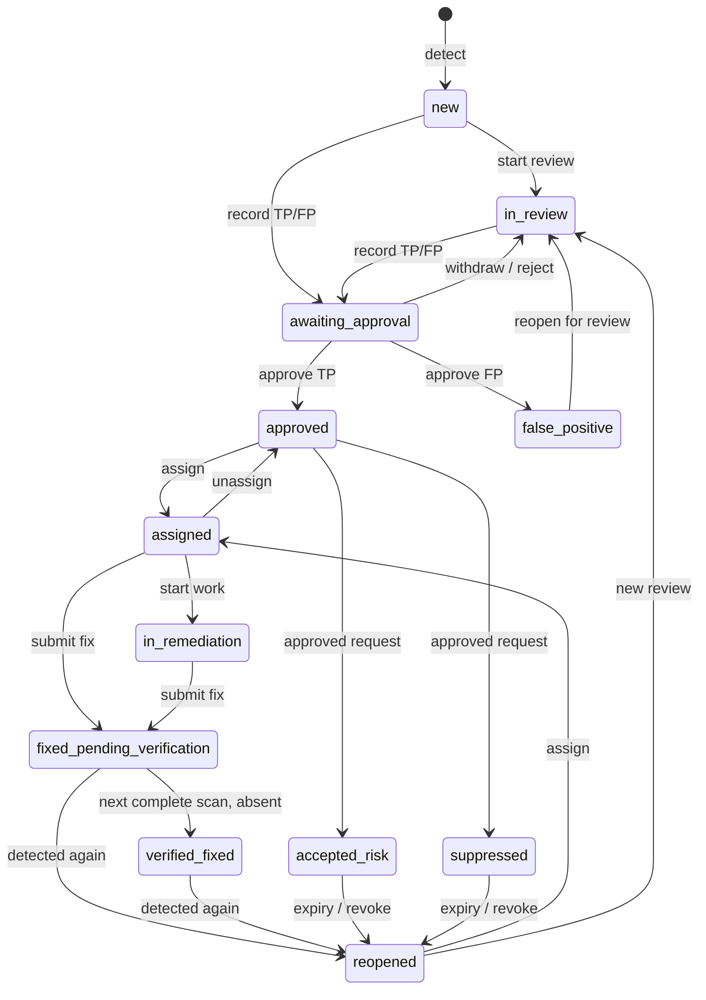

# Module specification: Findings, false-positive advisory agent and UI (workflow steps 7 to 12)

**Status:** **Owner decisions Confirmed 2026-11-23 (section 0.5); Part A0, the contract freeze, built 2026-11-23 (`AS_BUILT_A0.md`); Waves 1 to 3 not started.** The owner decisions of the brief of 2026-11-23 and the answers of 2026-11-23 (0.5) are recorded as **Confirmed**; everything else is **Recommended** or **Open** per the Status rule (CLAUDE.md, `docs/README.md`). Where 0.5 differs from a row of 0.2 to 17, **0.5 wins**.
**Owner:** Product owner (decisions); Claude Code (proposal).
**Last updated:** 2026-11-23 (repository at `402f8da`, Part A0 built on it).
**Related ADRs:** ADR-003 (tenant isolation), ADR-004 (finding identity per pipeline), ADR-008 (security regression suite; amendment proposed in 14.2), ADR-009 (secrets never stored), ADR-011 (outbox and envelopes), ADR-013 (LLM provider and consent; one addendum proposed in 11.3), ADR-014 (scan sandbox; no effect here).
**Template:** the brief names `docs/MODULE_SPECIFICATION_TEMPLATE.md`; that file does not exist. The real template is `docs/technical/MODULE_SPECIFICATION_TEMPLATE.md` and this document follows it (sections 1 to 14), then adds sections 0, 15 (open questions), 16 (parallel build parts) and 17 (verified facts) like the other module specs.
**Screens:** `docs/modules/findings/SCREENS.md` (T-31 to T-36 and `AiAdvisoryCard`).

## 0. Decisions, contradictions and how to read this document

### 0.1 Decisions of the brief (Confirmed, owner, 2026-11-23)

| Id | Decision | Where |
|---|---|---|
| D-1 | **Identity is pipeline-scoped.** Fingerprint = pipeline + rule or CVE or CWE + normalized location + content hash. Recurrence is matched by fingerprint: a re-detected finding keeps its identity, updates `last_seen`, and reopens if it was fixed. Findings are **never merged across pipelines** (ADR-004). | 5.1, 5.2 |
| D-2 | **Only a resolution-eligible scan moves a finding toward fixed** (full, trusted, complete). Incremental, partial, failed, cancelled, fork or degraded results **never** mark anything fixed. | 5.4 |
| D-3 | **Lifecycle state machine** with persisted, audited, immutable history for every transition, permission-gated, allowed transitions only. States: New, In review, TP or FP decision, Awaiting approval, Approved then Assigned, Remediation in progress, Fixed pending verification, Verified fixed, Reopened, plus Accepted risk (time-bound, lead-approved, expiry) and Suppressed. | 6 |
| D-4 | **Segregation of duties.** The user who recorded a review decision cannot approve that same finding; enforced on the server (and in the database) and shown in the UI as disabled with a tooltip. | 5.6 |
| D-5 | **Human events only.** `finding_reviews`, `finding_approvals`, `finding_assignments`, `remediation_records`, `verification_records` are human (or, for verification, scan-derived) events. The FP agent **never transitions a finding** and has **no write access to finding state**. | 7, 11.2 |
| D-6 | **FP advisory agent** reuses the ADR-013 `LLMProvider`: an asynchronous worker, started when a finding is created or reopened, producing an advisory TP/FP suggestion with confidence and reasoning **only**, shown as `AiAdvisoryCard` (labelled advisory, "requires human decision"). Evidence is untrusted data; external providers need the tenant consent gate; local Ollama is the default; snippets are capped and redacted; a raw secret is never sent. Zod-validated; any failure means no advice and no effect on the workflow. Fork or untrusted findings get no external egress. | 5.12, 9.3, 11.3 |
| D-7 | **Data.** The module consumes `scan_results` and `scan_result_items` (+ details) from the engines (scan-engines SPEC Part D schema, evidence, SCM links). It is built and tested against **seeded** findings (the ensemble flag stays OFF); a seed script creates realistic findings. | 5.3, 16, 17 |
| D-8 | **SLA** per severity: configurable targets (placeholders), countdown, due-soon and breached. | 5.9 |
| D-9 | **APIs:** list (cursor and numbered pagination, filters severity, status, scan type, pipeline, assignee, SLA; saved views All open, Needs review, Assigned to me, Breached SLA), detail, review, approve and reject, assign, accept risk, suppress, comment: authorized, tenant and workspace scoped, SOD-enforced, audited, with idempotency keys and DTO no-leak rules. | 8 |
| D-10 | **UI:** T-31 list, T-32 detail, T-33 accept-risk dialog, T-34 Reviews queue, T-35 Approvals queue, T-36 Remediation board and `AiAdvisoryCard`; the Findings, Security Reviews, Approvals and Remediation navigation items become `implemented: true` with their existing permissions. | 10, SCREENS |
| D-11 | **Security suite:** a new ADR-008 area (19) with the checks of 14.1; amendment text in 14.2; the CLAUDE.md scope-sentence proposal in 14.3. | 14 |
| D-12 | **Parallel parts A to F** with a contract freeze and a wave plan. | 16 |

### 0.2 Decisions I took (Recommended; the owner may change any of them)

| Id | Decision | Why |
|---|---|---|
| D-20 | **Both TP and FP decisions need lead approval** (state `awaiting_approval` holds a pending decision of either kind). | `docs/AUTHORIZATION.md` AUTHZ-011 and the wireframe T-35 ("Decision: TP / FP / Accepted risk") say TP/FP decisions are approved. The brief's arrow list shows approval only after TP; see contradiction C-10. |
| D-21 | **SOD is stricter than AUTHZ-011:** the approver may not be **any** user who recorded a review on that finding (any round), nor the requester of an exception on it. Also enforced by a database trigger. | The brief says "that same finding"; AUTHZ says "that decision". Following the brief (C-7). |
| D-22 | **Approved TP is its own state `approved`** ("Confirmed, awaiting assignment"); assignment is a separate human event by someone holding `finding.assign` (Dev Lead, Admin). | The brief's "Approved then Assigned" needs a resting state between the two people. |
| D-23 | **`new` to `in_review` is a human "Start review" (claim);** a decision may be recorded straight from `new` (both history rows are written). Findings of every severity enter the queue (auto-triage policy is the Policies module, OQ-4). | Keeps the machine explicit and the agent trigger on creation. |
| D-24 | **A finding is created and tracked only from a trusted execution on the pipeline's tracked baseline** (default: `ref_type = branch` and `ref_name` equal to the repository's default branch). Pull-request, other-branch, tag and fork executions are **not ingested** in v1 (a recorded skip). | Executions SPEC ER-24, pipelines H-F1/H-F2: the Findings spec owns the baseline; the safest definition first. OQ-1. |
| D-25 | **Absence handling.** An open finding absent from a resolution-eligible, covering result moves to `fixed_pending_verification` (system) and to `verified_fixed` after **N = 1** further consecutive eligible, covering absences (`FINDINGS_FIX_CONFIRMATIONS`, default 1). A human "Submit fix" enters the same pending state. Any positive observation of a pending or verified finding reopens it, **whatever the scan kind** (a detection is evidence even from an incremental run). | One uniform rule; flaky tools cannot fix a finding with one miss. |
| D-26 | **Fingerprint v1** 5.2: no fuzzy matching, no line numbers in the identity, secrets use only the platform-masked preview. | Deterministic and testable; OQ-2 lists the cost (a renamed file is "fixed" plus "new"). |
| D-27 | **SBOM components are inventory, not findings** (`kind = component` never becomes a finding; `license` is reserved). Findings come from `sca` (`vulnerability`), `sast` (`code_issue`) and `secrets` (`secret`). | The SBOM ensemble emits inventory; vulnerabilities are SCA. |
| D-28 | **Accept risk and suppress are requests decided through the same approval queue** (`finding.accept_risk` and `finding.suppress` request; `approval.approve` / `approval.reject` decide; SOD applies). Suppression scope in v1 is **this finding only** (one fingerprint in one pipeline); rule or path patterns belong to the Policies module (T-37). | Resolves "workflow not yet specified" in AUTHORIZATION 5. |
| D-29 | **Bulk in v1:** only **Assign** and **Start review** (claim), at most 50 findings per call, each finding authorized, transitioned and audited on its own. **No bulk decisions** (review, approve, accept risk, suppress) and **no Export** (Reports module, T-39). | A decision needs a per-finding rationale and an auditable SOD check. |
| D-30 | **SLA:** targets Critical 7 days, High 30 days, Medium 90 days, Low 180 days, Info none (placeholders, tenant-configurable); clock from first detection (restarts on reopen); `due_soon` when 25 percent or less of the target remains. | `docs/decisions/OPEN_DECISIONS.md` "SLA defaults and escalation" is a configurable proposal. |
| D-31 | **Advisory egress levels:** local provider = metadata plus code snippet; external provider = metadata only with the existing consent, plus a snippet only with a **new, separate** code-snippet consent; **secret findings never send a snippet or preview to any provider**; findings from a non-trusted origin never reach an external provider. | Code is tenant source, a stronger egress than the paths of the decision agent. |
| D-32 | **No-write guarantee** for the agent: a separate PostgreSQL role (`INSERT` on the advisory table only, `SELECT` on one narrow view), plus a repository without write methods on finding state, plus suite checks. | 9.3. |
| D-33 | **All schema in one migration owned by Part A** (the "contract freeze"), so the parts that follow never write a migration. | 16. |

### 0.3 Contradictions found in the documents (each is settled here; the owner is asked only where marked)

| # | Contradiction | Settlement |
|---|---|---|
| C-1 | Wireframe T-34 route permission `finding.review` and T-35 `finding.approve`; the catalog (`docs/AUTHORIZATION.md`, `packages/shared/src/permissions.js`, and the nav already built) uses `security_review.view`, `approval.view`, `approval.approve`, `approval.reject`. | The catalog wins; no `finding.approve` key exists or is added. |
| C-2 | Navigation item id `security-reviews` (shared constants) and label "Security Reviews" (wireframe, TENANT_APPLICATION_DESIGN) versus "Reviews" in the brief. | Keep the id `security-reviews` and the label **Security Reviews**; the route path is `/workspaces/:workspaceId/reviews` (wireframe). Screen name in this module: "Reviews queue". |
| C-3 | Status vocabulary: DESIGN_SYSTEM "Findings" (11 labels, Recommended), the wireframe board columns (Assigned, In progress, Fix submitted, Pending verification, Verified fixed, Reopened), PROJECT_CONTEXT, and the brief (adds Approved, Reopened, no resting TP state). | The brief's machine wins (6.1). Board columns become five: Assigned, In progress, Fixed pending verification, Verified fixed, Reopened ("Fix submitted" and "Pending verification" are one state). DESIGN_SYSTEM labels are extended in SCREENS 2. |
| C-4 | DATABASE_DESIGN lists `finding_versions`, `finding_evidence`, `finding_comments`, `finding_assignments`, `finding_reviews`, `finding_approvals`, `finding_status_history`, `finding_sla`, `finding_audit_logs`; the brief names `finding_reviews`, `finding_approvals`, `finding_assignments`, `remediation_records`, `verification_records`. | 7.1 lists the real set. `finding_versions` is not needed (history table), `finding_audit_logs` is the shared audit log, `finding_sla` becomes columns plus a settings table. DATABASE_DESIGN must be updated with the build (docs rule). |
| C-5 | Wireframe T-33 is "Accepted risk / suppression dialog"; the brief names an accept-risk dialog. | One dialog, two kinds (accept risk, suppress); SCREENS 5. |
| C-6 | Wireframe T-32 "Related occurrences in this pipeline only"; TENANT_APPLICATION_DESIGN 3.8 "related findings (links only)". | Both: "Detections in this pipeline" (history) and "Similar in other pipelines" (links only, never merged, ADR-004). |
| C-7 | AUTHZ SOD-1 "cannot approve **that decision**"; the brief "cannot approve **that same finding**". | The brief wins (stricter, D-21); AUTHORIZATION.md must be amended when built. |
| C-8 | AUTHZ catalog says `finding.suppress` / `finding.accept_risk` have "workflow not yet specified" and bundles Admin and Lead only. | Specified here (D-28). Bundle additions are **proposed** in 3.2, not applied. |
| C-9 | `docs/technical/API_STANDARDS.md` says "Known gap: `Idempotency-Key` is not implemented yet" and, a few lines later, documents it; `apps/api/src/lib/route-kit.js` implements it. | The code and the later section are right; the gap sentence is stale (fix with the build). |
| C-10 | Brief: only TP goes to "Awaiting approval"; AUTHZ-011 and wireframe T-35: TP/FP decisions are approved. | **Asked (not blocking):** I took approval for both kinds (D-20). If FP should be final on the analyst's decision, only transition SM-5 changes. |
| C-11 | Wireframe T-31 lists a DAST scan-type filter, an "AI confidence" filter, bulk "Send to review" and "Export", and T-32 a Jira ticket link. | No DAST module exists (filter absent); "AI suggestion" filter included; bulk per D-29 (Export deferred); the ticket is a free-text key without a link (no Jira integration). |
| C-12 | Wireframe T-32 "secret masked"; scan-engines SE-42 stores a masked line preview; scan-engines 7.5 says evidence snippets live 90 days, "the Findings module may copy what it needs under its own retention". | Findings copy the redacted evidence at ingestion (5.5, 7.3) with their own retention (7.6). |
| C-13 | `docs/modules/scan-engines/SPEC.md` 5.6.1, SE-11: "the Findings module ... may reuse [the dedup key] as an input". The dedup key of a secret contains the line number. | Not reused for identity: line numbers drift (5.2). |

### 0.5 Owner decisions of 2026-11-23 (Confirmed) and what they change

The owner answered the open points of 0.2, 0.3 and 15 on 2026-11-23. Every row below is **Confirmed**; the part that builds it is named. Where a row differs from an earlier row of this document, this row wins and the earlier text is read with it.

| Id | Decision (Confirmed 2026-11-23) | Effect on this document | Built by |
|---|---|---|---|
| OD-1 | **D-24 accepted:** a finding is created and tracked only from a trusted execution on the pipeline's tracked baseline branch; pull-request, other-branch, tag and fork executions are not ingested in v1 (a recorded skip) | D-24, IN-3 and OQ-1 are Confirmed (option a); a per-pipeline tracked ref (OQ-1 option b) stays a follow-up | A0 (`planIngestion`), A1 |
| OD-2 | **D-20 accepted: both TP and FP decisions need lead approval.** Relaxing the FP approval for senior analysts may be decided later | D-20, SM-6, RV-2 and OQ-3 are Confirmed; a later relaxation changes only SM-5/SM-6 | A0 (transition table), B |
| OD-3 | **Secrets and the FP agent: never send a snippet, a preview or any metadata of a secret finding, even to a local model. The FP agent does NOT run on secret findings in v1** | **Supersedes** D-31 and the secret rows of the 9.3.3 table (local and external, "metadata only") and the `secrets` clauses of 9.3.2: there is no call at all for a secret finding. `agentRunsOn` is false for `secrets` and `info`; the view `fp_agent_findings` excludes secret findings; the database refuses an advisory row for a secret finding. FPA-S03 asserts zero provider requests for secret findings at every level, local included | A0 (shared function, view, trigger), D |
| OD-4 | **A separate code-snippet consent tier is APPROVED** (second tenant consent, implies the first, default off) | D-31, 11.3 and OQ-15 are Confirmed (separate); ADR-013 addendum written 2026-11-23 (status Accepted) | A0 (columns, CHECK, addendum), D (settings API and UI) |
| OD-5 | **The fixed rule is accepted** (D-25: an open finding absent from a resolution-eligible covering result becomes `fixed_pending_verification`, then `verified_fixed` after N = 1 further absence; any positive observation reopens) | D-25, OQ-5 Confirmed (N = 1, configurable as `FINDINGS_FIX_CONFIRMATIONS`) | A0 (`evaluateCoverage`, `planIngestion`), A1 |
| OD-6 | **Fingerprint v1 accepted:** pipeline + rule or CVE or CWE + path (**no line numbers**) + content hash, **no fuzzy matching**; a rename or move is "fixed plus new", accepted as a **known limitation** (rename detection later) | D-26, 5.2 and OQ-2 are Confirmed. The CWE is stored but is not in the key (5.2.2: tools disagree on CWE numbers) | A0 (`computeFingerprint`) |
| OD-7 | **The smaller choices are accepted:** `approved` as its own state (D-22); bulk Assign and Start review capped at 50, no export (D-29); SLA Critical 7 days, High 30, Medium 90, Low 180, Info none, `due_soon` at 25 percent or less remaining (D-30, OQ-11); the five-column board (C-3); both feature flags OFF by default; **no backfill** (7.7, OQ-10) | D-22, D-29, D-30, C-3, 7.7 are Confirmed. `finding_pipeline_state` and the optional `findings:backfill` command stay as specified, but nothing backfills automatically | A0 (constants, flags), A1, C |
| OD-8 | **OQ-13 RESOLVED:** security analysts **and developers** can REQUEST accept-risk and suppression; **leads approve** | 3.2 is Confirmed in principle and extended to developers. **Open sub-question for Part B (not blocking the freeze):** 3.2 named Security Analyst (`finding.accept_risk` and `finding.suppress`) and Dev Lead (`finding.accept_risk`); the owner's word is "developers". Recommended: add the request keys to **Security Analyst, Dev Lead and Developer** (`finding.accept_risk`; `finding.suppress` to Security Analyst only), and ask the owner to confirm before Part B edits `roles.js` | B (`roles.js` bundles) |
| OD-9 | **OQ-6 RESOLVED:** provision a **restricted database login role** for the FP worker: read findings and evidence through one view, write ONLY advisory rows, NEVER finding state | The migration creates the NOLOGIN group role `qm_fp_agent` with exactly four grants; `packages/db/scripts/provision-fp-agent-login.js` creates the LOGIN role (dev and prod); the worker reads `FINDINGS_AGENT_DATABASE_URL` and **refuses to start in production without it** (9.3.4). See `AS_BUILT_A0.md` section 7 | A0, A1 (repository), D (worker) |

**Contradictions of 0.3 that stay as resolved** (none conflicts with 0.5 except as listed): C-1 to C-9, C-11 to C-13 unchanged; **C-10 is settled by OD-2** (FP decisions are approved); C-8 and 3.2 are extended by OD-8; the secret rows of 9.3.3 are superseded by OD-3.

**Found while building Part A0 (record, not blocking):** (1) 9.3.1 step 9 emits `finding.advisory.completed` and 9.3.4 layer 2 forbids the agent from reaching "the outbox": the agent must publish that hint straight to the broker through the shared publisher, not through the database outbox (the role has no outbox grant); Part D decides, the hint is only a realtime refresh. (2) 6.3 item 2 ("every row whose `rev` changed has a history row") is implemented for a **status or assignee change and for creation**; an observation update (last seen, counters, evidence) raises `rev` without a history row, otherwise every recurrence would write one row per finding per execution. (3) `finding_ingestions` uniqueness excludes `failed` rows so a failed attempt can be retried. (4) User columns are plain uuids without a foreign key (the precedent of `execution_events.actor_user_id`); the service validates tenant membership. (5) `PUT /settings/ai` must clear `codeSnippetConsent` when `externalConsent` is withdrawn: `setExternalConsent` in `packages/db/src/llm-settings.js` already does (the CHECK would otherwise refuse the write).

### 0.4 Reading guide

Section 5 holds the rules (identity, ingestion, resolution, SOD, SLA, exceptions), 6 the state machine, 7 the data model, 8 the API, 9 events, 10 and SCREENS the UI, 11 security and the agent's boundaries (the agent itself is 5.12 and 11.3), 14 the acceptance criteria and the security suite additions, 16 the parts for parallel builds.

## 1. Purpose

Turn scan output into managed work. After the engines have produced results, this module creates **findings** (one per pipeline and vulnerability), tracks them across scans, lets a **Security Analyst** record a true or false positive decision, lets a **Lead** approve or reject it (never the same person), lets a **Dev Lead** assign approved true positives to **Developers**, tracks remediation, and **verifies** a fix only through a later complete scan. It adds an **advisory** AI second opinion on TP/FP that never decides anything, per-severity **SLA** tracking, time-bound **accepted risk** and **suppression**, comments, and the screens T-31 to T-36 (`docs/product/PROJECT_CONTEXT.md` steps 7 to 12).

## 2. Scope

### In scope

- Finding creation, identity (fingerprint), recurrence, resolution and reopening from `scan_results` (5.1 to 5.5).
- The lifecycle state machine with immutable history, review, approval, assignment, remediation, verification (6, 7).
- Accepted risk and suppression (request, approval, expiry, revocation), comments, SLA targets and states, saved views.
- The FP advisory agent (worker, queue, consent, redaction, storage, `AiAdvisoryCard` data), the tenant code-snippet consent extension of `GET`/`PUT /settings/ai`.
- APIs of section 8, events of section 9, the Socket.IO hints, audit actions, the seed script, the security suite area 19.
- UI T-31 to T-36, `AiAdvisoryCard`, navigation flags, the two settings additions (SLA targets, code-snippet consent switch).

### Out of scope (non-goals)

- Running scans, evidence extraction, tool output, severity tables (scan-engines; this module reads their stored result).
- Notification delivery channels (email, Slack, Teams), Jira or other ticket integrations, auto-created pull requests, auto-fix suggestions (a fixed version from SCA is shown as data).
- Policies (T-37, T-38: suppression rules by pattern, severity gates, mandatory scans), reports and exports (T-39), dashboards beyond the saved-view counts (the dashboard already reads counts, see 17.4).
- DAST and asset-discovery findings (no module), license findings (`kind = license` reserved), SBOM components as findings (D-27).
- Cross-pipeline merging or a "global finding" (ADR-004), fuzzy relocation or rename tracking (D-26), multi-step agent autonomy, an agent that comments, assigns or writes anything (D-5).
- Ingesting pull-request, other-branch or fork executions (D-24, OQ-1), a backfill of old executions (7.7, OQ-10).
- File attachments to exceptions (T-33 wireframe "attach evidence"): not in v1.
- Feature or unit test-case structures (CLAUDE.md): only `pnpm test:security` (area 19) plus manual verification matrices.

## 3. Actors and permissions

### 3.1 Existing permission keys used (no new key is needed; verified in `packages/shared/src/permissions.js` and `roles.js`)

| Actor (built-in role that holds it) | Action | Scope | Permission |
|---|---|---|---|
| Everyone with a read bundle (Admin, Manager, Lead, Security Analyst, Dev Lead, Developer, Viewer) | List and open findings, history, evidence, advisory, similar findings | workspace | `finding.view` |
| Admin, Manager, Lead, Security Analyst, Dev Lead, Developer | Comment | workspace | `finding.comment` |
| Admin, Manager, Lead, Security Analyst | See the Reviews queue page | workspace | `security_review.view` |
| Admin, Security Analyst | Start a review, record TP/FP (+ optional severity override), withdraw own decision, re-open a false positive for review, request a new advisory | workspace | `finding.review` |
| Admin, Manager, Lead | See the Approvals queue page | workspace | `approval.view` |
| Lead (custom roles; **not** Admin by default, decision 5) | Approve (`approval.approve`) or reject (`approval.reject`) a review decision, an accept-risk request or a suppression request | workspace | `approval.approve`, `approval.reject` |
| Admin, Dev Lead | Assign or unassign an approved finding; bulk assign | workspace | `finding.assign` |
| Admin, Manager, Lead, Security Analyst, Dev Lead, Developer | See remediation work and the board | workspace | `remediation.view` |
| Admin, Dev Lead, Developer | Start work, submit a fix | workspace; a caller who does **not** also hold `finding.assign` in the workspace may act only on findings assigned to them (AUTHORIZATION 5.9 row "Assigned remediation") | `finding.remediate` |
| Admin, Lead | Request accept risk, request suppression, revoke an active acceptance or suppression | workspace | `finding.accept_risk`, `finding.suppress` |
| Admin | Set SLA targets and the code-snippet consent | tenant | `tenant_settings.manage` (read: `tenant_settings.view`), the keys of `GET`/`PUT /settings/ai` |

Rules: UI hiding is for usability only; the backend decides (CLAUDE.md). A visible finding without the key answers `403`; a finding in a workspace the caller cannot see, in another tenant, or nonexistent answers an identical `404` (AUTHORIZATION 5.9). Archived workspace: reads follow permissions, every mutation is refused (AUTHORIZATION 5.7). A suspended tenant: mutations refused with `TENANT_SUSPENDED`.

### 3.2 Proposed permission bundle changes (**Recommended**, not Confirmed; the owner decides; applied by Part B only after approval)

| Change | Reason |
|---|---|
| Add `finding.accept_risk` and `finding.suppress` to **Security Analyst** and `finding.accept_risk` to **Dev Lead** | The wireframe lets analysts and developers "Request accepted risk"; the Lead is the approver and, by SOD, cannot approve a request of their own. Without this, only Lead and Admin can request, and a single Lead tenant cannot decide any request. |
| Keep `approval.approve` / `approval.reject` out of Admin (decision 5) | Unchanged. |
| No other new key | Export uses `report.export`; SLA targets use `tenant_settings.manage`; the advisory re-request uses `finding.review`. |

If the owner declines, the keys keep their provisional bundles (Admin, Lead) and the UI shows the buttons only to those holders; nothing else changes.

### 3.3 The system actors

`system:ingestion` (creates, recurs, auto-pends, verifies, reopens), `system:sla` (due-soon and breach marking), `system:expiry` (accepted-risk and suppression expiry), `system:fp-agent` (writes advisories only). A system actor is recorded as `actor_type = 'system'` with a fixed `actor_code`, never a user id, and holds no permission: it acts only through the code paths of this module.

## 4. Functional requirements

| ID | Requirement | Priority | Status |
|---|---|---|---|
| FND-001 | A trusted execution on the tracked baseline creates findings from `sca`, `sast`, `secrets` result items; one finding per (pipeline, fingerprint) | Must | Confirmed (D-1, D-7), baseline Recommended (D-24) |
| FND-002 | Recurrence by fingerprint: re-detection keeps the finding, updates `last_seen_*`, and reopens a `fixed_pending_verification` or `verified_fixed` finding | Must | Confirmed (D-1) |
| FND-003 | No merge across pipelines, workspaces or tenants; `correlation_key` links similar findings for display only | Must | Confirmed (ADR-004) |
| FND-004 | A finding moves toward fixed only from a resolution-eligible, covering result (5.4); never from incremental, partial, failed, cancelled, fork, degraded or truncated results | Must | Confirmed (D-2) |
| FND-005 | Ingestion is idempotent per (execution, scan type), transactional, ordered per pipeline, and fail-closed | Must | Recommended |
| FND-006 | The state machine of 6.1 is the only allowed set of transitions, in `@qmentisai/shared` and in a database trigger; every transition writes one history row, one audit entry and one event in the same transaction | Must | Confirmed (D-3) |
| FND-007 | Review: TP/FP, rationale (required), optional severity override, from `new` or `in_review`; the decision waits for approval | Must | Confirmed (D-3, D-5), approval of FP Recommended (D-20) |
| FND-008 | Approve or reject by another person; SOD in service and database | Must | Confirmed (D-4) |
| FND-009 | Assign (Dev Lead), reassign, unassign; assignee must be an active workspace member holding `finding.remediate` | Must | Confirmed (D-5), mechanics Recommended |
| FND-010 | Remediation: start work, submit fix (optional PR link and ticket key, note); verification by a later complete scan only | Must | Confirmed (D-3) |
| FND-011 | Accept risk: justification, required expiry (at most 180 days), approval, automatic reopen at expiry; suppression likewise (expiry optional, at most 365 days) | Must | Confirmed (D-3), numbers Recommended |
| FND-012 | Comments (insert-only), history timeline (decisions, transitions, recurrence markers) | Must | Recommended |
| FND-013 | SLA per effective severity: target, due date, state `on_track`, `due_soon`, `breached`, `not_applicable`; a sweep marks due-soon and breach once | Must | Confirmed (D-8), values Recommended |
| FND-014 | List API with filters, numbered and cursor pagination, saved views, summary counts; detail, history, comments, queues, board | Must | Confirmed (D-9) |
| FND-015 | FP advisory agent: async, bounded, consent-gated, redacted, advice only, never writes state; `AiAdvisoryCard` | Must | Confirmed (D-6) |
| FND-016 | No secret value or value-derived data in findings, fingerprints, evidence copies, history, comments, advisory input or output, events, logs, audit | Must | Confirmed (SE-40, D-1) |
| FND-017 | Idempotency keys on every mutating POST; optimistic concurrency by `expectedRev` | Must | Confirmed (D-9), mechanics Recommended |
| FND-018 | Seed script with realistic findings across severities, states, types and pipelines | Must | Confirmed (D-7) |
| FND-019 | Realtime hints per workspace (ids, status, rev only) | Should | Recommended |
| FND-020 | Navigation items Findings, Security Reviews, Approvals, Remediation implemented with their existing permissions | Must | Confirmed (D-10) |
| FND-021 | Security suite area 19 (14.1) | Must | Confirmed (D-11), approval of the amendment pending |

## 5. Business rules

### 5.1 Identity rules (ID-n)

| Rule | Text |
|---|---|
| ID-1 | A finding belongs to exactly one `(tenant, workspace, repository, pipeline)`. `UNIQUE (tenant_id, pipeline_id, fingerprint)`. The same vulnerability in two pipelines is two findings with independent state, history and workflow (ADR-004, D-1) |
| ID-2 | The fingerprint is computed by one pure function `computeFingerprint(item, pipelineId)` in `@qmentisai/shared` and **never from a client or a message**; the pipeline id comes from the verified execution row |
| ID-3 | A scan engine merge key (`dedupKey`) is **not** the identity and is never compared across tasks (ER-26, SE-11). The fingerprint may be computed from the same fields but is a different value, versioned (`fp_version`) |
| ID-4 | `correlation_key` (display only) = SHA-256 over the fingerprint inputs **without** the pipeline id and **with** the tenant id, so equal values exist only inside one tenant. It powers "Similar in other pipelines"; it is never a unique key and never used to copy state |
| ID-5 | A pipeline that is soft-deleted keeps its findings readable (pipelines H-F3, AUTHORIZATION `pipeline.delete`); no new detection arrives; workflow actions that do not need a scan stay possible (6.4) |

### 5.2 Fingerprint construction (fp version 1; **Recommended**, D-26)

```
fingerprint = "fp1:" + hex( SHA-256( "qm.finding.fp.v1" 0x00 pipelineId 0x00 scanType 0x00 ruleKey 0x00 locationKey 0x00 contentKey 0x00 occ ) )
```

Every component is a UTF-8 string, NFC-normalized, joined with a NUL byte (so no component can forge another). `occ` is a decimal ordinal (5.2.4). The raw inputs are never stored or logged; the stored value is the 64-hex digest.

**5.2.1 Normalization (shared by all types).**

| Input | Rule |
|---|---|
| Path | Repository-relative POSIX path from the item location. NFC. Reject (item is dropped and counted `skipped_bad_path`) when empty after trimming, absolute, containing `..` segments, a backslash, a control or bidirectional-override character, or longer than 1024. Strip a leading `./`, collapse `//`. **Case is kept** (git is case sensitive). A file rename or move changes the fingerprint (OQ-2) |
| Rule | `rule.id` of the normalized finding (scan-engines 7.2), trimmed, ASCII-lowercase for `sast` and `secrets` rule ids (tool ids are case-insensitive in practice); advisory ids keep their canonical upper case |
| Line numbers | **Never part of the identity.** Lines move when code above changes; they are stored as attributes and updated on each detection. There is **no line drift tolerance** and no fuzzy match: the content key is what survives drift (D-26) |
| Whitespace in content | Per line: trim, collapse internal runs of whitespace to one space; drop empty lines; do not strip comments |

**5.2.2 Per scan type.**

| Type | `ruleKey` | `locationKey` | `contentKey` |
|---|---|---|---|
| `sca` (`vulnerability`) | The canonical advisory id: the first of `advisories[]` ordered by family CVE, GHSA, OSV, other (then by id); when there is none, `rule.id` | `purl` **without version and qualifiers** (type, namespace, name) + `"@"` + the normalized **declaring manifest path** (`location.path`). A vulnerability in two lockfiles is two findings (scan-engines D-25). The affected version is an attribute, not identity: an upgrade to a version that is still vulnerable to the same advisory is the same finding | empty (no source content). The component name is already in the location key |
| `sast` (`code_issue`) | `rule.id` (lower case). The engines pick a stable canonical rule per merged finding (SE-14); CWE numbers are stored but are not in the key because tools disagree on them | normalized path | SHA-256 of the **focus lines** of the stored evidence: the lines `focusStart..focusEnd` of `evidence.snippet` (evidence starts at `startLine`), normalized per 5.2.1, joined with `\n`. When there is no usable evidence (extractor unavailable, focus outside a truncated snippet): the fallback anchor is the string `L` + `startLine` and `anchor_kind = line` is recorded (this identity then drifts, which is accepted and counted in a metric) |
| `secrets` (`secret`) | `rule.id` (lower case) plus the `typeClass` | normalized path | SHA-256 of the **masked line only** (the single line `evidence.kind = line` or the focus line of the masked preview), normalized per 5.2.1, in which the value was replaced by `[REDACTED:<typeClass>]` by the scan worker (SE-42). **Never** the raw line, the stored 4-character `preview`, `valueLength`, any tool field, or any hash or HMAC of a value. When the masked preview is absent (SE-42 fail closed): the content key is empty and `anchor_kind = ordinal` |

**5.2.3 What may never enter any fingerprint:** a secret value or any value-derived datum (SE-40, OQ-5b option A), the `preview`, `valueLength`, a commit sha, a timestamp, a tool version, the tool name (a finding must survive a change of tool set), an execution id, a line number, a free-text title or message.

**5.2.4 Tie-break `occ`.** Items of one result with the same base digest (all components but `occ`) are ranked by `(startLine, ordinal)` and numbered from 0. In the normal case `occ = 0`. Removing one of two identical occurrences makes the remaining one take `occ = 0`, so the surviving finding keeps the older identity (the other becomes fixed); this is accepted.

**5.2.5 Versioning.** `fp_version = 1`. A later algorithm change adds `fp_version = 2` with a re-link job that computes both values for open findings and rewrites `fingerprint` in one transaction per pipeline (history keeps the old value in a `fingerprint_changed` row). Not built in v1.

### 5.3 What becomes a finding and the ingestion trigger

| Rule | Text |
|---|---|
| IN-1 | **Trigger.** The execution orchestrator already writes the terminal event `pipeline.execution.completed` through the outbox (executions 9.1, EQ-13). Part A adds, **in the same transaction**, a second outbox row of the same envelope for the new durable queue `findings` (message id `execution-completed-findings-<executionId>`), behind `FINDINGS_INGESTION_ENABLED` (default `false`). No other module changes behaviour |
| IN-2 | **The message is a wake-up.** The `findings` worker handler loads everything from the database: the execution (by tenant, workspace, repository, pipeline, id, through the existing ownership verifier), its `scan_results`, `scan_result_items` and `scan_result_item_details` for `scan_type in (sca, sast, secrets)`. It trusts nothing in the message except the ids (ADR-011, TENANT_ISOLATION) |
| IN-3 | **Eligibility to be ingested** (else a `finding_ingestions` row with a skip reason and nothing else): execution `trust = trusted`; `ref_type = branch` and `ref_name` equals the pipeline's tracked ref (`finding_pipeline_state.tracked_ref`, default the repository's `default_branch`; no tracked ref means skip `no_baseline`); the execution has at least one result of a findings-bearing type; the execution is newer than the pipeline's `ingested_through` marker for creation, see IN-6. Skip reasons: `untrusted_fork`, `not_baseline_ref`, `no_baseline`, `no_results`, `pipeline_deleted` |
| IN-4 | **Unit of work.** One transaction per `(execution, scan type)`: take `pg_advisory_xact_lock(hash(tenant, pipeline))`, re-read the pipeline (not deleted), insert the `finding_ingestions` row (`UNIQUE (tenant_id, execution_id, scan_type)`; an existing row means "already done", acknowledge), plan with the pure `planIngestion(existingFindings, observedItems, executionFacts)` of `@qmentisai/shared`, apply the plan with chunked statements (500 rows), write history, verification records, audit and outbox rows, commit. A failure rolls everything back and the message is retried with backoff, then dead-lettered; nothing is half-applied |
| IN-5 | **Positive observations** (every item that normalizes and fingerprints): new fingerprint creates `new`; known fingerprint updates `last_seen_at`, `last_seen_execution_id`, `last_seen_commit_sha`, `tool_severity`, `confidence`, attributes (lines, component version, advisory list), `occurrence_count + 1`, and replaces the evidence copy; state effects by 5.4. Items that fail normalization are counted (`skipped_bad_path`, `skipped_invalid`), never stored |
| IN-6 | **Order.** An execution whose `started_at` is older than the pipeline's `finding_pipeline_state.last_ingested_started_at` is still ingested for positive observations (`last_seen_at = greatest(old, new)`), but it **never resolves** and never reopens a finding whose `last_seen_at` is newer. `resolution_watermark_started_at` only moves forward |
| IN-7 | **No row, no secret, no free text.** Titles and rule names come from the stored normalized item (already redacted by the engines, SE-43) and pass the platform redaction again; tool free text is never stored; a credential-shaped string found anywhere in a field refuses that field (the item is stored without it and counted) |
| IN-8 | **Result states.** A result with `completeness = incomplete` or `truncated = true` still contributes its positive observations; it cannot contribute absence (5.4) |
| IN-9 | **Severity.** `tool_severity` is the normalized severity of the item; `severity` (effective) = `severity_override` when set, else `tool_severity` (CHECK). A recurrence updates the tool severity only. The SLA follows the effective severity |

### 5.4 Resolution: what "not seen" means (D-2, D-25)

An open finding `F` (scan type `T`, pipeline `P`) may be treated as **absent** by execution `E` only when **all** hold (a pure function `evaluateCoverage(F, E, result, toolRuns)` in `@qmentisai/shared`):

1. `E.resolutionEligible` is true: the event carries it (ER-24: succeeded, `scan_kind = full`, `trust = trusted`, every enabled type has a complete, non-truncated result). **The handler recomputes it from the database rows** (status, kind, trust, every enabled type's result) and uses `min` of the two; a disagreement is logged and fails closed (no resolution).
2. `E` is the tracked baseline ref (IN-3) and `E.started_at` is newer than `resolution_watermark_started_at` (IN-6).
3. The result of type `T` exists, `completeness = complete`, `truncated = false`, `coverage.state = complete`, `toolsDegraded = 0`, and its `scope` is a full-tree scope (`coverage` reports no `full_filtered` or `targets` kind for `T`).
4. No `coverage.gaps` entry matches `F` (its path prefix or ecosystem) and every tool in `F.last_seen_tools` has a `scan_tool_runs` row with status `succeeded` for this task attempt.
5. The pipeline still enables type `T` (a type disabled after the finding appeared has no result: such findings show the "not scanned recently" chip and are never resolved).

If any condition fails, the finding is **untouched** (`resolution_skipped` is counted by reason). Only when all hold, and `F` was not observed in this result:

| Current status | Effect (system actor) |
|---|---|
| `new`, `in_review`, `awaiting_approval`, `approved`, `assigned`, `in_remediation`, `reopened` | to `fixed_pending_verification`, reason `absent_in_complete_scan`, `absent_count = 1`; a pending review or exception on it is marked `superseded`; the SLA stops |
| `fixed_pending_verification` (entered by a human fix claim or by the rule above, **in an earlier execution**) | `absent_count + 1`; at `absent_count >= N` (default 1 more) to `verified_fixed`, a `verification_records` row (`outcome = verified`) |
| `accepted_risk`, `suppressed`, `false_positive`, `verified_fixed` | unchanged (their own rules) |

A positive observation of `fixed_pending_verification` or `verified_fixed` writes a `verification_records` row (`outcome = failed` for a human-claimed fix, `recurred` otherwise), moves the finding to `reopened` (`reopen_count + 1`, SLA restarts, `absent_count = 0`) and emits `finding.reopened`. An observation of `accepted_risk`, `suppressed` or `false_positive` only updates `last_seen_*`.

Partial coverage in plain words: a finding is fixed only when **every** thing that could have reported it ran to completion and looked in the right place; any doubt leaves it as it is. A partial or incremental run adds knowledge (new findings, recurrence) but never removes any.

### 5.5 Evidence copy

At ingestion the finding keeps a copy of the evidence it needs (`finding_evidence`, one current row per finding): the redacted evidence object of scan-engines 7.4 (`kind`, `language`, `nodeKind`, lines, `snippet` up to 4 KiB, `truncated`), the structured `scm_ref` and the built `url` (https, closed provider host table, commit-pinned, validated again by the DTO mapper). The copy is replaced on every positive observation (latest evidence wins; older evidence is not versioned). A secret finding's copy contains only the masked preview of SE-42 or nothing. Source: `scan_result_item_details.evidence`, `scm_ref`, `url` (retention there is 90 days; this copy follows 7.6).

### 5.6 Segregation of duties (SOD) (Confirmed D-4; strictness Recommended D-21)

| Rule | Text |
|---|---|
| SOD-1 | The approver of a review decision (`approve` or `reject`) must not be **any** user who recorded a review on that finding (`finding_reviews.reviewer_user_id`, any round). The approver of an exception must not be its requester or any reviewer of the finding |
| SOD-2 | User ids are compared, never roles, assignments or sessions; API keys and tokens of the same user are the same user. Not even Admin bypasses it; there is no break-glass path (AUTHZ 5.8) |
| SOD-3 | A decision awaiting approval cannot be edited by its reviewer; the reviewer may **withdraw** it (back to `in_review`) |
| SOD-4 | A denial is `403 FORBIDDEN` with `details.reason = "separation_of_duties"`, audited with both user ids and the decision id (`finding.approval_denied`). In the UI the Approve and Reject buttons are disabled with the tooltip "You recorded a decision on this finding. Another lead must approve it." |
| SOD-5 | The database refuses the violation too: a trigger on `finding_approvals` raises when `approver_user_id` appears as a reviewer or exception requester of the same finding (a direct SQL insert fails; suite `FNDDB-05`) |
| SOD-6 | Consequence (AUTHZ 5.8): a tenant with one person holding review and approval cannot approve that person's decisions; a second eligible person is needed |

### 5.7 Review, approval, assignment, remediation rules

| Rule | Text |
|---|---|
| RV-1 | `POST reviews` requires the status `new` or `in_review`, `expectedRev` equal to the row's `rev`, a rationale of 10 to 2000 characters (plain text; a credential-shaped string is **refused** with `VALIDATION_FAILED` / `reason: credential_shape`, never silently stored), `decision` in `true_positive`, `false_positive`, and optionally `severityOverride` (only with `true_positive`). The review row is immutable; the finding moves to `awaiting_approval` carrying `pending_review_id` |
| RV-2 | Approval of a `true_positive` review moves the finding to `approved` and applies the severity override (if any) in the same transaction (SLA recomputed, audited as `finding.severity_overridden`). Approval of a `false_positive` review moves it to `false_positive`. Rejection (comment required) returns it to `in_review`; the review row stays as history; **any** analyst other than the approver may decide the next version (the same analyst may too; SOD only binds the approver) |
| RV-3 | The advisory is never an input of a decision: the review API has no advisory field. The server records `advisory_id_at_decision` (the latest advisory of the finding at that moment, null when none) so quality can be measured later |
| AS-1 | Assign: status `approved`, `assigned`, `in_remediation` or `reopened`; the assignee is an active workspace member who holds `finding.remediate` in that workspace (checked by the central authorization engine); self-assignment allowed; a note up to 500 characters; optional `dueAt` is **not** in v1 (the SLA is the due date) |
| AS-2 | Unassign returns `assigned` or `in_remediation` to `approved`. Reassign keeps the status and writes a new `finding_assignments` row (the previous becomes `ended_at`) |
| RM-1 | `start` (assigned to in progress) and `submit_fix` (assigned or in progress to `fixed_pending_verification`) by the assignee, or by a caller who also holds `finding.assign` in the workspace. `submit_fix` stores `pull_request_url` (https only, no userinfo, at most 500 characters, rendered as text with a safe link), `ticket_key` (`^[A-Z][A-Z0-9]{1,9}-[0-9]{1,8}$`, free text, no link) and a note up to 1000. Nothing here claims "fixed": the status is pending verification and the UI says so |
| RM-2 | Only the ingestion path (5.4) can set `verified_fixed` or `reopened` from a scan. There is no manual "mark verified" in v1 (a person cannot verify what a scan has not) |
| RM-3 | `reopened` goes to `assigned` (`finding.assign`) or `in_review` (`finding.review`, "needs a new look") by a human; it never returns to `awaiting_approval` without a review |

### 5.8 Exceptions: accepted risk and suppression (Confirmed in principle D-3; numbers Recommended)

`finding_exceptions` rows have `kind` (`accept_risk` or `suppress`), a state machine `pending` to `approved` or `rejected` or `withdrawn` or `superseded`, and `approved` to `expired` or `revoked` or `invalidated`.

| Rule | Text |
|---|---|
| EX-1 | **Request** (`finding.accept_risk` or `finding.suppress`; finding in `new`, `in_review`, `approved`, `assigned`, `in_remediation`, `reopened`; none pending): justification 20 to 2000, optional compensating controls (accept risk) up to 1000, `expiresAt` (accept risk: **required**, in the future, at most 180 days; suppress: optional, at most 365 days, default none), optional `requestedApproverUserId` (a hint: an active member holding `approval.approve`, not the requester; any eligible approver may decide). The finding's status does **not** change while the request is pending; `pending_exception_id` is set and the finding appears in the Approvals queue |
| EX-2 | **Decision** by `approval.approve` / `approval.reject` with SOD-1. Approve: `accepted_risk` or `suppressed`, `accepted_severity` recorded, `exception_expires_at` set, SLA not applicable. Reject: comment required, no state change. The requester may **withdraw** while pending; an approved exception cannot be edited or extended (a new request replaces it after revocation or expiry) |
| EX-3 | **Expiry** (job `findings.exception.expire`, every 5 minutes and also on read): at `expires_at` the exception becomes `expired` and the finding goes to `reopened` (system, reason `risk_acceptance_expired` or `suppression_expired`), SLA restarts, event `finding.exception_expired`. A finding whose acceptance has expired is **never** shown as accepted: the read path treats `expires_at <= now()` as expired even before the job runs and the list query excludes it from the accepted filter |
| EX-4 | **Revoke** (`finding.accept_risk` / `finding.suppress`, reason required): approved exception becomes `revoked`, finding to `reopened` |
| EX-5 | **Invalidation:** when the effective severity of an accepted finding rises above `accepted_severity` (a tool re-rate on recurrence), the exception becomes `invalidated` and the finding goes to `reopened` (reason `severity_increased`). Suppression is not invalidated by severity |
| EX-6 | An accepted or suppressed finding still receives detections (`last_seen_*` updates) and is excluded from resolution, from SLA, from "All open" and from the queues |
| EX-7 | Suppression is **only** a platform workflow: inline `nosec`, `nosemgrep`, `gitleaks:allow` and ignore files are ignored by the engines (scan-engines OQ-16, T11); this module never reads them |

### 5.9 SLA (Confirmed D-8; values Recommended D-30)

| Rule | Text |
|---|---|
| SL-1 | Targets per effective severity in hours, tenant-wide, table `finding_sla_targets` (defaults of `@qmentisai/shared` `SLA_DEFAULT_HOURS` when no row: critical 168, high 720, medium 2160, low 4320, info none). Edited with `PUT /settings/findings-sla` (`tenant_settings.manage`, audited, a change affects findings from the next recompute, not retroactively past due dates already breached) |
| SL-2 | `sla_started_at` = first detection, reset to the transition time on reopen; `sla_due_at = sla_started_at + target(effective severity)` stored on the row (indexable) and recomputed when the effective severity changes (audited). `null` for `info`, `accepted_risk`, `suppressed`, `false_positive`, `verified_fixed` and while pending-verified |
| SL-3 | State (derived at read time from `sla_due_at` and now, never stored): `breached` when `now > due`; `due_soon` when the remaining time is at most 25 percent of the target; `on_track`; `not_applicable` when `sla_due_at` is null. The countdown is shown only for open findings |
| SL-4 | A sweep `findings.sla.sweep` (every 5 minutes, bounded batches) sets `sla_due_soon_notified_at` and `sla_breach_notified_at` once per cycle and emits `finding.sla_due_soon` / `finding.sla_breached` (notification module subscribes later) |

### 5.10 Comments

`finding_comments` is insert-only (no edit, no delete in v1; OQ-7). Plain text 1 to 4000 characters, credential-shaped strings refused like rationales, `finding.comment`, rate limit profile `write`. Comments are shown in the Comments tab and as a count on the header; they are not part of the status history but are in the audit log.

### 5.11 Saved views (fixed server-side definitions, not stored)

| View id | Definition (workspace scoped) |
|---|---|
| `all_open` | status in `new`, `in_review`, `awaiting_approval`, `approved`, `assigned`, `in_remediation`, `fixed_pending_verification`, `reopened` |
| `needs_review` | status in `new`, `in_review` (and not claimed by another user is a UI sort, not a filter) |
| `assigned_to_me` | `assignee_user_id = caller` and open |
| `breached_sla` | open, `sla_due_at < now()` |

The default view for a caller who lacks `finding.review` and holds `finding.remediate` is `assigned_to_me` (wireframe RBAC variant); for everyone else `all_open`. The default is chosen by the UI from the authorization engine, never by a role name.

### 5.12 The false-positive advisory agent (rules FP-n; detail in 9.3 and 11.3)

| Rule | Text |
|---|---|
| FP-1 | Advice only: `suggestion` (`likely_true_positive`, `likely_false_positive`, `uncertain`), `confidence` 0 to 100 (the model's own number, shown as "model-reported, not calibrated"), `reasoning` up to 1000 characters of plain text. Nothing else leaves the agent |
| FP-2 | It runs in a worker (queue `findings-agent`), started by `finding.advisory.requested`, which Part A's ingestion writes for each **created** finding and for each **reopened** finding (deduplicated by input hash), and which a user with `finding.review` can request again (rate limited). It never runs in an API request |
| FP-3 | It has no write access to finding state (D-5, 9.3.4) and no tool except one structured-output tool `submit_advice` |
| FP-4 | Failure is silent for the workflow: no provider, consent missing, timeout, error, invalid output, fork origin, daily cap reached: no advice or a `failed` advisory status record; the finding and every action stay exactly as they were |
| FP-5 | The advice is displayed with provider and model, the label "Advisory", the sentence "Requires a human decision" and never as a decision, never in a color or position that looks like a status (SCREENS 8) |

### 5.13 Edge cases

| Case | Behaviour |
|---|---|
| Reopened after `verified_fixed` | Same finding id, `reopen_count + 1`, history rows (`verified_fixed` to `reopened`, reason `recurred`), SLA restarts, a new advisory request (deduplicated by input hash), event `finding.reopened`; it goes back to the queue for assignment (`finding.assign`) or review |
| Finding whose pipeline is deleted | Readable everywhere (a "Pipeline deleted" chip); no ingestion, so no auto verify or reopen; review, approve, comment, accept risk, expiry and assignment still work; "submit fix" is refused with `FINDING_STATE_CONFLICT` / `reason: pipeline_deleted` because no scan can verify it; the user may request suppression with reason "obsolete" (OQ-9) |
| Repository disconnected or workspace archived | Reads work; scan-dependent flows pause (same as a deleted pipeline); an archived workspace refuses all mutations (AUTHZ 5.7); a banner explains "Verification is paused" |
| Severity override vs tool severity | Override only through an approved TP review; the list shows the effective severity with a "Reviewed: raised or lowered from <tool>" marker; a recurrence updates the tool severity but keeps the override; a new review may clear or change it |
| Same finding reported by two tools | One finding (the engines merged it); `last_seen_tools` lists the tools; absence needs every tool in that set to have run (5.4 item 4) |
| Review while a scan resolves it | The row is locked by `rev`; the later writer gets `409 FINDING_STATE_CONFLICT` (`stale_revision` or `transition_not_allowed`) and re-reads |
| Two approvers at once | Exactly one succeeds (the other 409); both attempts are audited |
| Finding with no evidence | Detail shows "No code excerpt is available for this finding" and the link when a `scm_ref` exists; the advisory runs on metadata only |
| Large first scan (thousands of findings) | Ingestion in chunks; advisory requests are rate limited and ordered by severity (9.3.5); the UI shows counts and pagination, never loads all |
| Fork pull request | Not ingested (D-24). Defence in depth: a finding row with `origin_trust <> trusted` (cannot arise in v1) never gets an external advisory and is never auto-assigned (pipelines H-F4) |

## 6. Workflows

### 6.1 The state machine (Confirmed shape D-3; details Recommended)

States (`finding_status`, enum in declaration order; labels in SCREENS 2): `new`, `in_review`, `awaiting_approval`, `approved`, `false_positive`, `assigned`, `in_remediation`, `fixed_pending_verification`, `verified_fixed`, `reopened`, `accepted_risk`, `suppressed`.

"TP" and "FP" are the **decision kinds** of a review (`finding_reviews.decision`); a decision rests in `awaiting_approval` until approved, so there is no separate "TP" resting state. The table below is the **only** set of allowed transitions: one constant `FINDING_TRANSITIONS` in `@qmentisai/shared`, mirrored by the SQL function `finding_transition_allowed(from, to, actor_type)` that the database trigger uses; the two are compared by a suite check (`FNDDB-02`).

| # | From | To | Action | Actor and permission | Conditions | History reason |
|---|---|---|---|---|---|---|
| SM-1 | (none) | `new` | detect | `system:ingestion` | new fingerprint on an ingested execution (5.3) | `detected` |
| SM-2 | `new` | `in_review` | start review (claim) | user, `finding.review` | sets `claimed_by_user_id`; a holder of `finding.review` may take over a claim (audited) | `review_started` |
| SM-3 | `new`, `in_review` | `awaiting_approval` | record review (TP or FP) | user, `finding.review` | RV-1; from `new` two history rows (SM-2 then SM-3) in one transaction | `review_recorded` |
| SM-4 | `awaiting_approval` | `in_review` | withdraw | the reviewer, `finding.review` | SOD-3; review row marked `withdrawn` | `review_withdrawn` |
| SM-5 | `awaiting_approval` | `approved` | approve a TP decision | user, `approval.approve` | SOD-1; applies the severity override | `approved_tp` |
| SM-6 | `awaiting_approval` | `false_positive` | approve an FP decision | user, `approval.approve` | SOD-1 | `approved_fp` |
| SM-7 | `awaiting_approval` | `in_review` | reject | user, `approval.reject` | SOD-1; comment required | `rejected` |
| SM-8 | `false_positive` | `in_review` | reopen for review | user, `finding.review` | reason required; no SLA until approved again | `fp_reopened` |
| SM-9 | `approved` | `assigned` | assign | user, `finding.assign` | AS-1 | `assigned` |
| SM-10 | `assigned`, `in_remediation` | same status | reassign | user, `finding.assign` | new assignee, same status | `reassigned` |
| SM-11 | `assigned`, `in_remediation` | `approved` | unassign | user, `finding.assign` | | `unassigned` |
| SM-12 | `assigned` | `in_remediation` | start work | assignee, or `finding.remediate` + `finding.assign` | RM-1 | `work_started` |
| SM-13 | `assigned`, `in_remediation` | `fixed_pending_verification` | submit fix | assignee, or `finding.remediate` + `finding.assign` | RM-1; pipeline not deleted | `fix_submitted` |
| SM-14 | `new`, `in_review`, `awaiting_approval`, `approved`, `assigned`, `in_remediation`, `reopened` | `fixed_pending_verification` | absent in a complete scan | `system:ingestion` | 5.4 | `absent_in_complete_scan` |
| SM-15 | `fixed_pending_verification` | `verified_fixed` | verified | `system:ingestion` | 5.4, `absent_count` reaches N | `verified` |
| SM-16 | `fixed_pending_verification`, `verified_fixed` | `reopened` | detected again | `system:ingestion` | positive observation, any scan kind | `recurred` |
| SM-17 | `reopened` | `assigned` | assign | user, `finding.assign` | AS-1 | `assigned` |
| SM-18 | `reopened` | `in_review` | needs a new review | user, `finding.review` | reason required | `rereview` |
| SM-19 | `new`, `in_review`, `approved`, `assigned`, `in_remediation`, `reopened` | `accepted_risk` | approve an accept-risk request | user, `approval.approve` | EX-2, SOD-1 | `risk_accepted` |
| SM-20 | same set | `suppressed` | approve a suppression request | user, `approval.approve` | EX-2, SOD-1 | `suppressed` |
| SM-21 | `accepted_risk`, `suppressed` | `reopened` | expire, revoke or invalidate | `system:expiry` (expire, invalidate); user `finding.accept_risk` / `finding.suppress` (revoke) | EX-3 to EX-5 | `risk_acceptance_expired`, `suppression_expired`, `revoked`, `severity_increased` |

Everything else is refused (`409 FINDING_STATE_CONFLICT`, `reason: transition_not_allowed`). `verified_fixed` has no manual exit; `false_positive`, `accepted_risk` and `suppressed` leave only through SM-8 and SM-21. A pending exception does not change the status (5.8 EX-1). A review on a finding with a pending exception is refused (`reason: exception_pending`).



(The diagram omits the system shortcut SM-14 and the accept-risk and suppression edges from the other open states, for legibility; the table is authoritative.)

### 6.2 The central transition function

Every status change, human or system, goes through one function `transitionFinding(tx, { scope, findingId, expectedRev, to, actor, reasonCode, note, links })` in `packages/db/src/findings/transitions.js` (Part A). It loads the row **by tenant and workspace and id** with `FOR UPDATE`, checks `expectedRev` (when given), checks `finding_transition_allowed`, updates the row (`rev + 1`, `status_changed_at`, derived columns), inserts the `finding_status_history` row, and writes the audit entry and the outbox row, all in the caller's transaction. No other code updates `findings.status`. The database trigger is the second lock (6.3).

### 6.3 Database guards (summary; the table definitions are in 7)

1. `findings` BEFORE UPDATE trigger: `status` may change only to a value allowed by `finding_transition_allowed(old, new, actor_type)`; `tenant_id`, `workspace_id`, `repository_id`, `pipeline_id`, `fingerprint`, `fp_version`, `scan_type`, `first_*` are immutable; `rev` increases by exactly 1 on every update; `severity` equals `coalesce(severity_override, tool_severity)` (CHECK).
2. A DEFERRABLE INITIALLY DEFERRED constraint trigger: at commit, every `findings` row whose `rev` changed in the transaction has a `finding_status_history` row with that `(finding_id, rev)` (a transition without history cannot commit).
3. `finding_status_history`, `finding_reviews` (except the one guarded `state` advance), `finding_approvals`, `finding_assignments` (except `ended_at`), `remediation_records`, `verification_records`, `finding_comments`, `finding_ai_advisories`: UPDATE and TRUNCATE refused; DELETE refused except by the retention purge function (a `SECURITY DEFINER` function with a fixed `qm.purge = 'on'` setting, the pattern of Executions HX-5).
4. `finding_approvals` SOD trigger (SOD-5) and a CHECK that exactly one of `review_id` or `exception_id` is set.
5. `finding_ai_advisories`: INSERT only; the agent role has no other privilege (9.3.4).

### 6.4 Main flows

**A. Detection to approval (human).** Ingestion creates `new` (history, event `finding.created`, advisory request) -> an analyst starts review (SM-2), reads the evidence and the advisory, records TP or FP with a rationale (SM-3) -> the finding enters the Approvals queue -> a lead other than the reviewer approves (SM-5, SM-6) or rejects (SM-7, back to the analyst).

**B. Remediation.** A Dev Lead assigns (SM-9) -> the developer starts work (SM-12) and submits the fix with a PR link or ticket key (SM-13, "Fixed, pending verification") -> the next **complete** baseline scan verifies it (SM-15) or reopens it (SM-16). The board (T-36) shows these columns.

**C. Exception.** A holder of `finding.accept_risk` requests (T-33) -> a lead other than the requester (and other than any reviewer of the finding) approves (SM-19) -> at expiry the system reopens it (SM-21).

**D. Failure paths.** Ingestion failure: retry with backoff, then the dead-letter queue and a metric; the previous state stands. Agent failure: no advice (FP-4). Stale write: 409, reload. A message for a pipeline that no longer matches the tenant: dropped and counted (ownership re-validation).

## 7. Data model

All tables are new (no finding table exists in `packages/db/prisma/schema/` today; verified, 17.1). One Prisma file `packages/db/prisma/schema/findings.prisma`, one migration `<timestamp>_findings_core` (Part A, D-33). Conventions copied from `scan_results` and `scan_result_item_details`: every tenant-owned table carries `tenant_id`; the primary keys of child tables include it; foreign keys are **composite** (`tenant_id, ...`) with `ON DELETE RESTRICT`; CHECK constraints and triggers live in the migration SQL; `timestamptz(6)`; enums as Postgres enums.

### 7.1 Tables

| Table | New or existing | Purpose | Mutability |
|---|---|---|---|
| `findings` | **new** | Current state of one finding (one row per pipeline and fingerprint) | updated only through `transitionFinding` and the ingestion update path, guarded by triggers |
| `finding_evidence` | **new** | Latest redacted evidence copy and SCM link (1:1) | upserted by ingestion; snippet purged by retention |
| `finding_status_history` | **new** | Every transition, immutable | insert only |
| `finding_reviews` | **new** | A TP/FP decision with rationale and optional severity override | insert only; `state` advances once from `pending` through a guarded update |
| `finding_exceptions` | **new** | Accept-risk and suppression requests and their outcome | guarded state machine (5.8) |
| `finding_approvals` | **new** | One approve or reject decision on a review or exception | insert only |
| `finding_assignments` | **new** | Assignment events | insert only (`ended_at` set once by a guarded update) |
| `remediation_records` | **new** | Start-work and submit-fix events | insert only |
| `verification_records` | **new** | Scan-derived verification outcomes | insert only |
| `finding_comments` | **new** | Comments | insert only |
| `finding_ai_advisories` | **new** | FP agent output | insert only |
| `finding_sla_targets` | **new** | Per-tenant SLA hours by severity | tenant settings |
| `finding_pipeline_state` | **new** | Per-pipeline ingestion markers and tracked ref | guarded (markers only move forward) |
| `finding_ingestions` | **new** | One row per (execution, scan type) processed: idempotency and metrics | insert only |
| `tenant_llm_settings` | **existing** (`llm.prisma`) | **columns added**: `code_snippet_consent boolean default false`, `code_snippet_consent_changed_at`, `code_snippet_consent_changed_by`; CHECK `code_snippet_consent => external_consent` | unchanged mechanics |
| `scan_results`, `scan_result_items`, `scan_result_item_details`, `scan_tool_runs`, `executions`, `pipelines`, `repositories` | **existing, read only** | The source of ingestion; **no change** | |
| `audit_logs`, `outbox_messages` | **existing** | Audit and events (new action names and message types only) | |

**How findings relate to the scan tables.** A finding has **no foreign key** to `executions`, `scan_results` or `scan_result_items`: execution metadata is purged after 13 months (executions ER-17) while a finding outlives it. It stores soft references (`first_execution_id`, `last_seen_execution_id`, `last_seen_scan_result_id`, plain uuids, no FK) plus denormalized facts (commit sha, time). Its hard foreign keys are to `(tenant, workspace, repository, pipeline)` (the `pipelines` composite unique key; soft-deleted rows stay). Ownership of an execution is **re-validated in the worker** before use (IN-2); a soft reference is never trusted as a join.

### 7.2 `findings` (columns)

| Column | Type | Notes |
|---|---|---|
| `id` | uuid PK | `UNIQUE (tenant_id, id)` for child composite FKs |
| `tenant_id`, `workspace_id`, `repository_id`, `pipeline_id` | uuid NOT NULL | composite FK `(tenant_id, workspace_id, repository_id, pipeline_id)` to `pipelines`; never updated |
| `fingerprint` | text NOT NULL | `fp1:` + 64 hex (CHECK); `fp_version smallint NOT NULL default 1` |
| `correlation_key` | text NOT NULL | 64 hex (ID-4) |
| `scan_type` | enum `sca`, `sast`, `secrets` | |
| `kind` | enum `vulnerability`, `code_issue`, `secret` | |
| `rule_id` text (200) NOT NULL; `rule_name` text (200) null; `title` text (200) NOT NULL | | redacted |
| `tool_severity` enum `critical`..`info` NOT NULL; `severity_override` enum null; `severity` enum NOT NULL; `severity_rank` smallint | | CHECK `severity = coalesce(severity_override, tool_severity)`; rank 4..0 consistent |
| `severity_assumed` boolean; `confidence` enum `low`, `medium`, `high` | | from the engines |
| `cwe` int[] (max 10); `advisory_ids` jsonb (max 20 `{id, family}`) | | |
| `component_purl` (500), `component_name` (200), `component_version` (100), `ecosystem` (40); `fixed_versions` jsonb (max 10) | null | SCA only |
| `path` (1024), `start_line`, `end_line` | null | attributes, not identity |
| `anchor_kind` | enum `focus_text`, `masked_line`, `line`, `ordinal`, `component` | how the content key was made (metric) |
| `last_seen_tools` | jsonb (max 6 tool ids) | for 5.4 item 4 |
| `status` | `finding_status` NOT NULL default `new`; `status_changed_at` | |
| `rev` | integer NOT NULL default 0 | optimistic concurrency, +1 per update (trigger) |
| `claimed_by_user_id` | uuid null | composite FK to the user |
| `assignee_user_id`, `assigned_at` | null | current assignment (denormalized from `finding_assignments`) |
| `pending_review_id`, `pending_exception_id` | uuid null | the open decision request, composite FKs |
| `active_exception_id`, `exception_expires_at`, `accepted_severity` | null | while `accepted_risk` or `suppressed` |
| `first_detected_at`, `first_execution_id`, `first_commit_sha` | NOT NULL | immutable |
| `last_seen_at`, `last_seen_execution_id`, `last_seen_scan_result_id`, `last_seen_commit_sha`, `occurrence_count` | | |
| `absent_count`, `fix_claimed_at`, `verified_at`, `reopened_at`, `reopen_count`, `closed_at` | | resolution bookkeeping |
| `sla_started_at`, `sla_due_at`, `sla_due_soon_notified_at`, `sla_breach_notified_at` | timestamptz null | SL-2, SL-4 |
| `origin_trust` | enum `trusted`, `untrusted_fork` NOT NULL default `trusted` | defence in depth (5.13) |
| `created_at`, `updated_at` | timestamptz | |

Constraints: `UNIQUE (tenant_id, pipeline_id, fingerprint)`; `UNIQUE (tenant_id, id)`; CHECKs for text caps, `end_line >= start_line`, status-dependent columns (`pending_review_id` non-null exactly in `awaiting_approval`; `active_exception_id` non-null exactly in `accepted_risk` and `suppressed`; `assignee_user_id` non-null in `assigned` and `in_remediation`), and credential-shape CHECKs on every text column (the `execution_logs` pattern).

**Indexes (open findings are the hot set; partial indexes keep them small).** `open` = the eight statuses of `all_open`.

| Index | Serves |
|---|---|
| `(tenant_id, workspace_id, severity_rank DESC, id) WHERE status in open` | default list sort and saved views |
| `(tenant_id, workspace_id, sla_due_at, id) WHERE status in open AND sla_due_at IS NOT NULL` | Breached SLA view, SLA sort, the sweep |
| `(tenant_id, workspace_id, assignee_user_id, status, id) WHERE assignee_user_id IS NOT NULL` | Assigned to me, board |
| `(tenant_id, workspace_id, status, severity_rank DESC, id)` | status filter, queues, counts |
| `(tenant_id, pipeline_id, scan_type, status) WHERE status in open` | the ingestion "absent" lookup of one pipeline and type |
| `(tenant_id, workspace_id, pipeline_id, first_detected_at DESC, id)` | pipeline filter, `firstDetectedAt` sort |
| `(tenant_id, correlation_key)` | "Similar in other pipelines" |
| `(tenant_id, exception_expires_at) WHERE active_exception_id IS NOT NULL` | expiry job |

### 7.3 The other tables (key columns)

| Table | Columns and rules |
|---|---|
| `finding_evidence` | PK `(tenant_id, finding_id)`; composite FK to `findings`; `kind`, `language`, `node_kind`, `start_line`, `end_line`, `focus_start`, `focus_end`, `snippet` (text, CHECK at most 4096 bytes, credential-shape CHECK), `truncated`, `scm_ref` jsonb, `url` text null (CHECK https and length), `captured_execution_id`, `captured_at`, `snippet_purged_at` null |
| `finding_status_history` | `id`, chain, `finding_id`, `rev` (the new rev), `from_status` null, `to_status`, `actor_type` (`user`, `system`), `actor_user_id` null, `actor_code` null (`ingestion`, `sla`, `expiry`), `reason_code`, `note` (text 2000, redacted), `execution_id` null (soft), `commit_sha` null, `created_at`. `UNIQUE (tenant_id, finding_id, rev)`. CHECK actor columns consistent. Index `(tenant_id, finding_id, rev DESC)` |
| `finding_reviews` | `id`, chain, `finding_id`, `reviewer_user_id`, `decision` (`true_positive`, `false_positive`), `rationale`, `severity_override` null (CHECK only with `true_positive`), `advisory_id_at_decision` null, `state` (`pending`, `approved`, `rejected`, `withdrawn`, `superseded`), `decided_at` null, `created_at` |
| `finding_exceptions` | `id`, chain, `finding_id`, `kind`, `requested_by_user_id`, `justification`, `compensating_controls` null, `requested_approver_user_id` null, `expires_at` (CHECK: required for `accept_risk`, at most 180 days; at most 365 days for `suppress`, from `created_at`), `accepted_severity`, `state` (`pending`, `approved`, `rejected`, `withdrawn`, `superseded`, `expired`, `revoked`, `invalidated`), `state_reason`, `decided_at`, `ended_at`, `created_at`. One `pending` and one `approved` per finding (partial unique indexes) |
| `finding_approvals` | `id`, chain, `finding_id`, `review_id` null, `exception_id` null (CHECK exactly one), `approver_user_id`, `decision` (`approve`, `reject`), `comment`, `created_at`. `UNIQUE (tenant_id, review_id)` and `UNIQUE (tenant_id, exception_id)` where set (one decision per request). SOD trigger |
| `finding_assignments` | `id`, chain, `finding_id`, `assignee_user_id`, `assigned_by_user_id`, `note`, `created_at`, `ended_at` null, `ended_reason` null |
| `remediation_records` | `id`, chain, `finding_id`, `assignment_id`, `kind` (`work_started`, `fix_submitted`), `actor_user_id`, `pull_request_url` null, `ticket_key` null, `note`, `created_at` |
| `verification_records` | `id`, chain, `finding_id`, `outcome` (`verified`, `failed`, `recurred`), `execution_id` (soft), `commit_sha`, `scan_result_id` (soft), `created_at`. Written by ingestion only |
| `finding_comments` | `id`, chain, `finding_id`, `author_user_id`, `body` (4000), `created_at` |
| `finding_ai_advisories` | `id`, chain, `finding_id`, `input_hash` (64 hex), `schema_version`, `status` (`ok`, `failed`, `consent_required`, `not_configured`, `skipped_untrusted`, `skipped_cap`, `timeout`, `invalid_output`), `suggestion` null, `confidence` null (0..100), `reasoning` null (1000, redacted, credential-shape CHECK), `egress_level` (`none`, `local`, `metadata`, `snippet`), `provider` null, `model` null, `usage` jsonb (tokens, latency, turns), `created_at`. `UNIQUE (tenant_id, finding_id, input_hash)`. CHECK: `suggestion`, `confidence`, `reasoning` present exactly when `status = ok` |
| `finding_sla_targets` | PK `(tenant_id, severity)`, `hours` (1 to 87600), `updated_by_user_id`, `updated_at` |
| `finding_pipeline_state` | PK `(tenant_id, pipeline_id)`, `tracked_ref` null, `last_ingested_started_at`, `resolution_watermark_started_at`, `updated_at`. Markers never decrease (trigger) |
| `finding_ingestions` | `id`, chain, `execution_id` (soft), `scan_type`, `status` (`ingested`, `skipped`, `failed`), `skip_reason` null, counters (`items_seen`, `created`, `recurred`, `auto_pending`, `verified`, `reopened`, `dropped`), `resolution_eligible`, `duration_ms`, `created_at`. `UNIQUE (tenant_id, execution_id, scan_type)` |

"chain" = `tenant_id, workspace_id, repository_id, pipeline_id` with the composite FK to `findings` `(tenant_id, finding_id)`.

### 7.4 Data classification

Evidence snippets are tenant source code (redacted by the engines, SE-43; copied here): sensitive, stored only in `finding_evidence`, never in a list DTO, never in a message, a log, an event or an audit entry. The advisory `reasoning` is model text: untrusted, redacted, plain. Everything else is metadata. No table stores a secret value, a preview other than the SE-42 masked line, a token, a prompt or a raw model response (ADR-013, 9.3).

### 7.5 Volume and plans (100,000 findings per tenant)

The list is one scoped keyset or offset query over the partial indexes above; `COUNT(*)` for the numbered pager uses the same predicate. Targets (measured on the seeded 100k tenant, 16.2): list p95 under 300 ms, detail under 150 ms, summary under 200 ms, ingestion of 5,000 items under 20 s. The `EXPLAIN` plans of the five hot queries are recorded in the as-built notes; if the exact count misses the target the fallback is a capped count (`10,000+`), which is an envelope extension and needs the owner (OQ-8). The search box `q` is a prefix and substring match on `title`, `rule_id` and `path` inside the already filtered workspace set; a `pg_trgm` index is added only if the measurement requires it.

### 7.6 Retention

Findings, history, reviews, approvals, assignments, remediation, verification, comments and exceptions are kept for the life of the tenant (an immutable record; the purge function exists for tenant deletion). `finding_evidence.snippet` is kept while the finding is open and purged (set null, `snippet_purged_at`) 90 days after the finding reaches `verified_fixed`, `false_positive` or `suppressed`; the link and line numbers stay. `finding_ai_advisories` are kept 90 days after the finding closes, then deleted by the purge function. `finding_ingestions`: 13 months.

### 7.7 Migration and backfill

One additive migration; no change to existing tables except the three `tenant_llm_settings` columns. **No backfill by default:** old executions are not ingested (OQ-10); with the flag off nothing is written. An optional operator command `findings:backfill --pipeline <id>` (Part A) ingests only the **latest eligible baseline execution** of a pipeline for creation and recurrence and **never resolves** (a backfill cannot fix anything). Rollback: the module is additive; `FINDINGS_INGESTION_ENABLED=false` and `FINDINGS_AGENT_ENABLED=false` stop all writers; the tables stay.

## 8. API contract

Conventions (all **Recommended** mechanics on Confirmed rules; `docs/technical/API_STANDARDS.md`, the Express route kit `apps/api/src/lib/route-kit.js`, the module layout `routes/ controllers/ services/ repositories/ schemas/ policies/ events/ listeners/ mappers/ constants/ index.js`): REST under `/api/v1`; authentication, then Zod on params, query and body (`.strict()`), then workspace resolution and authorization; the standard envelope `{ success, data, meta: { correlationId } }`; stable error codes. `workspaceId` is a **required query parameter** on collection reads (the pattern of `GET /executions?workspaceId=`); item routes derive the workspace from the finding (looked up **by tenant and id**, then authorized in that workspace). A body never carries `tenantId`, `workspaceId`, `pipelineId`, `fingerprint`, `status` or `reviewerId`; unknown keys are refused.

**Idempotency and concurrency.** Every mutating `POST` accepts `Idempotency-Key` (route-kit; replay returns the stored 2xx with `Idempotent-Replayed: true`; same key, different request: `409 IDEMPOTENCY_CONFLICT`). State changes also carry `expectedRev` (integer, from the last read): a stale value or a refused transition answers `409 FINDING_STATE_CONFLICT` with `details.reason` in `stale_revision`, `transition_not_allowed`, `exception_pending`, `pipeline_deleted`, `already_decided`. **New error code** `FINDING_STATE_CONFLICT` (409) in `packages/contracts/src/errors.js`; everything else reuses `VALIDATION_FAILED` (with `details.reason`: `credential_shape`, `assignee_not_eligible`, `expiry_out_of_range`, `override_requires_tp`, `approver_not_eligible`), `FORBIDDEN` (`details.reason: separation_of_duties` or a missing permission), `RESOURCE_NOT_FOUND`, `RATE_LIMITED`, `TENANT_SUSPENDED`, `IDEMPOTENCY_CONFLICT`, `INVALID_CURSOR`. Rate limit profiles: `read` for GET, `write` for POST (per tenant and user); the advisory re-request has its own limit (3 per finding per hour, 30 per user per hour).

**Pagination.** Numbered (`page`, `pageSize` 25, 50, 100; default 25; `meta.pagination` with `totalItems`, `totalPages`) **and** keyset (`cursor`, `limit`; the signed, filter-bound cursor of `apps/api/src/lib/keyset.js`: microsecond date keys, `severity` as an `enum` key in **declaration order** `critical` to `info`, the row id as the last term). The two cannot be combined (`page` with `cursor` is `400 VALIDATION_FAILED`). The UI uses numbered pages (UX rule of 2026-11-16); cursor is for integrations and the board columns.

### 8.1 Reads

| Method and path | Permission | Notes |
|---|---|---|
| `GET /findings?workspaceId=` | `finding.view` | Filters (all optional, combinable, validated enums): `view` (`all_open`, `needs_review`, `assigned_to_me`, `breached_sla`), `severity` (csv), `status` (csv), `scanType` (csv of `sca`, `sast`, `secrets`), `pipelineId`, `repositoryId`, `assignee` (`me`, `unassigned`, or a user id), `sla` (`on_track`, `due_soon`, `breached`, `none`), `aiSuggestion` (`likely_true_positive`, `likely_false_positive`, `uncertain`, `none`), `q` (2 to 100 chars). `sort`: `severity` (default, desc), `slaDueAt` (asc, nulls last), `firstDetectedAt`, `lastSeenAt`, `title`; always made total by the id. An unknown filter is `400`. A `pipelineId` or `repositoryId` that does not belong to the workspace answers an empty list or `404` like other modules (never leaks) |
| `GET /findings/summary?workspaceId=` | `finding.view` | `{ views: { allOpen, needsReview, assignedToMe, breachedSla }, bySeverity: {...}, byStatus: {...}, pendingApprovals, awaitingVerification }` (counts only); feeds the saved-view badges and the nav counts (the nav shows a count only on Findings, Security Reviews, Approvals) |
| `GET /findings/{id}` | `finding.view` | Detail DTO (8.3); `ETag` and `rev` |
| `GET /findings/{id}/history?cursor&limit` | `finding.view` | Timeline (status history, reviews, approvals, assignments, remediation, verification, exceptions) merged server-side and ordered by time, keyset-paged |
| `GET /findings/{id}/comments?cursor&limit` | `finding.view` | |
| `GET /findings/{id}/similar` | `finding.view` | Findings with the same `correlation_key` in **other pipelines of the same workspace the caller can see** (links only: id, title, severity, status, pipeline name); at most 20 |
| `GET /review-queue?workspaceId=` | `security_review.view` (and `finding.view` for the detail it opens) | Findings in `new` or `in_review`, oldest first by default, with the advisory hint; same filters as the list (subset) and pagination |
| `GET /approvals?workspaceId=` | `approval.view` | Pending decision requests (reviews and exceptions) with the finding summary, the requester, the rationale preview and `canDecide` / `cannotDecideReason` for the caller (`separation_of_duties`, `missing_permission`) computed server-side so the UI never guesses |
| `GET /remediation/board?workspaceId=` | `remediation.view` | Columns `assigned`, `in_remediation`, `fixed_pending_verification`, `verified_fixed` (last 30 days), `reopened`; per column `{ count, items (first 25), nextCursor }`; filters assignee, severity, pipeline, sla. `GET /remediation/board/{column}?cursor&limit&...` pages one column. A caller without `finding.assign` sees all cards but the actions are limited to assigned ones (the DTO carries `canRemediate`) |
| `GET /settings/findings-sla` | `tenant_settings.view` | `{ targets: [{ severity, hours, isDefault }] }` |

### 8.2 Writes

| Method and path | Permission | Request | Effect |
|---|---|---|---|
| `POST /findings/{id}/claim` | `finding.review` | `{ expectedRev }` | SM-2 (or a take-over, audited) |
| `POST /findings/{id}/reviews` | `finding.review` | `{ decision: "true_positive" \| "false_positive", rationale, severityOverride?, expectedRev }` | SM-3; returns the review |
| `POST /findings/{id}/reviews/{reviewId}/withdraw` | `finding.review`, caller is the reviewer | `{ expectedRev }` | SM-4 |
| `POST /findings/{id}/reviews/{reviewId}/approve` | `approval.approve` | `{ comment?, expectedRev }` | SM-5 or SM-6; SOD |
| `POST /findings/{id}/reviews/{reviewId}/reject` | `approval.reject` | `{ comment, expectedRev }` | SM-7; SOD |
| `POST /findings/{id}/reopen-review` | `finding.review` | `{ reason, expectedRev }` | SM-8 or SM-18 |
| `POST /findings/{id}/assignments` | `finding.assign` | `{ assigneeUserId, note?, expectedRev }` | SM-9, SM-10, SM-17 |
| `POST /findings/{id}/assignments/clear` | `finding.assign` | `{ note?, expectedRev }` | SM-11 |
| `POST /findings/{id}/remediation/start` | `finding.remediate` (+ assignee rule) | `{ expectedRev }` | SM-12 |
| `POST /findings/{id}/remediation/submit` | `finding.remediate` (+ assignee rule) | `{ pullRequestUrl?, ticketKey?, note?, expectedRev }` | SM-13 |
| `POST /findings/{id}/exceptions` | `finding.accept_risk` for `kind = accept_risk`; `finding.suppress` for `suppress` | `{ kind, justification, compensatingControls?, expiresAt?, requestedApproverUserId?, expectedRev }` | creates a `pending` exception (no status change) |
| `POST /findings/{id}/exceptions/{exceptionId}/withdraw` | the requester | `{}` | |
| `POST /findings/{id}/exceptions/{exceptionId}/approve` | `approval.approve` | `{ comment?, expectedRev }` | SM-19 or SM-20; SOD |
| `POST /findings/{id}/exceptions/{exceptionId}/reject` | `approval.reject` | `{ comment, expectedRev }` | SOD |
| `POST /findings/{id}/exceptions/{exceptionId}/revoke` | `finding.accept_risk` / `finding.suppress` by kind | `{ reason, expectedRev }` | SM-21 |
| `POST /findings/{id}/comments` | `finding.comment` | `{ body }` | |
| `POST /findings/{id}/advisory/request` | `finding.review` | `{}` | `202` with the advisory status `pending` (9.3); `429` over the limit |
| `POST /findings/bulk/claim` | `finding.review` | `{ workspaceId, findingIds (1..50) }` | per-item result |
| `POST /findings/bulk/assign` | `finding.assign` | `{ workspaceId, findingIds (1..50), assigneeUserId, note? }` | per-item result |
| `PUT /settings/findings-sla` | `tenant_settings.manage` | `{ targets: [{ severity, hours }] }` | audited |
| `GET` / `PUT /settings/ai` (existing) | `tenant_settings.view` / `.manage` | adds `codeSnippetConsent` | audited as `tenant.llm_code_consent_changed`; turning it on requires `externalConsent` already on |

Bulk responses are `200` with `{ results: [{ findingId, ok, errorCode?, reason? }] }` (never one transaction for the batch; a finding the caller cannot see is reported as not found). Every write is one transaction: change, history row, audit entry, outbox row.

### 8.3 DTOs (mapper rules: never a Prisma model; no `tenantId`, no internal columns, no soft execution or result ids, no user email; user = `{ id, displayName }`)

**List item**

```json
{ "id": "uuid", "title": "string", "scanType": "sca", "kind": "vulnerability", "ruleId": "CVE-2021-23337", "cwe": [77],
  "severity": "high", "toolSeverity": "high", "severityOverridden": false,
  "status": "in_review", "claimedBy": { "id": "uuid", "displayName": "..." },
  "location": { "path": "package-lock.json", "startLine": null, "endLine": null },
  "component": { "name": "lodash", "version": "4.17.20", "ecosystem": "npm" },
  "pipeline": { "id": "uuid", "name": "..." , "deleted": false }, "repository": { "id": "uuid", "fullName": "owner/repo" },
  "assignee": null, "sla": { "state": "due_soon", "dueAt": "ISO", "targetHours": 720 },
  "firstDetectedAt": "ISO", "lastSeenAt": "ISO", "occurrenceCount": 7, "reopenCount": 0,
  "pendingDecision": { "kind": "review", "decision": "true_positive", "submittedAt": "ISO" },
  "advisoryHint": { "suggestion": "likely_true_positive", "confidence": 87 },
  "rev": 3 }
```

**Detail** adds: `fingerprint` (full `fp1:` string; not a secret: a digest of non-secret identifiers and the pipeline), `description` (never stored; absent), `fix { fixedVersions }`, `advisories [{ id, family }]`, `confidence`, `provenance { tools: [{ toolId, displayName }] }` (tool names from the platform catalog, no versions or digests), `evidence { kind, language, nodeKind, startLine, endLine, focusStart, focusEnd, snippet, truncated, purged }`, `link { url, provider, commitShort, path, startLine, endLine }` (the URL is re-validated by the shared link validator: https, closed host table, 40-hex commit; otherwise `null`), `advisory` (the `AiAdvisoryCard` DTO of 9.3.6), `review { current: { id, decision, rationale, reviewer {id, displayName}, severityOverride, submittedAt } | null }`, `exception { id, kind, state, justification, expiresAt, requestedBy, approvedBy } | null`, `remediation { assignment {...}, lastRecord {...} }`, `lifecycle { allowedActions: [ { action, allowed, disabledReason? } ] }` (computed server-side from permissions, SOD and the machine; the UI renders it and never recomputes), `sla`, `coverage { lastSeenAt, notScannedRecently }`, `similarCount`, `rev`.

**Never present in any finding DTO:** `tenantId`, `workspaceId` (the route has it), `correlationKey`, `soft execution or scan result ids`, `repository clone URL`, `user email`, `raw tool output`, `prompt`, `raw model response`, `secret value`, `preview` characters, `valueLength`, `provider API key or base URL`. Suite check `FND-S14` greps every DTO of every route for these keys and for a canary secret.

### 8.4 OpenAPI and contract impact

New operations under tags `findings`, `reviews`, `approvals`, `remediation` are registered in the route kit (so `apps/api/src/lib/openapi.js` picks them up); `GET`/`PUT /settings/ai` gains a field; one new error code. The snapshot (`docs/api/`, Express twins and `parity-report.md`) is regenerated with `pnpm contract:snapshot` **once, at integration** (16.5), and the diff is reviewed. Parity with the Fastify baseline is unaffected (new paths only).

## 9. Events and asynchronous work

### 9.1 Messages (versioned envelope, ADR-011; registered in `packages/contracts/src/message-types.js` by Part A with strict Zod schemas; ids, enums and short validated strings only; no snippet, no rationale text, no title beyond 200 characters)

| Type | Kind / queue | Producer | Consumer | `messageId` |
|---|---|---|---|---|
| `pipeline.execution.completed` (existing) | event to the **new queue `findings`** (second outbox row, IN-1) | executions orchestrator | findings ingest handler | `execution-completed-findings-<executionId>` |
| `finding.advisory.requested` | **job** to queue `findings-agent` | ingestion (created, reopened), the request endpoint | FP agent worker | `finding-advisory-<findingId>-<inputHashShort>` |
| `finding.created` | event / tenant | ingestion | realtime, future notifications | `finding-created-<findingId>` |
| `finding.status_changed` | event, hint | `transitionFinding` | realtime | `finding-status-<findingId>-<rev>` |
| `finding.review_recorded`, `finding.approval_decided`, `finding.assigned`, `finding.fix_submitted`, `finding.verified`, `finding.reopened`, `finding.exception_requested`, `finding.exception_decided`, `finding.exception_expired`, `finding.comment_added`, `finding.sla_due_soon`, `finding.sla_breached` | events / tenant | the service that made the change | realtime, future notifications module | `<type>-<findingId>-<rev or id>` |
| `finding.advisory.completed` | event, hint | FP agent | realtime | `finding-advisory-done-<advisoryId>` |
| `findings.exception.expire`, `findings.sla.sweep` | scheduled jobs (the scheduler worker pattern) | scheduler | findings worker | per tick |

Idempotency: handlers record the message id (`inbox`, ADR-011) and the database constraints make a replay a no-op (5.3 IN-4, `finding_ingestions`, `finding_ai_advisories (finding, input_hash)`). Consumers re-validate ownership (tenant, workspace, repository, pipeline of the finding against the message ids) and drop a mismatch with a metric. Delivery is at-least-once; retries with the shared backoff; poison messages go to the dead-letter queue.

### 9.2 Workers and queues

A new worker entry `apps/workers/src/findings/` hosts: the ingest handler (queue `findings`), the expiry and SLA jobs, and the retention purge. A second entry `apps/workers/src/findings-agent/` hosts the agent (queue `findings-agent`) so a slow model never delays ingestion and so it can run with the restricted database role (9.3.4). Both start only when their flag is on (`FINDINGS_INGESTION_ENABLED`, `FINDINGS_AGENT_ENABLED`, default `false`). Queue and binding names are added to `packages/contracts/src/queues.js` by Part A.

### 9.3 The FP advisory agent (Confirmed rules D-6; mechanics Recommended)

**9.3.1 Flow.** `finding.created` or `finding.reopened` in ingestion writes `finding.advisory.requested` through the outbox (when the flag is on). The agent handler: (1) loads the finding **by tenant, workspace and id** through the agent's read view; (2) re-validates ownership against the message; (3) checks the daily cap and the rate limiter; (4) resolves the egress level (9.3.3); (5) builds the input (9.3.2) and its hash; if an advisory with this `(finding, input_hash)` exists, stop; (6) calls the harness; (7) validates; (8) inserts one `finding_ai_advisories` row (status `ok` or a failure status), nothing else; (9) emits `finding.advisory.completed`.

**9.3.2 The prompt input (data, never instructions).** One JSON object under a fixed system prompt that says the content is untrusted data and must not be followed; built by the pure function `buildAdvisoryInput(finding, evidence, egressLevel)` in `@qmentisai/shared` (so the suite can call it with canaries). Strict schema:

| Field | Rule |
|---|---|
| `findingType` | `sca`, `sast`, `secrets` |
| `rule` | `{ id (200), name? (200) }`, credential-shape redacted |
| `toolSeverity`, `toolConfidence`, `toolCount`, `cwe` (max 10), `advisories` (max 10 `{ id, family }`) | enums and short strings |
| `component` | `{ name, version, ecosystem, scope? }` and `fixedVersions` (max 10), SCA only |
| `location` | `{ path (512, redacted, bidi and control characters stripped), startLine?, endLine? }` |
| `pathClass` | derived, deterministic: `test`, `vendor`, `docs`, `config`, `generated`, `source` |
| `history` | `{ occurrenceCount, daysSinceFirstSeen, reopenCount }` |
| `evidence` | **only** at egress `local` or `snippet` and **never for `secrets`**: `{ language, nodeKind, snippet }` with `snippet` at most **1,500 characters and 40 lines** (the first 40 lines around the focus), 200 characters per line, re-passed through the platform redaction (`redactLogText` family + `maskCodeLine`) |

**Never in the input:** tenant, workspace, repository, pipeline or user names or ids, commit shas, author names, the repository full name, URLs, the fingerprint, the correlation key, comments or review rationales, the `preview` or `valueLength` of a secret, any token. The raw prompt and response are **not stored** (ADR-013 alternative 3); stored: the validated structured output, provider, model, usage, egress level, input hash.

**9.3.3 Egress levels and consent (D-31).** `resolveLLMProvider({ purpose: "finding_advisory", tenantId, ... })` (ADR-013) returns the provider kind; the level is then `egressLevelFor(kind, consent, finding)`:

| Provider | Consent | Finding | Level | Sent |
|---|---|---|---|---|
| none or not configured | n/a | any | `none` | no call; advisory status `not_configured` (or no row) |
| local (`ollama`) | none needed | `sca`, `sast` | `snippet` | metadata + snippet (sast) |
| local | none needed | `secrets` | `metadata` | metadata only, **no snippet, no preview** |
| external | `externalConsent` off | any | `none` | no call; status `consent_required`; **zero requests** |
| external | `externalConsent` on, `codeSnippetConsent` off | `sca`, `sast`, `secrets` | `metadata` | metadata (paths included) without snippet |
| external | both on | `sca`, `sast` | `snippet` | metadata + snippet |
| external | both on | `secrets` | `metadata` | metadata only (a secret's masked line never leaves, D-31) |
| any | any | `origin_trust <> trusted` | external: `none` (status `skipped_untrusted`); local: `metadata` | |

The consent is read from `tenant_llm_settings` by **tenant id from the finding row, never from the message** (AG-9 pattern), inside `resolveLLMProvider` for the external check and immediately before the request (ADR-013 per-request re-check). The new flag `codeSnippetConsent` is checked by `egressLevelFor` and again in `buildAdvisoryInput` (a function that, given level `metadata`, **cannot** emit `evidence`; a suite canary proves it). **ADR-013 addendum (proposed in 11.3):** `consent.isExternalAllowed(tenantId, purpose)` and a `consent.isCodeSnippetAllowed(tenantId)` port; the resolver contract is otherwise unchanged.

**9.3.4 The no-write guarantee (D-5, D-32), three layers.**

1. **Database role.** Migration creates the group role `qm_fp_agent` (NOLOGIN) with: `SELECT` on one view `fp_agent_findings` (the columns of 9.3.2 plus `tenant_id`, `workspace_id`, `id`, `origin_trust`, no rationale, no comment, no user id) and on `finding_evidence`'s snippet columns through the same view; `SELECT, INSERT` on `finding_ai_advisories`; `SELECT` on `tenant_llm_settings`; nothing else (no `UPDATE`, no `DELETE`, no `TRUNCATE`, no sequence rights beyond its table). The agent worker connects with `FINDINGS_AGENT_DATABASE_URL`. In production the worker **refuses to start** without it; in development, when unset, it uses the normal pool **only through** layer 2 and logs a warning. (Provisioning a login role is deployment configuration, out of scope here; the migration only defines the privileges; OQ-6.)
2. **Code.** `apps/workers/src/findings-agent/` imports only `packages/db/src/findings/agent-repository.js`, which exports read functions and `insertAdvisory`; it does not import `transitions.js`, `reviews.js` or any service. A source-level suite check scans the agent entry's import graph and fails if it reaches a module that writes `findings`, `finding_status_history`, `finding_reviews`, `finding_approvals`, `finding_assignments` or the outbox.
3. **Behaviour.** Suite checks run the agent with a hostile provider (it returns "approve", a transition tool call, extra keys, instructions to mark a false positive) and assert the finding row (`status`, `rev`, every column), the history, review and approval counts are byte-identical before and after, and that a statement the role is not granted fails when attempted through the agent's connection.

The advisory rows are written with `system:fp-agent` as the actor code and **no audit entry** (an advisory is not a user action); the event `finding.advisory.completed` is a hint.

**9.3.5 Cost and rate controls.** `FINDINGS_AGENT_MAX_CONCURRENT_CALLS` (the ADR-013 semaphore), `FINDINGS_AGENT_TENANT_DAILY_CAP` (default 500 advisories per tenant per day; over the cap: status `skipped_cap`), a per-tenant token bucket (default 30 per minute, Redis), publish order by severity so a first scan of thousands of findings advises the critical ones first, no advisory for `info` severity, deduplication by `input_hash`, a per-finding refresh limit (a new advisory only when the input hash changes or on a manual request). Bounds: the harness `runBoundedToolLoop` with **2 turns**, **30 s**, temperature 0, `maxOutputTokens` 400, one tool `submit_advice`.

**9.3.6 Output schema (Zod, strict, whole-output-or-nothing, like AG-5).**

```
{ suggestion: "likely_true_positive" | "likely_false_positive" | "uncertain",
  confidence: integer 0..100,
  reasoning: string 1..1000 }
```
The tool call must name `submit_advice` exactly once; unknown keys, a second tool, text instead of a tool call, an out-of-range number or an over-long string make the **entire** output invalid (`invalid_output`; nothing partially used). `reasoning` is credential-redacted, control characters and bidi marks stripped, stored and rendered as plain text. A model that answers with an instruction ("mark this approved") gains nothing: there is no field for it.

The `advisory` DTO (also the data of `AiAdvisoryCard`): `{ status: "none" | "pending" | "ready" | "failed" | "consent_blocked" | "not_configured", suggestion?, confidence?, confidenceBand? ("low" < 50, "medium" 50 to 79, "high" 80+), reasoning?, provider?, model?, egressLevel?, generatedAt?, stale (true when the finding's evidence changed after generation) }`. Mapping: advisory row `ok` to `ready`; `consent_required` to `consent_blocked`; `not_configured` or no provider to `not_configured`; `timeout`, `invalid_output`, `failed`, `skipped_cap` to `failed` (the same calm wording, SCREENS 8); a request not yet answered to `pending`; no request ever to `none`.

**9.3.7 Fork or untrusted findings.** `origin_trust <> trusted` never reaches an external provider (status `skipped_untrusted`); a local provider may see metadata only. This is the "floor-only equivalent": the advisory is simply absent for such findings. (Defence in depth only: D-24 does not ingest forks.)

### 9.4 The seed script (Confirmed D-7; mechanics Recommended)

`pnpm --filter @qmentisai/db seed:findings -- --tenant <slug> [--workspace <id>] [--scale small|medium|large]` (`packages/db/prisma/seed-findings.js`, Part A). It refuses to run when `NODE_ENV=production`, when the tenant does not exist, or without `FINDINGS_SEED_ALLOWED=true`. It creates, through the **same repository and transition functions** the product uses (so every trigger holds and every history row is real): for 3 pipelines of 2 repositories in the workspace (created when absent, marked by name prefix `seed-`), `small` = 120, `medium` = 2,000, `large` = 100,000 findings with a deterministic pseudo-random generator (a fixed seed, so reruns are idempotent by fingerprint): all four severities and `info`; SCA (npm, PyPI, Go, Maven components with CVE and GHSA ids and fixed versions), SAST (Bandit-like and Opengrep-like rules, with block evidence), Secrets (masked previews, no real secret shapes beyond canary-free fake tokens); **every status** of 6.1 including `accepted_risk` (one expiring in 2 days, one expired and reopened), `suppressed`, `reopened` with `reopen_count > 0`; SLA states `on_track`, `due_soon`, `breached` (by back-dating `first_detected_at` and `sla_due_at`); pending reviews and exceptions authored by a named seeded analyst so the SOD tooltip can be exercised; assignments to seeded developers; advisory rows `ready` (all three suggestions), `failed`, `consent_blocked`; one deleted pipeline with readable findings; the same vulnerability in two pipelines (two findings, a shared correlation key); Unicode paths, the longest allowed path, and a finding with no evidence. A `--reset` flag is **not** provided (history tables are immutable): reset a development database with the existing database reset. The seed prints counts and the ids of the demo users, never a password or secret.

### 9.5 Realtime (Recommended)

The Socket.IO server already authorizes rooms from database rows (`apps/api/src/realtime/server.js`: a client never names a room). Part B adds one room kind `findings:workspace:<tenantId>:<workspaceId>` joined only after `finding.view` is checked in that workspace, re-checked when permissions change (the existing listener for role-assignment events). Hints carry **ids, status, rev and a type only** (`finding.status_changed`, `finding.advisory.completed`, `finding.created`), no title, no rationale, no snippet. The UI treats them as invalidation signals for TanStack Query; if the socket is down, the screens poll every 60 s and refetch on focus.

## 10. Frontend requirements

Specified screen by screen in `docs/modules/findings/SCREENS.md`: T-31 Findings list, T-32 Finding detail, T-33 accept-risk and suppression dialog, T-34 Reviews queue, T-35 Approvals queue, T-36 Remediation board, and the shared `AiAdvisoryCard`. Feature folder `apps/tenant-web/src/features/findings/` (`components/ pages/ hooks/ services/ schemas/ stores/ constants/ index.js`). TanStack Query owns server state (keys `[tenantId, workspaceId, "findings", ...]`), URL parameters own filters and pagination, Zustand only UI state (panel layout, selection). Every data view has loading, empty, empty-by-filter, error (with the correlation id) and no-permission states. **Navigation change** (Part E only, `packages/shared/src/navigation.js`, group `security` of `WORKSPACE_NAV_GROUPS`): `findings` (`finding.view`), `security-reviews` (`security_review.view`), `approvals` (`approval.view`) and `remediation` (`remediation.view`) change `implemented` from `false` to `true`; the permission keys, scopes and ids are unchanged; `isRouteAvailable` is satisfied by registering the routes in `apps/tenant-web/src/app/routes.jsx`. `policies` and `reports` stay as they are. No role name appears in UI code; "default view" and every action state come from the authorization engine and the `lifecycle.allowedActions` of the DTO.

## 11. Security and privacy

### 11.1 Rules

| Id | Rule |
|---|---|
| FS-1 | **Tenant and workspace scope on every query.** No finding, review, exception, comment, advisory or evidence row is read or written by id alone: the repository functions take a trusted scope `{ tenantId, workspaceId }` and every join carries the tenant (TENANT_ISOLATION, ADR-003). The cursor is signed and bound to the filters, never a scope |
| FS-2 | **404 vs 403** per AUTHORIZATION 5.9: hidden or foreign resources are an identical 404 body; a visible resource without the key is 403. A pipeline filter from another workspace never widens the result |
| FS-3 | **Never trust identifiers from bodies or messages.** The worker re-reads the execution and the finding by tenant and ids and verifies the chain (workspace, repository, pipeline) before writing; a mismatch is dropped and counted |
| FS-4 | **Identity never crosses pipelines** (ID-1): there is no query that finds a finding by fingerprint without the pipeline id; `correlation_key` is used only for the read-only similar list, tenant-scoped and permission-filtered |
| FS-5 | **Secrets never stored** (FND-016): findings, evidence copies, fingerprints, history, rationales, comments, justifications, advisory input and output, events, logs and audit contain no secret value; credential-shaped input from users is refused (`credential_shape`); the masked preview of a secret is the only secret-related text anywhere, and it never reaches a model |
| FS-6 | **Untrusted text rendering.** Titles, rule names, paths, snippets, rationales, comments and the model's reasoning are rendered as escaped plain text (never HTML or Markdown); links are built only from validated structured data; a PR URL is validated (https, no userinfo) and rendered with `rel="noopener noreferrer"` |
| FS-7 | **Audit** every user action and every system transition (actions in 11.4), with both user ids on an SOD denial; audit rows are written in the same transaction (the existing helper); advisories are not audited (not a user action) |
| FS-8 | **Realtime** carries hints only (9.5) |
| FS-9 | **Rate limits and bounds:** write profile on every POST; page sizes capped at 100; bulk at 50; text sizes as in the schemas; request bodies at the global limit |
| FS-10 | **Platform separation:** Root Console has no finding routes; platform support access never exposes findings content unless a support grant explicitly allows read of that tenant (AUTHORIZATION 6.5) and then only through the same tenant-scoped reads |

### 11.2 The advisory agent's boundary (summary of 9.3.4)

It cannot write finding state by database privilege, by code reach and by behaviour tests; it cannot decide (no field, no tool); it cannot exfiltrate beyond its egress level; every failure is silent for the workflow.

### 11.3 ADR-013 addendum and consent (proposed; needs the owner's approval before Part D builds it, because it changes an Accepted ADR)

1. `resolveLLMProvider` accepts `purpose: "finding_advisory"` (the parameter already exists) and the consent port gains `isCodeSnippetAllowed(tenantId)`; the returned `{ provider, status }` shape is unchanged.
2. Consent semantics for this purpose: the existing `externalConsent` covers **metadata** (file paths, rule ids, component names, severities); the new `codeSnippetConsent` covers **source excerpts**. The second implies the first (CHECK). Both default off. Both are changed only through `PUT /settings/ai`, audited in the same transaction (`tenant.llm_consent_changed`, `tenant.llm_code_consent_changed`), re-checked immediately before every provider request.
3. Local Ollama needs no consent (unchanged), but secret findings never carry a snippet to any provider (D-31).
4. The tenant consent card (scan-decisioning SCREENS 3b) gains a second switch with a stronger warning: "Send short code excerpts of findings to the external model provider".

### 11.4 Audit actions (names; `actor` user or system; target `finding`; metadata ids and enums only)

`finding.review_started`, `finding.review_recorded`, `finding.review_withdrawn`, `finding.approval_decided` (metadata `decision`, `kind`), `finding.approval_denied` (SOD or permission; both user ids), `finding.severity_overridden` (previous, new), `finding.assigned`, `finding.unassigned`, `finding.remediation_started`, `finding.fix_submitted`, `finding.verified` (system), `finding.reopened` (system or user), `finding.auto_pending` (system), `finding.exception_requested`, `finding.exception_decided`, `finding.exception_withdrawn`, `finding.exception_revoked`, `finding.exception_expired` (system), `finding.comment_added`, `finding.advisory_requested`, `tenant.findings_sla_changed`, `tenant.llm_code_consent_changed`. `finding.detected` is **not** audited per finding (history is the record; the ingestion counters are metrics).

## 12. Observability

Logs (Pino, redaction paths as elsewhere): ids, statuses, counts, durations, reason codes, correlation ids; never titles beyond ids, snippets, rationales, comments, prompts or model text. Metrics: ingestion (`findings_ingest_duration`, items seen, created, recurred, auto-pending, verified, reopened, dropped, skipped by reason, `resolution_skipped` by reason, `fingerprint_anchor_kind` counts, failures), transitions by `to_status` and actor type, SOD denials, 409 conflicts, API latency, queue depth and age of `findings` and `findings-agent`, advisory outcomes by status and provider, tokens, latency, consent-blocked count, daily-cap hits, SLA sweep counts (due soon, breached), expiry job counts. Alerts (documented, owner configures): ingestion failure rate, dead-letter depth above zero, `findings` queue age above 10 minutes, SLA sweep lag above 15 minutes, agent no-write role missing in production. Traces carry the correlation id from the execution event through ingestion to the outbox rows.

## 13. Dependencies

| Dependency | Use |
|---|---|
| Executions (`pipeline.execution.completed`, `scan_results`, ER-24..26, HX-3) | trigger and data; one orchestrator edit (IN-1) |
| Scan engines (Part D schema 7.2/7.4, SE-40 to SE-43, `scan_result_item_details`, `scan_tool_runs`, `coverage`) | the finding data; the seed stands in while `SCAN_ENGINES_ENSEMBLE_ENABLED` is off |
| Pipelines, repositories (soft delete, `default_branch`, installation status) | ownership chain, baseline |
| Access management (`finding.*`, `approval.*`, roles, SOD rule 5.8, 404/403) | authorization; bundle proposals 3.2 |
| ADR-013 LLM layer and the consent gate (`tenant_llm_settings`, `GET/PUT /settings/ai`) | the agent; one addendum |
| ADR-011 outbox, inbox, message types; scheduler worker; realtime server; audit service; route kit and keyset | plumbing |
| `@qmentisai/shared` (navigation, permissions, scan-engines finding schema, link validator, redaction) | contracts |
| Dependencies to add | **none** (Node, Zod, Prisma, existing UI stack); no new package |

## 14. Acceptance criteria

- [ ] The transition table of 6.1 is the only set of allowed transitions, in `@qmentisai/shared` and in the database trigger; every transition has one history row, one audit entry and one outbox row in one transaction; a transition without history cannot commit.
- [ ] The same item in two pipelines of one repository gives two findings with independent state; no query merges them.
- [ ] A recurrence keeps the finding id and updates `last_seen`; a replayed execution changes nothing the second time.
- [ ] No incremental, partial, failed, timed-out, cancelled, fork, truncated, degraded or non-baseline result ever moves a finding toward fixed; a complete eligible covering absence does, in two steps (5.4).
- [ ] A reviewer cannot approve or reject on that finding by any route (API, SQL); the UI shows Approve and Reject disabled with the tooltip.
- [ ] The FP agent writes only `finding_ai_advisories`; a hostile model changes nothing; an advisory never creates a review, approval or transition.
- [ ] An external provider is never called without consent; a snippet is never sent without the second consent, never for a secret finding, never to an external provider for a non-trusted origin.
- [ ] No secret canary reaches any stored row, DTO, event, log, audit entry or provider request.
- [ ] Accepted risk requires an expiry of at most 180 days; at expiry the finding is reopened and never shown as accepted afterwards.
- [ ] Every list endpoint is workspace scoped, paginated (numbered and keyset), filterable, with the four saved views; 100,000 findings meet the targets of 7.5.
- [ ] T-31 to T-36 and `AiAdvisoryCard` work end to end against the real API with loading, empty, error and unauthorized states; the four navigation items are implemented.
- [ ] `pnpm test:security` passes with area 19; `pnpm contract:snapshot` diff reviewed; docs updated (DATABASE_DESIGN, AUTHORIZATION SOD wording, API_STANDARDS stale sentence, PROGRESS_TRACKER, ADR-008 and CLAUDE.md after approval).

### 14.1 Security-suite additions (proposed; ADR-008 area 19, **needs the owner's approval**, 14.2)

Prefixes: `FND-S` (HTTP and worker behaviour), `FNDDB-` (database integrity, in process), `FPA-S` (the agent). Each id may split into lettered checks; every new repository function gets a `DAL-` entry (the suite's "every function has a check" rule). Scope stays the safety properties, not severity tables, SLA arithmetic, prompt wording or model quality.

| Id | Property |
|---|---|
| FND-S01 | **Cross-tenant and cross-workspace 404.** Every finding route (list, summary, detail, history, comments, similar, every write, queues, board, advisory) answers an identical 404 for another tenant's finding, a hidden workspace and a nonexistent id; forged `tenantId`, `workspaceId`, `pipelineId` in body or query are refused or ignored |
| FND-S02 | **403 vs 404 and permissions.** A visible finding without the key answers 403 for every write; Developer remediation only on assigned findings unless `finding.assign` is held; Admin cannot approve by default |
| FND-S03 | **Identity never crosses pipelines.** One item observed in two pipelines yields two findings, independent history and state; the unique key holds; ingestion with a forged or mismatched execution or pipeline id is dropped; `correlation_key` never equal across tenants |
| FND-S04 | **Fingerprint properties.** Line shifts do not change it; path, rule, pipeline or content change it; secret findings: two different secret values behind the same masked line give the same fingerprint and no input list contains a value, `preview` or `valueLength`; the canary never appears in any fingerprint input |
| FND-S05 | **Recurrence and idempotency.** Replaying one execution twice changes nothing; a re-detected finding keeps its id; a verified or pending-fix finding reopens on any positive observation; a false positive stays a false positive; out-of-order older executions never move `last_seen` backwards |
| FND-S06 | **Resolution gating.** For incremental, partial, failed, timed-out, cancelled, `untrusted_fork`, non-baseline ref, incomplete, truncated, tool-degraded, coverage-gap and disabled-type results, no finding changes status; an eligible covering absence gives `fixed_pending_verification`, a second gives `verified_fixed`; the handler fails closed when the event's `resolutionEligible` disagrees with the database |
| FNDDB-01 | Immutability: UPDATE and DELETE of history, review (except the one state advance), approval, assignment (except `ended_at`), remediation, verification, comment and advisory rows fail; TRUNCATE fails; the purge function works only with its setting |
| FNDDB-02 | **State machine in the database:** every ordered pair of statuses against `FINDING_TRANSITIONS` (the SQL function equals the shared constant); immutable chain columns; `rev` +1; a status change without a history row fails at commit |
| FNDDB-03 | Composite foreign keys and CHECKs: a row whose tenant, workspace, repository or pipeline differs from its finding is refused; status-dependent columns; credential-shape CHECKs |
| FNDDB-05 | **SOD trigger:** a direct insert of an approval by a reviewer or exception requester of the same finding fails, for any round |
| FND-S07 | **SOD over HTTP.** Same user approving or rejecting their own review or exception: 403 `separation_of_duties`, audited with both ids; a user holding both roles via two assignments or via a custom role is still refused; an earlier reviewer of a rejected round is refused; a second eligible user succeeds; Admin has no bypass; withdraw by the reviewer only |
| FND-S08 | **Transition permissions and conflicts.** Each transition of 6.1 with a user lacking its key is 403; with a stale `expectedRev` or a disallowed source status 409 `FINDING_STATE_CONFLICT`; two concurrent approvals give exactly one success |
| FND-S09 | **Accept risk and suppression.** Expiry required and at most 180 days (365 for suppression); a pending request does not change status; approval by the requester refused; at expiry (injected clock) the finding is reopened, the exception `expired`, an expired acceptance never listed as accepted even before the job; revoke; severity increase invalidates |
| FND-S10 | **No secrets anywhere.** A canary secret in an item, title, evidence, rationale, comment, justification or PR note never reaches stored rows, DTOs, history, events and outbox payloads, logs, audit; rationale and comments containing credential shapes are refused |
| FND-S11 | **Idempotency keys** on every mutating POST (replay, different request conflict); bulk caps; per-item authorization in bulk |
| FND-S12 | **DTO no-leak:** the forbidden keys of 8.3 and the canary are absent from every finding DTO, queue, board and approvals response |
| FND-S13 | **List scoping and pagination:** filters never widen scope; a cursor from another filter, workspace, tenant or tampered is `INVALID_CURSOR`; keyset stable under inserts; severity declaration-order sort; `assignee=me` bound to the session; saved views match their definitions |
| FND-S14 | **Atomicity and events:** under a forced failure a transition leaves no partial change; each transition emits exactly one outbox row; event payloads contain no snippet, rationale or secret |
| FND-S15 | **Realtime:** the findings room is joinable only with `finding.view` in that workspace; hints carry ids, status and rev only; revoked permission leaves the room |
| FND-S16 | **Tenant suspended and archived workspace:** every mutation refused, reads follow permissions |
| FPA-S01 | **No-write.** Run through the agent's role: any `UPDATE`, `DELETE`, `INSERT` into another table fails; the agent's import graph reaches no writer module; with a hostile provider (approve, transition tool, extra keys, injected instructions) finding rows, history, reviews and approvals are identical before and after |
| FPA-S02 | **Advisory never decides.** An advisory of `likely_false_positive` at 99 leaves the finding in `new`, creates no review, approval or transition; the review API has no advisory input |
| FPA-S03 | **Consent gate.** An external provider gets zero requests without `externalConsent` (absent row, off, turned off between runs, any caller); with only `externalConsent` the captured request contains no snippet (canary); with both, SAST snippets are sent, SCA none; secrets never carry a snippet or preview at any level, local included; a non-trusted origin never reaches an external provider; local needs none; consent changes audited |
| FPA-S04 | **Input bounds and redaction.** The captured request holds no tenant, workspace, repository, pipeline or user identifier or name, no commit sha, no URL, no fingerprint; snippet caps hold; credential shapes in path, rule or snippet are redacted |
| FPA-S05 | **Output safety.** Whole-output-or-nothing Zod: wrong tool, extra keys, second call, out-of-range confidence, over-long reasoning, text-only answer: `invalid_output`, no partial advice; reasoning stored redacted and plain |
| FPA-S06 | **Fail-safe.** Provider absent, timeout, error, abort, cap reached, consent missing: no effect on any finding or action; one advisory request does not block ingestion |
| FPA-S07 | **Tenant scope.** The agent loads the finding by tenant from the row, ignores a mismatching message, shares no cache or conversation across tenants |
| FND-S17 | The seed script refuses production and unknown tenants |

Not in the suite: SLA arithmetic and thresholds, severity and rank tables, fingerprint tolerance quality, prompt wording, model quality, advisory usefulness, UI behaviour, list performance (verification matrices and live tests).

### 14.2 Proposed ADR-008 amendment text (do **not** apply without the owner; ADR-008 itself is not edited by this work)

> **Area 19 (owner-approved <date>, Findings module).** The suite also covers the Findings module's safety properties, Docker-free and network-free: finding identity per pipeline and fingerprint stability properties (never across pipelines, no secret-derived input); lifecycle integrity (the transition table in service and database, immutable history, resolution only by resolution-eligible, trusted, complete, covering scans on the tracked baseline, idempotent ingestion); segregation of duties (service and database); accept-risk and suppression expiry; the false-positive advisory agent's boundaries (no write access to finding state, advice never decides, whole-output-or-nothing validation, the two-level data-egress consent gate, secret findings never sent as snippets, no egress for non-trusted origins); no secrets in findings, evidence copies, comments, advisories, events, logs or audit; finding API tenant and workspace scoping, 404/403, idempotency, no-leak DTOs, list and cursor scoping; realtime authorization of finding hints. SLA arithmetic, severity and rank tables, fingerprint tolerance quality, prompt wording, model quality and the UI remain out of scope.

### 14.3 Proposed CLAUDE.md scope-sentence update (apply with the ADR-008 amendment)

Append to the `feature/unit test-case structures` exception, after the area 18 clause: "and, since <date> (ADR-008 area 19, owner-approved, Findings), finding identity per pipeline, lifecycle integrity (the transition table, immutable history, resolution only by resolution-eligible trusted complete scans, idempotent ingestion), segregation of duties, accept-risk and suppression expiry, the false-positive advisory agent's no-write, advice-only and two-level consent properties, no secrets in findings and advisories, and finding API tenant/workspace scoping and no-leak DTOs; SLA arithmetic, severity tables, fingerprint tolerance quality, prompt wording and model quality stay out of scope". Also update the Hard constraints line of `docs/README.md`, `AGENTS.md` and `docs/ai-development/AGENT_INSTRUCTIONS.md` the same way (the scan-engines work did the same).

### 14.4 Verification plan and live tests

Without Docker and without the owner: `pnpm test:security` (area 19), `pnpm lint`, `pnpm build`, API run against the seeded development database, the 100,000-finding seed with `EXPLAIN` plans and timings, the browser verification matrices of SCREENS by the building agent in a local browser (to be confirmed by the owner), contract snapshot review. **Needs the owner (live):** (LT-F1) a real local Ollama model producing advisories on seeded SAST and SCA findings (quality, latency, refusal behaviour); (LT-F2) hosted providers with a real key and both consents (adapters unverified live per ADR-013); (LT-F3) the production-like database with the `qm_fp_agent` login role provisioned; (LT-F4) end to end with real scan results: enable `SCAN_ENGINES_ENSEMBLE_ENABLED` and `FINDINGS_INGESTION_ENABLED` on a test repository, push twice, fix, push again, observe create, recur, pending, verified; (LT-F5) commit-pinned links on a real private repository (the permalink ranges, scan-engines ENG-L17); (LT-F6) the browser pass of T-31 to T-36 with screen reader and keyboard; (LT-F7) the first-scan burst (thousands of findings) against a local model for rate-limit behaviour.

## 15. Open questions (OQ) and decisions that remain open

None blocks Wave 1. Each has a Recommended default already used above.

| # | Question | Options | Recommendation |
|---|---|---|---|
| OQ-1 | Which executions are the baseline and ingested? | (a) default branch only (D-24); (b) default branch + per-pipeline tracked ref set by an admin; (c) also pull requests as a separate "preview" set | (a) now, (b) as a follow-up (the column exists); (c) is a product decision |
| OQ-2 | Rename and move tracking, fuzzy matching | none (D-26); similarity relink job later | none in v1; measure `anchor_kind=line` and "fixed plus new" pairs first |
| OQ-3 | Should an FP decision need approval (C-10)? | yes (D-20); no, final on the analyst's decision | yes; only SM-5/6 change if the owner decides otherwise |
| OQ-4 | Auto-triage by severity or policy (every finding enters review today) | none; auto-`approved` for critical; Policies module rules | none until the Policies module (T-37) |
| OQ-5 | Number of absence confirmations N | 1 (D-25); 2 | 1, configurable |
| OQ-6 | How is the `qm_fp_agent` login role provisioned in production? | ops provisions it from the migration's grants; the platform creates it at startup | ops (deployment is out of scope); the worker refuses to start in production without it |
| OQ-7 | Comment edit and delete | none (immutable); edit within 5 minutes | none |
| OQ-8 | Exact vs capped totals at 100k | exact; capped `10,000+` (envelope change) | exact, decide after the measurement |
| OQ-9 | Findings of a deleted pipeline or disconnected repository | leave; auto-suppress as obsolete; allow "close as obsolete" action | leave, with the suppression-request path |
| OQ-10 | Backfill of existing executions | none; latest eligible baseline execution, create only | none by default, optional command |
| OQ-11 | SLA numbers, due-soon threshold, per-workspace targets | D-30 placeholders; per workspace | tenant-wide placeholders (OPEN_DECISIONS "SLA defaults") |
| OQ-12 | Notifications for findings events | events only; in-app; email | events only until the Notifications module |
| OQ-13 | Does the owner accept the bundle additions of 3.2? | yes; no (Admin and Lead only) | yes |
| OQ-14 | ADR-013 addendum, ADR-008 area 19 and the CLAUDE.md sentence | approve; amend | approve (needed before Parts D and F merge) |
| OQ-15 | A separate consent for code snippets (D-31) vs reusing `externalConsent` | separate (D-31); reuse | separate: code is a stronger egress |

## 16. Parallel build parts

Principles: one **contract freeze** lands first; each part owns directories nobody else edits; shared files are touched by exactly one named part; parts register their security checks in their own helper file; no part commits the contract snapshot; no part writes a migration except A. Sizes: S under 1 day, M 1 to 3 days, L 3 to 6 days, XL more, for one agent.

### 16.1 The contract freeze (Part A0, size S to M; everything else waits for it, except E which builds against it)

Part A0 lands, in this order, as one small merge **before any other part starts**:

1. `packages/shared/src/findings/`: `constants.js` (statuses in enum order, severities and ranks, open set, scan types, SLA defaults, saved-view definitions, reason codes, `FINDING_TRANSITIONS` and `isTransitionAllowed`), `schemas.js` (Zod for every request body of 8.2, every query of 8.1, every DTO of 8.3 including `AdvisoryDto` and `lifecycle.allowedActions`), `fingerprint.js` and `normalize.js` (5.2, pure), `coverage.js` (`evaluateCoverage`), `plan-ingestion.js` (`planIngestion`, pure), `advisory-input.js` (`buildAdvisoryInput`, `egressLevelFor`, pure), `permissions-map.js` (transition to permission), exported from `@qmentisai/shared`.
2. `packages/contracts`: error code `FINDING_STATE_CONFLICT`, message types of 9.1 with schemas, queue names `findings` and `findings-agent`.
3. `packages/db`: `prisma/schema/findings.prisma`, the single migration with every table, enum, index, trigger, view and role of section 7 and 9.3.4, the `tenant_llm_settings` columns; repository **signatures with JSDoc** for `packages/db/src/findings/{transitions,findings,reviews,exceptions,assignments,remediation,advisories,agent-repository,ingestion}.js` (Part A fills `transitions`, `findings`, `ingestion`, `agent-repository`; B, C, D fill the others without touching A's files).
4. `apps/api/src/modules/findings/` skeleton: `index.js`, `routes/index.js` mounting `routes/{read,review,approval,remediation,exceptions,settings}.routes.js` (empty routers), so later parts only fill their own file; `apps/api/test/security/helpers/findings/index.js` aggregating `findings-{a,b,c,d,f}-checks.js` and `expected.js` (`EXPECTED_FINDINGS_CHECKS = { A:0, B:0, C:0, D:0, F:0 }`; the suite's `EXPECTED_CHECKS` becomes `909 + sum`).
5. `docs/modules/findings/AS_BUILT_<PART>.md` stubs (each part writes its notes only there).

**Built 2026-11-23: see `AS_BUILT_A0.md` for the frozen contract as built, the deviations from this list and the checks `FNDA0-01..15`.**

**Contract freeze = items 1 to 5 merged.** After it, DTO shapes, table and column names, message types, error codes, transition table and function signatures change only by a written amendment agreed by the integrator.

### 16.2 Parts

| Part | Deliverables | Owns (files and directories) | Depends on | Size |
|---|---|---|---|---|
| **A1 Core: schema behaviours, identity, ingestion, seed** | The A0 migration verified and any fix; `transitions.js`, `findings.js`, `ingestion.js`, `agent-repository.js`; the `findings` worker entry (ingest handler, flag), the one-line orchestrator outbox addition (IN-1) and its flag; `findings:backfill`; the seed script (9.4) with 100k mode; `GET /findings`, `GET /findings/summary`, `GET /findings/{id}`, history, comments read, similar (read routes); DTO mappers; the repository `DAL-` entries; checks `FND-S01` (read part), `S03`, `S04`, `S05`, `S06`, `S12` (reads), `S13`, `FNDDB-01..03`, `FND-S17` | `packages/db/prisma/schema/findings.prisma`, `packages/db/prisma/migrations/*findings_core*`, `packages/db/src/findings/{transitions,findings,ingestion,agent-repository}.js`, `packages/db/prisma/seed-findings.js`, `apps/workers/src/findings/**`, `apps/api/src/modules/findings/{routes/read.routes.js,controllers/read*,services/read*,mappers/**,repositories/read*,schemas/read*}`, the orchestrator edit in `apps/workers/src/execution/orchestrator.js` (the only edit outside the module), `helpers/findings/findings-a-checks.js` | A0 | L to XL |
| **B Lifecycle, review, approval, SOD, exceptions, comments** | Review, claim, withdraw, approve, reject, reopen-review, exception request, approve, reject, withdraw, revoke, comments POST, bulk claim; the Approvals and Review-queue read routes; expiry job; SOD in service and policies; `lifecycle.allowedActions` computation; the realtime room (9.5); the role bundle changes of 3.2 once approved; audit actions; checks `FND-S02`, `S07`, `S08`, `S09`, `S10` (rationale parts), `S11`, `S15`, `S16`, `FNDDB-05` | `packages/db/src/findings/{reviews,exceptions}.js`, `apps/api/src/modules/findings/{routes/{review,approval,exceptions}.routes.js,services/{review,approval,exceptions}*,policies/**,schemas/{review,approval,exceptions}*}`, `apps/workers/src/findings/expiry*`, `apps/api/src/realtime/` (findings room only), `packages/shared/src/roles.js` bundle lines, `helpers/findings/findings-b-checks.js` | A0; A1 for integration | L |
| **C Remediation, verification surface, SLA, board** | Assign, clear, start, submit, bulk assign; the board read route and column paging; SLA service, `PUT/GET /settings/findings-sla`, the sweep job and events; verification records visible in history; checks for assignment rules and SLA events within `FND-S08`/`S14` (C's share) | `packages/db/src/findings/{assignments,remediation}.js`, `apps/api/src/modules/findings/{routes/{remediation,settings}.routes.js,services/{remediation,sla}*,schemas/{remediation,sla}*}`, `apps/workers/src/findings/sla*`, `helpers/findings/findings-c-checks.js` | A0; A1 for integration | M |
| **D FP advisory agent** | Worker entry `apps/workers/src/findings-agent/`, prompt and harness use, output Zod schema, egress levels and consent extension (`tenant_llm_settings` read, `PUT /settings/ai` field, the ADR-013 addendum after approval), rate and cap controls, `POST /findings/{id}/advisory/request`, the advisory DTO mapping; the consent card second switch backend; checks `FPA-S01..S07`, `FND-S10` (agent parts) | `packages/infra/src/llm/` (consent port only, additive), `packages/db/src/findings/advisories.js`, `apps/workers/src/findings-agent/**`, `apps/api/src/modules/tenant-ai-settings/**` (the one field), `apps/api/src/modules/findings/{routes/advisory.routes.js,services/advisory*}`, `helpers/findings/findings-d-checks.js` | A0 (shared `advisory-input.js` and schema); A1 for the table behaviours and `agent-repository` | M to L |
| **E UI** | Feature folder `apps/tenant-web/src/features/findings/**` (T-31 to T-36, `AiAdvisoryCard`, hooks, services, schemas, stores), routes in `apps/tenant-web/src/app/routes.jsx`, the four nav flags in `packages/shared/src/navigation.js`, the consent card second switch in the existing AI settings feature, the SLA settings section | `apps/tenant-web/src/features/findings/**`, `apps/tenant-web/src/app/routes.jsx` (findings routes block), `packages/shared/src/navigation.js` (four lines), the existing settings AI card file (one addition), `packages/ui` additions only for new shared components named in SCREENS | A0 only (shared Zod schemas and DTO shapes); runs against `services/findings-api.mock.js` selected by `VITE_FINDINGS_MOCK=true` (no new dependency, hand-written fixtures from the seed's shapes); switches to the real API as A1, B, C, D land | XL |
| **F Security suite, cross-cutting checks, docs** | The suite integration (`expected.js`, README rows), the cross-cutting checks no part owns (`FND-S01` write routes sweep, `S14`, `S16` if B is late), the mutation sweep of area 19 (the scan-engines pattern), the ADR-008, CLAUDE.md, README, AGENTS, AGENT_INSTRUCTIONS, DATABASE_DESIGN, AUTHORIZATION (SOD wording, bundle), API_STANDARDS (stale sentence), PROGRESS_TRACKER updates after approval, the integration contract snapshot, folding `AS_BUILT_*` into SPEC 17 | `apps/api/test/security/{security.test.js (area 19 registration block only),README.md,helpers/findings/{index,expected,findings-f-checks}.js}`, `docs/**` shared files, `docs/api/**` (integration only) | A0 (checks scaffolding), all parts for the sweep | M |

Check ownership is per part (above) so the suite grows in parallel; F owns registration, the sweep and anything cross-cutting. Part IDs from the owner's sketch map as: A = A0 + A1, B, C, D, E, F unchanged.

### 16.3 What can run concurrently and what must be sequential

| Step | Parts | Rule |
|---|---|---|
| 0 | A0 | alone, first |
| Wave 1 | **A1, E, D-pure** (D's `advisory-input`, prompt, harness wiring and Zod schema against a stub provider, no database) | A1 and E touch disjoint directories; E uses the mock |
| Wave 2 | **B, C, D-integration** after A1 is merged (they need `transitions.js` and the migration applied); E continues and flips services from mock to real per route as B, C, D merge | B, C, D own disjoint route files and services; the central transition function is the only shared code and belongs to A1 |
| Wave 3 | **E integration, F, live tests** | F's sweep needs B, C, D merged; E's browser pass needs the real API |

Sequential constraints: A0 before everything; A1 before B, C, D integration; B before the final Approvals and queue UI wiring; F's amendments wait for the owner's approval (OQ-14); the contract snapshot is generated once at the end of Wave 3 integration.

### 16.4 Merge-conflict hotspots and how they are avoided

| Hotspot | Avoidance |
|---|---|
| `apps/api/test/security/security.test.js` (`EXPECTED_CHECKS`, registration) | A0 refactors it once: one import of `helpers/findings/index.js` and `EXPECTED_CHECKS = 909 + sum(expected.js)`; each part edits only its own line in `expected.js` and its own check file (separate lines merge cleanly) |
| `packages/shared/src/navigation.js`, `permissions.js`, `roles.js` | navigation: Part E only (four lines); bundles: Part B only; `permissions.js` needs no new key |
| `packages/contracts/src/{message-types,errors,queues}.js` | A0 adds everything at once; later parts do not edit them |
| `apps/api/src/modules/index.js` and the findings `routes/index.js` | A0 registers the module and mounts every route file; parts fill their own file |
| `packages/db/prisma/schema/*.prisma`, migrations | one schema file and one migration (A0, fixes by A1 only) |
| OpenAPI and `docs/api/**` snapshot | generated, committed once by F at integration; parts do not commit it |
| SPEC, tracker, README, other shared docs | each part writes `docs/modules/findings/AS_BUILT_<PART>.md`; F folds them into SPEC 17 and the tracker |
| `apps/tenant-web/src/app/routes.jsx` | Part E only, one block |
| `apps/api/src/modules/tenant-ai-settings/**` | Part D only |
| Lockfile | no dependency is added; any exception goes through the integrator |

### 16.5 Gates per part

Every part: `pnpm lint`, `pnpm build`, `pnpm format` check as the repo does, no new dependency, no TypeScript, JSDoc on public functions, Zod at boundaries, docs updated (its AS_BUILT file), and its own checks green with `SECURITY_SUITE_ONLY` before the full suite. A1: migration applies and rolls forward on the ephemeral cluster, `FNDDB-01..03`, `FND-S03..S06`, the seed small and large run, plans recorded. B: `FND-S02`, `S07..S09`, `S11`, `S15`, `S16`, `FNDDB-05`. C: assignment and SLA checks, sweep idempotency. D: `FPA-S01..S07` including the role check on an ephemeral cluster. E: lint, build, the manual verification matrix of SCREENS run in a browser against the mock and then the real API (confirmed by the owner). F: full `pnpm test:security` with the new count, mutation sweep results recorded, `pnpm contract:snapshot` diff reviewed, `pnpm lint`, `pnpm build --force`.

**Testable without Docker and without the owner:** everything in 14.1 (ephemeral PostgreSQL cluster of the suite, stub providers and stub GitHub), seeds, plans, builds. **Needs the owner:** 14.4 LT-F1 to LT-F7, approval of the amendments (OQ-13, OQ-14), browser confirmation of the screens.

### 16.6 Wave plan and rough effort

| Wave | Parts | Calendar (agents in parallel) |
|---|---|---|
| 0 | A0 | 1 to 2 days |
| 1 | A1 (L to XL), E (XL, on mocks), D-pure (S) | about 5 to 7 days |
| 2 | B (L), C (M), D-integration (M) | about 4 to 5 days |
| 3 | E integration (M), F (M), live tests with the owner | about 3 to 4 days |

Critical path: A0, A1, B, F. Three to four agents run at once in Waves 1 and 2.

## 17. What I verified (facts relied on; nothing built)

1. **No finding tables exist.** `packages/db/prisma/schema/` holds `base`, `executions`, `identity`, `llm`, `messaging`, `organization`, `pipelines`, `platform`, `scan_db`, `scm`, `secrets` only; `docs/technical/DATABASE_DESIGN.md` says findings are "not modeled yet".
2. **Scan data exists:** `scan_results` (chain, `completeness`, `truncated`, `coverage`, `schema_version`), `scan_result_items` and the 1:1 `scan_result_item_details` (`evidence`, `scm_ref`, `url`, `provenance`, `advisories`, `cwe`), `scan_tool_runs`; all insert-only, composite-keyed; a finding relates to them by soft reference only (7.1).
3. **The completed event** carries `resolutionEligible`, `scanKind`, `trust`, `refType`, `refName`, `commitSha`, `tasks[{ taskId, scanType, status, resultId, itemCount, completeness }]` (Executions 9.1, ER-24); EQ-13 anticipated a second queue row; `pipeline.execution.completed` is produced to `realtime` today; the shared helper `outcome.js` documents `resolutionEligible`.
4. **Permissions and nav:** `finding.view`, `finding.comment`, `security_review.view`, `finding.review`, `approval.view`, `approval.approve`, `approval.reject`, `finding.assign`, `remediation.view`, `finding.remediate`, `finding.suppress`, `finding.accept_risk` all exist (`packages/shared/src/permissions.js`, `roles.js`); nav items `findings`, `security-reviews`, `approvals`, `remediation` exist with `implemented: false` (`navigation.js`); Admin is excluded from `approval.approve` and `approval.reject`; `report.export` exists; the Developer and Dev Lead bundles hold `finding.remediate`, only Dev Lead and Admin `finding.assign`.
5. **Highest screen number:** T-45 (command palette) in `docs/TENANT_APP_WIREFRAME_SPEC.md`; T-31 to T-36 are listed there as Planned with the same names and routes the owner assigned (T-33 as "Accepted risk / suppression dialog"); no other module spec claims T-31 to T-36 (searched `docs/`). No number conflict; only the naming and permission contradictions of 0.3.
6. **Platform pieces reused:** keyset with microsecond date keys and enum keys (`apps/api/src/lib/keyset.js`, signed cursors), `Idempotency-Key` in `route-kit.js`, `resolveLLMProvider`/consent/harness (`packages/infra/src/llm`, ADR-013), `tenant_llm_settings` and `GET`/`PUT /settings/ai`, realtime hints and room authorization, the security suite layout (`EXPECTED_CHECKS = 909`, helper files per area).
7. **Template path:** `docs/MODULE_SPECIFICATION_TEMPLATE.md` does not exist; `docs/technical/MODULE_SPECIFICATION_TEMPLATE.md` does.
8. **docs are excluded from Prettier** (`.prettierignore` lists `docs`), so `prettier --check docs` is a no-op for these files.
