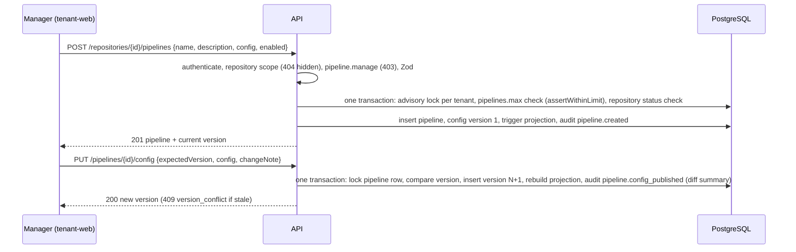
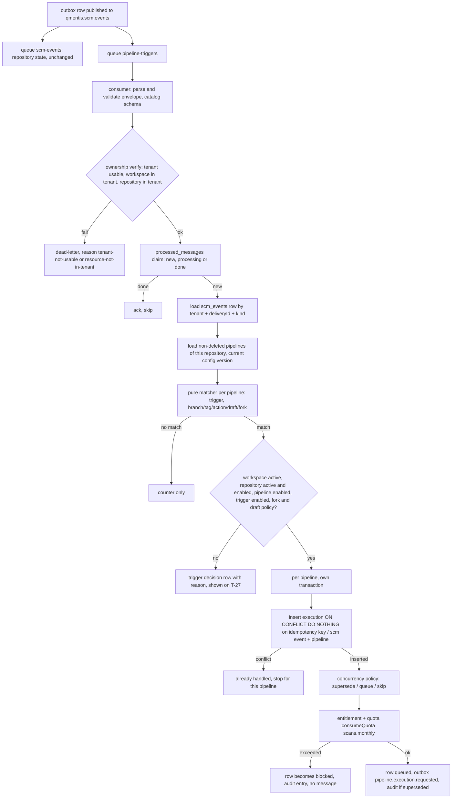
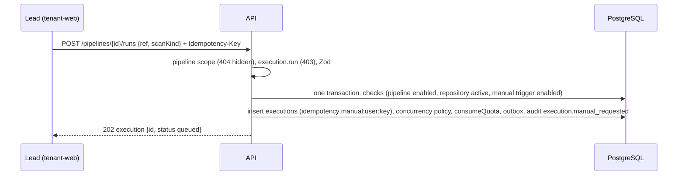

# Pipelines and triggers — Module Specification

**Status:** **Approved (2026-11-12).** The owner decided the questions of §15 on 2026-11-12 (see "Decisions applied at approval" below). Implementation follows in the parts of §13.3; parts A to E are built (§16). Items still labelled Open are listed in §15.3.
**Owner:** Product owner (decisions); Claude Code (specification)
**Last updated:** 2026-11-13 (part E implementation notes in §16)
**Related ADRs:** ADR-002 (modular monolith, separate workers), ADR-003 (tenant isolation), ADR-004 (finding identity is per pipeline), ADR-007 (Express 5), ADR-008 (security suite), ADR-009 (no secrets in messages), ADR-011 (outbox, one message family, idempotent consumers), ADR-012 (workspace-level source-control linking)

**Labels** (`docs/README.md`, `CLAUDE.md`): **Confirmed** = stated in the docs, an accepted ADR, the owner's instruction for this module, or a fact of the built code; **Confirmed (owner, 2026-11-12)** = decided by the owner at approval; **Recommended — default applied** = a proposal of the draft that the owner accepted at approval (it is in force; the owner may still change it); **Recommended** (bare, in a mechanics column) = a design detail inside an approved item, in force with it; **Open** = still needs a decision (§15.3). Where two documents disagree §15.2 records how the conflict was resolved.

**Sources** (short names used in citations): `docs/TENANT_APP_WIREFRAME_SPEC.md` (WF §4.1 to §4.5 RBAC, §5 inventory, §6 prompts T-24 to T-29); `docs/product/PROJECT_CONTEXT.md` (PC "Core workflow", "Product principles"), `PRODUCT_REQUIREMENTS.md` (PR), `FEATURE_CATALOG.md` (FC), `GLOSSARY.md`; `docs/architecture/WORKER_ARCHITECTURE.md` (WA), `BACKEND_ARCHITECTURE.md` (BA), `INTEGRATION_ARCHITECTURE.md` (IA), `OVERALL_ARCHITECTURE.md` (OA §4), `TENANT_ISOLATION.md` (TI); `docs/technical/EVENT_CONTRACTS.md` (EC), `API_STANDARDS.md` (AS), `DATABASE_DESIGN.md` (DD), `SECURITY_GUIDELINES.md` (SG), `IMPLEMENTATION_PLAN.md` (IP); `docs/AUTHORIZATION.md` (AZ §5.4, §5.9, §5.11, decisions 7 and 8); `docs/modules/repositories-github/SPEC.md` (SCM); `docs/modules/access-management/SPEC.md` (AM); `docs/decisions/OPEN_DECISIONS.md` (OD); `docs/design/DESIGN_SYSTEM.md`, `UX_GUIDELINES.md`, `TENANT_APPLICATION_DESIGN.md` (TAD §3.4, §3.5, §3b.3).

## Decisions applied at approval (2026-11-12)

All labelled **Confirmed (owner, 2026-11-12)**; the questions and conflicts are in §15.

| Id | Decision |
|---|---|
| Q5 | Fork PRs: "run without credentials". The platform fetch step uses the installation token **outside** the scan; the scan receives only the code archive: no SecretStore access, no tenant credentials, no installation token inside the scan; no automatic PR comments or check runs; results are marked `untrusted_fork`; findings of such executions are not auto-assigned. Default policy is `skip` (§5.4.1) |
| New rule | **Scans never execute repository code** (R-8, PIPE-023): SCA/SBOM parse manifests and lockfiles statically; no package install, no lifecycle scripts, no builds. The configuration schema has no field that can express commands, scripts, install or build steps and rejects unknown keys (§5.7.1) |
| New rule | The SCM producer stops publishing `scm.push.received` and `scm.pull_request.received` for repositories that are not `active` or not enabled (R-9, PIPE-024); the pipeline consumer's re-check stays (§5.9a, implementation part D) |
| Q6 | New permission key `pipeline.manage_fork_policy` (workspace scope), default bundles Admin and Lead; setting the fork policy to anything other than `skip` needs this key, other configuration needs `pipeline.manage`; every change of the fork policy is audited (§3, §5.4.1) |
| Q11 | Execution timeout default 30 min, cap 120 min; scan task default 15 min; configurable placeholders (§5.8) |
| Q18 | Execution metadata retained 13 months; logs and raw outputs 90 days; findings and their history as long as the finding exists; all configurable; the **purge job stays Open** (§7.6) |
| Q20 | Branch that does not match: counters only. Policy skips (fork, draft, repository/pipeline state that blocks): a **trigger decision row** with its reason, shown on T-27. Quota/entitlement blocks and denied manual runs: audit entries (§5.9b, §7.8, §6.2) |
| Q22 / C2 | The message is `pipeline.execution.requested` (EVENT_CONTRACTS) |
| Q23 | One repository in two workspaces is not allowed (SCM A4, unique `(tenant, provider, external repo id)`); stays Open as a future question |
| C1 | `pipeline.delete` is a **soft delete** (history and findings remain); `docs/AUTHORIZATION.md` amended |
| C3 | `execution.run` (not `pipeline.run`) everywhere; wireframe tooltip fixed |
| C4 | The built workspace-nested routes win; wireframe routes amended |
| C5 | The derived effective state wins: a pipeline is **not** flipped to disabled; SCM spec amended |
| C6 | Wireframe columns that depend on later modules stay hidden until those modules exist |
| C7 | Fastify-era wording removed where it said Fastify is the current stack (minimal edits) |
| C8 | Recommended disposition accepted |
| Q9 | Monorepo path filters are deferred to the Analysis module (the normalized events carry no file list) |
| All others | Recommended defaults accepted: **Recommended — default applied** (Q1 to Q4, Q7, Q8, Q10, Q12 to Q17, Q19, Q21, Q24 to Q30). Q23 and the purge job remain Open |

## 1. Purpose

Let a workspace define **pipelines** on a connected repository: independent, versioned security workflows with their own triggers, scan configuration and execution controls. Turn trusted SCM events (push, pull request), schedules and manual requests into **execution requests**, one per matching pipeline, safely, exactly once and within tenant, entitlement and quota limits. This module owns configuration, trigger matching and the creation of a **minimal execution record** plus the `pipeline.execution.requested` message; it does **not** run scans, move an execution past `queued`, or create findings (PC "Core workflow" steps 1 to 3 are this module; step 4 onward are the next modules).

## 2. Scope

### In scope
- Pipeline model: one repository has N pipelines; tenant + workspace ownership; versioned configuration with an immutable per-execution snapshot; enable/disable; soft delete (§5, §7). **Confirmed** (OA §4, PC, glossary, owner brief)
- Triggers: push, pull_request, schedule, manual (§5.3 to §5.6). **Confirmed** (owner brief); individual options are Recommended where marked
- Scan configuration **shell**: toggles, engine placeholders, thresholds, fail-on, incremental/full rules, exclusions (§5.7). **Confirmed** as shell only
- Execution controls: timeout, scan task timeout, concurrency policy, cancellation mode (§5.8): defaults **Confirmed (owner, 2026-11-12)**, values configurable
- Event routing: a dedicated consumer of the SCM events, matching, idempotent request creation, lifecycle/entitlement/quota gates (§6.2)
- Minimal `executions` table and the `pipeline.execution.requested` message (§7.5, §9)
- Scheduler integration for cron triggers (§6.4)
- Dry-run of triggers (§8, Recommended — default applied)
- Screens T-24 (Pipelines tab on the repository detail), T-25, T-26, T-27 (`SCREENS.md`)

### Out of scope (next modules or later)
- Running scans, repository analysis, scan engine adapters, any execution status beyond `queued` (and the terminal `blocked`/`skipped`/`cancelled` written before a claim), logs, artifacts, retry, the executions list and detail screens T-28/T-29 (**execution lifecycle module**).
- DAST and Asset Discovery: **manual-only** through `scan.run_manual` (T-30). They are never pipeline-triggered and cannot be configured in a pipeline (**Confirmed**, AZ decision 8, WF T-26 prompt "Manual-only scans").
- Findings, lifecycle, fingerprints (ADR-004 is respected, §13.2).
- Writing status checks or comments back to GitHub (needs write permissions, SCM Q-open "Optional permission").
- Pipeline definitions stored as files in the repository ("config as code"), templates, cross-workspace sharing (Q10); monorepo path filters on triggers (Q9, deferred to the Analysis module).
- Notifications (WF T-26 step 5 is hidden until the notification module exists; the config reserves an empty `notifications` object).
- Billing and real plan values.

## 3. Actors and permissions

All keys exist in `packages/shared/src/permissions.js` and are bundled in `roles.js` as AZ §5.4 lists them (verified, §17). **One key was added at approval (Q6, Confirmed (owner, 2026-11-12)): `pipeline.manage_fork_policy`**, added to the catalog, the Lead bundle (Admin receives every workspace key except the approval decisions automatically), AZ §5.4 and the AZ decision log (decision 28). All are workspace scope.

| Actor (default roles) | Action | Permission | Default holders |
|---|---|---|---|
| Any workspace member | List and open pipelines, versions, configuration, triggers, dry-run | `pipeline.view` | Admin, Manager, Lead, Security Analyst, Dev Lead, Developer, Viewer |
| Admin, Manager, Lead, Dev Lead | Create pipeline, edit metadata, publish a configuration version, enable/disable (any configuration except raising the fork policy) | `pipeline.manage` | Admin, Manager, Lead, Dev Lead |
| Admin, Lead | Set the **fork policy** of a pipeline to anything other than `skip` (at creation or in a new version); every change of the fork policy is audited | `pipeline.manage_fork_policy` (needed in addition to `pipeline.manage`) | Admin, Lead |
| Admin, Manager | Delete (soft) a pipeline | `pipeline.delete` | Admin, Manager |
| Any workspace member | See a pipeline's execution requests and last status (read only) | `execution.view` | all seven roles |
| Admin, Manager, Lead, Dev Lead | **Manual run** of a pipeline | `execution.run` | Admin, Manager, Lead, Dev Lead |
| Admin, Manager, Lead, Dev Lead | Cancel a queued request created by this module (running executions: next module) | `execution.cancel` | Admin, Manager, Lead, Dev Lead |
| Admin, Manager, Lead, Dev Lead | DAST / Asset Discovery manual scan (not part of this module) | `scan.run_manual` | Admin, Manager, Lead, Dev Lead |
| Needed with the above | See the repository a pipeline belongs to (to pick it in the wizard, to open T-24) | `repository.view` | all seven roles |
| System | Evaluate events, create requests, fire schedules | none (worker, no user) | n/a |
| Platform operator | No access to pipelines. Root Console has no pipeline route in v1; a platform session on a tenant route is 401 (ADR-008 area 3) | n/a | n/a |

Rules (**Confirmed**, AZ §5.9): a pipeline in a workspace the caller cannot see, in another tenant, or that does not exist answers the **same 404**; a visible workspace without the permission answers **403** with the generic body (AZ Q13). Cross-workspace and cross-tenant access is therefore 404. Item routes resolve the pipeline with a **pipeline scope resolver** (loads by id AND tenant, yields the workspace scope), mirroring `repositoryScope` (`apps/api/src/authz/scopes.js`). Collections are filtered to workspaces where the caller holds `pipeline.view` and never answer 403.

Who sees what by default role (WF §4.4 "Pipelines" row is consistent):

| Role | T-25 list | T-27 detail | Create / Edit / Enable / Duplicate (fork policy `skip` only unless noted in SCREENS §7) | Delete | Run now | Cancel queued |
|---|---|---|---|---|---|---|
| Admin | yes | yes | yes | yes | yes | yes |
| Manager | yes | yes | yes | yes | yes | yes |
| Lead | yes | yes | yes | no (hidden) | yes | yes |
| Security Analyst | yes (read only) | yes | no (hidden) | no | no (disabled with reason) | no |
| Dev Lead | yes | yes | yes | no | yes | yes |
| Developer | yes (read only) | yes | no | no | no (disabled with reason) | no |
| Viewer | yes (read only) | yes | no | no | no (disabled with reason) | no |

Segregation of duties: no SoD rule applies to pipelines in v1 (SOD-1..3 concern TP/FP decisions and role escalation, AZ decision 10). Fork policy (Q6, Confirmed): holders of `pipeline.manage_fork_policy` may set it to anything other than `skip`; everyone with `pipeline.manage` may edit all other configuration and may set it back to `skip`; a user without the key who saves a configuration that leaves an existing non-`skip` value unchanged is allowed (only a change to a non-`skip` value is checked). A violation answers `403 FORBIDDEN` with `details.reason: fork_policy_requires_permission`. Manager and Dev Lead therefore cannot enable fork runs.

## 4. Functional requirements

| ID | Requirement | Priority | Status |
|---|---|---|---|
| PIPE-001 | A pipeline belongs to exactly one repository, one workspace and one tenant; the repository belongs to the same workspace; a repository has N pipelines | Must | Confirmed (OA §4, owner brief) |
| PIPE-002 | Pipeline name is unique per repository (case-insensitive, among non-deleted pipelines); description is optional | Must | Confirmed (owner brief) |
| PIPE-003 | Configuration is versioned: every change publishes a new immutable version with a content hash; metadata (name, description) and the enabled flag are not versioned | Must | Confirmed (owner brief) |
| PIPE-004 | Every execution request points to the exact configuration version (and hash) that was current when it was requested; that snapshot cannot change | Must | Confirmed (owner brief) |
| PIPE-005 | Triggers: zero or more of push, pull_request, schedule, manual per pipeline | Must | Confirmed (owner brief) |
| PIPE-006 | Only the SCM events `scm.push.received` and `scm.pull_request.received`, schedules and manual requests can create executions (§5.9) | Must | Confirmed |
| PIPE-007 | DAST and Asset Discovery are never pipeline-triggered and cannot be part of a pipeline configuration | Must | Confirmed (AZ decision 8, WF T-26) |
| PIPE-008 | A fork pull request (and one whose fork status is unknown) does not run by default (`skip`); a run is only possible without credentials and only by explicit configuration by a holder of `pipeline.manage_fork_policy`; the semantics are those of §5.4.1 | Must | Confirmed (SCM R-7, owner brief; owner, 2026-11-12, Q5 and Q6) |
| PIPE-009 | One SCM event creates one execution request per matching pipeline (one event, N executions); each is idempotent by `(scm event, pipeline)` with a database unique constraint | Must | Confirmed (OA §4, owner brief) |
| PIPE-010 | Tenant (active or trial), workspace (not archived), repository (`status = active`, `enabled`), pipeline (enabled, not deleted), entitlement and quota are checked **before** the execution record is created; disconnected, unavailable or disabled repositories never trigger. A policy skip leaves a trigger decision row, a quota or entitlement block leaves a `blocked` row and an audit entry (§5.9b) | Must | Confirmed (owner brief; owner, 2026-11-12, Q20) |
| PIPE-011 | Ownership (tenant, workspace, repository, pipeline) is re-validated in the worker; `tenantId` from a message is never authority | Must | Confirmed (ADR-003, ADR-011, CLAUDE.md) |
| PIPE-012 | A scheduled trigger uses a cron expression and an IANA time zone, fires through the scheduler worker, and re-validates everything at fire time | Must | Confirmed (WA scheduler row, owner brief); details Recommended |
| PIPE-013 | Manual run requires `execution.run`, selects a branch or tag, refuses disabled pipelines and inactive repositories | Must | Confirmed (owner brief); details Recommended |
| PIPE-014 | An incremental scan never marks a finding fixed; only a full scan can; the request carries `scanKind` and the reason | Must | Confirmed (PC principles, WF T-29 notice) |
| PIPE-015 | Configuration is validated with Zod at the API boundary and again by the worker before use; the schema is versioned | Must | Confirmed (CLAUDE.md, owner brief) |
| PIPE-016 | The request creates a minimal `executions` row (`queued`) and a `pipeline.execution.requested` message in the same transaction (outbox) | Must | Confirmed (ADR-011, owner brief) |
| PIPE-017 | Audit: config versions (with diff summary), enable/disable, delete, schedule changes, **every fork-policy change**, manual runs, **denied manual runs**, blocked (quota/entitlement) and concurrency-skipped requests; never secrets. Branch non-matches are counters only; policy skips are trigger decision rows, not audit entries | Must | Confirmed (SG, owner brief; owner, 2026-11-12, Q6 and Q20) |
| PIPE-018 | Deleting a pipeline never deletes executions, config versions or anything findings depend on | Must | Confirmed (ADR-004, owner brief) |
| PIPE-019 | A pipeline whose repository is disconnected, unavailable, disabled or whose workspace is archived is **effectively stopped** (derived effective state; the stored `enabled` flag is never flipped), and resumes by itself when the repository recovers | Must | Confirmed (SCM §18.1 A5, A6 amended; owner, 2026-11-12, C5) |
| PIPE-020 | Dry-run: given a sample event or branch, show which triggers and pipelines would match and why, without side effects | Should | Recommended |
| PIPE-021 | Pipeline count limit per tenant (`pipelines.max`) and a per-repository cap | Should | Recommended |
| PIPE-022 | Execution requests of a pipeline are readable (`execution.view`) in a minimal list for T-27 until the execution module ships its own | Should | Recommended — default applied |
| PIPE-023 | **Scans never execute repository code** (fork or not): SCA and SBOM parse manifests and lockfiles statically; no package install, no lifecycle scripts, no builds, no repository-supplied hooks. The pipeline configuration cannot express any of them (§5.7.1) | Must | Confirmed (owner, 2026-11-12) |
| PIPE-024 | The SCM producer does not publish `scm.push.received` or `scm.pull_request.received` for a repository that is not `active` or not enabled; the pipeline consumer re-checks anyway | Must | Confirmed (owner, 2026-11-12); code change in part D |
| PIPE-025 | A fork pull request run is `untrusted_fork`: platform fetch outside the scan, code archive only, no credentials in the scan, no automatic PR comments or check runs, findings not auto-assigned | Must | Confirmed (owner, 2026-11-12, Q5) |
| PIPE-026 | Trigger decision rows record every policy skip with a stable reason, visible on T-27 | Must | Confirmed (owner, 2026-11-12, Q20) |

## 5. Business rules

### 5.1 Pipeline identity and lifecycle

| Rule | Text | Status |
|---|---|---|
| R-1 | A pipeline is created on a repository by a holder of `pipeline.manage` in the repository's workspace. The repository must be `active` (not `disconnected`, not `unavailable`); `enabled` may be false (the pipeline is then created but cannot fire). Archived GitHub repositories are allowed: pushes and PRs cannot happen on them, schedules and manual runs still can (SCM Q18 delegated this decision here). | Recommended — default applied (Q27) |
| R-2 | `name`: 1 to 100 characters, no control characters, unique per repository case-insensitively among non-deleted pipelines. `description`: 0 to 500 characters. Free text is stored and shown as escaped text. | Recommended — default applied |
| R-3 | Editing metadata (`PATCH`) changes name/description in place and is audited. Editing configuration (`PUT .../config`) creates version N+1 with optimistic concurrency (`expectedVersion`); a stale save is `409 CONFLICT` with `details.reason: version_conflict`. | Recommended — default applied |
| R-4 | `enabled` is the user's intent and is separate from the configuration versions. Enable requires at least one scan type enabled and at least one enabled trigger; otherwise `409 CONFLICT` `details.reason: pipeline_incomplete`. A pipeline may be saved disabled with incomplete configuration. | Recommended — default applied |
| R-5 | **Delete is a soft delete** (`deleted_at`, `deleted_by`): triggers are removed from the projection, queued requests are cancelled, the name is released, everything else (versions, executions, audit) stays. Delete is refused with `409 CONFLICT` `details.reason: has_active_executions` while any execution is in a non-terminal state other than `queued`; the user cancels first (`execution.cancel`). Purging data is a retention decision (Q18, the purge job is Open). `pipeline.delete` means soft delete; the old AZ §5.4 wording ("destroys execution/finding history association") was replaced on 2026-11-12 (§15.2 C1). | Confirmed (ADR-004; owner, 2026-11-12, C1); mechanics Recommended — default applied |
| R-6 | Finding identity stays per pipeline (ADR-004). A deleted pipeline keeps its id forever; findings and executions reference it. Re-creating a pipeline with the same name creates a **new** pipeline with new identity and no history. Cloning copies configuration only. | Confirmed |
| R-7 | A repository can carry at most `PIPELINES_MAX_PER_REPOSITORY` non-deleted pipelines (platform setting, default 20, bounds the fan-out of one event) and the tenant at most `pipelines.max` (entitlement, §10). | Recommended — default applied |
| R-8 | **Scans never execute repository code.** This holds for every execution, fork or not. SCA and SBOM analyze manifests and lockfiles statically (parsing only); nothing from the repository is installed, built, compiled, imported or run: no package-manager install, no lifecycle or `postinstall` scripts, no build, no test run, no repository-supplied hooks or plugins. The pipeline configuration enforces this by construction (§5.7.1): the schema has no field that can express a command, script, install or build step, and unknown keys are rejected. Engine adapters (later modules) must honor it as a contract (hand-over H8, §13.2) | **Confirmed (owner, 2026-11-12)** |
| R-9 | **The SCM producer publishes push and pull-request events only for usable repositories.** `scm.push.received` and `scm.pull_request.received` are not published (and no `scm_events` row is needed for routing) for a repository that is not `active` (`disconnected`, `unavailable`) or not enabled. The pipeline consumer re-checks the repository state from the database anyway, because state can change between publication and consumption (§5.9a) | **Confirmed (owner, 2026-11-12)**; built behavior and the change are described in §5.9a |

### 5.2 Effective state (when a pipeline can fire)

A pipeline can create executions only if **all** of the following hold at the moment of evaluation (the worker re-checks them, it never trusts the event):

`tenant.status in (active, trial)` AND `workspace.status = active` AND `repository.status = active` AND `repository.enabled` AND `pipeline.deleted_at IS NULL` AND `pipeline.enabled` AND trigger enabled AND the plan allows it (entitlement + quota, §6.2 step 7).

**Derived, not flipped (Confirmed (owner, 2026-11-12), C5).** The previous SCM text said the Pipelines module "disables" the pipelines of a disconnected repository (SCM R-6 unlink note, §18.1 A5, `repository.disconnected`). To keep the outcome and avoid a second source of truth, the module **does not rewrite `enabled`**; it computes an `effectiveState` for display and enforcement: `running_normally`, `disabled` (user), `repository_disabled`, `repository_unavailable`, `repository_disconnected`, `workspace_archived`. Re-linking or recovery restores pipelines with no memory of "why" needed. Consequence: the module does not need to consume `repository.disconnected` (which today is published only to the `notification` queue, `apps/workers/src/scm/events.js`), and no change to the SCM publishers is required. The SCM specification was amended on 2026-11-12 to read "pipelines do not trigger (derived state)" in A5, A6, R-6 and the unlink text (Q19, C5).

### 5.3 Push trigger (Confirmed as a trigger type; options Recommended — default applied)

Built facts the matcher relies on (`scm.push.received`): `ref` (full ref), `branch` (null for tags), `before`/`after` (SHAs, nullable), `created`, `deleted`, `forced`, `commitCount`, `headCommitSha`, `pusherLogin`. No changed-file list exists in the message (§17); **monorepo path filters on triggers are therefore deferred to the Analysis module** (Q9, Confirmed (owner, 2026-11-12)); `exclusions.paths` (§5.7) only limits scan scope.

| Option | Meaning | Default |
|---|---|---|
| `branches.include` | list of glob patterns (§5.5), at least one needed for the trigger to match a branch | wizard pre-fills the repository default branch; the token `$default_branch` is accepted and resolved from `repositories.default_branch` at match time (Recommended, so a default-branch rename does not silently stop scanning) |
| `branches.exclude` | glob patterns that veto a match | empty |
| `tags.enabled` | whether a push of a **tag** can match | `false` |
| `tags.include` / `tags.exclude` | glob patterns on the tag name (`refs/tags/` stripped) | empty |
| `onBranchCreated` | `run` / `skip` | `run` (a new branch is scanned; scan kind is **full**, §5.7) |
| `onForcePush` | `run` / `skip` | `run` (scan kind full, because the previous baseline may no longer be an ancestor) |

Decisions by event shape (**Recommended — default applied**). A non-match (branch/tag/action not matching, deleted ref, no trigger) is a **counter only**; a match that a policy or state then stops is a **trigger decision row** (§5.9b):

| Push shape | Result |
|---|---|
| `deleted = true` (branch or tag deleted) | never creates an execution; counted as `deleted_ref` (counter) |
| `created = true` on a matching branch | execution, `scanKind = full`, reason `branch_created` |
| `forced = true` | execution, `scanKind = full`, reason `force_push` |
| tag push, `tags.enabled = false` | no match |
| tag push, matches `tags.include` and not `tags.exclude` | execution, `scanKind = full`, reason `tag` |
| `branch = null` and not a tag ref (other refs, for example notes) | no match |
| `commitCount = 0` and not created/forced (a ref moved to an existing commit) | still evaluated like any push (not skipped); no SHA-based deduplication in v1 |
| merge of a pull request into a matching base branch | arrives as an ordinary push to that branch and matches the push trigger (the PR `closed` event never creates an execution) |

### 5.4 Pull request trigger

Built facts (`scm.pull_request.received`): `action` (the SCM service only publishes `opened`, `reopened`, `synchronize`, `closed`, `edited`, `ready_for_review`, `converted_to_draft`), `number`, `headSha`, `baseSha`, `headRef`, `baseRef`, `isFork` (boolean, **unknown is already mapped to true**), `draft` (nullable), `merged` (nullable), `authorLogin`.

| Option | Meaning | Default |
|---|---|---|
| `actions` | subset of `opened`, `synchronize`, `reopened` (owner brief) plus `ready_for_review` (Recommended addition so a PR skipped while draft is scanned when it becomes ready) | `opened`, `synchronize`, `reopened`, `ready_for_review` |
| `targetBranches.include` / `.exclude` | glob patterns on `baseRef` (the branch the PR targets) | include = `$default_branch` |
| `drafts` | `skip` / `run`. `draft = null` (unknown) is treated as **not draft** (running more is the safe side for a security product; the cost is quota). A skipped draft leaves a decision row `draft_policy_skip` | `skip` |
| `forkPolicy` | `skip` / `run_without_credentials` (§5.4.1); setting anything other than `skip` needs `pipeline.manage_fork_policy` | `skip` |

`closed`, `edited` and `converted_to_draft` never create an execution (not selectable). A PR that is `merged` is never scanned as a PR.

**Scan kind:** `incremental` against `baseSha` by default (the PR diff), reason `pull_request`; the execution module may upgrade to full (§5.7). **Ref recorded:** `refType = pull_request`, `refName = "pull/<number>"`, `headRef` and `baseRef` stored as context, `commit_sha = headSha`.

#### 5.4.1 Fork policy (**Confirmed (owner, 2026-11-12), Q5 and Q6**)

The SCM module already maps "unknown fork status" to `isFork = true` (`apps/api/src/modules/scm-webhooks/services/index.js`, function `isFork`: no `head.repo`, `fork: true`, or a head repository id different from the base repository id are all forks). The matcher uses the flag exactly as received and never recomputes it.

| Variant | Behaviour | Label |
|---|---|---|
| `skip` (**default**) | A fork PR matches no execution. It leaves a **trigger decision row** (`fork_policy_skip`, §7.8) shown on T-27 and a counter; no execution, no quota, no audit entry per event | Confirmed (owner, 2026-11-12) |
| `run_without_credentials` | The execution is created with `trust = untrusted_fork`. **Contract (binding on the execution and engine modules, hand-over H6):** (1) the platform's **fetch step** uses the GitHub installation token **outside the scan**, to download the code; (2) the **scan receives only the code archive**: no SecretStore access, no tenant credentials, no installation token, no AI-provider or external-engine credential inside the scan, no network access to tenant systems; (3) **no automatic PR comments or check runs** (also not possible today, no write permission); (4) the results are marked `untrusted_fork`, the execution is incremental by default and can never mark findings fixed; (5) **findings of such executions are not auto-assigned**; (6) it consumes quota like any run; (7) R-8 applies (no repository code is executed). | Confirmed (owner, 2026-11-12) |
| `run_with_credentials` | **Not offered.** Not configurable, not representable in the schema | Confirmed by omission (owner brief) |

**Who may change it (Q6, Confirmed (owner, 2026-11-12)).** Setting `forkPolicy` to anything other than `skip`, at creation or in a new configuration version, requires the workspace-scope key **`pipeline.manage_fork_policy`** (default bundles: Admin and Lead) in addition to `pipeline.manage`; all other configuration needs `pipeline.manage` only (§3). The API checks the key in the service against the central authorization engine for the pipeline's workspace; failure is `403 FORBIDDEN` `details.reason: fork_policy_requires_permission`, nothing is written. **Every change of the fork policy (either direction) is audited** as `pipeline.fork_policy_changed` with old and new value, version numbers and the actor, in the same transaction as the version.

### 5.5 Glob pattern semantics (Recommended — default applied)

One small, documented dialect used by every pattern field (branches, tags, target branches): case-sensitive; `*` matches any run of characters except `/`; `**` matches any run including `/`; `?` matches one character except `/`; everything else literal; no brace expansion, no `!` negation (use `exclude`), no regular expressions. Limits: at most 20 patterns per list, 200 characters each, printable characters only. Evaluation order: `exclude` wins over `include`. Implemented as a linear-time matcher (no regular-expression backtracking) in `@qmentisai/shared` and used by the worker and by the dry-run endpoint, so UI preview and production cannot diverge. No new dependency.

### 5.6 Schedule and manual triggers

**Schedule (Recommended — default applied, Q1 to Q3; every numeric value is a configurable platform setting).**

| Item | Rule |
|---|---|
| Expression | standard 5-field cron (minute hour day-of-month month day-of-week), names (`MON`, `JAN`) and ranges/steps allowed; no seconds, no `@reboot`, no `L`, `W`, `#`. Validated by Zod and by computing the next fire times |
| Time zone | required IANA name (`Europe/Berlin`), validated against the runtime's time-zone database; default `UTC` |
| Minimum interval | the smallest gap between two consecutive fire times in the next 50 occurrences must be >= `PIPELINE_SCHEDULE_MIN_INTERVAL_SECONDS` (default **3600**, Q1); otherwise `VALIDATION_FAILED` |
| Schedules per pipeline | at most `PIPELINE_MAX_SCHEDULES_PER_PIPELINE` (default 3) |
| Slot | the nominal fire instant in UTC; the idempotency key of the execution is `schedule:<triggerKey>:<slot ISO UTC>` |
| Jitter | a **deterministic** offset `hash(triggerId + slot) mod PIPELINE_SCHEDULE_JITTER_SECONDS` (default 300; **Confirmed (owner, 2026-11-13)**: derived from the trigger id and the nominal slot, not per trigger alone) is added to the actual fire time to spread the 00:00 burst. The offset is the same for the same trigger and slot on every handler run and in the API's `next_fire_at`, and it differs across slots and triggers. The slot (the `schedule_slot` key and the idempotency key) is always the nominal UTC instant and is never moved by jitter. One function (`jitterOffsetSeconds`, `nextScheduledFire` in `packages/shared/src/pipelines/schedule.js`) serves the API and the handler. The `jitter_offset_seconds` column of `pipeline_triggers` is no longer used for the fire time (kept at 0 for new rows: its CHECK requires a value for schedules; removing it is left to a later cleanup migration) |
| DST | spring forward: a nominal time that does not exist fires once at the first valid instant after the gap; fall back: a repeated local time fires once, at its first occurrence. The slot is always a distinct UTC instant, so the unique key prevents doubles. **Refinement accepted by the owner (2026-11-13), built in part E:** the gap-end rule applies to expressions that **name their hours** (`30 2 * * *`, `*/30 2 * * *`). Expressions whose hour field is a wildcard or a step (`*`, `*/n`, interval style) **skip** nominal times inside the gap, and in the repeated hour of a fall back they fire at **every real occurrence**, i.e. once per REAL UTC hour (a fall-back day has 25 real hours and 25 fires; a spring-forward day 23 and 23). Why: with the literal rule an hourly `30 * * * *` in Europe/Berlin would fire at 01:30Z, 01:00Z (the gap-end fire of the nominal 02:30) and 01:30Z on 29 March, two 30-minute gaps, so the 1 h minimum interval would have to refuse every hourly schedule in a time zone with daylight saving; skipping the gap keeps real gaps at 1 h and the repeat rule keeps them from growing to 2 h. Named-hour expressions fire once in the repeated hour (the first occurrence). Verified by fixtures (`PIP-043`, `PIP-050`; Europe/Berlin 2026-10-25 and America/New_York 2026-11-01). Q2 |
| Missed runs | policy `skip` or `run_once` (`run_all` is not offered). **`skip` means "fire only when on time"**: the slot fires only when it is handled at most `PIPELINE_SCHEDULE_ON_TIME_GRACE_SECONDS` (default **120**) after its planned time (slot + jitter), otherwise it is one missed run; **Recommended — default applied** (owner accepted 2026-11-13; the grace is a configurable placeholder like every numeric value of this table). Lateness is measured from the planned time. `run_once` is as follows. Default `run_once`: if the scheduler was down or slow, the **latest** missed slot fires once if it is not older than `PIPELINE_SCHEDULE_MAX_LATENESS_SECONDS` (default 21600); older misses are recorded as one `skipped` request with `status_reason = missed_run`. A pipeline that was disabled does not accumulate misses: on enable, `next_fire_at` is recomputed from now. Q3 |
| Branch scanned | the trigger names one branch (`ref`, default `$default_branch`); tags and PRs are not schedulable. `commit_sha` is null at request time (the platform makes no GitHub call in the trigger path); the execution module pins the head SHA when it claims the request (§13.1) |
| Scan kind | `full` by default (reason `scheduled`); the trigger may select `incremental` (Recommended) |
| Fork / trust | always `trusted` |

**Manual (Confirmed trigger type; details Recommended — default applied).**

| Item | Rule |
|---|---|
| Who | `execution.run` in the pipeline's workspace (Admin, Manager, Lead, Dev Lead by default). The `manual` trigger entry has `enabled` (default true); a pipeline can switch manual runs off |
| What | a branch or a tag (`ref: { type: "branch" \| "tag", name }`), default the repository default branch; the name is validated by syntax only (the branch list in the UI is a convenience read-through; the execution module fails the request if the ref does not exist). Optional `scanKind` (`full` or `incremental`, default `full`) |
| Gates | pipeline must be enabled, not deleted, effective state `running_normally`, manual trigger enabled; plus entitlement and quota (a manual run consumes 1 scan unit like any run). Otherwise `409 CONFLICT` with `details.reason` (`pipeline_disabled`, `repository_not_active`, `manual_disabled`) or `403 QUOTA_EXCEEDED` / `ENTITLEMENT_REQUIRED`. **Every denied manual run is audited** as `execution.manual_denied` (reason code, pipeline, actor; Confirmed (owner, 2026-11-12), Q20): gate and quota/entitlement denials from the service, and a permission denial (`403`) on a pipeline the caller can see from the route policy. A `404` (hidden or absent) is never audited against the target, to leak nothing. |
| Idempotency | `Idempotency-Key` is **required** on this POST (Recommended; the UI always sends one); the stored key is `manual:<userId>:<header value>` |
| Fork | not applicable (no PR) |

### 5.7 Scan configuration shell

The module stores and validates; it does not run. Configuration schema v1 (logical shape, §7.3):

| Part | Content | Rules |
|---|---|---|
| `scans.sca`, `scans.sbom`, `scans.sast`, `scans.secrets` | `{ enabled, engine: { id, profile }, severityThreshold }` | `engine.id` must be a key of a platform-owned **engine catalog** constant (in v1 one placeholder id per scan type, `default`); `profile` is an optional short string validated against the catalog entry; real engines and versions are added by the engine modules. `severityThreshold` in `info, low, medium, high, critical`: findings below it are not reported by this pipeline. At least one scan enabled to enable the pipeline (R-4). **Strict** objects: any other key, in particular `dast`, `assetDiscovery` or anything that could express a command, is rejected (PIPE-007, PIPE-023, §5.7.1) |
| `scanMode` | `{ default: "incremental" \| "full", fullEvery: null \| "weekly" \| "monthly" }` | default `incremental` for push and PR. `fullEvery` is a shell field the execution module can honor; the rules below are what this module guarantees today |
| `failOn` | `{ severity: "none"\|"low"\|"medium"\|"high"\|"critical", scope: "new" \| "all", onEngineError: "fail" \| "ignore" }` | defines when an execution is considered failed/blocking (a gate result, separate from the technical status). Default `severity = high`, `scope = new`, `onEngineError = fail`. Stored and snapshotted here; evaluated by the execution and findings modules. Tenant/workspace policy floors (TAD workspace policies, "stricter-only") will constrain it when the policies module exists (Q14) |
| `exclusions.paths` | glob patterns of repository paths excluded from scanning | same dialect as §5.5, max 50; not a trigger filter |
| `execution` | `{ timeoutSeconds, scanTaskTimeoutSeconds, concurrency: { policy, maxQueued, maxActive }, cancellation }` | §5.8 |
| `triggers[]` | `{ key, type, enabled, ...type options }` with a stable `key` per entry | §5.3 to §5.6 |
| `notifications` | `{}` reserved | ignored until the notification module |

#### 5.7.1 How the configuration enforces "scans never execute repository code" (R-8, PIPE-023; **Confirmed (owner, 2026-11-12)**)

- `pipelineConfigV1` is a **strict** Zod schema at every level (`.strict()`): an unknown key anywhere is rejected with `400 VALIDATION_FAILED`, never ignored or stored.
- The schema contains **no field whose value is a command line, script, shell snippet, container image, environment, working directory, package-manager invocation, install step, build step, hook or plugin reference**. The only free-text values it accepts are the bounded, validated ones already listed: names, glob patterns, cron expression, IANA time zone, engine catalog ids and profile names (checked against the platform engine catalog, never executed), and the change note. Pattern fields are matched against names, never evaluated or expanded by a shell.
- `engine.id` and `engine.profile` select from a **platform-owned catalog**; a repository cannot add an engine, a rule pack path, a command or a plugin. Repository-side files (lockfiles, manifests, `.npmrc`, build files) are inputs to static parsers only.
- The stored `config` JSON is validated again by the worker; an unsupported shape is a non-retryable poison message (§6.2).
- Future schema versions must keep this property: adding any field that can carry executable content is an ADR-level change and is rejected at review. A security-suite check proves the property (PIP-027, §14.1).
- Engine adapters, the execution module and the fetch step are bound by the same rule (hand-over H8): SCA/SBOM use static manifest and lockfile parsing; no install, no lifecycle scripts, no build.

**Incremental vs full (Confirmed rule, Recommended mechanics).** An incremental scan **never marks findings fixed**; only a full scan of a trusted execution can (hand-over to the Findings module, §13.2). This module decides the **requested** `scanKind` and its reason at request time, from facts it has; the execution module may **upgrade** incremental to full (for example when it has no completed full baseline for the pipeline) but **never downgrade** a full request.

| Situation | `scanKind`, `scanKindReason` |
|---|---|
| first request ever for the pipeline | `full`, `first_run` |
| the scan-relevant part of the configuration differs from the previous request's (hash of `scans`, `exclusions`, `scanMode`) | `full`, `config_changed` |
| push that creates a branch / force push / tag | `full`, `branch_created` / `force_push` / `tag` |
| schedule | `full` (or the trigger's choice), `scheduled` |
| manual run | the user's choice, default `full`, `manual` |
| `scanMode.default = full` | `full`, `configured_full` |
| push to an existing branch, pull request | `incremental`, `incremental` |

A fork execution (`trust = untrusted_fork`) and any execution whose ref is not the pipeline's tracked baseline cannot resolve findings regardless of kind; the Findings spec owns the baseline definition (hand-over item H3).

**Validation and versioning.** The API validates `PUT .../config` with a strict Zod schema `pipelineConfigV1`; the worker validates the stored version again before use and treats an unsupported `schemaVersion` as a non-retryable poison message. Adding fields in a later `schemaVersion` keeps old versions readable (a normalizer upgrades on read, old rows are never rewritten). Platform caps (timeout, schedule minimum interval, pattern counts) are applied at validation from configuration (§5.8). The Zod schema lives in `@qmentisai/contracts` and the pure matcher in `@qmentisai/shared` (Recommended placement), so API, worker and browser preview share one definition.

**The immutable snapshot.** Each publish writes `pipeline_config_versions(version, config JSON, schema_version, config_hash, created_by, change_summary)`; the `config_hash` is SHA-256 over the canonical JSON (sorted keys, no whitespace) of `{ schemaVersion, config }`. Versions are never updated or deleted (a database trigger rejects it, as for `audit_logs`). An execution stores `config_version_id`, `config_version` and `config_hash` (copy). That pointer **is** the snapshot: the content cannot change, and the copy of the hash lets anyone verify it. Context that is not in the config but affects the run (resolved `$default_branch`, `trust`, `scanKind`, matched trigger key) is stored on the execution itself.

### 5.8 Execution controls (defaults **Confirmed (owner, 2026-11-12), Q11**; every value is a configurable placeholder: platform setting now, entitlement later)

| Control | Per-pipeline field | Recommended default | Platform limit (where it lives) |
|---|---|---|---|
| Execution timeout (whole execution) | `execution.timeoutSeconds` | **1800 (30 min)** (`PIPELINE_TIMEOUT_DEFAULT_SECONDS`) | min 60, **cap 7200 (120 min)** (`PIPELINE_TIMEOUT_MAX_SECONDS`). A later entitlement key can lower the cap per plan (Q12) |
| Scan task timeout (one scan type inside an execution) | `execution.scanTaskTimeoutSeconds` | **900 (15 min)** (`PIPELINE_SCAN_TASK_TIMEOUT_DEFAULT_SECONDS`) | min 30, at most the execution timeout and at most the same cap; enforced by the execution module |
| Concurrency policy | `execution.concurrency.policy` | `supersede` | `queue`, `supersede` or `skip` |
| Queue depth | `concurrency.maxQueued` | 5 | max `PIPELINE_MAX_QUEUED_PER_PIPELINE` (default 20); used by `queue` |
| Parallel runs of one pipeline | `concurrency.maxActive` | 1 | stored; **enforced by the execution module**, which also owns platform and per-tenant worker concurrency (OD "Execution concurrency limits") |
| Cancellation | `execution.cancellation` | `graceful` | `graceful` or `immediate`; grace period `PIPELINE_CANCEL_GRACE_SECONDS` (default 60) is execution-module configuration |

Concurrency **group** of a request: push `ref:<ref>`, pull request `pr:<number>`, schedule `schedule:<triggerKey>`, manual `manual:<refName>`. Policy semantics (applied inside the creating transaction, under a per-pipeline advisory lock):
- `supersede`: queued requests of the same group that are older are cancelled (`cancelled`, `status_reason = superseded`, quota released); a running execution of the group is not touched by this module (the execution module may cancel it according to the pipeline's cancellation mode; hand-over H4).
- `queue`: the new request is queued behind others up to `maxQueued`, beyond which it is recorded `skipped` (`queue_full`).
- `skip`: if a request of the same group is queued or running, the new one is recorded `skipped` (`concurrency_skip`).

Timeouts are Confirmed (Q11); the other defaults are Recommended — default applied (Q4, Q12, Q13). All values are placeholders that live in platform configuration now and may move to entitlements later; none is hard-coded.

### 5.9 Which events can and cannot create executions

| Source | Creates an execution? | Notes |
|---|---|---|
| `scm.push.received` (queue `pipeline-triggers`) | yes, if a push trigger matches (§5.3) | per matching pipeline |
| `scm.pull_request.received` with action `opened`, `reopened`, `synchronize`, `ready_for_review` | yes, if a pull_request trigger matches (§5.4) | |
| `scm.pull_request.received` with `closed`, `edited`, `converted_to_draft` | no | |
| `scm.repository.changed`, `scm.installation.*`, `scm.installation_repositories.changed`, `repository.connected`, `repository.disconnected` | no | state only (SCM) |
| Schedule slot fired by the scheduler | yes (§6.4) | |
| Manual run API call | yes (§5.6) | |
| Webhook of any other kind (`check_run`, `issue_comment`, release, ...) | no | the SCM service does not publish them |
| UI "Retry" of a past execution | not in this module | execution module |
| DAST, Asset Discovery | **never** | `scan.run_manual` flow only |
| Pipeline create, edit, enable, config publish | no | enabling never back-fills old events (Q17) |

### 5.9a Producer rule and built behavior (R-9, PIPE-024; **Confirmed (owner, 2026-11-12)**)

**Built before part D** (changed on 2026-11-13, §16; `apps/api/src/modules/scm-webhooks/services/index.js`): the webhook service loaded the repository by `(tenant, external repo id)` and treats it as usable only when `repo.status !== "disconnected" && repo.enabled`. For an unusable repository the normalized event is null, so the delivery is recorded as `ignored` and nothing is stored in `scm_events` or published. A repository with `status = unavailable` that is enabled **is still treated as usable**, so its push and pull-request events **are still published**.

**Change made in part D (2026-11-13):** the condition for push and pull-request events became `repo.status === "active" && repo.enabled` for `scm.push.received` and `scm.pull_request.received`, so `unavailable` repositories no longer publish them. Repository-lifecycle events (`scm.repository.changed`, installation events, which are how an `unavailable` repository recovers) keep their own rules and are not affected. The pipeline consumer keeps its re-check (§6.2 step 4), because state can change between publication and consumption. Security-suite check PIP-028.

### 5.9b Where each non-run outcome is recorded (**Confirmed (owner, 2026-11-12), Q20**)

| Outcome | Record |
|---|---|
| Branch/tag/action/target does not match, deleted ref, no trigger | **Counters only** (`pipeline_trigger_decisions_total`), nothing stored |
| **Policy skips** after a match: fork policy `skip` (`fork_policy_skip`), draft policy (`draft_policy_skip`), repository or pipeline state that blocks (`repository_inactive`, `repository_disabled`, `workspace_archived`, `pipeline_disabled`, `trigger_disabled`) | A **trigger decision row** (§7.8) with the reason, shown on T-27; no execution, no quota, no audit entry |
| **Schedule policy skip** at a due slot (owner decision 2026-11-13): repository not `active` (`repository_inactive`), repository disabled (`repository_disabled`), workspace archived (`workspace_archived`), pipeline disabled while its trigger is due (`pipeline_disabled`) | A **trigger decision row** of source type `schedule_slot` keyed by the nominal slot (§7.8), with the reason, **and** the counter `pipeline_schedule_outcome_total{outcome=skipped_ineligible, reason}`; no execution, no quota, no audit entry. Counter only (no row): tenant not usable (no decision reason), a repository missing from the tenant or workspace, a repository without a default branch, a trigger removed or disabled by the current configuration version (parked), invalid schedule (deactivated), a pipeline deleted or invalid configuration (parked), and a slot that is not a slot of the schedule |
| Quota or entitlement block of an unattended trigger | `blocked` execution row (reason `quota_exceeded` / `entitlement_required`) **and an audit entry** (`execution.blocked`, deduplicated per pipeline, reason and UTC day) |
| Denied manual run (gate, quota, entitlement, permission on a visible pipeline) | **Audit entry** `execution.manual_denied`; no execution row and **no decision row** (the `manual` source type of §7.8 exists in the schema for a later need; nothing writes it now) |
| Concurrency skip, queue full, stale event, missed run | `skipped` execution row with its reason, audit entry `execution.skipped` (as before) |

## 6. Workflows

### 6.1 Create and edit a pipeline



### 6.2 SCM event to execution requests (the core flow)

Consumer: queue **`pipeline-triggers`** (Recommended — default applied, Q15), bound to the existing topic exchange `qmentis.scm.events` with routing keys **`scm.github.push`** and **`scm.github.pull_request`**, hosted by the `pipeline` worker entry point (`apps/workers/src/pipeline`, today a no-op on queue `pipeline`) as an additional consumer, exactly as the `scm` worker hosts `scm-events` (`apps/workers/src/scm/index.js`, `bindings`). The producer's exchange, routing and message shape are unchanged (its publish condition changes in part D, R-9): the webhook transaction writes **one** outbox row published to the exchange, and RabbitMQ copies it to every bound queue (`packages/infra/src/rabbitmq/publisher.js`).



Step list (the fail-closed order; every step is **Confirmed** as an obligation, the exact order is Recommended):

1. **Envelope and catalog validation** at the consumer (`parseMessage`); unknown `schemaVersion` is unsupported, dead-lettered.
2. **Ownership verification** (`createOwnershipVerifier`): tenant exists and is `active` or `trial` (a suspended or deactivated tenant's messages are dead-lettered with `tenant-not-usable`, built behavior shared with the SCM consumer; DLQ inspection tooling is an existing Open item in OD), the envelope `workspaceId` belongs to the tenant, and `scm.push.received` / `scm.pull_request.received` already have a check that `payload.repositoryId` belongs to `tenantId` (`apps/workers/src/ownership/index.js`).
3. **Idempotency claim** in `processed_messages` (tenant, consumer `pipeline-triggers`, key = `messageId`, which the SCM service derives as `scm-github-<deliveryId>`).
4. **Lifecycle gates, from the database and never from the event (applied per matching pipeline, after step 7):** workspace `status = active`; repository loaded by `(tenant_id, id)` with `status = active` and `enabled = true`; pipeline enabled and not deleted; trigger enabled. Until part D lands the SCM webhook still publishes for `unavailable` repositories; afterwards it publishes only for `active` enabled ones (R-9, §5.9a), but state can change between publication and consumption, so this check stays. A failed gate on a matching pipeline writes a **trigger decision row** (§7.8) with the reason; a pipeline that does not match is a counter only.
5. **Load the `scm_events` row** by `(tenant_id, delivery_id, kind)` (unique) to obtain the scm event id. Missing row (purged or never written) is non-retryable.
6. **Candidates:** non-deleted pipelines of that repository **in that tenant and workspace** (never by `externalRepoId`, never across tenants), at most `PIPELINES_MAX_PER_REPOSITORY`, each with its current config version (validated again; disabled ones are loaded so that a match can be recorded as `pipeline_disabled`).
7. **Match** with the pure function (§5.3, §5.4): patterns, tag/branch/action rules. A non-match is a **counter, not a record**. A match is then checked against the gates of step 4 and the **fork and draft policy**; a stop there is a **policy skip**: one trigger decision row per pipeline and delivery (unique, so redelivery adds nothing), no execution.
8. **Per matching pipeline, one transaction** (a failure in one pipeline never blocks the others, and redelivery re-runs only what has no row yet):
   a. advisory lock on the pipeline id; insert the `executions` row `queued` with the idempotency key `scm:<deliveryId>:<kind>` and `scm_event_id`; the unique constraints turn a duplicate into "already handled, stop";
   b. apply the concurrency policy (§5.8);
   c. entitlement and quota: `consumeQuota({ tenantId, quotaKey: "scans.monthly", amount: 1, periodKey: "YYYY-MM" UTC })`; `QUOTA_EXCEEDED` or `ENTITLEMENT_REQUIRED` turns the row into `blocked` (status reason `quota_exceeded` / `entitlement_required`), nothing is consumed, an **audit entry** is written (deduplicated per pipeline, reason and UTC day), no message is enqueued;
   d. for `queued` rows: `outbox.enqueue` of `pipeline.execution.requested` with `messageId = execution-requested-<executionId>`.
9. **Complete** the idempotency claim; ack.

**Delivery guarantees (Confirmed in the built infrastructure):** at-least-once; the consumer retries transient errors with the standard backoff tiers and dead-letters non-retryable ones (`packages/infra/src/rabbitmq`, WA "Consumer pipeline"). A crash after pipeline 1 committed but before the claim completed is safe: redelivery hits the unique key for pipeline 1 and proceeds to pipeline 2. Quota consumption and the insert are in the same transaction, so a crash cannot leak a unit (the entitlement helpers must be usable with a transaction client in the worker: part A moves them to a shared server package and proves it with a security-suite check, §13.1).

**Ordering and out-of-order delivery.** RabbitMQ and GitHub give no ordering guarantee. Executions always carry their own `commit_sha`, so a late push cannot corrupt an earlier one. For the `supersede` policy, "older" is decided by **ancestry hints first, receipt order second** (Recommended): a push whose `before` equals the `commit_sha` of an existing request in the same group is its descendant (supersedes it); an incoming push whose `after` equals the `before` of an existing newer request is stale and is recorded `skipped` (`stale_event`); otherwise `requested_at` order applies. For pull requests receipt order applies (the message has no timestamp or sequence); the execution module can re-read the PR head at claim time (hand-over H5). Strictness: Recommended — default applied (Q16).

**Poison messages.** Schema-invalid, unknown-type, unknown-`schemaVersion`, missing `scm_events` row, config with an unsupported `schemaVersion`: non-retryable, dead-lettered with a reason header. A database outage is a transient error (retried). The matcher is pure and bounded (pattern count, pattern length), so a hostile ref name cannot cause super-linear work.

**Per-tenant fairness (SCM Q23, cross-reference).** One shared queue is first-in first-out: a tenant with a very busy repository can delay others. Mitigations that exist without new infrastructure: the per-installation webhook rate limit (`scm-webhook` bucket), the per-repository pipeline cap, bounded work per message (DB only, no external calls), `prefetch` limit. Options for later: (A) accept FIFO now (**Recommended — default applied**, Q15), (B) shard into N queues by tenant hash with routing keys, (C) per-tenant token bucket in Redis that defers (not drops) messages (revisit when load requires it).

### 6.3 Manual run



A 403/409 is returned **before** any execution row is written (the denial itself is audited as `execution.manual_denied`, §5.9b); a quota failure on a manual run answers `403 QUOTA_EXCEEDED` and creates no row (the user is told immediately, unlike the unattended triggers, which record `blocked` rows). Repeating the call with the same `Idempotency-Key` returns the same execution (the platform's idempotency middleware plus the unique key).

### 6.4 Schedule firing

The existing scheduler enqueues platform jobs on fixed intervals with a time-bucket `messageId` (`apps/workers/src/scheduler/jobs.js`), which several scheduler instances turn into one job. Per-pipeline cron needs state, so the design adds a **schedule table** (columns on the trigger projection, §7.2) and one more platform job:

1. Every `PIPELINE_SCHEDULE_TICK_SECONDS` (default 60) the scheduler enqueues `pipeline.schedules.due_requested` (platform scope, `messageId = pipeline-schedules-due-<bucket>`).
2. The scheduler handler selects due triggers (`active AND next_fire_at <= now`, ordered by `next_fire_at`, `FOR UPDATE SKIP LOCKED`, at most `PIPELINE_SCHEDULE_BATCH` rows and at most `PIPELINE_SCHEDULE_MAX_PER_TENANT_PER_TICK` per tenant for fairness).
3. For each due trigger, **in its own transaction** it re-validates ownership and effective state (§5.2: tenant usable, workspace active, repository active and enabled, pipeline enabled and not deleted, trigger still present in the **current** config version, same trigger key), computes the slot, applies the missed-run policy, creates the request exactly as in §6.2 step 8 (key `schedule:<triggerKey>:<slot>`, unique `(tenant, pipeline, schedule_slot)`), and advances `next_fire_at` to the next slot in the same transaction.
4. If the pipeline is no longer eligible, the trigger's `next_fire_at` is still advanced and the counter `pipeline_schedule_outcome_total{outcome, reason}` is incremented; nothing is created. A **policy/blocking** reason (§5.9b) also writes one trigger decision row for the slot (source type `schedule_slot`, unique per trigger and slot, so a repeated run adds nothing). Time zone or cron errors found at fire time (a database edited by hand) deactivate the trigger and raise an alert; they never throw the whole batch.

The handler lives in the scheduler worker; its per-row tenant revalidation is the "ownership check" (the platform job itself carries no tenant, like the existing purge and reconcile jobs). A cron library is a new dependency (Recommended — default applied, Q2: a maintained cron parser with time-zone support, pinned and justified in the implementation part that adds it (CLAUDE.md dependency policy); DST behavior of §5.6 verified with fixtures; a restricted in-house evaluator is the fallback if no suitable library is found).

### 6.5 Configuration change, enable, disable, delete

| Action | Effect on queued requests | Effect on running executions (next module) | Audit action |
|---|---|---|---|
| Publish config N+1 | none: queued requests keep the snapshot they were created with | none | `pipeline.config_published` |
| Disable | queued requests stay and are cancelled when claimed if the pipeline is still disabled (claim re-check, hand-over H2); new events create nothing | none | `pipeline.disabled` |
| Enable | schedules recompute `next_fire_at` from now; no back-fill | n/a | `pipeline.enabled` |
| Delete | queued requests cancelled (`pipeline_deleted`, quota released); refused while others are active | refused (R-5) | `pipeline.deleted` |
| Repository disconnected / unavailable / disabled / workspace archived | no new request is created (derived effective state, nothing is flipped); requests already `queued` stay until claim; the claim re-check cancels them (`repository_inactive`) | execution module | none (SCM audits the disconnect) |

## 7. Data model

Logical model (not a Prisma schema). Tenant-owned tables carry `tenant_id`, use **composite tenant-safe keys** like the SCM tables (`Repository` has `@@unique([tenantId, id])` and a composite FK to `Workspace`), and are only read with the trusted tenant (ADR-003).

### 7.1 `pipelines`
`id`, `tenant_id`, `workspace_id`, `repository_id`, `name`, `name_normalized` (lower-case, for uniqueness), `description`, `enabled` (user intent), `current_version` (int) and `current_version_id`, `created_by_user_id`, `created_at`, `updated_at`, `deleted_at`, `deleted_by_user_id`.
- FKs: `(tenant_id, workspace_id) -> workspaces(tenant_id, id)`; `(tenant_id, workspace_id, repository_id) -> repositories(tenant_id, workspace_id, id)` (requires a **new unique index `repositories(tenant_id, workspace_id, id)`** in the migration; repositories never change workspace, SCM Q12) so a pipeline cannot name a repository of another workspace or tenant.
- Unique: `(tenant_id, id)`; `(tenant_id, workspace_id, repository_id, id)` (target of the execution FK); partial unique `(tenant_id, repository_id, name_normalized) WHERE deleted_at IS NULL`.
- Indexes: `(tenant_id, workspace_id, deleted_at, name)`, `(tenant_id, repository_id, deleted_at, enabled)` (the matcher's query).

### 7.2 `pipeline_config_versions` and `pipeline_triggers` (projection)
`pipeline_config_versions`: `id`, `tenant_id`, `pipeline_id`, `version`, `schema_version`, `config` (JSON, §7.3), `config_hash`, `change_summary` (JSON: added/removed/changed paths, never values of secrets; no secrets exist in the shell), `change_note` (<= 200 chars), `created_by_user_id`, `created_at`. Unique `(tenant_id, pipeline_id, version)` and `(tenant_id, id)`. **Immutable** (trigger rejects UPDATE and DELETE). FK to `pipelines` is `ON DELETE RESTRICT`.

`pipeline_triggers` (derived from the current version on every publish, rebuildable): `id`, `tenant_id`, `workspace_id`, `repository_id`, `pipeline_id`, `trigger_key`, `type` (`push`, `pull_request`, `schedule`, `manual`), `enabled`, `version_id`; for schedules also `cron`, `timezone`, `next_fire_at`, `last_slot_at`, `missed_policy`, `jitter_offset_seconds`. Unique `(tenant_id, pipeline_id, trigger_key)`. Index for the scheduler `(next_fire_at) WHERE type = 'schedule' AND enabled`. Authority is the config JSON; the projection exists for indexed schedule selection and for listing.

### 7.3 Configuration JSON v1 (shape)
```
{ "schemaVersion": 1,
  "triggers": [ { "key": "push-main", "type": "push", "enabled": true,
                  "branches": { "include": ["$default_branch"], "exclude": [] },
                  "tags": { "enabled": false, "include": [], "exclude": [] },
                  "onBranchCreated": "run", "onForcePush": "run" },
                { "key": "pr", "type": "pull_request", "enabled": true,
                  "actions": ["opened","synchronize","reopened","ready_for_review"],
                  "targetBranches": { "include": ["$default_branch"], "exclude": [] },
                  "drafts": "skip", "forkPolicy": "skip" },
                { "key": "nightly", "type": "schedule", "enabled": true, "cron": "0 2 * * *", "timezone": "Europe/Berlin",
                  "ref": "$default_branch", "scanKind": "full", "missedPolicy": "run_once" },
                { "key": "manual", "type": "manual", "enabled": true } ],
  "scans": { "sca": {...}, "sbom": {...}, "sast": {...}, "secrets": {...} },
  "scanMode": { "default": "incremental", "fullEvery": null },
  "failOn": { "severity": "high", "scope": "new", "onEngineError": "fail" },
  "exclusions": { "paths": [] },
  "execution": { "timeoutSeconds": 1800, "scanTaskTimeoutSeconds": 900, "concurrency": { "policy": "supersede", "maxQueued": 5, "maxActive": 1 }, "cancellation": "graceful" },
  "notifications": {} }
```
At most 1 trigger of type push, 1 pull_request, 1 manual and `PIPELINE_MAX_SCHEDULES_PER_PIPELINE` schedules (Recommended: keeps matching simple). Every object is strict; **no key can carry a command, script, install, build or hook** (§5.7.1).

### 7.4 Audit
Uses the existing append-only `audit_logs` through the audit service in the **same transaction** as the change (`record` is strict). New action names, `resource.verb` style (`apps/api/src/audit/actions.js`): `pipeline.created`, `pipeline.updated` (metadata), `pipeline.config_published`, `pipeline.enabled`, `pipeline.disabled`, `pipeline.deleted`, `pipeline.fork_policy_changed` (every change, old and new value), `pipeline.schedule_changed`, `execution.manual_requested`, `execution.manual_denied` (denied manual runs, reason code), `execution.blocked` (quota/entitlement), `execution.skipped`, `execution.cancelled_superseded`. Branch non-matches and policy skips are **not** audited (counters and trigger decision rows, §5.9b). Metadata: version numbers, hash, diff summary, reason codes, ids; no secrets (none exist in this shell), no commit text.

### 7.5 `executions` (minimum; the next module extends it)
| Column | Notes |
|---|---|
| `id`, `tenant_id`, `workspace_id`, `repository_id`, `pipeline_id` | FK `(tenant_id, workspace_id, repository_id, pipeline_id) -> pipelines`, so the chain is validated by the database |
| `config_version_id`, `config_version`, `config_hash` | the snapshot pointer (FK `ON DELETE RESTRICT`) |
| `trigger_type` (`push`, `pull_request`, `schedule`, `manual`), `trigger_key` | which trigger entry matched |
| `scm_event_id` (no FK, §7.6), `scm_delivery_id`, `scm_event_kind` | webhook origin |
| `schedule_slot` | nominal slot for schedules |
| `requested_by_user_id` | manual only |
| `ref_type` (`branch`, `tag`, `pull_request`), `ref_name`, `base_ref`, `pull_request_number` | context; `commit_sha` (nullable for schedule/manual until pinned), `base_sha` |
| `scan_kind` (`full`, `incremental`), `scan_kind_reason` | §5.7 |
| `trust` (`trusted`, `untrusted_fork`) | §5.4.1 |
| `concurrency_group` | §5.8 |
| `status`, `status_reason` | `status` values below; reason is a stable code |
| `quota_period`, `quota_consumed` | to release exactly what was consumed |
| `idempotency_key` | `scm:<deliveryId>:<kind>`, `schedule:<triggerKey>:<slotISO>`, `manual:<userId>:<key>` |
| `correlation_id`, `requested_at`, `created_at`, `updated_at` | |

Status names (**Recommended**; the next module may rename the reserved ones): written by this module: `queued`, `blocked`, `skipped`, `cancelled` (only `queued -> cancelled`, `status_reason` in `superseded`, `pipeline_deleted`, `user_cancelled`, `repository_inactive`, by conditional update `WHERE status = 'queued'`). **Reserved for the execution module:** `preparing`, `running`, `cancelling`, `succeeded`, `failed`, `timed_out`. Status reasons in this module (policy skips are **not** execution rows: they are trigger decision rows, §7.8): `quota_exceeded`, `entitlement_required`, `concurrency_skip`, `queue_full`, `stale_event`, `missed_run`, plus the cancel reasons above.

Constraints and indexes: unique `(tenant_id, pipeline_id, idempotency_key)`; unique `(tenant_id, pipeline_id, scm_event_id)` (nulls allowed), unique `(tenant_id, pipeline_id, schedule_slot)` (nulls allowed); indexes `(tenant_id, pipeline_id, requested_at DESC)`, `(tenant_id, workspace_id, status, requested_at DESC)`, `(tenant_id, pipeline_id, concurrency_group, status)`, `(status, requested_at)` for the claim sweeper. A database trigger makes everything except `status`, `status_reason`, `updated_at` and a one-time `commit_sha` null -> value **immutable** (Recommended).

### 7.6 Relationships, retention, migration
- `repositories`: read for status/`enabled`/`default_branch`; gains the unique index above. `repositories.pipelineCount` (hard-coded 0 in `apps/api/src/modules/repositories/mappers/index.js`) becomes a real count supplied by the pipelines module's repository layer (Prisma stays inside repositories, tenant-scoped).
- `scm_events` is the origin of webhook requests. The execution stores `scm_event_id` **without a foreign key** (Recommended) because retention of `scm_events` is undecided (SCM Q13) and execution history must outlive it; `scm_delivery_id` and kind are copied for traceability. If the owner prefers a FK, the scm_events purge job must skip referenced rows (Q18).
- Entitlements: new count key `pipelines.max` (catalog + placeholder in the seed); quota `scans.monthly` already exists (placeholder 100 per month in the seed).
- **Retention (Q18, Confirmed (owner, 2026-11-12); all periods configurable):** **execution metadata** (the `executions` rows, trigger decision rows, blocked/skipped rows) **13 months** (`EXECUTION_METADATA_RETENTION_MONTHS`, default 13); **logs and raw scan outputs 90 days** (`EXECUTION_LOG_RETENTION_DAYS`, default 90; owned by the execution module, no such data exists in this module); **findings and their history are retained as long as the finding exists** (Findings module; ADR-004). Pipelines and configuration versions are small and are kept while any retained execution or finding references them. The `scm_events` retention (SCM Q13) is independent (no foreign key, above). **The purge job that enforces these periods stays Open** (what exactly is deleted or anonymized, how it interacts with the immutability triggers, DB and storage sweeps); until it exists nothing is deleted. `processed_messages` and outbox purge remain the existing Open item.
- Migration: one additive migration (tables incl. trigger decisions, enums, the repositories unique index, immutability triggers, entitlement seed). No existing data is touched, no backfill.

### 7.8 `pipeline_trigger_decisions` (policy skips; Confirmed (owner, 2026-11-12), Q20; source types added 2026-11-13)
One row per **policy skip** of a matching pipeline: `id`, `tenant_id`, `workspace_id`, `repository_id`, `pipeline_id`, `trigger_type`, `trigger_key`, **`source_type`** (`scm_event` | `schedule_slot` | `manual`), the key that matches the source type (`scm_event`: `scm_event_id` (no FK, like executions), `scm_delivery_id` and `scm_event_kind`; `schedule_slot`: `schedule_slot`, the nominal UTC slot as `timestamptz`; `manual`: `manual_key`, the manual run's stored idempotency key `manual:<userId>:<header value>`, §5.6), `decision` (always `skipped_by_policy` in v1; the column exists so `would_run`-style values are never confused), `reason` (`fork_policy_skip`, `draft_policy_skip`, `repository_inactive`, `repository_disabled`, `workspace_archived`, `pipeline_disabled`, `trigger_disabled`), `ref_type`, `ref_name`, `pull_request_number` (nullable), `decided_at`, `correlation_id`. Composite FK `(tenant_id, workspace_id, repository_id, pipeline_id) -> pipelines` (the database validates the chain). A CHECK makes **exactly the matching key** present (the other two keys are NULL) and ties the trigger type to the source (`scm_event` with `push`/`pull_request` and the same SCM event kind, `schedule_slot` with `schedule`, `manual` with `manual`). Unique per `(tenant_id, pipeline_id, trigger_key, source type, key)`, written as three partial unique indexes (`scm_delivery_id + scm_event_kind`, `schedule_slot`, `manual_key`), so a redelivery, a repeated scheduler tick or a replayed manual call writes nothing twice. Index `(tenant_id, pipeline_id, decided_at DESC)`. Insert-only (a database trigger rejects UPDATE of any column; deletion only by the retention purge, which is Open). Stored values are ids, enums, instants and short validated strings; no PR title, commit text or author login. Retention: 13 months with the execution metadata (§7.6). Read through `GET /pipelines/{id}/trigger-decisions` (§8) and counted for the T-27 "skipped by policy" counter. A non-matching event writes **no** row. Migration `20261113120000_trigger_decision_source_type` (existing rows are `scm_event`). Which writer writes which source type: the SCM router `scm_event`, the schedule handler `schedule_slot` (§5.9b), nothing writes `manual` yet (a denied manual run stays an audit entry, Q20; the key to use if it ever writes a row is the manual run's stored idempotency key, the key the manual run already has).

## 8. API contract

All routes: tenant session, `/api/v1`, standard envelope, Zod on params/query/body, route kit (`audience: "tenant"`), `write` rate limit and optional `Idempotency-Key` on mutations (required where stated). Workspace is derived from the resource; the client never sends `tenantId`. Errors reuse existing codes (`UNAUTHENTICATED`, `FORBIDDEN`, `NOT_FOUND`, `VALIDATION_FAILED`, `CONFLICT` with `details.reason`, `QUOTA_EXCEEDED`, `ENTITLEMENT_REQUIRED`, `TENANT_SUSPENDED`, `IDEMPOTENCY_CONFLICT`, `RATE_LIMITED`); **no new error code is proposed**. Item routes use the pipeline scope resolver (404 hidden/absent, 403 visible without the key); repository-parented routes use `repositoryScope`.

| Method and path | Permission and scope | Request | Response | Notes and errors |
|---|---|---|---|---|
| `GET /pipelines` | `pipeline.view`, collection (visible workspaces, never 403) | query `workspaceId`, `repositoryId`, `enabled`, `effectiveState`, `triggerType`, `q`, `includeDeleted=false`, `sort` (`name`, `createdAt`, `lastRequestedAt`), `order`, `page`, `pageSize` | list of pipeline DTOs + `meta` pagination | |
| `GET /repositories/{repositoryId}/pipelines` | `pipeline.view` via `repositoryScope` | same filters | list | T-24 tab |
| `POST /repositories/{repositoryId}/pipelines` | `pipeline.manage` via `repositoryScope` (+ `pipeline.manage_fork_policy` when `forkPolicy` is not `skip`) | `{ name, description?, enabled?, config }` (`copyFromPipelineId?` Recommended) | 201 pipeline + version 1 | `409 CONFLICT name_taken`, `409 repository_not_active`, `403 QUOTA_EXCEEDED` (`pipelines.max`), `403 FORBIDDEN fork_policy_requires_permission`, `400 VALIDATION_FAILED`, `Idempotency-Key` |
| `GET /pipelines/{pipelineId}` | `pipeline.view` | none | DTO: metadata, `enabled`, `effectiveState`, repository summary (name only if visible), current version, trigger summary (`type`, `enabled`, `nextRunAt`), `lastRequest` (id, status, requestedAt), counters | 404 |
| `PATCH /pipelines/{pipelineId}` | `pipeline.manage` | `{ name?, description? }` | pipeline | `409 name_taken` |
| `GET /pipelines/{pipelineId}/versions` | `pipeline.view` | `page`, `pageSize` | versions (number, hash, createdBy display, createdAt, changeNote, diff summary) | |
| `GET /pipelines/{pipelineId}/versions/{version}` | `pipeline.view` | none | full config JSON of that version | contains no secrets by construction |
| `PUT /pipelines/{pipelineId}/config` | `pipeline.manage`; **plus `pipeline.manage_fork_policy` when the new `forkPolicy` is not `skip` and differs from the current version** | `{ expectedVersion, config, changeNote? }` | 200 new version | `403 FORBIDDEN fork_policy_requires_permission`, `400 VALIDATION_FAILED` for any unknown or command-like key (§5.7.1), `409 CONFLICT version_conflict`, `400 VALIDATION_FAILED` (per-field issues), `409 pipeline_incomplete` only if the pipeline is enabled and the new config is not enableable |
| `POST /pipelines/{pipelineId}/enable`, `/disable` | `pipeline.manage` | none | pipeline | enable: `409 pipeline_incomplete`; idempotent |
| `DELETE /pipelines/{pipelineId}` | `pipeline.delete` | `{ confirm: <name> }` | 200 `{ deleted: true }` | `409 has_active_executions`; soft delete |
| `POST /pipelines/{pipelineId}/runs` | `execution.run` | `{ ref: { type: "branch"\|"tag", name }, scanKind? }`, `Idempotency-Key` **required** | 202 `{ execution }` | `409 pipeline_disabled`, `repository_not_active`, `manual_disabled`; `403 QUOTA_EXCEEDED`/`ENTITLEMENT_REQUIRED`; suspended tenant is `TENANT_SUSPENDED`; every denial writes an `execution.manual_denied` audit entry |
| `GET /pipelines/{pipelineId}/executions` | `execution.view` | `status`, `triggerType`, `page`, `pageSize` | minimal rows (id, status, statusReason, triggerType, refName, commitSha, scanKind, trust, requestedAt) | read-only; superseded by the execution module's `/executions`; keeps 404/403 semantics |
| `GET /pipelines/{pipelineId}/trigger-decisions` | `execution.view` | `reason`, `triggerType`, `sourceType`, `page`, `pageSize` | rows of §7.8 (decidedAt, reason, `sourceType`, the key fields `scmDeliveryId` / `scheduleSlot` / `manualKey` (the caller's own idempotency value, never the stored user-id prefix; the other two are null), triggerType, triggerKey, refType, refName, pullRequestNumber) | read-only; T-27 "Skipped events"; 404/403 as the pipeline |
| `POST /executions/{executionId}/cancel` | `execution.cancel` | none | 200 | this module only handles `queued -> cancelled`; other states `409`; full cancel semantics belong to the execution module (the route is created by it; listed here for the interface) |
| `POST /repositories/{repositoryId}/pipelines/test-triggers` (dry run, Recommended) | `pipeline.view` via `repositoryScope`; no side effects, no quota, no audit, rate limited | `{ event: "push", branch?, tag?, created?, forced?, deleted? }` or `{ event: "pull_request", action, baseRef, headRef, isFork, draft }`; optional `pipelineId` | per pipeline and trigger: `decision` (`would_run`, `no_match`, `blocked_by_policy`, `not_effective`), `reasons[]` (stable codes), `scanKind`, `trust` | uses the same matcher and effective-state function as the worker; reports quota only as "unknown" (does not read usage) |
| `GET /workspaces/{workspaceId}/pipelines/options` | `pipeline.view` | none | platform caps and allowed values (timeout min/max, schedule minimum interval, pattern limits, engine catalog, trigger types), `pipelines.max` usage | one source for wizard validation hints |

Response DTOs never expose Prisma models, tenant ids, GitHub tokens or installation numbers; mappers produce them (BA). Sorting is explicit and whitelisted; `pageSize` capped (AS). The OpenAPI document and `pnpm contract:snapshot` are regenerated and the `docs/api/` diff reviewed.

## 9. Events and asynchronous work

All messages use the ADR-011 envelope, are registered in `packages/contracts/src/message-types.js` and validated at producer and consumer.

| Type | Kind / scope | Direction | Payload (v1) | Notes |
|---|---|---|---|---|
| `scm.push.received` | event / tenant | **consumed** from `qmentis.scm.events` key `scm.github.push` into queue `pipeline-triggers` | built: `repositoryId`, `deliveryId`, `ref`, `branch`, `before`, `after`, `created`, `deleted`, `forced`, `commitCount`, `headCommitSha`, `pusherLogin` | `messageId = scm-github-<deliveryId>` |
| `scm.pull_request.received` | event / tenant | **consumed** from key `scm.github.pull_request` | built: `repositoryId`, `deliveryId`, `action`, `number`, `headSha`, `baseSha`, `headRef`, `baseRef`, `isFork`, `draft`, `merged`, `authorLogin` | |
| `pipeline.execution.requested` | event / tenant (name and kind **Confirmed (owner, 2026-11-12), Q22**; resolves C2) | **produced** through the outbox to queue `pipeline` | `executionId`, `pipelineId`, `repositoryId`, `workspaceId`, `configVersion`, `configHash`, `triggerType`, `triggerKey`, `refType`, `refName`, `commitSha` (nullable), `pullRequestNumber` (nullable), `scanKind`, `scanKindReason`, `trust` | ids, enums and short validated strings only: no secrets, no source text, no commit messages, no PR title (SCM R-7, ADR-009). Envelope: `subject { type: "execution", id }`, context ids set, `initiator` = `{ type: "user" \| "scm" \| "schedule", id }`, `causationId` = the SCM `messageId` where applicable, `messageId = execution-requested-<executionId>` |
| `pipeline.schedules.due_requested` | job / platform | produced by the scheduler tick, consumed by the scheduler worker | `{ bucket }` (and limits from configuration) | time-bucket `messageId`; platform jobs have no tenant claim, the handler is naturally idempotent through the per-trigger slot key |

- **Outbox:** `executions` insert, quota change, audit and the outbox row are one transaction; the relay publishes with confirms; a duplicate publish is absorbed by `processed_messages` (the next module's consumer) and by the CAS claim (§13.1).
- **Ownership check for the new type:** `RESOURCE_CHECKS["pipeline.execution.requested"]` verifies that the pipeline exists in the tenant **and** that `workspaceId` and `repositoryId` match its row, and that the execution row exists in the tenant.
- **Topology additions:** queue `pipeline-triggers` with its own retry tiers and DLQ (derived names), two bindings on the existing exchange; the producer's topology and message shape are untouched (only its publish condition changes, R-9, §5.9a). A binding only receives messages published after it exists, so the queue must be declared before the module is enabled in an environment. **Why dedicated instead of reusing `scm-events` (Recommended — default applied, Q15):** separate failure isolation (a poison PR event cannot delay repository state updates and vice versa), independent scaling and retry/DLQ inspection, no coupling of two modules in one handler, and the `scm-events` consumer keeps its documented single responsibility. Cost: one more queue and a duplicated copy per event. Reuse would work technically (one handler switching on `type`) and remains the alternative.
- **Redelivery from the reconciler:** keeps the GitHub GUID, so SCM deduplication yields no second event; if an event was lost before the outbox, the reconciler's redelivery creates it for all consumers.

## 10. Entitlements and quota (AM, AZ §5.11)

| Item | Rule | Status |
|---|---|---|
| `pipelines.max` | new count entitlement, checked with `assertWithinLimit` inside the create transaction after a lock (the `workspaces.max` / `repositories.max` pattern); deleted pipelines do not count; placeholder value in the seed | Recommended — default applied |
| `scans.monthly` | existing quota definition (unit "scans", placeholder 100). One **queued** execution consumes 1 unit at request time; periodKey = UTC `YYYY-MM`. Units are released when a queued request is cancelled before a claim (superseded, deleted, user cancel). Whether the execution module refunds on infrastructure failure is its decision | Recommended |
| Skipped / blocked / stale / missed requests and policy skips | consume **nothing** | Recommended — default applied (Q8) |
| Hard vs soft quota and overage | placeholders only; `consumeQuota` is hard today | Open (OD "Hard/soft quota", platform-wide, not specific to this module) |
| Fail closed | a tenant without a subscription cannot consume governed quota (built behavior of `consumeQuota`) | Confirmed (built) |

## 11. Security and privacy

- **Tenant isolation (ADR-003, TI):** every repository function takes the trusted `tenantId`; pipelines are never read by id alone; the pipeline scope resolver and `repositoryScope` return null for other tenants; the matcher selects candidates by `(tenant_id, repository_id)` and never by GitHub ids; cache keys, locks (`pipeline:<tenant>:<id>` advisory locks), idempotency keys and queue messages carry the tenant; the same GitHub repository connected by two tenants produces two messages with different `tenantId` and `repositoryId` and can never match the other tenant's pipelines.
- **Untrusted input:** branch names, tags, refs and PR fields are untrusted strings: validated length and charset at the SCM boundary, matched with a linear-time matcher, stored as escaped text, rendered escaped in the UI, mono font for identifiers. User-supplied cron, time zone and patterns are validated and bounded. Pipeline names and descriptions are rendered as plain text.
- **Fork pull requests:** §5.4.1; never run with credentials (fetch outside the scan, code archive only); unknown = fork; `run_with_credentials` does not exist; raising the policy needs `pipeline.manage_fork_policy` and is audited.
- **No repository code is executed (R-8):** the configuration cannot express commands, scripts, install or build steps (§5.7.1); SCA/SBOM are static parses.
- **No secrets:** the configuration shell has no credential fields; a future engine credential is a `secretRef` (ADR-009), never a value; messages carry ids only.
- **Authorization order (BA lifecycle):** parse, authenticate, resource context, validate, authorize, tenant status and entitlement, service, persist, durable event, envelope. Suspended tenants: mutating routes answer `TENANT_SUSPENDED` (existing gate); workers create nothing (ownership verify).
- **Abuse:** a hostile fork PR flood is bounded by the per-installation webhook rate limit, the default `skip` policy (one small deduplicated decision row per pipeline and delivery, no execution, no quota), the per-repository pipeline cap and quota; `blocked` rows are deduplicated in audit per day.
- **Audit:** §7.4, same transaction, immutable. `pipeline.fork_policy_changed` carries old and new value.
- **Privacy:** no commit messages, PR titles, author e-mails; `pusherLogin`/`authorLogin` are not copied into executions in v1 (not needed). The `trigger` display ("PR #214") uses the number only.
- **Platform separation:** no platform route exposes tenant pipelines; a platform session on pipeline routes is 401.

## 12. Observability

- **Logs:** per consumed message: `messageId`, `deliveryId`, `tenantId`, `repositoryId`, `pipelinesEvaluated`, `executionsCreated`, outcome per pipeline (`created`, `duplicate`, `no_match`, `policy_skip`, `blocked`, `concurrency_skip`); correlation id = SCM delivery id (preserved from the envelope); never branch contents or payload bodies.
- **Metrics (names Recommended):** `pipeline_trigger_decisions_total{type,decision,reason}`, `pipeline_executions_requested_total{trigger_type,scan_kind,trust}`, `pipeline_executions_blocked_total{reason}`, `pipeline_trigger_consumer_lag_seconds`, `pipeline_schedule_lateness_seconds`, `pipeline_schedule_skipped_total{reason}`, `pipeline_fanout` histogram (pipelines per event).
- **Alerts:** DLQ depth on `pipeline-triggers`, schedule lateness above the lateness limit, repeated cron/time-zone failures, spike of `blocked` (quota), spike of `fork_policy_skip` decision rows (abuse signal).
- **Counters in the UI:** "skipped by policy (24 h)" on the pipeline detail, counted from the trigger decision rows (§7.8, Q20).

## 13. Dependencies and interfaces

### 13.1 Internal and external dependencies

| Dependency | Use | Gap found |
|---|---|---|
| Access management | scope resolvers, `authorize`, central engine | new `pipelineScope()` resolver |
| SCM module | events, repositories, `status`/`enabled`, `defaultBranch` | **producer change (R-9, part D):** stop publishing push/PR events for repositories that are not `active` or not enabled; `repositories` unique `(tenant_id, workspace_id, id)` addition (part B) |
| Entitlements | `assertWithinLimit`, `consumeQuota`, `releaseQuota` | **live in `apps/api/src/entitlements` and bind to a Prisma client; the worker cannot import `apps/api`.** They move to a shared server package (proposed `@qmentisai/db`, final placement decided in part A) and must be usable with a transaction client; a security-suite check proves `consumeQuota` inside a transaction client. Implementation part A |
| Outbox, processed messages, consumer/publisher | as built (ADR-011) | outbox `queue` for the new message is `pipeline` (direct); the SCM events keep the exchange route |
| Workers | `pipeline` worker gains the second consumer; `scheduler` gains the schedule handler | `RESOURCE_CHECKS` entries for new types |
| Audit service | strict same-transaction writes | new action names |
| Cron evaluation | cron + IANA time zone | new dependency (Q2, justified in part E) |
| Next module (execution lifecycle) | claims `queued` requests | contract in §13.2 |
| Findings module | uses `scanKind`, `trust`, `pipelineId` | contract in §13.2 |
| Infrastructure | PostgreSQL, RabbitMQ, Redis (rate limit, locks only) | none |

### 13.2 Interfaces to later modules

**What `queued` means before the execution module exists.** A `queued` row is a durable request. The module publishes `pipeline.execution.requested` to the existing `pipeline` queue, whose worker is today a no-op that acknowledges and logs (`apps/workers/src/pipeline/index.js`, `handlers/noop.js`). Rows therefore stay `queued` until the next module ships; the message is only a wake-up, the **row is the source of truth** (Recommended).

| # | Hand-over to the execution lifecycle module |
|---|---|
| H1 | **Claim:** compare-and-set `UPDATE executions SET status = 'preparing' ... WHERE id = ? AND tenant_id = ? AND status = 'queued'`; exactly one worker wins; redelivered messages lose and ack. |
| H2 | **Re-check at claim:** tenant usable, workspace active, repository active and enabled, pipeline enabled and not deleted; otherwise `queued -> cancelled` with the matching reason and quota release. |
| H3 | **Sweeper:** because today's no-op consumer discards the messages, the module must include a sweep that re-announces old `queued` rows (new `messageId`, idempotent) when it ships. |
| H4 | **Concurrency:** enforce `maxActive`, platform and per-tenant limits; apply `cancellation` mode when a `supersede` makes a running execution obsolete. |
| H5 | **Pin the SHA** for schedule/manual requests (`commit_sha` null -> value once); optionally re-read a PR's current head. |
| H6 | Honor `trust` as in §5.4.1 (fetch outside the scan with the installation token; the scan gets only the code archive, no SecretStore access or credentials; no automatic PR comments or check runs; results marked `untrusted_fork`; findings not auto-assigned), `timeoutSeconds`, `scanTaskTimeoutSeconds`, `scanKind` (may upgrade to full, never downgrade). |
| H7 | Own all further status transitions and the reserved status names. |
| H8 | **Never execute repository code** (R-8): static parsing of manifests and lockfiles only; no install, lifecycle scripts or builds, for any engine adapter. |

**Findings (ADR-004).** Finding fingerprints and lifecycle are per `pipelineId`. This module passes `pipelineId`, `configHash`, `scanKind`, `trust` and the ref context. Items for the Findings spec: "fixed" may only be set by a `full`, `trusted`, completed execution on the pipeline's tracked baseline (H-F1); a pull-request or fork execution never resolves baseline findings (H-F2); deleting a pipeline keeps its findings readable (H-F3); findings of `untrusted_fork` executions are not auto-assigned (H-F4).

### 13.3 Suggested implementation order (like the previous module)

| Part | Content |
|---|---|
| A | **Entitlement and quota helpers** (`assertWithinLimit`, `consumeQuota`, `releaseQuota`) **move to a shared server package** (proposed `@qmentisai/db`), usable by API and workers; a security-suite check proves `consumeQuota` works inside a transaction client (atomic with the caller's writes, rolled back with them) |
| B | **Prisma:** `pipelines`, immutable `pipeline_config_versions`, `pipeline_triggers`, minimal `executions`, `pipeline_trigger_decisions`, unique constraints and composite tenant-safe FKs, immutability triggers, `repositories` unique `(tenant_id, workspace_id, id)`, enums, `pipelines.max` entitlement seed; one additive migration |
| C | **Pipeline APIs:** `pipelineConfigV1` strict Zod schema and `@qmentisai/shared` glob matcher, trigger evaluator and effective-state function, message types, engine catalog constant; module `apps/api/src/modules/pipelines` (routes, controllers, services, repositories, schemas, policies, mappers), `pipelineScope`, `pipeline.manage_fork_policy` check, audit actions, OpenAPI, `pipelineCount` provider, trigger-decision read route, manual run (feature or unit tests of pure functions are not written, CLAUDE.md scope) |
| D | **Trigger router in the `pipeline` worker:** `pipeline-triggers` consumer, ownership checks, per-pipeline request creation with idempotency, concurrency policy, quota, decision rows, `pipeline.execution.requested` through the outbox; **plus the SCM producer change** (R-9: no push/PR events for repositories that are not `active` or not enabled) |
| E | **Scheduler:** schedule fields, tick job, handler, cron dependency (justified), DST fixtures |
| F | **Screens** T-24 Pipelines tab, T-25, T-26, T-27, `pipelineCount` on T-22/T-24 and navigation (`SCREENS.md`) |
| G | **Security suite** PIP-001..029 (§14.1) + DAL-154.. checks + mutation sweep (ADR-008 area 10) + live test; contract snapshot and parity; ADR-008, README and `PROGRESS_TRACKER.md` updated |

Part A of the earlier draft (owner review) is complete with this approval.

## 14. Acceptance criteria

- [ ] A pipeline can be created on an active repository by `pipeline.manage`, edited as new immutable versions, enabled, disabled and soft-deleted; names are unique per repository; other tenants and hidden workspaces get 404, visible workspaces without the key 403.
- [ ] A signed push to a matching branch creates exactly one `queued` execution per matching enabled pipeline of that repository and one `pipeline.execution.requested` message each; the same delivery redelivered, or the consumer crashing midway, creates no duplicate.
- [ ] A fork PR (and one with unknown fork status) creates no execution under the default policy and leaves a trigger decision row (`fork_policy_skip`); no configuration can run a fork PR with credentials; only a holder of `pipeline.manage_fork_policy` can set a policy other than `skip`, and every change is audited.
- [ ] No configuration key can express a command, script, install, build or hook; unknown keys are rejected with 400 (R-8).
- [ ] The SCM producer publishes no push/PR event for a repository that is not `active` or not enabled; the consumer still re-checks.
- [ ] A non-matching branch leaves only counters; policy skips leave decision rows shown on T-27; quota blocks and denied manual runs leave audit entries.
- [ ] Suspended or deactivated tenants, archived workspaces, disconnected, unavailable and disabled repositories, disabled and deleted pipelines create nothing.
- [ ] Quota exhaustion creates a `blocked` request with a visible reason and an audit entry, consumes nothing and sends no message; manual runs answer 403 and write nothing.
- [ ] A scheduled trigger fires once per slot (also with several scheduler instances), re-validates everything at fire time, follows the DST and missed-run rules of §5.6.
- [ ] A manual run needs `execution.run`, refuses disabled pipelines, and is idempotent on `Idempotency-Key`.
- [ ] An execution's configuration snapshot (version id, hash) never changes after later edits.
- [ ] Incremental requests carry `scanKind = incremental`; the reasons of §5.7 are recorded.
- [ ] No secret, token, commit message or source text appears in messages, audit entries, logs or responses.
- [ ] Screens T-24 (changes), T-25, T-26, T-27 implement every state of `SCREENS.md` for all seven default roles.
- [ ] Entitlement helpers live in a shared server package and `consumeQuota` works inside a transaction client (security-suite check).
- [ ] Security-suite checks of §14.1 pass; `pnpm test:security` count and ADR-008 updated; OpenAPI, contract snapshot, parity report and `PROGRESS_TRACKER.md` updated.

### 14.1 Security-suite additions (ADR-008 scope: tenant isolation, authorization 404/403, platform/tenant session separation, segregation of duties)

Existing ids: `SCM-001..058`, `DAL-001..153` (README of the suite). This module continues with a new prefix `PIP-001..029` and `DAL-154..` (the owner's brief said PIP-001..025; four checks were added for the approval decisions: PIP-026..029). Event-driven checks run **in-process** against the disposable database and the worker handlers, like areas 7 and 9 (the consumer, the scheduler handler, the ownership verifier), with a controls group proving the legitimate path works so denials are not vacuous. Everything is black-box about outcomes (rows, statuses), nothing about code structure. Ids are Recommended.

| Id | Check |
|---|---|
| PIP-001 | Pipeline by id across tenants: tenant A admin on tenant B's pipeline -> `404` for GET, PATCH, PUT config, enable, disable, DELETE, runs, versions, executions |
| PIP-002 | Pipeline in a workspace the caller cannot see -> `404`, body identical to a non-existent id; visible workspace without the key -> `403` (Developer: manage, delete, runs; Viewer; Security Analyst: manage; Lead: delete) |
| PIP-003 | Create under a repository of another tenant or of a hidden workspace -> `404`; a body naming `tenantId`/`workspaceId` is ignored or rejected; a pipeline cannot be created for a repository of another workspace of the same tenant (composite key) |
| PIP-004 | `GET /pipelines` lists only pipelines in workspaces where the caller holds `pipeline.view`; no counts or names from other tenants/workspaces; `?workspaceId=` of a hidden workspace yields an empty/404 result identical to a nonexistent one |
| PIP-005 | Trigger matching never crosses tenants: the same external GitHub repository id connected by tenant A and tenant B (two installations) -> a signed push on A's installation creates executions only for A's pipelines, none for B's |
| PIP-006 | Trigger matching never crosses workspaces: pipelines of another workspace/repository of the same tenant are not matched by an event for repository R |
| PIP-007 | A forged message: `scm.push.received` whose `tenantId` is tenant B's but `repositoryId` belongs to tenant A -> dead-lettered (`resource-not-in-tenant`), no execution in either tenant |
| PIP-008 | Fork rule: with the default policy, a PR with `isFork = true` creates no execution and leaves a `fork_policy_skip` decision row; `isFork` unknown in the GitHub payload (head repository missing) is mapped to a fork and creates none |
| PIP-009 | The configuration schema rejects `run_with_credentials`, `dast`, `assetDiscovery` and unknown keys (400), and a `run_without_credentials` execution carries `trust = untrusted_fork` and a request payload with no credential or token field |
| PIP-010 | Manual run: Viewer, Developer, Security Analyst -> `403`; hidden workspace -> `404`; Lead, Dev Lead, Manager, Admin -> `202`; control for the legitimate run |
| PIP-011 | Manual run on a disabled pipeline or an inactive repository -> `409`, no row, no outbox message, no quota consumed |
| PIP-012 | Scheduled job re-validates at fire time: a due trigger whose repository became `disconnected`/`unavailable`/disabled, whose workspace was archived, whose pipeline was disabled/deleted, or whose tenant is suspended creates no execution (and `next_fire_at` advances) |
| PIP-013 | Schedule fire is exactly-once: two scheduler handlers on the same due trigger create one execution per slot |
| PIP-014 | Quota exhaustion (`scans.monthly` at its limit): an unattended trigger creates a `blocked` row, no message, no consumption, one audit entry; a manual run answers `403 QUOTA_EXCEEDED` and writes nothing; another tenant's quota is unaffected |
| PIP-015 | Disconnected, `unavailable` and disabled repositories, disabled and deleted pipelines, disabled triggers create no execution for a valid event; the policy-skip cases leave a decision row with the right reason, a non-matching branch leaves none |
| PIP-016 | Idempotency: the same delivery handled twice, and a redelivery after a simulated crash between two pipelines, create one execution per pipeline; one event with N matching pipelines creates N executions (N = 3 in the fixture) |
| PIP-017 | Suspended and deactivated tenants and an archived workspace create nothing (suspended tenant -> message dead-lettered `tenant-not-usable`; archived workspace -> no row); a second, active tenant is unaffected |
| PIP-018 | Snapshot immutability: publishing a new configuration version after an execution was requested leaves that execution's `config_version_id`/`config_hash` unchanged; a direct UPDATE of a version or of an execution's snapshot columns is rejected by the database |
| PIP-019 | Concurrent config publish with the same `expectedVersion` -> exactly one succeeds, the other `409 version_conflict` |
| PIP-020 | Delete is soft: executions and versions remain, the pipeline is 404 for normal reads in other tenants, `includeDeleted` needs `pipeline.view` in the right workspace; delete with a running execution -> `409` |
| PIP-021 | Platform session on any pipeline route -> `401`; no pipeline route exists under `/api/v1/platform`; a tenant session cannot reach platform routes (re-checked for the new route family) |
| PIP-022 | Audit: config publish, enable, disable, delete, fork-policy change and manual run each produce an audit entry in the caller's tenant only, containing the version/diff summary and no secret or commit text; the audit write is in the same transaction (a forced failure leaves no change) |
| PIP-023 | Messages: `pipeline.execution.requested` contains only the allowed payload fields (no token, no free text), carries the right tenant, and its ownership check rejects a pipeline/execution of another tenant |
| PIP-024 | Dry-run endpoint: cross-tenant and hidden-workspace repository -> `404`; responses reveal nothing about other pipelines; creates no row |
| PIP-025 | `pipelines.max` entitlement: the (max+1)th pipeline -> `403 QUOTA_EXCEEDED` for that tenant only; concurrent creates cannot exceed the limit |
| PIP-026 | Fork-policy permission: with `pipeline.manage` only (Manager, Dev Lead) creating or publishing a configuration with `forkPolicy = run_without_credentials` -> `403` (`fork_policy_requires_permission`), nothing written; Admin and Lead -> success; setting back to `skip` and leaving an existing value unchanged need only `pipeline.manage`; every change writes `pipeline.fork_policy_changed` with old and new value in the caller's tenant only; hidden workspace -> `404` |
| PIP-027 | No code execution (R-8): the configuration API rejects with `400` any command-, script-, install-, build- or hook-like key at any level (for example `command`, `commands`, `script`, `scripts`, `run`, `install`, `build`, `postinstall`, `hooks`, `preScan`, `env`, `image`, `shell`), including nested in `scans.*` and `execution`; and the published OpenAPI schema of the configuration has no property with such a name and `additionalProperties: false` on every object |
| PIP-028 | SCM producer: a signed push and a signed pull-request webhook for a repository that is `disconnected`, `unavailable` or disabled publish no `scm.push.received` / `scm.pull_request.received` (no outbox row); for an `active` enabled repository they do (control); the consumer, handed a forged message for an inactive repository, still creates nothing |
| PIP-029 | Decision recording (Q20): a branch that matches no trigger leaves no row and no audit entry; policy skips leave exactly one decision row per pipeline and delivery (redelivery adds none); a quota block leaves a `blocked` row and one audit entry; a denied manual run (disabled pipeline, quota, `403` on a visible pipeline) leaves an `execution.manual_denied` audit entry and no execution row; all in the caller's tenant only, no secret or commit text |
| PIP-043..050 (part E and fixes) | DST fixtures (gap, overlap, 25 fires on a fall-back day for interval-style schedules, named hours once), the handler across both fall-back days, schedule policy skips write one `schedule_slot` decision row per trigger and slot (`PIP-048`), the per-slot jitter (`PIP-049`), `PIPDB-015` (decision source type and key), `DAL-206..207` |
| (part A) | `consumeQuota` called with a transaction client commits and rolls back with the caller's transaction (a failure after the consume leaves the usage unchanged); runs from the shared package in an API and a worker context |
| DAL-154.. | One data-access isolation check per new tenant-scoped repository function (pipelines, versions, triggers, executions, trigger decisions, schedule selection, `pipelineCount`, cancel-queued, supersede lookup): called with the wrong tenant returns nothing/no change; the mutation sweep (ADR-008 area 10) is rerun with the new functions so a missing tenant filter is caught |
| Controls | Admin creates a pipeline; a signed push creates its execution; Lead runs manually; a scheduled slot fires; so denials above are not vacuous |

**Not in the suite (CLAUDE.md "Out of scope", ADR-008):** feature and unit tests of glob semantics, cron/DST arithmetic, concurrency-policy behavior details, config validation messages, UI or browser tests, performance. Those are verified by review and by the manual verification matrix recorded in `SCREENS.md` after implementation, as for the previous module. Segregation of duties: no new SoD check (SOD-1..3 do not touch pipelines); PIP-002 includes the escalation-neutral check that `pipeline.manage` holders cannot grant themselves anything through this API.

## 15. Questions, conflicts and dispositions (all decided at approval, 2026-11-12)

Dispositions: **Confirmed (owner, 2026-11-12)** = decided by the owner; **Recommended — default applied** = the draft's recommendation accepted by the owner (in force); **Open** = still undecided (§15.3).

### 15.1 Questions Q1 to Q30

| Q | Topic | Decision | Disposition |
|---|---|---|---|
| 1 | Cron limits | Minimum interval 1 h, at most 3 schedules per pipeline; platform settings, later entitlements | **Recommended — default applied** |
| 2 | Time zone, DST, cron library | Gap fires at gap end, overlap once (§5.6); a maintained cron library with time-zone support, pinned and justified in part E (CLAUDE.md dependency policy), DST fixtures; in-house evaluator is the fallback | **Recommended — default applied** |
| 3 | Missed-run policy | `run_once` within 6 h, else a `skipped` record; no `run_all` | **Recommended — default applied** |
| 4 | Concurrency defaults | `supersede`, 5 queued, 1 active; `maxActive` enforced by the execution module | **Recommended — default applied** |
| 5 | Fork PR variants | Default `skip`; `run_without_credentials` = platform fetch outside the scan with the installation token, scan gets only the code archive, no SecretStore, no credentials or token in the scan, no automatic PR comments or check runs, results `untrusted_fork`, findings not auto-assigned; never with credentials; fork support ships in v1 | **Confirmed (owner, 2026-11-12)** |
| 6 | Who may change the fork policy | New workspace key `pipeline.manage_fork_policy` (Admin, Lead) for any value other than `skip`; every change audited; other config needs `pipeline.manage` | **Confirmed (owner, 2026-11-12)** |
| 7 | Tag triggers | Opt-in, default off, full scan | **Recommended — default applied** |
| 8 | Quota unit for skipped/blocked requests | Nothing consumed; 1 unit per queued request; released on cancel before claim (hard vs soft quota stays the platform-wide OD item) | **Recommended — default applied** |
| 9 | Monorepo path filters | Deferred to the Analysis module; normalized events carry no file list; `exclusions.paths` limits scan scope | **Confirmed (owner, 2026-11-12)** |
| 10 | Config as code, templates, cloning | UI-only now; cloning through Duplicate / `copyFromPipelineId`; templates later | **Recommended — default applied** |
| 11 | Timeout defaults and caps | Execution timeout default 30 min, cap 120 min; scan task default 15 min; configurable placeholders (§5.8) | **Confirmed (owner, 2026-11-12)** |
| 12 | Where platform limits live | Platform settings now; entitlement keys later (`pipelines.max` now) | **Recommended — default applied** |
| 13 | Cancellation default | `graceful`, 60 s grace (execution module) | **Recommended — default applied** |
| 14 | Fail-on and policy floors | Store now; enforce tenant/workspace stricter-only floors when the policies module exists | **Recommended — default applied** |
| 15 | Consumer topology and fairness | Dedicated queue `pipeline-triggers` in the `pipeline` worker; FIFO now (SCM Q23) | **Recommended — default applied** |
| 16 | Out-of-order strictness | Ancestry hints first, receipt order second | **Recommended — default applied** |
| 17 | Backfill / re-run of an old event | None; "run again" is a manual run or the execution module's Retry; enabling never back-fills | **Recommended — default applied** |
| 18 | Retention | Execution metadata 13 months; logs and raw outputs 90 days; findings and history as long as the finding exists; all configurable; **the purge job stays Open** | **Confirmed (owner, 2026-11-12)** (purge job: **Open**) |
| 19 | Disable mechanism | Derived effective state, nothing flipped; no consumption of `repository.disconnected` | **Confirmed (owner, 2026-11-12)** (see C5) |
| 20 | Audit of policy skips | Non-matching branch: counters only; policy skips: trigger decision row with reason on T-27; quota/entitlement blocks and denied manual runs: audit | **Confirmed (owner, 2026-11-12)** |
| 21 | Delete with history | Soft delete, typed confirmation, refused while executions run (R-5) | **Recommended — default applied** |
| 22 | Message name and kind | `pipeline.execution.requested`, kind event (EVENT_CONTRACTS) | **Confirmed (owner, 2026-11-12)** (resolves C2) |
| 23 | One repository in two workspaces | Not allowed (SCM A4, unique `(tenant, provider, external repo id)`); the future question stays **Open** | **Open** (decision: not allowed now) |
| 24 | Renamed / moved / transferred repositories | Identity is the repository id; pipelines follow the row; a transfer-out stops pipelines through the derived state; empirical test still Open in SCM Q22 | **Recommended — default applied** |
| 25 | Required status reporting / branch protection | Out of scope (needs write permission, Open in SCM) | **Recommended — default applied** |
| 26 | Draft PR default | `skip`; unknown draft = not draft | **Recommended — default applied** |
| 27 | Archived repositories | Pipelines allowed; schedule and manual still run | **Recommended — default applied** |
| 28 | Manual ref types | Branch and tag | **Recommended — default applied** |
| 29 | `$default_branch` token | Supported | **Recommended — default applied** |
| 30 | Placeholder values | One engine placeholder per scan type; severities `info..critical` | **Recommended — default applied** |

### 15.2 Conflicts between documents

| # | Conflict | Resolution | Disposition |
|---|---|---|---|
| C1 | AZ §5.4 `pipeline.delete` "destroys execution/finding history association" vs ADR-004 | `pipeline.delete` is **soft delete** (history and findings remain). `docs/AUTHORIZATION.md` §5.4 row and decision log (29) and the catalog description in `permissions.js` amended | **Confirmed (owner, 2026-11-12)** |
| C2 | `pipeline.execution.requested` (EC) vs `execution.requested` (owner brief) | `pipeline.execution.requested` (Q22) | **Confirmed (owner, 2026-11-12)** |
| C3 | WF tooltip `pipeline.run`; `execution.view` "Recommended key" | `execution.run` everywhere; `execution.view` exists; `docs/TENANT_APP_WIREFRAME_SPEC.md` fixed | **Confirmed (owner, 2026-11-12)** |
| C4 | WF `/pipelines/...` routes vs built workspace-nested routes | `/workspaces/:workspaceId/pipelines...` win (aliases redirect); wireframe routes amended | **Confirmed (owner, 2026-11-12)** |
| C5 | SCM docs: Pipelines "disables" pipelines on disconnect/unlink (A5, A6, R-6) | The derived effective state wins; a pipeline is not flipped; SCM SPEC amended on 2026-11-12 (§19 there); no pipeline wording found in the SCM SCREENS or ADR-012 | **Confirmed (owner, 2026-11-12)** |
| C6 | WF columns/KPIs depending on later modules | Hidden until those modules exist (`SCREENS.md` §8) | **Confirmed (owner, 2026-11-12)** |
| C7 | Fastify-era wording where it said Fastify is the current stack | Minimal edits in `docs/ai-development/AGENT_INSTRUCTIONS.md` and `docs/architecture/OVERALL_ARCHITECTURE.md`; `BACKEND_ARCHITECTURE.md`, `API_STANDARDS.md`, `TECH_STACK.md`, `IMPLEMENTATION_PLAN.md` already say Express 5 and keep the Fastify baseline as history; ADR-007, ADR-002 (superseded note), ADR-008 historical text and the frozen `docs/api/*-fastify-baseline.*` untouched | **Confirmed (owner, 2026-11-12)** |
| C8 | OD "Queue timeout and missed schedule behavior" Open vs proposed defaults | Recommended disposition accepted: Q3 and Q11 values apply as defaults (Q11 confirmed) | **Confirmed (owner, 2026-11-12)** |

### 15.3 What is still Open

- **Q23, one repository in two workspaces:** the decision is "not allowed now" (unique per tenant); whether and how to allow it later (cross-workspace sharing) is Open (SCM Q26).
- **The retention purge job** (Q18): what it deletes or anonymizes, how it interacts with the immutability triggers, and the exact scheduling; the periods themselves are decided and configurable.
- Not specific to this module but referenced: hard vs soft quota and overage (OD), execution concurrency limits at platform level (OD), SCM repository transfer behavior (SCM Q22), and the choice of the cron library (decided in part E against the dependency policy, not a product decision).

## 16. Implementation notes

Parts A to E built, part G (suite consolidation) started (spec approved 2026-11-12; the permission key `pipeline.manage_fork_policy` was added to the catalog, the Lead bundle and AZ on the same day). This section will record, per part (§13.3), what was built, the checks actually run (`pnpm lint`, `pnpm build`, `pnpm test:security`, `pnpm contract:parity`), deviations from this spec and known limitations. `docs/development/PROGRESS_TRACKER.md` and `docs/api/` are updated in the same work item.

- **2026-11-12, part A (shared entitlement helpers):** `checkEntitlement`, `assertEntitlement`, `assertWithinLimit`, `consumeQuota`, `releaseQuota` and their repository moved to `@qmentisai/db` (`packages/db/src/entitlements/`) so the pipeline worker can call them; each takes an optional transaction `client` (execution row + quota consume + outbox row in one per-pipeline transaction). Errors are the shared `EntitlementError` (same codes), mapped by the API error handler to the unchanged HTTP responses. `pipelines.max` added to `ENTITLEMENT_KEYS` and to the seed (placeholder 100); `QUOTA_KEYS.SCANS_MONTHLY` added. New security check `ENT-005` (rollback, commit, over-limit refusal, rolled-back release, tenant separation and a two-transaction race for the last unit); suite 324 checks.
- **2026-11-12, part B (Prisma model and migration):** migration `20261112120000_pipelines_triggers_executions` (schema `packages/db/prisma/schema/pipelines.prisma`; back-relations on Tenant, Workspace, Repository). Tables `pipelines`, `pipeline_config_versions`, `pipeline_triggers`, `executions`, `pipeline_trigger_decisions`; eight enums (trigger type, missed policy, execution status incl. the reserved names, ref type, scan kind, trust, decision kind and reason; `scm_event_kind` is reused); `repositories` gains unique `(tenant_id, workspace_id, id)`. Composite tenant-safe foreign keys everywhere (`pipelines` -> `workspaces` and `repositories`; triggers, executions and decisions -> `pipelines` on `(tenant, workspace, repository, id)`; triggers and executions -> versions on `(tenant, pipeline, id)`), all `ON DELETE RESTRICT`. Unique keys and indexes as §7.1, §7.2, §7.5, §7.8 (partial unique pipeline name per repository among non-deleted; partial due-schedule index). Hand-written SQL: immutability triggers (versions: UPDATE, DELETE, TRUNCATE rejected and INSERT only as the pipeline's next number; executions: everything except `status`, `status_reason`, `updated_at` and a one-time `commit_sha` null -> value; decisions: UPDATE rejected) and CHECK constraints (enum-like domains, lengths, non-negative counters, 5-field cron, schedule fields only on schedule triggers, SCM origin, trust and ref consistency, SHA shape, reason codes). No seed change (`pipelines.max` was seeded in part A). No scheduler counters table exists in §7, none was added. Security suite: `PIPDB-001..014` (area 12), 338 checks. Drift proof: after applying all migrations to an empty disposable database, `prisma migrate diff --from-schema-datasource ... --to-schema-datamodel` prints an empty migration. **Additions to §7 (hardening, no contradiction found):** (1) versions get unique `(tenant_id, pipeline_id, id)` so `pipelines.current_version_id`, `pipeline_triggers.version_id` and `executions.config_version_id` are validated to belong to the same pipeline (the spec only asked for `(tenant_id, id)`, kept too); (2) `pipelines.current_version` is 0 with a null `current_version_id` only between the pipeline insert and version 1 (CHECK ties the two), so create is insert pipeline, insert version 1, update the pointer in one transaction; `enabled` defaults to false; (3) execution CHECKs imply that push and pull-request executions carry `scm_event_id`, `scm_delivery_id` and `scm_event_kind` (equal to the trigger type) and schedule and manual executions carry none, `schedule_slot` exists exactly for schedules, `requested_by_user_id` exactly for manual runs, `pull_request_number` exactly for pull-request refs, `untrusted_fork` only on pull-request triggers, `status_reason` is required for `blocked`, `skipped` and `cancelled` and is a lower-case code, `quota_consumed > 0` needs `quota_period` (`YYYY-MM`); the execution module may relax these with a migration; (4) decisions are only for push and pull-request triggers; (5) user id columns (`created_by_user_id`, `deleted_by_user_id`, `requested_by_user_id`) have no foreign key, like the SCM tables' `*_user_id` columns; (6) `status_reason` and `scan_kind_reason` are validated text codes, not enums, because the execution module extends them; (7) the pipeline name uniqueness relies on the service computing `name_normalized` (no equality CHECK against `lower(name)`: PostgreSQL and JavaScript lowercasing differ for some characters). **Not enforced by the database (service rules):** the repository must be `active`, pipeline enabled/not deleted and workspace/tenant state when an execution is created, the per-repository and per-tenant pipeline caps, at most one trigger per type. Part C onward: DAL-154.. entries will need the new tables in the DAL fixture snapshot when repository functions exist.
- **2026-11-12, part C (Pipeline APIs):** *Shared pure code* in `@qmentisai/shared` (`packages/shared/src/pipelines/`, no Node or database imports; `zod` added to its dependencies from the workspace catalog, no new version): `pipelineConfigV1` / `createPipelineConfigSchema(limits)` (strict at every level, versioned, no field that can carry a command, script, install, build, hook, image or environment; platform limits applied; engine ids and profiles checked against the platform `ENGINE_CATALOG`), `canonicalJson`, `summarizeConfigChange` (paths only), `checkEnableable`, `forkPolicyOf`; the glob matcher of §5.5 (`matchGlob`, `matchIncludeExclude`, a bounded dynamic program, no regular expression, no new dependency) and `isValidRefName`; the trigger evaluator (`evaluateTrigger`, `evaluatePipelineTriggers`, `resolveScanKind`, `toDryRunDecision`: match / no_match / policy_skip with stable reason codes and the stage that stopped it, used by the dry-run now and by the router in part D); `computeEffectiveState`, `gateReasonOf`, `manualRunBlockOf`; a restricted 5-field cron validator with the minimum-interval check (`checkCronSchedule`, `isKnownTimeZone`). Message types `pipeline.execution.requested` (tenant scope, ids, enums and short validated strings only) and `pipeline.schedules.due_requested` (platform job) in `@qmentisai/contracts`, and the ownership check `RESOURCE_CHECKS["pipeline.execution.requested"]` (pipeline in the tenant with the stated workspace and repository, execution of that pipeline). *Module* `apps/api/src/modules/pipelines` (routes, controllers, services, repositories, schemas, policies, mappers, constants), registered in `modules/index.js`; `pipelineScope` in `authz/scopes.js` (also on `authz.scopes.pipeline`); audit actions for every §7.4 name; platform limits as environment settings (`PIPELINES_MAX_PER_REPOSITORY`, `PIPELINE_TIMEOUT_*`, `PIPELINE_SCAN_TASK_TIMEOUT_DEFAULT_SECONDS`, `PIPELINE_MAX_QUEUED_PER_PIPELINE`, `PIPELINE_SCHEDULE_*`, `PIPELINE_MAX_SCHEDULES_PER_PIPELINE`). *Endpoints* (all `audience: tenant`, write rate limit and `Idempotency-Key` on POST/PUT mutations): `GET /pipelines` (`pipeline.view`, collection), `GET|POST /repositories/{id}/pipelines` (`pipeline.view` / `pipeline.manage`, repository scope), `POST /repositories/{id}/pipelines/test-triggers` (`pipeline.view`, dry-run, no side effects), `GET /workspaces/{id}/pipelines/options` (`pipeline.view`), `GET|PATCH|DELETE /pipelines/{id}` (`pipeline.view` / `pipeline.manage` / `pipeline.delete`), `GET /pipelines/{id}/versions`, `GET /pipelines/{id}/versions/{version}` (`pipeline.view`), `PUT /pipelines/{id}/config` (`pipeline.manage`, plus `pipeline.manage_fork_policy` for a new non-`skip` policy that differs from the current one, checked in the service inside the transaction), `POST /pipelines/{id}/enable|disable` (`pipeline.manage`), `POST /pipelines/{id}/runs` (`execution.run`, `Idempotency-Key` required), `GET /pipelines/{id}/executions`, `GET /pipelines/{id}/trigger-decisions` (`execution.view`). No route updates or deletes a version. `pipelineCount` of the repository DTO is now the real number of non-deleted pipelines (counted by the pipelines module's repository layer, tenant-scoped, batched for lists). *Behavior built on §5:* create is one transaction (workspace and repository checks, tenant advisory lock, name uniqueness, per-repository cap, `pipelines.max` via `assertWithinLimit`, pipeline, version 1, pointer, trigger projection, audit); publish takes a per-pipeline advisory lock, compares `expectedVersion`, writes version N+1 and rebuilds the projection (schedule state survives an unchanged schedule; jitter `hash(triggerId) mod PIPELINE_SCHEDULE_JITTER_SECONDS`); a fork-policy change in either direction writes `pipeline.fork_policy_changed` and a schedule change `pipeline.schedule_changed`, both in the version's transaction; manual run: lock, idempotency replay by the stored key `manual:<userId>:<header>`, gates, concurrency policy (`supersede` cancels older queued requests of the group and releases their quota; `queue` and `skip` record a `skipped` row), `consumeQuota` through the shared helpers, the `queued` row, the outbox message and the audit entry in ONE transaction; denials are audited outside the rolled-back transaction (`execution.manual_denied`: gate, quota, entitlement, and a 403 on a visible pipeline by the route policy; a hidden or absent pipeline is never audited). *Verification:* `pnpm lint`, `pnpm build`, `pnpm test:security` (394 checks), `pnpm contract:parity` (0 unexplained), `pnpm check:connections`. **Deviations and gaps (none contradicts the approved spec):** (1) the Zod schema lives in `@qmentisai/shared` (with the pure code, so one definition serves the browser preview, the API and the worker) instead of `@qmentisai/contracts` as the Recommended placement of §5.7 said; (2) `copyFromPipelineId` (Recommended) is not implemented: duplicating is a read of the configuration and a create; (3) `POST /executions/{id}/cancel` is not added: §8 says the route is created by the execution module, and the brief listed only the endpoints of §8 for this module; likewise there is no "get one execution" route (§8 lists only the pipeline's execution list); (4) the manual-run gate has a fourth reason `workspace_archived` (409) besides `pipeline_disabled`, `repository_not_active` and `manual_disabled`, because §5.6 requires an archived workspace to refuse and names no code for it; creating a pipeline in an archived workspace is refused with the same reason; (5) the per-repository cap answers `409 CONFLICT` `repository_pipeline_limit` (no new error code, §8 does not name one); (6) the effective state has two more values than §5.2 lists, `tenant_unavailable` (pure function only) and `deleted` (a soft-deleted pipeline in `includeDeleted` lists and item reads); (7) the minimum-interval and "never fires" checks of a cron expression run on the nominal wall-clock schedule (no time zone, no daylight saving): the time-zone aware evaluation, `next_fire_at` (stays null in the projection) and the DST fixtures are part E, together with the choice of the cron library; (8) `GET /pipelines` sorted by `lastRequestedAt` orders the (at most 5000) matching pipelines in memory because the aggregate cannot be expressed as a Prisma `orderBy`; (9) the `skip` and `queue` concurrency outcomes of a MANUAL run answer 202 with the `skipped` execution (the row and the `execution.skipped` audit entry of §5.9b), not an error; (10) the idempotency middleware stores replays in Redis (or in process in development); the unique key `manual:<userId>:<header>` makes a replay after that cache expired return the same execution as long as it is the same user and pipeline. **Not verified:** the manual run against a real broker (the outbox row is written; the relay and the no-op `pipeline` worker were not exercised); behavior under a very large `pipelines` table (the effective-state filter is a relation filter).
- **2026-11-13, part D (trigger router and SCM producer rule):** *Topology.* Queue `pipeline-triggers` (`QUEUE_NAMES.PIPELINE_TRIGGERS`) is hosted by the `pipeline` worker as an additional consumer (`apps/workers/src/pipeline/index.js`, the same `additional`/`bindings` mechanism as `scm-events`), bound to the topic exchange `qmentis.scm.events` with `scm.github.push` and `scm.github.pull_request` (`PIPELINE_TRIGGERS_BINDINGS` in `@qmentisai/contracts`; exact keys, not the `scm.github.#` wildcard, so it never receives repository or installation events). The consumer declares the standard derived topology (`qmentis.pipeline-triggers`, retry tiers `.retry.1..n-1`, `.dlq`) and the two bindings on start; ownership verification (`verifyOwnership`), the `processed_messages` claim (consumer scope `pipeline-triggers`), retry/backoff and dead-lettering are the shared consumer's. The `scm-events` queue, the producer's exchange, routing and message shape are untouched; queue `pipeline` keeps its no-op handler. The `pipeline` worker now needs `DATABASE_URL` (ownership checks); a binding only receives messages published after it exists, so the worker must have started once before the module is relied on. *Router* (`apps/workers/src/pipeline/router.js`, data access in `repository.js`, every function takes the trusted `tenantId`): the repository is loaded by `(tenant, id)` with its workspace and tenant status (missing -> `resource-not-in-tenant`; an envelope workspace that differs from the repository's -> `resource-not-in-tenant`; an unusable tenant -> `tenant-not-usable`, also refused by the verifier before the handler); the `scm_events` row by `(tenant, delivery, kind)` (missing -> `scm-event-missing`, non-retryable); the non-deleted pipelines of that repository, tenant and workspace, at most `PIPELINES_MAX_PER_REPOSITORY` (worker setting, default 20), disabled ones included, each with its current version, validated again with `createPipelineConfigSchema` (wide limits: the shape and the schema version matter here, the API applied the platform limits). The shared `evaluatePipelineTriggers` decides: a non-match is counted only (structured log fields, `pipeline_trigger_decisions_total`, no row); a policy skip writes one `pipeline_trigger_decisions` row per pipeline, delivery and trigger (`createMany` with `skipDuplicates`, so a redelivery adds nothing); a match runs ONE transaction per pipeline: advisory lock `pipeline:<tenant>:<id>` (the key of the pipelines API, so a manual run and the router cannot interleave), lookup of the request this SCM event already created (duplicate = handled, stop; the unique `(tenant, pipeline, scm_event_id)` and idempotency key are the backstop and a `P2002` is also "handled"), scan-kind history (first request: `first_run`; changed scan-relevant configuration: `config_changed`; the evaluation is repeated with that history inside the transaction), the concurrency policy exactly as the manual run (`skip`, `queue` + `queue_full`, `supersede`: cancels the older queued requests of the group with a conditional update, releases their quota, audits each `execution.cancelled_superseded`; `skipped` rows carry an `execution.skipped` audit entry), `consumeQuota` through `@qmentisai/db` with the transaction client, the `queued` row and the `pipeline.execution.requested` outbox row (same payload shape and `messageId = execution-requested-<id>` as the manual run; initiator `{ scm, github-webhook }`, `causationId` = the SCM message id). A quota or entitlement refusal rolls that transaction back (so a refused request does not cancel earlier queued ones) and a second transaction writes the `blocked` row (`quota_exceeded` / `entitlement_required`) and one `execution.blocked` audit entry per pipeline, reason and UTC day, no message, nothing consumed. A failure of one pipeline does not stop the others; afterwards the message fails as `TransientError` (the shared retry tiers, then the DLQ; the unique keys make the retry safe) or, for an unreadable configuration or unsupported schema version, as non-retryable `invalid-pipeline-config` once every other pipeline was handled. *Producer.* `apps/api/src/modules/scm-webhooks/services/index.js`: `scm.push.received` / `scm.pull_request.received` are produced only for a repository that is `active` AND enabled; every other case is the delivery row `ignored` with no `scm_events` row and no outbox row, exactly as for `disconnected` or disabled before (the repository state events `scm.repository.changed` keep the rule `status !== disconnected && enabled`, so an `unavailable` repository still recovers through them). No existing SCM check asserted the old behavior (none had to change). *Security suite* (ADR-008 area 14): `PIP-005..008`, `PIP-015..017`, `PIP-028`, `PIP-035..039`, `DAL-188..198`; suite 418 checks; mutations swept in a scratch copy (tenant filter of the pipeline list and of the repository read, unknown fork treated as non-fork, repository status re-check removed, quota consume removed, idempotency handling removed, producer condition reverted) were each caught. **Deviations and notes (none contradicts the approved spec):** (1) §5.8's ancestry hints are implemented as the stale-event rule only (a push whose commit is the base of a newer request of the same group is `stale_event`, `supersede` policy); the "descendant supersedes" case is the ordinary receipt-order supersede, and pull requests use receipt order; (2) the decision reason `tenant_unavailable` of the shared gate function has no row (the enum of §7.8 does not have it): an unusable tenant never reaches the gates because its messages are dead-lettered; (3) a concurrency group longer than the database limit (300) is replaced by `ref:<sha256>`; ref names over 255 characters are stored truncated (matching used the full name); (4) the history for `first_run` / `config_changed` is the latest request of the pipeline of any status; (5) the metrics of §12 are structured log fields (no metrics backend exists); (6) `lockPipeline` has no DAL check because it reads and changes no row. **Not verified:** a real broker (queue and binding declaration, retry tiers and DLQ were inspected in `packages/infra/src/rabbitmq` and exercised only through the in-process handler; no queue was declared on any RabbitMQ), consumer lag, behavior under load.

- **2026-11-13, part E (scheduled triggers):** *Cron library (the one new dependency, CLAUDE.md dependency policy).* `croner` **10.0.1**, exact version in the workspace catalog (`pnpm-workspace.yaml`), referenced with `catalog:` by `@qmentisai/shared` only, lockfile committed. Why: MIT licence (registry metadata and the package's `LICENSE`), zero dependencies (`cron-parser` 5.10.5, the other candidate, needs `luxon`), one 27 KB ESM file (+ CJS, UMD and typings; 187 KB unpacked), isomorphic (the shared package is also bundled into the browser preview and the build of both web apps passes), actively maintained (10.0.1 of 2026-02-01, 11.0.0 of 2026-10-26; 10.0.1 is the mature release, 11.0.0 was only 18 days old at pinning), standard 5-field grammar with names, ranges, steps and the classic "day-of-month OR day-of-week" rule, `nextRun` strictly after a reference time. **What it is used for, and what it is not:** an experiment with fixed instants showed that croner's own time-zone mode moves a local time that does not exist by the length of the gap (Berlin 29 March: `30 2 * * *` fires 03:30 local = 01:30Z; the approved rule of §5.6 is the gap END, 03:00 local = 01:00Z). It also accepts syntax the platform forbids (`L`, `#`, six fields, `@daily`) and rejects `5/20`. So `croner` evaluates the expression against the NAIVE wall clock in its "UTC" zone (exact, no daylight saving), and `packages/shared/src/pipelines/schedule.js` maps each nominal local time to an instant with the runtime's `Intl` time-zone database and the rules of §5.6; `cron.js` stays the grammar gate (and now rejects a bare number with a step, which croner rejects too). The old nominal evaluator (`checkCronSchedule`, `nominalOccurrences`) is removed. *`schedule.js` (pure, shared by API and worker):* `nextFireAfter`, `previousFireBefore`, `minimumIntervalSeconds` (the real smallest gap over the next 50 occurrences AND a window of two days either side of every offset change of the zone within 400 days, so daylight saving can shorten a gap), `validateSchedule` (grammar, time zone, never fires, too frequent; minimum 0 = syntax only), `slotKey` (the slot ISO instant), `nextScheduledFire` (slot + jitter), `planScheduledFire` (missed-run plan). **Slot and DST semantics as built:** the slot is the UTC instant of the fire and jitter never changes it; a nominal time in the spring-forward gap fires ONCE at the gap end (several nominal times of one gap collapse into one fire); a repeated time fires once at its first occurrence; exception (a refinement of the owner-approved rule, see deviations): when the hour field starts with `*` (an interval-style schedule such as `30 * * * *`), nominal times inside the gap are skipped. Storage: UTC `next_fire_at` plus the IANA zone string; jitter is the per-trigger `hash(triggerId) mod PIPELINE_SCHEDULE_JITTER_SECONDS` stored at creation (§5.6), `next_fire_at` = slot + jitter. *API:* the configuration schema calls `validateSchedule` (a minimum interval of 0, used by the workers' wide re-validation, checks the syntax only); `next_fire_at` is computed from now when a schedule trigger is created, edited (cron or zone changed), or its pipeline is enabled, kept when an unchanged schedule is republished, and cleared when the pipeline or the trigger is disabled (a disabled pipeline accumulates no misses; deleting removes the triggers). *Scheduler worker:* the scheduler ticks every `PIPELINE_SCHEDULE_TICK_SECONDS` (default 60) and enqueues the platform job `pipeline.schedules.due_requested` (`messageId = pipeline-schedules-due-<bucket>` through `enqueuePlatformJob`, payload `{ bucket }`; limits come from the worker configuration, not the message); the handler (`apps/workers/src/scheduler/schedules.js`, data access `schedule-repository.js`, hosted by the scheduler worker's existing consumer) runs, while the batch (`PIPELINE_SCHEDULE_BATCH`, 100) is not used up: peek the next due trigger (platform scan on the partial due-schedule index; tenants that used `PIPELINE_SCHEDULE_MAX_PER_TENANT_PER_TICK` (10) are excluded; a trigger already tried in the run is excluded) and handle it in ITS OWN transaction: pipeline advisory lock (the key of the API, the router and the manual run, always taken BEFORE the row lock, the order the API uses, so publish and fire cannot deadlock) -> claim the trigger row `FOR UPDATE SKIP LOCKED`, scoped by tenant, workspace, repository, pipeline and id (a row another handler holds or has advanced yields nothing) -> re-validate from the database, scoped by the row's tenant, workspace and repository: pipeline live, current configuration version valid, the trigger still present, enabled and with the same cron and zone in the CURRENT version (a trigger a later version removed or disabled parks the schedule: `next_fire_at` null, `enabled` false; a stale projection is repaired and planned from now, nothing created), schedule valid (otherwise deactivated, logged as an error), repository found in the tenant AND workspace, effective state `running_normally` (tenant usable, workspace active, repository `active` and enabled, pipeline enabled; a failing gate creates nothing and advances `next_fire_at` to the next slot, outcome counter `skipped_ineligible` with the reason) -> plan -> create the request through the SAME writer as the router (`apps/workers/src/pipeline/execution-request.js`, extracted from `router.js`: concurrency policy, `consumeQuota` with the transaction client, the `queued` row, the `pipeline.execution.requested` outbox row, `blocked` and `skipped` rows with their audit entries) -> advance `next_fire_at` and `last_slot_at`. Request and advance commit together, so a crash between slots leaves both or neither; the unique `(tenant, pipeline, schedule_slot)` and the idempotency key `schedule:<triggerKey>:<slot ISO UTC>` are the backstop (a conflict rolls the row back and is counted; the next tick finds the slot and only advances). A quota or entitlement refusal rolls back to a savepoint (the supersede cancellations included) and writes the `blocked` row and one `execution.blocked` audit entry per pipeline, reason and UTC day in the same transaction. Triggers that have no planned time yet (created before the scheduler existed) are planned from now by the same handler (bounded by the batch). *Execution row and message (same shape as the router's):* `trigger_type` schedule, `trigger_key`, `schedule_slot`, `commit_sha` null (the execution module pins the head SHA, §5.6), `trust` trusted, `concurrency_group` `schedule:<triggerKey>`, the current version's snapshot, scan kind from `resolveScanKind` with the trigger's requested kind and the same history (first request and a changed configuration are `full`), `ref_type` branch and `ref_name` = the trigger's `ref`, with `$default_branch` resolved from the repository row AT FIRE TIME (a repository without a default branch creates nothing: outcome `skipped_ineligible` / `no_default_branch`); message initiator `{ schedule, <trigger id> }`, `causationId` = the job's message id. *Missed runs:* of all pending slots only the latest is considered; `run_once` fires it when it is at most `PIPELINE_SCHEDULE_MAX_LATENESS_SECONDS` (21600) behind its planned time, otherwise ONE `skipped` request (`missed_run`, audited as `execution.skipped`, no quota, no message) is recorded for that slot; `skip` fires it only when it is at most `PIPELINE_SCHEDULE_ON_TIME_GRACE_SECONDS` (120) behind, otherwise the same missed record; older slots are never replayed. *Security suite* (ADR-008 area 15): `PIP-012`, `PIP-013`, `PIP-040..047`, `DAL-199..205`; deterministic DST fixtures (`apps/api/test/security/helpers/schedule-fixtures.js`: Europe/Berlin and America/New_York, both 2026 transitions, from fixed instants); suite 435 checks; mutations swept in a scratch copy (tenant filter of the due-claim query, of the pipeline read and of the slot lookup; repository status re-check skipped; unique-slot handling dropped; quota consume dropped; the gap treated as skipped; the trigger-disabled and trigger-removed re-checks dropped) were each caught. **Deviations and notes:** (1) *a refinement of the DST rule:* a literal reading of "a nonexistent local time fires at the gap end" would make an hourly `30 * * * *` schedule fire at 01:30Z, 01:00Z and 01:30Z on a Berlin spring-forward day (two 30-minute gaps), so a platform minimum of one hour would have to refuse every hourly schedule in a time zone with daylight saving. The built rule applies the gap-end fire to expressions that name their hours (`30 2 * * *`, `*/30 2 * * *`) and skips gap times for interval-style expressions; the owner may prefer the literal rule and a refusal of such schedules; (2) the implementation brief spoke of a jitter derived from (trigger id, slot); §5.6 says a per-trigger offset `hash(triggerId) mod window`, built in part C, deterministic across retries and independent of the slot, and that is what runs; (3) §6.4 step 4 asks for a counter for an ineligible schedule while the implementation brief mentioned decision rows: `pipeline_trigger_decisions` rows are keyed by an SCM delivery (`scm_delivery_id` is required and unique per delivery) so they cannot describe a schedule without a migration; the built behavior is the counter (structured log `pipeline_schedule_outcome_total{outcome, reason}`) and no row; (4) `skip` is defined as "fire only when on time" (§5.6 does not define it beyond the name), with the grace `PIPELINE_SCHEDULE_ON_TIME_GRACE_SECONDS` (default 120, a configurable placeholder); (5) the handler plans a schedule only from its stored state: pipelines whose repository is disabled or disconnected keep ticking and advance each slot (nothing accumulates); (6) the interval-minimum check of the API now measures real gaps including daylight saving, so `30 1,2 * * *` in Europe/Berlin (a 30-minute gap on 29 March) is refused where the nominal check of part C accepted it (deviation 7 of part C is closed); (7) validation costs about 0.2 s for an hourly expression (about 150 evaluated fires per DST window); (8) the unique-slot constraint is a backstop: with the pipeline lock and `SKIP LOCKED` removed the suite still sees one execution per slot (the conflict rolls the second handler back); the checks prove the outcome, not which layer held. **Not verified:** a real broker (the tick job and the consumer were exercised through the outbox rows and the in-process handler, no RabbitMQ), the scheduler worker process with several instances, behavior under thousands of due triggers, DST for zones with 30-minute or two-hour shifts (Lord Howe, Troll), and fixture years other than 2026. **Amended the same day by the owner's decisions on these four deviations: see "part E fixes (owner decisions 2026-11-13)" below (deviation 1 accepted and extended to fall back, 2 and 3 changed, 4 accepted).**

- **2026-11-13, part E fixes (owner decisions 2026-11-13):** (1) *DST refinement accepted as built* and documented in §5.6 (named-hour expressions: gap-end rule and one fire in the repeated hour; wildcard or step-hour expressions: gap times skipped, a fire at every real occurrence of a repeated time, so 25 fires on a fall-back day; Berlin example `30 * * * *` on 29 March and the 1 h minimum interval as the reason). The code did NOT yet fire a wildcard expression at both occurrences of the repeated hour (it fired once at the first, a 2 h gap on `30 * * * *`); `fires()` in `packages/shared/src/pipelines/schedule.js` now yields every valid instant of an overlap for interval-style expressions and the first only for named-hour ones. The two-hourly fixture (`0 */2 * * *`, Berlin 25 October) now expects 00:00Z and 01:00Z (both occurrences of 02:00, 1 h apart, the minimum interval): this reads "once per real UTC hour" for a step expression as "at every real occurrence of the repeated nominal time". Checks: `PIP-043` (fixtures extended: `DAY_FIRES` counts the fires of a whole local day, 25 on the Berlin and New York fall-back days for an hourly expression with the instants and no slot twice, one fire for named hours, 23 on the spring-forward day), new `PIP-050` (both fall-back days walked through the scheduler handler, 25 executions each, every slot handled again creates nothing). (2) *Decision rows have a source type* (migration `20261113120000_trigger_decision_source_type`, §7.8): enum `trigger_decision_source` (`scm_event`, `schedule_slot`, `manual`), `schedule_slot` and `manual_key` columns, `scm_delivery_id` and `scm_event_kind` nullable, `source_check` (exactly the matching key, trigger type tied to the source), `lengths_check` rewritten, three partial unique indexes replacing the old unique (existing rows backfilled `scm_event` through a temporary column default, because the insert-only trigger refuses an UPDATE; the default is dropped), the insert-only trigger unchanged (it refuses any UPDATE). `manual_key` is the manual run's stored idempotency key `manual:<userId>:<header>`; nothing writes `manual` rows (a denied manual run stays an audit entry, Q20, §5.9b). The router writes `scm_event`; the schedule handler writes `schedule_slot` for the policy reasons `repository_inactive`, `repository_disabled`, `workspace_archived` and `pipeline_disabled` at the due slot (the latest pending slot, also when it would have been a missed run), in the same transaction as the advance, and keeps the counter. **Counter only, no row** (no decision reason or not a slot): suspended tenant (`tenant_unavailable`), repository missing, no default branch, a trigger removed or disabled by the current version (parked; the API already clears its `next_fire_at`, so this is a hand-edit path), invalid schedule, deleted pipeline, invalid configuration, a stored time that is not a slot. API: `GET /pipelines/{id}/trigger-decisions` returns `sourceType`, `scmDeliveryId`, `scheduleSlot`, `manualKey` and accepts `sourceType` and every trigger type as filter; the contract snapshot was regenerated (the operation is new relative to the Fastify baseline and already covered by the accepted pattern of the pipelines module, 0 unexplained). Checks: `PIPDB-012` updated, new `PIPDB-015` (source/key consistency, unique per source key in three ways, insert-only, no default), `DAL-206`, `DAL-207` (`schedules.createDecision`, wrong tenant and wrong workspace), `PIP-048` (one row per trigger and slot per reason, idempotent on repeat, own tenant, workspace and repository only, no execution and no message, counter kept, suspended tenant and deleted pipeline write none, readable through the API, 404 for another tenant). (3) *Jitter is `hash(triggerId + slot) mod window`*: `jitterOffsetSeconds` and `nextScheduledFire` / `planScheduledFire` in `schedule.js` take the trigger id and the window (`PIPELINE_SCHEDULE_JITTER_SECONDS`, now also read by the worker, default 300); the API's `next_fire_at` and the handler's advance use the same function; the first pending slot is recovered from the stored planned time, the latest slot whose planned time has come is handled, lateness is measured from the planned time; the slot key is the nominal UTC instant and never moves. The `jitter_offset_seconds` column is left (its CHECK requires a value for schedules, so removing it needs more than the source-type migration), no longer read for the fire time, and written as 0 for new rows. Existing rows keep a planned time computed with the old per-trigger jitter: such a time is not the planned time of any slot, so the handler creates nothing for that one slot and plans the next (an acceptable loss; no data migration). The hash is a pure 32-bit FNV-1a with a murmur finalizer (the shared package is bundled into the browser, so no `node:crypto`; jitter is not a security function). Check: new `PIP-049` (deterministic across handler runs, differs across slots and triggers for a sample, inside the window, not due before slot + jitter, the slot key and the idempotency key unchanged), the plan fixtures and DST fixtures still pass. (4) *`skip` = "fire only when on time"*, default grace `PIPELINE_SCHEDULE_ON_TIME_GRACE_SECONDS` 120 s: **Recommended — default applied** (owner accepted 2026-11-13), in §5.6 and in the placeholder list (`apps/workers/src/config.js`, `apps/workers/.env.example`, WORKER_ARCHITECTURE). Suite: 441 checks (435 + `PIPDB-015`, `DAL-206..207`, `PIP-048..050`).

- **2026-11-13, part G (first half), suite coverage matrix and consolidated mutation sweep:** the audit of the whole suite against §14.1, the numbered requirements and the data-access functions of the module. No production code changed. The suite is now **457 checks** (441 before: +11 `DAL` = 218, +5 `PIP` = the `PIP-051..055` consolidation group; `PIP-031` and `PIP-032` are not used).

  *Coverage matrix (every item of §14.1, every security-relevant requirement; ids as they exist in `apps/api/test/security`):*

  | Item | Checks |
  |---|---|
  | `PIP-001` pipeline by id across tenants, every verb | `PIP-001`, `DAL-157`, `DAL-186` |
  | `PIP-002` hidden workspace 404 vs missing key 403 | `PIP-002`, `PIP-026` (hidden), `PIP-010` |
  | `PIP-003` create under another tenant's or hidden repository, body `tenantId`/`workspaceId`, composite key | `PIP-003`, `PIPDB-001` |
  | `PIP-004` list limited to visible workspaces, hidden/unknown `?workspaceId=` | `PIP-004`, `PIP-053` (deleted pipelines, `includeDeleted`, `effectiveState=deleted`) |
  | `PIP-005` / `PIP-006` matching never crosses tenants / workspaces | `PIP-005`, `PIP-006`, `DAL-190`, `DAL-212` |
  | `PIP-007` forged message (tenant vs repository) | `PIP-007`, `DAL-187`, `DAL-217`, `DAL-218` |
  | `PIP-008` fork rule, unknown is fork (R-9) | `PIP-008`, `PIP-035`, `PIP-055` (unknown flag never trusted) |
  | `PIP-009` / `PIP-027` configuration cannot execute code (R-8) | `PIP-009`, `PIP-027` |
  | `PIP-010` manual run permission | `PIP-010`, `PIP-002`, `PIP-030` (idempotent, key required) |
  | `PIP-011` manual run on disabled pipeline or inactive repository | `PIP-011`, `PIP-029` |
  | `PIP-012` schedule re-validation at fire time | `PIP-012`, `PIP-048`, `DAL-202`, `DAL-203` |
  | `PIP-013` schedule exactly once | `PIP-013`, `PIP-047`, `PIP-050` |
  | DST (gap, overlap, fall-back days) | `PIP-043`, `PIP-044`, `PIP-050`, `PIP-042` (validation), `PIP-049` (jitter) |
  | `PIP-014` quota exhaustion (manual run, other tenant unaffected) | `PIP-014`, `PIP-037` (unattended), `PIP-040` (schedule), `ENT-005` |
  | `PIP-015` / `PIP-016` / `PIP-017` states create nothing; idempotency (N pipelines, duplicate, crash); tenant lifecycle | `PIP-015`, `PIP-016`, `PIP-017`, `PIP-034`, `PIP-012` |
  | `PIP-018` snapshot immutability (API and database) | `PIP-018`, `PIPDB-004`, `PIPDB-010` |
  | `PIP-019` concurrent publish | `PIP-019` |
  | `PIP-020` soft delete, running execution refuses delete, `includeDeleted` scope | `PIP-020`, `PIP-053` |
  | `PIP-021` platform session separation | `PIP-021` |
  | `PIP-022` audit in the caller's tenant only, same transaction (forced failure) | `PIP-022`, **`PIP-051`** (new: gap, the same-transaction rule was claimed but not proven) |
  | `PIP-023` message fields and ownership check | `PIP-023`, `PIP-035`, `DAL-187` |
  | `PIP-024` dry-run | `PIP-024` |
  | `PIP-025` `pipelines.max` and race | `PIP-025`, `DAL-121..126`, `ENT-005` |
  | `PIP-026` fork-policy permission (`pipeline.manage_fork_policy`) | `PIP-026` |
  | `PIP-028` SCM producer rule (R-9, PIPE-024) | `PIP-028`, `DAL-040` |
  | `PIP-029` decision rows and denial audit, `PIP-038`, `PIP-048` (schedule source) | `PIP-029`, `PIP-038`, `PIP-048`, `PIPDB-012`, `PIPDB-015`, `DAL-184`, `DAL-197`, `DAL-206`, `DAL-207` |
  | Effective state (list filters, manual gate, router gate, fire gate) | `PIP-004` (filters), `PIP-011`, `PIP-015`, `PIP-012` |
  | Idempotency keys never cross tenants or pipelines | `IDM-001..005` (route kit), **`PIP-052`** (new: gap, cross-tenant key reuse on manual runs and creates), `DAL-179`, `DAL-191`, `DAL-204`, `PIPDB-009` |
  | `pipeline.manage` cannot grant anything (§14.1 closing note) | **`PIP-054`** (new: gap) |
  | Entitlement and quota atomicity (part A, `consumeQuota` with a transaction client) | `ENT-005` |
  | Database integrity (composite keys, uniqueness, immutability, CHECKs, RESTRICT, decision source types) | `PIPDB-001..015` |
  | Controls (a pipeline is created, a signed push creates its execution, a manual run, a scheduled slot fires) | inside each group above (every denial has its legitimate control) |

  *Gaps found and filled:* `PIP-051` audit atomicity under a forced failure (a database trigger rejects the audit insert, then a deferred constraint trigger makes the change itself fail at COMMIT; both leave no change, no version, no message, no quota unit and no audit entry); `PIP-052` the same `Idempotency-Key` used by two tenants and on two pipelines never replays the other's resource; `PIP-053` soft-deleted pipelines of a hidden workspace or another tenant stay invisible (`includeDeleted`, `effectiveState=deleted`, every read answers the same 404); `PIP-054` role, permission, member and assignment fields are rejected and the tenant's roles, assignments, memberships and the caller's permissions are unchanged; `PIP-055` a missing, null or non-boolean fork flag never becomes a trusted run. Data-access gaps found by the sweep below: `DAL-208..210` (lock keys carry the tenant), `DAL-211..216` (right tenant and workspace, wrong repository or workspace for `listForRepository`, `router.listRoutingPipelines`, `claimDue`, `claimUnscheduled`, `findPipelineForFire`), `DAL-217..218` (ownership check with the stated workspace or repository not the pipeline's).

  *Data-access functions (ADR-008 area 10) and the consolidated mutation sweep.* Enumerated: every function of `apps/api/src/modules/pipelines/repositories`, `apps/workers/src/pipeline/repository.js`, `apps/workers/src/scheduler/schedule-repository.js`, the scope resolver `pipelineScope`, the ownership check of `pipeline.execution.requested`, the SCM producer's repository lookup and the advisory-lock helpers; the entitlement helpers in `@qmentisai/db` are covered by `DAL-121..126` and `ENT-005`. **Not tenant-scoped by design:** `peekDue` and `peekUnscheduled` (platform-level scans of the scheduler that return identifiers only and take no tenant argument; the handler claims and re-validates each candidate through the tenant-scoped functions below, `excludeTenantIds` is a fairness input, not a scope) and `transaction` (no data access). Each other function has the `tenantId` (and, where the function also scopes by workspace or repository, that condition separately) removed one at a time in scratch copies of the repository (never the real tree), then `pnpm test:security` run (filtered runs with `SECURITY_SUITE_ONLY` for speed, the failing ids below are real failures of the suite). For writes whose scope is data (`create*`) the mutation drops the field from the written data (the database then refuses the row or the composite key catches it); the compound-unique lookup of the producer was replaced by `findFirst` without the tenant. 79 mutations of the 55 enumerated functions and checks (the table; 105 mutated runs in all with the behavioral ones below); **every function is caught by at least one check**. Seven single mutations are not caught on their own because a second condition guards the same access (defence in depth); each pair is caught when both conditions are removed, and the table says so:

    | Function | DAL entries | Mutation (condition removed) | Failing checks |
  |---|---|---|---|
  | `pipelines.findRepository` | 154 | tenant | DAL-154 |
  |  |  | workspace | DAL-154 |
  | `pipelines.findWorkspace` | 155 | tenant | DAL-155 |
  | `pipelines.findRef` | 156 | tenant | DAL-156 |
  | `pipelines.findPipeline` | 157 | tenant | DAL-157 |
  |  |  | workspace | DAL-157 |
  | `pipelines.listForRepository` | 158, 211 | tenant | DAL-158 |
  |  |  | workspace | DAL-158 |
  |  |  | repository | DAL-211 |
  | `pipelines.list` | 159 | tenant | DAL-159 |
  |  |  | workspace | DAL-159 |
  |  |  | tenant, sort by last request (second query) | none (redundant, see note) |
  | `pipelines.lastRequested` | 160 | tenant | DAL-160 |
  | `pipelines.countLive` | 161 | tenant | DAL-161 |
  | `pipelines.countLiveInRepository` | 162 | tenant | DAL-162 |
  | `pipelines.countByRepository` (+ `pipelineCounts.forRepositories`) | 163, 164 | tenant | DAL-163, DAL-164 |
  | `pipelines.findByNormalizedName` | 165 | tenant | DAL-165 |
  | `pipelines.create` | 166 | tenant (data) | DAL-166 |
  |  |  | workspace (data) | DAL-166 |
  | `pipelines.update` | 167 | tenant | DAL-167, DAL-190 |
  | `pipelines.createVersion` | 168 | tenant (data) | DAL-168 |
  | `pipelines.findVersion` | 169 | tenant | DAL-169 |
  | `pipelines.findVersionById` | 170 | tenant | DAL-170 |
  | `pipelines.listVersions` | 171 | tenant | DAL-171 |
  | `pipelines.findMemberNames` | 172 | tenant | DAL-172 |
  | `pipelines.listTriggers` | 173 | tenant | DAL-173 |
  | `pipelines.createTrigger` | 174 | tenant (data) | DAL-174 |
  | `pipelines.updateTrigger` | 175 | tenant | DAL-175 |
  | `pipelines.deleteTriggers` | 176 | tenant | DAL-176, DAL-199, DAL-200, DAL-201, DAL-205 |
  | `pipelines.listExecutions` | 177 | tenant | DAL-177 |
  | `pipelines.findExecution` | 178 | tenant | DAL-178 |
  | `pipelines.findExecutionByKey` | 179 | tenant | DAL-179 |
  | `pipelines.createExecution` | 180 | tenant (data) | DAL-180 |
  | `pipelines.hasActiveExecutions` | 181 | tenant | DAL-181 |
  | `pipelines.countExecutions` | 182 | tenant | DAL-182 |
  | `pipelines.cancelQueued` | 183 | tenant, select only | none (redundant, see note) |
  |  |  | tenant, update only | none (redundant, see note) |
  |  |  | tenant, both | DAL-183, DAL-193 |
  | `pipelines.listDecisions` | 184 | tenant | DAL-184 |
  | `pipelines.countDecisionsSince` | 185 | tenant | DAL-185 |
  | `pipelines.lockLimit` (advisory lock key) | 208 | tenant in the key | DAL-208 |
  | `pipelines.lockPipeline` (advisory lock key) | 209 | tenant in the key | DAL-209 |
  | `authz.pipelineScope.resolve` | 186 | tenant | DAL-186 |
  | ownership check `pipeline.execution.requested` | 187, 217, 218 | tenant on the pipeline only | none (redundant, see note) |
  |  |  | tenant on the execution only | none (redundant, see note) |
  |  |  | tenant on both | DAL-187 |
  |  |  | workspace | DAL-217 |
  |  |  | repository | DAL-218 |
  | `router.findRepositoryState` | 188 | tenant | DAL-188 |
  | `router.findScmEvent` | 189 | tenant | DAL-189 |
  | `router.listRoutingPipelines` | 190, 212 | tenant | DAL-190 |
  |  |  | workspace | DAL-190 |
  |  |  | repository | DAL-212 |
  | `router.lockPipeline` (advisory lock key) | 210 | tenant in the key | DAL-210 |
  | `router.findExecutionByScmEvent` | 191 | tenant | DAL-191 |
  | `router.findLatestExecution` | 192 | tenant | DAL-192 |
  | `router.countExecutions` | 193 | tenant | DAL-193 |
  | `router.findNewerInGroup` | 194 | tenant | DAL-194 |
  | `router.cancelQueued` | 195 | tenant, select only | none (redundant, see note) |
  |  |  | tenant, update only | none (redundant, see note) |
  |  |  | tenant, both | DAL-195 |
  | `router.createExecution` | 196 | tenant (data) | DAL-196 |
  | `router.createDecision` | 197 | tenant (data) | DAL-197 |
  | `router.hasBlockedAuditSince` | 198 | tenant | DAL-198 |
  | `schedules.claimDue` | 199, 200, 213 | tenant | DAL-199 |
  |  |  | workspace | DAL-200 |
  |  |  | repository | DAL-213 |
  | `schedules.claimUnscheduled` | 201, 214, 215 | tenant | DAL-201 |
  |  |  | workspace | DAL-214 |
  |  |  | repository | DAL-215 |
  | `schedules.findPipelineForFire` | 202, 216 | tenant | DAL-202 |
  |  |  | workspace | DAL-202 |
  |  |  | repository | DAL-216 |
  | `schedules.findRepositoryForFire` | 203 | tenant | DAL-203 |
  |  |  | workspace | DAL-203 |
  | `schedules.createDecision` | 206, 207 | tenant (data) | DAL-206, DAL-207 |
  | `schedules.findExecutionBySlot` | 204 | tenant | DAL-204 |
  | `schedules.updateTrigger` | 205 | tenant | DAL-205 |
  | SCM producer query (`scm-webhooks` `findRepository`) | 040 (and `PIP-028` for the status rule) | tenant (compound unique key replaced by `findFirst` without tenant) | DAL-040 |

  *Note on the redundant single mutations:* `pipelines.list` sorted by last request loads its page by ids that came from a tenant-scoped query; `cancelQueued` (API and router) selects and then updates with the tenant in both queries; the ownership check of `pipeline.execution.requested` names the tenant in the pipeline lookup and in the execution lookup. Removing one condition changes nothing observable; removing both is caught (`DAL-183`, `DAL-193`, `DAL-195`, `DAL-187`). Two mutations outside tenant isolation were also run and are not caught by design: the manual-run replay lookup without the pipeline id (the route kit's idempotency layer answers first, `IDM-*`), and the schedule handler's unique-violation counter (a metric name only).

  *Behavioral rules, each mutated once (scratch copies), at least one check fails:*

    | Rule (mutation applied once) | Failing checks |
  |---|---|
  | Fork rule (R-9, D7): unknown fork status treated as non-fork in the SCM producer (`isFork`) | PIP-008 |
  | Fork rule: router treats a non-boolean flag as non-fork AND the message contract accepts an optional flag (alone each is redundant behind the other) | PIP-055 |
  | Repository status re-check, router: `repositoryStatus` forced to `active` | PIP-015, PIP-028 |
  | Repository re-check, router: `repositoryEnabled` forced to `true` | PIP-015 |
  | Repository re-check, schedule handler: status forced to `active` | PIP-012, PIP-048 |
  | Repository re-check, schedule handler: enabled forced to `true` | PIP-012, PIP-048 |
  | Effective-state gate removed from the manual run (`manualRunBlockOf` result ignored) | PIP-011, PIP-029 |
  | Quota consumption dropped in the shared request writer (router and scheduler) | PIP-037, PIP-038, PIP-039, PIP-040, PIP-045 |
  | Quota consumption dropped in the manual run | PIP-014, PIP-020 |
  | Idempotency, router: the `(scm event, pipeline)` lookup AND the unique-violation handler removed (each alone is absorbed by the other) | PIP-016 |
  | Idempotency, scheduler: the slot lookup (`findExecutionBySlot`) removed | PIP-013, PIP-049 |
  | `pipeline.manage_fork_policy` check removed (`mayManageForkPolicy` always true) | PIP-026 (PIP-053 and PIP-054 only as a collateral fixture failure) |
  | Configuration schema accepts a `commands` key (R-8) | PIP-027 |
  | Configuration schema `.strict()` replaced by `.passthrough()` at the top level (R-8) | PIP-009, PIP-027 (PIP-053, PIP-054 collateral) |
  | SCM producer condition reverted (`active` AND enabled -> enabled and not disconnected) | PIP-028 |
  | Configuration version immutability trigger (`pipeline_config_versions_immutable`) dropped from the migration | PIP-018, PIPDB-004, PIPDB-014 |
  | Execution snapshot immutability trigger (`executions_snapshot_immutable`) dropped | PIPDB-010 |
  | Audit entry written outside the transaction (delete, publish, manual run, three mutations) | PIP-051 (all three) |
  | Create body accepts unknown keys (`.passthrough()`) | PIP-054 |

  Two rules need two mutations to show a change because each half is absorbed by the other (router idempotency: the lookup and the unique-violation handler; the fork flag: the router default and the message contract). The suite is 457 checks (`EXPECTED_CHECKS`), `ADR-008` and `apps/api/test/security/README.md` updated.

- **2026-11-13, part G (live test with the real GitHub App; repository `STCOE-TESTING/qm-test-2-renamed`, workspace Identity & Access, pipeline `live-test`: push `main`, pull_request to `main`, schedule `2 * * * *` UTC, manual; SCA and SBOM on; fork policy `skip`, later `run_without_credentials`).** Webhooks arrived through the tunnel and were verified; the trigger router (`pipeline-triggers` queue) and the scheduler ran against the real broker and database.
  | Step | Result |
  |---|---|
  | Push to `main` (first run) | one `queued` execution, trigger `push-main`, scan kind `full` (`first_run`), trust `trusted`; one `pipeline.execution.requested` message |
  | **Schedule** | the slot fired **exactly at 07:02:00 UTC** (jitter 0 for the test): trigger `hourly`, scan kind `full` (`scheduled`), `schedule_slot` 07:02:00, quota unit consumed |
  | Merge of an earlier PR into `main` | `pull_request.closed` created nothing (the trigger lists opened, synchronize, reopened); the merge push created one `incremental` execution |
  | Push of a new branch `feature-x` and a commit on it | accepted by the SCM ingest, **no execution and no decision row** (branch filter: counters only, Q20) |
  | PR #2 `feature-x` -> `main` (same repository) | one execution, trigger `pr`, ref `pull/2`, `incremental`, trust `trusted` |
  | **Fork PR #3 with policy `skip`** | **no execution**; one decision row `scm_event / skipped_by_policy / fork_policy_skip` for trigger `pr`, PR 3 (the T-27 "skipped events" source) |
  | Fork policy changed to `run_without_credentials` by an Admin | version 2; audit `pipeline.fork_policy_changed` (from/to version and config hash only) |
  | **Fork PR #3 synchronize (second commit in the fork)** | one execution, config version **2**, trust **`untrusted_fork`**, `incremental`; its `pipeline.execution.requested` message carries only ids and flags (no token, secret or credential text) |
  | Redelivery of the PR #2 delivery | `202`; executions unchanged, one delivery row (deduped at ingest by the delivery GUID, then by `(scm event, pipeline)`) |
  | Manual run (Admin) | `202`, one `queued` execution (`manual`, `full`); the same `Idempotency-Key` again created no second execution |
  | Manual run as Viewer | `403`; nothing created; audit `execution.manual_denied` (`permission_denied`) |
  Totals: 6 executions (push, schedule, merge push, PR, manual, untrusted_fork PR), 1 decision row, 6 published messages, no duplicates. The seeded Manager belongs to Payments only, so its calls on this Identity & Access pipeline were `404` (hidden workspace), not the fork-policy `403`; the permission itself is covered by PIP-026. Not exercised live: the second schedule tick (checked separately), a draft PR, tag pushes, quota exhaustion and the pipelines cap (covered by the suite).

## 17. What I verified in the code (built facts relied on)

| Fact | Where |
|---|---|
| Message types `scm.push.received` and `scm.pull_request.received` with the payload fields listed in §9; tenant scope; schemaVersion 1; null-tolerant | `packages/contracts/src/message-types.js` |
| The webhook service publishes only push and pull_request actions `opened`, `reopened`, `synchronize`, `closed`, `edited`, `ready_for_review`, `converted_to_draft`; `branch` is null for non-branch refs; `isFork` treats a missing/ambiguous head repository as a fork; draft/merged are nullable booleans; no changed-file list, commit text or PR title is published | `apps/api/src/modules/scm-webhooks/services/index.js` (`normalize`, `isFork`), `constants/index.js` |
| The event is persisted in `scm_events` (unique `tenant_id, delivery_id, kind`) and one outbox row is enqueued in the same transaction with `exchange: qmentis.scm.events`, `routingKey: scm.github.<event>`, `queue: scm-events`, `messageId: scm-github-<deliveryId>`; events for `disconnected` or disabled repositories are dropped at the webhook, `unavailable` ones are still published | same file; `packages/db/prisma/schema/scm.prisma` (`ScmEvent`) |
| `scm-events` is bound to `scm.github.#` on the topic exchange and its consumer only acknowledges push/PR events ("the Pipelines module consumes them") | `apps/workers/src/scm/index.js`, `events.js`, `packages/contracts/src/queues.js` |
| The publisher publishes to the topic exchange when `exchange` and `routingKey` exist; the consumer asserts extra bindings; queue names must match `^[a-z][a-z0-9-]{0,63}$` | `packages/infra/src/rabbitmq/publisher.js`, `consumer.js`, `topology.js` |
| Envelope family (job/event, context ids `workspaceId`, `repositoryId`, `pipelineId`, `executionId`), catalog `parseMessage`, scope rules | `packages/contracts/src/messages.js`, `message-types.js` |
| Outbox: unique `(messageId, queue)`, relay with `FOR UPDATE SKIP LOCKED`; processed messages unique `(tenantId, consumer, idempotencyKey)` | `packages/db/src/outbox-repository.js`, `processed-message-store.js` |
| Ownership verifier: tenant must be `active` or `trial`, `workspaceId` must belong, per-type checks incl. both SCM event types; failures are non-retryable | `apps/workers/src/ownership/index.js`, `packages/shared/src/authorization.js` (`USABLE_TENANT_STATUSES`) |
| Scheduler: interval ticks enqueue platform jobs through the outbox with a time-bucket `messageId`; handler only knows the session purge today; queue `pipeline` has a no-op worker | `apps/workers/src/scheduler/*`, `apps/workers/src/pipeline/index.js`, `handlers/noop.js` |
| `Repository`: `status` (active/unavailable/disconnected), `enabled`, `archived`, `defaultBranch`, composite FKs, unique `(tenantId, provider, externalRepoId)` and `(tenantId, id)`; `Workspace.status` active/archived; `TenantStatus` active/trial/suspended/deactivated | `packages/db/prisma/schema/scm.prisma`, `organization.prisma`, `platform.prisma` |
| Entitlement helpers `assertWithinLimit`, `consumeQuota`, `releaseQuota`, key constants (`workspaces.max`, `users.max`, `repositories.max`); quota definition `scans.monthly` (placeholder 100) is seeded; helpers are in `apps/api` and bind to a Prisma client | `apps/api/src/entitlements/*`, `packages/db/prisma/seed.js` |
| Permission keys and bundles (`pipeline.view/manage/delete`, `pipeline.manage_fork_policy` added 2026-11-12 to the catalog and the Lead bundle (Admin automatic), `execution.view/run/cancel`, `scan.run_manual`) | `packages/shared/src/permissions.js`, `roles.js`; AZ §5.4 |
| Navigation already has `pipelines` (implemented) and `executions` (not implemented); the pipelines route is a placeholder page; the repository detail has tabs Overview, Branches, Pull requests, Webhooks, Settings and shows `pipelineCount` | `packages/shared/src/navigation.js`, `apps/tenant-web/src/app/routes.jsx`, `features/repositories/pages/repository-detail-page.jsx`, `apps/api/src/modules/repositories/mappers/index.js` (`pipelineCount: 0`) |
| Route kit options (`audience`, `rateLimit`, `idempotent`), scope resolvers `workspaceScope`/`repositoryScope`, audit service strict `record(tx)`, append-only audit, action names style | `apps/api/src/lib/route-kit.js`, `apps/api/src/authz/scopes.js`, `apps/api/src/audit/*` |
| Security suite structure and numbering (SCM-001..058, DAL-001..153, in-process worker checks, controls, mutation sweep) | `apps/api/test/security/README.md`, ADR-008 |

**Not verified:** GitHub behaviour beyond what the code already assumes (that a PR head can be fetched from the base repository for same-repo PRs; how GitHub names the merge ref); the cron library's DST behaviour; whether `consumeQuota` can run on a transaction client without change (its repository takes a client, so it is expected to, but it is only used from the API today); the real number of events per second the shared queue must absorb. The specification was written and amended by reading code and documents; no test was run for it (the approval work item ran the repository gates, recorded in the progress tracker).
