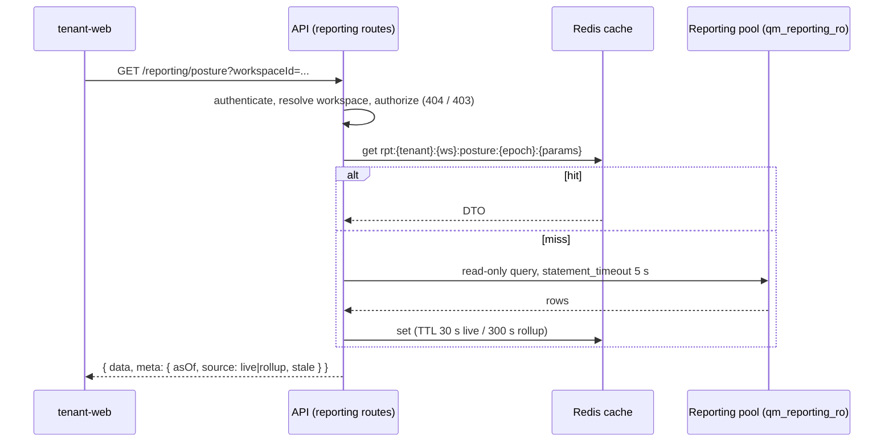

# Reporting and Dashboards — Module Specification

**Status:** **Approved for build (owner rulings of 2026-11-26, section 0.1).** Items marked Recommended in the text were accepted by those rulings unless section 0.1 says otherwise; where a ruling changed a value, section 0.1 wins over the text below.
**Owner:** Product owner (rulings in section 17)
**Last updated:** 2026-11-26
**Related ADRs:** ADR-003 (tenant isolation), ADR-004 (finding identity per pipeline), ADR-007 (Express 5), ADR-008 (security regression suite; a new area is proposed, 16), ADR-011 (outbox and message envelope), ADR-013/014 (LLM abstraction, scan sandbox; read only). A new ADR is proposed for the rollup design (17, D-1).
**Companion:** `SCREENS.md` (screen list, states, Stitch prompts). **Grounded in:** `docs/TENANT_APP_WIREFRAME_SPEC.md` (T-06, T-20, T-21, T-39), `docs/AUTHORIZATION.md` (catalog, decisions 30 and 33), `docs/modules/findings/SPEC.md` (data model, SLA, advisories), `docs/modules/executions/SPEC.md` (ER-17), `docs/modules/scan-engines/SPEC.md` (SBOM items), `docs/design/DESIGN_SYSTEM.md` (section 2.2 and 2.4), `docs/design/UX_GUIDELINES.md` (section 9 charts).

---

## 0. Summary and what needs your ruling

The module turns data that **already exists** into three things: (1) **current posture** tiles, (2) **trends and performance** charts, (3) **exports** (CSV and PDF). It adds **no new source of truth**: findings, `finding_status_history`, reviews, advisories, executions, scan results and SBOM items stay where they are. The only new storage is **derived** (daily rollups, a report-run table, the generated files) and can be deleted and rebuilt from the sources at any time.

Recommended shape in one paragraph: current-state numbers are **live indexed queries** (the Findings summary already measures under 200 ms on 100,000 findings); trends are **daily rollups** built by a new `reporting` worker off the transactional path, with an exact **backfill from the immutable history**; every report read goes through a **restricted database role that cannot read evidence, rationales, comments or advisory reasoning**, so a leak into a report is structurally impossible rather than filtered; exports are **asynchronous jobs** that produce a CSV or a server-drawn PDF stored under a tenant-scoped path.

The five decisions you asked for are resolved in section 17 (D-1 to D-5). Besides those, the review found **four conflicts in existing documents** that you must rule on before building (section 17, C-1 to C-4), and **eleven further open points** (O-1 to O-11).


### 0.1 Owner rulings (2026-11-26, **Confirmed**) — these override anything below that differs

| Ruling | Effect |
|---|---|
| **D-1 to D-5 approved** as proposed | hybrid live and daily rollups; reuse existing keys; async redacted exports with authenticated download; polling plus the existing hint plus a tenant-scoped cache epoch; tenant reporting time zone with 7, 30, 90 days and custom |
| **C-1** | charts use the `--sev-*` design tokens, not the brief's hex values; the accent is never hard-coded (`--chart-1` is the selected accent) |
| **C-2** | `report.view` stays on every built-in role (the catalogue wins over the wireframe's navigation table, which is amended) |
| **C-3, C-4** | median and p90 first (mean secondary); **no posture score in v1**; the connection tile shows **GitHub (repository connection) state only**; per-assignee workload only for `finding.assign` holders |
| **PDF writer** | **pdfkit** (pure JavaScript, MIT); not puppeteer, not pdfmake |
| **ADR-008 area 20 and a rollup ADR** | written: `ADR-008` item 20, `ADR-015`; CLAUDE.md scope sentence added |
| **Roles** | `qm_reporting` (worker) and `qm_reporting_ro` (API reads), least privilege, on the redaction-safe `report_*_v` views only |
| **Export limits (replace 7.3 and O-8)** | **CSV cap about 250,000 rows**, **3 concurrent export jobs per tenant**, **30-day file retention**, authenticated download only; the per-user hourly limit (20) and the 40-page PDF cap stay as proposed |
| **Backfilled severity trend is gated** | the severity series is backfilled **only if the equivalence test proves exact reconstruction**; if it does not, the severity trend is **forward-only** (status, flow and execution series are still backfilled) |
| **Flags** | everything OFF until the live test (`REPORTING_ENABLED=false`) |
| Points not mentioned (O-2, O-3, O-4, O-9) | built as recommended: own `reporting` worker role and queue; risk weights 10 / 5 / 2 / 1 plus 3 per breached critical or high; findings counted (not distinct issues) with a distinct-issue toggle on summed tiles; retention 25 months rollups, 13 months run rows |

---

## 1. Purpose

Give security leads, managers, analysts, developers and administrators one trustworthy place to answer: *how exposed are we now, is it getting better, are we meeting our deadlines, are the scans running, and how much can we trust the findings and the AI advice* — per workspace and across the workspaces a person may see — and to hand the answer to someone outside the product as a CSV or PDF **without leaking a secret**.

## 2. Scope

### In scope (v1)
- **Posture** (as-of-now): open findings by severity, type, lifecycle group and status; backlog; exceptions in force; approvals waiting.
- **Trends** (per day, in the tenant's reporting time zone): new vs resolved, severity trend, backlog burn-down; **point-in-time** ("as of day D") for any day in the rollup retention.
- **Remediation performance:** time to remediate (median, p90, mean), velocity, time to first decision, SLA compliance, aging.
- **Scan activity:** executions, success and failure, duration, repository and scan-type coverage, SBOM component counts.
- **Detection quality:** false-positive rate from analyst decisions, advisory agreement, noisiest rules.
- **Breakdowns:** by workspace, repository, pipeline, scan type, rule; **top risky repositories**.
- **Exports:** CSV and PDF of a fixed catalogue of report templates (section 7.3), asynchronous, audited, redaction by construction.
- **Screens:** extend T-06, T-20, T-21 and T-39; add T-46 to T-51 (`SCREENS.md`).

### Out of scope (v1)
- **Scheduled report delivery and e-mail** — depends on the notification module that does not exist yet. The `report_schedules` shape is **noted** in 8.5 so nothing blocks it later; **not built, no table, no UI beyond a disabled "Schedule" control that is not rendered** (the product rule: unimplemented items stay hidden).
- The **Audit evidence pack** template of the wireframe (needs the audit-log module's export); listed as deferred in 7.3.
- A composite **security posture score** (O-1: not recommended for v1).
- Cross-tenant or platform-level reporting (Root Console; separate permission model, separate module).
- Custom report builders, arbitrary SQL, saved custom dashboards, JSON export, public share links.
- DAST and asset-discovery metrics (not in the catalogue yet).
- Predictive analytics beyond one clearly labelled linear burn-down projection (T-3).
- Changing any source table's meaning, any finding transition or any ingestion rule.

## 3. Actors and permissions

Existing keys (catalogue of `docs/AUTHORIZATION.md`, **Confirmed**): `dashboard.view` (tenant scope, **Admin only**, decision 30), `workspace.view`, `finding.view`, `execution.view`, `remediation.view`, `security_review.view`, `report.view` (every built-in role in the catalogue), `report.export` (Admin, Manager, Lead; "audited"). **This module proposes no new permission key** (17, D-2, Recommended).

| Actor | Action | Scope | Permission (Recommended mapping) |
|---|---|---|---|
| Any member | Open the workspace dashboard page | workspace | `workspace.view` (unchanged, **Confirmed** nav) |
| Member | See findings posture, trends, SLA, aging, breakdowns | workspace | `finding.view` |
| Member | See scan activity, coverage, SBOM counts | workspace | `execution.view` |
| Member | See remediation performance | workspace | `finding.view` (all inputs are finding rows) |
| Analyst, Lead, Admin | See detection quality (FP rate, advisory agreement) | workspace | `security_review.view` |
| Person with `finding.assign` | See per-assignee workload | workspace | `finding.assign` (O-6) |
| Admin | See the Organization Overview and cross-workspace aggregates | tenant | `dashboard.view`, **and** per workspace the section's own key; only **accessible** workspaces are counted (decision 30 text) |
| Member | Open Reports, see generated reports of the workspace | workspace | `report.view` |
| Admin, Manager, Lead | Generate and download a report | workspace | `report.export` (audited) |
| Admin | Generate a tenant-wide report | tenant | `dashboard.view` **and** `report.export` at tenant scope |
| `reporting` worker | Build rollups and exports | platform, per tenant | restricted DB role `qm_reporting` (11.3), tenant ownership re-validated per message |
| Platform admin | Nothing | — | the Root Console has no access to tenant reporting (separate permission model) |

Authorization rules (docs/AUTHORIZATION.md 404 / 403, **Confirmed** pattern): another tenant's or a workspace the caller cannot see answers an **identical 404**; a visible workspace without the section's key answers **403**; `tenantId` is never read from a body, query or message (a client-supplied tenant or workspace id on a tenant-scope route is a 400, as `GET /overview` already does).

## 4. Functional requirements

| ID | Requirement | Priority | Status |
|---|---|---|---|
| RPT-001 | Posture tiles read **live** from `findings` through the Findings module's partial indexes, scoped by tenant and workspace (`GET /reporting/posture`) | Must | Recommended |
| RPT-002 | Trend charts read **rollup tables** (D-1) and never scan `findings` or `finding_status_history` on a request | Must | Recommended |
| RPT-003 | A **backfill** rebuilds any day range from the immutable history and gives the same numbers as the incremental job (equivalence check, 16) | Must | Recommended |
| RPT-004 | Time to remediate, aging and SLA compliance are computed **live** over a bounded window (percentiles cannot be merged from rollups) | Must | Recommended |
| RPT-005 | Every metric in section 6 has one definition, one source, one scope, and states whether it is as-of-now or over the period | Must | Recommended |
| RPT-006 | Period selector: 7, 30, 90 days and custom (`from`, `to`), in the tenant reporting time zone (D-5) | Must | Recommended |
| RPT-007 | Point-in-time view: "as of day D" for posture and the severity mix (rollup-backed) | Should | Recommended |
| RPT-008 | Breakdowns by workspace, repository, pipeline, scan type and rule; top risky repositories with a published formula (6.6) | Must | Recommended |
| RPT-009 | Every tile and chart shows **data as of** (live: now; rollup: last successful run) and a **stale** indicator when a rollup is more than two hours late | Must | Recommended |
| RPT-010 | CSV and PDF export of the catalogue templates, **asynchronous** (`202` and a report-run record), downloadable by the requester and the workspace's `report.export` holders | Must | Recommended |
| RPT-011 | Exports are built **only** from the reporting views (11.3); no evidence snippet, rationale, comment body, advisory reasoning or secret preview can enter a report | Must | Recommended |
| RPT-012 | Generating and downloading a report are audited (`report.generated`, `report.downloaded`); a failed generation is recorded with a stable code | Must | Recommended |
| RPT-013 | Current-state tiles refresh by polling (60 s) and by invalidation from the existing `finding.changed` hint (D-4); no new realtime room | Must | Recommended |
| RPT-014 | Server cache keys are tenant- and workspace-scoped with an invalidation epoch bumped on finding state change (D-4) | Must | Recommended |
| RPT-015 | Reporting reads never block or slow the transactional path: separate pool, `statement_timeout`, read-only transactions, no locks (11.3) | Must | Recommended |
| RPT-016 | Every chart has an accessible text alternative and a table toggle; every view has loading, empty, empty-by-period, error, no-permission and **partial-data** states | Must | Recommended |
| RPT-017 | Charts use the severity tokens in the fixed order Critical to Info and the chart tokens for non-severity series; the accent is never a severity or status colour (13) | Must | Recommended |
| RPT-018 | Scheduled delivery: **not built**; the schedule record shape is reserved (8.5) | — | Deferred |
| RPT-019 | Rollup and export retention follow 8.6; an empty tenant, an empty workspace and a workspace created yesterday render a clear state, not zeros that look like data | Must | Recommended |
| RPT-020 | A tenant reporting-time-zone change rebuilds the rollups (history is immutable, so the rebuild is exact) and the UI says "Recomputing" meanwhile | Must | Recommended (D-5) |

## 5. Business rules

1. **Findings, never "vulnerabilities".** Finding identity is per pipeline and findings never merge across pipelines (ADR-004, Confirmed). The same CVE in two pipelines is **two** findings, so a tenant-wide count can exceed the number of distinct issues. Every label says "findings". A distinct-issue view (`count(distinct correlation_key)`, the Findings module's cross-pipeline key) is offered as an option, not the default (O-4).
2. **Open** = the eight open statuses of the Findings module (`OPEN_FINDING_STATUSES`: `new`, `in_review`, `awaiting_approval`, `approved`, `assigned`, `in_remediation`, `fixed_pending_verification`, `reopened`). This equals the Findings summary `allOpen`, so a tile and the list it links to always agree. The reporting code imports the constant from `@qmentisai/shared`; it does not redefine it.
3. **Lifecycle groups** (the grouping you asked for, over the 12 statuses; one place in `@qmentisai/shared`, used by every chart and export):

   | Group | Statuses | Why |
   |---|---|---|
   | **Needs triage** | `new`, `reopened` | nobody has decided |
   | **In review** | `in_review`, `awaiting_approval` | a human decision is in flight |
   | **Confirmed, in remediation** | `approved`, `assigned`, `in_remediation` | a real problem someone must fix (`approved` = confirmed and unassigned) |
   | **Awaiting verification** | `fixed_pending_verification` | a fix was claimed or detected; a later complete scan must confirm |
   | **Accepted or suppressed** | `accepted_risk`, `suppressed` | closed by an approved exception (time-bound) |
   | **False positive** | `false_positive` | closed by an approved decision |
   | **Fixed** | `verified_fixed` | confirmed gone by a resolution-eligible scan |

   "Open" in the sense above is the first four groups. "Backlog" = open findings in **Needs triage**, **In review** and `approved` (not yet in anyone's hands); "Work in progress" = `assigned`, `in_remediation`, `fixed_pending_verification`.
4. **Resolved** is split, because mixing them flatters the numbers: **fixed** = transition into `verified_fixed`; **closed without a fix** = transition into `false_positive`, `suppressed` or `accepted_risk`. The default "resolved" series is **fixed**; "closed without a fix" is a separate series. Reopens are a third series and are never netted silently.
5. **Severity** is the **effective** severity (`severity` column; override or tool). `info` findings are counted in posture and trends but are excluded from SLA metrics (the Findings SLA has no `info` target, SL-1).
6. **SLA state** is derived at read time from `sla_due_at` and now (Findings SL-3: `breached`, `due_soon` at 25 percent remaining, `on_track`, `not_applicable`); it is never stored. The rollup therefore stores **counts of the three states as of the snapshot instant**, because the state of an old day cannot be recomputed from the row later.
7. **Trusted default-branch only.** Findings exist only from trusted default-branch executions (Findings D-24, Confirmed); scan-activity metrics show **all** executions, and a "ingestion-eligible" share, so a reader can see that a failed pull-request scan created no finding.
8. **Scan coverage** is shown as a statement of what was and was not scanned (the scan-engines coverage principle), not as a percentage that hides a gap: a repository with no enabled pipeline, a pipeline whose last full scan is older than the window, a pipeline whose last result was `partial` are listed.
9. **Minimum sample.** A rate over fewer than 20 decisions (FP rate, advisory agreement) is shown as "n = 14, too few to rate" with the counts, never as a percentage.
10. **No individual scorecards by default.** Per-person metrics (assignee workload) are shown only to holders of `finding.assign` and never ranked as "best" or "worst" (O-6).
11. **Derived is disposable.** Any rollup or export file can be deleted; the rollups rebuild from history; an export can be regenerated. Nothing derived is ever read by a transactional write path.

## 6. Metric catalogue

Legend: **Src** = source; **Mode** = `live` (query on request), `rollup` (daily table), `hybrid`; **As-of** = a point in time (now or a chosen day), **Period** = over the selected range; **Key** = permission (section 3). `sev` = effective severity. All counts are scoped by `tenant_id` and `workspace_id` (and `repository_id` / `pipeline_id` for the breakdowns).

### 6.1 Current posture (as-of now; live)

| ID | Metric | Definition | Src | Key |
|---|---|---|---|---|
| P-1 | Open findings | count of open statuses (rule 2) | `findings` | `finding.view` |
| P-2 | Open by severity | P-1 grouped by `sev`, order Critical to Info | `findings` | `finding.view` |
| P-3 | Open by type | P-1 grouped by `scan_type` (`sca`, `sast`, `secrets`) | `findings` | `finding.view` |
| P-4 | By lifecycle group and by status | all 12 statuses grouped (rule 3); the chart shows groups, the table shows statuses | `findings` | `finding.view` |
| P-5 | Backlog and work in progress | rule 3 | `findings` | `finding.view` |
| P-6 | Critical and high open | `sev` in (critical, high) and open; the wireframe's "Critical" tile | `findings` | `finding.view` |
| P-7 | Exceptions in force and expiring | `accepted_risk` plus `suppressed` count; those with `exception_expires_at` within 30 days | `findings` | `finding.view` |
| P-8 | Awaiting a decision | `awaiting_approval` count plus pending exceptions (`pending_exception_id` not null); links to the Approvals queue | `findings` | `approval.view` for the link only; the number needs `finding.view` |
| P-9 | New in the last 24 hours | `first_detected_at` within 24 hours | `findings` | `finding.view` |
| P-10 | Pipelines healthy | pipelines (enabled, not deleted) whose latest execution is `succeeded`, of all enabled pipelines (wireframe "11/12") | `pipelines`, `executions` | `execution.view` |

### 6.2 Trends (period; rollup)

| ID | Metric | Definition | Src | Mode |
|---|---|---|---|---|
| T-1 | New vs resolved per day | **new** = history rows with no `from_status` (creation); **fixed** = rows with `to_status = verified_fixed`; **closed without fix** = `false_positive`, `suppressed`, `accepted_risk`; **reopened** = `to_status = reopened`. Counted by the history row's `created_at` in the tenant time zone | `finding_status_history` | rollup |
| T-2 | Open findings per day by severity | the stacked open count at the end of each day (snapshot of P-2) | rollup of `findings` state | rollup |
| T-3 | Backlog burn-down | open count per day (T-2 summed) plus, optionally, a **dashed linear projection** to zero from the trailing 14-day net change, labelled "estimate"; no projection when the net change is not downward or fewer than 14 days exist | rollup | rollup |
| T-4 | Net change | new + reopened minus fixed minus closed without fix, per day and per period | rollup | rollup |
| T-5 | Awaiting verification over time | open count in `fixed_pending_verification` per day | rollup | rollup |

### 6.3 Remediation (period and as-of; hybrid)

| ID | Metric | Definition | Src | Mode |
|---|---|---|---|---|
| R-1 | Time to remediate | for findings that **entered `verified_fixed` in the period**: `verified_at - first_detected_at`; **median** (primary), **p90**, **mean** (secondary), overall and per severity; reopened-then-fixed findings are measured from first detection and flagged by count | `findings` | live |
| R-2 | Velocity | fixed per week (T-1) and fixed per assignee-week is **not** shown (rule 10) | rollup | rollup |
| R-3 | Time to first decision | `first review submitted - first_detected_at`, median and p90, per type | `finding_reviews`, `findings` | live |
| R-4 | SLA compliance (closed) | of findings fixed in the period with an SLA target: share with `verified_at <= sla_due_at` (per severity) | `findings` | live |
| R-5 | SLA status (open, as-of) | open findings with an SLA clock: `on_track`, `due_soon`, `breached` (rule 6); the wireframe's "SLA status" bars; "breached" links to the list | `findings` | live; rollup keeps the daily counts |
| R-6 | Aging | open findings by age bucket (0 to 7, 8 to 30, 31 to 90, over 90 days since `first_detected_at`) by severity; the 10 oldest open critical and high findings (id, title, age) | `findings` | live |
| R-7 | Verification lag | `verified_at - fix_claimed_at` median (how long a claimed fix waits for a scan) | `findings` | live |
| R-8 | Reopen rate | reopened in the period divided by fixed in the period | rollup | rollup |

### 6.4 Scan activity (period; hybrid)

| ID | Metric | Definition | Src | Mode |
|---|---|---|---|---|
| S-1 | Executions per day by status | `succeeded`, `failed`, `partial`, `timed_out`, `cancelled`, `skipped`, `blocked` (the Executions vocabulary) by `requested_at` day | `executions` | rollup |
| S-2 | Success rate | `succeeded / (succeeded + failed + partial + timed_out)`; cancelled, skipped and blocked are excluded and shown separately | `executions` | rollup |
| S-3 | Duration and queue wait | median and p90 of `finished_at - started_at` and `started_at - requested_at` | `executions` | live over the window (13 months retention, ER-17) |
| S-4 | Repository coverage | active repositories with at least one enabled, non-deleted pipeline **and** a `succeeded` execution on the default branch inside the window, of all active repositories; lists the rest with the reason (`no_pipeline`, `pipeline_disabled`, `no_recent_scan`, `last_scan_partial`, `connection_unavailable`) | `repositories`, `pipelines`, `executions` | live |
| S-5 | Scan-type coverage | per pipeline: which of sbom, sca, sast, secrets are enabled and last `complete` | `pipelines`, `scan_results` | live |
| S-6 | Result completeness | share of results `complete` vs `partial` per scan type | `scan_results` | rollup |
| S-7 | Ingestion-eligible share | executions that are trusted, default-branch and complete (rule 7) | `executions`, `finding_ingestions` | rollup |
| S-8 | SBOM components | components in the **latest** SBOM result per pipeline: total, by ecosystem, and those with a known vulnerability (SCA findings sharing `component_purl`); trend from the rollup | `scan_result_items` (kind `component`), `findings` | live latest; rollup trend |

### 6.5 Quality (period; live and rollup)

| ID | Metric | Definition | Src |
|---|---|---|---|
| Q-1 | False-positive rate | approved FP decisions divided by approved TP plus FP decisions in the period, per type; **not shown for secrets as a model metric** (the advisory agent never runs on secrets, but analyst decisions on secrets still count); rule 9 applies | `finding_reviews` (`state` approved, `decision`) |
| Q-2 | Noisiest rules | per `rule_id`: decisions, FP share; top 10 with n >= 20 | `finding_reviews`, `findings` |
| Q-3 | Advisory coverage | share of decisions that had a ready advisory at decision time (`advisory_id_at_decision` not null) among findings the agent can run on | `finding_reviews`, `finding_ai_advisories` |
| Q-4 | Advisory agreement | among decisions with an advisory: the 2x2 of advisory suggestion (`likely_false_positive`, `likely_true_positive`, `uncertain` shown apart) against the approved decision; **agreement** = share where they match; the label says "advice vs human decision", never "accuracy" (the human may be wrong; the advisory is advice only, FP-1) | same |
| Q-5 | Human override rate | share of decisions that went against a confident advisory (confidence band high) | same |
| Q-6 | Advisory outcomes | counts by advisory `status` (`ok`, `failed`, `consent_required`, `not_configured`, `skipped_*`, `timeout`, `invalid_output`) and by provider kind: an **operations** view of whether the agent is working | `finding_ai_advisories` |

### 6.6 Breakdowns and top risk (as-of and period)

| ID | Metric | Definition |
|---|---|---|
| B-1 | By workspace (Organization Overview) | per accessible workspace: open by severity, SLA breached, executions and success rate in the period; a workspace the caller cannot see is **absent**, never zero |
| B-2 | By repository | open by severity, open total, SLA breached, last scan status and age |
| B-3 | By pipeline | same, including soft-deleted pipelines grouped as "(deleted)" so the totals still add up |
| B-4 | **Top risky repositories** | risk score = `10 x critical + 5 x high + 2 x medium + 1 x low` over **open** findings, plus `3 x` the number of **breached** critical or high findings; top 10 by score, ties by older oldest-open-critical then name. The formula is printed in the tooltip and in the PDF; the number is called "risk points", not a probability. Weights live in `@qmentisai/shared` (one place) and are an **Open** point (O-3) |
| B-5 | By rule or CWE | top 10 open rules and the share of the open total |
| B-6 | Per-assignee workload | open assigned, due soon, breached per assignee; gated by `finding.assign` (rule 10, O-6) |

## 7. Workflows

### 7.1 Read path



### 7.2 Rollup path (off the transactional path)

```mermaid
flowchart LR
  S[scheduler worker\nhourly tick] -->|reporting.rollup.requested\n(one per tenant, versioned envelope)| Q[(queue reporting)]
  Q --> W[reporting worker\nrole qm_reporting]
  W -->|read history + findings\nas-of T| DB[(PostgreSQL)]
  W -->|upsert today + finalize yesterday| R[(report_daily_* tables)]
  W --> RUN[(report_rollup_runs)]
```

- The scheduler enumerates active tenants and emits one `reporting.rollup.requested` per tenant per hour (`{ day, mode: "incremental" }`); the job is **idempotent** (upsert by `(tenant, workspace, pipeline, day, ...)`), bounded in batches of workspaces, and re-validates tenant ownership.
- **One code path** computes "state as of instant T": the latest history row per finding with `created_at <= T`, joined to the severity in force at T (6.7 below). The hourly run uses `T = now` for **today** (partial day, replaced every hour); the day-close run uses `T = end of the tenant-local day`. The **backfill** is the same function over past days. An equivalence check compares `asOf(now)` with the live posture queries (16).
- Late data cannot change a closed day: history is append-only with `created_at` at transaction time. A time-zone change or a defect fix triggers a **rebuild of a day range**, which is exact.
- **Backfill:** `reporting.rollup.requested { mode: "backfill", from, to }` per tenant, throttled (one tenant at a time per worker, a configurable day batch), resumable through `report_rollup_runs`. On first enablement the module backfills from the earliest history row, capped at the rollup retention. Seeded tenants (the Findings seed) therefore get a believable trend immediately.

### 7.3 Export path and templates

`POST /reporting/reports` (Idempotency-Key) validates the template, scope and period, writes a `report_exports` row `queued`, enqueues `reporting.export.requested`, returns `202`. The worker builds the file from the **reporting views only**, writes it to the tenant-scoped object path, records size and SHA-256, sets `status = ready` and `expires_at`, and emits the audit event. The UI polls the row (or receives the realtime hint of D-4) and offers the download.

| Template (T-39 card) | Formats | Content (no evidence, no secret preview) | v1 |
|---|---|---|---|
| Executive security summary | PDF | KPI block (P-1, P-2, P-6, R-1 median, R-5), 90-day burn-down, top 5 risky repositories, SLA compliance, scan coverage statement | yes |
| Findings by pipeline | CSV, PDF | one row per finding: id, title, scan type, severity, status, repository, pipeline, path and line, rule id, first seen, age days, SLA state and due date, assignee display name only if the caller has `finding.assign` (O-6); **no snippet, no rationale, no comments, no advisory text** | yes |
| SLA compliance | CSV, PDF | R-4 and R-5 by severity and repository, breached list | yes |
| Remediation performance | PDF, CSV | R-1 to R-3 and R-7 by severity and type, velocity (T-1), reopen rate | yes |
| SBOM inventory | CSV | S-8: component, version, ecosystem, repository, pipeline, vulnerable yes or no (the existing CycloneDX download of the Executions module stays the way to get the document) | yes |
| Detection quality | PDF | Q-1 to Q-5 with the sample sizes | yes (addition) |
| Point-in-time snapshot | CSV, PDF | P-1 to P-4 and B-2 as of a chosen past day (rollup) | yes (addition) |
| Audit evidence pack | PDF | needs the audit-log module's export | **deferred** |

Limits (Open, O-8): **ruled 2026-11-26 (0.1):** at most about 250,000 rows per CSV, at most 3 running exports per tenant, at most 20 requests per hour per user, PDF at most 40 pages; a larger request is refused with a stable code and the advice to narrow the scope.

### 7.4 Report-run states

`queued` -> `running` -> `ready` | `failed` (`failed.code` in `too_large`, `timeout`, `source_unavailable`, `internal`), `ready` -> `expired` (file deleted by the purge; the row stays). A user can delete their own report; a `report.export` holder can delete any report of the workspace (audited).

## 8. Data model

All new tables are **derived or operational** and carry `tenant_id` first in every key (composite tenant keys, the pattern of the Findings migration), with composite foreign keys to `(tenant_id, workspace_id, repository_id, pipeline_id)` where a pipeline is referenced. One additive migration; no change to any existing table except the tenant setting of 8.4.

### 8.1 Reporting views (the only way reporting reads sources)

`report_findings_v`, `report_status_events_v`, `report_decisions_v`, `report_advisories_v`, `report_executions_v`, `report_sbom_latest_v`. They expose **only** non-sensitive columns: ids, enums, timestamps, counts, `rule_id`, `title` (already redacted at ingestion), `path` and line numbers, `component_*`, severity, status, SLA columns. They **exclude** `finding_evidence` entirely, `finding_reviews.rationale`, `finding_comments`, `finding_ai_advisories.reasoning`, `finding_exceptions.justification`, evidence `scm_ref`, and any user email. `qm_reporting` has `SELECT` on these views and on nothing else of the findings domain (11.3). This is the structural redaction guarantee of RPT-011.

### 8.2 Rollup tables (grain: tenant, workspace, repository, pipeline, tenant-local day)

| Table | Extra key columns | Counters |
|---|---|---|
| `report_daily_findings` | `day date`, `scan_type`, `severity` | `open_count`, `backlog_count`, `wip_count`, `awaiting_verification_count`, `sla_on_track`, `sla_due_soon`, `sla_breached` (open with a clock), `exceptions_in_force`, `open_age_seconds_sum` (mean age), plus **flow** counters `new_count`, `fixed_count`, `closed_other_count`, `reopened_count` |
| `report_daily_executions` | `day date` | `total`, one counter per status, `duration_ms_sum`, `queue_wait_ms_sum`, `eligible_count`, `result_complete_count`, `result_partial_count` |
| `report_daily_decisions` | `day date`, `scan_type` | `tp_count`, `fp_count`, `with_advisory`, `agree_fp`, `agree_tp`, `advisory_fp_human_tp`, `advisory_tp_human_fp`, `advisory_uncertain`, `override_confident` |
| `report_daily_sbom` | `day date` | `components`, `components_vulnerable` (the last SBOM result of the day) |

A row is written only for combinations that have data (sparse); the API fills zeros between days so a chart axis is continuous. Estimated size: 50 pipelines x 400 days x 15 (type x severity) = 300,000 rows per large tenant for the findings table, indexed by `(tenant_id, workspace_id, day)` and `(tenant_id, pipeline_id, day)`.

### 8.3 Operational tables

- `report_rollup_runs`: `id`, `tenant_id`, `day`, `mode` (`incremental`, `close`, `backfill`), `status`, `started_at`, `finished_at`, `rows_written`, `error_code`, `as_of_history_id` (the newest history row read, so "data as of" is exact); unique `(tenant_id, day, mode, started_at)`.
- `report_exports`: `id`, `tenant_id`, `workspace_id` null (tenant-wide), `template`, `format` (`csv`, `pdf`), `params jsonb` (validated, no free text), `period_from`, `period_to`, `as_of_day`, `status`, `error_code`, `requested_by_user_id`, `created_at`, `started_at`, `finished_at`, `expires_at`, `object_key` (tenant-scoped, never user-supplied), `bytes`, `sha256`, `row_count`, `deleted_at`.
- `report_cache_epochs` is **not a table**: the invalidation epoch is a Redis counter (D-4).

### 8.4 Tenant setting

`tenant_settings.reporting_timezone` (IANA name, default `UTC`, validated against the runtime database, the rule of PIPE time zones in `pipelines-triggers` section 5), edited by `tenant_settings.update` holders (audited). Today the product stores **no tenant time zone** (only per-trigger zones on pipelines); D-5.

### 8.5 Reserved shape for scheduled delivery (not built)

`report_schedules(id, tenant_id, workspace_id, template, format, params, cron, timezone, recipients_ref, enabled, created_by)`; delivery depends on the notifications module. No table is created in v1.

### 8.6 Retention

| Data | Retention (Recommended, O-9) |
|---|---|
| Rollup rows | 25 months (longer than the 13-month execution metadata of ER-17, so the executions trend survives the purge); findings flow counters never depend on purged data because history is kept for the tenant's life (Findings 7.6) |
| `report_rollup_runs` | 13 months |
| Generated files | 30 days; the `report_exports` row stays 13 months; download links are valid 24 hours from each request (D-3) |
| Cache | seconds to minutes; nothing durable |

## 9. API contract

REST under `/api/v1`, the standard envelope, Zod `.strict()` on params, query and body, route kit, `workspaceId` a **required query parameter** on workspace reads (the Findings pattern), reads need no `Idempotency-Key`, the one write needs it. All responses carry `meta.asOf` (ISO instant), `meta.source` (`live` or `rollup`), `meta.stale` (boolean), `meta.timeZone`. **Counts only**: no DTO contains a finding title, path or any text from a finding, **except** the explicitly listed drill-down lists (`aging`, `top-risk` repository names, `noisy-rules`), whose strings are the same redacted strings the Findings list already shows to the same caller.

| Endpoint | Permission | Notes |
|---|---|---|
| `GET /reporting/posture?workspaceId=&asOf=` | `finding.view` | P-1 to P-9; `asOf` = a past tenant-local day (rollup) or absent (live) |
| `GET /reporting/trends?workspaceId=&period=&from=&to=&series=` | `finding.view` | T-1 to T-5, daily points, zero-filled |
| `GET /reporting/remediation?workspaceId=&period=` | `finding.view` | R-1 to R-8 |
| `GET /reporting/sla?workspaceId=` | `finding.view` | R-5 and R-4 |
| `GET /reporting/aging?workspaceId=` | `finding.view` | R-6 including the oldest 10 |
| `GET /reporting/scan-activity?workspaceId=&period=` | `execution.view` | S-1 to S-7 |
| `GET /reporting/coverage?workspaceId=` | `execution.view` | S-4 and S-5 with reasons |
| `GET /reporting/sbom?workspaceId=&period=` | `execution.view` | S-8 |
| `GET /reporting/quality?workspaceId=&period=` | `security_review.view` | Q-1 to Q-6 |
| `GET /reporting/breakdown?workspaceId=&by=repository\|pipeline\|scan_type\|rule&period=` | `finding.view` | B-2, B-3, B-5; keyset pagination |
| `GET /reporting/top-risk?workspaceId=&limit=` | `finding.view` | B-4 with the formula in `meta` |
| `GET /reporting/workload?workspaceId=` | `finding.assign` | B-6 |
| `GET /reporting/overview?period=` | `dashboard.view` (tenant) | B-1 for accessible workspaces, tenant roll-up, top risky across workspaces; **no** `workspaceId` or tenant parameter (a supplied one is a 400) |
| `POST /reporting/reports` | `report.export` | `{ template, format, workspaceId?, period | asOfDay, options }`; `202 { reportId }`; `Idempotency-Key` required |
| `GET /reporting/reports?workspaceId=` | `report.view` | the generated-reports table (T-39) |
| `GET /reporting/reports/{id}` | `report.view` | status, no file |
| `GET /reporting/reports/{id}/download` | `report.view` and the requester or `report.export` | authenticated stream (D-3), `Content-Disposition: attachment`, `Cache-Control: no-store`, audited |
| `DELETE /reporting/reports/{id}` | requester or `report.export` | soft delete, file purge |

Errors (stable codes): `REPORT_PERIOD_INVALID`, `REPORT_PERIOD_TOO_LONG`, `REPORT_AS_OF_UNAVAILABLE` (before the rollup start), `REPORT_TOO_LARGE`, `REPORT_LIMIT_REACHED` (429), `REPORT_NOT_READY` (409), `REPORT_EXPIRED` (410), `REPORT_TEMPLATE_UNKNOWN`; the usual 400, 401, 403, 404, 409, 429. Rate-limit profiles: reads `read`; `POST` and downloads `write` plus the per-user export limit (O-8). `docs/api/` snapshots and parity are regenerated in the same work item.

## 10. Events and asynchronous work

| Message | Producer to consumer | Rules |
|---|---|---|
| `reporting.rollup.requested` v1 `{ day?, from?, to?, mode, tenantId }` | scheduler worker to queue `reporting` | versioned envelope (ADR-011), `.strict()`, tenant-scoped, idempotent handler, `messageId` = `reporting-rollup-{tenant}-{mode}-{day}-{hour}` |
| `reporting.export.requested` v1 `{ reportId }` | API (transactional outbox, same transaction as the `report_exports` row) to `reporting` | the worker loads the row **by tenant and id** and ignores any tenant in the message body |
| `finding.changed` hint | existing (Findings realtime) to the API | **consumed** by the API's existing realtime listener to bump the cache epoch (D-4); no new queue |
| `report.generated`, `report.failed` | `reporting` worker to the outbox | for the notification module later; today an audit entry only |

New queue `reporting` (main, retry tiers, dead-letter) is added to the shared broker topology with the existing helper, a new worker role `reporting` joins the dev launcher (`WORKERS=...,reporting`), and **both reporting jobs are OFF behind `REPORTING_ENABLED=false` by default** (the Findings and Scan Engines rollout pattern), so nothing is queued or written until enabled. Retries: transient database errors retry with backoff; a validation or ownership failure is non-retryable and dead-lettered.

## 11. Frontend requirements

Feature folder `apps/tenant-web/src/features/reporting/` (`components/ pages/ hooks/ services/ schemas/ stores/ constants/ index.js`). Detail in `SCREENS.md`; the rules that bind every screen:

- **Navigation** is defined once in `@qmentisai/shared` (`navigation.js`) and evaluated by the central engine: the `reports` item exists (`report.view`, `implemented: false` today) and becomes `true`; the five analysis screens are **not** new nav items (they open from the dashboard tiles and from tabs inside Reports) so the sidebar does not grow; the Organization Overview keeps `dashboard.view`. No role names in UI code.
- **TanStack Query** owns server data (keys: tenant, workspace, `reporting`, metric, params); Zustand holds only UI state (chart or table view, series toggles); **URL params** carry `period`, `from`, `to`, `sev`, `view`, `asOf` (the wireframe's `period`, `sev`, `view`).
- **Charts** are Recharts with the severity tokens and the chart tokens (13); a visible **data table toggle** and a one-line summary give each chart its text alternative (UX 9).
- **Refresh:** 60-second polling for the live tiles; invalidation on the `finding.changed` hint; the Refresh icon forces a refetch; "Updated 14:02" and a stale chip come from `meta`.
- **Every view** has loading (skeletons shaped like the chart), empty (no findings yet, with the next step), empty-for-period, error with correlation id and retry, no-permission, **partial** (some sections forbidden or stale), and "Recomputing" (rollup rebuild).
- **Exports:** the Generate dialog shows the template, format, scope, period, the row estimate, and states plainly **what is excluded** ("No code excerpts, comments or reasoning are included"); the generated-reports table shows status, expiry and a Download button that streams through the API.
- **Untrusted text** (titles, repository and pipeline names, rule names) is rendered as escaped plain text, identifiers in mono, never HTML.

## 12. Security and privacy

1. **Tenant isolation at every aggregate** (ADR-003): the tenant comes from the session, never from input; every query, cache key, rollup key, message, object path and Socket.IO use carries `tenant_id`; composite foreign keys make a cross-tenant row unrepresentable; a **404** for another tenant's workspace is byte-identical to a nonexistent one.
2. **Structural redaction** (RPT-011): the reporting role reads only the views of 8.1; evidence, rationales, comments, advisory reasoning, justifications and secret previews are not reachable by the reporting code at all. A **canary test** plants a fake secret in every one of those fields and asserts absence from every rollup row, every DTO, every CSV and every PDF byte (16).
3. **CSV injection:** every cell that starts with `=`, `+`, `-`, `@`, tab or carriage return is prefixed with a single quote and quoted; embedded quotes and newlines are escaped; UTF-8 with BOM is optional (O-8). Titles can be attacker-controlled (a scanned repository chooses file names and rule messages), so this is a real path.
4. **PDF:** no HTML is rendered, no external fetch, no embedded script; text is drawn, not interpreted; fonts are bundled; fixed page template; long strings are truncated with an ellipsis and counted.
5. **Exports are tenant-scoped objects:** `reports/{tenantId}/{reportId}.{ext}` built by the server from validated ids (the traversal rules of the artifact store: no separator, `..`, leading dot); the object name never comes from a request; download re-checks tenant, workspace, permission and `expires_at`; `no-store`; **no bearer or signed URL** in v1 (D-3).
6. **Audit** (`docs/technical/SECURITY_GUIDELINES.md`): `report.generated`, `report.downloaded`, `report.deleted`, `tenant.reporting_timezone_changed`, each with actor, scope, template, format, row count, never a value.
7. **Least privilege for reads:** the API reads through a separate pool of a **read-only** login (`qm_reporting_ro`: `SELECT` on the views and the `report_*` tables, nothing else), `default_transaction_read_only = on`, `statement_timeout = 5s`, `idle_in_transaction_session_timeout`, a connection cap; the worker uses `qm_reporting` (the same plus `INSERT`/`UPDATE` on the `report_*` tables). Both roles are `NOLOGIN` groups with a separate login created by an idempotent provisioning script, the pattern of `qm_fp_agent` / `provision:fp-agent-login`.
8. **No new secret surface:** no provider keys, no tokens, no credentials in any report or table; logs carry ids, counts, durations and codes only.
9. **Privacy:** per-person metrics are limited (rule 10); assignee names appear only in an export requested by a `finding.assign` holder and as display names (no emails).
10. **Abuse and cost:** per-tenant and per-user export limits, a global concurrency cap on the worker, `statement_timeout`, a row cap, and a refusal (not a truncation) when a request is too large.

## 13. Design and charts (aligned with `DESIGN_SYSTEM.md`, **Confirmed** tokens)

- **Severity** series use `--sev-critical` to `--sev-info` in the fixed order Critical to Info, drawn as filled marks **with** a pattern or direct label so color is never the only signal (DESIGN_SYSTEM 2.4, UX 9). On the light theme the derived darker variants are used where text sits on the series; the supplied base colors are the fills.
- **Non-severity** series use `--chart-1` (the primary series only) to `--chart-4`; gridlines `--chart-grid`; axes `--subtle-foreground`; tabular numerals.
- **Accent:** `--chart-1` equals the **selected accent** (Electric Mint by default) because the accent is a user preference (DESIGN_SYSTEM 2.5); it marks **one** primary series per chart (for example "fixed"), never a severity or a status, and mint stays below the 5 percent screen rule. Do not hard-code mint in a chart.
- **No 3D, no gradients**, sparklines and small multiples preferred over large decorative charts (UX 9). No donut for SLA (the wireframe already uses progress bars).
- **Conflict to rule on (C-1):** the brief and the wireframe prompts name the severity hex values `#B91C1C`, `#EA580C`, `#D97706`, `#2563EB`, `#64748B`, whereas the approved design system defines `--sev-*` as `#FF4D5A`, `#FF873D`, `#F5C451`, `#55A8FF`, `#9AA6B2` (dark; the light text variants are `#B3202D`, `#A8440A`, `#7A5800`, `#1257B5`, `#47535F`). This SPEC uses the **tokens**.

## 14. Observability

- **Metrics:** rollup lag (seconds since the newest successful run per tenant), run duration and rows written, backfill progress, export duration, size, outcome and queue depth, cache hit ratio per endpoint, reporting query p95 per endpoint, statement-timeout count.
- **Alerts (proposed):** rollup lag over 2 hours, export failure rate, `reporting` queue dead-letters, a query hitting the timeout.
- **Logs:** Pino, correlation id, tenant id, workspace id, endpoint, row counts, never values; the rollup logs the day and counts only.
- **Targets (proposed, to be measured on the 100,000-finding seed, as the Findings module did):** posture p95 under 300 ms live; trends and breakdowns from rollups under 200 ms; remediation (live percentiles) under 500 ms over 90 days; export of 50,000 rows under 60 seconds.

## 15. Dependencies

Internal: Findings (tables, constants, SLA, advisories, realtime hint), Executions (tables, retention), Pipelines and Repositories (names, coverage), Scan Engines (SBOM result items, completeness), Access Management (permission engine, navigation), the artifact store abstraction of the Executions module (generated files), the scheduler and the shared broker topology, `@qmentisai/shared` (constants, periods, DTOs, token names).
External: **none for the data**; the PDF writer is a **new dependency to approve** (17, O-7): recommended a pure-JavaScript PDF library (no headless browser, no native binary). A headless Chromium is **not** recommended (large, a sandbox of its own, the Docker/CI scope limits of CLAUDE.md).

## 16. Acceptance criteria and proposed security suite

### 16.1 Acceptance

- [ ] Every metric of section 6 is implemented once, with its definition tested against a hand-built dataset (the numbers in the test fixture are asserted exactly).
- [ ] Each posture tile equals the count the linked Findings list shows for the same filter.
- [ ] `asOf(now)` equals the live posture; a backfilled day equals the day the incremental job produced; a rebuild after a time-zone change equals a fresh build.
- [ ] A user without the section's key gets 403; another tenant's or a hidden workspace gets the identical 404; the Organization Overview lists only accessible workspaces.
- [ ] A canary secret planted in evidence, rationale, comment, advisory reasoning, exception justification and rule title never appears in any rollup row, DTO, CSV or PDF.
- [ ] CSV cells that start with a formula character are neutralized; a hostile title cannot break the PDF.
- [ ] The posture endpoint stays under its target on the 100,000-finding seed; the transactional ingestion benchmark is unchanged with the reporting worker running (RPT-015).
- [ ] `pnpm test:security`, lint, build, `contract:parity`, prettier and `install --frozen-lockfile --offline` pass; `docs/api` snapshots regenerated.
- [ ] Charts meet the contrast and non-color-only rules (screen-reader and keyboard review recorded as **not verified** until a human does it).

### 16.2 Proposed ADR-008 **area 20** (needs your approval, like areas 17 to 19)

Scope: tenant and workspace isolation of every reporting aggregate and export; the permission matrix of section 3 (404 vs 403); the reporting role's grants (no evidence, no write to any source table); structural redaction and the canary; CSV and PDF safety; export object scoping and traversal; rollup idempotency, tenant isolation, equivalence with live and DST day boundaries; cache-key tenant scoping and invalidation; export limits. **Out of scope** (as for areas 18 and 19): metric values on real data, chart appearance, PDF layout quality, weights of the risk formula, performance numbers (measured, not asserted). Proposed checks `RPT-S01` to `RPT-S14`; the count goes into `apps/api/test/security/helpers/reporting/expected.js` in the existing per-part manner, and the scope sentence is added to `CLAUDE.md` on approval.

## 17. Decisions and open points for your ruling

### 17.1 The five decisions you asked for

**D-1. Live query vs precomputed daily rollups for trends**

| Option | What | For | Against |
|---|---|---|---|
| A. Live only | reconstruct trends from `findings` and `finding_status_history` per request | no new tables, always exact | a 90-day, per-severity, as-of reconstruction is a window query over the whole history on every load; severity at a past day needs the review timeline; p95 will not hold at 100,000 findings and many tenants; loads the primary |
| B. Materialized views | `REFRESH` on a schedule | little code | full refresh each time, no incremental, a lock window, no backfill story, no tenant-time-zone buckets |
| **C. Daily rollup tables (hybrid) (Recommended)** | current state **live**; trends from rollups built by a `reporting` worker; live percentiles for R-1 and R-3 | fast trends, off the transactional path, exact backfill from the immutable history, survives the 13-month execution purge, point-in-time views | new tables, a worker, a queue, an equivalence test to keep honest |
| D. Counters updated inside the transition function | increment on every state change | real time | puts reporting work **in the transactional path** (violates RPT-015), couples every Findings write to this module |

*Job and place:* the scheduler worker ticks hourly and emits one `reporting.rollup.requested` per tenant; the **new `reporting` worker** (apps/workers, restricted role `qm_reporting`) computes "state as of T" and upserts today (hourly) and closes the previous tenant-local day. *Backfill:* same function over past days, per tenant, throttled and resumable; first enablement backfills from the earliest history row within the rollup retention; a time-zone change rebuilds. *Severity as of a past day:* effective severity changes only through approved reviews and exceptions, which are timestamped rows, so the history is **believed sufficient for an exact reconstruction**; this is verified by the equivalence test before it is relied on, and the fallback is to snapshot severity only from the first run onward (no backfilled severity trend).

**D-2. Dashboard scope and RBAC**

| Option | What |
|---|---|
| **A. Reuse the existing keys (Recommended)** | workspace pages by section key (section 3), Organization Overview and tenant-wide reports by `dashboard.view` (Admin-only, decision 30) and per accessible workspace, `report.view` and `report.export` as in the catalogue; **no new key, no change to any built-in role** |
| B. New tenant keys | `report.view_all` / `report.export_all` so a Manager or Lead can see cross-workspace roll-ups without the Admin-only overview key; needs catalogue, bundle and nav changes |
| C. Per-tile keys everywhere | finer than the product's existing grain |

Navigation stays defined once in `@qmentisai/shared`: flip `reports.implemented`, no new sidebar items (analysis screens open from tiles and Reports tabs). The permission note of the workspace dashboard stays `workspace.view` for the page and the **section key for the data** (a Viewer sees the page and the tiles whose keys they hold; a tile without its key is hidden, the API answers 403 if called anyway). **Conflict C-2** below affects this.

**D-3. Exports (PDF and CSV), redaction, scheduling**

| Question | Options | Recommendation |
|---|---|---|
| Redaction carried through | A. filter at render time; **B. structural: reports read only the views of 8.1, the role cannot read evidence or free text, plus a canary test** | **B** |
| PDF engine | A. headless Chromium; **B. pure-JavaScript PDF library, text and vector charts drawn from the data**; C. browser print-to-PDF | **B** (O-7: dependency to approve) |
| Download link | A. signed expiring URL (the wireframe's "signed link, expires in 24h"); **B. authenticated API stream, record valid 24 hours per request, no bearer URL** | **B** (a bearer link is a leak path; the wireframe wording is reconciled as "expires in 24 hours") |
| Sync vs async | **async for all** (`202`); sync only for tiny CSVs is rejected as two code paths | async |
| Scheduling | defer; shape reserved (8.5) | deferred, noted |

**D-4. Refresh model and cache**

| Option | What |
|---|---|
| A. Polling only | simple; up to 60 s stale |
| B. A new realtime room for reporting | duplicate of the Findings room; a second authorization surface |
| **C. Poll plus reuse the existing hint (Recommended)** | 60-second polling; the client invalidates the live queries (debounced 5 s) when the existing `finding.changed` hint of its workspace room arrives; **server cache** keys `rpt:{tenantId}:{workspaceId}:{metric}:{epoch}:{paramsHash}` through the tenant-scoped cache helper, TTL 30 s (live) and 300 s (rollup); the **epoch** is a Redis counter per tenant and workspace incremented by the API's existing realtime listener on every `finding.changed`, so one `INCR` invalidates every key atomically without scanning; trend and rollup endpoints are invalidated by TTL only (they change hourly) |

**D-5. Date ranges and tenant time zone**

| Question | Options | Recommendation |
|---|---|---|
| Presets | 7, 30, 90 days; custom | as asked; custom up to **400 days** (matches 13 months) |
| Bucket boundary | A. UTC always; **B. one tenant reporting time zone (IANA, default UTC), set by the tenant admin**; C. per-user zone | **B**: one number for the whole tenant, rollups keyed by local date, DST days are 23 or 25 hours and the boundary is exact; C would force query-time bucketing and defeat the rollups |
| Semantics | current-state tiles are **as of now**; "last 30 days" means the 30 complete tenant-local days **including today (partial)**; ranges are half-open `[from 00:00, to+1 00:00)` | stated in the UI under the control |
| Time-zone change | allowed; triggers a rebuild; UI shows "Recomputing" | as RPT-020 |
| Storage | none exists today; new `tenant_settings.reporting_timezone` | additive migration |

### 17.2 Conflicts found in existing documents (rule before building)

| Id | Conflict | Options | Recommendation |
|---|---|---|---|
| **C-1** | Severity colours: the brief and wireframe prompts use `#B91C1C`, `#EA580C`, `#D97706`, `#2563EB`, `#64748B`; the approved `DESIGN_SYSTEM.md` 2.2 defines `--sev-*` with different values and says "severity charts use the severity tokens" | A. tokens (no change to the design system); B. change the design system to the brief's values (affects Findings, badges, light/dark contrast table) | **A** |
| **C-2** | **Reports visibility:** `AUTHORIZATION.md` gives `report.view` to **every** built-in role (Developer and Viewer included), the wireframe nav table **hides** Reports from Developer and shows it read-only for Viewer | A. follow the catalogue (every role sees the page; a Developer sees the reports of the workspace but cannot generate); B. follow the wireframe and remove `report.view` from the Developer bundle | **A** if reports hold only aggregates (they do by 8.1); otherwise B |
| **C-3** | The wireframe's "**Mean** time to remediate" vs the distribution of remediation times (long tail, a few years-old findings dominate a mean) | median primary and p90, mean secondary (R-1) | as R-1 |
| **C-4** | The wireframe's **Security posture score 72/100** and **Connection health (GitHub, Jira)** and **Team workload** tiles have no agreed definition or no data source | see O-1, O-5, O-6 | omit the score, derive connection health from repository status, gate workload |

### 17.3 Further open points

| Id | Question | Recommendation |
|---|---|---|
| O-1 | Composite posture score | **Not in v1.** A single number invites arguments about its weights and hides what matters; the tiles already show the components. If wanted later, publish the formula like B-4 |
| O-2 | Where the rollups run and whether `reporting` is its own worker role | own role `reporting` plus queue (isolates load, own role grants); alternative: reuse the `findings` worker (fewer processes, mixes write-heavy ingestion with heavy reads) |
| O-3 | Weights of the top-risk formula (10, 5, 2, 1 and 3 per breached critical or high) | accept as a starting point; stored in shared constants and printed in the UI |
| O-4 | Count findings or distinct issues (`correlation_key`) | findings by default, a "distinct issues" toggle on tiles that sum across pipelines |
| O-5 | "Connection health" tile (GitHub, Jira) | show repository connection state (`active`, `unavailable`, `disconnected`) from the Repositories module; no Jira (no such integration) |
| O-6 | Per-assignee workload visibility and assignee names in exports | `finding.assign` holders only; never ranked; display names, no e-mail |
| O-7 | **New dependency:** a pure-JavaScript PDF library | approve one (pinned, justified, licence checked) |
| O-8 | Export limits (rows, concurrency, rate) and CSV BOM | 100,000 rows, 5 running per tenant, 20 per hour per user, BOM on for Excel users |
| O-9 | Retention of rollups (25 months), generated files (30 days), runs (13 months) | as 8.6 |
| O-10 | ADR-008 **area 20** and the ADR for the rollup design | approve the scope sentence (16.2) and an ADR |
| O-11 | Reporting database role and an optional **read replica** (`REPORTING_DATABASE_URL`, the `FINDINGS_AGENT_DATABASE_URL` pattern): the shared pool in development, a replica later | accept; no replica is required for v1 |

### 17.4 As built, Part A0 (2026-11-26; details in `AS_BUILT_A0.md`)

Deviations from the text above, none changing a ruling: (1) the tenant time zone is `tenant_reporting_settings.reporting_timezone` (no `tenant_settings` table exists; one settings table per module is the pattern); (2) a seventh view `report_tenant_settings_v`, repository, pipeline and assignee display names in the views, and `report_decisions_v` carries review decisions and exception outcomes in one timeline; (3) two `SECURITY DEFINER` functions (`qm_reporting_clear_range`, `qm_reporting_purge`) because the roles have no DELETE; (4) the message payload schemas live in `@qmentisai/contracts`, and `reporting.rollup.requested` has an informational `reason`; (5) `REPORT_TOO_LARGE` is 422 and `REPORT_AS_OF_UNAVAILABLE` 409; (6) `report_rollup_runs` has `range_to` and `time_zone`.

## 18. Build plan (after approval; each part verified by gates, not before)

| Part | Content | Parallel |
|---|---|---|
| **A0 Contract freeze** | `@qmentisai/shared` reporting constants (groups, periods, weights, DTO and message schemas), permission mapping, error codes, migration (rollups, runs, exports, views, roles, tenant time zone), flag `REPORTING_ENABLED=false`, topology change | first |
| **A Rollup core** | the "state as of T" function, hourly and close jobs, backfill, rebuild, equivalence harness, `reporting` worker and scheduler tick | with E |
| **B Read API** | live posture and remediation queries, rollup-backed trends and breakdowns, caching and epoch, authorization, DTO mappers, API standards snapshots | after A0 |
| **C Exports** | report-run lifecycle, CSV and PDF writers, redaction canary, object storage, audit, limits | after A0 |
| **D UI** | T-06, T-20, T-21, T-39, T-46 to T-51 with the real API behind a dev mock flag like Findings | with B |
| **E Suite and docs** | area 20 checks, mutation sweep, `docs/api`, tracker, as-built notes | last |

Flags OFF by default; nothing is ingested, queued or written until `REPORTING_ENABLED=true`.

## 19. Implementation notes

(Empty until built.)
