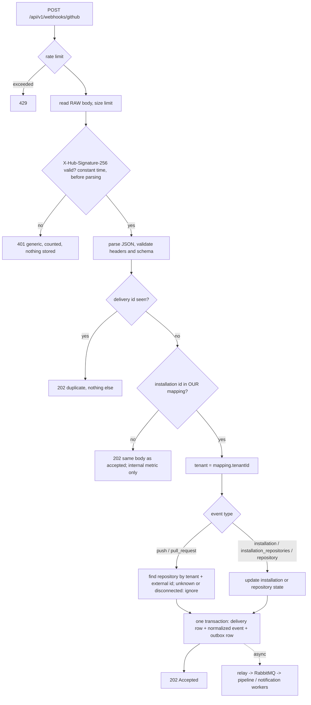

# Repositories and GitHub integration — Module Specification

**Status:** Draft. Review decisions received 2026-11-11 but NOT yet applied: the verification spike (§17) found facts that differ from this text and work stopped for your decision. Nothing is implemented.
**Owner:** Product owner (decisions); Claude Code (specification)
**Last updated:** 2026-11-11
**Related ADRs:** ADR-003 (tenant isolation), ADR-004 (finding identity per pipeline), ADR-008 (security suite), ADR-009 (SecretStore), ADR-010, ADR-011 (outbox, message envelope)

**Labels** (`docs/README.md`): **Confirmed** = stated in the docs, an accepted ADR or the owner's instruction; **Recommended** = my proposal; **Open** = needs your decision. Only Confirmed items are requirements.
**Sources:** `docs/architecture/INTEGRATION_ARCHITECTURE.md` (IA), `docs/technical/SECURITY_GUIDELINES.md` (SG), `docs/design/TENANT_APPLICATION_DESIGN.md` (TAD §3.3, §3.14, §3b.2 to §3b.5), `docs/product/PRODUCT_REQUIREMENTS.md` (PR), `docs/product/GLOSSARY.md`, `docs/technical/EVENT_CONTRACTS.md` (EC), `docs/architecture/WORKER_ARCHITECTURE.md` (WA), `docs/AUTHORIZATION.md` (AZ), `docs/decisions/ADR-009` and `ADR-011`, `docs/technical/DATABASE_DESIGN.md` (DD: lists `repositories` and `repository_integrations`), `docs/decisions/OPEN_DECISIONS.md`.

## 1. Purpose

Let a tenant connect GitHub, choose repositories into workspaces, keep their metadata current, and turn GitHub activity (pushes, pull requests, installation changes) into trustworthy, tenant-scoped events that the pipeline module consumes. This module owns the connection and the events; it does **not** run scans or define pipelines.

## 2. Scope

### In scope
- GitHub connection through a **GitHub App installation** (tenant-level mapping). **Recommended** (see §5, R-1)
- Repository connect, list, detail, update, sync, enable/disable and disconnect, inside workspaces. **Confirmed** capability (TAD §3.3, §3b.2, §3b.3), shape Recommended
- Webhook ingestion for GitHub: verification, deduplication, tenant resolution from the stored installation mapping, normalization, publication through the outbox. **Confirmed** requirements (owner instruction; SG "Webhooks and integrations")
- Connection health and failure handling (§6.4)
- The relationship repository 1:N pipelines (§7.4)
- Screens T-13, T-14, T-22, T-23, T-24, T-42 (`SCREENS.md`)

### Out of scope
- Pipelines, triggers and executions (next module); this module only emits `scm.*` events.
- Scans, findings, analysis of repository contents.
- GitLab, Bitbucket, GitHub Enterprise Server (adapter contract stays provider-neutral, IA "provider adapters"; the second provider is a later work item).
- Writing back to GitHub (status checks, PR comments) beyond reading: Optional permission, **Open** (§15).
- Billing/plans (only the entitlement key `repositories.max` is proposed).

## 3. Actors and permissions

Permission keys are the existing catalog (`packages/shared/src/permissions.js`, AZ §5.3/§5.4). **There is no `repository.create` or `repository.delete`**: "create" is `repository.connect` and "delete" is `repository.disconnect` (the instruction's `repository.view/create/update/delete` maps to these; the catalog is unchanged, **Recommended**). `repository.*` are **workspace-scope**; `integration.*` are **tenant-scope**.

| Actor | Action | Scope | Permission | Default holders (AZ bundles) |
|---|---|---|---|---|
| Tenant Admin | Link or unlink a GitHub installation; list installations; refresh | tenant | `integration.manage` / `integration.view` | Admin |
| Workspace member | List repositories; open detail, branches, pull requests | workspace | `repository.view` | every role |
| Workspace administrator, Manager, Dev Lead | Connect repositories from a linked installation | workspace | `repository.connect` | Admin, Manager, Dev Lead |
| Admin, Manager, Lead, Dev Lead | Sync | workspace | `repository.sync` | Admin, Manager, Lead, Dev Lead |
| Admin, Manager, Lead | Enable / disable | workspace | `repository.toggle` | Admin, Manager, Lead |
| Manager, Admin, Dev Lead | Edit settings (display name, description, owner) | workspace | `repository.update` | Admin, Manager, Dev Lead |
| Admin, Manager | Restrict a repository to groups | workspace | `repository.manage_access` | Admin, Manager |
| Admin, Manager | Disconnect | workspace | `repository.disconnect` | Admin, Manager |
| GitHub (system) | Deliver webhooks | none (unauthenticated, signature only) | none | n/a |
| Platform Super Admin | Configure the GitHub App at platform level | platform | `platform.integration_catalog.manage` (**Recommended**) | Super Admin |

Rules: a user who cannot see a workspace gets **404** for everything in it; a visible workspace without the permission gets **403** (AZ §5.9, **Confirmed**). Connecting needs `repository.connect` in the target workspace; it does not require `integration.view` (the wizard only sees the installations it may use). **Open**: whether Managers and Dev Leads may use an installation they cannot manage (§15 Q9).

## 4. Functional requirements

| ID | Requirement | Priority | Status |
|---|---|---|---|
| REPO-001 | A tenant links GitHub through a GitHub App installation; the mapping installation id -> tenant is stored tenant-side | Must | Recommended |
| REPO-002 | Installation linking proves the linking user controls the installation (user authorization at install time) and binds it with a single-use `state` | Must | Recommended |
| REPO-003 | One installation belongs to exactly one tenant; a second claim is refused without disclosing the owner | Must | Confirmed (tenant isolation) + Recommended mechanism |
| REPO-004 | List repositories visible to the installation and mark those already connected | Must | Confirmed (TAD §3b.2 step 3) |
| REPO-005 | Connect a repository into a workspace; provider identity (provider + external repo id) is unique per tenant | Must | Confirmed (owner instruction) |
| REPO-006 | List, detail, update, sync, enable/disable, disconnect repositories with the permissions in §3 | Must | Confirmed (TAD §3.3, §3b.3) |
| REPO-007 | Repository detail shows connection health, last sync, last event, webhook/installation health | Must | Confirmed (TAD §3b.3) |
| REPO-008 | A repository may have N pipelines; pipelines reference the repository by id | Must | Confirmed (TAD §3.4, glossary) |
| REPO-009 | Webhook route is public and unauthenticated; the raw body is preserved; `X-Hub-Signature-256` is verified in constant time **before** parsing | Must | Confirmed (owner instruction, SG) |
| REPO-010 | The tenant is resolved only from the stored installation mapping, never from payload fields | Must | Confirmed (owner instruction, ADR-003) |
| REPO-011 | Deliveries are deduplicated by `X-GitHub-Delivery` | Must | Confirmed (owner instruction, SG) |
| REPO-012 | A normalized event is persisted, then published through the outbox; the HTTP answer is 2xx fast and processing is asynchronous | Must | Confirmed (owner instruction, ADR-011) |
| REPO-013 | Webhook ingestion is rate limited; deliveries for unknown installations are dropped without revealing whether the installation exists | Must | Confirmed (owner instruction) |
| REPO-014 | Credentials: app private key and secrets are platform-level; tokens are never returned, logged or placed in messages | Must | Confirmed (ADR-009, SG) |
| REPO-015 | Handle revoked/suspended installations, removed permissions, deleted, renamed and transferred repositories, webhook redelivery (§6.4) | Must | Confirmed (owner instruction) |
| REPO-016 | Emit `repository.connected`, `repository.disconnected`, `scm.push.received`, `scm.pull_request.received` with versioned schemas | Must | Confirmed (owner instruction) |
| REPO-017 | Every state change is audited in the same transaction | Must | Confirmed (SG audit rules) |
| REPO-018 | `repositories.max` entitlement checked when connecting | Should | Recommended |
| REPO-019 | Reconciliation sync repairs state missed by lost webhooks | Should | Recommended |
| REPO-020 | Branches and pull requests shown in the UI come from GitHub on demand (not stored in v1) | Should | Recommended |

## 5. Business rules

**R-1 Connection model: GitHub App (Recommended).** Use one platform-owned **GitHub App** installed by tenants, rather than an OAuth App or personal access tokens.

| | GitHub App (recommended) | OAuth App | PAT |
|---|---|---|---|
| Permissions | fine-grained, per repository selection | broad scopes (`repo`) | broad or fine-grained but user-bound |
| Credential lifetime | installation token ~1 hour, minted on demand from a short-lived app JWT | long-lived user token | long-lived |
| Acts as | the app (survives employee departure) | a user | a user |
| Webhooks | app-level, one secret, no per-repo hook to register or rotate | per-repo hooks needed | per-repo hooks needed |
| Revocation | uninstall removes access at once; `installation` events tell us | revoke token | revoke token |
| Tenant mapping | installation id | user token | user token |

Consequences: the design wizard's "manage webhooks" permission and per-repository "Webhook registration" check (TAD §3b.2 steps 5 and 6) do not apply to an App (the webhook belongs to the app); the validation matrix becomes Credentials, Repository metadata, Installation covers the repository, Test delivery (`ping`), Signature verification. The design documents already say mechanisms differ per provider and must be verified per adapter (TAD §3b, IA). **Verify with a spike before implementation** (Open Q1): the facts used here (installation tokens expire after about an hour, `X-Hub-Signature-256` is `sha256=` + HMAC-SHA256 of the raw body with the webhook secret, `X-GitHub-Delivery` is a GUID reused by redelivery, deliveries time out after about 10 seconds and payloads can be large, repository ids are stable across rename and transfer) come from my knowledge of GitHub, not from this repository.

**R-2 Installation linking is a trust boundary (Recommended).** Anyone can paste an `installation_id`. Linking therefore requires: (1) a single-use `state` created by `POST .../start`, stored in Redis for a few minutes and bound to tenant + user + session; (2) GitHub's "request user authorization during installation" `code`, exchanged for a user token used **only** to call `GET /user/installations` and prove the user can see this installation; (3) the installation details fetched with the app's own JWT (account, permissions, repository selection). The user token is discarded immediately and never stored.

**R-3 One installation, one tenant (Confirmed rule, Recommended mechanism).** `(provider, external_installation_id)` is globally unique. A claim on an installation already linked to another tenant answers a generic `409 CONFLICT` (`reason: installation_unavailable`) that does not say who owns it.

**R-4 Provider identity (Confirmed).** `(tenant_id, provider, external_repo_id)` is unique. The numeric GitHub repository id is the identity; `full_name` is display data that changes on rename or transfer. The same GitHub repository may be connected by two tenants through their own installations (two independent rows).

**R-5 Workspace placement.** A repository belongs to exactly one workspace of the same tenant (validated on write; Recommended composite foreign key on `(tenant_id, workspace_id)`). Moving a repository between workspaces is **Open** (§15 Q12). A repository cannot be connected into an archived workspace.

**R-6 Disconnect is soft (Recommended).** Disconnect marks the row `disconnected` and keeps its id, so findings and executions stay attributable (ADR-004). Reconnecting the same GitHub repository reactivates the same row. Events for disconnected repositories are ignored.

**R-7 Untrusted input (Confirmed, SG).** Everything in a webhook payload (repository names, branch names, commit messages, PR titles, author logins) is untrusted. Published events carry identifiers, SHAs, counts, flags and validated short strings only; no commit message or PR body text travels in a message. Fork pull requests are flagged (`isFork`) so the pipeline module can refuse to run untrusted code with privileged tokens.

**R-8 No secrets in messages (Confirmed, ADR-009).** Events and jobs carry `repositoryId`/`installationRef` (our ids), never a token or key. A worker that needs GitHub mints an installation token itself, after re-validating tenant ownership of the repository.

**R-9 Entitlement (Recommended).** Connecting checks `assertWithinLimit` on a new catalog key `repositories.max`, inside the creating transaction after an advisory lock (the pattern of `workspaces.max`). The seed gains the key with a placeholder value (Open).

## 6. Workflows

### 6.1 Link a GitHub installation (tenant admin)

```mermaid
sequenceDiagram
  participant U as Admin (tenant-web)
  participant A as API
  participant G as GitHub
  U->>A: POST /integrations/github/installations/start
  A-->>U: installUrl (with signed state, stored for 10 min)
  U->>G: install the App on an account/organization
  G-->>U: redirect to tenant-web callback (installation_id, code, state)
  U->>A: POST /integrations/github/installations {installationId, code, state}
  A->>A: check state (single use, same tenant/user/session)
  A->>G: user token from code; GET /user/installations (is it theirs?)
  A->>G: app JWT: GET /app/installations/{id}
  A->>A: INSERT mapping (unique installation id) + audit + event, one transaction
  A-->>U: installation (account, repository selection, status)
```

Alternate: state expired or reused -> 400/409 with a restart hint; installation owned elsewhere -> generic 409; user cannot see the installation -> 403.

### 6.2 Connect repositories (workspace)
1. `GET /workspaces/{id}/repositories/available?installationId=` lists what the installation can access (live from GitHub, paged), each with `alreadyConnected` (tenant-wide check by external id).
2. `POST /workspaces/{id}/repositories` per repository (the wizard calls it once per selected repository; partial success is a UI concern, TAD §3b.2 step 8). In one transaction: lock + `repositories.max` check, insert row (unique identity), audit `repository.connected`, enqueue the `repository.connected` event.
3. A sync job validates the connection (metadata, default branch, permissions) and sets `health`.

### 6.3 Webhook ingestion



Requirements, all **Confirmed** (owner instruction) unless noted:
- **Route:** `POST /api/v1/webhooks/github`, audience `public`, mounted so that the global JSON parser does not consume the body: the route reads the **raw body** (`express.raw`, `application/json` only, size limit from configuration, default 1 MiB, **Open** Q14), keeps the `Buffer`, verifies, and only then `JSON.parse`s it. Route-kit option `webhook: true` (**Recommended**) selects this behavior and the `webhook` rate-limit profile.
- **Signature:** `X-Hub-Signature-256` must be `sha256=<64 hex>`; compute HMAC-SHA256 over the raw bytes with the platform webhook secret and compare with `crypto.timingSafeEqual` after checking lengths. Missing, malformed or wrong signature: `401` with a generic body, no parsing, nothing stored, counted per IP. The webhook secret is a platform-level SecretStore value (Q2).
- **Tenant resolution:** read `installation.id` from the **verified** payload purely as a lookup key into `scm_installations`; the tenant is `mapping.tenantId`. Fields such as account login, organization, repository owner or anything resembling a tenant are never used for resolution. The repository is then found with `(tenantId, provider, externalRepoId)`; a payload naming a repository that is not connected for that tenant is ignored.
- **Dedupe:** `scm_webhook_deliveries` unique on `(provider, delivery_id)`; redelivery (the same GUID) answers `202` without side effects. Outbox `messageId` is derived from the delivery id (`scm-github-<deliveryId>`), so even a crash between steps cannot publish twice (ADR-011).
- **Unknown installation:** a validly signed delivery for an installation we do not know answers `202` with the **same body and timing class** as an accepted one; the drop is visible only in logs/metrics. (It happens legitimately for `installation.created` arriving before the setup redirect; reconciliation covers it.) An unsigned/forged request is `401`, which reveals nothing about installations.
- **Fast 2xx:** verification, dedupe insert, normalization and outbox insert are one database transaction (milliseconds); no GitHub API call and no pipeline work happens in the request.
- **Rate limit:** the existing `webhook` profile per IP, plus a per-installation counter after resolution (Redis, tenant-scoped key), plus the global limit. IP allow-listing of GitHub's ranges is optional hardening (Q15).
- **Replay:** GitHub sends no timestamp header, so replay protection is the delivery-id table (kept for a configurable window, **Open** Q13); a captured signed request replayed after the window would be accepted as new, which is why events must be idempotent downstream.

### 6.4 Failure classes

| Failure | Detection | Handling |
|---|---|---|
| **Installation revoked/uninstalled** | `installation` event `deleted`; token mint returns 404/401 | Mark installation `revoked`; repositories `error` (`reason: installation_revoked`) and `disconnected` after a grace period (**Open** Q10); emit `repository.disconnected` with reason; notify tenant admins (outbox -> notification worker); stop accepting its events |
| **Installation suspended** | `installation` event `suspend` | Status `suspended`; repositories paused; resume on `unsuspend` |
| **Permission removed / selection narrowed** | `installation` `new_permissions_accepted`, `installation_repositories` `removed`; 403/404 from API | Affected repositories `error` (`reason: access_removed`) with recovery text (re-grant on GitHub); retryable via Sync |
| **Repository deleted** | `repository` `deleted`; 404 on sync | Status `disconnected` (`reason: repo_deleted`), audit + event; row kept |
| **Repository renamed** | `repository` `renamed`; `full_name` differs on sync | Update `full_name`/`name` (identity is the external id); audit |
| **Repository transferred** | `repository` `transferred`; owner differs; access lost | If still reachable through the installation: update owner. Otherwise `error` (`reason: transferred_out`); never follow a transfer to another account automatically |
| **Repository archived / made private** | `repository` event; sync | Reflect `archived`/`visibility`; archived is read-only (no new scans, Open Q) |
| **Webhook redelivery** | same `X-GitHub-Delivery` | `202`, no side effects (§6.3) |
| **Webhook lost / endpoint down** | no event for a repository for a long time; GitHub shows failures | Scheduled reconciliation sync (Recommended, REPO-019) compares branches/PR heads and repository state |
| **GitHub API rate limit** | `403/429` with rate-limit headers | Transient error: retry with the worker backoff (`TransientError`); honor `Retry-After`/reset time |
| **GitHub outage** | 5xx, network | `PROVIDER_UNAVAILABLE` (502) to the API caller; transient retry in workers; health `degraded` |
| **Tenant suspended/deactivated** | tenant status | Webhooks are still verified and answered `202`, but events are not published (worker ownership check fails closed); data retained |
| **Token mint failure** | app JWT/installation token errors | Transient or `error` health, depending on cause; alert (§12) |

### 6.5 Sync
`POST /repositories/{id}/sync` returns `202 { status: "queued" }` and enqueues a job (`scm.repository.sync_requested`, job kind, tenant scope). The worker re-validates that the repository belongs to the tenant, mints an installation token, refreshes metadata (name, default branch, visibility, archived, permissions), updates `health`, `last_synced_at`, and emits nothing unless state changed. Idempotent by `(repositoryId, minute bucket)`.

## 7. Data model

Logical model (not a Prisma schema). Every tenant-owned row carries `tenantId` and is only read with it (ADR-003). Migrations and Prisma models are an implementation step.

### 7.1 `scm_installations` (tenant-level mapping)
`id`, `tenant_id`, `provider` (`github`), `external_installation_id` (string), `account_external_id`, `account_login`, `account_type` (`organization`|`user`), `repository_selection` (`all`|`selected`), `permissions` (JSON snapshot of granted permissions), `status` (`active`|`suspended`|`revoked`), `linked_by_user_id`, `linked_at`, `suspended_at`, `revoked_at`, `last_checked_at`.
Unique: **`(provider, external_installation_id)` globally** (R-3). Index `(tenant_id, status)`. Contains no secrets.

### 7.2 `repositories`
`id`, `tenant_id`, `workspace_id`, `installation_id` (FK, same tenant), `provider`, `external_repo_id`, `full_name`, `name`, `owner_login`, `html_url`, `visibility`, `default_branch`, `description`, `display_name`, `owner_user_id` (QmentisAI owner), `status` (`connected`|`disabled`|`disconnected`), `health` (`healthy`|`degraded`|`error`), `health_reason`, `archived`, `last_synced_at`, `last_event_at`, `connected_by_user_id`, `connected_at`, `disconnected_at`, `disconnect_reason`, timestamps.
Unique: **`(tenant_id, provider, external_repo_id)`**. Indexes `(tenant_id, workspace_id, status)`, `(tenant_id, installation_id)`, `(tenant_id, full_name)`. Group restriction (`repository.manage_access`) reuses the group model through a join table `repository_group_access (tenant_id, repository_id, group_id)` (**Recommended**, Open Q12 for semantics).

### 7.3 `scm_webhook_deliveries` and `scm_events`
- `scm_webhook_deliveries`: `id`, `provider`, `delivery_id`, `event_type`, `action`, `external_installation_id`, `tenant_id` (null when the installation was unknown), `outcome` (`accepted`|`duplicate`|`ignored`|`unknown_installation`), `payload_sha256`, `received_at`. **Unique `(provider, delivery_id)`.** No raw payload is stored (untrusted, may be large); retention window **Open** (Q13).
- `scm_events` (normalized, tenant-scoped): `id`, `tenant_id`, `repository_id`, `delivery_id`, `kind` (`push`|`pull_request`|`repository`|`installation`), `normalized` (JSON, the fields in §9, validated by the message catalog), `created_at`. Unique `(tenant_id, delivery_id, kind)`. Persisted in the same transaction as the outbox row.

### 7.4 Relationship to pipelines (definition only)
A repository has **N pipelines** (TAD §3.4, glossary: "independent security workflow configured for a repository"). The pipelines module will own `pipelines (tenant_id, repository_id, ...)` with a foreign key to `repositories(id)` within the same tenant. Each matching event creates **one execution per pipeline**, and finding identity stays per pipeline (ADR-004, **Confirmed**). This module guarantees only: a stable `repositories.id`, the `repository.disconnected` event so pipelines can be disabled, and soft disconnect so history survives. No pipeline column or table is added here.

### 7.5 Credentials (ADR-009)
| Secret | Level | Storage |
|---|---|---|
| GitHub App id, client id, slug | platform | configuration (not secret) |
| App **private key** (PEM), **client secret**, **webhook secret** | **platform** | SecretStore, purpose `scm.github.app.*` (**Open Q2**: today's SecretStore is tenant-scoped; a platform scope needs an ADR-009 amendment, or v1 reads them from the environment/KMS at deploy) |
| Installation id -> tenant mapping | tenant | `scm_installations` (no secret) |
| Installation access token | per use | minted from the app JWT when needed, kept only in process memory until shortly before expiry, **never persisted, logged, returned or sent in a message** |
| User-to-server token from the install redirect | per use | used for one call, discarded |

Redaction paths gain `privateKey`, `installationToken`, `webhookSecret` (the generic ones already exist).

## 8. API contract

All tenant routes: tenant session, `/api/v1`, standard envelope, Zod on params/query/body, pagination/filter/sort conventions, optional `Idempotency-Key` on POSTs, `write` rate limit. Errors use stable codes; new ones are **Recommended**: `PROVIDER_UNAVAILABLE` (502). Conflicts use `CONFLICT` with `details.reason`.

### 8.1 Integration (tenant scope)
| Method and path | Permission | Notes |
|---|---|---|
| `GET /integrations/github` | `integration.view` | App availability (configured?), installations summary |
| `GET /integrations/github/installations` | `integration.view` | Tenant's installations: account, selection, status, repository count. No secrets |
| `POST /integrations/github/installations/start` | `integration.manage` | Returns `{ installUrl }`; stores `state` |
| `POST /integrations/github/installations` | `integration.manage` | Body `{ installationId, code, state }`; 201; `409 CONFLICT reason installation_unavailable` |
| `POST /integrations/github/installations/{installationId}/refresh` | `integration.manage` | Re-reads account, permissions, status; 200 |
| `DELETE /integrations/github/installations/{installationId}` | `integration.manage` | Unlinks in QmentisAI (repositories disconnected, event emitted); does **not** uninstall the App on GitHub (Open Q10); typed confirmation enforced server-side (`confirm` = account login) |

### 8.2 Repositories (workspace scope)
| Method and path | Permission and scope | Notes |
|---|---|---|
| `GET /repositories` | `repository.view`, collection (filtered to visible workspaces, never 403) | Query: `workspaceId`, `provider`, `health`, `status`, `q`, `sort` (`fullName`, `connectedAt`, `lastEventAt`), `page`, `pageSize` |
| `GET /workspaces/{workspaceId}/repositories/available` | `repository.connect` in that workspace | Query `installationId`, `q`, `visibility`, `page`; live from GitHub; `alreadyConnected` flag; `PROVIDER_UNAVAILABLE` on outage |
| `POST /workspaces/{workspaceId}/repositories` | `repository.connect` in that workspace | Body `{ installationId, externalRepoId, displayName?, description?, ownerUserId? }`; 201; `409 CONFLICT reason repository_already_connected` (unique identity); `403 QUOTA_EXCEEDED/ENTITLEMENT_REQUIRED` |
| `GET /repositories/{repositoryId}` | `repository.view` via a repository scope resolver (loads by id **and** tenant, yields the workspace) | 404 when absent or not visible |
| `PATCH /repositories/{repositoryId}` | `repository.update` | `displayName`, `description`, `ownerUserId` (must be an active tenant member) |
| `POST /repositories/{repositoryId}/sync` | `repository.sync` | 202 queued; rate limited |
| `POST /repositories/{repositoryId}/disable` and `/enable` | `repository.toggle` | Disabled repositories ignore events and cannot be scanned |
| `DELETE /repositories/{repositoryId}` | `repository.disconnect` | Soft disconnect; body `{ confirm: <full name> }`; 200; emits `repository.disconnected` |
| `GET /repositories/{repositoryId}/branches`, `GET .../pull-requests` | `repository.view` | Live read-through with a short tenant-scoped cache (REPO-020, Open Q16) |

Response DTOs never include internal ids of other tenants, tokens, installation numbers beyond `installationId` (our id) and `externalInstallationId` for tenant admins only. `externalRepoId` is returned.

### 8.3 Webhook (public)
`POST /api/v1/webhooks/github`: no session, no cookies, no CORS. Headers read: `X-Hub-Signature-256`, `X-GitHub-Delivery`, `X-GitHub-Event`, `Content-Type: application/json`. Responses: `202 {"success":true,"data":{"received":true},...}` (accepted, duplicate, ignored and unknown installation are indistinguishable), `401 UNAUTHENTICATED` (generic: bad or missing signature), `400 BAD_REQUEST` (signed but malformed), `413`, `415`, `429 RATE_LIMITED`. Documented in OpenAPI with `hide: false` and a security note that the signature, not a session, authenticates it.

## 9. Events and asynchronous work

All messages use the ADR-011 envelope (`kind: "event"`, `scope: "tenant"`, `schemaVersion: 1`, `subject: { type: "repository", id }`, `initiator`: `{ type: "user", id }` for UI-driven events and `{ type: "system", id: "github-webhook" }` for webhook-driven ones). They are registered in the message catalog (`@qmentisai/contracts`). Payloads carry no free text from GitHub beyond the validated strings noted.

| Type | Emitted when | Payload (v1) | Queue (**Open** Q11) |
|---|---|---|---|
| `repository.connected` | after connect commits (outbox) | `repositoryId`, `workspaceId`, `provider`, `externalRepoId`, `fullName`, `defaultBranch`, `installationRef` | `pipeline`, `notification` |
| `repository.disconnected` | disconnect, installation revoked/unlinked, repository deleted | `repositoryId`, `workspaceId`, `provider`, `reason` (`user`\|`installation_revoked`\|`installation_unlinked`\|`repo_deleted`\|`access_removed`) | `pipeline`, `notification` |
| `scm.push.received` | verified push for a connected, enabled repository | `repositoryId`, `deliveryId`, `ref`, `branch` (null for tags), `before`, `after`, `created`, `deleted`, `forced`, `commitCount`, `headCommitSha`, `pusherLogin` | `pipeline` |
| `scm.pull_request.received` | verified pull_request (`opened`, `reopened`, `synchronize`, `closed`, `ready_for_review`, `edited` filtered) | `repositoryId`, `deliveryId`, `action`, `number`, `headSha`, `baseSha`, `headRef`, `baseRef`, `isFork`, `draft`, `merged`, `authorLogin` | `pipeline` |

- `messageId` = `scm-github-<deliveryId>[-<queue>]`; `idempotencyKey` is not needed (the id is deterministic); `correlationId` = the delivery id for webhook events, the request id for UI events.
- Consumers (pipeline module) re-validate tenant and repository ownership (the verifier gets a `repository.*` check: repository exists, belongs to the tenant, `status = connected`), deduplicate through `processed_messages`, and treat unknown future `schemaVersion` as unsupported (DLQ), per the catalog rules.
- Internal jobs: `scm.repository.sync_requested` (job, tenant scope, from the sync endpoint and from reconciliation).
- Retries/DLQ: the standard tiers (WA). Webhook ingestion itself never retries (GitHub redelivers on failure); outbox publication retries with the relay's backoff.
- Ordering is not guaranteed; consumers use `after`/`headSha` and `occurredAt` to ignore stale events.

## 10. Frontend requirements

See `SCREENS.md`. Common rules: TanStack Query with tenant-scoped keys, URL state for filters, loading/empty/error/unauthorized on every data view, permission-aware actions through the central engine (no role names), navigation items `repositories` (workspace) and `integrations` (tenant) already exist and are flagged `implemented` when the screens ship.

## 11. Security and privacy

- **Tenant isolation:** repositories and installations are never read by id alone; webhook tenant comes only from `scm_installations`; cache and lock keys, queue messages and Socket.IO rooms carry the tenant (ADR-003).
- **Webhook hardening:** §6.3. No parsing before the signature check; constant-time comparison; no raw-payload persistence; no tenant hints from payload fields; identical answers for accepted, duplicate, ignored and unknown installation; rate limits; body size limit.
- **Installation takeover resistance:** R-2 and R-3. State is single-use and bound; user authorization proves access; installation ids are never accepted from a client alone.
- **Credentials:** §7.5 and ADR-009; tokens never in responses, logs (redaction), messages, audit payloads or error messages; secrets for the App are platform-level and read only by the processes that need them.
- **Least privilege on GitHub (Recommended):** Metadata (read, mandatory), Contents (read), Pull requests (read); Checks/Commit statuses (write) optional and off by default; no write to code. Subscribed events: `push`, `pull_request`, `installation`, `installation_repositories`, `repository`, `meta`, `github_app_authorization`.
- **Untrusted content:** R-7; fork PRs flagged; this module never executes repository content.
- **Audit (same transaction):** `scm_installation.linked`, `scm_installation.unlinked`, `scm_installation.status_changed`, `repository.connected`, `repository.updated`, `repository.synced` (state changes only), `repository.enabled`, `repository.disabled`, `repository.disconnected`. Webhook deliveries are not audited per delivery (volume); outcomes are metrics, and security-relevant refusals (bad signature spikes) raise alerts.
- **Privacy:** commit messages, PR text and author e-mail addresses are not stored or published; logins only where listed in §9.

## 12. Observability

- **Logs:** every delivery with `deliveryId`, `eventType`, `outcome`, `installationId` (external), `tenantId` once resolved, `repositoryId`; correlation id = delivery id; never the body or headers (redaction).
- **Metrics (names Recommended):** `scm_webhook_deliveries_total{outcome}`, `scm_webhook_signature_failures_total`, `scm_webhook_duration_seconds`, `scm_outbox_lag_seconds`, `scm_github_api_requests_total{status}`, `scm_github_rate_limit_remaining`, `scm_installations{status}`, `scm_repositories{health}`.
- **Alerts:** signature failures above a threshold per IP or overall, deliveries for unknown installations spiking, installation revoked, token mint failures, repositories stuck in `error`, relay lag.
- **Health:** per-installation and per-repository `health`, shown in the UI and used by readiness only for the platform configuration check (App credentials present), never for tenant data.

## 13. Dependencies

Internal: access management (permissions, scope resolvers), workspaces, audit, entitlements, SecretStore (ADR-009), outbox and relay (ADR-011), notification worker, route kit (new `webhook` option), rate limiting (`webhook` profile exists), Redis. External: GitHub REST API and App webhooks. Infrastructure: PostgreSQL, Redis, RabbitMQ. Downstream: the pipelines module consumes `scm.*` and `repository.*`.

## 14. Acceptance criteria

- [ ] A tenant admin links an installation; a second tenant cannot link the same installation and learns nothing about the first.
- [ ] Repositories can be listed, connected (once per tenant), updated, synced, disabled and disconnected with the §3 permissions; hidden workspaces and other tenants' repositories answer 404.
- [ ] A signed push delivery for a connected repository results in one `scm.push.received` message after the transaction commits, and the HTTP answer returned before any processing.
- [ ] Forged, missing or wrong signatures are rejected without parsing or persisting anything.
- [ ] A redelivered `X-GitHub-Delivery` produces no second event.
- [ ] A signed delivery for an unknown installation is answered exactly like an accepted one and persists nothing tenant-scoped.
- [ ] A payload cannot cause events in a tenant other than its installation's tenant.
- [ ] No token, private key or secret appears in any response, log, message or audit entry.
- [ ] Installation revoked, repository deleted/renamed/transferred and permission-removed paths update state and emit the specified events.
- [ ] Security-suite checks in §14.1 pass; `pnpm test:security` count and ADR-008 updated.
- [ ] OpenAPI, contract snapshot and parity report updated; PROGRESS_TRACKER updated.

### 14.1 Security-suite additions (ADR-008 scope: tenant isolation, authorization, session separation)
The suite needs a **local GitHub stub** (an HTTP server started by the runner, selected by `GITHUB_API_BASE_URL`, no real network) for installation linking, plus the webhook secret known to the runner. New checks (ids Recommended):

| Id | Check |
|---|---|
| SCM-001 | Webhook with a forged signature -> `401`; no delivery row, no event, no outbox row |
| SCM-002 | Missing and malformed `X-Hub-Signature-256` -> `401`; a valid signature over a different body -> `401` |
| SCM-003 | A validly signed push for tenant A's installation creates exactly one event and one outbox row in tenant A, none in tenant B |
| SCM-004 | A signed payload that names a repository of tenant B (same external id connected in B) under tenant A's installation id affects only A's data and never B's |
| SCM-005 | Cross-tenant installation id: tenant B tries to link A's installation -> generic `409`, A's mapping unchanged, response reveals no tenant data |
| SCM-006 | A validly signed delivery for an unknown installation answers `202` with the same body as an accepted one and persists no tenant-scoped row |
| SCM-007 | Duplicate `X-GitHub-Delivery` -> one event only |
| SCM-008 | Repository by id across tenants -> `404` for GET, PATCH, sync, disable, DELETE (tenant A admin vs tenant B's repository) |
| SCM-009 | Repository in a workspace the caller cannot see -> `404`, identical to a nonexistent id; visible but lacking the permission -> `403` |
| SCM-010 | Same `(provider, external repo id)` connected twice in one tenant -> `409`; allowed once in each of two tenants |
| SCM-011 | A tenant session or platform session cannot use the webhook route as an authentication path (the route ignores cookies) |
| SCM-012 | Responses and audit entries contain no token or key material (the stub issues recognizable fake tokens; the suite searches for them) |
| Controls | Admin links via the stub; manager connects; a signed push is accepted (so denials are not vacuous) |

## 15. Open questions

1. **GitHub App feasibility spike (R-1):** confirm token lifetimes, webhook headers, payload limits, event list and the install/redirect flow against current GitHub documentation before building. Also confirm GitHub App vs OAuth fallback for customers that cannot install an App.
2. **Platform-level secrets:** ADR-009's SecretStore is tenant-scoped (per-tenant keys, tenant foreign keys). Options: (a) amend ADR-009 with a *platform scope* (data key with a null tenant, separate AAD) **Recommended**; (b) read the App secrets from environment/KMS in v1. Production cannot enable SecretStore until a KMS/Vault adapter exists (ADR-009), which also blocks (a) in production.
3. **One shared App vs bring-your-own App:** one platform App (simplest, one webhook secret, **Recommended**) or per-tenant Apps (isolation of secrets, more setup, per-tenant webhook URL/secret).
4. **Screen identifiers:** T-13/T-14/T-22/T-23/T-24/T-42 are not defined anywhere in the repository (the wireframe specs are missing). `SCREENS.md` proposes a mapping; please confirm or correct it.
5. **Permission names:** keep the catalog keys (`connect`, `disconnect`) instead of `create`/`delete`? (**Recommended**: keep.)
6. **Wizard deviation:** for an App, drop "manage webhooks" and per-repository webhook registration from the wizard and replace the validation matrix (§R-1). Accept?
7. **Webhook response for unknown installations:** `202` (recommended, no information) vs `404/410` (lets GitHub show failures for uninstalled apps).
8. **Token cache:** process memory only (recommended) vs a tenant-scoped Redis cache encrypted with SecretStore.
9. **Who may use an installation:** can a Manager connect repositories from an installation they cannot `integration.view`? Recommended: yes, through the available-repositories endpoint only, never seeing installation details.
10. **Installation unlink semantics:** unlink only in QmentisAI (recommended) or also uninstall on GitHub; grace period before auto-disconnecting repositories of a revoked installation.
11. **Queue routing** for `scm.*` and `repository.*` (recommended: `pipeline`, plus `notification` for connection events).
12. **Moving a repository between workspaces** and the semantics of group restriction (`repository.manage_access`) relative to workspace roles.
13. **Retention** of `scm_webhook_deliveries` (replay window) and `scm_events`; purge job (Open in OPEN_DECISIONS already for outbox rows).
14. **Webhook body size limit** (default 1 MiB proposed; GitHub payloads can be much larger for large pushes: accept and reduce, or refuse).
15. **GitHub IP allow-listing** for the webhook route (optional hardening; ranges change).
16. **Branches and pull requests** in the UI: live read-through (recommended) vs stored; cache TTL.
17. **Entitlement `repositories.max`** and its placeholder value; whether disabled repositories count.
18. **Archived/read-only repositories** and what the pipeline module does with them.
19. **Fork pull requests:** flag only (this spec) vs refuse to publish events for forks until the pipeline module defines a policy.
20. **GitHub Enterprise Server / GitLab / Bitbucket:** timing and whether the adapter contract is written now.
21. **"Sync frequency"** (TAD §3b.5): reconciliation interval and who can change it.

## 16. Implementation notes

Not implemented. Expected implementation order: (1) message catalog entries and event payload schemas; (2) migrations and repositories; (3) platform-secret decision (Q2) and GitHub client (app JWT, installation tokens, stub for tests); (4) installation linking APIs; (5) repository APIs with the repository scope resolver; (6) webhook route (route-kit `webhook` option, raw body) and ingestion service; (7) workers: ownership checks for `repository.*`, sync job; (8) screens; (9) security-suite checks §14.1, OpenAPI, contract snapshot, docs. Deviations from this approved design will be recorded here.

## 17. Verification spike: GitHub facts against the official documentation (2026-11-11)

Method: the pages below were fetched from `docs.github.com` on 2026-11-11 by web-fetch subagents; the quotes are as those agents reported them (short, verbatim), not re-read by me. "Not documented" means the pages read do not say it; it does not mean it is false. Pages that returned 404 are listed.

### 17.1 Facts confirmed (spec was right)

| # | Fact | Documented as | Source |
|---|---|---|---|
| 1 | Installation access token lifetime | "The installation access token will expire after 1 hour." Optionally limited to repositories (up to 500) and permissions | https://docs.github.com/en/apps/creating-github-apps/authenticating-with-a-github-app/authenticating-as-a-github-app-installation ; https://docs.github.com/en/rest/apps/apps |
| 2 | Mint endpoint and credential | `POST /app/installations/{installation_id}/access_tokens`, authenticated with the app JWT; 201 returns `token`, `expires_at`, `permissions` | same two pages |
| 3 | App JWT | RS256; claims `iat`, `exp`, `iss`; `exp` at most 10 minutes ahead; `iss` = client ID (recommended) or app ID; `iat` 60 s in the past recommended (the page's own examples disagree: 60 s, 10 s, none); `Authorization: Bearer` | https://docs.github.com/en/apps/creating-github-apps/authenticating-with-a-github-app/generating-a-json-web-token-jwt-for-a-github-app |
| 4 | Signature header | `X-Hub-Signature-256` is `sha256=` + HMAC hex digest of the request body with the webhook secret; use `crypto.timingSafeEqual`; absent when no secret is configured; handle payload as UTF-8; legacy SHA-1 `X-Hub-Signature` also sent | https://docs.github.com/en/webhooks/using-webhooks/validating-webhook-deliveries ; https://docs.github.com/en/webhooks/webhook-events-and-payloads (Delivery headers) |
| 5 | Delivery id | `X-GitHub-Delivery`: "A globally unique identifier (GUID) to identify the event." A **redelivery keeps the original GUID** | webhook-events-and-payloads ; https://docs.github.com/en/webhooks/using-webhooks/best-practices-for-using-webhooks |
| 6 | Payload cap, timeout | "Payloads are capped at 25 MB" (larger events are not delivered); respond with 2XX "within 10 seconds" or the delivery is a failure | webhook-events-and-payloads ; best-practices-for-using-webhooks |
| 7 | No timestamp header | No timestamp or other replay header is documented; the documented replay defence is the delivery GUID | best-practices-for-using-webhooks |
| 8 | Content types | `application/json` or `application/x-www-form-urlencoded`; use JSON | webhook-events-and-payloads ; https://docs.github.com/en/webhooks/using-webhooks/handling-webhook-deliveries |
| 9 | IP allow-listing | Possible through `GET /meta` (the `hooks` key is not named on the pages read) | best-practices-for-using-webhooks |
| 10 | `ping` event | Exists (`zen`, `hook_id`, `hook`) | webhook-events-and-payloads |
| 11 | `installation` event | Actions `created`, `deleted`, `new_permissions_accepted`, `suspend`, `unsuspend`; all Apps receive it by default | webhook-events-and-payloads#installation |
| 12 | `installation_repositories` | Actions `added`, `removed`; fields `repositories_added`, `repositories_removed`, `repository_selection` | webhook-events-and-payloads#installation_repositories |
| 13 | `push` | `ref`, `before`, `after`, `created`, `deleted`, `forced`, `head_commit`, `commits` (max 2048); not created when more than 5000 branches or 3 tags are pushed at once; needs Contents: read | webhook-events-and-payloads#push |
| 14 | `pull_request` actions | `opened`, `reopened`, `synchronize` (with `before`/`after`), `closed` (merged is a payload flag), `edited`, `ready_for_review`, `converted_to_draft`, others; needs Pull requests: read | webhook-events-and-payloads#pull_request |
| 15 | Rate limits | Installation token baseline 5,000 requests/hour (scales with repositories and users, cap 12,500; 15,000 on Enterprise Cloud); primary and secondary limits answer 403 or 429; honor `retry-after` and `x-ratelimit-reset`; secondary: 100 concurrent requests, 900 points/minute for REST, serial requests recommended | https://docs.github.com/en/rest/using-the-rest-api/rate-limits-for-the-rest-api ; https://docs.github.com/en/rest/using-the-rest-api/best-practices-for-using-the-rest-api |
| 16 | Listing repositories | `GET /installation/repositories`, `per_page` max 100 (the page does not state the credential; an installation token is the natural one, **assumption**) | https://docs.github.com/en/rest/apps/installations |
| 17 | Installation lookup | `GET /app/installations/{installation_id}` with JWT: `account`, `repository_selection` (`all`/`selected`), `permissions`, `events`, `suspended_at`, `suspended_by`, `app_slug`, `target_type` | https://docs.github.com/en/rest/apps/apps |
| 18 | Setup URL | GitHub adds an `installation_id` query parameter, and the docs warn "Bad actors can hit this URL with a spoofed `installation_id`", recommending a user access token and a check that the installation is associated with that user (**this is what R-2 does**) | https://docs.github.com/en/apps/creating-github-apps/registering-a-github-app/about-the-setup-url |
| 19 | Code exchange | `POST https://github.com/login/oauth/access_token` (`client_id`, `client_secret`, `code`, optional `redirect_uri`, `code_verifier`); `state` must be checked; user tokens (`ghu_`) expire after 8 hours with refresh tokens (`ghr_`, 6 months), described as an optional feature "subject to change" | https://docs.github.com/en/apps/creating-github-apps/authenticating-with-a-github-app/generating-a-user-access-token-for-a-github-app |
| 20 | Redelivery | Manual or via API only, within 3 days; the REST delivery endpoints (`GET /app/hook/deliveries`, `POST /app/hook/deliveries/{delivery_id}/attempts`) need an app JWT | https://docs.github.com/en/webhooks/testing-and-troubleshooting-webhooks/redelivering-webhooks ; https://docs.github.com/en/rest/apps/webhooks |

### 17.2 Facts that DIFFER from this spec (decision needed)

| # | Spec said | Documentation says | Impact |
|---|---|---|---|
| D1 | §9: "GitHub redelivers on failure" | "GitHub does not automatically redeliver failed deliveries." Redelivery is manual or by API for 3 days (redelivering-webhooks) | A lost or failed delivery is gone unless someone redelivers it. **Reconciliation sync (REPO-019) becomes Must, not Should.** A redelivery of a delivery we already accepted carries the same GUID and is (correctly) ignored, so recovery of accepted-but-lost work cannot rely on redelivery |
| D2 | §6.4: repository deletion arrives as a `repository` `deleted` event | "A repository was deleted. GitHub Apps and repository webhooks will not receive this event." No page links deletion to `installation_repositories` `removed` | Deletion must be detected by 404 on sync or token calls (reconciliation), not by event |
| D3 | §6.4: transfer arrives as a `repository` `transferred` event | The event "is only sent to the account where the ownership is transferred", and only if that account has the App installed and subscribed | Transfer **out** of the installation's account is invisible; detect by 403/404 on sync. A transfer **in** is a different tenant's concern |
| D4 | R-2 and §6.1: a single-use `state` travels through the install redirect | The install URL accepts `?state=` ("to preserve the state of the application page", https://docs.github.com/en/apps/sharing-github-apps/sharing-your-github-app), but the Setup URL page lists only `installation_id`; `state` on the setup redirect and `setup_action` are **not documented**. With "Request user authorization (OAuth) during installation" GitHub starts the OAuth flow and redirects to the callback URL with `code`; whether `installation_id` or `state` arrive there is not documented | Do not depend on `state` surviving the install redirect. Documented alternative: after the setup redirect (`installation_id`), QmentisAI starts its own OAuth web flow (authorize URL with our `state`, documented) and verifies the installation afterwards. The tenant is bound by the signed-in QmentisAI session performing the link |
| D5 | R-2: `GET /user/installations` "proves the linking user controls the installation" | It lists installations the user "has explicit permission (:read, :write, or :admin) to access". Not admin-only. Organization owners are the default managers of Apps; the docs name no API that proves "owner of this installation" | A user with read access could link someone else's organization installation to their tenant. Stronger check available: `GET /user/memberships/orgs/{org}` (user access token; requires the **Members: read** organization permission on the App; `role` is `admin`, `member` or `billing_manager`). Costs an extra permission request. Needs your decision |
| D6 | R-4: the numeric repository id is stable across rename and transfer | **Not documented.** The rename and transfer pages say only that links redirect and webhooks/secrets stay associated; nothing about the numeric `id` or `node_id` | The identity key (`provider`, `external_repo_id`) rests on an undocumented (widely assumed) property. Verify empirically against a sandbox repository (rename, transfer) or accept the risk |
| D7 | §9: `scm.pull_request.received` uses `head.sha`, `base.sha`, `head.repo.fork`, `draft`, `merged`, `user.login` | The webhook page does not describe the `pull_request` object and does not say it equals the REST object. The REST schema has `head.sha`, `base.sha`, `head.ref`, `base.ref`, `merged`, `state`, `number`, `user.login`, `head.repo.fork`, `draft` (optional). `head.repo` is "required", not nullable, and deleted forks are not mentioned | Normalization must be defensive (null-safe `head.repo`, `isFork` unknown means treat as fork); verify field presence on a real delivery |
| D8 | §6.3: tenant lookup by `installation.id` in every payload | The common parameter `installation` exists ("The GitHub App installation..."), but the webhook page lists no `id` field for it; the REST installation object has `id` | Almost certainly `installation.id`, but verify on a real delivery before relying on it |
| D9 | R-1 table: installation tokens are opaque and short | "Starting April 27, 2026, GitHub began a staged rollout of a stateless format (`ghs_APPID_JWT`)" for new tokens; code must not assume 40 characters | No length checks or fixed-size columns; redaction must match the prefix, not a length |
| D10 | (not in spec) | Pin `Accept: application/vnd.github+json` and `X-GitHub-Api-Version` (the docs' examples use 2026-03-10) | Adapter sends both headers; the version is a config value |
| D11 | Wireframe IDs | `docs/TENANT_APP_WIREFRAME_SPEC.md` and `docs/ROOT_CONSOLE_WIREFRAME_SPEC.md` are **not in the repository** (searched the whole tree) | `SCREENS.md` cannot be redone from them |

### 17.3 Gaps (documentation silent; verify before relying)
`setup_action` and `state` on the setup redirect; whether a deleted repository triggers `installation_repositories` `removed`; whether a REST redelivery gets a new id (the best-practices page says the header GUID is unchanged); installation fields in the webhook payload; the `hooks` key of `GET /meta`; which credential `GET /installation/repositories` takes.

### 17.4 Proposed spec changes (awaiting your approval; not yet applied to the sections above)
1. §6.4 and §9: replace "GitHub redelivers" with "no automatic redelivery"; make reconciliation a Must (scheduled and on `repository.sync`), detecting deleted/transferred/inaccessible repositories by 404/403.
2. R-2 and §6.1: use the documented sequence setup redirect (`installation_id`) -> our own OAuth authorize with our `state` -> `GET /user/installations` check; drop reliance on `state` in the install URL.
3. D5: choose between (a) tenant-admin gate only, (b) additionally require organization role `admin` via the Members: read permission (Recommended), (c) both with a per-tenant setting.
4. D6: add an empirical check (sandbox rename and transfer) to the implementation plan, and a reconciliation fallback that re-matches a repository by `node_id` if the numeric id ever mismatches.
5. D7 and D8: payload normalization must be null-safe, and the adapter spec records "verified on a real delivery" as an acceptance criterion.
6. §8 and §9: nothing else changes; the owner's other review decisions (permissions, platform-secret amendment to ADR-009, single shared App, 202 for unknown installations, unlink semantics, `scm` exchange with routing keys `scm.github.<event>`, 30-day delivery retention, defaults for the remaining open questions) are not affected by the spike and remain to be applied after you answer D1 to D11.
