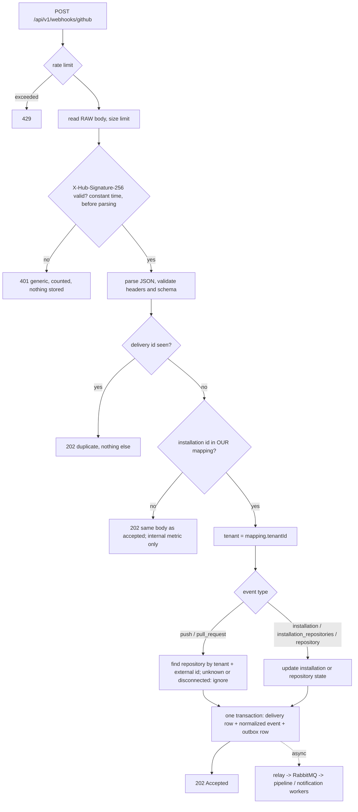

# Repositories and GitHub integration — Module Specification

**Status:** Approved (2026-11-11). Review decisions and spike decisions D1 to D10 are applied (§17.5); remaining open questions carry the label *Recommended — default applied* (§15).
**Owner:** Product owner (decisions); Claude Code (specification)
**Last updated:** 2026-11-11
**Related ADRs:** ADR-003 (tenant isolation), ADR-004 (finding identity per pipeline), ADR-008 (security suite), ADR-009 (SecretStore and the platform-secret amendment), ADR-010, ADR-011 (outbox, message envelope)

**Labels** (`docs/README.md`): **Confirmed** = stated in the docs, an accepted ADR or the owner's instruction; **Recommended** = my proposal; **Open** = needs your decision. Only Confirmed items are requirements.
**Sources:** `docs/architecture/INTEGRATION_ARCHITECTURE.md` (IA), `docs/technical/SECURITY_GUIDELINES.md` (SG), `docs/design/TENANT_APPLICATION_DESIGN.md` (TAD §3.3, §3.14, §3b.2 to §3b.5), `docs/product/PRODUCT_REQUIREMENTS.md` (PR), `docs/product/GLOSSARY.md`, `docs/technical/EVENT_CONTRACTS.md` (EC), `docs/architecture/WORKER_ARCHITECTURE.md` (WA), `docs/AUTHORIZATION.md` (AZ), `docs/decisions/ADR-009` and `ADR-011`, `docs/technical/DATABASE_DESIGN.md` (DD: lists `repositories` and `repository_integrations`), `docs/decisions/OPEN_DECISIONS.md`.

## 1. Purpose

Let a tenant connect GitHub, choose repositories into workspaces, keep their metadata current, and turn GitHub activity (pushes, pull requests, installation changes) into trustworthy, tenant-scoped events that the pipeline module consumes. This module owns the connection and the events; it does **not** run scans or define pipelines.

## 2. Scope

### In scope
- GitHub connection through a **GitHub App installation** (tenant-level mapping). **Recommended** (see §5, R-1)
- Repository connect, list, detail, update, sync, enable/disable and disconnect, inside workspaces. **Confirmed** capability (TAD §3.3, §3b.2, §3b.3), shape Recommended
- Webhook ingestion for GitHub: verification, deduplication, tenant resolution from the stored installation mapping, normalization, publication through the outbox. **Confirmed** requirements (owner instruction; SG "Webhooks and integrations")
- Connection health and failure handling (§6.4)
- The relationship repository 1:N pipelines (§7.4)
- Screens T-13, T-14, T-22, T-23, T-24, T-42 (`SCREENS.md`)

### Out of scope
- Pipelines, triggers and executions (next module); this module only emits `scm.*` events.
- Scans, findings, analysis of repository contents.
- GitLab, Bitbucket, GitHub Enterprise Server (adapter contract stays provider-neutral, IA "provider adapters"; the second provider is a later work item).
- Writing back to GitHub (status checks, PR comments) beyond reading: Optional permission, **Open** (§15).
- Billing/plans (only the entitlement key `repositories.max` is proposed).

## 3. Actors and permissions

Permission keys are the existing catalog (`packages/shared/src/permissions.js`, AZ §5.3/§5.4). **There is no `repository.create` or `repository.delete`**: "create" is `repository.connect` and "delete" is `repository.disconnect` (the instruction's `repository.view/create/update/delete` maps to these; the catalog is unchanged, **Recommended**). `repository.*` are **workspace-scope**; `integration.*` are **tenant-scope**.

| Actor | Action | Scope | Permission | Default holders (AZ bundles) |
|---|---|---|---|---|
| Tenant Admin | Link or unlink a GitHub installation; list installations; refresh | tenant | `integration.manage` / `integration.view` | Admin |
| Workspace member | List repositories; open detail, branches, pull requests | workspace | `repository.view` | every role |
| Workspace administrator, Manager, Dev Lead | Connect repositories from a linked installation | workspace | `repository.connect` | Admin, Manager, Dev Lead |
| Admin, Manager, Lead, Dev Lead | Sync | workspace | `repository.sync` | Admin, Manager, Lead, Dev Lead |
| Admin, Manager, Lead | Enable / disable | workspace | `repository.toggle` | Admin, Manager, Lead |
| Manager, Admin, Dev Lead | Edit settings (display name, description, owner) | workspace | `repository.update` | Admin, Manager, Dev Lead |
| Admin, Manager | Restrict a repository to groups | workspace | `repository.manage_access` | Admin, Manager |
| Admin, Manager | Disconnect | workspace | `repository.disconnect` | Admin, Manager |
| GitHub (system) | Deliver webhooks | none (unauthenticated, signature only) | none | n/a |
| Platform operator | Configure the GitHub App (credentials via PlatformSecretProvider, App settings on GitHub) | platform | deployment configuration, not an API; the Root Console shows App status only (`platform.integration_catalog.view`) | n/a |

Rules: a user who cannot see a workspace gets **404** for everything in it; a visible workspace without the permission gets **403** (AZ §5.9, **Confirmed**). Connecting needs `repository.connect` in the target workspace; it does not require `integration.view`: the wizard reads `GET /workspaces/{id}/integrations` (`workspace_integration.view`), and connect/available refuse a connection that is outside the organization scope or switched off for the workspace (403). Managers and Dev Leads can therefore use a connection they cannot manage (decided 2026-11-11, AUTHORIZATION Q26).

## 4. Functional requirements

| ID | Requirement | Priority | Status |
|---|---|---|---|
| REPO-001 | A tenant links GitHub through the single shared QmentisAI GitHub App; the installation -> tenant link is stored tenant-side | Must | Confirmed (owner decision Q3) |
| REPO-002 | Installation linking follows the documented flow: setup redirect, our own OAuth authorization with our single-use `state`, installation verification, plus the organization-admin / personal-account rule (D5) | Must | Confirmed (owner decision D4, D5) |
| REPO-003 | One installation belongs to exactly one tenant; a second claim is refused without disclosing the owner | Must | Confirmed (tenant isolation) + Recommended mechanism |
| REPO-004 | List repositories visible to the installation and mark those already connected | Must | Confirmed (TAD §3b.2 step 3) |
| REPO-005 | Connect a repository into a workspace; provider identity (provider + external repo id) is unique per tenant | Must | Confirmed (owner instruction) |
| REPO-006 | List, detail, update, sync, enable/disable, disconnect repositories with the permissions in §3 | Must | Confirmed (TAD §3.3, §3b.3) |
| REPO-007 | Repository detail shows connection health, last sync, last event, webhook/installation health | Must | Confirmed (TAD §3b.3) |
| REPO-008 | A repository may have N pipelines; pipelines reference the repository by id | Must | Confirmed (TAD §3.4, glossary) |
| REPO-009 | Webhook route is public and unauthenticated; the raw body is preserved; `X-Hub-Signature-256` is verified in constant time **before** parsing | Must | Confirmed (owner instruction, SG) |
| REPO-010 | The tenant is resolved only from the stored installation mapping, never from payload fields | Must | Confirmed (owner instruction, ADR-003) |
| REPO-011 | Deliveries are deduplicated by `X-GitHub-Delivery` | Must | Confirmed (owner instruction, SG) |
| REPO-012 | A normalized event is persisted, then published through the outbox; the HTTP answer is 2xx fast and processing is asynchronous | Must | Confirmed (owner instruction, ADR-011) |
| REPO-013 | Webhook ingestion is rate limited; deliveries for unknown installations are dropped without revealing whether the installation exists | Must | Confirmed (owner instruction) |
| REPO-014 | Credentials: app private key and secrets are platform-level; tokens are never returned, logged or placed in messages | Must | Confirmed (ADR-009, SG) |
| REPO-015 | Handle revoked/suspended installations, removed permissions, deleted, renamed and transferred repositories, webhook redelivery (§6.4) | Must | Confirmed (owner instruction) |
| REPO-016 | Emit `repository.connected`, `repository.disconnected`, `scm.push.received`, `scm.pull_request.received` with versioned schemas | Must | Confirmed (owner instruction) |
| REPO-017 | Every state change is audited in the same transaction | Must | Confirmed (SG audit rules) |
| REPO-018 | `repositories.max` entitlement checked when connecting | Should | Recommended |
| REPO-019 | Reconciliation is REQUIRED: (a) a delivery reconciler redelivers failed GitHub deliveries inside GitHub's 3-day window, (b) a scheduled repository sync covers gaps beyond it; both intervals configurable | Must | Confirmed (owner decision D1) |
| REPO-020 | Branches and pull requests shown in the UI come from GitHub on demand (not stored in v1) | Should | Recommended |

## 5. Business rules

**R-1 Connection model: GitHub App (Recommended).** Use one platform-owned **GitHub App** installed by tenants, rather than an OAuth App or personal access tokens.

| | GitHub App (recommended) | OAuth App | PAT |
|---|---|---|---|
| Permissions | fine-grained, per repository selection | broad scopes (`repo`) | broad or fine-grained but user-bound |
| Credential lifetime | installation token ~1 hour, minted on demand from a short-lived app JWT | long-lived user token | long-lived |
| Acts as | the app (survives employee departure) | a user | a user |
| Webhooks | app-level, one secret, no per-repo hook to register or rotate | per-repo hooks needed | per-repo hooks needed |
| Revocation | uninstall removes access at once; `installation` events tell us | revoke token | revoke token |
| Tenant mapping | installation id | user token | user token |

Consequences: the design wizard's "manage webhooks" permission and per-repository "Webhook registration" check (TAD §3b.2 steps 5 and 6) do not apply to an App (the webhook belongs to the app); the validation matrix becomes Credentials, Repository metadata, Installation covers the repository, Test delivery (`ping`), Signature verification. The design documents already say mechanisms differ per provider and must be verified per adapter (TAD §3b, IA). **Verify with a spike before implementation** (Open Q1): the facts used here (installation tokens expire after about an hour, `X-Hub-Signature-256` is `sha256=` + HMAC-SHA256 of the raw body with the webhook secret, `X-GitHub-Delivery` is a GUID reused by redelivery, deliveries time out after about 10 seconds and payloads can be large, repository ids are stable across rename and transfer) come from my knowledge of GitHub, not from this repository.

**R-2 Installation linking is a trust boundary (Confirmed, owner decisions D4 and D5).** Anyone can open the setup URL with a spoofed `installation_id` (GitHub's own warning, §17.1 #18). Linking therefore uses only documented behavior: (1) GitHub redirects to our **setup URL** with `installation_id` (the install-URL `state` is ignored, §17.2 D4); (2) the tenant-web page calls the API, which creates a **single-use `state`** bound to tenant + user + session + installation id (Redis, minutes) and returns GitHub's authorize URL; (3) GitHub redirects back with `code` and our `state`; (4) the API consumes the state, exchanges the code for a **user-to-server token** (used for the checks below and discarded, never stored), and verifies the installation. Verification rules:
- the installation appears in `GET /user/installations` for that user;
- **organization installation:** the user's role in that organization must be `admin` and active (`GET /user/memberships/orgs/{org}`; this requires the **Members: read** organization permission on the App, added to the App's permission list in §11);
- **personal-account installation:** the installation's account id must equal the authorized user's id (`GET /user`);
- the QmentisAI user performing the link must hold `integration.manage` in the tenant (the route permission).
Any failure is refused without saying why beyond what the user can act on (not admin, not theirs); an installation already linked to another tenant is the generic `409` of R-3.

**R-3 One installation, one tenant (Confirmed).** An installation can have at most one *linked* tenant link at a time (partial unique index). A claim on an installation that is currently linked elsewhere answers a generic `409 CONFLICT` (`reason: installation_unavailable`) that does not say who owns it. After the owner unlinks, another tenant that passes the R-2 checks may link it.

**R-4 Provider identity (Confirmed; stability risk accepted, D6).** `(tenant_id, provider, external_repo_id)` is unique. The numeric GitHub repository id is the identity; `node_id` is stored as a **secondary identity** used by reconciliation (a repository missing by id but present by `node_id` is re-matched and the mismatch is logged and audited); `full_name` is display data that changes on rename or transfer. GitHub does not document that the numeric id survives rename or transfer (§17.2 D6): an empirical rename and transfer test with the development GitHub App is Open (§15 Q22). The same GitHub repository may be connected by two tenants through their own installations (two independent rows).

**R-5 Workspace placement.** A repository belongs to exactly one workspace of the same tenant (validated on write; Recommended composite foreign key on `(tenant_id, workspace_id)`). Moving a repository between workspaces is **Open** (§15 Q12). A repository cannot be connected into an archived workspace.

**R-6 Nothing is ever deleted (Confirmed, owner decisions D2/D3, Q10).** Repository `status` is `active`, `unavailable` or `disconnected`; `enabled` (the `repository.toggle` switch) is separate. A sync that gets 404/403 for a repository (or no longer finds it among the installation's repositories) sets `unavailable` and increments `consecutive_sync_failures`; after **N consecutive failures** (`SCM_SYNC_FAILURES_BEFORE_DISCONNECT`, default 5) it becomes `disconnected`. A successful sync resets the counter and returns it to `active`. Both transitions are audited. The row, its id, findings and history stay, and reconnecting the same GitHub repository reactivates the same row.

**Unlink (Q10).** Unlinking an installation sets the tenant link to `unlinked`, sets its repositories to `disconnected` (reason `installation_unlinked`, rows kept), emits `repository.disconnected` for each (the Pipelines module disables their pipelines), keeps history, findings and audit, and makes webhooks for that installation ignored (202 + log + metric, since no active link exists). **Re-linking** the same installation by the same tenant reactivates the link and restores those repositories to `active`, subject to the next sync. Everything is audited.

**R-7 Untrusted input (Confirmed, SG).** Everything in a webhook payload (repository names, branch names, commit messages, PR titles, author logins) is untrusted. Published events carry identifiers, SHAs, counts, flags and validated short strings only; no commit message or PR body text travels in a message. Fork pull requests are flagged (`isFork`) so the pipeline module can refuse to run untrusted code with privileged tokens.

**R-8 No secrets in messages (Confirmed, ADR-009).** Events and jobs carry `repositoryId`/`installationRef` (our ids), never a token or key. A worker that needs GitHub mints an installation token itself, after re-validating tenant ownership of the repository.

**R-9 Entitlement (Recommended).** Connecting checks `assertWithinLimit` on a new catalog key `repositories.max`, inside the creating transaction after an advisory lock (the pattern of `workspaces.max`). The seed gains the key with a placeholder value (Open).

## 6. Workflows

### 6.1 Link a GitHub installation (tenant admin)

```mermaid
sequenceDiagram
  participant U as Admin (tenant-web)
  participant A as API
  participant G as GitHub
  U->>A: POST /integrations/github/installations/start
  A-->>U: installUrl (no state; the install URL state is ignored)
  U->>G: install the App on an account or organization
  G-->>U: redirect to the setup URL: tenant-web /integrations/github/setup?installation_id=...
  U->>A: POST /integrations/github/installations/authorize {installationId}
  A-->>U: authorizeUrl (our single-use state: tenant + user + session + installation)
  U->>G: authorize the App as the user
  G-->>U: redirect to tenant-web /integrations/github/callback?code=...&state=...
  U->>A: POST /integrations/github/installations {code, state}
  A->>A: consume state (single use, same tenant/user/session)
  A->>G: code -> user token; GET /user/installations; org: GET /user/memberships/orgs/{org} (admin) or personal: GET /user (id = account id)
  A->>G: app JWT: GET /app/installations/{id}
  A->>A: one transaction: installation upsert + tenant link + audit + event
  A-->>U: link (account, selection, status)
```

Alternates: state missing, expired, reused or bound elsewhere -> 400 (restart); installation not in the user's installations, or user not an organization admin, or personal account id mismatch -> 403 `FORBIDDEN` with a plain reason; installation linked to another tenant -> generic 409 (R-3); user lacks `integration.manage` -> 403.

### 6.2 Connect repositories (workspace)
1. `GET /workspaces/{id}/repositories/available?installationId=` lists what the installation can access (live from GitHub, paged), each with `alreadyConnected` (tenant-wide check by external id).
2. `POST /workspaces/{id}/repositories` per repository (the wizard calls it once per selected repository; partial success is a UI concern, TAD §3b.2 step 8). In one transaction: lock + `repositories.max` check, insert row (unique identity), audit `repository.connected`, enqueue the `repository.connected` event.
3. A sync job validates the connection (metadata, default branch, permissions) and sets `health`.

### 6.3 Webhook ingestion



Requirements, all **Confirmed** (owner instruction) unless noted:
- **Route:** `POST /api/v1/webhooks/github`, audience `public`, mounted so that the global JSON parser does not consume the body: the route reads the **raw body** (`express.raw`, `application/json` only, size limit from configuration, default 1 MiB, **Open** Q14), keeps the `Buffer`, verifies, and only then `JSON.parse`s it. Route-kit option `webhook: true` (**Recommended**) selects this behavior and the `webhook` rate-limit profile.
- **Signature:** `X-Hub-Signature-256` must be `sha256=<64 hex>`; compute HMAC-SHA256 over the raw bytes with the platform webhook secret and compare with `crypto.timingSafeEqual` after checking lengths. Missing, malformed or wrong signature: `401` with a generic body, no parsing, nothing stored, counted per IP. The webhook secret is a platform-level SecretStore value (Q2).
- **Tenant resolution:** read `installation.id` from the **verified** payload purely as a lookup key into `scm_installations`; the tenant is `mapping.tenantId`. Fields such as account login, organization, repository owner or anything resembling a tenant are never used for resolution. The repository is then found with `(tenantId, provider, externalRepoId)`; a payload naming a repository that is not connected for that tenant is ignored.
- **Dedupe:** `scm_webhook_deliveries` unique on `(provider, delivery_id)`; redelivery (the same GUID) answers `202` without side effects. Outbox `messageId` is derived from the delivery id (`scm-github-<deliveryId>`), so even a crash between steps cannot publish twice (ADR-011).
- **Unknown or unlinked installation (Q7):** a validly signed delivery for an installation with no active link answers `202` with the **same body and timing class** as an accepted one, plus a log line and a metric (`scm_webhook_deliveries_total{outcome="unknown_installation"}`); nothing tenant-scoped is stored. An invalid signature is `401`.
- **Fail closed (D8):** a validly signed payload that has no `installation.id` (or a non-numeric one) is not processed, logged and counted (`outcome="rejected_payload"`), and answered `202` like an accepted delivery.
- **Fast 2xx:** verification, dedupe insert, normalization and outbox insert are one database transaction (milliseconds); no GitHub API call and no pipeline work happens in the request.
- **Rate limit:** the existing `webhook` profile per IP, plus a per-installation counter after resolution (Redis, tenant-scoped key), plus the global limit. IP allow-listing of GitHub's ranges is optional hardening (Q15).
- **Replay:** GitHub sends no timestamp header, so replay protection is the delivery-id table (kept 30 days by default, configurable, Q8); a captured signed request replayed after the window would be accepted as new, which is why events must be idempotent downstream.

### 6.4 Failure classes

| Failure | Detection | Handling |
|---|---|---|
| **Installation revoked/uninstalled** | `installation` event `deleted`; token mint returns 404/401 | Installation `revoked`; link kept, its repositories `disconnected` (reason `installation_revoked`) immediately; `repository.disconnected` events; notify tenant admins (outbox -> notification worker); webhooks for it are ignored |
| **Installation suspended** | `installation` event `suspend` / `unsuspend` | Status `suspended`; repositories `unavailable` while suspended, restored on `unsuspend` |
| **Permission removed / selection narrowed** | `installation_repositories` `removed`; sync 403/404 | Repository `unavailable`, failure counter increments, `disconnected` after N (R-6); retryable via Sync |
| **Repository deleted** | GitHub Apps do **not** receive `repository.deleted` (§17.2 D2); sync finds 404 or no longer lists it | `unavailable` -> `disconnected` after N consecutive failures (reason `repo_inaccessible`); never deleted; audited |
| **Repository renamed** | `repository` `renamed`; `full_name` differs on sync | Update `full_name`/`name` (identity is the external id); audit |
| **Repository transferred** | `repository.transferred` goes only to the *receiving* account's installation (§17.2 D3); transfer-out shows as sync 403/404 | Same path as deleted. Never follow a transfer to another account automatically |
| **Repository archived / privatized / publicized** | `repository` event; sync | Reflect `archived`/`visibility` |
| **Webhook redelivery** | same `X-GitHub-Delivery` | `202`, no side effects (§6.3) |
| **Webhook lost / endpoint down** | GitHub does not retry automatically (§17.2 D1); delivery list shows failures | **Delivery reconciler** (§6.5a) redelivers failures inside the 3-day window; **scheduled repository sync** (§6.5b) covers anything older |
| **Signed payload without `installation.id`** | schema check after signature | Fail closed: not processed, logged and counted, response identical to an accepted delivery (D8) |
| **GitHub API rate limit** | `403/429` with rate-limit headers | Transient error: wait for `retry-after`/`x-ratelimit-reset`; secondary limits: serial requests, at least one minute when no reset is given, exponential backoff |
| **GitHub outage** | 5xx, network | `PROVIDER_UNAVAILABLE` (502) to API callers; transient retry in workers |
| **Tenant suspended/deactivated** | tenant status | Webhooks verified and answered `202`; events not processed (worker ownership check fails closed) |
| **Token mint failure** | app JWT/installation token errors | Transient or `unavailable` depending on cause; alert (§12) |

### 6.5 Sync and reconciliation

**(a) Delivery reconciler (D1, REQUIRED).** The scheduler worker enqueues `scm.deliveries.reconcile_requested` (platform job) every `SCM_RECONCILE_INTERVAL_SECONDS` (default 900). The handler lists the App's webhook deliveries with the app JWT (`GET /app/hook/deliveries`, §17.1 #20), groups attempts by GUID, and for each GUID younger than `SCM_RECONCILE_WINDOW_HOURS` (default 70, under GitHub's 3 days) whose attempts all failed, requests a redelivery (`POST /app/hook/deliveries/{id}/attempts`), at most `SCM_RECONCILE_MAX_REDELIVERIES` per run. A redelivery keeps the original GUID, so delivery-ID deduplication makes the whole thing idempotent: if we had already accepted it, the redelivery is a harmless duplicate.

**(b) Scheduled repository sync (D1).** The scheduler enqueues `scm.repositories.sync_requested` every `SCM_SYNC_INTERVAL_SECONDS` (default 3600); the handler enqueues one `scm.repository.sync_requested` job (tenant scope) per due repository (`enabled`, not `disconnected`, `last_synced_at` older than the interval), batched.

**(c) Repository sync job.** `POST /repositories/{id}/sync` (and (b)) enqueue `scm.repository.sync_requested`. The worker re-validates tenant ownership, mints an installation token, lists the installation's repositories (`GET /installation/repositories`, paged), finds the repository by external id, else by `node_id` (R-4), and applies the result: refresh metadata and reset the failure counter, or mark `unavailable`/`disconnected` per R-6. Idempotent by `(repositoryId, minute bucket)`. Rate-limit and outage failures are transient errors and never count as repository failures.

**(d) Retention.** A scheduled job purges `scm_webhook_deliveries` older than `SCM_DELIVERY_RETENTION_DAYS` (default 30, configurable, Q8).

## 7. Data model

Logical model (not a Prisma schema). Every tenant-owned row carries `tenantId` and is only read with it (ADR-003). Migrations and Prisma models are an implementation step.

### 7.1 `scm_installations` (platform-level facts) and `scm_installation_links` (tenant-level mapping)
`scm_installations`: `id`, `provider` (`github`), `external_installation_id` (string), `account_external_id`, `account_login`, `account_type` (`organization`|`user`), `repository_selection` (`all`|`selected`), `permissions` (JSON snapshot), `status` (`active`|`suspended`|`revoked`), `created_at`, `updated_at`, `last_checked_at`. Unique `(provider, external_installation_id)`. No tenant column, no secret.

`scm_installation_links` (tenant-owned): `id`, `tenant_id`, `installation_id`, `status` (`linked`|`unlinked`), `linked_by_user_id`, `linked_at`, `unlinked_by_user_id`, `unlinked_at`. Unique `(tenant_id, installation_id)` (a re-link reuses the row) and a **partial unique index on `(installation_id) WHERE status = 'linked'`** (one installation, one tenant at a time, R-3). The webhook resolves `installation -> the single linked link -> tenant_id`.

`scm_workspace_link_settings` (tenant-owned routing, `workspace_integration.manage`): `tenant_id`, `workspace_id`, `link_id`, `enabled`; no row = enabled; it can only turn a connection off or back on inside the organization scope below.
`scm_installation_link_workspaces` (tenant-owned, optional scope, T-14/T-42): `link_id`, `tenant_id`, `workspace_id`; no rows means every workspace of the tenant may use the connection. Enforced when connecting repositories (**Recommended — default applied**).

### 7.2 `repositories`
`id`, `tenant_id`, `workspace_id`, `link_id` (FK, same tenant), `provider`, `external_repo_id`, `node_id`, `full_name`, `name`, `owner_login`, `html_url`, `visibility`, `default_branch`, `description`, `display_name`, `owner_user_id`, `status` (`active`|`unavailable`|`disconnected`), `enabled` (boolean), `archived`, `consecutive_sync_failures` (int), `last_sync_error` (short code), `last_synced_at`, `last_event_at`, `connected_by_user_id`, `connected_at`, `disconnected_at`, `disconnect_reason`, timestamps.
Unique **`(tenant_id, provider, external_repo_id)`**. Indexes `(tenant_id, workspace_id, status)`, `(tenant_id, link_id)`, `(tenant_id, node_id)`. Health shown in the UI is derived: `active` with no failures = healthy, `active` with failures = degraded, `unavailable` = error, `disconnected` = disconnected. Group restriction (`repository.manage_access`) uses `repository_group_access (tenant_id, repository_id, group_id)` (Recommended — default applied; semantics follow workspace roles).

### 7.3 `scm_webhook_deliveries` and `scm_events`
- `scm_webhook_deliveries`: `id`, `provider`, `delivery_id`, `event_type`, `action`, `external_installation_id`, `tenant_id` (null when unknown or unlinked), `outcome` (`accepted`|`duplicate`|`ignored`|`unknown_installation`|`rejected_payload`), `payload_sha256`, `received_at`. **Unique `(provider, delivery_id)`.** No raw payload is stored. Retention 30 days by default (`SCM_DELIVERY_RETENTION_DAYS`).
- `scm_events` (normalized, tenant-scoped): `id`, `tenant_id`, `repository_id` (nullable for installation events), `delivery_id`, `kind` (`push`|`pull_request`|`repository`|`installation`|`installation_repositories`), `normalized` (JSON per §9), `created_at`. Unique `(tenant_id, delivery_id, kind)`. Written in the webhook transaction together with the outbox row.
- The outbox (`outbox_messages`) gains optional `exchange` and `routing_key` columns so a row can target the topic exchange `qmentis.scm.events` (§9).

### 7.4 Relationship to pipelines (definition only)
A repository has **N pipelines** (TAD §3.4, glossary: "independent security workflow configured for a repository"). The pipelines module will own `pipelines (tenant_id, repository_id, ...)` with a foreign key to `repositories(id)` within the same tenant. Each matching event creates **one execution per pipeline**, and finding identity stays per pipeline (ADR-004, **Confirmed**). This module guarantees only: a stable `repositories.id`, the `repository.disconnected` event so pipelines can be disabled, and soft disconnect so history survives. No pipeline column or table is added here.

### 7.5 Credentials (ADR-009 and its platform-secret amendment)
| Secret | Level | Storage |
|---|---|---|
| GitHub App id, client id, slug, API and web base URLs, API version | platform | configuration (not secret) |
| App **private key** (PEM), **client secret**, **webhook secret** | **platform** | **PlatformSecretProvider** (ADR-009 amendment, decision Q2): read from the environment (or a mounted file) in development, from KMS/Vault in production. **Never stored in the database in v1.** The tenant SecretStore is unchanged and is not used for them |
| Installation -> tenant link | tenant | `scm_installation_links` (no secret) |
| Installation access token | per use | minted from the app JWT, cached in process memory only until shortly before `expires_at`, **never persisted, logged, returned or sent in a message**; no length or format assumptions (D9) |
| User-to-server token from linking | per use | used for the D5 checks, then discarded |

Production refuses to start with the GitHub integration enabled and the `env` platform-secret provider (mirrors the SecretStore rule), until a KMS/Vault provider exists. Redaction gains `privateKey`, `clientSecret`, `webhookSecret`, `installationToken`, `userToken`, `authorization` and token prefixes (`ghs_`, `ghu_`, `ghr_`).

## 8. API contract

All tenant routes: tenant session, `/api/v1`, standard envelope, Zod on params/query/body, pagination/filter/sort conventions, optional `Idempotency-Key` on POSTs, `write` rate limit. Errors use stable codes; new ones are **Recommended**: `PROVIDER_UNAVAILABLE` (502). Conflicts use `CONFLICT` with `details.reason`.

### 8.1 Integration (tenant scope)
| Method and path | Permission | Notes |
|---|---|---|
| `GET /integrations` | `integration.view` | Catalog (T-13): GitHub (status Connected/Degraded/Not connected) and the other providers as "not available yet" |
| `GET /integrations/github` | `integration.view` | App availability (configured on the platform?), links summary, capabilities |
| `GET /integrations/github/installations` | `integration.view` | Tenant's links: account, type, selection, status, repository count, workspace scope. No secrets |
| `POST /integrations/github/installations/start` | `integration.manage` | Returns `{ installUrl }` (no state) |
| `POST /integrations/github/installations/authorize` | `integration.manage` | Body `{ installationId }`; stores the single-use state; returns `{ authorizeUrl }` |
| `POST /integrations/github/installations` | `integration.manage` | Body `{ code, state }`; 201; D5 checks; generic `409 CONFLICT reason installation_unavailable` |
| `POST /integrations/github/installations/{linkId}/refresh` | `integration.manage` | "Test connection": re-reads installation, checks token minting; 200 |
| `PUT /integrations/github/installations/{linkId}/workspaces` | `integration.manage` | Body `{ workspaceIds: [] }` (empty = all); T-14 Scope and T-42 toggles |
| `GET /workspaces/{workspaceId}/integrations` | `workspace_integration.view` (workspace) | Connections the organization scope allows for this workspace, with the workspace's on/off setting; minimal DTO (no installation number, no scope list) |
| `PUT /workspaces/{workspaceId}/integrations/{linkId}` | `workspace_integration.manage` (workspace) | Body `{ enabled }`; routing only, never widens the organization scope (a link outside it is `404`); audited |
| `GET /integrations/github/installations/{linkId}/deliveries` | `integration.view` | Recent deliveries for the Webhooks table (outcome, event, time; no payload) |
| `DELETE /integrations/github/installations/{linkId}` | `integration.manage` | Unlink (R-6/Q10); typed confirmation (`confirm` = account login); does not uninstall the App on GitHub |

### 8.2 Repositories (workspace scope)
| Method and path | Permission and scope | Notes |
|---|---|---|
| `GET /repositories` | `repository.view`, collection (filtered to visible workspaces, never 403) | Query: `workspaceId`, `provider`, `health`, `status`, `q`, `sort` (`fullName`, `connectedAt`, `lastEventAt`), `page`, `pageSize` |
| `GET /workspaces/{workspaceId}/repositories/available` | `repository.connect` in that workspace | Query `installationId`, `q`, `visibility`, `page`; live from GitHub; `alreadyConnected` flag; `PROVIDER_UNAVAILABLE` on outage |
| `POST /workspaces/{workspaceId}/repositories` | `repository.connect` in that workspace | Body `{ installationId, externalRepoId, displayName?, description?, ownerUserId? }`; 201; `409 CONFLICT reason repository_already_connected` (unique identity); `403 QUOTA_EXCEEDED/ENTITLEMENT_REQUIRED` |
| `GET /repositories/{repositoryId}` | `repository.view` via a repository scope resolver (loads by id **and** tenant, yields the workspace) | 404 when absent or not visible |
| `PATCH /repositories/{repositoryId}` | `repository.update` | `displayName`, `description`, `ownerUserId` (must be an active tenant member) |
| `POST /repositories/{repositoryId}/sync` | `repository.sync` | 202 queued (job `scm.repository.sync_requested`); rate limited |
| `POST /repositories/{repositoryId}/disable` and `/enable` | `repository.toggle` | Sets `enabled`; disabled repositories ignore events and cannot be scanned |
| `DELETE /repositories/{repositoryId}` | `repository.disconnect` | Soft disconnect; body `{ confirm: <full name> }`; 200; emits `repository.disconnected` |
| `GET /repositories/{repositoryId}/branches`, `GET .../pull-requests` | `repository.view` | Live read-through with a short tenant-scoped cache (REPO-020, Open Q16) |

Response DTOs never include internal ids of other tenants, tokens, installation numbers beyond `installationId` (our id) and `externalInstallationId` for tenant admins only. `externalRepoId` is returned.

### 8.3 Webhook (public)
`POST /api/v1/webhooks/github`: no session, no cookies, no CORS. Headers read: `X-Hub-Signature-256`, `X-GitHub-Delivery`, `X-GitHub-Event`, `Content-Type: application/json`. Responses:
- `401 UNAUTHENTICATED` (generic): missing, malformed or wrong signature. Nothing is parsed or stored (decision Q7).
- `202 {"success":true,"data":{"received":true},...}`: a validly signed delivery. **Accepted, duplicate, ignored, unknown or unlinked installation, and a signed payload without `installation.id` are indistinguishable** (Q7, D8); the difference is only in logs and metrics.
- `400 BAD_REQUEST` (signed but not JSON), `413`, `415`, `429 RATE_LIMITED`.

## 9. Events and asynchronous work

All messages use the ADR-011 envelope (`kind: "event"` unless stated, `scope: "tenant"`, `schemaVersion: 1`, `subject: { type: "repository", id }`, `initiator`: a user for UI-driven events, `{ type: "system", id: "github-webhook" }` for webhook-driven ones). They are registered in the message catalog. Payloads carry no free text from GitHub beyond validated short strings.

**Routing (decision Q11).** Webhook-derived events go to the **topic exchange `qmentis.scm.events`** with routing key **`scm.github.<event>`** (`scm.github.push`, `scm.github.pull_request`, `scm.github.repository`, `scm.github.installation`, `scm.github.installation_repositories`). The outbox row carries `exchange` and `routing_key`. **One consumer** (queue `scm-events`, bound to `scm.github.#`) applies the normalized events to repository and installation state (rename, archive, suspend, revoke, last event time, selection changes); **trigger matching and executions belong to the Pipelines module**, which will bind its own queue to the same exchange. Per-tenant fairness (a noisy tenant delaying others on the shared consumer) is Open (Q23). `repository.connected` / `repository.disconnected` go to the direct queues `notification` (and `pipeline` once it exists). Jobs use the direct queue `scm`.

| Type | Kind | Emitted when | Payload (v1) |
|---|---|---|---|
| `repository.connected` | event | after connect commits | `repositoryId`, `workspaceId`, `provider`, `externalRepoId`, `fullName`, `defaultBranch`, `linkId` |
| `repository.disconnected` | event | disconnect, unlink, revoke, inaccessible | `repositoryId`, `workspaceId`, `provider`, `reason` (`user`\|`installation_unlinked`\|`installation_revoked`\|`repo_inaccessible`) |
| `scm.push.received` | event | verified push for a linked, active, enabled repository | `repositoryId`, `deliveryId`, `ref`, `branch` (null for tags), `before`, `after`, `created`, `deleted`, `forced`, `commitCount`, `headCommitSha`, `pusherLogin` |
| `scm.pull_request.received` | event | verified pull_request (relevant actions) | `repositoryId`, `deliveryId`, `action`, `number`, `headSha`, `baseSha`, `headRef`, `baseRef`, `isFork` (unknown = true), `draft`, `merged`, `authorLogin` (all null-tolerant, D7) |
| `scm.repository.changed` | event | verified `repository` event | `repositoryId`, `deliveryId`, `action`, `fullName`, `archived`, `visibility`, `defaultBranch` |
| `scm.installation.changed` | event | verified `installation` event | `linkId`, `deliveryId`, `action` |
| `scm.installation_repositories.changed` | event | verified `installation_repositories` event | `linkId`, `deliveryId`, `action`, `repositoriesAdded`, `repositoriesRemoved` (external ids) |
| `scm.repository.sync_requested` | job | sync endpoint, scheduled sync | `repositoryId` |
| `scm.repositories.sync_requested` | job, scope platform | scheduler | `intervalSeconds` |
| `scm.deliveries.reconcile_requested` | job, scope platform | scheduler | `windowHours`, `maxRedeliveries` |
| `maintenance.scm.purge_requested` | job, scope platform | scheduler | `retentionDays` |

- `messageId` = `scm-github-<deliveryId>`; the outbox is unique per `(messageId, queue)`, so a crash between steps cannot publish twice.
- Consumers re-validate tenant and repository ownership, deduplicate through `processed_messages`, treat unknown future `schemaVersion` as unsupported (DLQ), and use `after`/`headSha`/`occurredAt` to ignore stale events. Ordering is not guaranteed.
- Retries/DLQ: standard tiers. Webhook ingestion never retries (GitHub does not redeliver automatically, §17.2 D1); the reconciler and the scheduled sync compensate.

## 10. Frontend requirements

See `SCREENS.md`. Common rules: TanStack Query with tenant-scoped keys, URL state for filters, loading/empty/error/unauthorized on every data view, permission-aware actions through the central engine (no role names), navigation items `repositories` (workspace) and `integrations` (tenant) already exist and are flagged `implemented` when the screens ship.

## 11. Security and privacy

- **Tenant isolation:** repositories and installations are never read by id alone; webhook tenant comes only from `scm_installations`; cache and lock keys, queue messages and Socket.IO rooms carry the tenant (ADR-003).
- **Webhook hardening:** §6.3. No parsing before the signature check; constant-time comparison; no raw-payload persistence; no tenant hints from payload fields; identical answers for accepted, duplicate, ignored and unknown installation; rate limits; body size limit.
- **Installation takeover resistance:** R-2 and R-3. State is single-use and bound; user authorization proves access; installation ids are never accepted from a client alone.
- **Credentials:** §7.5 and ADR-009; tokens never in responses, logs (redaction), messages, audit payloads or error messages; secrets for the App are platform-level and read only by the processes that need them.
- **Least privilege on GitHub (Confirmed, D5):** repository permissions Metadata (read, mandatory), Contents (read), Pull requests (read); **organization permission Members (read)**, required by the organization-admin check of R-2; Checks/Commit statuses (write) optional and off by default; no write to code. Subscribed events: `push`, `pull_request`, `repository`, `installation_repositories`, `meta`, `github_app_authorization`; `installation` is delivered to every App by default. Also enable *Request user authorization* only as needed by the callback URL we register. Webhook content type JSON, SSL verification on.
- **Untrusted content:** R-7; fork PRs flagged; this module never executes repository content.
- **Audit (same transaction):** `scm_installation.linked`, `scm_installation.unlinked`, `scm_installation.status_changed`, `repository.connected`, `repository.updated`, `repository.synced` (state changes only), `repository.enabled`, `repository.disabled`, `repository.disconnected`. Webhook deliveries are not audited per delivery (volume); outcomes are metrics, and security-relevant refusals (bad signature spikes) raise alerts.
- **Privacy:** commit messages, PR text and author e-mail addresses are not stored or published; logins only where listed in §9.

## 12. Observability

- **Logs:** every delivery with `deliveryId`, `eventType`, `outcome`, `installationId` (external), `tenantId` once resolved, `repositoryId`; correlation id = delivery id; never the body or headers (redaction).
- **Metrics (names Recommended):** `scm_webhook_deliveries_total{outcome}`, `scm_webhook_signature_failures_total`, `scm_webhook_duration_seconds`, `scm_outbox_lag_seconds`, `scm_github_api_requests_total{status}`, `scm_github_rate_limit_remaining`, `scm_installations{status}`, `scm_repositories{health}`.
- **Alerts:** signature failures above a threshold per IP or overall, deliveries for unknown installations spiking, installation revoked, token mint failures, repositories stuck in `error`, relay lag.
- **Health:** per-installation and per-repository `health`, shown in the UI and used by readiness only for the platform configuration check (App credentials present), never for tenant data.

## 13. Dependencies

Internal: access management (permissions, scope resolvers), workspaces, audit, entitlements, SecretStore (ADR-009), outbox and relay (ADR-011), notification worker, route kit (new `webhook` option), rate limiting (`webhook` profile exists), Redis. External: GitHub REST API and App webhooks. Infrastructure: PostgreSQL, Redis, RabbitMQ. Downstream: the pipelines module consumes `scm.*` and `repository.*`.

## 14. Acceptance criteria

- [ ] A tenant admin links an installation; a second tenant cannot link the same installation and learns nothing about the first.
- [ ] Repositories can be listed, connected (once per tenant), updated, synced, disabled and disconnected with the §3 permissions; hidden workspaces and other tenants' repositories answer 404.
- [ ] A signed push delivery for a connected repository results in one `scm.push.received` message after the transaction commits, and the HTTP answer returned before any processing.
- [ ] Forged, missing or wrong signatures are rejected without parsing or persisting anything.
- [ ] A redelivered `X-GitHub-Delivery` produces no second event.
- [ ] A signed delivery for an unknown installation is answered exactly like an accepted one and persists nothing tenant-scoped.
- [ ] A payload cannot cause events in a tenant other than its installation's tenant.
- [ ] No token, private key or secret appears in any response, log, message or audit entry.
- [ ] Installation revoked, repository deleted/renamed/transferred and permission-removed paths update state and emit the specified events.
- [ ] Reconciliation: a failed delivery inside the window is redelivered by the reconciler and processed once; a repository that disappears becomes `unavailable`, then `disconnected` after N consecutive failures, with both transitions audited.
- [ ] Linking an installation the user does not administer (organization or personal) is refused.
- [ ] Security-suite checks in §14.1 pass; `pnpm test:security` count and ADR-008 updated.
- [ ] OpenAPI, contract snapshot and parity report updated; PROGRESS_TRACKER updated.

### 14.1 Security-suite additions (ADR-008 scope: tenant isolation, authorization, session separation)
The suite needs a **local GitHub stub** (an HTTP server started by the runner, selected by `GITHUB_API_BASE_URL`, no real network) for installation linking, plus the webhook secret known to the runner. New checks (ids Recommended):

| Id | Check |
|---|---|
| SCM-001 | Webhook with a forged signature -> `401`; no delivery row, no event, no outbox row |
| SCM-002 | Missing and malformed `X-Hub-Signature-256` -> `401`; a valid signature over a different body -> `401` |
| SCM-003 | A validly signed push for tenant A's installation creates exactly one event and one outbox row in tenant A, none in tenant B |
| SCM-004 | A signed payload that names a repository of tenant B (same external id connected in B) under tenant A's installation id affects only A's data and never B's |
| SCM-005 | Cross-tenant installation id: tenant B tries to link A's installation -> generic `409`, A's mapping unchanged, response reveals no tenant data |
| SCM-006 | A validly signed delivery for an unknown installation answers `202` with the same body as an accepted one and persists no tenant-scoped row |
| SCM-007 | Duplicate `X-GitHub-Delivery` -> one event only |
| SCM-008 | Repository by id across tenants -> `404` for GET, PATCH, sync, disable, DELETE (tenant A admin vs tenant B's repository) |
| SCM-009 | Repository in a workspace the caller cannot see -> `404`, identical to a nonexistent id; visible but lacking the permission -> `403` |
| SCM-010 | Same `(provider, external repo id)` connected twice in one tenant -> `409`; allowed once in each of two tenants |
| SCM-011 | A tenant session or platform session cannot use the webhook route as an authentication path (the route ignores cookies) |
| SCM-012 | Responses and audit entries contain no token or key material (the stub issues recognizable fake tokens; the suite searches for them) |
| SCM-013 | Linking an installation of an organization where the user's role is `member` -> rejected, no link created |
| SCM-014 | Linking a personal-account installation whose account id differs from the authorized user -> rejected |
| SCM-015 | A signed payload without `installation.id` -> `202` like an accepted delivery, but nothing processed and nothing persisted for any tenant |
| SCM-016 | Reconciler: a failed delivery is redelivered once; a second reconciliation run does not redeliver it again; the redelivered GUID produces one event only |
| SCM-017 | A repository that stops being listed becomes `unavailable`, then `disconnected` after N failures; rows are never deleted; both transitions appear in the audit log |
| Controls | Admin links via the stub; manager connects; a signed push is accepted (so denials are not vacuous) |

## 15. Open questions and their disposition

Decisions by the owner are marked **Decided**; every other item carries **Recommended — default applied** (the default is in force, revisit any time).

| Q | Topic | Disposition |
|---|---|---|
| 1 | GitHub App feasibility spike | **Decided**: done (§17); differences resolved by D1 to D10 |
| 2 | Platform-level secrets | **Decided**: ADR-009 amended with a PlatformSecretProvider (environment in development, KMS/Vault in production); App private key, client secret and webhook secret are never stored in the database in v1; the tenant SecretStore is unchanged |
| 3 | Shared App vs bring-your-own | **Decided**: one shared QmentisAI GitHub App in v1; bring-your-own App and GitHub Enterprise Server stay Open (later work item) |
| 4 | Screen identifiers | **Decided**: taken from `TENANT_APP_WIREFRAME_SPEC.md` (T-13, T-14, T-22, T-23, T-24, T-42); see `SCREENS.md` |
| 5 | Permission names | **Decided**: keep `repository.connect` / `repository.disconnect` |
| 6 | Wizard deviation for an App | Recommended — default applied: no per-repository webhook registration; the wireframe text "Webhooks will be registered automatically" becomes "Events arrive through the GitHub App; signatures are verified on every delivery" |
| 7 | Webhook responses | **Decided**: invalid signature `401`; valid signature with unknown/unlinked installation `202` identical to accepted, plus log and metric |
| 8 | Token cache | Recommended — default applied: process memory only; delivery-ID retention **Decided** at 30 days (`SCM_DELIVERY_RETENTION_DAYS`) |
| 9 | Who may use an installation | Recommended — default applied: a role with `repository.connect` in a workspace may select repositories from the tenant's linked installations through the available-repositories endpoint (and only if the workspace is in the link's scope and has not switched the connection off: `workspace_integration.*`, AUTHORIZATION Q26); installation details need `integration.view` |
| 10 | Unlink semantics | **Decided**: repositories `disconnected` (not deleted), pipelines disabled, history/findings/audit retained, webhooks ignored, re-link restores, all audited (R-6). Not uninstalling on GitHub |
| 11 | Routing | **Decided**: topic exchange `qmentis.scm.events`, routing key `scm.github.<event>`, one consumer applies normalized events, trigger matching belongs to Pipelines; per-tenant fairness stays **Open** (Q23) |
| 12 | Moving a repository between workspaces; group restriction | Recommended — default applied: moving is not supported in v1 (disconnect and reconnect keeps the same row only within the same workspace); group restriction inherits workspace roles and further limits visibility to the listed groups |
| 13 | Retention of events | Recommended — default applied: `scm_webhook_deliveries` 30 days; `scm_events` follow the outbox/processed-message retention decision (Open in OPEN_DECISIONS) |
| 14 | Webhook body limit | Recommended — default applied: 1 MiB default (`SCM_WEBHOOK_BODY_LIMIT_BYTES`); larger signed deliveries get `413` and the reconciler/sync covers the gap (GitHub's cap is 25 MB) |
| 15 | IP allow-listing | Recommended — default applied: not enabled in v1 (ranges change); documented as optional hardening |
| 16 | Branches and pull requests in the UI | Recommended — default applied: live read-through from GitHub, 60 s tenant-scoped cache, nothing stored |
| 17 | Entitlement `repositories.max` | Recommended — default applied: added to the catalog with a placeholder limit in the seed (disconnected repositories do not count) |
| 18 | Archived repositories | Recommended — default applied: shown read-only; the Pipelines module decides execution policy |
| 19 | Fork pull requests | Recommended — default applied: events are published with `isFork` (unknown = fork); the Pipelines module decides policy |
| 20 | GHES, GitLab, Bitbucket | **Open** (later work items; the adapter interface is provider-neutral) |
| 21 | Sync frequency | Recommended — default applied: `SCM_SYNC_INTERVAL_SECONDS` 3600; changing it is a platform setting |
| 22 | Repository id stability | **Decided**: risk accepted; `node_id` stored as secondary identity; the empirical rename and transfer test with the development GitHub App is **Open** |
| 23 | Per-tenant fairness on the shared `scm-events` consumer | **Open** |
| 24 | `GET /repositories/{id}` (by numeric id) as a lighter per-repository sync call | **Open**: not covered by the spike; sync lists the installation's repositories instead |
| 25 | Redelivery GUID in the REST API | **Open**: the docs are silent whether `POST .../attempts` keeps the GUID; the reconciler assumes it does (best-practices page) and dedupes either way |

## 16. Implementation notes

Implemented 2026-11-11 in parts A to H, each committed separately after `pnpm lint`, `pnpm build`, `pnpm test:security`, `pnpm contract:parity` and `pnpm check:connections` (apps/api scripts) passed.

| Part | Result |
|---|---|
| A. Verification spike | §17; the owner's decisions D1..D10 are applied below. |
| B. Prisma migration | `20261111220000_scm_github_repositories`: installations, tenant links (partial unique index: one linked tenant per installation), link workspace scope, repositories (status enum, `node_id`, failure counter), deliveries, normalized events; outbox gains `exchange` and `routing_key`. |
| C. GitHub adapter | `packages/infra/src/scm/github`: app JWT, in-memory installation tokens (never persisted, never in messages), repository listing, retry classification, pinned `X-GitHub-Api-Version`, delivery list and redeliver. |
| D. Linking flow | D4 documented flow (setup redirect, our OAuth authorize with our single-use state, installation verification) and D5 ownership checks, generic `409`. |
| E. Webhook | Raw body, constant-time HMAC before parsing, tenant only from the link, delivery dedupe, persist then outbox, D8 fail-closed, identical `202`. |
| F. Repository APIs and jobs | Connect, list, detail, edit, sync, enable/disable, disconnect, branches, pull requests; scheduled sync and delivery reconciler in the `scm` worker, retention purge. |
| G. Screens | T-13, T-14 (with the `/integrations/github/setup` and `/callback` landing pages), T-22, T-23, T-24, T-42; `workspace-integrations` nav item `implemented: true`. Verified in headless Chrome for all seven seeded roles (see SCREENS.md "Browser verification"). |
| H. Security suite | Local GitHub stub; `SCM-001..021`; suite is 133 checks (ADR-008 updated). |

Deviations and interpretations of the approved design:

- "One consumer persists normalized events": ingestion persists `scm_events` and the outbox message in one transaction; the `scm-events` consumer applies the resulting state changes (installation and repository changes). Trigger matching stays with the Pipelines module.
- `repository.connected` and `repository.disconnected` are consumed only by `notification` until the Pipelines module exists.
- Platform-scope messages (reconcile, scheduled sync, purge) carry no tenant and take no idempotency claim; their handlers are naturally idempotent.
- Sync lists `GET /installation/repositories` for the installation instead of a per-repository lookup (Open item 24).
- `pipelineCount` is `0` until the Pipelines module provides the real count.
- The contract snapshot runs with dummy GitHub environment so the webhook route is part of the contract.
- The suite runs the SCM-016/017 worker handlers in-process (ADR-008 area 9).
- Wireframe §4.4 (Manager visibility of Workspace Integrations) was closed on 2026-11-11 by the workspace-scope keys `workspace_integration.view` / `.manage` (AUTHORIZATION Q26); table `scm_workspace_link_settings` (migration `20261111230000_scm_workspace_link_settings`) stores the per-workspace routing setting, absent = on; checks `SCM-022..026`.
- A mutation test showed that removing the tenant filter from the repository scope resolver is not caught by SCM-008 alone, because the workspace-visibility layer also answers 404 (defense in depth); removing signature verification is caught by SCM-001/002/011.

Backend of the §18 amendment (2026-11-12, API, workers and contracts; the security suite and the frontend follow separately):

- Endpoints are exactly the §18.2 list; the old tenant-level link endpoints and the routing endpoints are removed (404). `GET /integrations/github` additionally returns `allowWorkspaceLinking`; `GET /workspaces/{ws}/integrations/github` returns `{ configured, linkingEnabled, items }`. The allow-list `PUT` takes either `{ externalRepoIds }` (replace) or `{ add, remove }` (patch); a repository that is currently connected cannot be removed from the list (409 `repository_connected`, disconnect it first), and an entry already on another workspace's list is a generic 409 `CONFLICT` (`allow_list_conflict`). The picker (`GET .../links/{id}/repositories`) also returns `allowedElsewhere` and `connected` flags (no workspace is named).
- Linking: the tenant `ScmInstallationLink` is created once and stays `linked` when its last workspace unlinks (A5); the workspace link row is created or reactivated (reactivation restores that workspace's repositories disconnected with `workspace_unlinked` or legacy `installation_unlinked`, and re-adds them to the allow-list, skipping a repository that another workspace has listed in the meantime). Consuming a state checks, in this order: single-use unexpired state bound to tenant, user and session (400), `workspace_integration.manage` in the state's workspace through `can()` on the request's resolved permission set (403), the tenant setting (403 `workspace_linking_disabled`), then D5. The state TTL is `SCM_LINK_STATE_TTL_SECONDS` (default 600, 1 to 3600).
- Connect: body `{ workspaceLinkId, externalRepoId, ... }`; a foreign or unknown workspace link is 404, a link that is not `linked` or a repository outside the allow-list is 403 (`repository_not_allowed`), a revoked installation is 409. `GET .../repositories/available` lists the whole installation from GitHub (bounded to 50 pages), keeps the allow-listed entries and pages them in memory. Repositories keep `linkId` (tenant link) next to `workspaceLinkId`; both are written together by connect.
- Uninstall and suspension: `states.revokeInstallation` / `suspendInstallation` (workers) act on every workspace link of the tenant link, write per-repository entries, one `scm_workspace_link.status_changed` entry per workspace, one tenant-level `scm_installation.status_changed` entry, and queue one `scm.installation.revoked` event (new catalog type, payload: link id, cause `deleted` or `suspended`, counts per workspace; no names or addresses). `revoked` is terminal (a later suspend or unsuspend event is ignored), and repeating a transition that changed nothing does not notify again. The `notification` worker resolves recipients from the database with the tenant filter (`apps/workers/src/notification/recipients.js`): active, unexpired direct or group holders (tenant scope or that workspace) of tenant `integration.manage` and of `workspace_integration.manage`, with active membership and account; each person gets one notification listing the affected workspaces where they also hold `workspace.view`; tenant managers are told about every such affected workspace. There is no notification table yet, so delivery is a structured log line per person (the channel belongs to the notification module).
- Not changed: webhook ingestion resolves the tenant only from the installation's linked tenant link; `repositories.max` stays tenant-wide; the repository sync job also requires the workspace link to be `linked`.


Limitations: no live GitHub App was used (the stub implements the documented endpoints only), so the empirical rename/transfer test (Open item 22) and the redelivery GUID assumption (Open item 25) remain unverified.


### 16.1 Defect: 64-bit GitHub identifiers (found in the live test, 2026-11-12; fixed)
**What happened:** the first live reconcile job got a `404` when redelivering a failed webhook delivery. GitHub's webhook-delivery ids are 64-bit integers (`3853579981959463xxx`); `JSON.parse` rounded the id above 2^53 and the redelivery request addressed a different (non-existent) id. The stub suite used small ids, so SCM-016 did not see it.
**Fix:** `packages/infra/src/scm/github/json.js` (`quoteBigIds`, `parseJsonPreservingIds`) quotes integer values of id-like keys (`id`, `*_id`, `*Id`) with 16 or more digits before parsing; the GitHub adapter parses every API response with it and the webhook controller parses the (already signature-verified) body with it. All GitHub identifiers are strings from the adapter boundary on.
**Checks:** the stub now emits ids as raw JSON integers like GitHub does; `SCM-016` uses a delivery id above 2^53 (not exactly representable) and asserts the redelivery addressed that exact id; `SCM-045` links an installation, allow-lists and connects a repository, and posts a signed push whose raw body carries installation, repository and account ids above 2^53 and checks they stay exact in the API, the delivery row and the event. Both fail when the parser is disabled (mutation run in a scratch copy).

| Identifier | Parsed at the adapter boundary | Stored as | Handling after that |
|---|---|---|---|
| Webhook delivery id (numeric, App hook API) | string (`quoteBigIds`) | not stored (used in memory for redelivery) | URL-encoded string; logged as a string |
| Delivery GUID (`X-GitHub-Delivery`) | header string | `scm_webhook_deliveries.delivery_id` TEXT, unique per provider | dedupe key, outbox `messageId` derived from it |
| Hook id (`X-GitHub-Hook-Id`) | not read | not stored | none |
| Installation id | string | `scm_installations.external_installation_id` TEXT, `scm_webhook_deliveries.external_installation_id` TEXT | API DTO string `externalInstallationId`; linking state and comparisons are string equality |
| Repository id | string | `repositories.external_repo_id` TEXT, `scm_workspace_link_repositories.external_repo_id` TEXT, `node_id` TEXT | DTO string `externalRepoId`; events carry our UUID `repositoryId`, not the GitHub id |
| Account id / OAuth user id | string | `scm_installations.account_external_id` TEXT; the user id is only compared (D5), never stored | string equality |
| Pull request number | number (a small per-repository counter, not an id) | event field | the only GitHub-supplied integer kept as a Number |
| App id, client id | configuration strings | not stored | JWT `iss` |
No GitHub id column is `int4`; the only `Int` in the SCM schema is `consecutive_sync_failures`. The frontend never converts these ids with `Number()` (the only `Number(` use is the page parameter).


### 16.2 UX defect: linking an account whose installation already exists (found in the live test, 2026-11-12; **to be fixed after the live test**)
When the App is already installed on the GitHub account, "Link a GitHub account" sends the user to GitHub's install URL, which shows the installation's **Configure** page instead of redirecting to the Setup URL. The D4 flow cannot start from there and the user is stranded; the workaround is `/integrations/github/setup?installation_id=<id>`.
**Required behavior (owner, 2026-11-12):** the link action offers **"Use an existing installation"**: installations the signed-in user administers, discovered with `GET /user/installations` after the user authorizes (the authorize step needs no installation id for this), listed with the account and selection; choosing one runs the normal consume path, so **D5 still runs on consume** (organization role `admin`, or personal account id = authorized user id). This also covers "Reconnect" for an account the workspace previously unlinked. The state stays bound to tenant + workspace + user + session, single use, 10 minutes; `installation_id` in the URL remains only a hint.
**Defect, not only UX (owner, 2026-11-12): revoked installations shown as "linked".** After an uninstall (`installation.deleted`) or a transfer that removes an installation, the tenant link stays `linked` by design (A5) and the read-only tenant list (T-13/T-14) shows it as `linked` with 0 repositories. Required: an installation whose GitHub installation is revoked (uninstalled) or suspended must be shown as **Revoked** (or **Suspended**) **with the date and the reason** (for example "uninstalled on GitHub, 2026-11-12 08:01 UTC" or "App owner transferred") **everywhere**: the tenant list, the installation detail, the workspace page and any select/reconnect list; it must never read "linked". The API carries a derived `status`/`health` plus `revokedAt` and `revokedReason` (from the `installation.deleted`/`suspend` event or the failed sync), the UI shows a Revoked badge, and revoked installations are excluded from "Use an existing installation" except as a clearly labelled "reinstall the App" hint. Security-suite check to add with the fix: after a signed `installation.deleted`, the tenant installation list and the workspace link both report `revoked` with `revokedAt` set, and no endpoint reports `linked` for it.
**Security checks required with the fix:** a Developer or Viewer cannot start it; a user in another tenant picking an installation that is linked elsewhere gets the generic 409; a tampered, truncated, foreign or reused state is refused (SCM-046 covers the state variants today); an installation the user does not administer is refused (SCM-018).

## 17. Verification spike: GitHub facts against the official documentation (2026-11-11)

Method: the pages below were fetched from `docs.github.com` on 2026-11-11 by web-fetch subagents; the quotes are as those agents reported them (short, verbatim), not re-read by me. "Not documented" means the pages read do not say it; it does not mean it is false. Pages that returned 404 are listed.

### 17.1 Facts confirmed (spec was right)

| # | Fact | Documented as | Source |
|---|---|---|---|
| 1 | Installation access token lifetime | "The installation access token will expire after 1 hour." Optionally limited to repositories (up to 500) and permissions | https://docs.github.com/en/apps/creating-github-apps/authenticating-with-a-github-app/authenticating-as-a-github-app-installation ; https://docs.github.com/en/rest/apps/apps |
| 2 | Mint endpoint and credential | `POST /app/installations/{installation_id}/access_tokens`, authenticated with the app JWT; 201 returns `token`, `expires_at`, `permissions` | same two pages |
| 3 | App JWT | RS256; claims `iat`, `exp`, `iss`; `exp` at most 10 minutes ahead; `iss` = client ID (recommended) or app ID; `iat` 60 s in the past recommended (the page's own examples disagree: 60 s, 10 s, none); `Authorization: Bearer` | https://docs.github.com/en/apps/creating-github-apps/authenticating-with-a-github-app/generating-a-json-web-token-jwt-for-a-github-app |
| 4 | Signature header | `X-Hub-Signature-256` is `sha256=` + HMAC hex digest of the request body with the webhook secret; use `crypto.timingSafeEqual`; absent when no secret is configured; handle payload as UTF-8; legacy SHA-1 `X-Hub-Signature` also sent | https://docs.github.com/en/webhooks/using-webhooks/validating-webhook-deliveries ; https://docs.github.com/en/webhooks/webhook-events-and-payloads (Delivery headers) |
| 5 | Delivery id | `X-GitHub-Delivery`: "A globally unique identifier (GUID) to identify the event." A **redelivery keeps the original GUID** | webhook-events-and-payloads ; https://docs.github.com/en/webhooks/using-webhooks/best-practices-for-using-webhooks |
| 6 | Payload cap, timeout | "Payloads are capped at 25 MB" (larger events are not delivered); respond with 2XX "within 10 seconds" or the delivery is a failure | webhook-events-and-payloads ; best-practices-for-using-webhooks |
| 7 | No timestamp header | No timestamp or other replay header is documented; the documented replay defence is the delivery GUID | best-practices-for-using-webhooks |
| 8 | Content types | `application/json` or `application/x-www-form-urlencoded`; use JSON | webhook-events-and-payloads ; https://docs.github.com/en/webhooks/using-webhooks/handling-webhook-deliveries |
| 9 | IP allow-listing | Possible through `GET /meta` (the `hooks` key is not named on the pages read) | best-practices-for-using-webhooks |
| 10 | `ping` event | Exists (`zen`, `hook_id`, `hook`) | webhook-events-and-payloads |
| 11 | `installation` event | Actions `created`, `deleted`, `new_permissions_accepted`, `suspend`, `unsuspend`; all Apps receive it by default | webhook-events-and-payloads#installation |
| 12 | `installation_repositories` | Actions `added`, `removed`; fields `repositories_added`, `repositories_removed`, `repository_selection` | webhook-events-and-payloads#installation_repositories |
| 13 | `push` | `ref`, `before`, `after`, `created`, `deleted`, `forced`, `head_commit`, `commits` (max 2048); not created when more than 5000 branches or 3 tags are pushed at once; needs Contents: read | webhook-events-and-payloads#push |
| 14 | `pull_request` actions | `opened`, `reopened`, `synchronize` (with `before`/`after`), `closed` (merged is a payload flag), `edited`, `ready_for_review`, `converted_to_draft`, others; needs Pull requests: read | webhook-events-and-payloads#pull_request |
| 15 | Rate limits | Installation token baseline 5,000 requests/hour (scales with repositories and users, cap 12,500; 15,000 on Enterprise Cloud); primary and secondary limits answer 403 or 429; honor `retry-after` and `x-ratelimit-reset`; secondary: 100 concurrent requests, 900 points/minute for REST, serial requests recommended | https://docs.github.com/en/rest/using-the-rest-api/rate-limits-for-the-rest-api ; https://docs.github.com/en/rest/using-the-rest-api/best-practices-for-using-the-rest-api |
| 16 | Listing repositories | `GET /installation/repositories`, `per_page` max 100 (the page does not state the credential; an installation token is the natural one, **assumption**) | https://docs.github.com/en/rest/apps/installations |
| 17 | Installation lookup | `GET /app/installations/{installation_id}` with JWT: `account`, `repository_selection` (`all`/`selected`), `permissions`, `events`, `suspended_at`, `suspended_by`, `app_slug`, `target_type` | https://docs.github.com/en/rest/apps/apps |
| 18 | Setup URL | GitHub adds an `installation_id` query parameter, and the docs warn "Bad actors can hit this URL with a spoofed `installation_id`", recommending a user access token and a check that the installation is associated with that user (**this is what R-2 does**) | https://docs.github.com/en/apps/creating-github-apps/registering-a-github-app/about-the-setup-url |
| 19 | Code exchange | `POST https://github.com/login/oauth/access_token` (`client_id`, `client_secret`, `code`, optional `redirect_uri`, `code_verifier`); `state` must be checked; user tokens (`ghu_`) expire after 8 hours with refresh tokens (`ghr_`, 6 months), described as an optional feature "subject to change" | https://docs.github.com/en/apps/creating-github-apps/authenticating-with-a-github-app/generating-a-user-access-token-for-a-github-app |
| 20 | Redelivery | Manual or via API only, within 3 days; the REST delivery endpoints (`GET /app/hook/deliveries`, `POST /app/hook/deliveries/{delivery_id}/attempts`) need an app JWT | https://docs.github.com/en/webhooks/testing-and-troubleshooting-webhooks/redelivering-webhooks ; https://docs.github.com/en/rest/apps/webhooks |

### 17.2 Facts that DIFFER from this spec (decision needed)

| # | Spec said | Documentation says | Impact |
|---|---|---|---|
| D1 | §9: "GitHub redelivers on failure" | "GitHub does not automatically redeliver failed deliveries." Redelivery is manual or by API for 3 days (redelivering-webhooks) | A lost or failed delivery is gone unless someone redelivers it. **Reconciliation sync (REPO-019) becomes Must, not Should.** A redelivery of a delivery we already accepted carries the same GUID and is (correctly) ignored, so recovery of accepted-but-lost work cannot rely on redelivery |
| D2 | §6.4: repository deletion arrives as a `repository` `deleted` event | "A repository was deleted. GitHub Apps and repository webhooks will not receive this event." No page links deletion to `installation_repositories` `removed` | Deletion must be detected by 404 on sync or token calls (reconciliation), not by event |
| D3 | §6.4: transfer arrives as a `repository` `transferred` event | The event "is only sent to the account where the ownership is transferred", and only if that account has the App installed and subscribed | Transfer **out** of the installation's account is invisible; detect by 403/404 on sync. A transfer **in** is a different tenant's concern |
| D4 | R-2 and §6.1: a single-use `state` travels through the install redirect | The install URL accepts `?state=` ("to preserve the state of the application page", https://docs.github.com/en/apps/sharing-github-apps/sharing-your-github-app), but the Setup URL page lists only `installation_id`; `state` on the setup redirect and `setup_action` are **not documented**. With "Request user authorization (OAuth) during installation" GitHub starts the OAuth flow and redirects to the callback URL with `code`; whether `installation_id` or `state` arrive there is not documented | Do not depend on `state` surviving the install redirect. Documented alternative: after the setup redirect (`installation_id`), QmentisAI starts its own OAuth web flow (authorize URL with our `state`, documented) and verifies the installation afterwards. The tenant is bound by the signed-in QmentisAI session performing the link |
| D5 | R-2: `GET /user/installations` "proves the linking user controls the installation" | It lists installations the user "has explicit permission (:read, :write, or :admin) to access". Not admin-only. Organization owners are the default managers of Apps; the docs name no API that proves "owner of this installation" | A user with read access could link someone else's organization installation to their tenant. Stronger check available: `GET /user/memberships/orgs/{org}` (user access token; requires the **Members: read** organization permission on the App; `role` is `admin`, `member` or `billing_manager`). Costs an extra permission request. Needs your decision |
| D6 | R-4: the numeric repository id is stable across rename and transfer | **Not documented.** The rename and transfer pages say only that links redirect and webhooks/secrets stay associated; nothing about the numeric `id` or `node_id` | The identity key (`provider`, `external_repo_id`) rests on an undocumented (widely assumed) property. Verify empirically against a sandbox repository (rename, transfer) or accept the risk |
| D7 | §9: `scm.pull_request.received` uses `head.sha`, `base.sha`, `head.repo.fork`, `draft`, `merged`, `user.login` | The webhook page does not describe the `pull_request` object and does not say it equals the REST object. The REST schema has `head.sha`, `base.sha`, `head.ref`, `base.ref`, `merged`, `state`, `number`, `user.login`, `head.repo.fork`, `draft` (optional). `head.repo` is "required", not nullable, and deleted forks are not mentioned | Normalization must be defensive (null-safe `head.repo`, `isFork` unknown means treat as fork); verify field presence on a real delivery |
| D8 | §6.3: tenant lookup by `installation.id` in every payload | The common parameter `installation` exists ("The GitHub App installation..."), but the webhook page lists no `id` field for it; the REST installation object has `id` | Almost certainly `installation.id`, but verify on a real delivery before relying on it |
| D9 | R-1 table: installation tokens are opaque and short | "Starting April 27, 2026, GitHub began a staged rollout of a stateless format (`ghs_APPID_JWT`)" for new tokens; code must not assume 40 characters | No length checks or fixed-size columns; redaction must match the prefix, not a length |
| D10 | (not in spec) | Pin `Accept: application/vnd.github+json` and `X-GitHub-Api-Version` (the docs' examples use 2026-03-10) | Adapter sends both headers; the version is a config value |
| D11 | Wireframe IDs | `docs/TENANT_APP_WIREFRAME_SPEC.md` and `docs/ROOT_CONSOLE_WIREFRAME_SPEC.md` are **not in the repository** (searched the whole tree) | `SCREENS.md` cannot be redone from them |

### 17.3 Gaps (documentation silent; verify before relying)
`setup_action` and `state` on the setup redirect; whether a deleted repository triggers `installation_repositories` `removed`; whether a REST redelivery gets a new id (the best-practices page says the header GUID is unchanged); installation fields in the webhook payload; the `hooks` key of `GET /meta`; which credential `GET /installation/repositories` takes.

### 17.4 Proposed spec changes (approved by the owner and applied; see §17.5)
1. §6.4 and §9: replace "GitHub redelivers" with "no automatic redelivery"; make reconciliation a Must (scheduled and on `repository.sync`), detecting deleted/transferred/inaccessible repositories by 404/403.
2. R-2 and §6.1: use the documented sequence setup redirect (`installation_id`) -> our own OAuth authorize with our `state` -> `GET /user/installations` check; drop reliance on `state` in the install URL.
3. D5: choose between (a) tenant-admin gate only, (b) additionally require organization role `admin` via the Members: read permission (Recommended), (c) both with a per-tenant setting.
4. D6: add an empirical check (sandbox rename and transfer) to the implementation plan, and a reconciliation fallback that re-matches a repository by `node_id` if the numeric id ever mismatches.
5. D7 and D8: payload normalization must be null-safe, and the adapter spec records "verified on a real delivery" as an acceptance criterion.
6. §8 and §9: nothing else changes; the owner's other review decisions (permissions, platform-secret amendment to ADR-009, single shared App, 202 for unknown installations, unlink semantics, `scm` exchange with routing keys `scm.github.<event>`, 30-day delivery retention, defaults for the remaining open questions) are not affected by the spike and remain to be applied after you answer D1 to D11.

### 17.5 Spike decisions applied (owner, 2026-11-11)

| Id | Decision | Where applied |
|---|---|---|
| D1 | Reconciliation REQUIRED: delivery reconciler (App deliveries API, 3-day window, idempotent through delivery-ID dedupe) and scheduled repository sync; intervals configurable | REPO-019, §6.4, §6.5 |
| D2/D3 | Sync 404/403 -> repository `unavailable`; after N consecutive failures -> `disconnected`; never deleted; both transitions audited | R-6, §6.4, §7.2 |
| D4 | Documented flow only: setup redirect, our OAuth authorize with our single-use state, installation verification; install-URL state ignored | R-2, §6.1, §8.1 |
| D5 | Option (b) plus the personal-account rule; organization role `admin` via `GET /user/memberships/orgs/{org}` (Members: read added to the App); personal installation account id must equal the authorized user id; linker needs `integration.manage`; generic 409 on conflicts | R-2, R-3, §11 |
| D6 | Risk accepted; `node_id` secondary identity used in reconciliation; empirical rename/transfer test is Open | R-4, Q22 |
| D7 | Null-tolerant normalization; unknown fork status = fork | §9 |
| D8 | Signed payload without `installation.id` -> not processed, logged and counted, response identical to accepted | §6.3, §8.3 |
| D9 | No token length or format assumptions anywhere | §7.5 |
| D10 | `X-GitHub-Api-Version` pinned from configuration (`GITHUB_API_VERSION`); `Accept: application/vnd.github+json` | adapter (part C) |

## 18. Amendment 2026-11-12: workspace-level source-control integration (**Approved 2026-11-12 with the changes recorded in §18.6**; implementation in progress)

Owner instruction (2026-11-12): source-control integration becomes workspace-level for users. This amendment supersedes R-2 (who may link), R-5 (placement), the tenant-level scope and routing tables of §7 and the integration endpoints of §8.1 **where stated**; everything not named here (D4 flow, D5 checks, webhook ingestion, dedupe, sync, reconciler, R-4, R-6 to R-9) is unchanged.

### 18.1 Decisions

| # | Decision | Status |
|---|---|---|
| A1 | **Workspace admins connect GitHub from T-42** with the workspace-scope key `workspace_integration.manage` (Admin, Manager by default, AZ Q26). Tenant `integration.manage` is **not required**. The D4 flow and the D5 GitHub-side ownership checks run unchanged for the person linking. | Confirmed (owner instruction) |
| A2 | **The installation record stays tenant-scoped** (`scm_installations` platform fact + `scm_installation_links`, one *linked tenant* per installation, R-3). GitHub allows one App installation per account or organization, so a **second workspace of the same tenant linking the same installation reuses it: no 409 inside a tenant**. A claim from another tenant stays the generic `409 CONFLICT installation_unavailable`. The person linking a second workspace must still pass D5 against GitHub (organization admin, or personal account id = authorized user id); the first link does not vouch for them. | Confirmed (owner instruction) |
| A3 | **New `scm_workspace_links`** (workspace <-> installation link): `tenant_id`, `workspace_id`, `link_id` (-> `scm_installation_links`), `status` (`linked`, `unlinked`), `linked_by_user_id`, `linked_at`, `unlinked_by_user_id`, `unlinked_at`; unique `(workspace_id, link_id)`; composite tenant FKs. Re-linking the same pair reactivates the row and restores that workspace's disconnected repositories. A repository row references the **workspace link** (`workspace_link_id`) instead of the tenant link. | Confirmed (owner instruction); shape Recommended |
| A4 | **New `scm_workspace_link_repositories`** (per-workspace repository allow-list): `tenant_id`, `workspace_link_id`, `external_repo_id`, `node_id`, `full_name` (display snapshot), `added_by_user_id`, `added_at`. A user with `repository.connect` can connect **only repositories on the allow-list** of their workspace's link; `workspace_integration.manage` edits the list (the picker shows what the installation can access, live from GitHub). **A repository is on one workspace's allow-list at a time** (unique `(tenant_id, provider, external_repo_id)` among live entries) so it is connected to exactly one workspace by default. **Cross-workspace sharing is Open (Q26).** | Confirmed (allow-list, one workspace); uniqueness mechanics Recommended |
| A5 | **Workspace disconnect** (unlink in T-42, typed confirmation) sets that workspace link `unlinked`, sets **only that workspace's** repositories to `disconnected` (reason `workspace_unlinked`, never deleted) and disables their pipelines; other workspaces on the same installation are untouched; history, findings and audit stay; re-link restores. The tenant installation record is kept (history) even when no workspace uses it. | Confirmed (owner instruction) |
| A6 | **App uninstall on GitHub** (`installation.deleted`) or suspension affects **all linked workspaces**: the installation becomes `revoked`/`suspended`, every workspace link and its repositories follow the existing unavailable -> disconnected transitions (R-6), **each affected workspace gets its own audit entries plus one tenant-level entry**, and **tenant Admins are notified** (recipients: active users holding `integration.manage` at tenant scope; message `scm.installation.revoked` to the `notification` worker, no secrets in it). Webhooks of the revoked installation are ignored. | Confirmed (owner instruction); recipients Recommended |
| A7 | **Authorization split.** Workspace scope (`workspace_integration.view` / `.manage`, `repository.connect`/`.disconnect`...) governs linking, allow-list, unlink, test connection and the workspace's repositories. Tenant scope: `integration.view` gives the **read-only** installation list with the workspaces using each (T-13/T-14); `integration.manage` keeps **tenant-wide tools** (Jira, Slack and the like, none live yet) and no longer controls GitHub. Tenant Admin still holds every workspace key through its tenant-scope assignment, so it can do everything a workspace admin can. | Confirmed (owner instruction) |
| A8 | **State binding.** The single-use linking `state` binds tenant + **workspace** + user + session + installation id. The setup and callback URLs are single URLs registered on the App, so the browser carries the workspace as a *hint* (session storage) to the **workspace-scoped** authorize call, where `workspace_integration.manage` is checked by the middleware; consuming the state (`POST /integrations/github/links`, `{code,state}`) takes the workspace **only from the stored state** and re-checks `workspace_integration.manage` there through the central engine in the service (the one place authorization is not in the route chain, because the resource comes from the state). A state minted for workspace A can never link into B, for another user or session, or twice. If the page has no hint, the user picks a workspace among those where they hold the key. | Recommended |
| A9 | **Removed:** tenant-level scope list (`scm_installation_link_workspaces`) and the on/off routing setting (`scm_workspace_link_settings`) and their endpoints: the workspace link **is** the scope, and "off" is unlink (it disconnects that workspace's repositories, unlike the old routing switch, which only hid the connection). A temporary pause is not offered (Open, Q27). | Recommended |
| A10 | **Existing data.** Each `linked` tenant link gets a workspace link for every workspace that has repositories on it; with no repositories it gets none (it appears in T-13 as "not used by any workspace"). Existing repositories are added to their workspace's allow-list. | Recommended |
| A11 | **Entitlements** unchanged: `repositories.max` is tenant-wide. | Confirmed |

### 18.2 API changes (replaces the integration rows of §8.1; webhook and repository rows unchanged except as noted)

| Endpoint | Permission | Notes |
|---|---|---|
| `GET /workspaces/{ws}/integrations/github` | `workspace_integration.view` (ws) | This workspace's links (health, account, type, selection, repository counts, last event time), whether the App is configured |
| `POST /workspaces/{ws}/integrations/github/start` | `workspace_integration.manage` | `{ installUrl }` |
| `POST /workspaces/{ws}/integrations/github/authorize` | `workspace_integration.manage` | `{ installationId }` -> `{ authorizeUrl }`; state binds tenant + workspace + user + session + installation |
| `POST /integrations/github/links` | session; `workspace_integration.manage` re-checked from the state's workspace (A8) | `{ code, state }`; D5 checks; 201; same tenant + installation already linked: reuse (no 409); other tenant: generic 409 |
| `POST /workspaces/{ws}/integrations/github/links/{id}/refresh` | `workspace_integration.manage` | Test connection |
| `DELETE /workspaces/{ws}/integrations/github/links/{id}` | `workspace_integration.manage` | Workspace disconnect (A5); typed confirmation = account login |
| `GET` / `PUT /workspaces/{ws}/integrations/github/links/{id}/repositories` | `workspace_integration.view` / `.manage` | Installation's repositories (live, paged) with `allowed` flag / replace-or-patch the allow-list; 409 generic if a repository is on another workspace's allow-list |
| `GET /integrations/github/installations` | `integration.view` (tenant) | **Read-only:** installations, health, and which workspaces use each (names only for workspaces the caller can see, count for the rest), no allow-lists, no deliveries per repository |
| `GET /integrations/github/installations/{id}/deliveries` | `integration.view` | Unchanged (installation-level webhook health) |
| `GET /workspaces/{ws}/repositories/available` | `repository.connect` | Now returns **only allow-listed** repositories of the chosen workspace link (`alreadyConnected` marked) |
| `POST /workspaces/{ws}/repositories` | `repository.connect` | Body `{ workspaceLinkId, externalRepoId }`; refused (403) when the repository is not on the allow-list |
| **Removed** | | `POST .../installations/start|authorize`, `POST .../installations`, `.../refresh`, `PUT .../workspaces`, `DELETE .../installations/{id}` (tenant-level), `GET/PUT /workspaces/{ws}/integrations[/{linkId}]` (routing) |

### 18.3 Security-suite changes (ADR-008 scope: tenant isolation and authorization 404/403)

New checks (ids continue after `SCM-026`; the routing checks `SCM-022..026` and the tenant-link checks `SCM-005/013/014/018..020` are re-pointed to the new endpoints, not dropped):
1. Workspace A cannot **list, connect or see** workspace B's repositories, allow-list or **link records** under the **same installation** (404 for a workspace the caller cannot see, 403 where visible without the key).
2. A workspace-scoped **Manager without tenant Admin can link** (full D4/D5 flow against the stub); a **Viewer, Developer, Lead and Dev Lead (view only) cannot** (403).
3. **Same tenant, second workspace, same installation: links (201, no 409)**, and D5 is evaluated again for that user (an organization member who is not admin is rejected); another tenant claiming it gets the generic 409.
4. A `state` minted for workspace A cannot be consumed for workspace B, by another user or session, or twice; consuming it re-checks the key (a user who lost `workspace_integration.manage` after minting is refused).
5. Allow-list: connecting a repository that is not on the list is refused; a repository on A's list cannot be added to B's (generic 409); the editor needs `.manage`.
6. Workspace unlink disconnects only that workspace's repositories (the other workspace's stay `active`); the installation record stays.
7. `installation.deleted` through the signed webhook disconnects the repositories of **all** linked workspaces, writes per-workspace and tenant audit entries, queues the Admin notification, and later webhooks for it are ignored.
8. Tenant `integration.view` lists installations read-only with workspace usage; a holder without it gets 403; no tenant-level GitHub write endpoint exists (403/404).
9. DAL checks (ADR-008 area 10) for the new tables and changed repository functions, and the mutation sweep re-run for them.

### 18.4 Open items opened by this amendment (also in OPEN_DECISIONS.md)

| # | Item | Status |
|---|---|---|
| Q26 | Cross-workspace sharing of a repository (one repository, several workspaces) | **Open** (default: one workspace) |
| Q27 | Temporary pause of a workspace link without disconnecting repositories | **Open** (dropped with the routing switch, A9) |
| Q28 | Whether a tenant Admin can restrict workspace linking | **Closed 2026-11-12**: tenant setting "Allow workspace admins to link source control" (§18.6). Force-unlink by a tenant Admin remains possible as a workspace admin through its tenant-scope keys |
| Q29 | Installation-level webhook delivery history visibility for workspace admins (now tenant `integration.view` only) | **Open** |

### 18.6 Owner changes at approval (2026-11-12), applied above
- **A6:** on an uninstall or suspension, notify the active holders of tenant `integration.manage` **and**, for each affected workspace, the holders of `workspace_integration.manage` in that workspace (one notification per person, listing the affected workspaces they can see).
- **A8:** the linking state binds tenant + workspace + user + session, is single-use and has a **10-minute TTL**. On consume the service re-checks `workspace_integration.manage` (and the tenant setting below) **and runs the D5 checks**. An **expired state is rejected** (security check added).
- **Q28 closed by a tenant setting:** "Allow workspace admins to link source control" (**default on**). Changing it needs tenant `integration.manage`, is audited (`scm_settings.workspace_linking_updated`) and is read through `GET /integrations/settings` (`integration.view`) and `PUT /integrations/settings` (`integration.manage`, body `{ allowWorkspaceLinking }`). When off, **starting and consuming a workspace link answers 403** with `reason: workspace_linking_disabled` and the message "Your organization administrator has turned off linking source control from workspaces." Existing links keep working; unlink, allow-list edits and test connection are not blocked. Stored in `tenant_integration_settings` (one row per tenant; absent = on). The old Admin override question (Q28) is therefore closed; Q26, Q27 (pause) and Q29 remain Open.
- Implementation note: `repositories.link_id` (tenant link) is kept as a denormalized reference for workers next to the new `workspace_link_id` (composite FK `(tenant_id, workspace_id, workspace_link_id)`); code keeps them consistent and the data-access checks cover both.

### 18.5 Trust model change (see ADR-012)
Before: a tenant Admin decided which GitHub accounts the organization uses. After: **GitHub-side proof (D5) plus a workspace-scoped permission** authorize attaching an installation to a workspace; the tenant Admin sees every installation read-only, is notified of uninstalls, and can still act as a workspace admin. Residual risk: a person who is an organization admin on GitHub and a workspace admin in QmentisAI can expose that GitHub account's repositories to *their* workspace's allow-list picker. Mitigations: the allow-list (a repository serves one workspace), audit of every link/unlink/allow-list change, tenant-wide read-only visibility (T-13), `repositories.max`, and the per-tenant exclusivity of the installation.

### 17.6 Live test with the real GitHub App (STCOE-TESTING organization, tunnel to localhost:3000)

| Date | Step | Result |
|---|---|---|
| 2026-11-12 | Webhook reachable through the tunnel | The App's webhook URL points at the tunnel host; the API answers an unsigned delivery with `401`. |
| 2026-11-12 | First `ping` delivery | `404` from GitHub's side at the time (route not reachable yet); later attempts below. |
| 2026-11-12 | **Defect:** webhook secret not set on GitHub | `GET /app/hook/config` had no `secret` field and delivery records had no `X-Hub-Signature-256` header, so our API correctly answered `401 The signature is not valid` to the redelivered ping. Fixed by `PATCH /app/hook/config` (url, `content_type=json`, `insecure_ssl=0` kept) with the secret from `GITHUB_APP_WEBHOOK_SECRET`, value never printed. |
| 2026-11-12 | `ping` redelivery after the secret was set | `202`; the delivery record carries `X-Hub-Signature-256` and it equals HMAC-SHA256(raw recorded body, secret from `.env`). Signature verification passes. (The ping has no `installation.id`, so by D8 it is acknowledged, recorded in `scm_webhook_deliveries` as `rejected_payload` with no tenant, and nothing else is stored.) |
| 2026-11-12 | **Q25 (redelivery GUID), REST** | `POST /app/hook/deliveries/{id}/attempts` returned `202`; the new attempt appears with `redelivery: true` and the **same delivery GUID** as the original; three attempts of the one ping (404, 401, 202) share one GUID. So GitHub keeps the GUID on REST redelivery, and `scm_webhook_deliveries (provider, delivery_id)` dedupes redeliveries as designed. The UI-redelivery half of Q25 is recorded below when done. |
| 2026-11-12 | **Defect:** 64-bit delivery id | See §16.1. |
| 2026-11-12 | **Step 1 (first attempt): personal installation** | The App was first created under a personal account and installed there (installation on `venkatanarendra-stcoe`, type User, selection `selected`). Linking worked with the **personal-account D5 path** (account id equals the authorized user id): audit `scm_installation.linked`, `scm_workspace_link.created`; later unlink, and a re-link of the same pair audited as `reactivated` with `reusedInstallation: true`. `installation.created` arrived **before** the link and was recorded as `unknown_installation` (202, no tenant), as designed. `installation.new_permissions_accepted` and two `installation_repositories.added` deliveries were accepted, normalized (`scm_events`), published (outbox, queue `scm-events`) and marked `done` by the consumer. |
| 2026-11-12 | **Observation: reconnecting after unlink** | With the App already installed, GitHub's install URL opens the installation's Configure page instead of redirecting to the Setup URL, so the D4 flow cannot restart from the UI. Workaround: open `/integrations/github/setup?installation_id=<id>`. Proposed product fix: a "Reconnect" action for accounts a workspace previously unlinked (authorize by workspace-link id). |
| 2026-11-12 | **App ownership** | An App owned by a user cannot be installed on an organization when it is "Only on this account". The App was transferred to the organization (`GET /app` now reports `owner: STCOE-TESTING, Organization`); App id, client id, secret, private key and webhook secret were unchanged, so no configuration changed on our side. |
| 2026-11-12 | **Step 1 (org): D5 org-owner positive path, live** | The App installed on the organization `STCOE-TESTING` (installation selection `all`) and linked from the workspace page: audit `scm_installation.linked` with `accountType: organization`, `scm_workspace_link.created` (`reusedInstallation: false`). The user is an organization owner, so the membership check `GET /user/memberships/orgs/{org}` returned role `admin` and the link was accepted. The non-admin rejection remains **Open** for the live test (no second account). Two organization repositories were put on the allow-list and connected (`repository.connected` audited). |
| 2026-11-12 | **Step 5 evidence (incidental): uninstall fan-out, live** | Transferring the App removed the personal installation: GitHub sent `installation.deleted` (202, `accepted`). Result: audit `scm_installation.status_changed` (revoked, system), `repository.disconnected` (reason `installation_revoked`, system), `scm_workspace_link.status_changed` (revoked, `repositoriesAffected: 1`); the repository row stayed (status `disconnected`, not deleted); one `scm.installation.revoked` message was published and the notification worker resolved one recipient (the tenant-level holder, with the one affected workspace) and logged the fan-out. This confirms A6 against real GitHub; delivery of the notification itself is still log-only (no notification table yet). |
| 2026-11-12 | **Open before Step 2** | `GET /app` reports `events: []`: the App is not subscribed to push, pull request, repository and installation-target events, so GitHub sends none of them. Subscribing is a manual step on the App's Permissions & events page. |
| 2026-11-12 | **Step 2: push and pull request, live** | After subscribing the App to `push`, `pull_request` and `repository`, a push to `main` of `STCOE-TESTING/qm-test-2`, a push creating branch `dev` and a pull request `dev -> main` produced three deliveries. GitHub logged `202` for all three (the signature verified). Each GUID has exactly one `scm_webhook_deliveries` row (`accepted`, tenant resolved from the installation link), one `scm_events` row (repository resolved to the connected row), one outbox message (`scm-github-<guid>`, queue `scm-events`) that the consumer marked `done`, and the repository's `lastEventAt` updated. Normalized payloads: push to `main` `{branch: main, commitCount: 1, created: false, deleted: false, forced: false, before/after/head SHAs, pusherLogin}`; branch creation `{branch: dev, created: true, before: 0000000…, commitCount: 1}`; pull request `{action: opened, number: 1, baseRef: main, headRef: dev, isFork: false, draft: false, merged: false, authorLogin, baseSha, headSha}`. No commit message, PR title or body travelled in any message (R-7). |
| 2026-11-12 | **Installation target** | `GET /app` and the installation both list `events: [pull_request, push, repository]`; `installation_target` is **not** subscribed although the box was ticked (possibly not saved). Nothing in our code depends on it (account renames are picked up by sync); recorded as an observation. |
| 2026-11-12 | **Step 3 (REST redelivery of the PR delivery), dedupe, Q25** | `POST /app/hook/deliveries/{id}/attempts` -> `202`; GitHub lists the attempt with `redelivery: true` and the **same GUID**; our API answered `202 {received: true}`; delivery rows, events and outbox messages for that GUID stayed at 1, 1, 1 (deduped by `(provider, delivery_id)`). Together with the ping result above this answers Q25 for REST: **the GUID is kept**. |
| 2026-11-12 | **Setup-URL hardening, live (API level)** against the running API, statuses only: unauthenticated `authorize` -> `401`; seeded Developer -> `403`; seeded Viewer -> `403`; seeded Manager (holds `workspace_integration.manage` in Payments) and Admin -> `200` (a fresh state is minted only for them); a tampered, a truncated and a garbage state -> `400`; a second user presenting the genuine state -> `400` and the state is burned (the owner reusing it -> `400`); a genuine state with an invalid authorization code -> `400` (GitHub's exchange refuses it) and its reuse -> `400`; a non-numeric `installation_id` -> `400`. The cross-tenant case (b) cannot be run live (the dev database has one tenant) and is covered by SCM-005; case (d), an installation the user does not administer, is covered by SCM-018 and is re-run live in the UI (below). New suite check SCM-046 covers the unauthenticated request, the state variants, the foreign and reused state and a control link. |
| 2026-11-12 | **ADR-012 live check A: repository covered by the installation but on no allow-list** | `STCOE-TESTING/qm-test-3` was created and pushed twice while the installation covers all repositories and the repository is on no workspace allow-list. GitHub delivered `repository.created`, two `push` and `installation_repositories.added`, all answered `202`. Ours: both pushes and `repository.created` are stored with the tenant resolved and outcome **`ignored`** (no repository row matches, so nothing is normalized): **no `scm_events` row and no outbox message** exist for them. `installation_repositories.added` is `accepted` as an installation-level event: one `scm.installation_repositories.changed` message on `scm-events` whose envelope has **no `workspaceId`** and whose subject is the installation link, so it reaches no workspace. A REST redelivery of the ignored push returned `202`, GitHub logged it as a redelivery with the same GUID, and rows/events/outbox stayed 1/0/0 (deduped; the row keeps outcome `ignored`). `GET /repositories` as every seeded role (Admin, Manager, Lead, Security Analyst, Dev Lead, Developer, Viewer) never lists `qm-test-3`, and `available` for a workspace link returns only allow-listed repositories. |
| 2026-11-12 | **Observation: revoked personal installation still shows `linked` in the tenant list** | `GET /integrations/github/installations` lists the old personal installation with `status: linked`, `repositoryCount: 0` and no workspaces, although its health is revoked and the App was uninstalled (A5 keeps the tenant link `linked` by design). The read-only tenant list should show it as revoked or hide it once no workspace uses it: to be handled with the existing-installation UX fix (§16.2). |
| 2026-11-12 | **ADR-012 live check B: second workspace on the same installation** | Payments Platform linked the installation already linked in Identity & Access: audit `scm_workspace_link.created` with `reusedInstallation: true`, no 409, one tenant installation link shared by two workspace links (D5 re-ran for the person linking; the org-owner check passed). Adding `qm-test-1` (on Identity's allow-list) to Payments' allow-list was refused with `409 CONFLICT`, the generic message "One or more of these repositories cannot be added to this workspace." (no workspace named), list size unchanged. `qm-test-3` was allow-listed in Payments and connected there; the next push (`e7654b90…`) was `accepted`, normalized, and its `scm.push.received` envelope carries Payments' `workspaceId`. Isolation through the API: the Payments-only Manager and Lead list only `qm-test-3`, get `404` for Identity's repositories (`qm-test-1`, `qm-test-2`), Identity's integration page, Identity's link allow-list, and for Payments' link id under Identity's path (a link id is bound to its workspace; the Admin gets 404 for that mismatch too); a user of both workspaces filtered by workspace sees `qm-test-3` in Payments and `qm-test-1`, `qm-test-2` (and the disconnected `dvna`) in Identity. No seeded user belongs to Identity only, so the reverse probe is covered by SCM-036. |
| 2026-11-12 | **Setup URL with an installation the user does not administer (live d)** | `/integrations/github/setup?installation_id=181159424` (the uninstalled personal installation) -> authorize on GitHub -> the callback showed "You do not have access to this GitHub installation." Nothing was linked: workspace-link counts and audit unchanged. |
| 2026-11-12 | **Q25, UI half: not performed** | Redelivery from the GitHub UI (Advanced > Recent Deliveries) of delivery `a2065e66…` was not performed (GitHub's log showed only the original attempt). The owner decided to skip it. **The REST redelivery is the Q25 evidence**: `POST /app/hook/deliveries/{id}/attempts` keeps the delivery GUID and is deduped by `(provider, delivery_id)` (verified on a normalized pull-request delivery and on an ignored push). Open item Q25 is closed on that basis. |
