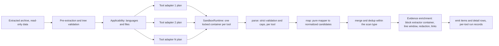
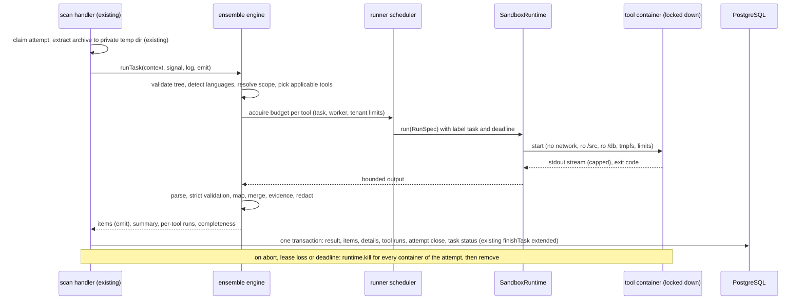

# Scan engines (production ensemble engines) — Module Specification

**Status:** **Approved with the owner decisions of 2026-11-19** (see "Decisions 2026-11-19" below). Nothing in this document is implemented: no product code, migration, package or configuration change. The scope amendments (Docker exception for the scan layer only, ADR-008 area 18) are applied to `CLAUDE.md`, `docs/technical/TECH_STACK.md`, `docs/README.md`, `AGENTS.md`, `docs/ai-development/AGENT_INSTRUCTIONS.md`, Executions SPEC ER-5/ER-26 and ADR-008. Tool adoption is gated by the Part A verification spike (section 17.a, done 2026-11-19 on rootful Docker; results in `IMAGES.md`; **accepted by the owner 2026-11-19, D-13**): no adapter is built on unverified facts. **Data licences are a legal gate before production (D-15, OQ-26) and the rootless isolation checks are a gate before production (D-20, OQ-27).**
**Owner:** Product owner (decisions); Claude Code (specification)
**Last updated:** 2026-11-19
**Related ADRs:** ADR-002 (modular monolith, separate workers), ADR-003 (tenant isolation), ADR-004 (finding identity is per pipeline, never merged across pipelines), ADR-008 (security suite; area 18 approved 2026-11-19, section 14.1), ADR-009 (no secrets in messages, SecretStore), ADR-011 (envelopes, outbox, ownership re-validation), ADR-012 (workspace-level source-control linking; GitHub only today), ADR-013 (LLM abstraction; not used by this module), **ADR-014 (containerised scan execution, Accepted 2026-11-19)**
**Related specs:** `docs/modules/executions/SPEC.md` (scan tasks, results, timeouts, cancellation, `untrusted_fork`, engine registry, §17.ab SBOM-lite engine), `docs/modules/scan-decisioning/SPEC.md` (which scan types run), `docs/modules/pipelines-triggers/SPEC.md` §5.7.1 (engine catalog)
**Template:** `docs/technical/MODULE_SPECIFICATION_TEMPLATE.md` (the owner's brief named `docs/MODULE_SPECIFICATION_TEMPLATE.md`; the file lives under `docs/technical/`).

Labels used throughout: **Confirmed** = stated by the owner in the 2026-11-19 brief (rows `CB-n` below), decided by the owner on 2026-11-19 (rows `D-n` below, `Confirmed 2026-11-19` tags) or already approved in an existing document and cited; **Recommended** = my proposal; **Open** = needs the owner. Per `CLAUDE.md` (status rule), only Confirmed items are requirements; nothing Recommended or Open is promoted.

## Decisions taken from the owner brief (2026-11-19, Confirmed)

| Id | Decision |
|---|---|
| CB-1 | The built-in SBOM-lite engine is to be replaced by **production ensemble engines**. Each tool runs as a **pinned OCI image (by digest)** in a locked-down sandbox: no network by default, read-only mount of the archive, non-root, dropped capabilities, seccomp, CPU / memory / pids / time limits. Repository code is analysed as **data** and never executed |
| CB-2 | This reverses the "no Docker" constraint **for the scan layer only**. The rest of the `CLAUDE.md` out-of-scope line (Docker, Compose, Kubernetes, deployment, CI) otherwise stands. The amendment to `CLAUDE.md` and `TECH_STACK.md` needs an owner approval; this draft only proposes the wording |
| CB-3 | Each scan type is an **ensemble engine** running N **tool adapters**; each adapter runs its container, parses the output and maps it to the normalized finding schema. Tools: SBOM = Syft + cdxgen (CycloneDX and SPDX outputs); SCA = Trivy + Grype + OSV-Scanner (Grype deferred to v2, D-21); SAST = Semgrep OSS (or Opengrep) + per-language tools selected by detected languages (Bandit, gosec, njsscan, Brakeman); Secrets = Gitleaks + detect-secrets (TruffleHog optional, AGPL-3.0 flagged); **CodeQL is excluded** (commercial-licence restriction) |
| CB-4 | A tool failing does **not** fail the scan type if another tool of that type succeeded (partial per tool). Per-tool statuses roll up into the task status and stay consistent with Executions SPEC 5.4 and scan-decisioning 17.g |
| CB-5 | Results of several tools are **merged and de-duplicated within a scan type**; one issue found by several tools is ONE finding carrying tool provenance (which tools found it, with higher confidence) |
| CB-6 | A **normalized finding schema** (severity, rule/CVE/CWE, title, location, tool provenance, confidence, raw reference) is defined here for the Findings module; adapters return raw-parsed records, a pure mapper maps them, the merger de-duplicates; tool output is untrusted input |
| CB-7 | **Evidence enrichment**: tree-sitter (no execution) extracts the enclosing function or block of a code finding; SCM deep links point to the exact commit, file and lines; **secret values are never stored**: a secret finding shows its line with the value masked (SE-42, D-27) |
| CB-8 | **Vulnerability databases** are pinned and mirrored offline for Trivy, Grype and OSV; a refresh job updates them; the sealed scan path needs no live network |
| CB-9 | Integration with scan execution honours timeouts, cancellation (kill containers, no orphans), `untrusted_fork` (no tenant credentials to any tool), and incremental scope |
| CB-10 | T-29 shows which tools ran and each tool's per-task status and counts; evidence and links surface later in Findings (T-32) |
| CB-11 | Security-suite additions (ADR-008 scope amendment) are a PROPOSAL for the owner's approval, testable without Docker in the cloud sandbox, plus live Docker checks listed separately |
| CB-12 | The **container runtime and isolation model is the owner's decision** (Open, section 15, OQ-1 and ADR-014) |

## Decisions 2026-11-19 (owner, Confirmed)

| Id | Decision | Folded into |
|---|---|---|
| D-1 (OQ-1) | **Runtime.** All runtime access goes through a `SandboxRuntime` interface. Development adapter: rootless Podman (preferred) or rootless Docker. Production: a dedicated scan-runner service (gVisor or Kata noted as hardening). The privileged Docker socket (equivalent to root) is NEVER mounted into the worker; the worker talks to the runtime only through `SandboxRuntime` | ADR-014 (Accepted), 6.2, 6.3, 11.1 T3, 15 |
| D-2 (OQ-2, OQ-3) | **Scope.** The "scan layer only" Docker exception is added to `CLAUDE.md`, `TECH_STACK.md`, `docs/README.md`, `AGENTS.md`, `AGENT_INSTRUCTIONS.md`; Executions ER-5 updated; ADR-008 area 18 (`ENG-S*`) approved. Docker, Compose, Kubernetes, deployment and CI remain out of scope everywhere else; only the scan-tool sandbox layer may use an OCI runtime via `SandboxRuntime` | 0.4, 14, 14.1 |
| D-3 (OQ-9) | **Licence gate.** A tool is adopted ONLY if the spike confirms ALL of: permissive licence, does NOT execute repository code, works offline. Provisional set: SBOM = Syft + Trivy (SBOM mode); cdxgen DROPPED (it runs package managers); SCA = Trivy + Grype + OSV-Scanner (Grype deferred to v2, D-21); SAST = Opengrep OR Semgrep-OSS (OSS-licensed rules only) + Bandit + gosec (gosec after Bandit); Secrets = Gitleaks + detect-secrets. EXCLUDED pending verification: TruffleHog (AGPL + network), CodeQL (commercial), Brakeman (licence). Each adopted tool's exact licence and version is documented (IMAGES.md, 17.a) | 5.2, 17.a |
| D-4 (OQ-12) | **Images** pinned by DIGEST in an images manifest (`IMAGES.md` now, the lock file at build); cosign signing deferred to production; scanning the scanner images themselves in CI later | 9.3, IMAGES.md |
| D-5 (OQ-4, OQ-5, OQ-5b) | **Policy.** Highest severity wins; unknown becomes Medium with a visible "severity unmapped" flag; per-scan-type dedup keys as proposed in 5.6 are MERGE keys, not finding identity (ER-26); NO secret fingerprint and no value-derived data is stored in v1 | 5.6, 5.7, 7.2 |
| D-6 (OQ-17) | **Roll-up.** A task where at least one tool succeeded is `succeeded (degraded)` with an incomplete-result flag; a task where ALL tools failed is `failed`. A degraded or incomplete result is NEVER `resolutionEligible`. The execution status `partial` is not overloaded | 5.4 |
| D-7 (OQ-13) | **Incremental.** The changed-path list already computed by scan-decisioning is stored as an artifact; engines scope incremental scans to it (fail closed to full). This resolves the FT-5 contradiction (CX-8) | 5.9, 7.3 |
| D-8 | **Size caps.** A detail table plus higher ceilings for provenance, evidence snippets and SBOM documents (numbers in 7.3, calibrated by ENG-L10) | 7.3, CX-5, CX-6 |
| D-9 | **ER-26.** The merge/dedup key is NOT a finding identity; recorded here (SE-11, 7.2) and in the Executions SPEC ER-26 note | 5.6 |
| D-10 | **File modes.** The archive extractor (`packages/infra/src/archive/tar.js`, files `0600`, dirs `0700`) must be fixed so a non-root scan container can read the tree. Recorded as a build-part requirement (Part C); no code is changed now | 6.3, 16.1 |
| D-11 (OQ-20) | **Findings schema.** The normalized schema of 7.2 is the SHARED CONTRACT the Findings module will consume | 7.2 |
| D-12 | **Other approvals.** SAST v1 = Opengrep/Semgrep-OSS + Bandit (gosec next); DB mirror with staleness tiers; engines ship behind a rollout flag OFF by default (all four types, including SBOM `ensemble`; SBOM-lite stays the default engine); proposed limits and evidence caps accepted; Linux dev only for now (Windows/macOS deferred, OQ-19); "no adapter is built on unverified facts": Part A is the verification spike (17.a) | 5.8, 5.10, 5.12, 5.13, 15, 16 |
| D-13 | **Spike accepted.** The Part A verification spike (17.a, `IMAGES.md`) is accepted by the owner as the basis for adapters (OQ-8 closed: Opengrep is the SAST engine, Semgrep OSS stays the documented fallback). The spike's `semgrep/semgrep` and `securego/gosec:2.24.6` images were pruned and are not part of the manifest | 5.2, 17.a, IMAGES.md |
| D-14 | **Licences of tools and images.** Opengrep (LGPL-2.1) is acceptable as an unmodified separate binary in a separate container, never linked into platform code. The owner approves building **our own Opengrep and detect-secrets images** (no upstream image exists) and a **pinned platform mirror registry**; digests are recorded in `IMAGES.md` and later in the lock file. Closes the remainder of OQ-12 (registry and own builds) | 5.2, 9.3, IMAGES.md, ADR-014 |
| D-15 | **Vulnerability-data licences. The owner is not a lawyer: a real legal sign-off is a REQUIRED gate before production (OQ-26, `OPEN_DECISIONS.md`).** Until then, for v1: SCA is restricted to the **language ecosystems npm, PyPI, Go and Maven**, using commercial-safe sources only: **GHSA (CC-BY-4.0, attribution REQUIRED, 5.12.1 and SCREENS section 12)**, **NVD (public domain)** and **OSV core**. The unstated-licence **Grype DB data** and any **Chainguard non-commercial data** are **QUARANTINED**: not shipped, not mirrored, not mounted, until legal clears them. A source that cannot be cleanly separated from a tool's DB is **dropped for v1**. The consequence for the Grype adapter (and the same question for the Trivy OS-package data) is recorded as an Open consequence with options in OQ-24; nothing is decided silently | 5.2, 5.12.1, 15 (OQ-9, OQ-24, OQ-26), SCREENS 12 |
| D-16 | **SAST rules.** The Semgrep-registry rules (Semgrep Rules Licence) and Commons-Clause rule packs are NOT bundled. SAST uses a **platform-owned rule pack**, authored and reviewed by the security team (the existing QualiSec rules are reused where licence-compatible). v1 starts with a **small self-written rule set** in Opengrep/Semgrep YAML; the comprehensive pack is an **ongoing security-team deliverable** (OQ-25) | 5.2, 16.1 part H, 15 (OQ-25) |
| D-17 | **Optional spikes skipped.** cdxgen stays excluded (Syft + Trivy cover SBOM). Ruby SAST is deferred (Brakeman is non-commercial; revisit when a permissive option exists) | 5.2, 17.a.7 |
| D-18 | **File modes (D-10 refined).** Option 2 approved: a **0755 / 0644 tree inside a 0700 parent** so a non-root container can read it. The extractor (Part C) must also implement: **fail-closed tree validation**, the **`.git/` extraction deny list**, and the **Trivy path-length guard** (reject or flag any path over `PATH_MAX`, failing closed, because Gitleaks and detect-secrets silently miss secrets at over-long paths and Trivy fails fatally) | 6.3, 11.2, 16.1 part C |
| D-19 | **Permalinks.** The GitHub range syntax is `#L<start>-L<end>` (two L's). Each provider's range format is verified against a real repository in the live test using the installation token (ENG-L17) | 5.13.3, 16.2 |
| D-20 | **Rootless isolation GATE.** The cloud sandbox forbade user namespaces, so rootless Podman or Docker, uid mapping and gVisor are **UNVERIFIED**. Verification on the owner's Docker machine is a REQUIRED pre-production gate (ENG-L18, OQ-27). **The `SandboxRuntime` interface and the argument builder MUST NOT assume a rootful runtime** (the binary, user-namespace mode and uid mapping are configuration, never constants) | 6.2, 6.3, 16.1 part A, ADR-014 |
| D-21 | **Grype deferred to v2 (OQ-24 closed, option A, owner decision 2026-11-19).** Grype is DROPPED from the v1 SCA ensemble because the aggregated Grype DB licence is unstated. **SCA v1 = Trivy (language ecosystems ONLY: OS/distro package scanning disabled, e.g. `--pkg-types library`, so vendor advisory data is not used; exact flags verified in the live test) + OSV-Scanner (offline; npm, PyPI, Go, Maven)**. Clean data: GHSA (CC-BY-4.0 + attribution), OSV core, NVD. **Requirement (ENG-L19, Part F):** while building the DB mirror, verify that the npm, PyPI, Go and Maven OSV zips contain no Chainguard/Wolfi or other non-commercial record and **quarantine any that do** (SE-46). Grype returns in v2 with an own-built DB from NVD + GHSA. The ensemble is therefore **SBOM = Syft + Trivy; SCA = Trivy + OSV-Scanner; SAST = Opengrep + Bandit (gosec later); Secrets = Gitleaks + detect-secrets: at least two tools per scan type**, and the "two tools" reading of SE-38 and table 5.4 is now the normal case. The lock file marks Grype `DEFERRED_V2` and the resolver refuses it with the code `tool_deferred` (ENG-S02b). Own-built images (Opengrep, detect-secrets): recording their mirror registry digests is a **pre-production task of the owner**; the production-mode throw of the lock loader stays correct until then. The platform SAST rule pack stays Open (security-team deliverable, OQ-25). Each provider's permalink range format is verified in the live test (ENG-L17) | 5.2, 5.4, 5.12.1, 15 (OQ-24), 16.1 part G, IMAGES.md |
| D-22 | **Part E confirmations (owner decision 2026-11-20).** (1) `db_unavailable` after the retry budget: if no tool produced data the task fails (transient class, then failed, never resolution eligible); if another tool produced output the task is degraded/incomplete and is never discarded. (2) SE-38 rewrite confirmed: every stale tier runs as partial/incomplete, never resolution eligible, staleness never fails a task. (3) Accepted: base confidence medium, 512 MiB tmpfs for SBOM tools, 500,000-component cap, CycloneDX scope mapping. Hashes and licences are not mapped into findings **only because the full SBOM document is retained**: (4) **Part K stores one canonical tool's CycloneDX document (Syft) in the `sbom_document` class** (required for the T-24 SBOM download and future licence scanning; it preserves the hashes and licences the finding schema omits). It is stored, not discarded. No redundant CHECK migration for the detail table: the existing composite foreign keys enforce tenancy and ENG-S08d proves the cross-tenant read guard. |
| D-23 | **Part K core, owner decisions (2026-11-20).** (1) **Retry class, option A:** the class of table 5.4 row 7 is decided ONLY by the infrastructure-dependent container tools; the permanent failure word of the in-process inventory (`sbom-lite`, `output_invalid`) is excluded from that decision (it still counts as a failed tool and is recorded). If every container tool failed transiently the task retries even though the local inventory failed. (2) **Stored SBOM document, option A:** the `sbom_document` holds the REDACTED copy (credential masking kept), so a secret in a package field never leaves through the T-24 download; if redaction would leave something that is not a JSON object the document is NOT stored, a warning is logged and the task is not failed. **Superseded in its mechanism by 17.l (per-string redaction, owner decision 2026-11-20): only the offending strings are replaced and the document is stored; it is not stored only when it cannot be parsed or serialized within the caps.** A controlled exact-bytes path for licence or legal use is a separate later item, recorded as OQ-28 (Open, not built). (3) **Event-loop yielding is REQUIRED:** every CPU-heavy loop of the ensemble path yields to the event loop so a large merge can never starve the lease heartbeat (17.j). (4) **Changed-paths write order deviation accepted** (artifact before the decision transaction, harmless orphan) with orphan cleanup by retention and a reader that goes only through the committed decision row (SE-22). (5) ADR-008 scope confirmed: `ENG-S15` validates tooling non-vacuousness and containment, not tool fidelity; no scope change. (6) Confirmed correct: containers carry `attempt + 1` (the sandbox needs `labels.attempt >= 1`, the task column is 0-based) and the production-mode lock loader refuses unpushed own-built image digests. |
| D-24 | **Owner decisions of 2026-11-21 (SBOM completeness, SBOM download, Part F).** (a) **SBOM components: INCLUDE ALL regardless of dev, prod or test scope.** No tool reliably emits a scope, and dropping a component risks missing a real supply-chain vulnerability. `scope` is `prod`, `optional` or `dev` where a tool emits it, otherwise `unknown`. **This reverses 17.n decision 1 (npm development dependencies excluded, `--include-dev-deps` not passed).** (b) **Syft-only components (project-root packages, test-scope Maven dependencies) are KEPT.** (c) **OQ-17 rows 3 and 4 (applicability gate, `no_applicable_files`) are DEFERRED to the SAST and Secrets parts** (H and I). (d) **SBOM scope confirmed: whole tree, no Trivy vulnerability database** (SPEC 5.9, 17.n). (e) **SBOM download: option A of 17.o is built** (repository-level route, `repository.view`, served from the REDACTED `sbom_document`, `Content-Disposition: attachment`, `X-Content-Type-Options: nosniff`, one audit entry per download, an ADR-008 check); **OQ-28 (exact-bytes path) is DEFERRED: users get the redacted version only.** (f) **Part F:** the four staleness tiers stay (fresh, aging, out of date, expired above 30 days, each with its own operator notice); **a snapshot containing quarantined or non-commercial records is rejected as a whole in v1 (fail closed) and the operator is ALERTED when a refresh is blocked by quarantine (once per snapshot digest);** "build our own vulnerability database from clean GHSA, NVD and OSV sources" is recorded as the **v2 path** (it also resolves Grype, D-21, OQ-24 option B); the **OSV sha256 source** (OSV published checksums versus trust-on-first-fetch pinning) is **DEFERRED to the real-downloader implementation (before production), recorded as OQ-29**; the fake-downloader path stays; **a rejected digest is not retried automatically** (the next scheduled refresh retries) | 5.2, 5.4, 5.9, 5.12, 17.n, 17.o, 17.p |
| D-25 | **Owner decisions of 2026-11-21 on Part G (all CONFIRMED).** (1) **Trivy SCA `--include-dev-deps` ACCEPTED** (its dependency universe equals the SBOM's and OSV-Scanner's). (2) **The alias merge pairs PER DECLARING MANIFEST: ACCEPTED and PROMOTED to Confirmed** (a vulnerability in two lockfiles is two contexts, two occurrences); 5.6.2 now names the manifest. (3) The CVSS list in the provenance entry (at most 2) is accepted. (4) `HEAD` on the SBOM download sends no body and writes no audit entry: accepted. (5) `SANDBOX_RULES_DIR` is required while `SCAN_DB_REFRESH_ENABLED=true`: accepted. (6) **OQ-26 legal list extended:** the Trivy database contains the distribution vendors' ratings of the same CVEs (`redhat`, `ubuntu`, `azure`, `bitnami`); the platform NEVER reads or exposes them (`ENG-S06j` proves it) but the file is still mirrored; the v2 own-built database from clean GHSA, NVD and OSV sources removes them entirely. (7) **CVSS 9.0 (our calculator, equal to NVD) against GHSA's 9.1 for CVE-2021-45046 is accepted, no change.** CVSS v4.0 scoring stays open (no calculator) | 5.6.2, 17.u, OQ-26 |
| D-26 | **Part H, owner decisions of 2026-11-21 (OQ-25, rule pack scope for v1; CONFIRMED).** SAST v1 = **Bandit's built-in Python rules (Apache-2.0)** plus a SMALL **platform-written Opengrep starter pack in our own YAML** covering SQL injection, command injection, eval or exec of untrusted input, insecure deserialization, path traversal, weak crypto and hard-coded credentials for JavaScript and TypeScript, Python and Go. **No Semgrep-registry rule and no Commons-Clause or Semgrep-Rules-License pack is bundled**; every rule file is original, carries id, message, severity, CWE and languages metadata and a provenance and licence header stating platform-owned; the licence question is recorded for security-team review (OPEN_DECISIONS); the comprehensive pack (leveraging QualiSec rules where the licence is compatible) is an ongoing security-team deliverable, OQ-25 stays Open | 5.2, 11.3, 15 (OQ-25), 16.1 part H, 17.v |
| D-27 | **Part I, owner decisions of 2026-11-22 (all CONFIRMED; recorded by the part J work, 17.y).** (1) The Secrets exclusion policy is CONFIRMED: scan everything except `.git` and the deny-listed tool-control files (`.gitleaksignore`, `.gitleaks.toml`, `.secrets.baseline` at any depth), NO vendored exclusion; the type-class, severity and confidence tables and the extraction deny list are CONFIRMED. (2) The Gitleaks default-allowlist gap is ACCEPTED for v1: detect-secrets covers `node_modules`, lock files and the other paths Gitleaks skips; this is DOCUMENTED in the coverage statement of a Secrets task and no custom Gitleaks ruleset is forked. (3) **A masked line preview of a secret finding is BUILT (part J): this CHANGES SE-42** (evidence was omitted for every secret). (4) Mirror registry digests of the own-built Opengrep and detect-secrets images remain a PRE-PRODUCTION task | 17.y, SE-42, 5.13.4 |

## 0. Facts that need the owner's attention (read this first)

### 0.1 The "Findings SPEC" does not exist

The brief refers to a "Findings SPEC" (the normalized finding schema). **`docs/modules/findings/` does not exist** (verified: `docs/modules/` holds only `access-management`, `executions`, `pipelines-triggers`, `repositories-github`, `scan-decisioning`, `user-preferences`, `scan-engines`). The progress tracker lists "Finding lifecycle" as Not Started. I therefore did not copy a schema; section 7.2 defines the normalized finding schema in this module as a **Recommended contract proposal** that the future Findings module adopts or amends. It follows ADR-004 (finding identity is per pipeline; findings are never merged across pipelines; a workspace may only show correlation). It is listed as a cross-module Open point (OQ-20). Until the Findings module accepts it, it is a proposal and nothing may treat it as a settled contract.

### 0.2 The ADR number

The brief says "ADR-XXX". `docs/decisions/` holds ADR-001 to ADR-013 (verified by listing); the next free number is **ADR-014**, written as `docs/decisions/ADR-014-CONTAINERISED-SCAN-EXECUTION.md` (Proposed).

### 0.3 Contradictions with existing, approved text (none is silently changed)

| Id | Where | What it says | Effect of this module | Proposal |
|---|---|---|---|---|
| CX-1 | `CLAUDE.md` line 14; `AGENTS.md` line 27; `docs/README.md` line 33; `docs/ai-development/AGENT_INSTRUCTIONS.md` line 101 | Docker, Docker Compose, Kubernetes, deployment and CI are out of scope now | Scan tools run as containers, so a container runtime and Dockerfile-free pinned images are needed | **Resolved 2026-11-19 (D-2):** owner-approved amendment, scan layer only (ADR-014 "Scope"), applied to these files and `TECH_STACK.md`. Sentence in section 0.4 |
| CX-2 | Executions SPEC ER-5 | "Logical scan sandbox (no container) ... Physical isolation (separate process pool, container) is a deployment decision outside this spec (Docker is out of scope); the queue split of ER-7 keeps it possible" | The physical isolation now exists for tools. The scan worker still holds no SecretStore or GitHub setting; it gains access to a container runtime (ADR-014 risk R1) | **Resolved 2026-11-19:** ER-5 stays true for credentials; the ADR-014 pointer is added to Executions ER-5 |
| CX-3 | Executions SPEC §17.ab | The SBOM-lite engine is the only engine; "External-tool engines (Semgrep, Trivy, Gitleaks) are a separate future module with its own sandbox ADR" | This is that module and that ADR (ADR-014). Consistent, not a conflict | None |
| CX-4 | ADR-008 line 150 "no Docker"; `ER-6` "never spawn the repository's code" | The suite runs without Docker; adapters never run repository code | The suite additions of section 14.1 are Docker-free (fake runtime); live Docker checks are NOT in `pnpm test:security` | Keep the suite Docker-free; live checks are a separate plan (section 16.2). Area 18 approved 2026-11-19 (D-2) |
| CX-5 | Executions SPEC §7.4 `scan_result_items.data` | `data jsonb` at most 4 KiB; `normalizeItems` drops a larger object | Provenance, raw severities and evidence do not fit | **Resolved 2026-11-19 (D-8):** new detail table plus higher ceilings (section 7.3) |
| CX-6 | Executions SPEC §7.4 and §17.ac | One artifact at most 1 MiB, 20 per execution, 8 MiB per execution; "nothing writes artifacts yet" | CycloneDX / SPDX documents of a large repository exceed 1 MiB | **Resolved 2026-11-19 (D-8):** higher ceilings for provenance, evidence snippets and SBOM documents (7.3); raw tool outputs are still not stored in v1 |
| CX-7 | Executions SPEC ER-26 | The results module "never computes a fingerprint" and items carry "locators only, not an identity key" | The merger computes a **dedup key** and, for secrets, an in-task fingerprint | **Confirmed 2026-11-19 (D-9):** the dedup key is a within-task merge key, NOT a finding identity (ADR-004); the Findings module still owns identity. Stated in 7.2 and in the Executions SPEC ER-26 note |
| CX-8 | Scan-decisioning FT-5 ("the decision adds nothing to a task message") and 17.i display note ("the full list is not stored") | A task has no list of changed files; the decision record keeps counts and up to N sample paths | Incremental scoping of SAST and Secrets needs the changed-path list | **Resolved 2026-11-19 (D-7):** Section 5.9: store the capped list as an artifact referenced by the execution, read by the scan handler (the message stays unchanged). **Approved 2026-11-19 (D-7).** Amends a stored-data statement; scan-decisioning 17.i display note to be updated with the build part |
| CX-9 | SBOM-lite (`engines/sbom`, §17.ab) emits one item per (ecosystem, name, version, source file) | An ensemble merges by component identity | Item count and shape change; `locations[]` in the detail row | Section 5.6 and OQ-5 |
| CX-10 | Executions SPEC 5.4 | Task statuses `succeeded, failed, timed_out, cancelled, skipped, unsupported`; no task `partial` | "A tool failing does not fail the scan type" needs a partial notion | **Confirmed 2026-11-19 (D-6):** `succeeded (degraded)` = task status `succeeded` plus the `completeness = incomplete` flag (precedent: §17.ab item 5); **no new task status, no enum change, no change to table 5.4**; never `resolutionEligible`; the execution `partial` is not overloaded (section 5.4) |
| CX-11 | `packages/shared/src/pipelines/constants.js` `ENGINE_CATALOG`; §17.ab ("the catalog id stays `default` because stored pipeline configurations select it") | Engines are selected by `engine.id` and `engine.profile` only; a repository can never add an engine, rule pack path, command or plugin | Keep `default` / `standard`; the ensemble replaces the implementation behind the same id, chosen by a deployment flag | Section 5.10 |
| CX-12 | `packages/infra/src/archive/tar.js` extracts files with mode `0600` and directories `0700` | A non-root container user cannot read a tree owned by another uid with those modes | Mount strategy must make the tree readable by the container user without widening permissions on the host | **Confirmed 2026-11-19 (D-10):** fix the extractor (build part C); section 6.3 and ADR-014 (uid mapping); live check ENG-L02; the Part A spike (17.a) tests the strategies |
| CX-13 | OPEN_DECISIONS rows "Scan engine vendors" (Select providers) and "Built-in vs external scan engines" (Hybrid proposed) | Unresolved | This spec proposes the vendors and the hybrid boundary | Rows narrowed to what stays open (`OPEN_DECISIONS.md`) |

### 0.4 The `CLAUDE.md` / `TECH_STACK.md` amendment (owner-approved 2026-11-19, APPLIED)

> Applied (precise statement): Docker, Docker Compose, Kubernetes, deployment and CI remain out of scope; ONLY the scan-tool sandbox layer may use an OCI runtime, reached exclusively through `SandboxRuntime` (rootless Podman or Docker in development, a dedicated scan-runner service in production), to run third-party tool images pinned by digest; the privileged Docker socket is never mounted into the worker.

The root `README.md` does not carry the out-of-scope rule and was not changed.

## 1. Purpose

QmentisAI scans customer repositories with four scan types (SBOM, SCA, SAST, Secrets; `docs/product/PROJECT_CONTEXT.md` "Initial scan scope"). Today only the in-process SBOM-lite engine exists (Executions §17.ab); SCA, SAST and Secrets tasks are recorded `unsupported`. This module provides the production engines: for each scan type an **ensemble** of well-known open-source tools, each run as a pinned, sandboxed container, whose outputs are normalized, merged and de-duplicated into one result per scan task in the shape the Findings module will consume, with tool provenance, reproducible versions and offline vulnerability data.

## 2. Scope

### In scope
- ADR-014 and the sandbox runner: a `SandboxRuntime` abstraction, a pure argv builder, the pinned image catalog and its digest workflow.
- Tool adapters, pure mappers and the merger for SBOM, SCA, SAST and Secrets; the normalized finding schema (Recommended contract).
- Severity normalization, dedup keys and confidence per scan type.
- Evidence enrichment (enclosing block by tree-sitter, line window fallback), SCM deep links, secret redaction.
- The vulnerability-database mirror and its refresh job.
- Integration into the scan handler: per-tool statuses and roll-up, timeouts, cancellation without orphans, `untrusted_fork`, incremental scope, resource budget and scheduler.
- Hostile-archive hardening additions and the threat model.
- T-29 additions (tool list and per-tool status) in `SCREENS.md`.
- Security-suite additions (proposal), live test plan, rollout flags.

### Out of scope
- The Findings module (identity, lifecycle, suppression, dashboards, T-31 to T-34, the false-positive agent): this module only reserves the contract and the evidence fields (T-32 shows them later).
- DAST and Asset Discovery (T-30), licence-policy decisions, reachability analysis, auto-remediation.
- Docker Compose, Kubernetes, deployment and CI configuration (CX-1 keeps them out of scope); building a registry; production orchestration of the runner beyond ADR-014's options.
- The LLM layer (ADR-013): no model is involved in any step of this module; every tool-derived string is inert data.
- Running a customer's build, tests, package manager or any repository-provided hook, for any reason.
- A UI for managing tool catalogs, rule packs or DB snapshots (a later Root Console item; OQ-23).

## 3. Actors and permissions

No new permission key is introduced (**Recommended**, as in scan-decisioning §3).

| Actor / role | Action | Scope | Permission |
|---|---|---|---|
| Tenant user | Sees the tool list and per-tool status on T-29 | workspace | `execution.view` (existing key) |
| Tenant user | Sees evidence and links (later, T-32) | workspace | `finding.view` (planned by the Findings module) |
| Platform admin | Approves an image digest bump, DB snapshot promotion, rule-pack change | platform | Out of this spec (Root Console, Open OQ-23); until then a repository change reviewed by the owner |
| Scan worker / runner | Runs containers | system | none (service identity; no tenant credential) |
| DB refresh worker | Downloads vulnerability data | system | none (service identity; the only network-egress component) |

## 4. Functional requirements

| ID | Requirement | Priority | Status |
|---|---|---|---|
| SEF-001 | Each tool runs only as a catalog image referenced by digest, in the sandbox of ADR-014 / section 6 | Must | Confirmed (CB-1) |
| SEF-002 | The repository is analysed as data; nothing from it is executed, built, installed, imported or interpreted as tool configuration | Must | Confirmed (CB-1; ER-6, R-8) |
| SEF-003 | Each scan type is an ensemble of tool adapters selected by the engine catalog entry, applicability (detected languages and files) and platform configuration, never by repository content | Must | Confirmed (CB-3); selection mechanics Recommended |
| SEF-004 | Per-tool statuses roll up into one task outcome without failing the scan type while a tool succeeded | Must | Confirmed (CB-4); exact table Recommended (5.4) |
| SEF-005 | Findings of several tools are merged within a scan type by a per-type dedup key; the merged finding carries provenance and a confidence | Must | Confirmed (CB-5); keys Recommended (5.6) |
| SEF-006 | Severity is normalized to critical / high / medium / low / info, the highest wins, each tool's raw severity is recorded | Must | Normalization policy Recommended (OQ-4) |
| SEF-007 | Adapter output is validated strictly and bounded; the mapper is a pure function; the schema is versioned | Must | Confirmed (CB-6) |
| SEF-008 | Code findings carry the enclosing function or block, or a line-window fallback, within size caps | Should | Confirmed (CB-7); caps Recommended |
| SEF-009 | Findings carry an SCM deep link built from the recorded provider and the pinned commit SHA | Should | Confirmed (CB-7); formats Recommended |
| SEF-010 | A secret value never appears in any stored or transmitted field, log, event or error | Must | Confirmed (CB-7); mechanics Recommended |
| SEF-011 | Vulnerability databases are versioned, mirrored snapshots mounted read-only; the sealed path needs no network; each result records tool, image and DB digests | Must | Confirmed (CB-8); mirror design Recommended |
| SEF-012 | Cancellation, lease loss and deadline kill every container of the attempt; no orphan survives; a janitor reaps stragglers | Must | Confirmed (CB-9) |
| SEF-013 | An `untrusted_fork` task passes no tenant credential to any tool and uses the `scan-untrusted` queue | Must | Confirmed (CB-9, ER-5, ER-7) |
| SEF-014 | Incremental scans scope each tool as specified in 5.9 | Should | Confirmed (CB-9); mechanics Recommended |
| SEF-015 | Parallelism of tools within a task is bounded by a per-task budget and a per-worker semaphore | Should | Recommended |
| SEF-016 | Hostile archives and hostile tool output are tolerated within hard caps; every cap breach is a stable code | Must | Confirmed (CB-1, section 11) |
| SEF-017 | T-29 lists the tools of each task with fixed-word statuses and counts; all tool-derived text is inert | Must | Confirmed (CB-10) |
| SEF-018 | The engines are enabled progressively per scan type by a deployment flag; SBOM-lite stays available until the ensemble is verified | Should | Recommended (OQ-18) |
| SEF-019 | The security-suite additions of 14.1 run without Docker and fail when a property is removed | Must | Confirmed as a proposal for approval (CB-11) |

## 5. Business rules

Rule ids `SE-n`. "Confirmed" rows cite the owner brief row (`CB-n`) or an existing approved rule; everything else is **Recommended** unless marked **Open**.

### 5.1 Anatomy of an ensemble engine

| Rule | Text |
|---|---|
| SE-1 | One ensemble engine per scan type, registered in the existing engine registry (`apps/workers/src/execution/engines.js`) and implementing the existing adapter contract `runTask(context, { signal, log, emit }) -> { status, items[], summary, truncated?, incomplete? }` (Executions ER-6). The scan handler, queues, leases, fencing and the `scan_results` writer are unchanged. The ensemble is a new engine implementation behind the same `(scanType, "default")` catalog id (CX-11). Confirmed (CB-3) for the pattern, Recommended for the placement |
| SE-2 | An ensemble is a list of **tool adapters**. A tool adapter is a plain object `{ toolId, scanType, imageKey, plan(ctx) -> RunPlan, parse(streams) -> RawRecord[], map(rawRecord, ctx) -> Candidate }`. `plan` builds a `RunSpec` (section 6.2) from platform data only; `parse` is a bounded, strict reader of the tool's stdout (untrusted); `map` is a **pure function** (no I/O, no clock, no randomness) from a validated raw record to a normalized candidate (7.2). The **merger** (pure) folds candidates of the whole task into findings. Confirmed (CB-6) for the boundaries, Recommended for the names |
| SE-3 | The adapter never builds a shell command. `RunSpec.argv` is an array passed to the runtime without a shell; no repository-derived string is placed in `argv` except validated relative paths after a `--` separator (SE-27). Confirmed (CB-1, ER-6) in spirit, Recommended mechanics |
| SE-4 | A tool adapter returns **raw-parsed records** only (after schema validation and caps). It does not know severities, tenants or the database. All normalization is in `map` and the merger, which makes them unit-testable in the security suite without Docker (14.1) |
| SE-5 | The ensemble does not call the network, the database, the SecretStore, the GitHub client or the LLM layer. Its only side effects are containers (through `SandboxRuntime`) and the engine's `log` and `emit` |



### 5.2 Tool catalog and licences (provisional set Confirmed 2026-11-19, D-3; licences verified only by the Part A spike, section 17.a and `IMAGES.md`; "Licence (confidence)" below is the pre-spike claim)

The pre-spike text below was written without browsing the web. Licences are what the author was confident of from general knowledge; anything marked **verify** must be re-checked against the tool's repository and the licence texts before adoption (OQ-9 includes the legal review). **No version or image digest is pinned in this document** (placeholders `<tool>@sha256:<digest-placeholder>`; the pinning workflow is section 9.3 / ADR-014).

| Scan type | Tool | Licence (confidence) | OK to run as a separate container? | Caveats |
|---|---|---|---|---|
| SBOM | **Trivy (SBOM mode)** | Apache-2.0 | **Added 2026-11-19 (D-3); ADOPTED by the spike (17.a)**; originally gated by the spike (`trivy fs --format cyclonedx`, no vulnerability scanning in this role) | Same image as the SCA role; second SBOM source so the SBOM ensemble keeps two tools after cdxgen is dropped |
| SBOM | **Syft** | Apache-2.0 (confident) | **ADOPTED (spike 17.a)**: Yes | Static catalogers; can unpack nested archives (JARs, wheels), so give it the same decompression caps as the archive (11.2). Emits CycloneDX and SPDX (verify the exact format flags at adoption) |
| SBOM | **cdxgen** | Apache-2.0 (verified, 17.a) | **DROPPED 2026-11-19 (D-3): it runs package managers (confirmed from its README, 17.a).** (Pre-spike text: yes, only in a no-build / lockfile mode) | The highest-footgun tool: by design it can call package managers and build tools (npm, mvn, gradle, pip, go) to resolve dependency trees, and those execute repository-controlled code (lifecycle scripts, build plugins, `setup.py`). Mitigations: no network (installs fail), image without package managers beyond what the tool strictly needs, explicit "do not resolve/build" configuration (verify the flags and environment variables at adoption), and a live planted-script test (ENG-L06). If it cannot be made safe, drop it and keep Syft + SBOM-lite (OQ-9) |
| SCA | **Trivy** | Apache-2.0 (confident) | **ADOPTED (spike 17.a); DB data licence open**: Yes | **v1: language ecosystems only; OS/distro package scanning disabled (D-21).** Run with `--scanners vuln` only (no secret, misconfig, licence scanning in this module), offline flags, no DB update. Its vulnerability DB is distributed as an OCI artifact from a public registry with pull limits: mirror it (5.12). DB data terms: **verify** |
| SCA | **Grype** | Apache-2.0 (confident) | **DEFERRED TO v2 (D-21, OQ-24 closed 2026-11-19); not in the v1 ensemble, the resolver refuses it.** Spike 17.a: ran offline; DB data licence not stated | Needs a Grype DB (its own format and listing) mounted read-only; auto-update disabled; it reads `.grype.yaml` from the current directory and the scanned path (11.3). DB data terms: **verify** |
| SCA | **OSV-Scanner** | Apache-2.0 (confident) | **ADOPTED only with `--offline --no-resolve --no-call-analysis=go --no-ignore --config` (spike 17.a); data licence open**: Yes | Offline mode needs local OSV database files per ecosystem (large; subset by ecosystem, OQ-6). OSV data is aggregated from many sources with mostly permissive data licences (CC-BY 4.0 for several): attribution duties **verify**. Reads `osv-scanner.toml` found in scanned directories (11.3) |
| SAST | **Semgrep OSS engine** | LGPL-2.1 for the engine (confirmed, 17.a) | **NOT SELECTED (17.a): default mode executed the repository `.git/config` fsmonitor; fallback only**. Pre-spike: Yes (unmodified, separate container) | **Rule licence caveat:** the community rules in the Semgrep registry are under the Semgrep Rules License (not an OSI licence; it restricts use in a competing commercial offering and redistribution). Do **not** bundle registry rules without legal review (OQ-9). Safe path: platform-written rules and rule packs whose licence permits our use; the engine is intra-file for taint in the OSS edition (verify) |
| SAST | **Opengrep** (Opengrep OR Semgrep-OSS, D-3) | LGPL-2.1 (confirmed, 17.a) | **ADOPTED as the preferred engine by the spike (17.a)**, owner to confirm; no upstream image: own-built from the release binary. Pre-spike: Yes | A community fork of the Semgrep engine created after the OSS edition lost features; same rule syntax; younger project and release cadence (verify); same rule-licence caveat applies to the rules you load. Trade-off in OQ-8 |
| SAST | **Bandit** (Python) | Apache-2.0 (confident) | **ADOPTED (spike 17.a) with `--ini` override**: Yes | AST based, no execution; reads `.bandit`, `setup.cfg`, `pyproject.toml` (11.3); `# nosec` comments |
| SAST | **gosec** (Go) | Apache-2.0 (confident) | **ADOPTED for phase 4b only (spike 17.a: no marker in the tested configuration; some cases UNVERIFIED)**: Yes, **higher risk**; D-12: after Bandit | Loads Go packages with the Go toolchain (`go list` machinery), which can invoke the compiler and cgo and resolve modules. Needs `CGO_ENABLED=0`, `GOFLAGS=-mod=vendor` or `-mod=readonly`, `GOPROXY=off`, `GOTOOLCHAIN=local` (verify) and may still execute toolchain code on hostile `go:` directives. Phase 4b, after a live test (ENG-L07); not in the first SAST release (OQ-7) |
| SAST | **njsscan** (JS/Node) | LGPL-3.0 (verify) | Not in v1 (skipped, overlap with Semgrep; OQ-7) | Wraps Semgrep rules plus its own; largely overlaps Semgrep. Python package dependencies add supply-chain surface. Recommended: skip in v1 (OQ-7) |
| SAST | **Brakeman** (Rails) | **Brakeman Public Use License: "free for non-commercial use" (verified, 17.a)** | **EXCLUDED (D-3, licence verified by the spike).** (Pre-spike: no, not without legal review) | Ruby / Rails only. Recommended: excluded from v1 pending a licence decision (OQ-9) |
| Secrets | **Gitleaks** | MIT (confident) | **ADOPTED (spike 17.a)**: Yes | Use directory mode (no git history: the archive has no `.git`). Reads `.gitleaks.toml` / `.gitleaksignore` and `gitleaks:allow` comments (11.3). Use its redaction option so the secret is not in stdout; this removes the value needed for a cross-tool fingerprint (5.6.4) |
| Secrets | **detect-secrets** | Apache-2.0 (confident) | **ADOPTED (spike 17.a); `hashed_secret` must be dropped; no upstream image**: Yes | Python; baseline file and plugin loading must be platform-controlled; custom plugins from the repository are never loaded. Output has locations and types, not the value (verify) |
| Secrets | **TruffleHog** (optional) | **AGPL-3.0 (verified, 17.a)** | **EXCLUDED (D-3, licence verified by the spike).** Pre-spike text: not in v1 by default. Running an unmodified build as a separate process is commonly treated as aggregation, but the AGPL network-use clause and our hosted offering make this a legal-review item | Its main differentiator is live verification of credentials, which needs outbound network and is therefore **incompatible with the sealed path**; offline it loses that value. Recommended: exclude (OQ-9) |
| Secrets, SAST | **CodeQL** | GitHub CodeQL Terms and Conditions (verified, 17.a) | **Excluded** (Confirmed, CB-3; D-3) | Commercial-licence restriction |
| Evidence | **tree-sitter** and grammars | MIT for the runtime and most grammars (verify each grammar) | Yes | Runs only inside a sandbox container (5.13) |

#### 5.2.1 Tool and image outcomes of the owner batch of 2026-11-19 (D-13 to D-17; Confirmed)

- **Opengrep** (LGPL-2.1) is the SAST engine; used only as an unmodified binary in its own container, never linked (D-14). **Own-built images** for Opengrep and detect-secrets (no upstream image exists) from the vetted release binary and a frozen `pip` set, pushed to a **pinned platform mirror registry**; the registry digest, not the spike's local image id, goes into the lock file (Part B treats a locally built entry as needing a registry digest before production).
- **SAST rules:** only the platform-owned pack (D-16). Registry rules and Commons-Clause packs are never bundled.
- **SCA sources for v1 (D-15):** language ecosystems npm, PyPI, Go, Maven only. Allowed sources: GHSA (CC-BY-4.0, attribution, 5.12.1), NVD (public domain), OSV core. **Quarantined until legal clears them:** the Grype DB data (licence not stated) and any Chainguard/Wolfi non-commercial data. **Consequence for the tools (decided 2026-11-19, D-21, OQ-24 closed):** the Grype database is one aggregated file whose providers (`nvd`, `github`, `chainguard`, `wolfi`, distros) cannot be separated after download, so **Grype is deferred to v2** (own-built DB from NVD + GHSA then). Trivy runs on language ecosystems only (OS-package scanning disabled, so its vendor advisory data is not used); the OSV zips (npm, PyPI, Go, Maven) are checked for Chainguard-derived records during the mirror build and any such record is quarantined (ENG-L19).
- **Not adopted:** cdxgen (excluded), Ruby SAST (deferred, D-17), TruffleHog, Brakeman, CodeQL (excluded).

### 5.3 Per-tool run statuses (Recommended)

A tool run is one container execution (or, for the in-process SBOM-lite adapter, one function call). One row per tool per task attempt in `scan_tool_runs` (7.3).

| Tool status | Meaning | Counts as success for roll-up |
|---|---|---|
| `succeeded` | Exit code accepted by the adapter's table, stdout parsed and valid, no cap hit | yes |
| `partial` | The tool produced usable output but a cap or a defect limited it: output truncated at its byte cap, invalid records dropped, a per-file timeout inside the tool, **DB stale (any tier, reason `db_stale`; owner decision 2026-11-19: a stale database never fails a scan)** | yes, result becomes `incomplete` |
| `failed` | Crash, unacceptable exit code, unparseable output, OOM kill, sandbox error, image missing | no |
| `timed_out` | The tool's wall-clock limit or the task deadline reached while it ran | no |
| `cancelled` | Killed because of a user cancel, lease loss or abort | no (task follows cancel rules) |
| `skipped` | Not applicable (no file of its kind, another tool excluded by catalog rule); not started | neutral |
| `unavailable` | Could not start for a platform reason known before the run: DB snapshot missing (`db_unavailable`, transient), image not present in the local store. **Never** because a snapshot is stale | no |

Failure reasons are **fixed words** (stable codes, no tool text), shown on T-29 through a frontend map: `image_unavailable`, `db_unavailable`, `db_stale`, `timeout`, `out_of_memory`, `exit_code`, `output_invalid`, `output_too_large`, `sandbox_error`, `killed`, `no_applicable_files`, `config_invalid`, `capacity`, `cancelled`, `deadline`. (`capacity` is transient: the tool waited longer than the scheduler allows, 5.8.)

Retry classification against Executions ER-13 (owner decision 2026-11-19; `toolReasonClass` in `@qmentisai/shared`): `sandbox_error`, `image_unavailable`, `capacity` and **`db_unavailable`** are **transient** (infrastructure that can recover); `db_stale` is a **warning**, not a failure: it only ever accompanies a `partial` run (the scan proceeds, the result is `incomplete`, hence never resolution eligible; the roll-up refuses `db_stale` on any other status); `timeout`, `out_of_memory`, **`killed`**, `output_invalid`, `output_too_large`, `exit_code`, `config_invalid` are **permanent** for that tool and for the run (a killed or out-of-memory tool is surfaced as degraded, never auto-retried; an unknown or missing reason is permanent so no retry loop can start). A tool that stays `unavailable` with `db_unavailable` after the retries is a degraded tool (row 6, `incomplete`) when another tool produced output; when none did the task is the ordinary row 7 `failed` task with the transient class, and the retry budget of ER-13 decides how often it is re-run (no new status, and no result is discarded that a tool produced). **Deviation to confirm (OQ-17):** ER-13 lists "engine timeout of the process" as transient; a tool that timed out on the same input will time out again, so I recommend treating a tool timeout as permanent. A task is retried (ER-13, new attempt, whole ensemble re-run) only when no tool succeeded and every failure is transient.

### 5.4 Roll-up of tool statuses into the task and the execution (Confirmed intent CB-4; rows 5 to 7 and the degraded rule Confirmed 2026-11-19, D-6; rows 3, 4 and tool-timeout classification still Recommended, OQ-17 remainder)

Let *applicable tools* be the tools whose applicability check passed. Evaluate top to bottom, first match wins.

| # | Situation | Task status | `scan_results.completeness` | Notes |
|---|---|---|---|---|
| 1 | The task is cancelled or the lease is lost | `cancelled` (Executions ER-14) | `incomplete`, results of finished tools kept | Containers killed (6.4) |
| 2 | The task deadline is reached while a tool runs | `timed_out` (ER-16) | `incomplete`, finished tools' results kept (B5) | Running tools become `timed_out`/`cancelled` |
| 3 | No file in the tree is relevant to the scan type (for example SBOM with no manifest, SAST with no source file) | `succeeded` | `complete`, zero items, `coverage = nothing_to_scan` | Like SBOM-lite on a repository without manifests |
| 4 | Relevant files exist but no catalog tool is applicable (for example Haskell only for SAST) | `succeeded` | `incomplete`, `coverageGaps = [language ...]` | Honest coverage statement; execution not resolution eligible (ER-24). **Open (OQ-17):** option B makes this `failed`; I recommend A because the engine ran and reported exactly what it could not cover, unlike scan-decisioning 17.g where no engine existed at all |
| 5 | At least one tool `succeeded` or `partial`; every other applicable tool `succeeded`, `partial` or `skipped`; no cap hit | `succeeded` | `complete` (if no `partial`) | The normal case |
| 6 | At least one tool `succeeded` or `partial`; at least one other applicable tool `failed`, `timed_out`, `cancelled`, `unavailable` (a `partial` tool with the warning reason `db_stale` is NOT such a tool: it counts as output, row 5, `incomplete`) | `succeeded` (**degraded**, Confirmed D-6) | `incomplete`, `toolsDegraded = n` (the incomplete-result flag); **never `resolutionEligible`** | "A tool failing does not fail the scan type" (CB-4). Precedent: Executions §17.ab item 5, a bad file is a warning and the result is `incomplete` |
| 7 | No tool `succeeded` or `partial`; at least one `failed`/`unavailable` (**ALL tools failed**, Confirmed D-6) | `failed`, reason `tools_failed`; error class transient only if every failure of the infrastructure-dependent tools is transient (`sandbox_error`, `image_unavailable`, `capacity`, `db_unavailable`, 5.3); the in-process `sbom-lite` inventory is EXCLUDED from this decision (D-23 (1), `retryClassExcludes`), and when only excluded tools failed they decide; a stale database can never put a task here | no result, or an `incomplete` empty one (follow the SBOM-lite handling of a failed engine) | T-29 shows each tool's fixed reason |
| 8 | Every applicable tool `skipped` | falls under rows 3 or 4 | | |

**Execution level (consistency with SPEC 5.4 and scan-decisioning 17.g).** No new task status and no change to table 5.4: a task in row 6 is `succeeded`, so an execution whose tasks all succeed is `succeeded`; because the result is `incomplete`, `resolutionEligible` is false (ER-24 requires every enabled type's result to be complete), the same way a truncated SBOM-lite result already behaves. A row 7 task is an ordinary `failed` task: one failed plus one succeeded task gives `partial / tasks_incomplete`; no success gives `failed / tasks_failed`. `unsupported` keeps its meaning (a scan type with no registered engine; terminal at creation; never from `running`) and is **not** used for a tool: a tool that cannot run is `unavailable` or `failed` inside a registered engine. The all-decided-types-unsupported ending of 17.g is unchanged. **Option B (execution `partial`, marking the task `failed`) is rejected by the owner (D-6):** the execution status `partial` is not overloaded. Still Open (OQ-17 remainder): row 4 (no applicable tool) and whether a tool timeout is permanent versus ER-13 transient.

### 5.5 Selection and applicability (Recommended)

| Rule | Text |
|---|---|
| SE-6 | The set of tools of a scan type is platform data (the image catalog, 9.3), keyed by `(scanType, profile)`. A pipeline selects only `engine.id` and `engine.profile` (pipelines-triggers §5.7.1: "a repository can never add an engine, a rule pack path, a command or a plugin"). Profile `standard` is the only profile at first |
| SE-7 | **Language detection** is a pure function of file names and extensions of the extracted tree (a bounded walk, the SBOM-lite walker pattern), never of file content and never by running `file` or a parser. It returns a ranked list of languages with file counts. It selects the per-language SAST tools; Semgrep runs when any supported language is present |
| SE-8 | Applicability per type: SBOM and SCA are applicable when the walk finds a manifest, lockfile or other inventory source that a tool supports (Syft also catalogs images/binaries in the tree: only file kinds on a platform allowlist are handed over); Secrets always applies to the scoped file set; SAST applies per detected language |
| SE-9 | A tool that is not applicable is recorded `skipped` with reason `no_applicable_files`, never started |

### 5.6 Merge and de-duplication within a scan type (Confirmed intent CB-5; per-type keys Confirmed 2026-11-19, D-5, as MERGE keys, not finding identity, D-9; tolerances Recommended)

General rules:

| Rule | Text |
|---|---|
| SE-10 | The merger takes the candidates of **one task attempt** and nothing else. It has no tenant, pipeline or execution input beyond that task, keeps no module-level state and calls nothing outside itself. Findings are therefore never merged across tasks, executions, pipelines or tenants (ADR-004, ADR-003) |
| SE-11 | The `dedupKey` is a deterministic string built from the per-type fields below. It is a **merge key inside the task, not a finding identity**; the Findings module computes identity per pipeline (CX-7) and may reuse it as an input |
| SE-12 | **Two candidates of the same tool are never merged** (they are two occurrences, even with an equal key); they are separate findings unless the tool itself reports them as one. Cross-tool merging only. **Read strictly and accepted by the owner 2026-11-19:** two records of one tool for one component stay two findings even in SBOM; merging happens only on the exact merge key, never on a near match. Consequence to verify on REAL tool output (ENG-L11): that the SBOM tools do not emit confusing duplicate components (for example one component twice for the same package in the same file); if they do, the Syft/Trivy adapters (part E) fold such records into one record with several locations, or the SBOM dedup-by-purl is refined then, never by loosening SE-12 |
| SE-13 | A merged finding keeps one `provenance[]` entry per tool that reported it: `{ toolId, toolVersion, imageDigestShort, ruleId, rawSeverity, rawRef }`; `confidence` is raised one step (low to medium, medium to high) when at least two **distinct tools** agree, capped at high, with `confidenceBasis = "multi_tool"` |
| SE-14 | Determinism: candidates are sorted before merging by `(dedupKey, toolId, rawRef)`; the output order is by severity, then path, line, component, rule, so two runs of the same inputs give identical output |
| SE-15 | Findings of different scan types are **never** merged in this module (a hard-coded password reported by Bandit and by Gitleaks stays two findings); cross-type correlation is the Findings module's decision |

**5.6.1 SBOM: component identity.** Key: `canonicalPurl(type, namespace, name, version, selected qualifiers)`.

| Step | Rule |
|---|---|
| Parse | Own small purl parser (no dependency; OQ-5), rejecting any purl over 500 characters or with control characters |
| Normalize name | Per purl type: `npm` lowercase scope and name; `pypi` lowercase with `_` and `.` mapped to `-`; `golang` lowercase namespace and name per the purl spec; `maven` namespace and name as given (case-sensitive); `deb`, `rpm`, `apk` keep distro qualifiers. **verify each rule against the purl specification at implementation** |
| Qualifiers | Keep `classifier`, `type` (maven), `arch`, `distro` (OS packages); drop `repository_url`, `download_url`, `vcs_url`, `checksum`, `subpath` |
| Version | Trim only. A leading `v` is stripped only for types where the registry never uses one (verify), never for `golang`. No semver coercion |
| Declared-only | A component with no version (a range from a manifest) is kept only when no component with a version and the same `(type, namespace, name)` was found from the same directory; otherwise it is dropped as redundant |
| Merge | One component finding per key. `locations[]` is the union of source files (cap 20, plus `locationCount`), `scope` the strongest (prod over dev over optional/peer over unknown, as SBOM-lite), `licenses` the union (cap 10), `hashes` kept when two tools agree |
| Output | `kind = component`, `severity = info` |

**5.6.2 SCA: purl@version plus advisory with alias resolution.**

| Step | Rule |
|---|---|
| Component | Canonical purl and version exactly as in 5.6.1; if the two tools disagree about the version of the same lockfile entry they stay two findings |
| Advisory aliases | Each record yields an alias set from its own output: its primary id plus every alias the tool reports (Trivy `VulnerabilityID` and references, Grype `relatedVulnerabilities`, OSV `aliases`). Ids are normalized to their family prefix in upper case (`CVE-`, `GHSA-`, `GO-`, `PYSEC-`, `RUSTSEC-`, `OSV-`, vendor ids kept as given); a CVE id is all upper case; **a GHSA id has an upper case `GHSA` prefix and a lower case body** (`GHSA-35jh-r3h4-6jhm`, the form GitHub publishes; confirmed by the owner 2026-11-19, the code and the suite agree) |
| Canonical advisory id | Priority `CVE` > `GHSA` > ecosystem id (`GO`, `PYSEC`, `RUSTSEC`, ...) > `OSV` > other; stored beside the full alias list (cap 20) |
| Merge | Two candidates merge when the canonical purl and version are equal, **they were declared by the same manifest (the lockfile or manifest path of the occurrence: the same component and advisory in two lockfiles are two occurrences, so each tool's record of one lockfile pairs with the other tool's record of the SAME lockfile; Confirmed by the owner 2026-11-21, D-25)** **and** their alias sets intersect (transitive within the component and manifest, via union-find). **Guard (SE-12 extension):** a union that would join two different primary ids reported by the same tool for the same component is not performed |
| Merged fields | `fixedVersions` the union (and the minimal version that fixes all, when computable by ecosystem-aware comparison; otherwise the list); `cvss` every score and vector per tool kept in `provenance`; `cwe` union; `references` union (cap 10, `http(s)` only) |
| Output | `kind = vulnerability`, `rule.id` = canonical advisory id |

**5.6.3 SAST: rule class + file + location tolerance.**

| Step | Rule |
|---|---|
| Rule class | `ruleClass` = the normalized CWE when present (CWE-79, CWE-89, ...), mapped through a small curated **equivalence table** that groups siblings (Recommended starting set: command injection {77, 78, 88}, SQL injection {89, 564}, XSS {79, 80}, path traversal {22, 23, 36}, hard-coded credential {259, 321, 798}, deserialization {502}, SSRF {918}, open redirect {601}, weak crypto {326, 327, 328}, insecure randomness {330, 338}). A candidate with no CWE gets `ruleClass = tool:<toolId>:<ruleId>` and therefore never merges across tools (no false merges) |
| File | Path normalized (POSIX separators, no `./`, NFC); a tool-reported path outside the source root is dropped (`output_invalid`) |
| Location | Two candidates of different tools merge when `ruleClass` and file are equal and **either** their line ranges overlap, **or** both lie inside the same enclosing block (from the block extractor, 5.13), **or** their start lines differ by at most `SAST_LINE_TOLERANCE` (Recommended 3). The merge is applied in sorted order and is not transitive beyond tolerance from the first member (no chaining of far lines) |
| Merged fields | Range = union capped at the enclosing block; title = the tool with the highest confidence, ties by tool order; `cwe` union; remediation text is not merged (not stored in v1) |
| Output | `kind = code_issue` |

**5.6.4 Secrets: file + line + type + fingerprint (never the value).**

| Step | Rule |
|---|---|
| Type class | Tool rule ids map to a platform list of types: `private_key`, `aws_access_key`, `gcp_service_account`, `azure_storage_key`, `github_token`, `gitlab_token`, `slack_token`, `stripe_key`, `jwt`, `basic_auth_url`, `generic_api_key`, `high_entropy_string`, `password_assignment`, `other`. Unmapped ids become `other` with the tool's id kept in provenance |
| In-task fingerprint | Where an adapter can obtain the value from a tool that does not redact it, it computes `HMAC-SHA-256(taskKey, value)` truncated to 16 bytes, where `taskKey` is 32 random bytes generated in memory for this attempt, **never stored, logged or transmitted**. It is used only for the merge inside the task and is discarded with the task. It is not stored on the finding. Gitleaks is run with redaction (so the value never leaves the sandbox), which means fingerprints exist only for tools that expose the value; the merge then falls back to the location key |
| Key | `(path, startLine, typeClass)` plus the fingerprint when both candidates have one; two secrets on one line with different fingerprints stay separate |
| Tolerance | Start lines must be equal (0 lines); a multi-line secret (private key block) merges when the start lines are equal; a `generic_api_key`, `high_entropy_string` or `other` candidate merges into a specific type on the same line |
| Stored identity across runs | **Confirmed 2026-11-19 (D-5): option A, NO secret fingerprint or value-derived value is stored in v1.** Original analysis: the Findings module will need something stable across runs (line numbers shift). Options: (A) no stored fingerprint, identity from path + type + rule + line context hash; (B) a keyed HMAC with a platform-derived per-tenant key delivered to the scan worker (needs an exception to ER-5 "no secret in the scan worker"; a leaked key allows dictionary attacks on stored fingerprints); (C) hash computed inside the sandbox with a per-execution salt delivered by the pipeline worker. Recommendation: A for v1 (nothing derived from the secret is stored), revisit with the Findings module. Executions SPEC §7.4 already says any stored hash "would have to be a keyed HMAC with a tenant key (Findings decides, Open)" |
| Output | `kind = secret`; stored preview follows the existing built rule: at most 4 leading characters, only for a value longer than 12, never otherwise (`normalizeItems`); the masked preview rules are in 5.13.4 |

### 5.7 Severity normalization and confidence (policy Confirmed 2026-11-19, D-5; tables Recommended)

**Policy.** Normalize every tool's severity to `critical | high | medium | low | info`; the merged finding takes the **highest** normalized severity among its tools; each tool's raw value and scale are kept in `provenance[]` (`severityRaw`); `severityAssumed = true` when the severity had to be defaulted; the UI shows it as a visible **"severity unmapped"** flag (Confirmed D-5: unknown becomes Medium with the flag).

| Source scale | Raw value | Normalized |
|---|---|---|
| CVSS v3.x base score (standard qualitative bands) | 9.0 - 10.0 / 7.0 - 8.9 / 4.0 - 6.9 / 0.1 - 3.9 / 0.0 | critical / high / medium / low / info |
| CVSS v4.0 base score | same bands (verify the qualitative scale for v4) | same |
| Trivy `Severity` | CRITICAL, HIGH, MEDIUM, LOW, UNKNOWN | critical, high, medium, low, **UNKNOWN to medium with `severityAssumed`** (fail visible, OQ-4) |
| Grype `severity` | Critical, High, Medium, Low, Negligible, Unknown | critical, high, medium, low, info, UNKNOWN to medium with `severityAssumed` |
| OSV record | `database_specific.severity` string (GHSA: CRITICAL/HIGH/MODERATE/LOW); else a CVSS vector in `severity[].score` | MODERATE to medium; a vector is converted by an in-repo CVSS v3 base-score calculator (public formula; no new dependency, OQ-4); v4 vectors: `severityAssumed` medium until a calculator is approved |
| Semgrep / Opengrep `extra.severity` | ERROR / WARNING / INFO | high / medium / low. Critical is **not** produced from SAST by default; a platform rule may carry `metadata.qm_severity` to set it. `metadata.confidence` and `impact` (when present) feed `confidence`, not severity |
| Bandit `issue_severity`, `issue_confidence` | HIGH / MEDIUM / LOW | high / medium / low; confidence mapped the same way |
| gosec `severity`, `confidence` | HIGH / MEDIUM / LOW | high / medium / low |
| njsscan | ERROR / WARNING / INFO | high / medium / low (if adopted) |
| Brakeman (if ever adopted) | confidence only: High / Medium / Weak | confidence only; severity assumed medium (Open) |
| Gitleaks, detect-secrets | no severity | platform table by type class: `private_key`, `aws_access_key`, `gcp_service_account`, `azure_storage_key`, `github_token`, `gitlab_token`, `stripe_key` = high; `slack_token`, `jwt`, `basic_auth_url`, `password_assignment` = medium; `generic_api_key`, `high_entropy_string`, `other` = medium or low by tool confidence. **Never critical in v1**: "critical" would mean verified-active, which needs live verification (network) |
| SBOM components | n/a | info |

**Confidence** (`low | medium | high`; **an unknown or missing tool confidence is `medium`**, accepted by the owner 2026-11-19): tool-reported confidence mapped per tool (Bandit/gosec HIGH to high; Semgrep `metadata.confidence`; Trivy/Grype/OSV vulnerability matches by ecosystem-native id = high, CPE-based matches = low or medium); one step up when two distinct tools agree (SE-13); `confidenceBasis` records why.

### 5.8 Resource limits, parallelism and the scheduler (Recommended, OQ-10)

**Per-container limits** (all enforced by the runtime flags of 6.2, not by the tool). Numbers are starting points to be measured on the owner's machine (live test ENG-L10); they are configuration with hard ceilings, validated at start like the archive caps.

| Tool | CPUs | Memory | pids | Wall-clock | Stdout cap | Notes |
|---|---|---|---|---|---|---|
| Syft | 1 | 1 GiB | 128 | 180 s | 64 MiB | |
| cdxgen | 1 | 1.5 GiB | 256 | 240 s | 64 MiB | |
| Trivy | 2 | 2 GiB | 256 | 300 s | 64 MiB | DB mount read-only |
| Grype | 2 | 2 GiB | 128 | 300 s | 64 MiB | |
| OSV-Scanner | 1 | 1.5 GiB | 128 | 300 s | 64 MiB | |
| Semgrep / Opengrep | 2 | 3 GiB | 512 | 600 s | 64 MiB | tool-internal per-file timeout 30 s, max target file size 1 MiB (verify flags) |
| Bandit | 1 | 1 GiB | 128 | 240 s | 32 MiB | |
| gosec | 2 | 2 GiB | 256 | 300 s | 32 MiB | |
| Gitleaks | 1 | 1 GiB | 128 | 300 s | 32 MiB | |
| detect-secrets | 1 | 1 GiB | 128 | 300 s | 32 MiB | |
| Block extractor (5.13) | 1 | 1 GiB | 128 | 120 s | 8 MiB | |

Every tool's wall-clock is further capped by the task deadline (`min(tool limit, task secondsToDeadline)`, ER-16). The sum of tool limits may exceed the task timeout; the task deadline always wins. `scanTaskTimeoutSeconds` comes from the pipeline snapshot as today; the per-tool wall-clock values are platform configuration, not tenant-selectable.

**Scheduler (inside the scan worker process).**

| Rule | Text |
|---|---|
| SE-16 | **Per task:** at most `SCAN_ENGINE_TOOL_PARALLELISM` (Recommended 2) tools run at once; the rest wait in catalog order. This sits under the existing per-execution task parallelism (`EXECUTION_TASK_PARALLELISM`, ER-12, default 2) |
| SE-17 | **Per worker process:** a weighted semaphore over CPU and memory (`SCAN_RUNNER_CPU_CAPACITY` default 4, `SCAN_RUNNER_MEMORY_MIB` default 8192, `SCAN_RUNNER_MAX_CONTAINERS` default 4). A tool starts only when its limits fit; FIFO by task start time so no task starves |
| SE-18 | **Per tenant, per worker:** at most `SCAN_RUNNER_MAX_CONTAINERS_PER_TENANT` (Recommended 2) containers, keyed by the tenant id the handler already loaded from the database. The key is used for counting only and never passed to a tool |
| SE-19 | **Queue interplay:** the consumers of `scan` and `scan-untrusted` use separate semaphores, `scan-untrusted` capped at `SCAN_UNTRUSTED_CAPACITY_SHARE` (Recommended 50 percent) of the worker, so a flood of fork pull requests cannot starve trusted runs (ER-7). Queue prefetch must not exceed the worker's container capacity, so a message is not claimed far ahead of the capacity to run it |
| SE-20 | **Waiting is not running:** a tool waits for capacity at most `SCAN_RUNNER_WAIT_SECONDS` (Recommended 120); then it is `unavailable` with reason `capacity` (transient). The task lease heartbeat keeps running while it waits (the heartbeat timer is independent of tool execution in `scan-handler.js`) |
| SE-21 | A single archive-wide limit protects the host: the extracted tree is on local disk once per task attempt (as today) and mounted read-only into every tool container of that attempt; the tree is deleted in the handler's `finally` as today |

### 5.9 Scan kind, incremental scope and what each tool receives (Confirmed intent CB-9; changed-paths artifact Confirmed 2026-11-19, D-7; remaining mechanics Recommended)

Today (`scan-handler.js`, verified) a task receives the whole extracted tree and **no list of changed files**; scan-decisioning decides *which scan types* run (FT-2) but not *which files*; its record holds counts and sample paths only (CX-8). For an incremental execution (`scan_kind = incremental`), the Recommended mechanics are:

| Rule | Text |
|---|---|
| SE-22 | The pipeline worker, in the decision transaction, stores the capped changed-path list (at most 3000 paths, bounded by the GitHub limits already recorded in scan-decisioning 17.a, 512 KiB, redacted paths) as an artifact `t/<tenant>/x/<execution>/changed-paths.json` through the existing `ArtifactStore` and records `changed_paths_ref` and `changed_paths_status` (`complete`, `truncated`, `unavailable`) on the decision. The message to the scan task stays unchanged (FT-5); the scan handler reads the artifact by tenant and execution. **Approved 2026-11-19 (D-7, CX-8)**; it amends the statement that the full list is not stored  **Accepted deviation (owner 2026-11-20, D-23 (4)):** the artifact is written BEFORE the decision transaction (the artifact store cannot join it); an orphan after a rollback or an execution that ended without the decision is harmless because the reader takes status and reference from the committed decision row only (a missing, truncated or unavailable decision, or a reference other than the fixed name, never opens the store) and the retention purge removes, at once and whatever their age, every `changed-paths.json` of a terminal execution that no committed `complete` decision references (`orphanChangedPaths`; ENG-S08e). |
| SE-23 | **Fail closed to full:** when `changed_paths_status` is `truncated` or `unavailable`, or the execution is `full`, every tool runs over the whole tree and no filter is applied. A partially known scope is never used |
| SE-24 | **Merge first, filter after.** Tools run (scoped or full) and are merged on their complete output; the changed-path filter is then applied once, identically, to every merged finding with a path. Results are therefore independent of how each tool was scoped |

| Tool class | Full run | Incremental run |
|---|---|---|
| SBOM (Syft, cdxgen), SCA (Trivy, Grype, OSV) | whole tree | **whole tree, no path filter**: dependency graphs and lockfiles are whole-tree by nature; a changed manifest changes the resolved graph. `scope.applied = full_tree` is recorded; the Findings module decides which findings to open (an incremental run is never resolution eligible, ER-24) |
| Semgrep / Opengrep, Bandit | target `/src` | explicit file targets (changed files of supported languages, at most 2000, after `--`); above the cap: full run then filter |
| gosec, njsscan, Brakeman | whole module / project | **full run then filter** (they need package context) |
| Gitleaks | directory mode over `/src` | **full run then filter** to changed paths (secrets scanning is cheap and per-file; avoids argument-length and config surprises) |
| detect-secrets | whole tree | changed files as targets (cap 2000) or full then filter |
| Block extractor | locations of the findings that survived | same |

`scan_tool_runs.scope` records `{ kind: "full" | "targets" | "full_filtered", paths: n }`.

### 5.10 Engine identity, versioning, reproducibility and progressive enablement (rollout flag OFF by default, Confirmed D-12)

| Rule | Text |
|---|---|
| SE-25 | **Identity.** The catalog id stays `default` (CX-11). `scan_results.engine_id` = `default`; `engine_version` = `ensemble-<scanType>/<ensembleVersion>` (the existing columns, no schema change for this). `ensembleVersion` is the semantic version of the adapter + mapper + merger + rule-pack set in this repository and changes when any mapping or merge rule or the catalog image set changes |
| SE-26 | **Reproducibility record.** Every tool run records `toolVersion`, `imageDigest`, `configDigest` (the platform tool configuration actually mounted), `rulepackDigest` (SAST), and `dbSnapshotSha256` plus `dbBuiltAt` (SCA). The set of these plus `ensembleVersion` is canonicalized and hashed into `run_manifest_sha256` on `scan_results` (new column, 7.3). Same archive hash + same manifest hash must give identical findings (the pipeline is deterministic, SE-14); results with different manifests are comparable but not expected to be equal. The DB snapshot is the one input that legitimately changes between runs |
| SE-27 | **Argument safety.** Repository-derived values (paths) enter `argv` only after `--`, as relative POSIX paths that start with a letter, digit, `_` or `.` followed by a safe character, contain no `..`, no control characters, no leading `-`, are at most 1024 characters and exist in the validated tree. Anything else is dropped from the target list and counted (`targetsDropped`) |
| SE-28 | **Progressive enablement (Open, OQ-18).** Recommended deployment flags, Zod-validated at start: `SCAN_ENGINE_SBOM`, `SCAN_ENGINE_SCA`, `SCAN_ENGINE_SAST`, `SCAN_ENGINE_SECRETS`, each `off` (type has no engine: `unsupported`, today's behaviour for SCA, SAST and Secrets), `lite` (SBOM only: the existing engine), `ensemble`. Defaults: SBOM `lite`, the rest `off`; the `ensemble` value is OFF by default for every type (Confirmed D-12). A flag per tenant (allowlist for a canary) is Open. **No silent runtime fallback** from ensemble to lite when containers fail: mixed engines would make results non-comparable and hide a broken runtime. Instead the SBOM-lite parser may ship as an **in-process tool adapter `sbom-lite`** inside the SBOM ensemble (no container; same hardening limits), so an SBOM task keeps an inventory when both container tools fail (roll-up row 6). Whether it stays permanently is Open |

### 5.11 `untrusted_fork` and hostile repositories

| Rule | Text |
|---|---|
| SE-29 | **No tenant credential reaches any tool, ever, for any trust level.** The scan worker has none (ER-5). Tool containers receive an explicit environment allowlist of static strings (`HOME=/tmp`, offline switches), never `process.env` inherited, and `assertNoCredentials` runs over every `RunSpec` before it is built (the guard that already protects the scan context). Confirmed (CB-9, ER-5) |
| SE-30 | A fork's code is **hostile by assumption**; so is a trusted repository's (a compromised dependency or insider is the same threat). Both use the identical sandbox. The fork difference is the pool: `scan-untrusted` consumers (ER-7) with their own semaphore (SE-19), tighter defaults (Recommended: 50 percent of the CPU, memory and time limits of 5.8 for forks), and, in production, a separate runtime user or host and a stronger OCI runtime (gVisor or Kata) so that a container escape from a fork's content does not land next to trusted scan data (ADR-014 option D). Recommended; the owner decides the production isolation (OQ-1) |
| SE-31 | Fork results keep the existing marks: `untrusted_fork`, never auto-assigned, never resolution eligible. Evidence snippets and links are produced as for any run |

### 5.12 Vulnerability database management (Confirmed intent CB-8; mirror with staleness tiers approved 2026-11-19, D-12; numbers Recommended)

**Goal:** the sealed scan path never needs the network and always records which data it used.

| Rule | Text |
|---|---|
| SE-32 | **A platform-owned mirror**, behind a `DbMirrorStore` interface in `packages/infra` (same pattern as `ArtifactStore`; driver `local-fs` first, object storage later, OD). Content is **public vulnerability data, not tenant data**, so one set of snapshots is shared by all tenants (no tenant in the path; read-only) |
| SE-33 | **Snapshots are versioned and addressed by digest:** `db/<tool>/<sha256>` plus a metadata row in a new platform-level table `scan_db_snapshots` (7.3): tool, source version, upstream build time, fetched time, size, sha256, status `candidate | active | retired | rejected`. One `active` snapshot per tool; the previous N (Recommended 3) are kept for rollback and for reproducing old results |
| SE-34 | **A refresh job** in the scheduler worker (`apps/workers`, the pattern of the retention purge) enqueues a platform message `maintenance.scan_db.refresh_requested` (versioned envelope, ADR-011, `.strict()`, off by default behind `SCAN_DB_REFRESH_ENABLED`, Recommended period 6 hours). A new platform worker role `dbrefresh` handles it. **It is the only component allowed network egress**, to an allowlist of the upstream data hosts, and runs the vendor's own download command inside a container with the egress allowlist or as a vetted downloader (ADR-014 risk R6). It downloads into a temporary name, verifies upstream integrity metadata where the vendor provides it (verify), computes the sha256, and writes a `candidate` row |
| SE-35 | **Promotion gate:** a candidate becomes `active` only after (a) size and age sanity checks (not empty, not smaller than 50 percent of the active one, built less than `SCAN_DB_MAX_UPSTREAM_AGE` ago), and (b) a **canary scan** in the same sandbox: a tiny platform-owned fixture (an SBOM with a known, long-lived vulnerable package) must produce the expected advisory. Failure marks it `rejected` and keeps the previous `active`. Promotion is atomic (one row update) |
| SE-36 | **Mount:** at task start the runner resolves the `active` snapshot per tool, materializes it once into a host cache directory `<cache>/<tool>/<sha256>/` (verified against the sha256 before first use; permissions `0555/0444`, owned by the runner user) and bind-mounts it **read-only** at `/db`. The container sets the tool's offline switches (Trivy skip DB update and offline scan, Grype auto-update off, OSV offline mode; exact flags verify at adoption). Tools never receive a download URL or a registry credential |
| SE-37 | **Provenance on every result:** `dbSnapshotSha256`, `dbBuiltAt`, `dbFetchedAt` per tool run (SE-26), shown on T-29 as the DB version/date |
| SE-38 | **Staleness policy (Open, OQ-6; Recommended):** age is measured from the snapshot's upstream build time. **Changed by the owner 2026-11-19: staleness never fails a scan.** Warn tier older than 3 days: tool status `partial`, reason `db_stale`, shown "DB older than 3 days", result `incomplete`. Hard tier older than 14 days (configurable): the tool STILL runs, status `partial`, reason `db_stale`, shown with the stronger "vulnerability data is out of date" notice; the result is `incomplete` and therefore not resolution eligible (ER-24), so an old database can never produce an assurance of "no known vulnerabilities". The earlier text (hard tier = `unavailable`, all tools unavailable = `tools_failed`) is withdrawn. A missing snapshot is a different case: `unavailable` / `db_unavailable` (transient) |
| SE-39 | The refresh job writes platform metrics and logs (counts, digests), never tenant data; **since 2026-11-21 (D-24 (f), 17.s) a refresh blocked by quarantine also writes ONE platform audit entry `scan_db.quarantine_denied` (system actor, once per digest) and one warn line; the other refresh outcomes are not audited (the open platform-audit point of the retention purge, Executions 17.ac, is unchanged for them)** |

#### 5.12.1 Data licences, quarantine and attribution (Confirmed 2026-11-19, D-15; legal sign-off REQUIRED before production, OQ-26)

| Rule | Text |
|---|---|
| SE-45 | **Allowed v1 sources** (language ecosystems npm, PyPI, Go, Maven only): GHSA (CC-BY-4.0), NVD (public domain), OSV core records for those ecosystems. A snapshot for a tool is promoted (SE-35) only if it contains no quarantined source. Distro and OS-package ecosystems are not scanned in v1 |
| SE-46 | **Quarantine.** The Grype DB data (licence not stated) and Chainguard/Wolfi or any other non-commercial-licensed data are not downloaded by the refresh job, not stored in the mirror, not mounted and not displayed until legal clears them. **A source that cannot be cleanly separated from a tool's DB is dropped for v1** (the tool is then dropped or run only with a separable source: Grype was dropped for v1, D-21). The quarantine is enforced by the source allowlist of the refresh job and by a record-level check in the adapters (an advisory whose id/source is not allowlisted is dropped and counted) |
| SE-47 | **GHSA attribution is mandatory.** Wherever advisory data derived from GHSA is shown (T-29 tool coverage footer, the Findings advisory panel T-32 later, exports, reports) and in the product's third-party notices page, show the exact text: "`This product includes vulnerability advisory data from the GitHub Advisory Database (https://github.com/github/advisory-database), licensed under CC-BY-4.0 (https://creativecommons.org/licenses/by/4.0/). The data has been used in a form that may include format conversion and filtering. National Vulnerability Database data is public domain (U.S. Government work).`" The text is a constant in `@qmentisai/shared` when built (one place); a result view that shows advisory fields without it fails the screen verification matrix (SCREENS section 12) |
| SE-48 | **Legal sign-off gate.** No production use of vulnerability data (any scan type that shows advisory data) before a lawyer signs off the sources and attribution of this section (OQ-26). Development and the live test may use the allowed sources |

### 5.13 Evidence enrichment (Confirmed intent CB-7; caps accepted D-12, wasm extractor and retention Confirmed 2026-11-22 (17.aa (6)), OQ-11; BUILT in part J, 17.z)

**5.13.1 Where tree-sitter runs: inside a sandbox container too (Recommended).** Parsing hostile source is itself an attack surface (grammar bugs, resource exhaustion, native-code memory errors). Therefore:

- A small `block-extractor` image (pinned like any tool) runs with the same flags as every tool (no network, read-only `/src`, non-root, limits of 5.8).
- Input: a JSON list on stdin of `{ path, startLine, endLine }` (validated relative paths, line numbers integers, at most 2000 entries).
- **Output is numbers only:** `{ path, startLine, endLine, enclosingStart, enclosingEnd, nodeKind }` where `nodeKind` is from a fixed allowlist (`function`, `method`, `class`, `block`, `module`, `unknown`). The container returns **no source text and no names**. The scan worker (outside the container) reads the lines from the extracted tree itself with plain bounded file reads. The hostile parser therefore can influence only integers and one enumerated label.
- If the container fails, times out or a file has no grammar, the finding falls back to the line window (5.13.2) and the tool run for the extractor is `partial`/`failed` without failing the scan.
- **Grammars for v1 languages** (Recommended, follows OQ-7): JavaScript, TypeScript (and TSX), Python, Go, Java; stretch: Ruby, PHP, C#. Each grammar's licence is verified at adoption (MIT for the common ones; **verify**).
- **WASM versus native bindings (Confirmed 2026-11-22, OQ-11, 17.aa (6); was Recommended):** `web-tree-sitter` with prebuilt grammar `.wasm` files inside the image (no compiler toolchain in the image, memory-safe sandbox inside the Node runtime, grammars pinned by file hash, the image is a Node runtime that is not a package manager). Native bindings are faster but need prebuilt binaries or a build toolchain in the image. Either way the choice is confined to the extractor image; the platform code only sees the JSON.

**5.13.2 Caps (Recommended).**

| Item | Cap |
|---|---|
| Enclosing block used | at most 80 lines; a larger block is replaced by the window |
| Line window fallback | 10 lines before and after the finding (21 lines), clipped to the file |
| One line | 300 characters, longer lines cut with a visible marker; control characters replaced |
| Snippet total | 4 KiB after redaction |
| Evidence per finding (all fields) | 8 KiB |
| Findings that get a snippet per task | the 500 highest severity first (ties by path, line); the rest keep location and link only; `evidenceTruncated = true` on the result |
| Extractor input per task | 2000 locations; files over 1 MiB are not parsed (window only) |
| Per-file parse time inside the extractor | 5 s |

**5.13.3 SCM deep links (GitHub range syntax `#L<start>-L<end>` Confirmed 2026-11-19, D-19; other providers Recommended and verified live, ENG-L17).** Built from the repository's recorded provider, its recorded full name (`repositories.provider`, `full_name`, `html_url`), the execution's pinned `commit_sha` (40 hexadecimal characters, validated; **never a branch name**) and the finding's path and lines. The link is a plain string produced by one pure function; the host comes from a fixed per-provider allowlist, never from tool output or user input.

| Provider | Format (line range syntax) | Status in this product |
|---|---|---|
| GitHub | `https://github.com/{owner}/{repo}/blob/{sha}/{path}#L{start}-L{end}` (**two L's: `#L10-L20`, Confirmed 2026-11-19, D-19**; single line `#L{n}`) | **Built as a pure function (part J, `evidence/permalink.js`, ENG-S13a) for all three providers; the only provider wired today** (`enum ScmProvider { github }` in `packages/db/prisma/schema/scm.prisma`; ADR-012, repositories-github). GitHub Enterprise hosts are Open |
| GitLab | `https://gitlab.com/{group}/{project}/-/blob/{sha}/{path}#L{start}-{end}` (single `#L{n}`) | Not wired; format for the future adapter |
| Bitbucket Cloud | `https://bitbucket.org/{workspace}/{repo}/src/{sha}/{path}#{filename}-{line}` (**corrected by the spike 17.a.8**: the official page documents only the single-line anchor `#{filename}-{line}`; a range is undocumented, link to the start line) | Not wired; format for the future adapter |

**Each provider's range format is verified against a real repository in the live test with the installation token (ENG-L17, D-19);** until then GitLab and Bitbucket stay "format for the future adapter" and Bitbucket links to the start line. Path segments are percent-encoded one by one; a path with `..`, a control character or a backslash yields no link. Line numbers are positive integers from the validated record. A repository whose provider has no registered formatter, or without a pinned SHA, gets `url = null` and the finding is still valid. Component findings (SBOM, SCA) link to the **manifest file** that declared the component when one is known, with no line.

**5.13.4 Secret redaction in evidence (Confirmed intent CB-7).**

| Rule | Text |
|---|---|
| SE-40 | A `secret` finding stores **no value and no value-derived data except** the existing preview rule (at most 4 leading characters, only when the value is longer than 12 characters; `normalizeItems`) plus `valueLength` bucket (`<=16`, `<=32`, `<=64`, `>64`) and the type class. No hash, no HMAC and no entropy score of the value is stored in v1 (OQ-5b option A) |
| SE-41 | Gitleaks runs with its redaction option on so the value never reaches the worker. detect-secrets output has no value. A tool or version that does return the value (or a `Match`/`Line` field containing it) is handled by the adapter: the field is dropped by the **strict raw-record schema** (unknown fields are stripped, not copied), so a value can never be carried into a candidate by accident |
| SE-42 | **CHANGED by the owner decision of 2026-11-22 (D-27 (3), 17.y; built in part J, 17.z).** A secret finding stores a **MASKED LINE PREVIEW** built by the platform, never a tool snippet and never the raw line. The tools give none (the real Gitleaks `Match` is only a redacted span, detect-secrets gives nothing), so the scan worker reads the line at the reported location from the extracted tree and masks it with the union of three independent sources: (1) the span the tools reported (1-based columns, widened by one character on each side because the real Gitleaks columns are shifted by one after the first line, read both as UTF-16 units and as UTF-8 bytes, widened to the whole token), taken from every candidate of the line before the merge; (2) when any finding on the line has no span (detect-secrets never has one) the whole right-hand side of the first `key = value`, `key: value` or `key => value`; (3) every token-looking run of the line (known token prefixes, 16 or more letters and digits, a long high-entropy run). The value is replaced by `[REDACTED:<typeClass>]`. The preview shows the line plus at most two lines above and two below (`secretContextLines`, Recommended, 17.z), each masked as well (other findings' spans, token runs, the right-hand side of an assignment to a sensitive key name) or replaced by `[line withheld]`; a multi-line secret (a private key) shows its FIRST line only. The preview is **omitted** (fail closed; the finding keeps location and link) when the location is unreliable (a line outside the file, a blank line, a span outside the line), the focus line is over 300 characters or holds a control byte, the file is binary, invalid UTF-8, a link, over 4 MiB or unreadable, there is no span and no assignment to mask, or the masked line still holds a token-looking run or lacks the mask. The preview passes the same scrubber as every snippet (SE-43), never holds the raw line and is checked by the storage projection for credential shapes; no hash, HMAC or entropy of the value is derived (SE-40 is unchanged) |
| SE-43 | **Every snippet of every finding type, and every title and message,** passes the platform redaction (`redactLogText` family: PEM blocks, credential shapes, `Authorization` headers, password pairs) before storage, because a SAST finding's line can itself contain a hard-coded secret. The RAW window around a secret finding is never stored: a secret finding has only the masked preview of SE-42 (its context lines are masked or withheld; this sentence was changed by the owner decision of 2026-11-22, D-27). **As built (17.z):** every line of a CODE excerpt also passes `maskCodeLine` BEFORE the line cap: token-looking runs and the literal right-hand side of an assignment to a sensitive key name (`password`, `secret`, `token`, `api key`, `credential`, ...) are masked, and the lines a hard-coded-credential rule points at are masked whatever the key is called. A real run showed that the platform text redaction alone stored `const dbPassword = "..."` in the clear, because it does not recognise every spelling |
| SE-44 | Raw tool stdout of Gitleaks and detect-secrets is never stored as an artifact and never logged; only counts and fixed reason codes reach the task log. Raw outputs of other tools, if stored (OQ-14), go through the same redaction and credential CHECKs as logs |

## 6. Workflows

### 6.1 One scan task with an ensemble engine



### 6.2 The run specification and the generated runtime invocation (Recommended; ADR-014)

`RunSpec` has **no field that can weaken the sandbox**: there is no network, mount-mode, capability, user, device or privilege field. The runner decides all of those from constants; the adapter can only choose the image key (resolved to a digest from the catalog), the argv, the limits within the ceilings, whether the DB mount is attached, and the read-only mount sources it is allowed to name (`archive`, `db:<tool>`, `rules:<tool>`).

```js
/**
 * @typedef {{
 *   toolId: string, imageKey: string,                 // catalog key, resolved to repo@sha256:... by the runner
 *   argv: string[],                                   // no shell; repository paths only after "--", validated (SE-27)
 *   mounts: { archive: true, db?: string, rules?: string },
 *   stdin?: string,                                   // only for the block extractor: validated JSON, capped
 *   limits: { cpus: number, memoryMiB: number, pids: number, wallClockSeconds: number, stdoutBytes: number, tmpfsMiB: number },
 *   labels: { taskId: string, attempt: number, deadlineEpoch: number }   // for the janitor (6.4)
 * }} RunSpec
 */
```

The pure function `buildRunArgs(spec, runtimeConfig)` returns the argv of the runtime CLI. For Docker (and Podman, same flags) the generated invocation has this shape (flag names are the ones I am confident of; **verify each against the installed runtime in the live test ENG-L01**):

```text
docker run --rm --init
  --name qm-<task8>-<tool>-<attempt>
  --label qm.scan=1 --label qm.task=<taskId> --label qm.attempt=<n> --label qm.deadline=<epoch>
  --pull=never
  --network=none
  --read-only
  --user <uid>:<gid>                              # non-root, fixed; see 6.3
  --cap-drop=ALL
  --security-opt=no-new-privileges
  --security-opt seccomp=<platform profile file>    # never "unconfined"
  --pids-limit=<n> --memory=<n>m --memory-swap=<n>m --cpus=<n>
  --ulimit nofile=1024:1024 --ulimit fsize=<bytes> --ulimit core=0
  --tmpfs /tmp:rw,noexec,nosuid,nodev,size=<n>m
  --mount type=bind,src=<tree>,dst=/src,readonly
  --mount type=bind,src=<db snapshot>,dst=/db,readonly        # SCA tools only
  --mount type=bind,src=<rules>,dst=/rules,readonly           # SAST / secrets platform rule packs only
  --env HOME=/tmp --env <tool offline switches>               # explicit allowlist, no --env-file, no inherited env
  --workdir /tmp
  <repository>@sha256:<digest> <argv...>
```

Properties the invocation must **never** contain (asserted by ENG-S01): `--privileged`, `--network` other than `none`, `--net=host`, `--pid=host`, `--ipc=host`, `--userns=host`, `--device`, `--cap-add`, `--security-opt seccomp=unconfined` or `apparmor=unconfined`, `--volume`/`--mount` with a writable mode, a mount of the runtime socket, `/proc`, `/sys`, the home directory, the worker's working directory, the archive store or the database mirror root, `--env-file`, `--env` carrying a name outside the allowlist, `--user 0` or `root`, a tag instead of a digest, `--pull=always`, `--entrypoint` taken from anything other than the catalog.

There is **no host-writable mount**: output leaves the container only through stdout (capped, read by the runner) and the exit code. This removes a whole class of host-write and symlink-race problems.

### 6.3 Archive hand-over and the uid question (file-mode fix Confirmed as a build requirement, D-10)

The existing flow (verified in `apps/workers/src/execution/scan-handler.js` and `packages/infra/src/archive/tar.js`): the archive is read from the `ArtifactStore`, its sha256 is checked against `executions.archive_sha256`, and it is extracted by the in-house bounded reader into a private `mkdtemp` directory, files mode `0600`, directories `0700` (before part C; now `0644`/`0755` in a `0700` parent, 17.d), links, devices and FIFOs skipped, `..` and absolute paths skipped, caps on entries, sizes, ratio and depth, and the `exclusions.paths` of the snapshot applied.

**Build requirement (Confirmed 2026-11-19, D-10):** the extractor is fixed (Part C) so that a non-root scan container can read the tree; the strategy (matching uid versus a private world/group-readable tree) is chosen from the Part A spike result (17.a.4: on rootful Docker a `0755/0644` tree inside a private `0700` parent works for any container uid; matching host uid also works; rootless mapping is UNVERIFIED). No code is changed by this specification. New for this module (Recommended): (1) **a second validation of the extracted tree** before any container starts (11.2), (2) **making the tree readable by the container user without widening it to the world**: the container runs as the same numeric uid as the scan worker user (rootless runtimes map it into the container's user namespace; for rootless Podman `--userns=keep-id`, for rootless Docker the equivalent mapping, verify). That keeps the `0600/0700` modes as they are and avoids `chmod a+r` (CX-12). A rootful runtime would need a different, explicit uid and a group-readable tree; this is one reason the rootless option is recommended in ADR-014. Verified live by ENG-L02. (3) the tree is mounted read-only, so even a tool that wanted to write into it cannot.

**Built in part C (2026-11-19, `packages/infra/src/archive/`):** see 17.d. **Decision 2026-11-19 (D-18, supersedes the strategy preference above):** the owner approved the `0755 / 0644` tree inside a `0700` private parent directory (option 2 of 17.a.4) so a non-root container can read it, with the extractor also adding fail-closed tree validation, the `.git/` deny list and the `PATH_MAX` path-length guard (Part C). The rootless mapping variant stays an alternative to verify (ENG-L02, ENG-L18). `SandboxRuntime` must not assume a rootful runtime (D-20): the container user, user-namespace mode and uid mapping are configuration of the runtime driver.

### 6.4 Timeouts, cancellation, lease loss and no orphans (Confirmed intent CB-9)

| Event | Behaviour |
|---|---|
| Tool wall-clock reached | The runner kills that container (`kill`, then `rm -f`), the tool is `timed_out`, other tools continue, partial output is discarded for that tool (a killed tool's stdout is not parsed in v1; OQ-10) |
| Task deadline, user cancel, lease loss | The handler's `AbortSignal` (already wired to all three, `scan-handler.js`) fires; the runner kills **every** container labelled with that task and attempt, waits for removal up to `EXECUTION_ABORT_GRACE_SECONDS`, and the ensemble returns whatever finished tools produced; the handler then follows ER-14/ER-16 (partial results of finished tools are ingested `incomplete`) |
| Runner or worker process crash (`SIGKILL`, power loss) | Containers outlive the process. Defence in depth: (1) every container has the `qm.deadline` label and the runner holds a **hard stop at the tool's wall-clock inside the runtime** where supported (verify; otherwise the janitor); (2) a **janitor** runs at worker start and every minute: it lists containers labelled `qm.scan=1`, and removes any whose deadline passed or whose attempt is no longer `running` in the database (read by `(tenant, task, attempt)`); (3) container names are unique per attempt, so a re-run cannot collide with a straggler |
| Reclaimed task (new attempt, ER-28 to ER-30) | The new attempt has a new label; the old attempt's stragglers are removed by the janitor; the old holder's late DB writes are rejected by the existing fence |
| Tool exit code | A per-tool table says which codes are success (many scanners exit non-zero when they find something); any other code is `failed` with reason `exit_code` |

### 6.5 Failure paths

A missing image or snapshot before start gives `unavailable`; the container runtime missing on the worker gives `failed` with `sandbox_error` for every tool of the task (transient, ER-13: the task retries and, on exhaustion, fails `tools_failed`), and a startup health check logs it once per worker so it is visible before tasks arrive. The engine never throws for tool-originated problems: every defect becomes a tool status; only programming errors reach `EngineError("engine_failed")`.

## 7. Data model

### 7.1 Existing structures this module builds on (verified)

| Structure | Facts (source) | Use |
|---|---|---|
| `scan_tasks`, `scan_task_attempts` | Executions SPEC §7.4 and `packages/db/prisma/schema/executions.prisma` | Unchanged. Roll-up of 5.4 uses existing statuses |
| `scan_results` | `schemaVersion Int @default(1)`, `engineId`, `engineVersion`, `completeness`, `truncated`, `itemCount`, `severityCounts`; unique `(tenantId, scanTaskId)` | Gains `run_manifest_sha256` and `coverage` (7.3); `schema_version` 2 for ensemble results |
| `scan_result_items` | `kind` in (`vulnerability, license, secret, code_issue, component`), `ruleId`, `severity`, `title`, `path`, `startLine`, `endLine`, `componentPurl`, `componentVersion`, `data` jsonb (code cap 4 KiB); unique `(tenantId, scanResultId, ordinal)`; composite FK to the result | Keeps the list-friendly projection of a finding; unchanged shape |
| `ArtifactStore`, `LogStore` | Interfaces and Postgres drivers; artifact ceilings 1 MiB / 20 / 8 MiB (§17.ac) | Raw documents blocked by the ceilings (CX-6, OQ-14) |
| Engine registry | `createEngineRegistry`, `EngineError`, adapter contract (`engines.js`) | The ensemble is registered here |
| `ENGINE_CATALOG` | `packages/shared/src/pipelines/constants.js` | Unchanged; `default` / `standard` |
| `ScanContext` | ids, scan type, engine, thresholds, `trust`, `deadlineSeconds`, `sourceDir`; `assertNoCredentials` | Extended with `scope` only (5.9); still no credential |

### 7.2 The normalized finding schema (SHARED CONTRACT the Findings module will consume, Confirmed 2026-11-19, D-11; **no `docs/modules/findings` exists yet, section 0.1**)

Version `schemaVersion: 1` of the *ensemble finding* (stored in `scan_results.schema_version = 2` terms, see 7.3 for the mapping). Strict Zod schema in `packages/shared` (so the API DTO mapper, the worker and the future Findings module share one definition), JSDoc typedef beside it.

| Field | Type / cap | Meaning |
|---|---|---|
| `schemaVersion` | integer, 1 | Schema version of the finding record |
| `scanType` | `sbom \| sca \| sast \| secrets` | Which ensemble produced it |
| `kind` | `component \| vulnerability \| code_issue \| secret` (`license` reserved) | Matches the existing `scan_result_items.kind` values |
| `dedupKey` | string, 600 | The merge key of 5.6; **not a finding identity** (ADR-004, CX-7) |
| `title` | string, 200, escaped on render | From the highest-confidence tool; redacted |
| `severity` | `critical \| high \| medium \| low \| info` | Normalized, highest of the tools (5.7) |
| `severityAssumed` | boolean | True when defaulted |
| `confidence` | `low \| medium \| high` | 5.7 and SE-13 |
| `confidenceBasis` | `tool \| multi_tool \| heuristic` | |
| `rule` | `{ id: string(200), name?: string(200), tool: string }` | Canonical rule or advisory id |
| `cwe` | integer[] (max 10) | Normalized CWE numbers |
| `advisories` | `{ id: string(60), family: string }[]` (max 20) | CVE, GHSA, OSV, ... (SCA) |
| `location` | `{ path?: string(1024), startLine?: int, endLine?: int, startColumn?: int, endColumn?: int }` | Source location (SAST, secrets) or the declaring manifest (SBOM, SCA) |
| `component` | `{ purl: string(500), name: string(200), version?: string(100), ecosystem: string(40), scope?: string }` | SBOM, SCA |
| `locations` | `{ path, startLine? }[]` (max 20) and `locationCount` | Component occurrences |
| `fix` | `{ fixedVersions: string[] (max 10) }` | SCA |
| `provenance` | array (1 to 6) of `{ toolId, toolVersion, imageDigestShort, ruleId?, severityRaw, severityScale, confidenceRaw?, rawRef }` | Which tools found it, what each said |
| `evidence` | object, 8 KiB total (section 7.4) | Enclosing block or window, redacted |
| `scmRef` | `{ provider, repoFullName, commitSha, path?, startLine?, endLine? }` | Structured link inputs |
| `url` | string, 2000, nullable | Built deep link (5.13.3) |
| `scope` | `{ kind: full \| targets \| full_filtered, inScope: boolean }` | 5.9 |
| `rawRef` | `{ toolRunId, ordinal }` | Pointer to the tool run and the record position; **not** the raw record |

JSON example (SCA finding, two tools agreed):

```json
{
  "schemaVersion": 1, "scanType": "sca", "kind": "vulnerability",
  "dedupKey": "sca|pkg:npm/lodash@4.17.20|CVE-2021-23337",
  "title": "Command injection in lodash template",
  "severity": "high", "severityAssumed": false, "confidence": "high", "confidenceBasis": "multi_tool",
  "rule": { "id": "CVE-2021-23337", "tool": "trivy" },
  "cwe": [77],
  "advisories": [ { "id": "CVE-2021-23337", "family": "CVE" }, { "id": "GHSA-35jh-r3h4-6jhm", "family": "GHSA" } ],
  "location": { "path": "package-lock.json" },
  "component": { "purl": "pkg:npm/lodash@4.17.20", "name": "lodash", "version": "4.17.20", "ecosystem": "npm", "scope": "prod" },
  "fix": { "fixedVersions": ["4.17.21"] },
  "provenance": [
    { "toolId": "trivy", "toolVersion": "<v>", "imageDigestShort": "sha256:ab12cd34", "ruleId": "CVE-2021-23337", "severityRaw": "HIGH", "severityScale": "trivy", "rawRef": { "toolRunId": "<uuid>", "ordinal": 41 } },
    { "toolId": "osv-scanner", "toolVersion": "<v>", "imageDigestShort": "sha256:ef56ab78", "ruleId": "GHSA-35jh-r3h4-6jhm", "severityRaw": "HIGH", "severityScale": "osv", "rawRef": { "toolRunId": "<uuid>", "ordinal": 17 } }
  ],
  "evidence": null, "scmRef": { "provider": "github", "repoFullName": "<owner>/<repo>", "commitSha": "<40 hex>", "path": "package-lock.json" },
  "url": "https://github.com/<owner>/<repo>/blob/<40 hex>/package-lock.json", "scope": { "kind": "full", "inScope": true }
}
```

JSON example (secret finding):

```json
{
  "schemaVersion": 1, "scanType": "secrets", "kind": "secret",
  "dedupKey": "secrets|src/config/prod.env|12|aws_access_key",
  "title": "AWS access key", "severity": "high", "confidence": "high", "confidenceBasis": "multi_tool",
  "rule": { "id": "aws_access_key", "tool": "gitleaks" },
  "location": { "path": "src/config/prod.env", "startLine": 12, "endLine": 12 },
  "preview": "AKIA",
  "evidence": { "snippet": "AWS_ACCESS_KEY_ID=[REDACTED:aws_access_key]", "kind": "line" },
  "provenance": [ { "toolId": "gitleaks", "...": "..." }, { "toolId": "detect-secrets", "...": "..." } ]
}
```

**Mapper boundaries and validation (CB-6).** (1) *Adapter boundary:* the tool's stdout is parsed with a bounded streaming reader, size-capped, depth-capped (no recursion on untrusted depth, the SBOM-lite pre-check pattern), parsed as JSON into a plain object with `__proto__`, `constructor` and `prototype` keys refused, then validated by a **strict per-tool Zod schema that strips unknown keys** and caps every string and array. Records that fail are dropped and counted (`recordsDropped`); a high drop ratio (Recommended over 20 percent) makes the tool `failed` `output_invalid`. (2) *Mapper:* `map(rawRecord, ctx)` is pure and total; it cannot throw on validated input. (3) *Merger:* pure, operates on one task. (4) *Boundary to storage:* the existing `normalizeItems` (control characters stripped, credential-shaped text redacted, lengths capped) stays the last gate before the database. (5) `schemaVersion` is checked by every consumer; an unknown version is refused, not guessed.

### 7.3 Database changes (detail table and ceilings Confirmed 2026-11-19, D-8; no migration is written by this spec)

All new tenant-owned tables carry the full chain `(tenant, workspace, repository, pipeline, execution)` with composite foreign keys to `scan_tasks`, exactly like `scan_results` (ER-2), insert-only for terminal facts, fenced by `(scan_task_id, attempt)` (ER-30).

| Change | Shape |
|---|---|
| **`scan_tool_runs`** (new, tenant-owned) | `id`, chain, `execution_id`, `scan_task_id`, `attempt`, `tool_id`, `tool_version`, `image_digest` (`sha256:` + 64 hex, CHECK), `config_digest`, `rulepack_digest` null, `db_snapshot_sha256` null, `db_built_at` null, `status` (7 values of 5.3), `reason` (fixed words, CHECK), `exit_code` null, `started_at`, `finished_at`, `duration_ms`, `scope` jsonb, `records_seen`, `records_dropped`, `findings_mapped`, `severity_counts` jsonb, `truncated` bool, `limits` jsonb (applied), `capacity_wait_ms`. Unique `(tenant_id, scan_task_id, attempt, tool_id)`. Credential-shape CHECK on text columns like `execution_logs`. No stdout, no stderr, no tool message text |
| **`scan_result_item_details`** (new, 1:1 with `scan_result_items`) | `tenant_id`, `scan_result_id`, `item_ordinal`, `schema_version`, `dedup_key`, `confidence`, `confidence_basis`, `severity_assumed`, `provenance` jsonb (at most 6 entries), `advisories` jsonb, `cwe` int[], `evidence` jsonb (CHECK size 8 KiB), `scm_ref` jsonb, `url` text null, `scope` jsonb. Keeps `scan_result_items` and its 4 KiB `data` untouched (CX-5), so list queries stay lean. **Tenant ownership (owner decision 2026-11-19, checked against the as-built table):** `tenant_id` is a NOT NULL column of the table and part of its primary key `(tenant_id, scan_result_id, item_ordinal)`; the composite foreign keys `(tenant_id, scan_result_id, item_ordinal)` to the item and `(tenant_id, execution_id, scan_result_id)` to the result make the database refuse a detail row whose tenant differs from that of its item or its result (so no backfill or extra migration was needed: the column existed since the part D migration). The workspace / repository / pipeline chain is NOT repeated on this leaf: every read joins through the parent with the tenant filter, and `ENG-S08d` proves it (DAL reads need tenant AND execution AND result, a source guard requires a tenant predicate in every statement of the scan-engine repository, a twin result in another tenant is never mixed in). `extra` (kept) is validated at write time by the strict `detailExtraSchema` (unknown keys refused, every value bounded, at most 16 KiB (the detail row cap; locations of long paths need it), scrubbed with the secret-containment functions before validation; no secret value and nothing derived from one). Composite FK to the item |
| **`scan_results`** (columns added) | `run_manifest_sha256` text null, `coverage` jsonb (`{ state, coverageGaps[], toolsDegraded, tools: [{toolId, status}] }`), `schema_version` 2 for ensemble results; CHECK that a result with `toolsDegraded > 0` is `incomplete`. **Part J: `coverage.notes`** (fixed codes, `gitleaks_default_allowlist` for every Secrets task and `evidence_capped` when more than 500 code or secret findings wanted an excerpt; text in `@qmentisai/shared` `COVERAGE_NOTE_TEXT`) lives inside the existing jsonb (no migration); a note never changes the state or the completeness |
| **`scan_db_snapshots`** (new, **platform-level, no tenant column**, like `execution_orchestrator_markers`) | `id`, `tool_id`, `source_version`, `upstream_built_at`, `fetched_at`, `size_bytes`, `sha256` (unique per tool), `status`, `promoted_at`, `rejected_reason` fixed words; one `active` per tool (partial unique index); status transitions one-way by trigger; no tenant data |
| **`scan_decisions`** (columns added, Confirmed D-7) | `changed_paths_ref`, `changed_paths_status` |
| Artifacts (**built, 17.f**) | **Higher ceilings (Confirmed in principle D-8; numbers Recommended, to be calibrated by ENG-L10):** a new artifact class `sbom_document` (CycloneDX, SPDX) with 16 MiB per document, **at most 20 documents (accepted by the owner 2026-11-19; the number was added by the build, the SPEC had none)** and 64 MiB per execution (the 1 MiB / 20 / 8 MiB ceilings of Executions §17.ac stay for every other class); `scan_result_item_details.provenance` up to 6 entries of at most 600 bytes each, `evidence` up to 8 KiB, a detail row at most 16 KiB (the 4 KiB `scan_result_items.data` is untouched). Raw tool outputs are still not stored in v1 |
| Enums | **No change** to `scan_task_status`, `executions` or the transition guards (CX-10) |
| `@qmentisai/shared` | New schema package files for the finding schema, severity maps, reason words, status roll-up function (shared by the worker, the API mapper and the suite) |

### 7.4 The evidence object

```json
{ "kind": "block", "language": "python", "nodeKind": "function",
  "startLine": 40, "endLine": 71, "focusStart": 55, "focusEnd": 57,
  "snippet": "<up to 4 KiB of redacted text, 300 chars per line>", "truncated": false }
```
`kind` is `block` (tree-sitter enclosing range), `window` (fallback; also a secret's masked line with its masked context) or `line` (a secret's masked single line). `snippet` is data and rendered only as inert text (SCREENS). For a secret it is the MASKED preview of SE-42, absent when the masking cannot be confirmed.

### 7.5 Retention

Tool runs and details follow the result: execution metadata 13 months (ER-17). Evidence snippets contain source text: the retention is the **log/artifact window of 90 days** for the `evidence.snippet` field (the Findings module may copy what it needs under its own retention); **Confirmed 2026-11-22 (OQ-11, 17.aa (6): retention stays as in 5.13)**. DB snapshots: the last N (3) kept, older deleted by the refresh job after no non-purged result references them (results record the sha; the snapshot is only needed to reproduce).

## 8. API contract

One new endpoint since 2026-11-21 (owner decision D-24 (e), 17.r): `GET /repositories/{repositoryId}/sbom[?pipelineId=]`, `repository.view`, the stored redacted SBOM as an attachment (CycloneDX JSON, `nosniff`, `private, no-store`, ETag, one audit entry `repository.sbom_downloaded` per download; 404 `RESOURCE_NOT_FOUND` without a document). Otherwise no new endpoint. `GET /executions/{id}` already returns task cards from the DTO mapper (`apps/api/src/modules/executions/mappers`); this module adds, to each task DTO, an optional `tools` array and a `coverage` object, read from `scan_tool_runs` and `scan_results.coverage` by `(tenant, execution)`:

```json
{ "tools": [ { "toolId": "trivy", "displayName": "Trivy", "version": "x.y.z", "imageShort": "sha256:ab12cd34",
               "status": "succeeded", "reason": null, "durationMs": 41200,
               "counts": { "critical": 0, "high": 3, "medium": 5, "low": 2, "info": 0 },
               "db": { "builtAt": "2026-11-18T06:00:00Z", "versionShort": "sha256:77aa11bb" },
               "scope": "full" } ],
  "coverage": { "state": "partial_tools", "toolsDegraded": 1, "gaps": [] } }
```
Rules: DTO mappers never expose Prisma models, internal ids of tool runs, full digests (short form only: the first 8 hex characters after `sha256:` is enough to identify, the full digest stays server side), command lines, stderr, or any tool-originated free text; `reason` is a fixed word from 5.3; `displayName` comes from the platform catalog. Same permission as the execution (`execution.view`), same 404 behaviour for hidden workspaces and other tenants. An execution created before the ensemble existed has no `tools` (the field is omitted, no placeholder). The OpenAPI snapshot and the `docs/api/` twins are regenerated with `pnpm contract:snapshot` when this is built (CLAUDE.md contract rule). Findings endpoints are the Findings module's.

## 9. Events and asynchronous work

### 9.1 Messages

No new task message: `scan.task.requested` and `scan.task.completed` are unchanged (FT-5, ER-15). `scan.task.status_changed` hints are unchanged. **Optional hint (Recommended):** a `scan.task.tool_changed` hint (ids, tool id, status only; no counts that need authorization beyond what the room already has) so T-29 can show tools live; if not built, T-29 refetches on `scan.task.status_changed` (OQ-22).

### 9.2 Maintenance messages

`maintenance.scan_db.refresh_requested` (platform message, `.strict()`, enqueued only when `SCAN_DB_REFRESH_ENABLED=true`, handler refuses in a process where it is off, same pattern as `maintenance.executions.purge_requested`), consumed by the `dbrefresh` worker. `maintenance.scan_images.verify_requested` (Open, OQ-12): a periodic check that every catalog digest is present in the local runtime store and matches the lock file.

### 9.3 The image catalog and the digest workflow (Recommended, OQ-12)

- **Catalog file** in the repository, reviewed like code: `images.lock.json` (path proposal: `apps/workers/src/execution/engines/ensemble/catalog/images.lock.json`, Open) with, per tool: `toolId`, `scanType`, `repository`, `digest` (`sha256:...`), `version` (informational), `licence` and licence-review date, `sourceUrl`, `approvedBy`, `approvedAt`, `imageSbomSha256`, `selfScan` (the result of scanning the image with our own SCA: counts), `signatureVerified` (true/false and how). Placeholders only until the owner approves real digests.
- **Resolution:** the runner takes only `imageKey`; the digest comes from the lock file; a tag is never accepted (ENG-S02).
- **Update flow:** a person (or a scripted proposal) opens a change that edits one lock entry; the change must show the licence, the upstream release notes link, the self-scan result and the image SBOM; the owner approves; the lock file hash is logged at worker start. No automatic digest bump.
- **Provisioning:** images are loaded into the runtime's local store before use (`pull` by digest from a platform-controlled mirror registry, or `load` from a tarball for air-gapped hosts) by an operator action or a provisioning step; the scan path always runs with `--pull=never`, so a scan never reaches a registry.
- **Verification:** where upstream publishes signatures or provenance (cosign / SLSA), verify them at provisioning time (verify availability per tool). **Own build versus upstream images (Open):** upstream images pinned by digest are the v1 recommendation; building our own minimal images needs Dockerfiles and a build pipeline (CX-1: covered by the ADR-014 exception only for scan images, CI stays out of scope).
- **The scanners' own vulnerabilities:** a Critical or High vulnerability with a fix in a scanner image blocks its next approval; accepted exceptions are recorded in the lock entry. The images are scanned with the platform's own SCA ensemble once it exists, and with a third-party scan until then (OQ-12).

## 10. Frontend requirements

Only T-29 changes, and only by additions; the full specification is `docs/modules/scan-engines/SCREENS.md`. Summary: each scan task card gains a collapsible "Tools" list (tool name, version, image digest in short form, fixed-word status, duration, counts by normalized severity, DB version for SCA, fixed-word failure reason), a coverage line, and the incomplete/partial notices; every tool-derived string is inert text. Evidence snippets and links are **not** on T-29: they surface in Findings (T-32, Findings module), where this module only reserves the fields (SCREENS section 6). Navigation, permissions and the other screens are unchanged. Loading, empty, error and unauthorized states are those of T-29.

## 11. Security and privacy

The sandbox is the core property of this module (CB-1). Tenant isolation and credential rules of the existing modules apply unchanged: every query by `(tenant, id)`, the chain foreign keys, no `tenantId` from messages (ER-3), no credential in the scan worker (ER-5), `scan_results` and the new tables tenant-scoped and fenced.

### 11.1 Threat model

| # | Attacker goal | Vector | Control | Residual risk |
|---|---|---|---|---|
| T1 | Run attacker code on the scan host | A repository makes a tool execute it: package-manager lifecycle scripts or build plugins via cdxgen or gosec, a hostile Semgrep rule or autofix, `setup.py`, `go:generate`, Makefile, git hooks | Tools run in analysis-only modes with explicit config (11.3); images without package managers where possible; **no network**, read-only root, non-root, `no-new-privileges`, all capabilities dropped; no shell in argv; platform-owned rules only; live planted-script test (ENG-L06) | Code that still runs does so only inside the container; residual is T2 |
| T2 | Escape the container to the host | Kernel or runtime vulnerability, abused syscalls | seccomp, `cap-drop=ALL`, rootless runtime (user namespace), read-only mounts, pids/memory/cpu limits; production option: gVisor or Kata (ADR-014 option D); patch cadence for kernel/runtime | A kernel or runtime zero-day; mitigated, not eliminated, by D |
| T3 | Become root through the runtime control channel | The scan worker holds the Docker socket (equivalent to root); a compromised worker uses it | Prefer rootless Docker/Podman (socket owner is an unprivileged user) or a scan-runner service with a narrow API that cannot create arbitrary containers (ADR-014 options B, C); the worker never mounts the socket into a tool | Dev with a plain Docker socket is root-equivalent: accepted for development only (ADR-014 R1) |
| T4 | Read another tenant's data | A tool container sees another task's tree or output; a shared cache leaks | One private temp tree per task attempt, only that tree mounted, no shared writable mount, DB mirror is public data only, container names/labels carry ids only, every DB access by `(tenant, id)` | Host-level compromise (T2/T3) |
| T5 | Exfiltrate repository content or secrets | Tool or planted code calls out (HTTP, DNS, metadata service, host localhost services such as PostgreSQL, Redis, RabbitMQ) | `--network=none` (no interfaces, no DNS, no loopback to the host); no mounts of sockets; verified live (ENG-L03) including the host loopback and cloud metadata addresses | Covert channels with no network are impractical; none known |
| T6 | Steal platform or tenant credentials | Environment inheritance, mounted files, the worker's config | Scan worker has no credentials (ER-5); explicit env allowlist; `assertNoCredentials` over every `RunSpec`; no `--env-file`; no home-directory mount; registry credentials live only in the provisioning step, not on the scan path | The runner host's own credentials (outside this module) |
| T7 | Exhaust host resources (DoS) | Fork bomb, memory bomb, CPU spin, disk fill, stdout flood, thousands of containers | pids/memory/cpu/ulimit/tmpfs limits, wall-clock kill, stdout byte cap, per-task / per-tenant / per-worker budgets (5.8), queue wait cap, fork pool share | Noisy neighbour inside the budgets |
| T8 | Crash or stall the platform with a hostile archive | Zip/tar bomb, deep or wide trees, symlink or hardlink tricks, special files, huge filenames, Unicode tricks | Existing bounded reader plus 11.2 validation; tools handed only a validated tree; caps and stable codes | Pathological input just under the caps costs the full budget of one task |
| T9 | Attack the platform through tool output | Findings with XSS strings, huge or deeply nested JSON, `__proto__` keys, path traversal in a reported path, ANSI escapes, bidi control characters, link injection | Strict per-tool schemas that strip unknown keys, byte/depth/array caps, reported paths must resolve inside the validated tree, `normalizeItems` and redaction before storage, inert rendering and fixed-word reasons in the UI, link host from a fixed allowlist | Parser defect in our own validators (covered by ENG-S09) |
| T10 | Change what the tools do through repository files | `.semgrepignore`, `.gitleaks.toml`, `osv-scanner.toml`, `.trivyignore`, `.grype.yaml`, `.bandit`, `trivy.yaml`, plugin hooks, `.gitattributes` | Platform-owned config passed explicitly; tool-control filenames removed from the tool's tree at extraction (11.3); "ignore repo-provided config" is an acceptance criterion per tool, proven live by planting (ENG-L07) | A tool that discovers config in a way we did not foresee: the planting test is the only proof |
| T11 | Hide findings | Inline suppressions (`nosec`, `nosemgrep`, `gitleaks:allow`, `pragma: allowlist secret`), ignore files | Disable inline-suppression handling where the tool offers a switch (OQ-16); suppression is a platform workflow in the Findings module, not a code comment | Tools without a switch; documented per tool |
| T12 | Supply-chain compromise of a scanner image or its update | Poisoned upstream image, typosquatted image, tag swap | Digest pinning, lock file review, signature/provenance verification where available, image self-scan, no automatic bumps, `--pull=never`, provisioning from a platform mirror | Compromise before approval; mitigated by review and self-scan, not eliminated |
| T13 | Hide vulnerabilities by poisoning the vulnerability data | Tampered or truncated DB snapshot, stale DB | Snapshot sha256, size/age sanity, canary scan before promotion, atomic promotion with rollback, staleness tiers (5.12), egress limited to the refresh job and an allowlist | Compromised upstream data source |
| T14 | Obtain a secret from platform storage | The secret leaks into a finding, snippet, title, log, event, DTO or error | No value stored (SE-40), tool redaction, strict schemas that drop value-bearing fields, fail-closed snippets, redaction of all snippets/titles/messages, raw secret-tool stdout never stored or logged, ENG-S05 over every sink | Shape-based redaction cannot recognise every secret format inside a SAST snippet; residual is limited to source text already in the tenant's own repository |
| T15 | Cause findings of one tenant/pipeline to merge into another's | A shared dedup cache or merger state | Merger is per-task, pure, no module state (SE-10); ADR-004 | None identified |
| T16 | Leave processes running after a task ends | Worker crash, lost lease, ignored kill | Labels, kill-on-abort, janitor by label and deadline, unique names | Janitor interval (up to one minute) |
| T17 | Race the tree between validation and use | Modify the tree after validation | Tree is private to the attempt, owned by the worker, mounted read-only, no tool has write access; no other process shares it | A root-level attacker on the host (T2/T3) |
| T18 | Make a finding link point somewhere malicious | Tool-reported path or URL | Link built from the recorded provider, pinned 40-hex SHA, repository name and a path from the validated tree; fixed host list; no URL taken from tool output | GitHub Enterprise hosts not yet handled |
| T19 | Exploit the parser via source files | A crafted source file crashes or exploits tree-sitter or Semgrep | Parsers run only in the sandbox; the extractor returns integers and one enumerated label only | As T2 |
| T20 | Weaken the sandbox by configuration | An operator or a bug sets a permissive flag | `RunSpec` has no such field; the runner derives every security flag from constants; ENG-S01/S02 fail the build if one disappears | A code change that edits the constants (reviewed) |

### 11.2 Hostile-archive tolerance (cap and pre-extraction validation)

The existing bounded reader (`packages/infra/src/archive/tar.js`, caps in `apps/workers/src/config.js`: archive 200 MiB, 100000 entries, 50 MiB per file, 1 GiB expanded, ratio 200, depth 64; links, hardlinks, devices, FIFOs skipped; `..`, absolute, NUL and control-character paths skipped) already extracts safely and is not re-opened here. This module adds, before any container starts, **a validation walk of the extracted tree** and per-vector caps:

| Vector | Cap / rule | Result on breach |
|---|---|---|
| Decompression bomb (outer archive) | Existing ratio and expanded-size caps | `prepare_failed:archive_too_large` (existing) |
| Nested archives inside the tree (JAR, wheel, zip, tar) | Tools that unpack them (Syft, Trivy, Grype) get their own caps: max nested depth 2, max nested expanded bytes per archive (Recommended 64 MiB) and in total (256 MiB), ratio 100, by tool flag where one exists (verify) else by excluding nested archives from the tool's target set | Tool `partial` or `skipped` for that file; counted |
| Symbolic or hard links, devices, FIFOs, sockets | The reader never creates them (archive entries of these types are skipped and counted, because real repositories contain symbolic links and rejecting the archive would make them unscannable); the validation walk (`lstat`, part C) fails the task attempt if any non-regular, non-directory entry or any file with a link count above 1 exists in the extracted tree, and the whole tree is removed | Task `failed`, permanent, error code `tree_invalid` (built, part C) |
| Path traversal, absolute paths | Reader skips; the walk asserts every entry resolves under the root | as above |
| File count / directory count / depth | Entries 100000, depth 64 (existing); a second cap on **files handed to tools** (Recommended 100000) and on tool target lists (2000 explicit paths) | Cap breach: targets dropped and counted, tool runs on the directory or is `partial` |
| Very long names / paths | Reader cap: path 1024 UTF-16 characters (`archive_too_large`). **Path guard (D-18, built in part C):** a path over `TREE_MAX_PATH_BYTES` = **3584 UTF-8 bytes** (PATH_MAX is 4096 including the NUL; tools see the tree under `/src/` and add their own prefixes, so 512 bytes are kept free) or a name over 255 bytes (NAME_MAX) fails the whole extraction with `tree_path_too_long` before anything is written and again in the walk, because Trivy fails fatally and Gitleaks and detect-secrets silently miss files at over-long paths (17.a.3); the guard counts bytes, not characters | Task `failed`, permanent, `tree_path_too_long` (Part C; the 3584 value is a **decision for the owner to review**) |
| Unicode tricks | Entries with NUL or control characters already skipped. Bidirectional override/isolate characters (U+202A to U+202E, U+2066 to U+2069), zero-width characters and non-NFC names are **kept** (they are real files) but flagged `pathSuspicious`; every path shown or stored is rendered with those characters escaped as visible `\uXXXX`; two entries whose names collide after NFC normalization or case folding are both kept, and a finding path is always the exact bytes of the entry (**owner decision 2026-11-19, part C: keep both and flag.** The extraction target and the tools' container are case-sensitive Linux, so such names are distinct files; both are extracted and scanned, and the tree walk reports the pair in `suspiciousPaths` with the reason `case_collision` or `unicode_collision`. Only an EXACT duplicate path or a real on-disk collision, for example on a case-insensitive host file system, aborts the extraction with `archive_invalid`; a `.git` component in any case is still denied. The `pathSuspicious` flags for bidirectional and zero-width characters are NOT built yet) | UI shows escaped text; link builder refuses such paths (no link) |
| Huge single files / minified lines | Per-file byte cap for tools (Recommended 1 MiB for SAST, 5 MiB manifests as SBOM-lite, 10 MiB for secrets); per-line cap where the tool has one | File skipped by the tool; counted `partial` |
| Sparse or special regular files | Size is the logical size; the existing per-file cap applies at extraction | as above |
| Binary files | Not passed to SAST; Syft binary catalogers only on an allowlist; secrets tools may scan binaries up to a cap (Recommended 5 MiB) | skipped |
| Many small files (inode exhaustion) | Entry cap; tmpfs `size` and inode limits for `/tmp` | `out_of_memory`/`sandbox_error` per tool |
| Tool-reported paths | Must be inside `/src` (relative, no `..`), must exist in the tree; otherwise the record is dropped | `recordsDropped` |

### 11.3 Repository-provided tool configuration: "ignore repo config" (Confirmed intent CB-1; mechanics Recommended, OQ-16)

**Principle (SE-45):** the only configuration, rule file, ignore file, baseline, plugin or hook a tool ever uses comes from a platform-owned read-only mount (`/rules`). Nothing from the repository tree changes a tool's behaviour. Two layers:

1. **Explicit flags / environment** pointing the tool at the platform config and disabling discovery wherever the tool offers it (flag names verify per tool at adoption).
2. **Tree filtering at extraction, per scan type**, using the existing `exclude` predicate of the extractor (`apps/workers/src/execution/scan-handler.js` already passes `exclude` to `extractTarGz`): a platform-owned deny list of **tool-control file names** is applied in addition to the pipeline's `exclusions.paths`, so a tool that auto-discovers a file never finds it. Each task already extracts its own private copy, so the filtering differs per scan type without extra cost. Recommended starting list (verify and extend with the live planting test): `.semgrepignore`, `.semgrep/`, `.semgrep.yml`, `.gitleaks.toml`, `.gitleaksignore`, `.secrets.baseline`, `.trivyignore`, `.trivyignore.yaml`, `trivy.yaml`, `trivy-secret.yaml`, `.grype.yaml`, `.grype/`, `osv-scanner.toml`, `.syft.yaml`, `.bandit`, `bandit.yaml`, `.njsscan`, `.cdxgenignore`, `.pre-commit-config.yaml`, `.gitattributes`, `.gitignore`. The files are not deleted from the archive record; they are only absent from that scan type's tree. Residual: a secret inside such a file is not seen by the Secrets tools (accepted, low); manifests that double as tool config (`pyproject.toml`, `setup.cfg`, `package.json`) cannot be removed and are handled by flags (below).

| Tool | Repository-controlled behaviour / footgun | Control (verify flag names at adoption) |
|---|---|---|
| Syft | Reads `.syft.yaml` from the working directory; unpacks nested archives; binary catalogers on arbitrary files | Working directory `/tmp`; explicit config; nested-archive caps; cataloger allowlist; never `--from docker` or registry sources |
| cdxgen | **Executes package managers/build tools** (npm, mvn, gradle, pip, go, dotnet) to resolve trees, which run repository scripts and plugins; env-var driven options | No-build / lockfile-only mode; image has no mvn/gradle/pip/go and no network; if the mode cannot be enforced the tool is not adopted (OQ-9); ENG-L06 |
| Trivy | `trivy.yaml` / `.trivyignore*` in cwd and tree; Java POM remote resolution; misconfiguration engine can load repo policies; secret scanner config | `--scanners vuln` only; explicit config; DB update and Java DB update off, offline scan on; cwd `/tmp`; deny-listed files removed |
| Grype | `.grype.yaml` in cwd or the scan root; ignore rules; DB auto-update | Explicit `--config`; auto-update and validate-age off; DB path `/db`; deny-listed files removed |
| OSV-Scanner | **`osv-scanner.toml` found in scanned directories can ignore vulnerabilities and packages** | Deny-list removal (primary) plus an explicit config where supported; offline mode with local DB; planting test is mandatory |
| Semgrep / Opengrep | `.semgrepignore`, `.gitignore` handling, `nosem` comments, `--config auto` (network), rules fetched from the registry, `--autofix` (writes files), metrics/telemetry, version check | Rules only from `/rules` (`--config /rules/...`); never `auto`; `--metrics=off`; version check off; no autofix; `--no-git-ignore`; `--disable-nosem` (OQ-16); per-file timeout, max target bytes, jobs; `/src` is read-only so autofix could not write anyway |
| Bandit | Reads `.bandit`, `setup.cfg`, `pyproject.toml` if pointed at; `# nosec`; loads plugins from entry points | Explicit `-c /rules/bandit.yaml`; no ini discovery; `--ignore-nosec` (OQ-16); image has only the pinned Bandit |
| gosec | Loads packages through the Go toolchain (compiler, cgo, module resolution); `#nosec` | `CGO_ENABLED=0`, `GOFLAGS=-mod=vendor` or readonly, `GOPROXY=off`, `GOTOOLCHAIN=local`; `-nosec` handling per OQ-16; adopted only after ENG-L07 (phase 4b) |
| njsscan / Brakeman | `.njsscan`, `config/brakeman.yml`; Brakeman licence | Not in v1 (OQ-7, OQ-9) |
| Gitleaks | `.gitleaks.toml`, `.gitleaksignore`, `gitleaks:allow` comments; git-mode reads `.git` | Directory mode (`--no-git`), explicit `--config /rules/gitleaks.toml`, redaction on, size/decode caps, no baseline; ignore inline allow if the version has a switch (OQ-16) |
| detect-secrets | Default file list comes from `git ls-files` (an archive has no `.git`, so the default scan could find **nothing**: use the all-files mode, verify), baseline file, `pragma: allowlist secret`, custom plugin paths | All-files mode; no baseline; no custom plugins; platform plugin set only |
| TruffleHog (if ever) | Live credential verification calls the network | Excluded (OQ-9) |
| Block extractor | Grammar bugs | Sandbox, integers only |

**Prompt-injection note.** No language model is involved anywhere in this module (ADR-013 is not used), so repository text cannot steer a model. Repository text that looks like instructions is just data in a tool's input.

### 11.4 Privacy

Evidence snippets contain customer source text. They are stored in the tenant's partition under the same tenant scope as results, shown only to users with the relevant view permission, never sent to any external service, never logged, and subject to retention (7.5). The DB mirror holds only public vulnerability data. No tenant data leaves the platform in this module (no network egress exists in the scan path).

## 12. Observability

Logs (task log, redacted, capped by the LogStore): one line per tool start/end with tool id, fixed status and reason, duration, counts; scheduler waits; janitor actions; never tool stdout/stderr text beyond a bounded, redacted first line on `failed` (and none for secret tools). Metrics (Pino-derived counters now, a metrics backend later, Open as elsewhere): container starts, durations and exit classes per tool, kills, orphans reaped, capacity wait times, drop ratios, DB snapshot age per tool, canary results, image digests in use. Correlation id: the execution's `correlationId` is carried into the log fields, never into the container. Alerts (when a metrics system exists): DB snapshot older than the warn tier, janitor reaping more than N containers, a tool failing in more than X percent of runs, any container started with a non-catalog digest (must be zero).

## 13. Dependencies

| Dependency | Use | Notes |
|---|---|---|
| Executions module | handler, registry, leases, results, logs, artifacts | Unchanged contracts except the additions of section 7 |
| Scan-decisioning | decided types; (CX-8) changed-path artifact | Amendment needed for 5.9 |
| Repositories (GitHub) | provider, `full_name`, `html_url`, pinned `commit_sha` for links | GitHub only |
| Findings module (does not exist) | consumes the normalized schema | OQ-20 |
| Container runtime on scan hosts | OQ-1 | New operational dependency (ADR-014) |
| Third-party scan tools | Section 5.2 | Licences to verify (OQ-9) |
| npm dependencies of the platform | **None planned.** The runner uses `node:child_process` (`execFile`, no shell) to call the runtime CLI; no `dockerode`, no tree-sitter in the platform packages (it lives only in the extractor image); an in-repo purl parser and CVSS calculator avoid two packages. Each exception must be justified per `docs/technical/CODING_STANDARDS.md` | Recommended |

## 14. Acceptance criteria

- [x] ADR-014 is Accepted by the owner and `CLAUDE.md`, `TECH_STACK.md`, `docs/README.md`, `AGENT_INSTRUCTIONS.md` and `AGENTS.md` carry the approved amendment (CX-1) (done 2026-11-19).
- [ ] Every adopted tool passed the three-criteria gate of the Part A spike (permissive licence, does not execute repository code, works offline) and appears in `IMAGES.md` with digest and exact licence.
- [ ] A container run is constructed only from a catalog digest; the generated invocation contains every required flag and none of the forbidden ones (ENG-S01, ENG-S02), and the live inspection agrees (ENG-L01).
- [ ] No tool container has network access, verified live including host loopback and the metadata address (ENG-L03).
- [ ] Repository code is never executed: planted lifecycle scripts, plugins and hooks do not run under any tool (ENG-L06); repository tool config and inline suppressions do not change results (ENG-L07).
- [ ] For each shipped scan type: per-tool statuses roll up exactly as table 5.4 (ENG-S11); a failing tool does not fail the type while another succeeds; an all-tools failure fails the task with `tools_failed`.
- [ ] Merge/dedup produces one finding with provenance for an issue found by two tools and never merges across tasks (ENG-S06); severity mapping tables are asserted.
- [ ] Hostile archives and hostile tool outputs are contained (ENG-S07, ENG-S09, ENG-L08).
- [ ] No secret value appears in any store, log, message, DTO or event (ENG-S05, ENG-L14).
- [ ] Cancellation, deadline and lease loss leave no container behind; a killed worker's containers are reaped (ENG-S10, ENG-L05).
- [ ] The sealed scan path runs with the host network disabled using a mirrored snapshot; each result records tool, image and DB digests (ENG-S12, ENG-L09).
- [ ] T-29 shows the tools and statuses as specified in SCREENS with all states and accessibility checks run by hand.
- [ ] `pnpm test:security` with the additions passes; a mutation sweep of the new functions is done (part M).
- [ ] `docs/api/` snapshots regenerated and reviewed; PROGRESS_TRACKER and OPEN_DECISIONS updated.

### 14.1 Security-suite additions (ADR-008 scope amendment "area 18", APPROVED 2026-11-19, D-2; recorded in ADR-008; **BUILT in parts A to M: 898 checks at part M; the coverage matrix of `SE-1` to `SE-48` and of the area 18 properties against the checks, with the gaps found and filled, is `MUTATION_BACKLOG.md` section 1; `ENG-S15` (comparison tooling), `ENG-S16` (engines in the worker path) and `ENG-S17` (event loop yielding) were added after this list and are described in section 17**)

Scope sentence (now in ADR-008): "area 18, scan engine sandbox and result integrity: the properties of the container invocation (no network, read-only mounts, non-root, dropped capabilities, resource limits, digest-pinned images, no credentials), that repository content is never executed or used as tool configuration, that secret values never reach stored or transmitted data, that cross-tool merging never crosses a tenant, pipeline or task, that hostile archives and tool outputs are contained, tenant isolation of scan results and tool runs, and cancellation without orphans. Tool quality, rule content, severity tables and dedup tolerances stay out of scope." The suite remains Docker-free (ADR-008 line 150); the live checks (ENG-L) are a separate hand-run plan.

**How they are testable without Docker.** A `FakeSandboxRuntime` implements the `SandboxRuntime` interface in memory: it records every `run(spec)` call, the **argv produced by `buildRunArgs`**, kill/remove calls and label state; it returns scripted stdout and exit codes (valid, malformed, hostile, huge, slow, hanging). The pure functions (`buildRunArgs`, `assertRunSpecSafe`, mappers, merger, roll-up, redaction, link builder, tree validation, DB-snapshot selection) are asserted directly. The checks run inside the existing disposable PostgreSQL for the DB parts.

| Check | What it proves | How (no Docker) |
|---|---|---|
| ENG-S01 | **Invocation invariants.** For every tool of every ensemble, the argv contains `--network=none`, `--read-only`, `--cap-drop=ALL`, `--security-opt=no-new-privileges`, a `seccomp=` profile that is not `unconfined`, a non-root `--user`, `--pids-limit`, `--memory` with equal `--memory-swap`, `--cpus`, `--ulimit`, a `noexec,nosuid,nodev` tmpfs, `--pull=never`, `--init`, the labels, only `readonly` bind mounts of the archive / db snapshot / rules, no other mount, and none of the forbidden flags of 6.2 | Table-driven over the tool catalog with `buildRunArgs`; a mutated copy of each forbidden property is also checked to be rejected |
| ENG-S02 | **Secure by construction and digest pinning.** `RunSpec` schema refuses unknown keys and any attempt to set network, privileged, device, capabilities, user, extra mounts or writable mounts; the image comes from the lock file by key; a tag, a missing or malformed digest, or a key not in the catalog is refused; the lock file entries all match `sha256:[0-9a-f]{64}` (placeholders refused in production mode) | Pure function tests |
| ENG-S03 | **Repository content is never executed or used as configuration** (SBOM tools built in part E as `ENG-S03c`: the sealed Syft and Trivy command lines, equal to IMAGES.md, the platform configuration flags, no repository string in the argument vector, the module's source guard). No `sh -c`/`bash -c` or shell metacharacter processing anywhere in the runner (execFile only, source guard); hostile file names (`--config=evil`, `; rm -rf`, newline, leading `-`, spaces, `$()`) never alter argv (they appear only after `--` and only if valid, else are dropped and counted); each tool's argv snapshot contains its "ignore repo config" flags; the per-scan-type deny list removes the tool-control file names from the tree handed to tools | argv assertions; extraction test with a fixture archive; source grep guard |
| ENG-S04 | **No credentials reach tools.** `assertNoCredentials` runs over every spec; the container env is exactly the allowlist; a planted `GITHUB_TOKEN`, `DATABASE_URL`, `AWS_*`, `LLM_*` in the worker process env never appears in any argv or env of any call; the scan worker config schema still refuses SecretStore and GitHub App settings; the same for `untrusted_fork` through `scan-untrusted` | Fake runtime captures; config schema test; extends `EXE-046/048` |
| ENG-S05 | **Secrets are masked in everything stored** (framework part built in part D as `ENG-S05a`: canary through the parse kit, merger and storage projection; the end-to-end sinks, DTOs and logs belong to part I). Hostile tool output carrying a canary secret in every field (`Secret`, `Match`, `Line`, `Description`, snippet, rule message, file name) yields stored items, details, evidence, logs, task events, DTOs, outbox rows and error texts with **no occurrence** of the canary, its base64, hex, URL-encoded or reversed forms; the preview obeys the 4-character / length-12 rule; a secret finding with an unknown span has no snippet; SAST snippets containing a credential shape are redacted | Fake runtime + database + DTO mapper; substring sweep over all sinks |
| ENG-S06 | **Dedup never crosses a boundary** (built in part D as `ENG-S06a`, `ENG-S06b`, `ENG-S06c`, `ENG-S06d`; SBOM mapping and merge on hand-written Syft, Trivy and sbom-lite fixtures in part E as `ENG-S06e` and `ENG-S06f`). The merger accepts one task's candidates; identical candidates in two tasks of two tenants, two pipelines of one tenant, or two executions of one pipeline produce separate rows each; no module-level state (source guard like `DEC-S06b`); same-tool duplicates are not merged; different scan types are not merged; the union-find guard refuses to join two primary ids of one tool | Pure functions + two-tenant database fixture |
| ENG-S07 | **Hostile archives are contained** (built in part C as `ENG-S07a`, `ENG-S07b`, `ENG-S07c`; the `.git` deny list, modes and path guard are in them; per-scan-type tool-control deny list not yet). Bomb ratio, entry/size/depth caps, symlinks, hardlinks, devices, traversal, absolute paths, NUL, over-long names, bidi names, 100000 tiny files, exact duplicate paths (abort), NFC and case variants (both extracted and flagged, not aborted): nothing is written outside the destination, the tree has no non-regular entry, the validation walk fails closed, walks stay within caps, codes are stable; tool-reported paths outside the tree are dropped | Extraction on generated archives; extends `EXE-049` |
| ENG-S08 | **Tenant isolation of results and tool runs** (the database part built in part D as `ENG-S08a`, `ENG-S08b`, `ENG-S08c` and `ENG-S08d` (detail rows tenant-owned and unreadable across tenants, `extra` validated, legacy rows); the HTTP and DTO part, 404 for a foreign tenant and no ids or free text in a `scan_tool_runs` DTO, waits for the routes of parts K and L). Composite foreign keys refuse a mismatched chain; reads by `(tenant, id)` of another tenant return nothing / HTTP 404 identical to a missing id; a zombie attempt's write of tool runs, details or results affects 0 rows; `scan_tool_runs` DTO has no ids of other tenants, no digests beyond the short form, no free text | DB + HTTP in the existing harness; patterns of `EXECDB-024/025` **The repository SBOM download route (HTTP and database, part of this check) is built as `ENG-S08i` and `DAL-317` (17.r).** |
| ENG-S09 | **Hostile tool output is tolerated** (built in part D as `ENG-S09a`, `ENG-S09b`, `ENG-S09c`; hostile CycloneDX documents and sbom-lite items in part E as `ENG-S09d`). Malformed, truncated, huge, deeply nested JSON, wrong types, `__proto__`/`constructor` keys, ANSI/bidi/control characters, invalid severities, duplicate records, a million records, NaN/negative lines: bounded memory and time, tool status `partial`/`failed` with a fixed reason, no unhandled exception, no prototype pollution, titles escaped | Fake runtime scripted outputs; heap/time guards |
| ENG-S10 | **Cancellation leaves no orphan.** On abort, lease loss, deadline and tool timeout the fake runtime sees `kill` then `remove` for every started container of the attempt exactly once, none remains afterwards; the janitor removes labelled containers past their deadline or whose attempt is not running and never touches unlabelled ones; a crash simulation (runner state dropped) is recovered by the janitor | Fake runtime state machine |
| ENG-S11 | **Roll-up matches the specification** (the pure function built in part D as `ENG-S11a`, `ENG-S11b`; the orchestrator run with scripted tools is part K). Every row of table 5.4 incl. partial / failed / timed_out / cancelled / skipped / unavailable combinations; a degraded result is `incomplete` and the execution is not resolution eligible; `unsupported` is never produced for a tool; execution outcome per SPEC 5.4 and 17.g unchanged | Pure roll-up function table + orchestrator run with scripted tools |
| ENG-S12 | **Sealed path and DB provenance.** The SCA argv carries the offline switches; the db mount is read-only and points at an `active` snapshot; no refresh code path is reachable from the scan path (source guard: the scan package imports nothing from the refresh worker); the result records snapshot sha and build time; staleness tiers behave as 5.12; a rejected or unverified candidate is never mounted | Pure + database |
| ENG-S13 | **Links and evidence are safe.** Links are built only from the recorded provider, a 40-hex SHA (never a branch), validated path segments and the fixed host; paths with `..`, backslashes, control or bidi characters give no link; unknown providers give `url = null`; evidence caps hold; the block extractor's output accepts only integers and the enumerated label | Pure functions + fake runtime scripted extractor output **As built (part J): `ENG-S13a` links, `ENG-S13b` extractor protocol and image entry, `ENG-S13c` caps and file reads, `ENG-S13d` masked preview (real Gitleaks and detect-secrets output), `ENG-S13e` SAST engine with the scripted and failing extractor; `ENG-S05f` extends the canary (ENG-S05e) to the stored previews |
| ENG-S14 | **Capacity and fairness are enforced.** Per-task, per-worker, per-tenant and fork-share semaphores never exceed their limits under concurrent scripted tasks; a waiting tool times out as `unavailable` `capacity` | Fake runtime with timers (small property test) |

Mutation sweep (part M): mutate the flag list of `buildRunArgs` (remove each security flag in turn), the env allowlist, the redaction, the merger tenant scoping, the roll-up table, the kill-on-abort, the janitor filter, the path validation, and require the suite to fail for every mutant, with survivors triaged (the method of Executions §17.ag).

**Live checks (not in the suite, run by hand on the owner's Docker-capable machine):** ENG-L01 to ENG-L16 in section 16.2.

## 15. Open questions (each with options and a recommendation; nothing is promoted)

Priority P1 = blocks the first build, P2 = blocks a scan type, P3 = can be settled later.

| Id | P | Question | Options | Recommendation |
|---|---|---|---|---|
| OQ-1 | P1 | **Container runtime and isolation model** (OWNER DECISION, ADR-014) | A plain Docker daemon socket; B rootless Docker or Podman, CLI per run; C a dedicated `scan-runner` service with a narrow API; D B or C plus gVisor/Kata for production; E microVM per task; F Kubernetes Jobs (out of scope) | B for development and a single-host first release behind the `SandboxRuntime` seam; C when more than one host or fork traffic appears; D for production multi-tenant; A only on a developer laptop. **Docker-socket-equals-root is the central risk (ADR-014 R1)** **Confirmed 2026-11-19 (D-1):** `SandboxRuntime` interface; dev adapter rootless Podman (preferred) or rootless Docker; production a dedicated scan-runner service, gVisor/Kata noted; the privileged Docker socket is never mounted into the worker. **Closed.** |
| OQ-2 | P1 | Amend `CLAUDE.md`, `AGENTS.md`, `docs/README.md`, `TECH_STACK.md`, `AGENT_INSTRUCTIONS.md`, Executions ER-5 for the scan-layer exception | Apply the wording of 0.4 / do nothing / narrower | Approve ADR-014 first, then apply 0.4 in one edit **Confirmed and applied 2026-11-19 (D-2). Closed.** |
| OQ-3 | P1 | ADR-008 scope amendment (area 18, section 14.1) | Approve as written / reduce / defer | Approve with the first build part (A) so every later part is covered **Confirmed 2026-11-19 (D-2): ADR-008 area 18 approved. Closed.** |
| OQ-4 | P2 | Severity normalization policy | A highest wins with raw kept (5.7); B majority; C weighted by tool trust; unknown handling: medium + `severityAssumed` / info / low | A with unknown as medium and a visible flag; CVSS v3 calculator in-repo; no critical from SAST or secrets by default **Confirmed 2026-11-19 (D-5): highest wins; unknown to Medium with a visible "severity unmapped" flag. Closed** (tables remain Recommended). |
| OQ-5 | P2 | Dedup keys and tolerances per scan type (5.6); component occurrences (one finding with `locations[]` vs one per file as SBOM-lite) | As 5.6 / stricter (same line only) / looser | As 5.6; `SAST_LINE_TOLERANCE` 3 **Confirmed 2026-11-19 (D-5): per-type keys as proposed, as MERGE keys not finding identity (D-9). Closed** (`SAST_LINE_TOLERANCE` stays a tunable). **The purl normalization rules inside the SBOM key are the Recommended table of 5.6.1; ENG-L20 (2026-11-20) verified the PyPI, Go, npm-scope and Maven rules against real Syft and Trivy output and left the rest unverified (17.n (5), `ENG_L20_RESULT.md` section 5); they are NOT checked against the purl specification text itself.** |
| OQ-5b | P2 | Stored secret fingerprint (identity across runs) | A none (v1); B keyed HMAC with a platform-derived per-tenant key in the scan worker (exception to ER-5); C salted hash computed in the sandbox | A for v1; decide with the Findings module **Confirmed 2026-11-19 (D-5): A, no fingerprint or value-derived value stored in v1. Closed.** |
| OQ-6 | P2 | Offline vulnerability DB mirror strategy and staleness | A as 5.12 (platform mirror + digests + canary); B tools bake a DB into the image per release; C fetch at scan time (rejected: breaks sealed path); thresholds 3/14 days; OSV ecosystem subset | A; thresholds as stated; start OSV with the ecosystems of the platform's SBOM parsers **Confirmed 2026-11-19 (D-12): mirror with staleness tiers approved. Closed** (thresholds and the OSV ecosystem subset are tunables to calibrate). |
| OQ-7 | P2 | Which SAST language tools in v1 | Semgrep only; Semgrep + Bandit; + gosec; + njsscan; + Brakeman | Semgrep + Bandit first; gosec after ENG-L07; njsscan skipped (overlap); Brakeman excluded (licence) **Confirmed 2026-11-19 (D-12): SAST v1 = Opengrep/Semgrep-OSS + Bandit, gosec next. Closed.** |
| OQ-8 | P2 | Semgrep OSS vs Opengrep | Semgrep OSS (LGPL engine, established, feature-limited OSS edition, rule-licence caveats); Opengrep (community fork, restores some features, younger) | Start behind an interface so either runs the same platform-owned rules; decide after a live comparison on fixtures (ENG-L11); verify both licences and release health **Narrowed 2026-11-19 (D-3); the spike (17.a) found Opengrep preferable; spike accepted and Opengrep chosen with the LGPL-2.1 reading approved 2026-11-19 (D-13, D-14). Closed.** |
| OQ-9 | P1 | Licence and legal review: Semgrep rule licence, cdxgen safe mode, Brakeman, TruffleHog AGPL, CodeQL excluded (Confirmed), Trivy/Grype/OSV data terms and attribution, tree-sitter grammars | Per tool as in 5.2 | Legal review before adoption of each tool; cdxgen adopted only if ENG-L06 passes; TruffleHog and Brakeman excluded **Confirmed 2026-11-19 (D-3): the three-criteria gate; cdxgen dropped; Trivy SBOM mode added; TruffleHog, CodeQL and Brakeman excluded pending verification. Per-tool outcomes: 17.a. Second batch (D-14 to D-17): Opengrep LGPL-2.1 acceptable; data licences restricted for v1 with GHSA attribution, legal sign-off REQUIRED before production (OQ-26); SAST rules platform-owned. Tool licences: Closed; data licences: gate Open (OQ-26).** |
| OQ-10 | P2 | Resource limits and timeouts per tool (5.8), killed-tool partial output | Numbers as 5.8, measured in ENG-L10; parse a killed tool's output or discard | Numbers as proposed; discard a killed tool's output in v1 **Limits accepted 2026-11-19 (D-12)**; killed-tool output discarded in v1; numbers calibrated by ENG-L10. |
| OQ-11 | P3 | Evidence caps, grammars, wasm vs native tree-sitter, snippet retention | As 5.13 | As 5.13; wasm in the extractor image; 90-day snippet retention **Evidence caps accepted 2026-11-19 (D-12). CONFIRMED 2026-11-22 (17.aa (6)): the wasm tree-sitter extractor (`web-tree-sitter@0.27.2` with the pinned grammar packages inside the extractor image, 17.z) and the snippet retention of 5.13. Closed.** |
| OQ-12 | P1 | Image registry, build, signing and digest workflow; image SBOM; vulnerability policy for the scanners' own images | Upstream images pinned by digest from a platform mirror registry (v1) vs own minimal builds; cosign verification where available; self-scan gate | Upstream digests + mirror + review PR + self-scan; own builds later **Confirmed 2026-11-19 (D-4): digests in an images manifest; cosign signing deferred to production; scanner-image self-scan in CI later. Own builds of Opengrep and detect-secrets and a pinned mirror registry approved 2026-11-19 (D-14). Closed** (registry hostname and build recipe are build-time details of Part B and the provisioning docs). |
| OQ-13 | P2 | Scan-kind scoping (5.9, CX-8): store the changed-path list as an artifact | A as 5.9; B pass paths in the task message (rejected: FT-5, size); C always full then filter by the 300 samples (insufficient) | A, fail closed to full **Confirmed 2026-11-19 (D-7): A, fail closed to full. Closed.** |
| OQ-14 | P2 | SBOM documents (CycloneDX, SPDX) and raw tool outputs: where stored, size ceilings | Raise artifact ceilings for a class; wait for object storage (OD); do not store raw outputs | Do not store raw outputs in v1; store SBOM documents only when the object-storage driver or a raised ceiling exists **Narrowed 2026-11-19 (D-8): higher ceilings for SBOM documents, provenance and evidence (7.3); raw tool outputs still not stored. Closed for v1.** **Applied in part E (recommended option picked, recorded here): both SBOM tools are asked for CycloneDX JSON only; SPDX is not parsed in v1; part E stores nothing (the `sbom_document` class is available for part K if the owner wants one tool document kept per run; that wiring decision is Open for part K).** |
| OQ-15 | P3 | Engine versioning and reproducibility | Record tool + image + db + config digests and a manifest hash (5.10) / record versions only | Record the manifest hash |
| OQ-16 | P2 | Honour or ignore inline suppression comments (`nosec`, `nosemgrep`, `#nosec`, `gitleaks:allow`, `pragma: allowlist secret`) and repository ignore files | Ignore all (a developer cannot hide a finding by a comment; suppression is a platform workflow) / honour (tool default; hiding is trivial for an attacker) | Ignore, and show them as context in evidence later; needs the Findings suppression workflow to exist before release so developers have a path |
| OQ-17 | P2 | Roll-up semantics (5.4): row 6 stays `succeeded` + `incomplete` vs execution `partial`; row 4 (no applicable tool) `succeeded` + incomplete vs `failed`; tool timeout permanent vs ER-13 transient | As 5.4 vs alternatives | As 5.4 **Confirmed 2026-11-19 (D-6): degraded = `succeeded (degraded)` + incomplete flag, never resolutionEligible; all-failed = `failed`; execution `partial` not overloaded. Still Open: row 4 (no applicable tool) and the tool-timeout classification.** **Rows 3 and 4 (applicability gate) DEFERRED to the SAST and Secrets parts (owner decision 2026-11-21, D-24 (c)); BUILT for SAST in part H (17.v: row 3 nothing to scan, row 4 language gap, a mixed tree names its gaps); Secrets (part I) still to do.** |
| OQ-18 | P2 | Progressive enablement: per-type flags, canary tenant list, SBOM-lite as an in-process adapter or retired | As 5.10 | Flags per type; SBOM-lite kept as `sbom-lite` adapter until the ensemble is verified, then decide **Confirmed 2026-11-19 (D-12): engines behind a rollout flag OFF by default.** **Rollout staging decided 2026-11-23 (17.ac (3)):** the worker-wide `SCAN_ENGINES_ENSEMBLE_ENABLED` is enough for non-production end-to-end validation; for the first production customer rollout the per-type flags and a tenant allowlist are to be BUILT in the deferred task `rollout-hardening` (preferred over routing tenants to dedicated worker queues, which has its own unknowns); the canary tenant list itself is still the owner's to name at that time. **The `sbom-lite` adapter is kept (part E): the legacy engine `sbom`/`default` stays the registered default, unchanged, and the same inventory is available as the in-process ensemble tool `sbom-lite`; whether it stays permanently after the ensemble is verified is decided then.** |
| OQ-19 | P3 | Windows and macOS developer machines | Docker Desktop / WSL2 (Linux VM; paths, uid mapping and seccomp behave differently) / Linux-only dev for scan work | Linux or WSL2 for scan-engine work; document that Desktop runtimes are not a security reference **Confirmed 2026-11-19 (D-12): Linux dev only for now; Windows/macOS deferred.** |
| OQ-20 | P2 | Normalized finding schema ownership (no Findings SPEC) | Findings module adopts or amends section 7.2 | Treat 7.2 as the proposal; version it; no consumer before the Findings spec exists **Confirmed 2026-11-19 (D-11): the schema of 7.2 is the shared contract the Findings module consumes.** |
| OQ-21 | P3 | Image size and cost (several images, large DBs) | Mirror only needed ecosystems; share layers; prune | Measure in ENG-L10; keep a size budget in the lock file |
| OQ-22 | P3 | A `scan.task.tool_changed` realtime hint | Add / refetch on task hint only | Refetch only in v1 |
| OQ-24 | P1 | ~~Consequence of quarantining the Grype DB data (D-15)~~ **CLOSED 2026-11-19 (D-21)** | A drop Grype from v1 (chosen); B own-built Grype DB from `nvd` + `github` (v2); C keep Grype after legal clearance; D SBOM-input mode | **Closed by the owner: option A.** SCA v1 = Trivy (language ecosystems only) + OSV-Scanner; the two-tool reading of SE-38 and table 5.4 applies. Grype returns in v2 with an own-built DB (B). Remaining: the Chainguard record check of the OSV zips and of the Trivy language data during the mirror build (ENG-L19), covered by OQ-26 |
| OQ-25 | P2 | **Platform-owned SAST rule pack (D-16):** who writes and reviews it, scope and cadence | A small v1 set by the security team (reusing QualiSec rules where licence-compatible); then an ongoing pack with a review process; ship rules in the repository under `/rules` | **Ongoing security-team deliverable.** Open as a deliverable, not a decision. **v1 scope Confirmed 2026-11-21 (D-26): Bandit built-ins plus a small platform-written Opengrep starter pack (23 rules, JavaScript and TypeScript, Python, Go), no registry or Commons-Clause rules; built in part H (17.v); the licence question and the comprehensive pack stay with the security team** |
| OQ-26 | P1 | **REQUIRED before production: legal sign-off of the vulnerability-data licences and attribution (D-15):** GHSA CC-BY-4.0, NVD, OSV per-source terms, Trivy DB (language data only; **the file also mirrors the distro-vendor ratings `redhat`, `ubuntu`, `azure`, `bitnami`, never read or exposed by the platform, ENG-S06j; D-25**), Chainguard non-commercial data (the Grype DB is out of v1, D-21) | A obtain written legal review; B restrict data further (e.g. NVD only) | **A. A gate, not a recommendation.** The owner is not a lawyer |
| OQ-27 | P1 | **REQUIRED before production: rootless isolation verification (D-20):** rootless Podman or Docker, uid mapping, platform seccomp, gVisor | Run ENG-L18 on the owner's Docker machine | **Run ENG-L18.** `SandboxRuntime` must not assume rootful until then |
| OQ-23 | P3 | Root Console management of the catalog, rule packs and DB snapshots | Later Root Console item / repository-reviewed files only | Files first |
| OQ-28 | P3 | **Exact-bytes SBOM document for licence and legal use (D-23 (2)):** the stored `sbom_document` is the redacted copy | A a controlled, access-restricted exact-bytes path (separate class and permission); B keep only the redacted copy | **DEFERRED (owner decision 2026-11-21, D-24 (e)): not built; users get the redacted copy only.** Was: Open; not built. The T-24 download uses the redacted copy (per-string redaction since 17.l: only offending strings are replaced) |
| OQ-29 | P1 | **Source of the OSV sha256 for the real downloader (D-24 (f)):** the real refresh downloader needs an integrity anchor for the OSV zips | A the checksums OSV publishes; B pin on first fetch (trust on first use) and compare afterwards | **Open; DEFERRED to the real-downloader implementation, required before production (17.ac (6), 2026-11-23).** Default approach unless OSV publishes a trusted checksum: **B, trust on first use** (fetch, hash, pin the sha256, verify it on every later fetch). The fake-downloader path (17.p) is unaffected |

## 16. Implementation notes

### 16.1 Build parts A to N and phases per scan type (Recommended plan; nothing is built)

**Phases.** *Phase 0 foundation:* A, B, C, D. *Phase 1 SBOM end to end (the container pipeline proven on the lowest-risk type):* E, K (core), L, M (core checks), N (first live run). *Phase 2 Secrets:* I, J (redaction + links), M additions. *Phase 3 SCA:* F, G, M additions. *Phase 4 SAST:* H (4a Semgrep + Bandit, 4b gosec), J (tree-sitter), M additions. *Phase 5 hardening and rollout:* remaining N, flags, mutation sweep. Each phase ends with the owner's live run before the next flag is turned on.

| Part | Goal | Deliverables | Claude Code cloud sandbox | Owner's Docker-capable machine | Gates / tests |
|---|---|---|---|---|---|
| **0. Part A spike (verification, docs only)** | Facts for tool adoption: licences, no-repo-code-execution, offline, digests, file-mode strategy. **DONE 2026-11-19** | `IMAGES.md`, section 17.a | Done on a rootful Docker only (17.a); rootless unverified | Rootless, gVisor, production runner, Windows/macOS, large repos | None (docs) |
| **A. Runtime abstraction and sandbox runner** (phase 0; **must not assume a rootful runtime, D-20**) | A `SandboxRuntime` interface, `RunSpec`, pure `buildRunArgs`, runtime CLI wrapper (`execFile`), output capture with caps, labels, kill/remove, janitor, health check, `FakeSandboxRuntime` | `packages/infra/src/sandbox/*` (JSDoc, Zod), config schema entries | **Can build and unit/suite-test this** (fake runtime, argv assertions: ENG-S01/S02/S03/S10/S14) | **Needs the owner's machine to verify** the real runtime applies each flag (ENG-L01), uid mapping (ENG-L02), network (ENG-L03), limits (ENG-L04), orphans (ENG-L05) | `pnpm test:security` with ENG-S01..S03, S10, S14; lint, build |
| **B. Image catalog and digest pinning** (phase 0) | Lock file format, loader and validator, `--pull=never` rule, provisioning documentation, placeholder entries, self-scan record format | `images.lock.json` schema + loader; docs for the workflow | **Can build and test** the loader/validator and reject-tag/placeholder logic (ENG-S02) | **Needs the owner**: real digests chosen and approved, images provisioned into the runtime store, signature verification (ENG-L15), licence review (OQ-9) | ENG-S02; lock-file consistency check |
| **C. Archive hardening and pre-extraction validation** (phase 0, **built 2026-11-19: file modes, `.git` deny list, tree validation and path guard; see 17.d**) | **Extractor file-mode fix (D-10, D-18: `0755/0644` tree inside a `0700` parent; the `.git/` extraction deny list; the Trivy `PATH_MAX` path-length guard, fail closed)**, tree validation walk, per-scan-type deny list of tool-control files, language/file-kind detection, suspicious-path flags, caps | `packages/infra/src/archive/tree.js` (the tree check stays beside the extractor; it is not under `apps/workers`; decision 2026-11-19) | **Can build and test** with generated hostile archives (ENG-S07, S03 part) | **Needs the owner** for real-tool behaviour on hostile trees (ENG-L08) | ENG-S07 extends `EXE-049` |
| **D. Adapter / mapper / merger framework and normalized schema** (phase 0, **built 2026-11-19: framework 17.e, migrations, repositories and ceilings 17.f; the changed-paths column (D-7) goes with part K and `scan_db_snapshots` with part F**) | **Detail table and higher ceilings (D-8), changed-paths artifact column and writer (D-7, with K)**, adapter contract, strict parse kit (bounded JSON reader, proto-pollution guard), shared Zod finding schema, severity maps, merger skeleton, roll-up function, `normalizeItems` extension, DB changes proposal turned into a migration (after approval) | `packages/shared` schema files; `ensemble/core/*`; migration + repositories for `scan_tool_runs`, `scan_result_item_details`, `scan_results` columns | **Can build and test** everything including DB parts in the disposable PostgreSQL (ENG-S06, S08, S09, S11) | Nothing live required | ENG-S06, S08, S09, S11; contract snapshot |
| **E. SBOM ensemble (Syft + Trivy SBOM mode, `sbom-lite` adapter; cdxgen dropped, D-3)** (phase 1; **built 2026-11-19, 17.h; fixtures hand-written, fidelity to real output NOT verified**) | Tool adapters, raw schemas, mappers, component merge, CycloneDX/SPDX handling decision (OQ-14) | `ensemble/sbom/*` | **Can build and test mapping/merge** against recorded sample outputs (fixtures I write by hand from the tools' documented formats; their fidelity to real output is **not verified** in the cloud sandbox) | **Needs the owner**: real Syft/Trivy runs, version pins, determinism (ENG-L11) | ENG-S06, S09 on SBOM fixtures; live L06, L11 |
| **F. Vulnerability DB mirror and refresh job** (phase 3; **built 2026-11-20 against a fake downloader, 17.p; real downloads, real canary and the real data layout NOT verified**) | `DbMirrorStore`, `scan_db_snapshots`, `dbrefresh` worker role, scheduler message, promotion gate with canary, staleness tiers, materialization cache | `packages/infra/src/dbmirror/*`, worker handler, migration | **Can build and test** store, state machine, promotion logic, staleness, atomic switch with a fake downloader and fake runtime (ENG-S12) | **Needs the owner**: the real downloads (network, sizes, hosts), upstream integrity metadata, canary with real Trivy/Grype/OSV, offline host test (ENG-L09) | ENG-S12; live L09 |
| **G. SCA ensemble (Trivy + OSV-Scanner; Grype deferred to v2, D-21)** (phase 3; **BUILT 2026-11-21, 17.u; run against REAL tool output and real databases; the live list is ENG-L21, `ENG_L21_RUNBOOK.md`**) | Adapters, mappers, alias resolution, advisory merge, CVSS calculator, DB provenance on results | `ensemble/sca/*` | **Can build and test** mapping, alias union-find, severity maps, merge on fixtures (ENG-S06, S09, S11, S12) | **Needs the owner**: real runs offline, `osv-scanner.toml` planting (ENG-L07), data terms, runtime/size calibration (ENG-L10) | Suite + live L07, L09, L10, L11 |
| **H. SAST ensemble (Opengrep or Semgrep-OSS with OSS-licensed rules only + Bandit; 4b gosec; Brakeman excluded pending verification)** (phase 4; **BUILT 2026-11-21, 17.v; run against REAL Opengrep and Bandit output; the live list is ENG-L22, `ENG_L22_RUNBOOK.md`; gosec and tree-sitter evidence are HELD**) | Language detection use, **platform-owned rule pack (D-16: a small self-written Opengrep/Semgrep YAML set in v1; the comprehensive pack is an ongoing security-team deliverable, OQ-25; QualiSec rules reused where licence-compatible)**, adapters, rule-class table, location-tolerance merge, scoping | `ensemble/sast/*`, `/rules` packs | **Can build and test** language detection, mapping, merge, tolerance, scoping logic on fixtures | **Needs the owner**: real tools, rule-pack authoring review, Semgrep-vs-Opengrep comparison (OQ-8), gosec risk test (ENG-L07), autofix/ignore flags (ENG-L06/L07) | Suite + live |
| **I. Secrets ensemble (Gitleaks + detect-secrets), redaction** (phase 2; **BUILT 2026-11-21, 17.w and 17.x; verified on real runs**) | Adapters with value-dropping schemas, type-class table, in-task fingerprint merge, severity-by-type table, snippet masking, log hygiene | `ensemble/secrets/*` | **Can build and test** with canary secrets through the fake runtime (ENG-S05, S06, S09) | **Needs the owner**: real tools' output formats and redaction behaviour, detect-secrets all-files mode, end-to-end canary sweep over DB/logs/queues/sockets (ENG-L14) | ENG-S05; live L14 |
| **J. Evidence enrichment** (phase 2 links + redaction; phase 4 tree-sitter; **BUILT 2026-11-22, 17.y and 17.z; the extractor image was built and run for real, the secret previews were verified on real Gitleaks and detect-secrets runs; live permalink ranges are ENG-L17**) | Link builder per provider, evidence caps, line window, **masked secret line preview**, block-extractor image + protocol + grammars | `ensemble/evidence/*`, `evidence/extractor-image/*` (ADR-014 exception), `scripts/eng-j/run-evidence.js` | **Built and tested** link builder, windows, caps, masking, extractor protocol and engine wiring (ENG-S13a to S13e, ENG-S05f) | **Needs the owner**: live permalink ranges (ENG-L17), the mirror digest of the extractor image, signing and self-scan (ENG-L15), the live evidence run on large repositories | ENG-S13a to S13e, S05f; live L17 |
| **K. Integration into the scan worker** (phase 1 core; extended per phase; **the format-independent core is BUILT 2026-11-20, SPEC 17.i, behind the off-by-default flag; the path- and output-shape-dependent rest is HELD on ENG-L20**) | **Changed-paths artifact written by the pipeline worker and read by the scan handler (D-7)**, registry wiring by flag (OFF by default, D-12), per-tool run records, roll-up, timeouts, cancellation, `untrusted_fork`, incremental scope (CX-8 amendment), scheduler/semaphores, janitor start | `engines/ensemble/index.js`, changes in `scan-handler.js`, `registry.js`, `config.js`, pipeline-worker changed-path artifact | **Can build and test** (fake runtime): ENG-S04, S10, S11, S14, extends `EXE-*` | **Needs the owner**: real cancel/kill, SIGKILL recovery, fork pool (ENG-L05, L12) | Suite; live L05, L12 |
| **L. T-29 UI additions** (phase 1; **BUILT 2026-11-20, SPEC 17.o, including the API and DTO fields the screen needs; the screen is UNVERIFIED in the real app**) | Tools list in task cards, coverage line, notices, tokens, states | `apps/tenant-web/src/features/executions` components, DTO schema | **Can build and check** (lint, build, headless-browser run against a mock API as in earlier modules, if available in the sandbox: not verified) | **Needs the owner** to look at it in the real app, dark theme, keyboard and screen reader (SCREENS matrix) | SCREENS verification matrix by hand |
| **M. Security suite and mutation sweep** (grows each phase; **BUILT 2026-11-22, 17.ab; 898 checks; the sweep survivors are recorded in `MUTATION_BACKLOG.md`; the security-relevant groups and a 20 percent sample were TRIAGED 2026-11-23, 17.ac, 909 checks; full triage (A) is still required before general availability**) | ENG-S01..S17 in the suite, ADR-008 area 18 text, mutation sweep of the new functions, backlog file for survivors | `apps/api/scripts/mutation-*.js`, `apps/api/test/security/helpers/ensemble-{guard,env,kill}-checks.js`, `MUTATION_BACKLOG.md`, ADR-008 edit | **Built and run** (Docker-free by design) | Not needed | `pnpm test:security` green; mutation sweep report in `MUTATION_BACKLOG.md` |
| **N. Live test plan and rollout** (every phase; **WRITTEN 2026-11-22, documentation only, 17.aa**) | Written live plan (this table), flags, runbook for provisioning images and DB, results recorded in the tracker | `LIVE_TEST_PLAN.md` (per-item checklist and the pre-production gate register G-1 to G-13), `ROLLOUT.md` (stages, prerequisites, monitoring, rollback, what is not verified), tracker entries | Cannot run (no Docker daemon expected in the cloud sandbox; **not verified**; no live item was run by the Part N author) | **Entirely the owner's machine** | The ENG-L list below |

**16.2 Live test list (owner's Docker-capable machine; none of this can be verified in the cloud sandbox).**

| Id | Checks |
|---|---|
| ENG-L01 | `docker inspect` (or `podman inspect`) of a live probe container: network mode none, read-only rootfs, `CapDrop ALL`, `no-new-privileges`, seccomp profile name, user, pids/memory/cpu limits, mounts all read-only, no socket mount, labels; rootless confirmed by `info` |
| ENG-L02 | The non-root container user reads the `0600/0700` extracted tree (uid mapping), cannot write it, cannot read the host home or the worker's other temp dirs |
| ENG-L03 | From inside a probe container: DNS lookup, TCP to a public address, to the host's loopback services (PostgreSQL, Redis, RabbitMQ ports), to the container gateway and to the cloud metadata address all fail |
| ENG-L04 | Memory bomb OOM-killed (`out_of_memory`), fork bomb stopped by the pids limit, CPU spin killed at wall clock, tmpfs fill stops at its size, stdout flood capped; host stays healthy |
| ENG-L05 | Abort kills and removes containers; `kill -9` of the worker mid-run leaves containers that the janitor removes within its interval; reclaimed attempt does not collide |
| ENG-L06 | Repository with `postinstall`/`prepare` scripts, `setup.py`, Maven/Gradle plugins, `go:generate`, Makefile, `.git/hooks`, `.pre-commit-config.yaml`: run every tool; no marker in stdout/stderr, no child processes of package managers or interpreters (`docker top` sampling), no file effect in a test-only writable `/tmp` mount |
| ENG-L07 | Config planting: `.semgrepignore: *`, `.gitleaks.toml` allowing all, `osv-scanner.toml` ignoring all, `.trivyignore`, `.grype.yaml` ignore rules, `.bandit`, inline `nosec`/`nosemgrep`/`gitleaks:allow`, `.gitattributes`/`.gitignore` hiding files: seeded vulnerable and secret fixtures are still reported |
| ENG-L08 | Hostile archives against the real tools and the real extractor: bombs, links, traversal, 1 million tiny files, deep trees, giant lines, bidi/NFC names: bounded time and memory, expected codes, worker alive |
| ENG-L09 | **Part G note (17.u): the canary command lines are now the verified ones (a platform file at `/rules`), the real DB layout the tools read is in `IMAGES.md` section 7, and the procedure is `ENG_L21_RUNBOOK.md` section 2; the real downloader is still not built.** Sealed scan with the host network disabled using a mirrored snapshot; refresh job downloads, verifies, canary-promotes; a corrupted snapshot is rejected; stale tiers; results show snapshot sha and date. **Part F note (17.p):** the suite proves the logic with a fake downloader; this live test must also verify the real downloader (hosts, egress allowlist, upstream metadata and how a sha256 is obtained), the real `CANARY_PLANS` command lines and output (replace them with the Part G argv), the real DB layout the tools read under `/db`, the cache directory mounted read-only by the real runtime, and the stale tiers on a real result |
| ENG-L10 | Calibrate limits and sizes on small, medium and large repositories; record image sizes and DB sizes |
| ENG-L11 | End-to-end per scan type with fixtures: expected merged counts, provenance, determinism (two runs identical output and manifest hash), Semgrep-vs-Opengrep comparison. **SBOM (owner 2026-11-19, SE-12 note):** on REAL Syft and Trivy SBOM output verify that no confusing duplicate components appear (the same package twice from one tool, or a near-duplicate purl that the exact merge key cannot fold); if they do, refine the adapters or the SBOM dedup-by-purl, never loosen SE-12 |
| ENG-L12 | Fork pull request: no credential in the container environment (`inspect`), runs from `scan-untrusted`, fork pool share and tighter limits honoured |
| ENG-L13 | Windows (WSL2) and macOS Docker Desktop smoke, if the owner wants them supported (OQ-19) |
| ENG-L14 | Canary secrets seeded in the repository: sweep the database, task logs, events, outbox, RabbitMQ messages, Redis, Socket.IO frames, API responses, error bodies and the stored evidence for the canary and its encodings: none |
| ENG-L15 | `--pull=never` fails closed when an image is missing; a digest mismatch is refused; image signature and self-scan results recorded |
| ENG-L16 | If gVisor or Kata is chosen: repeat L01 to L08 under that runtime |
| ENG-L17 | **Permalink range format per provider (D-19):** with the installation token against a real repository, check that GitHub `#L<start>-L<end>` highlights the range, and the GitLab and Bitbucket range forms if those providers are ever wired; record the result |
| ENG-L18 | **Rootless isolation GATE (D-20, OQ-27, REQUIRED before production):** on the owner's Docker machine, rootless Podman and rootless Docker (`info` reports rootless), uid mapping of the `0755/0644` tree (and `keep-id` or the rootless equivalent), platform seccomp profile applied, a read of the tree by the mapped non-root user, and gVisor (`runsc`) if chosen; repeat L01 to L05 and L08 under each runtime that is to be supported. Also run the runtime with the `SandboxRuntime` configuration fields (binary, userns mode) it will use in production |
| ENG-L19 | **Data cleanliness during the DB-mirror build (OQ-24 closed, D-21):** verify that the npm, PyPI, Go and Maven OSV zips and the Trivy language-ecosystem data contain no Chainguard/Wolfi or other non-commercial record, and **quarantine any that do** (SE-46); confirm Trivy runs with OS/distro scanning disabled and does not read vendor advisory data. (The Grype own-built DB test moves to the v2 plan.) **Part F note (17.p):** the record-level check (`classifyRecord`, `inspectSnapshotArchive`) is built and proved on invented OSV-like fixtures only; it cannot see inside the opaque Trivy database file, and the bundle layout must be adapted to the real OSV zips; the quarantine of a real finding is a REJECTION of the whole snapshot (decision (b) in 17.p) |
| ENG-L20 | **SBOM real-output fidelity (part E; owner's machine):** run the sealed Syft and Trivy command lines on a fixture repository and compare with the hand-written fixtures under `apps/api/test/security/fixtures/scan-engines/sbom/`: the CycloneDX spec version, the property names the adapters read (`syft:location:<n>:path`, `syft:package:foundBy`, `evidence.occurrences[].location`, `aquasecurity:trivy:FilePath`), Trivy's lockfile `application` components and `dependencies` graph, how scoped npm, Go, PyPI, Maven and OS packages are written in the purl, whether a path is relative to the scanned root and begins with a slash, the CycloneDX `scope` values, the exit codes, and that the platform configuration files `rules/syft.yaml` and `rules/trivy.yaml` are accepted and make the tool ignore repository configuration (plant `.syft.yaml` and `trivy.yaml`); replace the fixtures with recorded output and fix the adapters; verify the purl rules against the purl specification and against what the tools emit. **RUN 2026-11-20 in the development sandbox (owner authorised): results, reconciliation and what remains for the owner's machine in `ENG_L20_RESULT.md` and 17.n; DONE in the sandbox, rootless runtime, other operating systems and architectures NOT run.** **Runbook and offline comparison (written 2026-11-20): `ENG_L20_RUNBOOK.md`** (pull by the locked digests, extract a tree with the production extractor, run the sealed commands through the real `buildRunArgs`, the config-acceptance experiments, `apps/workers/scripts/eng-l20/{capture,compare}.js`; the comparison prints PASS / MISMATCH / UNKNOWN for every assumption of the adapters and is itself covered by `ENG-S15a` to `ENG-S15e`) |
| ENG-L21 | **SCA real run (part G; owner's machine; `ENG_L21_RUNBOOK.md`):** download the real Trivy database and the four OSV archives, extract a tree like production, run `apps/workers/scripts/eng-l21/run-sca.js` (the sealed SCA command lines through the real `buildRunArgs`, the real adapters, merger and roll-up): both tools `succeeded`, nothing dropped, the two tools agreeing on most findings, the planted-configuration run (`.trivyignore`, `trivy.yaml`, `osv-scanner.toml`) giving exactly the clean findings; then the same from the mirror's cache directory with the host network disabled, stale tiers, no snapshot (no container) and the attribution text on T-29. **RUN once in the development sandbox on 2026-11-21 against real data (`IMAGES.md` section 7, `ENG_L20_RESULT.md` section 9); rootless runtimes, other architectures, large repositories and the real downloader NOT run.** |
| ENG-L22 | **SAST real run (part H; owner's machine; `ENG_L22_RUNBOOK.md`):** the sealed Opengrep and Bandit lines on the fixture tree and on real repositories, the planted-configuration and explicit-targets experiments (the script `apps/workers/scripts/eng-l22/run-sast.js`), the mirror digest of the own-built Opengrep image, timing and memory on a small, a medium and a large repository (vendored directories, Bandit's 32 MiB output cap, files the tools skip), and the security team's review of the starter rule pack |
| ENG-L23 | **Secrets real run (part I; owner's machine; `ENG_L23_RUNBOOK.md`):** the sealed Gitleaks and detect-secrets lines through `apps/workers/scripts/eng-l23/run-secrets.js` (planted configuration, incremental scope, canary line), performance on small, medium and large repositories, the accepted Gitleaks default-allowlist gap. **RUN once in the development sandbox on 2026-11-21 (`IMAGES.md` section 9); rootless runtimes and large repositories NOT run** |

**Status of the list (Part N, 2026-11-22):** nothing in this list has been run on the owner's machine. The per-item procedure, prerequisites, expected results, pass/fail criteria, the order and which items are REQUIRED pre-production gates are in `LIVE_TEST_PLAN.md` (gate register G-1 to G-13); the staged rollout, rollback and the list of what is not verified are in `ROLLOUT.md`. Status cells: L01 to L05, L08, L12, L14, L15, L16, L18: not run, no automated driver exists (procedure only); L06, L07, L20 to L23 and the Part J run: scripted, run once in the rootful sandbox, not on the owner's machine; L09, L19: runbook only, real downloader missing; L10, L11, L17: not run; L13: deferred (Linux dev only).

### 16.3 Implementation notes

**17.aa Part J, owner decisions of 2026-11-22 (Confirmed; recorded by the Part N work).** (1) **SE-43 CONFIRMED:** the masked line preview overrides the earlier wording "never store the window": only the masked preview is stored, never the raw window. (2) **Two masked context lines either side, and `[line withheld]` for a context line that cannot be masked: ACCEPTED** (17.z (a), (b)). (3) **The shared 500-excerpt budget per task for code and secret findings: ACCEPTED** (17.z (c)). (4) **`scmRef.provider` stores GitHub only: ACCEPTED for v1**, since GitHub is the only connected SCM; GitLab and Bitbucket links are built but not stored, and the schema expands when another integration lands (17.z (d)). (5) **The extractor `scan_tool_runs` migration is DEFERRED:** the extractor run keeps no tool-run row. Follow-up, NOT implemented: surface the extractor fallback counts (window used instead of a block) in the coverage notes or metrics if that is cheap. (6) **The wasm tree-sitter extractor (OQ-11) is CONFIRMED** (`web-tree-sitter@0.27.2` with pinned grammars inside the extractor image); snippet retention stays as in 5.13. (7) **The excerpt UI is deferred to the Findings module** (SPEC 0.1). **Part N (2026-11-22, documentation only):** `LIVE_TEST_PLAN.md` and `ROLLOUT.md` written; they record that the rollout flag is one worker-wide switch (no per-type or per-tenant flag exists, SE-28 and OQ-18 canary list still Open), so staging by tenant needs either separate environments or a code change that is not part of Part N.

**17.ab Part M, security suite completion and mutation sweep as built (2026-11-22; checks `ENG-S03i`, `ENG-S03j`, `ENG-S03k`, `ENG-S04b`, `ENG-S01c`, `ENG-S03l`, `ENG-S03m`, `ENG-S07d`, `ENG-S13f`; 898 checks; no migration, no route, no dependency, flag OFF).** **Audit.** `ENG-S01..S17` were mapped against `SE-1..SE-48` and the six sentences of the ADR-008 area 18 scope (`MUTATION_BACKLOG.md` 1.1 and 1.2). Four gaps were found and filled: the Secrets extraction deny list composed with `exclusions.paths` at the scan handler (`ENG-S03i`, database), the Gitleaks `--max-target-megabytes 5` cap in the argument vector with a negative control (`ENG-S03j`), the no-network / no-process / no-SecretStore / no-GitHub / no-LLM / no-database guard over all of `ensemble/**` instead of the core only (`ENG-S03k`, SE-5) and the planted-environment credential check through the real engine, trusted and fork (`ENG-S04b`). `SE-47` (attribution text) and `SE-48` (legal gate) are display and process items and have no check by design. **Sweep.** `apps/api/scripts/mutation-sweep.js` (with `mutation-worker.js`, `mutation-hook.js`, `mutation-register.js`) applies operator mutants one at a time IN MEMORY and runs only the Docker-free checks that cover the mutated line; the repository SBOM download, the DB refresh worker and the tool run DTO are mutated in place against the database and HTTP checks and restored. 1426 mutants in 85 files (a bounded sample of 4367 candidates): 1191 killed, 12 timeouts, 219 survived, 4 invalid, kill rate 84.6 percent; the survivors are listed by file, NOT triaged (standing order), with a note on the security-relevant groups, in `MUTATION_BACKLOG.md` 3. **Killed after the sweep** (the standing order allows killing obviously security-critical survivors): `ENG-S01c` (the argument audit and the configuration refuse a wrong seccomp profile and the reserved network names `bridge` and `default`), `ENG-S03l` (the CLI driver refuses a malformed container name before any process starts), `ENG-S03m` (one unsafe target refuses a whole SAST or Secrets plan, SE-27), `ENG-S07d` (the DB mirror quarantine list, including `trivy-os`, and the tree name guard) and `ENG-S13f` (the credential-shaped run test of the secret line mask, the permalink name guard); each was re-run against its mutants. **Not verified:** the coverage map knows the Docker-free checks only, so database-only code was swept by sampling; a load-sensitive check (`ENG-S02a`, `ENG-S09d`) fails when the machine runs 12 workers at once; the survivors are not triaged. No scope change in ADR-008.

**17.ac Cleanup round after parts M and N: mutation triage, extractor fallback counts and the staging decisions (2026-11-23; checks `ENG-S13g`, `ENG-S13h`, `ENG-S05g`, `ENG-S07e`, `ENG-S14c`, `ENG-S16h`, `ENG-S02d`, `ENG-S13i`, `ENG-S09h`, `ENG-S06o`, `ENG-S13j`; 909 checks, 928 tests; no migration, no route, no OpenAPI change, no dependency; flag OFF).** **(1) Mutation triage, owner option B (decided 2026-11-23).** The survivors of the part M sweep in the security-relevant groups (secret masking boundaries, the Secrets mapping, hostile archive parsing, engine wiring gates and capacity, the placeholder digest rule and the image catalog; 75 survivors) and a deterministic sample of the rest (every fifth of 141, 29 survivors) were triaged: **88 are killed by 10 new Docker-free checks, 14 are proved equivalent and 2 are deferred**, each with its id in `MUTATION_BACKLOG.md` (3.3 line by line, 4 in tables). Every kill was verified by re-running the mutant against the check (`mutation-sweep.js one`, a new command of the sweep tool); no earlier check was edited or weakened. Totals: 1426 mutants, 1279 killed, 12 timeouts, **131 survived**, 4 invalid, **kill rate 90.8 percent** (from 84.6). **115 survivors are not triaged; the full triage (A) stays required before general availability** (gate G-7). Findings worth keeping: a survivor marked "not executed by any Docker-free check" can still be killed by a check the coverage map does not attribute; the mutator can emit an identity mutant (`M0537`). **(2) Extractor fallback counts (answers the follow-up of 17.aa decision 5).** The SAST coverage statement of a result (`scan_results.coverage`, a `jsonb` column: **no migration**) gains `evidence`: `{ extractor, requested, invalid, blocks, windows, fallbacks }`, where `extractor` is the run word the runner already returned (`ok`, `none`, `unavailable`, `failed`, `cancelled`, plus `not_run`), `requested` the distinct locations sent, `invalid` the answers refused, `blocks` and `windows` the code findings that got the enclosing block and the line window, and `fallbacks` the windows by one fixed reason: `extractor_not_run`, `extractor_none`, `extractor_unavailable`, `extractor_failed`, `extractor_cancelled` (the run word), `no_block` (the extractor answered, but no function, method or class encloses the location, or the answer was refused) and `block_rejected` (a block existed and the platform refused it: over 80 lines, past the end of the file, or its focus cut by the byte cap). **Counts and fixed words only**: no path, label, value or tool text; the object is validated by the strict shared Zod schema `evidenceCoverageSchema` (`packages/shared/src/scan-engines/tool-dto.js`, words in `constants.js`) at the producer (`evidenceCoverageOf`), omitted when nothing was evidenced and the extractor did not run, and a failure of the schema drops the field and never fails a scan. The SAST log line carries the same reasons. **SE-5 and SE-42 hold**: the object is derived from counts the enrichment already had, adds no input, and the scan result (status, items, tool runs) is identical with and without the extractor (`ENG-S13j`). The API task DTO and the tenant UI are NOT changed: showing the counts needs a new DTO field (`coverageDtoSchema`), the executions mapper, the OpenAPI document and the screen text, which is more than trivial; they are stored and logged, and a screen can show them later. Secrets tasks do not run the extractor and carry no `evidence` counts. **(3) Rollout staging decided.** `SCAN_ENGINES_ENSEMBLE_ENABLED` (one worker-wide switch) is fine for non-production end-to-end validation; for the first production customer rollout the per-type flags and a tenant allowlist are to be built (preferred over routing tenants to dedicated worker queues, which has its own unknowns) in the deferred task **`rollout-hardening`** (gate G-14; recorded in `ROLLOUT.md` section 1, which replaced the two options of Part N with this decision, and in OQ-18). **(4) Quarantine alert watcher deferred** to pre-production operations (build a visible operator surface and assign an owner then); the platform audit log query is the interim way to see a blocked refresh; gate G-5 now says so. **(5) OQ-11 is Confirmed** wherever it still said Recommended or Open (5.13, the retention sentence of 7.3, the OQ-11 row, `OPEN_DECISIONS.md`): 17.aa (6) supersedes. **(6) OQ-29 (the OSV sha256) is deferred to the build of the real downloader; the default approach is trust on first use** (fetch, hash, pin, verify on later fetches) unless OSV publishes a trusted checksum; recorded in OQ-29 and gate G-4. **Not verified:** nothing in this round ran on a container runtime; the SCA engine's capacity wait (`R0100`) and the directory order of the language inventory (`R0244`) are deferred; the 115 untriaged survivors; the counts are not shown in the API or the UI.

**17.z Part J, evidence enrichment as built (2026-11-22; checks `ENG-S13a` to `ENG-S13e`, `ENG-S05f`; 889 checks; no migration, no route, no OpenAPI change, no Prisma change; one image; flag OFF).** **What exists** (`engines/ensemble/evidence/*`): (1) **permalinks** (`permalink.js`): one pure function for GitHub, GitLab and Bitbucket, fixed host per provider, closed provider table, `owner/repo` names and the 40-hex commit validated, path segments percent-encoded one by one (also `!'()*`), no `..`, backslash, control or bidirectional character, a Bitbucket range links to its start line; `scmLinkOf` stores `scmRef` for the wired provider (GitHub) only and `url` for any provider with a formatter; a component finding links to its manifest without a line. (2) **Evidence** (`snippet.js`, `enrich.js`): block of at most 80 lines else the window (10 lines either side), 300 characters per line with ` [cut]`, 4 KiB snippet, 8 KiB evidence, the 500 highest-severity code and secret findings per task, the rest counted (`coverage.notes` `evidence_capped`). (3) **Block extractor** (`extractor-image/`, `block-extractor.js`): a Node image with `web-tree-sitter@0.27.2` and JavaScript, TypeScript, TSX, Python, Go and Java grammars, built and run sealed for real (IMAGES.md section 10); stdin list in, numbers and one enumerated label out, validated strictly (an entry that does not echo its request or whose range does not contain the location is dropped, a bad document drops all); any failure means the window and never fails the scan; it is **not a tool run** (no row, the tool id is not in the database enum and no migration was made: an extractor run record is Open). (4) **Masked secret preview** (`mask.js`, `secret-preview.js`, SE-42): see SE-42; built from the columns of every candidate BEFORE the merge. (5) **Platform facts:** the scan handler loads the repository `provider` and `fullName` by tenant AND workspace AND id and the execution's pinned `commitSha` into `platform.scm` (`null` when missing: no link, never a failed scan). (6) **Engines:** SBOM and SCA add links; SAST adds links, blocks and windows and runs the extractor once per task; Secrets adds links and previews; each logs counts only. (7) **Coverage:** `SECRETS_COVERAGE_NOTE` (D-27 (2)) is stored as `coverage.notes` and shown by the tenant UI under the Tools table of a Secrets task. (8) **Image catalog:** `block-extractor` is ADOPTED as an own build with a local image id and no registry digest (the production lock refuses it, like Opengrep and detect-secrets: now three pre-production digests). **Real-run findings** (`apps/workers/scripts/eng-j/run-evidence.js` through the real CLI runtime and the production flags, pinned Gitleaks, local detect-secrets, Opengrep and extractor): 15 of 15 secret findings got a preview with the mask and no fake value, SHA-1 or HMAC reached a stored row or a log line; 33 SAST findings got 27 blocks and 6 windows with the extractor `ok`; the first real run stored `const dbPassword = \"hunter2-hunter2-hunter2\";` in a SAST window because the platform text redaction did not recognise it (fixed by `maskCodeLine`, now in SE-43); the first extractor build returned `module` for every Python finding (fixed, IMAGES.md section 10); the real Gitleaks columns are shifted by one after the first line and `Match` can include a closing quote or `;` (so the span is widened and never trusted alone). **Decisions made here, Recommended, owner to confirm:** (a) the secret preview shows two masked lines of context either side (`secretContextLines`; set it to 0 for the line alone); (b) a context line that cannot be masked is shown as `[line withheld]`; (c) the 500-excerpt budget is shared by code and secret findings; (d) `scmRef.provider` stays `github` only in the shared schema (GitLab and Bitbucket have URLs but no stored reference until they are wired). **Not verified:** live permalink ranges on a real repository (ENG-L17); rootless runtimes; the extractor on very large files and a real 5 s parse timeout; the extractor's Ruby, PHP and C# grammars (not built); the tenant UI of the excerpt (the Findings module does not exist yet, SPEC 0.1); a live run on a large repository.

**17.y Part I, owner decisions of 2026-11-22 (Confirmed; recorded by the part J work; D-27).** (1) **Secrets exclusion policy CONFIRMED** as built (17.w): everything except `.git` and the deny-listed `.gitleaksignore`, `.gitleaks.toml` and `.secrets.baseline` (any depth) is scanned, no vendored exclusion; the type-class, severity and confidence tables and the extraction deny list are CONFIRMED (they stop being Recommended). (2) **The Gitleaks default-allowlist gap is ACCEPTED for v1.** Gitleaks skips `node_modules`, lock files, `go.sum` and image files through its default configuration allowlist; detect-secrets covers them. The gap is stated in the coverage statement of a Secrets task: the fixed text `SECRETS_COVERAGE_NOTE` (`@qmentisai/shared`, one place) is stored in the result's `coverage.notes` as the code `gitleaks_default_allowlist` and is shown by the tenant UI under the Tools table of a Secrets task (SCREENS 3.4). No custom Gitleaks ruleset is forked. (3) **Masked line preview: YES, built in part J** (5.13.4, SE-42 changed, 17.z). (4) **Mirror digests for the own-built Opengrep, detect-secrets and block-extractor images are a PRE-PRODUCTION task** (the production lock refuses an own build without a registry digest; unchanged).

**17.w Owner decisions of 2026-11-21 on Part H and on the Secrets exclusion policy (Confirmed; recorded by the part I work).** (1) **An unscanned language makes the task `incomplete` and never resolution eligible** (as built in 17.v, now Confirmed). (2) **A file the tool could not parse is `partial` / `output_invalid` for v1**; a dedicated reason word is deferred (it needs a migration). (3) **The fixed, secret-free title of a Bandit hard-coded password finding (B105 to B107) is accepted.** (4) **`--x-ignore-semgrepignore-files` is KEPT as a security necessity** (without it a planted `.semgrepignore` hides every finding): the Opengrep version is pinned (`OPENGREP_VERIFIED_VERSION` = the lock file version, 2.0.0), every upgrade must re-verify the flag with the planted run (ENG-L22), and check `ENG-S03g` proves Docker-free that the flag is present once, that the version in the lock equals the verified one, and that the REAL Opengrep output over a tree with a planted `.semgrepignore`, `.gitignore`, `.semgrep.yml` and `nosemgrep` comments equals the clean output (same rule, path, range, scanned files). (5) **SAST excludes vendored directories by a PLATFORM-OWNED fixed list, never repository-controlled:** `node_modules`, `vendor`, `.venv`, `venv`, `site-packages`, `dist`, `build`, `target`, at any depth (a directory whose name merely contains one of them, or a file with such a name, is scanned). Implemented in the sealed arguments (Opengrep `--exclude <name>`; Bandit `-x` with slash-delimited globs, because bare names match as substrings: verified), the tree walk (a vendored file is not a source file: a tree of only vendored code is "nothing to scan", row 3), the incremental scope (a changed vendored file is not a target and not counted dropped) and a final filter of the merged findings (`ENG-S03g`, `ENG-S11f`). A repository cannot hide its own code beyond this list (a real directory named `build` with source in it IS skipped: the accepted cost). (6) **Rule pack review is an ongoing security-team deliverable; OQ-25 stays Open;** the CWE cross-tool merge (Bandit CWE-78 or 20 against a pack CWE-95 or 502) stays unmerged for v1. **Secrets exclusion policy (decided separately, owner confirmation requested; Recommended and built as such):** scan EVERYTHING except `.git`, which is never extracted (SPEC 11.2); NO vendored exclusion, because secrets hide in vendored and build output. Trade-off: more files and more noise (a committed `node_modules` is read by both tools; a leaked key inside a dependency is a finding), more time and output (limits calibrated by ENG-L23); the pipeline's own `exclusions.paths` still apply at extraction. **Real finding that qualifies the policy:** the default configuration allowlist of Gitleaks skips `node_modules`, lock files, `go.sum` and image files, and `[extend] useDefault = true` cannot remove it; detect-secrets covers `node_modules`. The owner may later choose an own copy of the default rule file without the allowlist (Open, not built).

**17.x Part I, Secrets ensemble as built (2026-11-21; checks `ENG-S03g`, `ENG-S03h`, `ENG-S05e`, `ENG-S06n`, `ENG-S09g`, `ENG-S11f`, `ENG-S11h`, `ENG-S16g`; 883 checks; no migration, no route, no dependency, flag OFF).** **What exists** (`engines/ensemble/secrets/*`, `engine/secrets-engine.js`): (1) **adapters** for Gitleaks 8.30.1 (upstream image, digest in the lock) and detect-secrets 1.5.0 (own-built `qm-spike-detect-secrets`, digest still null, so the production lock refuses it and the tool is `unavailable` / `image_unavailable` until the mirror digest is recorded); sealed command lines in `IMAGES.md` section 9, every flag verified on a real run with negative controls. (2) **Value-dropping strict schemas:** only rule id, path, lines and columns are read; Gitleaks `Secret`, `Match`, `Entropy`, `Fingerprint`, `Description` and detect-secrets `hashed_secret` (SHA-1 of the value), `is_verified` are never read; a Gitleaks `Secret` or `Match` that is NOT the redaction marker (a tool or version that fails to redact) is a framework SECRET FIELD, scrubbed from every string, and is the only source of the in-task HMAC (SPEC 5.6.4), which never reaches a finding. (3) **Type-class table** (`type-class.js`, Recommended): exact Gitleaks ids and the `github-`, `gitlab-`, `slack-` families, the detect-secrets labels; unknown is `other`; only the 27 labels of the pinned plugin set become a rule id or name (any other label is `unknown`, so a value hidden in a label is never copied); the title is a fixed platform text per class (never tool prose); severity from the shared table (never critical); confidence: specific class high (Gitleaks) or medium (detect-secrets), generic classes medium or low. (4) **Merge:** `secrets|path|line|class` key; real output showed that the two tools never share a value, so the fingerprint is the location plus the class, not a value hash; the merger now orders SPECIFIC classes before generic ones on a line (found on real output: a generic entropy finding of one tool had absorbed the group and left the same tool's specific finding as a second finding). (5) **No snippet:** the real Gitleaks `Match` is only the matched span (never the line) and detect-secrets has none, so evidence is omitted for every secret (SE-42 fail closed); the line preview belongs to the evidence part (J). (6) **Extraction deny list (SPEC 11.3 layer 2, first use):** a root `.gitleaksignore` hid ALL findings on a real run and no flag prevents it; the engine declares `extractionDeny` (`.gitleaksignore`, `.gitleaks.toml`, `.secrets.baseline`, any depth) and the scan handler composes it with `exclusions.paths` when it extracts. (7) **Scope:** the inventory lists every file; any file makes both tools applicable, none is "nothing to scan" (row 3), no language gap; incremental: detect-secrets gets explicit targets after `--`, Gitleaks runs full and the one filter keeps the changed paths. (8) **Exit classes:** Gitleaks 0 and 7 accepted, exit 1 with the (coloured) configuration-load fatal line is `config_invalid`, 137 `out_of_memory`, other `exit_code`; detect-secrets 0 accepted. (9) Registry and wiring: the Secrets engine joins the scan worker's engines and the pipeline worker's presence registry only while `SCAN_ENGINES_ENSEMBLE_ENABLED` is strictly true. (10) **Log hygiene:** the engine logs one counts-only line per incremental scan; stderr is never stored or logged (read only to choose a fixed word). **Real-run findings (2026-11-21):** see IMAGES.md section 9. **Unverified:** rootless runtimes; large trees and the limits (ENG-L23); the full Gitleaks rule list; production digests; the own-built detect-secrets image in a registry. **Owner decisions needed:** confirm the Secrets exclusion policy and the table content; the Gitleaks allowlist gap (own rule file copy); whether a masked line preview is wanted (Part J).

**17.v Part H, SAST ensemble as built (2026-11-21; owner decisions D-26; checks `ENG-S03e`, `ENG-S03f`, `ENG-S05d`, `ENG-S06l`, `ENG-S06m`, `ENG-S09f`, `ENG-S11e`, `ENG-S11g`, `ENG-S16f`; 875 checks; no migration, no new route, no new dependency).** **What exists.** (1) **Opengrep adapter** (`engines/ensemble/sast/opengrep.js`): the sealed line of `IMAGES.md` section 8 (`--config /rules/qm-sast` as the ONLY configuration, `--disable-nosem`, `--no-git-ignore`, `--x-ignore-semgrepignore-files`, `--no-rewrite-rule-ids`, `--no-autofix`, `--json --quiet`, per-file timeout 30 s, 1 MB file cap, 2 jobs), every flag VERIFIED with real runs and negative controls (removing `--disable-nosem`, `--no-git-ignore` or `--x-ignore-semgrepignore-files` made the planted configuration change the result; there is no `--metrics` option (exit 2) and no documented version-check option, so none is used). Planted `.semgrepignore`, `.gitignore`, `.semgrep.yml`, `.opengrep/`, `.semgrep/`, `semgrep.yml`, `.gitattributes`, a hostile `.git/config` and a `nosemgrep` comment on every vulnerable line gave exactly the 26 results of the clean tree; the JSON marks the suppressed results `is_ignored: true`, which the adapter NEVER reads. (2) **Bandit adapter** (`bandit.js`): `-f json -c /rules/bandit.yaml --ini /rules/empty.ini --ignore-nosec -q -r /src`, verified: without `--ini` the repository `.bandit` removed all 13 findings, without `--ignore-nosec` `# nosec` removed 10; **the text of B105, B106 and B107 quotes the secret value (verified), so such a finding has a fixed title, no evidence, and the quoted value is a secret field scrubbed from every string.** (3) **Platform rule pack** (`sbom/rules/qm-sast/qm-{javascript,python,go}.yml`, 23 original rules; header with pack, provenance and licence lines; `rule-pack.js` checks it and the engine refuses to start with a pack that has a problem: a missing header, a foreign id, a registry reference (`p/...`, `semgrep.dev`, a URL, `config: auto`, a licence key), a missing CWE, confidence, message, severity or languages; the digest of the pack is the configuration digest of Opengrep and in the run manifest). Eval and deserialization rules exist for the languages that have them (no Go eval). (4) **Mapping** (strict schemas through the bounded parse kit; hostile output contained): platform rule id only (`qm.<language>.<name>`, anything else dropped), CWE from the rule or Bandit, severity ERROR/WARNING/INFO to high/medium/low (or the rule's `qm_severity`), Bandit levels, confidence from the rule or the tool, location file, lines and columns (a column only where it provably sits on its line), evidence `kind: line` with the reported lines only (10 lines, 300 characters a line, 4096 in all, line breaks kept, scrubbed with the platform text redaction `redactLogText`, no evidence for a hard-coded credential finding), the title redacted with `redactLogText` too. (5) **Merge**: the framework's rule-class table, file and location tolerance of 3 lines (anchored at the first member, same-tool never merged, a CWE-less record never merges across tools), severity highest wins, confidence one step up with `multi_tool`; on the real fixtures 26 + 13 records merge to 33 findings, 6 with both tools. A merged range drops a column that no longer sits on its line. (6) **Language detection and the applicability gate** (`languages.js`, OQ-17 rows 3 and 4, D-24 (c)): language by file NAME only; JavaScript, TypeScript, Python and Go are supported, every other known source language is a coverage GAP with a platform word; a tool without a file of its languages is `skipped` / `no_applicable_files` and never started; no source file at all is row 3 (nothing to scan, complete), only gap languages row 4 (language gap, incomplete), **a mixed tree names its gaps in the coverage statement and the result is incomplete (never resolution eligible; Recommended, owner to confirm)**; a bounded non-following tree walk whose cut marks the inventory truncated, and a truncated inventory never claims absence. (7) **Scope** (`scope.js`): what real output settled: both tools take explicit targets after `--`; a missing target is a hard error of Opengrep (exit 2, no result), so targets are validated against the walked tree. **The runner now places repository-relative `paths` under the archive mount (`/src/<path>`)**: before, a relative path named nothing because the working directory is `/tmp` (`build-run-args.js`; `ENG-S03` check updated). An incremental scan with a complete list runs `targets` (at most 2000 files of the tool's languages), widens to `full_filtered` (the whole tree, then the filter) for more than 2000, a changed file whose name cannot be a target or a truncated inventory, and a list that is not complete is a full run (fail closed). The ONE filter (SE-24) keeps merged findings in the changed paths and counts the others. (8) **Engine** (`engine/sast-engine.js`, shared `container-run.js` carrying `paths` and the scope): identity `ensemble-sast/1`, roll-up through `rollUpTask` with `relevantFilesExist` and the gaps, every candidate states its scope, a file the tool could not process (`errors[]` of Opengrep, `errors[]` of Bandit) makes the run `partial` / `output_invalid` through a new optional `fileErrors` of the parse result (the result is incomplete). Exit classes: Opengrep 7 and 8 `config_invalid`, other non-zero `exit_code`, Bandit 2 with the unreadable-configuration text `config_invalid`, 137 `out_of_memory`. (9) **Wiring**: registered with the SBOM and SCA engines behind `SCAN_ENGINES_ENSEMBLE_ENABLED` (OFF by default; with the flag off the registries are byte-identical, `ENG-S16b` and `ENG-S16e`), a presence entry for `sast` in the pipeline worker's registry; the T-29 DTO shows a narrowed run as `changed_paths`. (10) **Core changes found by this part**: the storage projection no longer drops a finding whose evidence still looks like a credential (it stores the finding without evidence); `scrubDeep` keeps the line breaks of a `snippet` and uses the platform text redaction for it. **HELD / not verified (the honest list):** (a) **gosec** (SPEC phase 4b): no adapter, never selectable; (b) **tree-sitter evidence and the enclosing-block merge rule** (Part J): the merge rule "both inside the same enclosing block" has no block information, the evidence is the reported lines; (c) the **Opengrep image has no registry digest** (own build): the lock resolves it only after the owner pushes it to the mirror and records the digest, until then every SAST task is degraded (Opengrep `unavailable` / `image_unavailable`); a dev run uses `--opengrep-local` of `run-sast.js`; (d) **tool-control file deny list at extraction** (SPEC 11.3 layer 2) NOT built: the flags make it unnecessary for these two tools (verified); (e) **vendored directories** (`node_modules`, `vendor`) are scanned and **Bandit's 32 MiB output cap** may be hit by a very large Python tree (ENG-L22); (f) rule quality and false positives on real code, **the starter pack was run only on the fixture tree and small samples**; no cross-file taint; (g) the CWE class table is the SPEC's starting set: Bandit's eval (CWE-78) and yaml.load (CWE-20) do not merge with the pack's CWE-95 and CWE-502 rules; (h) a dedicated failure word for "files skipped" does not exist (`output_invalid` is used; a new word needs a migration and a frontend map); (i) the `--x-ignore-semgrepignore-files` flag is an unstable `--x-` option of Opengrep 2.0.0; (j) rootless runtimes, other platforms, large repositories (ENG-L22), a real Opengrep timeout or out-of-memory; (k) the per-scan-type Secrets applicability (part I). **Decisions for the owner (Recommended as built):** a mixed tree with an unscanned language is incomplete; a file the tool could not process makes the run partial; the title of a hard-coded password finding is fixed text; `--x-` flag use; whether vendored directories are excluded. **Mutation sweep:** about 230 mutants (comparison, boolean, nullish and literal operators) over `languages.js`, `scope.js`, `common.js`, `opengrep.js`, `bandit.js`, `plan.js`, `rule-pack.js`, `sast-engine.js`, `tool-exit.js` and `scrub.js`, run against the part H checks; two sweeps overlapped by mistake (the files were restored from a backup and re-verified byte for byte), so the clean re-run of `languages.js` and `scope.js` is the exact figure: 37 and 24 mutants, 22 and 22 killed; the survivors are equivalent (`??` against `||` where the left side is never falsy but undefined, comparator ties that unique names never produce, `> 0` against `>= 0` on counts that are at least 1) except two real gaps that were closed (the exact entry and depth caps of the walk, `ENG-S11e`) and one dead function that was removed (`isRegularFile`). The other files had 0 survivors (killed 29, 18, 23, 12, 16, 28, 22 and 11).
**17.u Part G, SCA ensemble as built (2026-11-21; this entry is completed by each Part G commit; the framework commit comes first).** **Framework (commit "part G framework").** (1) **CVSS v3.0 and v3.1 base-score calculator** (`packages/shared/src/scan-engines/cvss.js`, pure, no network, no dependency): strict (the eight base metrics exactly once with a legal one-letter value; the optional temporal and environmental metrics `E`, `RL`, `RC`, `CR`, `IR`, `AR`, `MAV`... are accepted once each and ignored because real GHSA data carries `/E:H`; anything else, a v2 or v4 vector, a repeated or unknown metric, lower case, over 23 parts, a non-string is `null`, never a throw). One round-up rule serves both versions (checked exhaustively over all 2592 base vectors: the v3.0 ceiling and the v3.1 integer round-up give identical scores). **Proved against REAL data: all 44 distinct vector and score pairs of the real Trivy report of 2026-11-21 agree, except one the SOURCE got wrong: GHSA states 9.1 for `CVSS:3.1/AV:N/AC:H/PR:N/UI:N/S:C/C:H/I:H/A:H` (CVE-2021-45046) while NVD states 9.0 and the FIRST formula gives 9.0 (recorded and asserted in `ENG-S06h`).** CVSS v4.0 has NO calculator (SPEC 5.7: not approved): a v4 vector is kept in the provenance and does not set a severity. (2) **`normalizeOsvSeverity`**: per advisory the `database_specific.severity` label first (GHSA CRITICAL, HIGH, MODERATE, LOW), else the highest scored v3 vector, the group takes the highest of its advisories, and when nothing resolves (a Go advisory, a v4-only or v2-only advisory, a malformed vector, no record) the result is `medium` with `severityAssumed` (the "severity unmapped" flag, D-5); at most 40 entries and six vectors per entry are read. (3) **Provenance CVSS entries:** the provenance entry gained an optional `cvss` list (at most two entries of `{ version, vector, score? }`, strict, inside the existing 600-byte cap), the field SPEC 5.6.2 already names ("every score and vector per tool kept in `provenance`") that the entry's field list lacked. Additive: an entry without it is unchanged. (4) **Alias union-find (already built in part D) fixed for real two-lockfile output:** the union is now keyed by (component, declaring manifest, advisory), so the same component and advisory in two lockfiles are two occurrences and each tool's record of one lockfile pairs with the other tool's record of the SAME lockfile (before, the pairing was arbitrary and left one record of each tool alone). **Owner decision 2026-11-21 (D-25): accepted and Confirmed; 5.6.2 now names the manifest.** (Was: a deviation from the SPEC text, which merged on "canonical purl and version equal and alias sets intersect" without naming the manifest; the SPEC's own `location` field (7.2: "the declaring manifest") and SE-12 (two records of one tool are two occurrences) make the manifest part of an occurrence.) (5) **Exit classification of the SCA role** (`engine/tool-exit.js`, with the REAL stderr texts): Trivy exit 1 with a `FATAL ... DB error:` line and OSV-Scanner exit 127 with `could not load db for <ecosystem> ecosystem` or `Error during extraction ... osvlocal` are `db_unavailable` (transient); OSV-Scanner exit 127 `Failed to read config file` is `config_invalid`; the SBOM role is unchanged. (6) **Checks** `ENG-S06h`, `ENG-S06i`, `ENG-S11d`. **Mutation sweep of this commit:** cvss.js 27 mutants run by hand, every survivor either killed by added reference vectors or an equivalent mutant (`Math.min(..., 10)` for the unchanged scope, whose maximum is 9.76; the vector length cap that the 23-part cap already enforces); `normalizeOsvSeverity` and `tool-exit.js` 24 mutants, the survivors are equivalent (`Object.create(null)` against `{}` for keys that are only ever valid vectors, a `typeof` filter whose job the calculator repeats).

**17.u (continued) Part G adapters, engine and wiring (one commit "part G adapters, SCA engine, wiring and live notes"; 866 checks, 885 tests).** **What exists.** (1) **Adapters** (`engines/ensemble/sca/*`): Trivy in SCA mode (`TRIVY_SCA_ARGV`: `fs --config /rules/trivy.yaml --skip-db-update --skip-java-db-update --offline-scan --scanners vuln --pkg-types library --include-dev-deps --list-all-pkgs=false --format json /src`, `TRIVY_CACHE_DIR=/db`) and OSV-Scanner (`OSV_SCA_ARGV`: `scan source --offline --offline-vulnerabilities --no-resolve --no-call-analysis=go --no-ignore --config /rules/osv-scanner.toml -r /src --format json`, accepted exit codes 0, 1 and 128), both VERIFIED on real runs (`IMAGES.md` section 7). **Language ecosystems only:** `--pkg-types library`, `--scanners vuln` only, any result whose class is not `lang-pkgs` is dropped and counted, only the allowlisted CVSS sources (`ghsa`, `nvd`) are kept, a vendor rating never reaches a finding; Grype has no adapter and `assertToolSelectable` refuses it (`tool_deferred`). Strict raw-output schemas through the bounded parse kit (the framework of part D), no repository-derived string in any argument vector (constants), mappers to the normalized vulnerability schema (advisory ids and aliases, purl and version, fixed versions, CWE, CVSS entries, severity per tool, the lockfile as location, confidence `high` for an ecosystem-native id), the Go version `v` prefix restored for OSV-Scanner, titles cleaned and redacted before they are clipped. (2) **Engine** (`engine/sca-engine.js`, shared container runner `engine/container-run.js` extracted from the SBOM engine without a change of behaviour): per tool the verified `active` snapshot of the Part F mirror is resolved (`createDbSnapshotResolver`) and mounted read-only at `/db`; no snapshot, a digest failure or a failing lookup is `unavailable` / `db_unavailable` (transient, D-22) and the container is NEVER started; every stale tier runs the tool as `partial` / `db_stale` (incomplete, never resolution eligible, never a failure); each tool run records `dbSnapshotSha256` and `dbBuiltAt` and both enter the run manifest. Whole-tree scope (`scope.kind full`, SPEC 5.9). (3) **Wiring:** the scan worker registers the SCA engine beside the SBOM engine behind `SCAN_ENGINES_ENSEMBLE_ENABLED` (still OFF by default; with the flag off the registries are byte-identical to before, `ENG-S16b` and `ENG-S16e`); the pipeline worker registers a PRESENCE entry for `sca` while the flag is on (it only asks `has`, so an SCA scan becomes a task instead of `unsupported`); the scan worker's sandbox `mountRoots.db` is `SCAN_DB_CACHE_ROOT` (without both `SCAN_DB_MIRROR_ROOT` and `SCAN_DB_CACHE_ROOT` every SCA tool is `unavailable` and a warning is logged); the scan path reads snapshots through `createScanDbSnapshotReader` (only `getActive`), never the repository with its write functions (`ENG-S12g`). (4) **Canary of the promotion gate (part F) replaced by the verified command lines:** a platform file `canary.cdx.json` mounted at `/rules` (stdin does not work for either tool), `SANDBOX_RULES_DIR` is now required while `SCAN_DB_REFRESH_ENABLED=true`. (5) **GHSA attribution:** the constant `ADVISORY_ATTRIBUTION` (`@qmentisai/shared`) and T-29 already show it whenever a tool run has database provenance; the SCA tool runs now carry it. (6) **Checks:** `ENG-S03d` (language-only and sealed-plan guard, Grype never selectable, source guard), `ENG-S06j` (mapping and merge on the real fixtures), `ENG-S06k` and `ENG-S12p` (bounds, ordering and engine edges, from the mutation sweep), `ENG-S09e` (hostile output), `ENG-S12o` (sealed path and database provenance through the engine), `ENG-S16e` (the real worker path with the database), plus the changed `ENG-S12e` to `ENG-S12f` (canary and configuration). **HELD / not verified (the honest list):** (a) **CVSS v4.0 scoring** (no calculator, SPEC 5.7: a v4-only advisory is severity `medium` assumed; real data holds such advisories); (b) **`references` of the SPEC merged-fields row**: the finding schema has no references field, so none is stored; (c) the **minimal version that fixes all** (SPEC 5.6.2) is not computed: the fixed versions are the union, as the SPEC allows when ecosystem-aware comparison is not available; (d) **incremental scope**: SCA is whole-tree (SPEC 5.9) and no changed-path filter is applied; a path-scoped SCA run was not built because no real output settles it; (e) **coverage rows 3 and 4** (`no_applicable_files`, nothing to scan) stay deferred to the SAST and Secrets parts (D-24 (c)): an SCA task over a tree with no lockfile is a complete result with zero findings (OSV-Scanner exit 128, Trivy no `Results`); (f) the **real downloader** and the integrity anchor (OQ-29); (g) the legal gate for the data inside the Trivy database file (vendor ratings of distributions, OQ-26, `ENG_L21_RUNBOOK.md` section 3); (h) rootless runtimes, other platforms, large repositories (ENG-L10), Windows and macOS; (i) a **real OSV-Scanner timeout or out-of-memory** (only 137 and the wall clock are classified by the generic path, not reproduced for these two tools); (j) the **per-lockfile pairing** deviation (above) and **`--include-dev-deps`** for Trivy are decisions for the owner (OPEN_DECISIONS). **Mutation sweep (adapters, mappers, plan, SCA engine, container runner; comparison, boolean, nullish, cap and slice mutants):** 171 mutants, 72 survived the first run; the survivors that were not equivalent were closed by `ENG-S06k` and `ENG-S12p` and a second run over the same lines left 26 survivors (so 145 of 171 killed), all of them equivalent or defence in depth: `??` against `||` where the value is never falsy but not nullish (titles, fixed versions, the item cap, the snapshot columns, the scope, the first id), `&&` against `||` in guards whose failure is caught by the per-record drop (the OSV document walk, the purl and version check, the group id minimum), the CVSS budget loop at exactly 300 bytes, an id comparison for two equal ids that the de-duplication cannot produce, the deadline flag when the cancel flag already wins in the roll-up, and `timed_out` or `aborted` status against its flag, which the runtime always sets together. The CVSS calculator (31 mutants) and the severity and exit classification (22) are in the framework entry above.

**17.t SBOM download audit only when the body is sent (owner decision 2026-11-21; commit "SBOM download audit entry only when the body is sent"; `ENG-S08i` extended, no new check, no migration).** (1) **Decision.** `repository.sbom_downloaded` is written ONLY when a 200 body is actually sent; a 304 (`If-None-Match` matching the ETag) is not a download and writes no entry. (2) **Mechanism.** `service.sbom` is now a lookup that writes nothing; the controller sets the ETag, asks `isNotModified` (`apps/api/src/lib/conditional.js`, RFC 9110 weak comparison, a header over 2000 characters or a list over 50 entries never matches, `*` matches, a request with `Cache-Control: no-cache` is still answered 304 because a validator IS the revalidation), answers an empty 304 with the ETag, or calls `service.recordSbomDownload` BEFORE the 200 send (a failing audit write refuses the download and no body leaves, the ETag header is removed from the error answer). HEAD sends no body and writes no entry (it was an audited download before; it now reveals only the ETag and media type of a document the caller may already download). The permission and scope of the route and the lookup come first, so a matching ETag never turns a 404, 403 or 401 into a 304 (no oracle). (3) **Found while testing:** `fetch` (and so the suite) sends `Cache-Control: no-cache` on every conditional request, which made Express's own `req.fresh` false; the helper above replaces it. (4) **Checks.** `ENG-S08i`: exact, weak, list and wildcard validators give an empty 304 with the ETag, no content disposition and no entry; a different ETag and a list without it give the document and one entry each; HEAD is a 200 without body and without entry; another tenant, a missing repository, a repository without a document, a member without `repository.view` and an anonymous caller with the matching ETag get the plain 404, 404, 404, 403, 401; the pure validator is asserted at the bounds (2000 and 2001 characters, 50 and 51 entries). 12 of 12 mutants of the helper and the controller killed. (5) **Recorded, still Open (OPEN_DECISIONS):** (a) a Root Console attention card or push channel for a quarantine-blocked refresh is DEFERRED, the audit-log query (`scan_db.quarantine_denied`) is the v1 mechanism, and a blocked refresh needs a visible operator surface before production operations; (b) rejected digests are never re-downloaded or re-alerted, the next scheduled refresh evaluates the current upstream (confirmed as built, 17.s); (c) the suite flake (401s from `PIP-051` onward in one full run, not reproduced) stays Open; if it recurs the owner captures the starting check. Not the same as the fixture collision fixed in the keyset commit (`EXE-052`: a random-only installation id collided once in about 50 full runs).

**17.s Operator alert when a DB refresh is blocked by quarantine (owner decision 2026-11-21, D-24 (f); commit "operator alert when a DB refresh is blocked by quarantine"; check `ENG-S12n` new, 852 checks, 871 tests; no migration).** (1) **Mechanism (nothing new was invented):** the repository already has an operator-visible, durable, immutable record, the platform audit log (`platform_audit_logs`, read by Root Console administrators with `platform.audit_log.view` through `GET /api/v1/platform/audit-logs`), and it already has a system actor type; there was no alerting, paging or notification channel for platform events. The alert is therefore ONE platform audit entry plus ONE warn log line. This is the first worker write into that table (the open point of SE-39 and Executions 17.ac, "platform audit entry for jobs of the system actor", is answered for this event only: `actor_type` `system`, no actor id, no tenant, no target id). (2) **When:** a refresh is rejected with the reason `quarantined_source`: the upstream DECLARES a quarantined source (stage `declared`, nothing downloaded, the digest is the upstream's claim) or the downloaded snapshot contains quarantined records (stage `inspected`, the digest is the one this process hashed). Every other rejection (integrity, hostile archive, a distro or unknown source, size, age, canary) raises NO alert. The whole snapshot stays rejected (fail closed, v1); no partial use. (3) **Content:** action `scan_db.quarantine_denied` (it ends in `_denied`, so the Root Console result filter shows it as a failure), `target_type` `scan_db_snapshot`, metadata ONLY `toolId`, `reason` (the fixed word `quarantined_source`), `stage`, `sha256` and the integer counts `records`, `quarantined`, `notAllowed`, `invalid` (`null` where unknown, anything that is not a non-negative integer up to a billion is `null`). Never a URL, host, token, source name, record id, licence text or any upstream text. The warn line has the fixed message "Vulnerability DB refresh blocked by quarantine" and the fields `toolId`, `reason`, `stage`, `sha256`, `alert`. (4) **Once per digest:** `recordQuarantineAlert` (`packages/db/src/scan-db-snapshots.js`) takes an advisory lock of (tool, digest) and inserts only when no entry of that tool and digest exists, so repeated refreshes and concurrent ones write one entry and one log line; a rejected digest is never downloaded again and never alerted again (a new upstream digest alerts again). Writing the alert is best effort: a failure is logged ("The quarantine alert could not be recorded", fields `toolId`, `reason`, `sha256`, never the cause) and never changes the refresh outcome; the next refresh of the same rejected digest records it. The refresh outcome carries `alerted` (true when a new entry was written). (5) **Surfacing:** an operator reads `GET /api/v1/platform/audit-logs?action=scan_db.quarantine_denied` (Root Console audit log, filter by action or result `failure`); there is no push notification, email or dashboard tile (not invented; recommended later: a Root Console attention card, Open). (6) **Rejected digests are not auto-retried** (owner decision): the job never re-downloads a digest it rejected; the next scheduled refresh evaluates whatever the upstream then publishes. (7) **Check `ENG-S12n`** (real database, fake downloader, recording log): inspected and declared alerts, entry shape and metadata, one warn line, repeat writes nothing and downloads nothing, a new digest alerts, no alert for rejections that are not quarantine (also for a known non-quarantine digest repeated), a failing alert write (outcome unchanged, fixed log words, cause not echoed, recorded on the next refresh), five concurrent recordings write one entry, input validation and hostile counts, no leak of upstream text or source names into the entry or the log, and the Root Console audit mapper shows a failure of the system actor. (8) **Found while testing (not caused by this module, recorded for the owner):** the keyset cursors of the audit-log APIs carry JavaScript dates (millisecond precision) while PostgreSQL stores microseconds, so two audit rows written within the same millisecond but different microseconds can appear twice or out of order when paged by cursor (`PAG-020` failed with the first version of the alert, whose rows were written in quick succession). The first version of the alert therefore wrote `created_at` cut to whole milliseconds. **RESOLVED 2026-11-21 (owner decision: cursor fix, API_STANDARDS "Cursor pagination", Precision note):** the keyset cursors now carry microsecond timestamps (`PAG-026..029`), the alert writes the database's own `clock_timestamp()` again (the truncation existed only for this bug and is removed, no other reason), and no audit writer cuts anything.
**17.r Repository SBOM download, option A (owner decision 2026-11-21, D-24 (e); commit "repository SBOM download route (option A)"; checks `ENG-S08i` and `DAL-317` new, 851 checks, 870 tests; no migration; OQ-28 stays deferred).** (1) **Route.** `GET /api/v1/repositories/{repositoryId}/sbom[?pipelineId=<uuid>]` in the repositories module (Express route kit, Zod `.strict()` query, rate limit profile `read`). Authorization is `repository.view` through the repository scope resolver, so another tenant's repository, a missing id and a repository in a workspace the caller cannot see are the same 404, and a visible repository without the permission is a 403 (exactly as the other repository item routes). `repository.view` is held by every built-in role; the owner accepted that every holder can download the redacted document. (2) **Which document.** The newest `sbom_document` artifact whose task is a SUCCEEDED `sbom` scan task of the same tenant and execution (`packages/db/src/executions/artifacts.js` `findLatestSbomDocument`: the artifact name `sbom-<task id without dashes>-a<attempt>.cdx.json` is joined to `scan_tasks`; a document of a failed task, a decoy named after another tenant's task, after a task of another scan type or stored in another artifact class is never served), scoped by tenant, workspace and repository, newest by creation time, then id. With several pipelines the newest over ALL the repository's pipelines is served; `?pipelineId=` narrows it to one pipeline, validated by the same predicate (a pipeline of another repository or tenant, an unknown id and a pipeline without a document are the same 404 `RESOURCE_NOT_FOUND` as a repository without a document; a malformed or extra query parameter is 400). No document is a 404 with the stable code `RESOURCE_NOT_FOUND` and a fixed message. (3) **Response.** The stored REDACTED bytes, unchanged (D-23 (2), 17.l), as a raw body (the one non-envelope success of this module; errors keep the envelope): `Content-Type: application/vnd.cyclonedx+json`, `Content-Disposition: attachment; filename="<name>"` with the name built by `sbomFileName` from the repository's full name (only `[A-Za-z0-9._-]`, at most 80 characters, no leading dot or hyphen, `repository` when nothing is left, suffix `-sbom.cdx.json`), `X-Content-Type-Options: nosniff`, `Cache-Control: private, no-store`, `ETag: "<stored sha256>"` (Express may answer a matching `If-None-Match` with 304; the audit entry was already written) **[superseded by 17.t: a 304 writes no entry]**. The size is bounded by the stored ceiling (16 MiB, the table CHECK); the document is one database row, read and sent in one piece (no streaming: a stream would need a second query and the ceiling is small). (4) **Audit.** One `repository.sbom_downloaded` entry per delivered document, written BEFORE the body is sent with the strict writer (a failed audit write refuses the download): actor, workspace, target repository, IP and request id like the other repository entries, metadata only `executionId`, `pipelineId`, `sizeBytes`; nothing is audited for a refusal. (5) **Frontend.** There was no button on the repository detail screen yet (T-24 shows the SBOM card only with the executions and findings modules); a minimal secondary button "Download SBOM" was added to the header actions of T-24, shown through the central authorization engine (`repository.view` in the repository's workspace), disabled with "Preparing SBOM" while the request runs, with a toast for the 404 ("No SBOM yet. One appears after a scan with the SBOM scan type succeeds.") and for other errors; the API client gained a `download` that returns the blob and the server's file name; no new design. (6) **Checks.** `ENG-S08i` (real database and HTTP): selection among five decoys and three real documents, several pipelines and `?pipelineId=`, the headers, the exact stored bytes, the file-name sanitiser on hostile names, the stable 404 and 400, the audit entries (count, metadata keys, none for refusals), tenant E on tenant A's repository and the reverse identical to a missing id, a member without `repository.view` (403) and one with it only (200), an anonymous call (401), and direct repository calls with a wrong workspace, repository and tenant; `DAL-317` (the data-access isolation entry the existing rule `EXE-076` requires for the new function). Contract: `docs/api/*` regenerated (119 operations; `pnpm contract:parity` 0 differences, the new operation falls under the accepted repositories module extras).
**17.q SBOM includes all components (owner decision 2026-11-21, D-24 (a) and (b); commit "SBOM includes all components"; no migration; the check ids are unchanged, 868 tests / 849 checks as before the part plus assertions inside `ENG-S03c`, `ENG-S06e`, `ENG-S06f`, `ENG-S09d`, `ENG-S15a`, `ENG-S15f`, `ENG-S16d`).** (1) **Real facts** (`IMAGES.md` section 6, `ENG_L20_RESULT.md` section 8): Trivy needs `--include-dev-deps` (added to the sealed vector, after `--scanners license`), Syft has no flag and takes the platform-file key `javascript.include-dev-dependencies: true` (the environment form also works); together they list the npm (package-lock, yarn, pnpm) and poetry development and optional entries; Syft already lists Maven test, provided and optional and Python requirements-dev and Pipfile develop; **Trivy never lists Maven test, provided or optional dependencies and has no flag for them (a recorded coverage gap of Trivy, covered by Syft, which is why Syft-only components are kept)**. Neither tool writes a CycloneDX `scope` or any development marker. (2) **Mapper:** `scope` is `prod`, `optional` or `dev` where a tool emits a CycloneDX scope (`required`, `optional`, `excluded`) and **`unknown` otherwise (always present on a component now, the sbom-lite items without a scope included)**; the merger keeps the strongest scope, and the SE-12 strict merge is unchanged. The shared schema already allowed `unknown`; no DB CHECK enumerates it, so no migration; no UI wording depends on it. (3) **Drift guard:** both tools silently ignore an unknown config key, so the new comparison checks `DEV-included-syft` and `DEV-included-trivy` (given `--tree`) require every npm package that the tree's `package-lock.json` marks `dev: true` to be in both documents. (4) **Counts** before and after: `ENG_L20_RESULT.md` section 8 (sample 20 to 21, tree C 21 to 23 distinct purls in the union).
**17.p Part F, vulnerability DB mirror and refresh job as built (2026-11-20; code in `packages/infra/src/dbmirror/*`, `packages/shared/src/scan-engines/db-mirror.js`, `packages/db/src/scan-db-snapshots.js`, `apps/workers/src/dbrefresh/*`, `apps/workers/src/execution/engines/ensemble/db/resolve-db.js`; migration `20261120120000_scan_db_snapshots`; checks `ENG-S12a` to `ENG-S12m`, 849 checks; everything against a FAKE downloader, the `FakeSandboxRuntime` and a fixed clock; no network, no container, no Docker).** **What exists.** (1) *Vocabulary and staleness* (`@qmentisai/shared`, pure): tool ids (`trivy`, `osv-scanner`; Grype has no mirror, D-21), snapshot statuses, the fixed reject-reason words, `classifyDbStaleness` (tier from the UPSTREAM build time; an unreadable build time is `expired`, a future one is age 0), `dbStalenessEffect` (every tier above `fresh` is a `partial` tool run with the reason `db_stale`, an `incomplete` result, not resolution eligible, `failsScan: false` always; an unknown tier counts as `expired`; the fixed notice keys `db_aging` and `db_out_of_date`), `dbProvenance` (digest, build and fetch time, tier and the GHSA attribution flag; nothing else). (2) *Source policy* (`infra/dbmirror/sources.js`): the closed allowlist GHSA (CC-BY-4.0, attribution required, recorded as `attributionRequired` and the key `ghsa-cc-by-4.0`), NVD (public domain), OSV core; ecosystems npm, PyPI, Go, Maven only; `classifyRecord` (record level: id prefix `GHSA-`/`CVE-`/`PYSEC-`/`GO-`/`OSV-`, every listed ecosystem allowlisted, Chainguard/Wolfi/`CGA-`/`cgr.dev` markers in the id, aliases, ecosystems and source fields and any non-commercial licence field are QUARANTINED and win over every other verdict) and `checkDeclaredSources` (the source list an upstream declares; empty, unknown, quarantined, Grype DB and Trivy OS data refused). (3) *Archive inspection* (`inspect.js`): a snapshot is a tar.gz bundle with one top directory (`metadata.json` with the declared sources, `records/**/*.json` OSV-style records, any other file opaque); it is read WITHOUT extraction by the hardened reader of the executions module (caps on entries, one file, expanded size, expansion ratio and depth; traversal, absolute paths, links and devices; any skipped entry is a violation, stricter than repository extraction); a record is parsed with `JSON.parse` under a 1 MiB cap and never executed or imported. (4) *Store* (`DbMirrorStore`, driver `local-fs`): `stage` (size-capped, hashes the bytes received) then `commit` to `<root>/db/<tool>/<sha256>.tar.gz` (the digest is recomputed, a swapped file cannot be committed under another digest, written once, 0444), `materialize` into `<cache>/<tool>/<sha256>/` (re-hashes the object, extracts with the hardened extractor into a temporary directory, seals 0555/0444 and moves it into place by one rename; concurrent callers converge on one directory; a corrupted or missing object extracts nothing), `verify`, `remove`, `list`, `sweepStage`; tool and digest are validated and no caller supplies a path. (5) *Database*: `scan_db_snapshots` (platform-level, NO tenant column and no foreign key, like `execution_orchestrator_markers`): `id`, `tool_id`, `source_version`, `upstream_built_at`, `fetched_at`, `size_bytes`, `sha256` (unique per tool), `status`, `promoted_at`, `retired_at`, `rejected_reason`, `content_pruned_at`, `sources` jsonb (allowlisted sources with licence and attribution flag, never a URL), `record_counts` jsonb (counts only); CHECK constraints (closed tool list, digest shape, version shape, fixed reason words, bounded jsonb, status and companion columns agree), a partial unique index (ONE `active` per tool), a trigger (a row enters as `candidate` or `rejected`; only candidate to active or rejected and active to retired; identity and provenance columns immutable; `promoted_at`, `retired_at` and the reason change only with a transition; DELETE refused) and a no-TRUNCATE trigger. The repository (`createScanDbSnapshotRepository`) composes it: idempotent `insertCandidate`, `insertRejected`, `getActive` (one statement), `promote` (one transaction under a per-tool advisory lock: retire the old, activate the new; a candidate that is no longer one promotes nothing), `reject`, `abandonStaleCandidates`, `prunableRetired`, `markPruned`. `listForTask` of the tool-run repository now also returns `dbSnapshotSha256` and `dbBuiltAt` (tenant and task scoped, as before). (6) *Refresh* (`dbrefresh/refresh.js`, `refreshTool`): refuse a tool without a mirror; per-tool lock (Redis lock manager when configured, `acquirePlatform`; the database enforces the invariants whether or not the lock is held); `downloader.latest()` gives the upstream integrity metadata (strict Zod: sha256, size, build time, version, declared sources; no URL); a declared quarantined or non-allowlisted source stops the job BEFORE any download; a digest the mirror already knows is not downloaded again (a known candidate is resumed, a known rejected one stays rejected); the download is staged with a size cap and hashed; the digest and size must equal the upstream metadata; the archive is inspected; the object is committed and a candidate row written; the gate (SE-35: `promotionSanity`: not empty, at least `SCAN_DB_MIN_SIZE_PERCENT` of the active snapshot, built less than `SCAN_DB_MAX_UPSTREAM_AGE_DAYS` ago, not more than 24 h in the future) then materialization (re-hash) and the canary; promotion is the atomic switch; retired snapshots beyond the newest `SCAN_DB_KEEP_RETIRED` lose their content (the row stays as provenance). Rows are written only for bytes this process hashed itself, so an upstream cannot poison the table by claiming a digest (rejections before the download record nothing). (7) *Canary* (`dbrefresh/canary.js`): a platform-owned CycloneDX fixture (lodash 4.17.20, expecting CVE-2021-23337 or GHSA-35jh-r3h4-6jhm) is scanned through the sandbox runner with ONLY the candidate directory mounted read-only at `/db`, no network, no archive and no repository content; a missing advisory is `canary_failed` (rejected, previous active kept); a canary that cannot RUN (runtime, image, timeout) is `unavailable`: the candidate stays and the next refresh resumes it, the previous snapshot keeps serving. (8) *Worker role and message*: queue `dbrefresh`, handler `createDbRefreshHandler` (refuses in a process where `SCAN_DB_REFRESH_ENABLED` is not `true`, intersects the message's tools with the process's own list, one tool after another, an unexpected error is re-thrown after the other tools ran so the queue retries, a non-retryable refusal at once, then sweeps abandoned candidates and old staging files; logs tool ids, outcome words, reason words, counts and digests only), the catalog message `maintenance.scan_db.refresh_requested` (platform job, `.strict()`, tools only), the scheduler tick (outbox, time-bucket `messageId` `scan-db-refresh-<bucket>`, only when enabled), `start:dbrefresh` and `dev:dbrefresh`. (9) *Read side for the scan path* (`ensemble/db/resolve-db.js`, `createDbSnapshotResolver`): resolves the one `active` snapshot, materializes it (digest checked first) and returns the mount directory, the provenance and the staleness effect; no snapshot, or an object that does not match its digest, is `unavailable` / `db_unavailable` and is never mounted; it imports nothing from the refresh side (source guard in `ENG-S12g`). Nothing in the SCA adapters calls it yet (Part G). (10) *Configuration* (worker schema, OFF-safe): `SCAN_DB_REFRESH_ENABLED=false`, interval 21600 s, tools `trivy,osv-scanner` (`grype` is refused by name), `SCAN_DB_MIRROR_ROOT` and `SCAN_DB_CACHE_ROOT` (absolute, different, required only while enabled), `SCAN_DB_MAX_BYTES` 4 GiB, min size 50 percent, max upstream age 30 days, keep retired 3, candidate abandon 3600 s, lock TTL 3600 s, staleness 3/14/30 days (strictly increasing); no URL, host or credential is configurable here. **Checks (13 new, 849 in all).** `ENG-S12a` staleness tiers at exact boundaries, never a failure, the roll-up; `S12b` record-level allowlist and quarantine; `S12c` hostile archive containment and per-record verdicts; `S12d` the store and the materialization cache (including a corrupted object and concurrency); `S12e` the canary against the fake runtime (read-only `/db`, `--network=none`, no credential, `unavailable` is never a pass); `S12f` configuration OFF by default, the message contract, the handler refusals; `S12g` the sealed scan path source guard and the resolver; database: `S12h` table integrity (the transition matrix, immutability, values, no tenant column), `S12i` refresh and promotion gate (including the exact boundaries), `S12j` tampered, hostile and unclean downloads and crash recovery, `S12k` atomic switch under concurrent readers, a crash between the two steps and racing promotions, `S12l` handler, scheduler message and log hygiene, `S12m` tenant-scoped provenance in `scan_tool_runs`. `EXECDB-026` excludes the platform table (like the marker table). **Owner decisions needed.** (a) *The fourth tier.* SE-38 names two thresholds (3 and 14 days); four tiers were asked for, so `expired` (older than 30 days, `SCAN_DB_STALE_EXPIRED_DAYS`) is an ADDED number; all three non-fresh tiers behave identically (partial, `db_stale`, incomplete, never fails); only the notice differs. Option A (built): keep it as a label for the notice and ops alerts. Option B: drop `expired` and keep three tiers. (b) *A snapshot with any quarantined record is rejected as a whole* (SE-45 "promoted only if it contains no quarantined source"); the alternative, filtering the records out and re-hashing, would break the upstream digest check and is not built. (c) *Upstream integrity metadata must carry a sha256.* OSV publishes other checksums than sha256 per file; the downloader must therefore obtain or compute a trusted sha256 (for example from a signed manifest). Until the owner decides how, a snapshot without one cannot pass (`integrity_unverified` is a reserved word, the schema refuses the job). (d) *Same digest, rejected once, stays rejected* (no automatic retry of a canary that failed for an environmental reason: a failed canary is a content verdict; an environmental failure is `unavailable` and is retried). **NOT verified / NOT built (unverified list).** The real downloader (hosts, egress allowlist, container or vetted client, sizes, upstream metadata format, how the sha256 is obtained) and the way it is wired into the `dbrefresh` worker: the default downloader refuses (non-retryable) and the job fails closed (ENG-L09). The canary command lines and output readers in `CANARY_PLANS` are the Part F reading of the tools' offline switches and were NEVER run against real Trivy or OSV-Scanner; the real DB layout the tools expect under `/db` (Trivy `db/trivy.db`, OSV-Scanner offline databases) and whether a bundle of this tar.gz shape can be mounted as is, or the mirror must store the vendor layout, is unverified. The bundle layout (`metadata.json`, `records/**`) is the invented minimal format of the fixtures; real OSV zips (all.zip per ecosystem) and the Trivy DB (an OCI layer with `trivy.db` and `metadata.json`) must be adapted by the downloader or the inspector (ENG-L19: whether the real npm, PyPI, Go and Maven OSV data and the Trivy language data contain Chainguard/Wolfi or non-commercial records is not known; record-level checks cannot see inside the opaque Trivy bbolt file). The Redis lock was tested only through a fake with the real interface (no Redis in the suite). A multi-host promotion race, the object-storage driver (Open), disk-full and permission behaviour of the cache on a real host, rootless runtime mounts of the cache directory, and the sandbox mount roots of the `dbrefresh` and scan workers (the scan worker still passes `db: []`; Part G must add the cache root) are not verified. The legal sign-off (OQ-26, SE-48) and the third-party notices page (SE-47 text constant) are not part of F. Platform audit entries for the refresh (SE-39) follow the open platform-audit system-actor point and are not written. **Mutation sweep (2026-11-20).** Oracle: the thirteen `ENG-S12` checks run outside the HTTP suite against a scratch PostgreSQL (each database mutant in a fresh copy of the migrated template), one regex mutation at a time (comparison, boolean, nullish, numeric constant and negation operators; the file restored after every mutant; `git diff` empty afterwards). JavaScript: 337 mutants over `db-mirror.js`, `sources.js`, `inspect.js`, `store.js`, `canary.js`, `resolve-db.js`, `refresh.js`, `dbrefresh/index.js`, `scan-db-snapshots.js` and the Part F lines of `config.js`; the first pass killed 212 and left 127; the survivors drove the boundary assertions of `helpers/dbmirror-boundary-checks.js` (exact limits, defaults, return shapes, configuration bounds) and three code changes found on the way (below); the final pass **killed 303 of 337, 34 survived, of which 4 are mutants of the neighbouring `OUTBOX_*` lines of `config.js` (not Part F code) and 30 are documented as equivalent**: 13 `null` to `undefined` (a value only tested for falsiness or never read when the refresh is off: sink returns of the inspector, `catch(() => null)` of `stat`/`lstat`, the candidate and failure holders, the lock holder); 4 `rm(..., { force: true })` to `false` (the file always exists at those lines); 3 in `inspect.js` (a one-chunk collector cannot tell `over = true` from the truncated parse that follows, and two comment-only mutants); 10 numeric constants with no observable effect (`Math.max(0, ...)` to `Math.max(1, ...)` changes no whole second of age, `randomBytes(8)` to `9` in a temporary name, `* 1000` to `* 1001` in the housekeeping age, the advisory-lock salt, the default page size 50 to 51, `created_at <` to `<=` of the abandon sweep, the lower bounds 1 of the stale and expired day settings (unreachable: they must exceed the aging setting), and the 120-character cap of an advisory id in the canary reader (a longer id is ignored; no expected id is that long)). SQL: 33 hand-written mutants of the migration (index, constraints, trigger branches, immutability terms, transitions, truncate trigger): 30 killed after the first pass left 8; 3 survive as equivalent (the lower bound of `char_length` is implied by the version pattern, `jsonb_array_length` already raises on a non-array so the explicit type test is redundant, and the state check already refuses a fifth status value). **Found by the sweep and fixed:** (1) the record scanner cut a field at 300 characters before looking for a quarantine marker, so `wolfi` after character 300 of a source field escaped; a field longer than 4096 characters is now `invalid` instead of being cut; (2) a refused non-array source declaration counted two refusals instead of one; (3) the collector of the inspector carried an unused field; and the untested wiring of the worker (`DBREFRESH_CONSUMER` with `requireTenant: false`, the disabled handler that builds nothing, the production refusal of the unpinned image lock) is now exercised through exported factories.

**17.o Part L as built (2026-11-20; two commits: the API and DTO, then "T-29 UI additions"; checks `ENG-S08g`, `ENG-S08h` and `DAL-316` new, 834 checks, 853 tests; no migration; no new route, no new permission; the contract snapshot `docs/api/openapi-express.json` grew by the optional `tools` and `coverage` of the task object, the Fastify-era baseline and `pnpm contract:parity` are unchanged, 0 differences). Everything is behind the data: the ensemble flag is still OFF by default, so a real result has no tool runs and the screen renders exactly as before; the ensemble path was exercised with database rows written by the suite and with fixtures in a browser harness, never with a real tool run.** (1) **API.** `GET /executions/{id}` (section 8, unchanged route, `execution.view`, same 404/403) adds to each finished task, only when the task has tool runs, `tools` (one object per tool of the LATEST attempt, catalog order: `toolId`, `displayName` from the platform catalog `TOOL_DISPLAY_NAMES` in `@qmentisai/shared`, `version` (`null` while unknown), `imageShort` (`sha256:` plus the first 8 hex characters; `null` for the in-process adapter and for a tool that never started), `builtIn`, `status`, `reason`, `durationMs`, `counts` (the five severities, integers), `findingsMapped`, `resultKind`, `db` (`builtAt`, `versionShort`, or `null`), `scope` (`full` or `changed_paths`, or `null`)) and, when the result of THAT attempt carries a stored coverage statement, `coverage` (`state`, `toolsDegraded`, `toolsTotal` = applicable tools, `gaps`). Both are omitted for a legacy task, an unsupported, queued or running task and, for `coverage`, a task that failed with every tool failed (table 5.4 row 7 writes tool runs and no result), so the screen has no placeholder. **Allow-list mapper** (`toToolRunDto`, `apps/api/src/modules/executions/mappers`): no tool-run id, tenant or chain id, config or rule-pack digest, full image or snapshot digest, exit code, limits, capacity wait or record counters; an unknown status or reason is the word `unknown`, a tool id outside the catalog is dropped, counts are clamped to non-negative integers, a coverage gap word outside the platform list `COVERAGE_GAP_NAMES` is `other`, a stored coverage state outside the known set yields no `coverage`. The strict Zod definition (`toolRunDtoSchema`, `coverageDtoSchema`, `packages/shared/src/scan-engines/tool-dto.js`) is the API response schema and the single source of the words; the web app parses the same fields tolerantly. **Stored word to DTO word** (SPEC 7.3 to SCREENS 3.4): `degraded` is `partial_tools`, `language_gap` is `gaps`, `partial` stays `partial`, `complete` and `nothing_to_scan` as they are; the `truncated` case of SCREENS 3.4 is read from the existing `resultSummary.truncated`, not from a coverage state. Read path: `findTasks` also selects the result's `attempt` and `coverage`, the new `findToolRuns` (Prisma, tenant AND execution scoped, an explicit column allow-list) in the same `Promise.all` of `get`. (2) **No SBOM download endpoint was built.** The "T-24 download" of D-22 (4) and OQ-28 is the Download SBOM button of the REPOSITORY detail screen (wireframe T-24, "latest SBOM card"), a repository-level feature of the repositories module; section 8 of this spec says "no new endpoint", Part L is the T-29 additions, and no document download route, permission or header contract is specified anywhere. Building it would invent a route family; it is therefore HELD as an owner decision (requested at the end of this paragraph). **Decided and built on 2026-11-21 as option A: see 17.r (D-24 (e)).** The `sbom_document` artifact is stored by Part K and stays server side. (3) **Checks.** `ENG-S08g` (real database, HTTP: shape and order, catalog names, short image form, provenance, exact key sets, a body-wide search for sentinel values seeded in every internal column, legacy task unchanged, all-tools-failed shape, another tenant's repository call and HTTP 404 identical to a missing id, a member without `execution.view`) and `ENG-S08h` (pure mapper: hostile and malformed rows, exact shapes). **Mutation sweep** of the new mapper code (`const countOf` to `toTaskDto`, line-level operator mutations: comparison, boolean, nullish, numeric, `slice`, `filter`, early returns): 45 mutants; with the first version of the checks 26 were killed and 19 survived; the survivors showed real gaps (builtIn, `db` with one of its two sources, null versus absent, the `filter(Boolean)` on dropped tool ids, `toolsTotal` counting skipped tools, the gap cap, the early returns) and `ENG-S08h` was extended; now 36 killed, 9 survive and ALL 9 ARE EQUIVALENT (`null` versus `undefined` where the value is only tested for truth or only read by `includes`, `{}` versus `{ x: 1 }` where only the five known keys are read, `>= 0` versus `> 0` where both give 0, `??` versus `||` where the left side is an object or a non-empty string). A second sweep of the database-level and wiring code with the filtered suite (`SECURITY_SUITE_ONLY` = `ENG-S08g|DAL-316`, about 15 s per mutant): 15 mutants (the tenant and the execution predicate of `findToolRuns`, each select column, the service wiring, the detail mapper's per-task filter, the digest shortening, the catalog name, the version, the response schema, the terminal-status set): 12 killed by `ENG-S08g` and `DAL-316`, 1 (the terminal-status set, `running` added) killed by `ENG-S08h` only; 2 survivors kept by design: (a) dropping `executionId` from the `findToolRuns` predicate survived the first version of `ENG-S08g` (the mapper filters by task id, so the answer did not change) and was killed by the twin-execution assertion added then (a second execution of the same tenant with its own tool runs is never mixed in); (b) the two response-schema mutants (`tools` and `coverage` renamed) SURVIVE and are not equivalent: **the route kit's `response` schema documents only (`lib/route-kit.js`), nothing validates or strips the response at run time**, so the mapper is the only guard of the body (which is why `ENG-S08g` and `ENG-S08h` test the body and the mapper, not the schema) and the schema's only oracle is the contract snapshot review (done: the diff adds the two optional fields and removes nothing); (c) `executionId: e.id` versus `ref.id` in `get` is an equivalent mutant (the same value). `DAL-316` is the entry `EXE-076` requires for the new repository function; it needed a tool-run fixture in the data-access world (`helpers/direct-repos.js`) and is appended last so no existing `DAL-` id moves. **Found while testing:** nothing in the product code; two mistakes of my own fixtures (a `findings_mapped` above `records_seen` violates the table CHECK, and a DAL entry inserted in the middle of the list would have renumbered every later `DAL-` id). **Owner decision requested (SBOM document download; nothing is built):** A (Recommended) a repository-level read route, for example `GET /repositories/{repositoryId}/sbom` (latest successful SBOM execution of the repository, `repository.view` through the repository scope, the same 404 and 403 rules, served from the redacted `sbom_document` artifact as `application/vnd.cyclonedx+json`, `Content-Disposition: attachment` with a fixed server-built file name, `X-Content-Type-Options: nosniff`, `Cache-Control: private, no-store`, a rate limit of the read class, an audit entry `repository.sbom_downloaded`), specified in the repositories module and built with its screen; B an execution-level route `GET /executions/{executionId}/sbom` with `execution.view` only, shown as a button on T-29 (a new permission is not needed, but the download would be per execution, not "latest"); C leave it until the Findings and Reports modules define their exports. Either route needs its own SPEC text, an ADR-008 check (cross-tenant 404, hidden-workspace 404, the headers above, the body is the stored redacted bytes and nothing else) and the exact-bytes question OQ-28 answered first (the stored copy is redacted). (4) **UI (second commit; `apps/tenant-web/src/features/executions`; as-built notes, deviations and what was looked at: `SCREENS.md` section 13).** A one-line summary in the collapsed task card and, in the expanded card, a "Tools" section (table or stacked list by CARD width, reasons from the fixed-word map, the coverage line, the vulnerability-data staleness notice, the truncation line, the advisory attribution once per SCA card), all read from the fields above through a tolerant Zod parse (`schemas/tools.js`) and a pure text module (`constants/tool-text.js`); no new route, query, store, dependency or role check; a task without `tools` renders as before. Checked: lint, build, prettier; a throwaway harness page rendering the real components with fixtures in a headless Chrome (ensemble, legacy, hostile and empty fixtures at 1280, 1440 and 420 px, light and dark; no horizontal scroll, hostile text inert). **UNVERIFIED (nothing below has been done):** the screen against the real API and a real ensemble execution (the flag is off, no tool has run); keyboard-only use and a screen reader; `prefers-reduced-motion` (no animation is added); the seven default roles; the live refetch when a task finishes; every other accent colour; long locales and very long tool names beyond the clamp; the browser harness itself was not kept in the repository (no UI test structures, ADR-001 scope). **Wording and design decisions to confirm** (Recommended, none promoted; details in `SCREENS.md` 13): the Data column became a sub-row, "Opengrep" instead of "Semgrep", the wording for coverage `partial` and for stale data, the browser-side age tiers (3 and 14 days) against the server's configured tiers, and the advisory attribution constant living in `@qmentisai/shared` before any SCA tool exists.

**17.n ENG-L20 run for real, adapters reconciled, held items released (2026-11-20, owner authorised, development sandbox: rootful Docker 29.1.3, Linux x86_64; commits "ENG-L20 real run results", "reconcile Syft/Trivy adapters to real output", "release held part K items confirmed by ENG-L20"; checks `ENG-S15f`, `ENG-S16d` new, `ENG-S15a` to `S15e`, `ENG-S09d` and `ENG-S10c` helpers adjusted; 836 checks (834 on main before this part plus these two); no migration; full record `ENG_L20_RESULT.md`).** (1) **Run.** The locked images were already in the local store; `capture.js images --check` printed OK for both (the containerd store reports RepoDigests, so the RepoDigest equal to the locked digest is the identity proof); Syft 1.57.2 and Trivy 0.76.2; the production sandbox flags through `buildRunArgs`; containers `qm-engl20-*`, `--rm`, none left. Tree A (the bundled sample) and tree B (generated locally: real npm lockfile v3 from `npm install --package-lock-only` with dev, optional, peer and `npm:` alias entries, `go mod tidy` output, a Maven pom with a test dependency, `requirements.txt` and `poetry.lock`). Before any change: tree A `PASS 47, MISMATCH 5, UNKNOWN 9`, tree B `PASS 51, MISMATCH 1, UNKNOWN 9`; after: tree A `PASS 61, MISMATCH 0, UNKNOWN 5`. (2) **Measured facts.** Sealed runs exit 0 in 2.1 s (Syft) and 0.5 s (Trivy) on trees of a few KB; CycloneDX **1.7** from both; no network and no database for Trivy's SBOM mode (also with a `.jar` in the tree; the vulnerability mode without a database exits 1 after 4.7 s with `failed to download vulnerability DB`, and `--skip-db-update` on an empty cache exits 1 with `--skip-db-update cannot be specified on the first run`); a missing platform config file exits 1 for both and an UNKNOWN key is silently ignored; repository configuration is not read; an unknown flag exits 1; `--memory=8m` exits **137** with no output for both; a tree with nothing to catalog exits 0 (Syft omits `components`, Trivy writes an empty list); Syft catalogs a `.jar`, Trivy in licence mode does not; both omit npm dev dependencies by default; no component of either tool carries `scope`, `evidence.occurrences` or `aquasecurity:trivy:FilePath`. (3) **Where real output differed from Part E and what changed.** Trivy writes no purl for operating-system packages in filesystem mode (no OS family): the adapter now skips a purl-less Trivy library instead of counting it invalid (Syft stays strict); Trivy's lockfile graph needs a transitive walk (Go root module, Maven project): `trivyRefPaths` walks each lockfile (never through another lockfile application, cycle-safe, 2,000,000 visits per document); the SE-12 premise "a tool lists a package once" is wrong per lockfile (the adapter already folded). **No change** to the sealed argument vectors, the flags, the environment, the platform config files or `IMAGES.md` section 2 (all ran as written). Dev dependencies stay excluded (`--include-dev-deps` is NOT passed: both tools agree). **Reversed by the owner decision of 2026-11-21 (D-24 (a)): all components are included.** (4) **Fixtures.** Real outputs (trimmed only by compacting the JSON, 140 KB in all) under `fixtures/scan-engines/sbom/real/{sample,treeB}` plus `facts.json` (exit codes, wall times, stderr); the three hand-written documents stay for what real output never wrote (`scope`, `evidence.occurrences`, `FilePath`, hostile cases); `ENG-S15f` asserts both. (5) **OQ-5 purl rules**, each rule VERIFIED by real output or still unverified (table in `ENG_L20_RESULT.md` section 5): VERIFIED PyPI (`.`, `_`, case), Go lower case and the kept `v`, npm `%40` scope, Maven case; Syft's deb and apk qualifiers (`arch`, `distro` kept, `upstream` dropped); UNVERIFIED npm case, the `v` strip, Maven `type` and `classifier`, rpm, and every deb/apk cross-tool agreement (Trivy writes no purl for them). (6) **RELEASED from the 17.i held list:** (a) `pathExists`: `createTreePathExists` (a safe relative path that `lstat` finds as a file or directory; symlinks, `..`, absolute and non-string never exist; cached per path, cap 100,000) is passed to the parse of Syft and Trivy by the worker wiring, so a record whose reported path is not in the tree is dropped (`partial`, `output_invalid`; over 20 percent failed); real output showed every reported path is a repository path once the leading slash is removed and all of them exist (the comparison's `PATH-exists` PASS); the engine option is optional, the wiring always sets it (asserted by `ENG-S16d`). (d, part) **exit 137 and the real stderr**: `classifyToolExit` maps a non-accepted exit code to one fixed word, 137 to `out_of_memory` (permanent; the runtime reports no exit code for the platform's own kills, so a 137 is not ours), exit 1 with the recorded Syft or Trivy bad-config text to `config_invalid`, anything else to `exit_code`; stderr only chooses the word and is never stored, returned or logged; Trivy's database error in the SBOM role is `exit_code` (not `db_unavailable`: the SBOM role never needs a database). **SETTLED, nothing to build:** the incremental scope narrowing for the SBOM scan type: SPEC 5.9 says SBOM and SCA are whole-tree, real output confirms why (a path is a lockfile; filtering by changed paths would drop the packages of unchanged lockfiles from an SBOM and from the stored canonical document), so `scope.kind` stays `full`, the changed-path list is read and carried but narrows nothing (asserted by `ENG-S16d`); Trivy's database behaviour for the SBOM role: none needed. (7) **STILL HELD (real output of these tools does not settle them):** `scope.kind` `targets` and `full_filtered`, the merged-finding changed-path filter (SE-24) and explicit file targets (SE-27) belong to SAST and secrets output (Parts H and I); applicability from detected files (`skipped` / `no_applicable_files`, table 5.4 rows 3 and 4, `coverageGaps`): the rows are still Recommended (OQ-17), and real output shows why a name allowlist is unsafe (Syft catalogs `.jar` archives and OS databases that a manifest list would miss; a tree with nothing gives exit 0 and an empty document, which the engine already reports as `succeeded` / `complete` with no items); Trivy database classification (`db_unavailable`, `db_stale`) for the SCA role (Part G; the exact failure texts are recorded in `facts.json`); `scope` on real documents (no real tool wrote it); a Trivy dev-dependency decision (below). (8) **Decisions for the owner:** the Trivy and Syft default of leaving dev dependencies out is kept (adding `--include-dev-deps` and Syft's dev switch would put dev packages into the SBOM and the stored document, with no `scope` to tell them apart: neither tool writes one); whether the project root packages Syft lists (`pkg:npm/web@1.0.0`) and the test-scope Maven dependencies only Syft lists are wanted in the SBOM (kept as components now); OQ-17 rows 3 and 4 and the applicability gate. (9) **Mutation sweep (judged by the Docker-free checks, files restored, `git diff` empty after each):** comparison, boolean, constant, `??` and `null` mutators over the new lines of `tree-paths.js`, `tool-exit.js`, the engine's classification and filter lines, `cyclonedx.js` (`purlOptional`, `trivyRefPaths`) and the new blocks of `compare-lib.js`: about 100 mutants, 85 killed on the first full pass of this part after the assertions of `ENG-S15f` and `ENG-S16d` were added; the 16 survivors are documented: `??` versus `||` on empty arrays (5), `null` versus `undefined` defaults and equivalent sentinels (7), the cache cap boundary `<` versus `<=` (1), the initial `exists = false` that both branches reassign (1), a `reason: null` that the parse overwrites (1), wording of assumption texts (1 group). **NOT verified:** rootless Docker or Podman, another operating system or architecture, rpm and Python virtual-environment trees, a large real repository (timing and memory), newer tool versions, Option B of the runbook (needs a token, not run). 

**17.m Checkpoint assertions for the yielding steps (2026-11-20; commit "close merger mutation survivors"; `ENG-S17a` extended, 831 checks, no migration).** Re-derived from a fresh sweep of the merger (202 mutants of `core/merger.js`, comparison, boolean, nullish, numeric and `yield` mutations; the oracle is the pure part of the suite: the eleven framework checks, the equivalence part of `ENG-S17a` and the loop guard `ENG-S17b`): 63 survived, 12 of them checkpoint mutants, i.e. the two the previous report named (`merger.js:94`, the checkpoint inside the open-group scan of `greedy`, five mutants of its condition, and `merger.js:104`, the per-candidate checkpoint of `greedy`) plus the same two constructs in `groupSecrets` (line 244, five mutants, and line 271); the other 51 are the documented equivalent classes of 17.e (nullish fallbacks of absent lines and paths, sign-only comparators, tie-breaks). The same kind of sweep over `core/yield.js` (41 mutants) found 16 survivors and over `core/run-parse.js` (lines 76 to 95, 23 mutants) 3; `core/storage.js` (7) none. **Cause:** a checkpoint that is moved or removed changes WHEN the loop yields, never a result, so no equivalence check can see it. **Fix:** exact, clock-free counts. `greedy` and `groupSecrets` are now exported (for the suite only) and driven by hand: one checkpoint per candidate plus one per 512 open groups scanned (an analytic formula over 0 to 1100 distinct candidates, plus two candidates that match a group at 600 and at 3 and stop their scan early); `sortYielding` is counted for 13 sizes in ascending and descending order against a small independent model of its run and pair structure, with four hand-derived anchors (0, 256, 257 items with the right run smaller and larger); the parse is counted through the existing `now` hook of `runYielding` (the number of clock reads is the number of checkpoints plus one, with a slice that is never used up): one checkpoint per record, dropped or kept; and the drop-ratio limit is asserted at exactly 20 percent. **Found by the sweep: `YIELD_SLICE_MS` was 0 in the committed code (e65b120), not the 8 ms that the SPEC, the commit message and the tests' comments state;** with a slice of 0 the default driver gave the event loop a turn at EVERY checkpoint (correct but wasteful, and not what 17.j describes). It is now 8 and asserted, together with the default driver's behaviour at 3, 4 and 5 ms per clock read (the slice boundary is inclusive). **After:** the 12 checkpoint mutants of the merger are killed (40 mutants of the checkpoint regions 82 to 110 and 236 to 275 re-swept: 2 survivors, both equivalent and older: the `?? "other"` fallback of an absent secret type class and the generic-to-specific type upgrade of 17.e); `yield.js` 16 to 2 (both equivalent: `runs[0] ?? []` with an array that is always truthy, and a step counter that counts down instead of up, which reaches the multiples of 256 at the same points); `run-parse.js` 3 to 1 (equivalent: `seen > 0` against `seen >= 0`, because 0 / 0 is not greater than anything). No timing is involved anywhere in the new assertions, apart from the existing event-loop gap bound of `ENG-S17a`, which is unchanged. **NOT verified:** the whole of `merger.js` outside the checkpoint regions was swept once and not re-swept; the sweep generator also produces a few meaningless mutants (comparison operators inside JSDoc generics), counted among the survivors above.

**17.l Per-string SBOM redaction (2026-11-20, owner decision; commit "per-string SBOM redaction"; check `ENG-S05c` rewritten, 831 checks, no migration).** Replaces the whole-text redaction of D-23 (2) / 17.j. **Behaviour:** the Syft document is parsed with the strict parse kit (`parseBoundedJson`: size, depth 64, node and forbidden-key caps), walked ITERATIVELY (`engine/sbom-redaction.js`, a checkpointed generator run by the same `runYielding` driver as the other heavy steps: a turn for every container and for every 256 members), and only the string VALUES and object KEYS that the credential detector of the artifact store flags (a string is offending when `redactLogText` changes it, so the detector is the store's own) are replaced by the fixed marker `[REDACTED]`; a replaced key keeps its place and its value and gets `[REDACTED]`, `[REDACTED]#2`, ... so no member is lost; a string above 1 MiB is replaced as a whole (a detector pass over it cannot be sliced and no package field is that long). The result is serialized from the parsed value (compact JSON), so it is valid JSON by construction and equals the original except at the replaced places; a document with nothing to replace keeps its exact bytes (when the store's pass leaves them alone, otherwise the compact form). **The store's own masking:** the artifact store masks `application/json` artifacts again on `put`; the stored bytes are required to be a FIXED POINT of that masking (`redactLogText(bytes) === bytes`, checked on the serialized document), so that pass is a no-op and cannot break the JSON (a line `Authorization: ...` in a value used to be replaced up to the end of the line, closing quotes included, which is why the old design dropped the whole document). The store was not weakened. **Fail closed only for:** a document that cannot be parsed within the caps (nesting beyond 64, a `__proto__`, `constructor` or `prototype` key, invalid or empty JSON, a root that is not an object: note `document_not_json`), a document above the 16 MiB ceiling before or after redaction (`document_too_large`; a short offending value grows by the marker's length) and a redaction that is not a fixed point (`redaction_not_stable`); then the document is NOT stored, one warning with the fixed note is logged and the task is never failed. A single credential-shaped field never drops the document. **Exact-bytes path (OQ-28):** still Open and not built; the T-24 download serves the redacted copy. **Limits (recorded):** the detector finds the credential SHAPES of `credential-guard.js` and `log-redaction.js` (the same as for logs); a base64 blob with no keyword, a credential split over two JSON strings and a secret with no recognizable shape are not detected, exactly as for any other artifact; one native `JSON.parse`, `JSON.stringify` or a regular expression over one string (at most 1 MiB, the whole text once for the fixed-point check) cannot be sliced. **Measured:** 30000 components, 15000 of them with a token: about 0.6 s end to end, in slices. **Mutation sweep** (41 mutants of `sbom-redaction.js` and the engine wiring: marker, string cap, member step, detector, both loops, key renaming, rebuild, ceiling checks, fixed point, driver options): 34 killed first; seven survivors were killed by new assertions (exact setImmediate counts for the checkpoints, a single and two replaced keys with no literal marker key, the synchronous reference never yielding, the ceiling of the redacted text); one redundant argument (the parse cap that the pre-check already enforces) was removed from the code instead; no survivor remains. **NOT verified:** real Syft output (ENG-L20), a document of 16 MiB with tens of thousands of offending strings (timing was measured at 30000 components only), and whether CycloneDX consumers accept the marker in a licence or purl field (the T-24 download is a human-facing copy; OQ-28 covers the legal use).

**17.k Batched result writes (2026-11-20; commit "batched detail inserts"; check `ENG-S08f` new, `ENG-S08d` guard strengthened; 831 checks; no migration).** The bug recorded in 17.j (5) is fixed. `finishTask` wrote a result's items with a Prisma `createMany` and its detail rows one statement per row, all inside one interactive transaction of 15 s (`withTransaction`); the row-by-row code needed about 1.2 ms per row, so a result of roughly 6400 rows (items plus details) lost the whole write while the default cap is 50000. **Fix:** `createScanResultDetailRepository.insertMany` and the new `createScanResultItemRepository.insertMany` (`packages/db/src/executions/scan-engines.js`) write in batches of 1000 detail rows and 2000 item rows, each batch ONE statement with ONE bind parameter (the rows as a JSON array read by `jsonb_to_recordset`; an absent key is SQL NULL), so the Postgres limit of 65535 bind parameters is never near. The statements keep the scoping of the row-by-row ones: a detail row is selected FROM `scan_result_items` under the trusted tenant, execution and result predicates (a foreign id inserts nothing, an ordinal without an item inserts nothing and does not fail the batch); an item row copies tenant, execution and result from the `scan_results` row selected under the same three predicates, never from the caller; the same CHECKs, composite foreign keys and guard triggers apply because the table is the same; insert-once (a duplicate ordinal still fails the primary key); `ORDER BY ordinal` inside a batch and batches in array order, so reads (`ORDER BY d.item_ordinal`) are unchanged; every `extra` is validated BEFORE the first statement (an invalid row inserts nothing); an item with a key outside the item shape is refused (Prisma refused it before). The whole of `finishTask` is still ONE transaction: a failing batch rolls back the result, the items, the details, the tool runs and the attempt close (`ENG-S08f` proves it with a credential-shaped row in the second batch). **Measured** (the suite's disposable PostgreSQL 18, one transaction, 50000 items plus 50000 detail rows from the real storage projection): about 11 s (five runs: 10.8, 11.2, 11.4, 11.7, 11.8 s); before the fix the same write of 4000 plus 4000 rows took 9.4 s (extrapolated: about 117 s at the cap). Where the 11 s go: roughly 4 s the database's own per-row CHECK constraints (the credential-shape regexes and the size checks), foreign keys and guard triggers on the detail table and 1.2 s on the item table (measured in `psql` with `generate_series`: 4.8 s together), about 2 s the item statements and the rest the application's validation and the transfer. That cost is per row inside the database and batching does not remove it. **Decision for the owner (taken provisionally so that no result is lost, recorded as a deviation):** 11 s is under the 15 s default but without comfortable slack for a slower disk, so `finishTask` now asks for a transaction budget of 15 s plus 0.5 ms per row written (items plus details; `finishTaskTimeoutMs`, 65 s at the cap, about six times the measurement); a result without rows keeps 15 s. The brief asked to stay far under the 15 s budget; that is not achievable with the present CHECK constraints at the cap, so the check asserts the write finishes (the database would refuse otherwise) in less than 25 s (the row-by-row code needs more than 90 s, so it fails by a factor of four), prints the measured time, and asserts the scaled budget is the one handed to the transaction. Alternatives: lower the default result cap, or relax the per-row CHECKs (they are the defence in depth of D-5; not touched). **Other write paths checked:** tool runs (`scan_tool_runs.insertMany`) stay row by row (at most nine rows per task attempt, one per tool); retention deletes are set-based (one statement per table per execution, or per batch of 500 rows with `FOR UPDATE SKIP LOCKED`), no per-row loop; `requeueTask` writes tool runs only. **Source guard (`ENG-S08d`):** every statement over the scan tables must carry a BOUND tenant predicate; every INSERT must take its tenant column from the parent row it selects (never from a bind parameter), scope by execution, and at least two batched inserts must be found; five single-defect copies of the source (a dropped tenant predicate in either batched statement, a tenant column taken from the caller, a dropped execution predicate, an unsafe raw call) must each be detected, so the guard is not vacuous. **Mutation sweep** of the changed repository code (45 mutants of `scan-engines.js` and `tasks.js`: batch sizes and slicing, ordinal handling, every column default, every predicate, the item key list, the budget formula): 44 killed (one of them, a statement of 100000 rows, by exhaustion: the check did not finish in ten minutes), 1 survivor, equivalent: the default of a missing `provenance` (`{}` instead of `[]`; the database CHECK refuses both). Four first-round survivors were killed by new assertions (a schema version other than 1 is refused and not coerced, the batch size bounds, the budget really passed to the transaction). Not mutated, equivalent by construction: removing `ORDER BY u.ordinal` (the physical order of rows is not observable through the reads). **NOT verified:** a slower disk or a remote database, concurrent writers, the cost of the CHECKs on a database with millions of rows, and real tool output (ENG-L20).

**17.j Part K core, owner decisions applied (2026-11-20; commit "part K owner decisions"; checks `ENG-S05c`, `ENG-S08e`, `ENG-S17a`, `ENG-S17b`, `ENG-S17c` new, `ENG-S11c` and the roll-up check of `ensemble-core-checks.js` extended; 830 checks; no migration).** (1) **Retry class** (D-23 (1)): `rollUpTask` takes `retryClassExcludes`; the engine passes `["sbom-lite"]`; supersedes decision (ii) of 17.i. Mutation-checked: a permanent container failure stays permanent, an all-excluded failure falls back to all tools, `toolsDegraded` still counts every failed tool. (2) **Redacted SBOM copy** (D-23 (2)): `redactedSbomDocument` (engine) applies the artifact store's redaction and requires a JSON object; the whole-text redaction can break structure (for example an `Authorization:` header inside a value is replaced to the end of the line, closing quote included): then the document is not stored, the engine logs `The SBOM document was not stored (redaction_broke_document)` and the task stays succeeded. Supersedes decision (iii) of 17.i. Structure-preserving, per-string redaction would store more documents; not built (owner option). (3) **Yielding:** `core/yield.js` (`runSync`, `runYielding`, stable `sortYielding`); the merger, the storage projection and the per-record parse are checkpointed generators (one `yield` per candidate, record, group or finding and inside the open-group scans); `mergeTaskCandidates`, `toStorageRows`, `runToolParse` are the synchronous references, the `...Async` forms give the loop a turn every 8 ms of work and return byte-identical results (same generator). The engine awaits only the async forms. The heartbeat is a `setInterval` created before `adapter.runTask` and cleared after it (scan handler), so it runs between yields. Residual, not sliceable: one `JSON.parse` and the adapter's own `parse` (Part E adapters held, 64 MiB cap; about 0.6 s extra gap measured for a 50000-component document) and one `redactLogText` pass over at most 16 MiB (about 0.3 s). Measured throughput: yielding makes the 50000-candidate merge somewhat slower (about 34 s against 24 s for the old synchronous loop, quadratic open-group scan unchanged); tuning waits for ENG-L10. `ENG-S17a` asserts a longest 200 ms-timer gap below 1000 ms (10 times below the 10 s heartbeat) for a 50000-candidate merge, the storage rows and the parse, plus determinism against the synchronous reference for all four scan types; `ENG-S17b` is the source guard (every loop in merger, storage, run-parse and engine yields or carries `// bounded: <reason>`, array iteration over large-named collections likewise, an `await` is not a yield point; shown to fail on mutated sources); `ENG-S17c` runs the real handler with a 1 s heartbeat and an 8000-component result and asserts the database heartbeat keeps advancing. (4) **Changed paths** (SE-22): accepted deviation recorded, retention orphan cleanup and reader behaviour asserted by `ENG-S08e`. (5) **Found, not fixed:** `scan_result_item_details` are inserted one statement per row inside the 15 s transaction of `finishTask`; about 8000 rows exceeded it in the suite (the default result cap is 50000). That write path needs batching before large real results (ENG-L10), a decision for the owner. **Fixed in 17.k.** (6) Confirmed correct by the owner: the `attempt + 1` container label and the production-mode refusal of unpushed own-built image digests. (7) ADR-008: `ENG-S15` checks tooling non-vacuousness and containment, not tool fidelity.

**17.i Part K core, integration into the scan worker as built (2026-11-20; `apps/workers/src/execution/engines/ensemble/engine/*`, `apps/workers/src/execution/changed-paths.js`, changes in `scan-handler.js`, `orchestrator.js`, `registry.js`, `config.js`, `scan/index.js`, `execution/index.js`, `decision/{decide,floor}.js` and `packages/db/src/executions/{tasks,decisions,scan-engines}.js`; migration `20261120100000_scan_decisions_changed_paths`; checks `ENG-S05b`, `ENG-S06g`, `ENG-S10c`, `ENG-S11c`, `ENG-S14b`, `ENG-S16a`, `ENG-S16b`, `ENG-S16c` in `helpers/ensemble-engine-checks.js`; 825 checks (the eight above plus `DAL-315`, the data-access isolation entry of `tasks.isAttemptRunning`); no API or contract change). Built behind `SCAN_ENGINES_ENSEMBLE_ENABLED`, which stays OFF by default; only the part of Part K that does not depend on path forms or on the shape of real tool output. Everything below was exercised with the FAKE runtime and the hand-written fixtures; no container was started.** (1) **Rollout flag.** `buildEngineRegistry({ ensembleEnabled, createEnsembleEngine })` always registers the built-in SBOM engine (`sbom-lite`) as `sbom`/`default` and replaces that entry with the ensemble engine ONLY for a strictly `true` value (a string, `1`, absent and any other value change nothing and never call the factory); the module-level `engineRegistry` is the built-in engine only, so the pipeline worker (which only asks `has`) and every flag-off process are as before; there is no run-time fallback from the ensemble to the built-in engine (SE-28). The configuration reads the flag in `config.js` only (asserted), and while it is true requires two new absolute, safe paths, `SANDBOX_ARCHIVE_ROOT` (where the scan worker extracts trees; becomes the handler's `tmpRoot`, the only archive mount root) and `SANDBOX_RULES_DIR` (the platform `syft.yaml` and `trivy.yaml`, mounted read-only at `/rules`), plus capacity settings (`SCAN_ENGINE_TOOL_PARALLELISM` 2, `SCAN_RUNNER_MAX_CONTAINERS` 4, `SCAN_RUNNER_MAX_CONTAINERS_PER_TENANT` 2, `SCAN_UNTRUSTED_CAPACITY_SHARE` 50, `SCAN_RUNNER_WAIT_SECONDS` 120, `SCAN_RUNNER_JANITOR_SECONDS` 60); a root under a forbidden host path is a start-up error naming the variable, never its value. (2) **The engine** (`createEnsembleSbomEngine`, all dependencies injected, no environment, no module-level state): Syft and Trivy through the `SandboxRunner` and the capacity gate (per worker, tenant, task and the fork share; a wait over `SCAN_RUNNER_WAIT_SECONDS` is `unavailable` / `capacity`), the in-process `sbom-lite` inventory beside them, each output parsed by the REAL Part E adapter through `runToolParse`, the part D merger, `rollUpTask` for the task status, and `toStorageRows` for the items and detail rows. It does NOT call Part E's `runSbomEnsemble`: that helper rolls statuses up before the caller can mark a truncated inventory `partial` and cannot carry the finer per-tool outcomes, so the engine composes the same three steps itself (the helper is now unused by the worker). Outcomes: a `RunResult` of `timed_out` is `timed_out` / `timeout`, `aborted` is `cancelled` with the reason `cancelled` or `deadline` (the abort reason decides), `output_limit` is `failed` / `output_too_large`, `runtime_error` or a thrown runner error is `failed` / `sandbox_error`, an unresolvable or deferred image is `unavailable` / `image_unavailable`, an exit code or output the adapter refuses is `failed` / `exit_code` or `output_invalid`; a killed tool's output is never parsed (6.4). On any abort the engine kills and removes every container of the attempt (the runtime does it for a running one, `abortAttempt` for stragglers) and still returns the finished tools' results and the tool runs. Every tool scans the whole tree and `scope` is `{ kind: "full", paths: 0 }`. The result carries the coverage statement, the run manifest hash (`runManifestSha256`: ensemble version plus per tool version, image digest and configuration digest, canonicalized; SE-26 columns for the rule pack and the database snapshot stay null until parts F to H), the engine version `ensemble-sbom/1` and `default` as the id (SE-25). (3) **Worker path.** The handler passes `platform` (tenant from the database, deadline, trust, item cap, the changed paths) to an engine that declares `needsPlatform`, and only to it (the flag-off engine gets exactly the three hooks of before, asserted); an ensemble return carries `ensemble` (tool runs, detail rows, coverage, manifest, roll-up, the canonical document) which is stored by `finishTask` in the same transaction as the result, the items and the attempt close (tool runs and detail rows only after `lockRunning` succeeded, so a zombie attempt writes nothing; `requeueTask` takes tool runs too, so a retried attempt keeps its record); table 5.4 row 7 ends the task `failed` / `tools_failed` with the class the roll-up decides and records the tool runs without a result; rows 1 and 2 (cancel, deadline) keep the finished tools' items, detail rows and tool runs as an `incomplete` schema 2 result. `scan_tool_runs.id` is now supplied by the engine so a detail row's `rawRef.toolRunId` points at its tool run. The janitor (Part A) starts with the scan worker, sweeps at once and every `SCAN_RUNNER_JANITOR_SECONDS`, asks `isAttemptRunning` (a new tenant-scoped repository read) and is stopped with the worker. (4) **Canonical SBOM document (D-22 (4)).** The Syft stdout of a `succeeded` or `partial` Syft run, at most 16 MiB, is stored once per attempt in the `sbom_document` class as `sbom-<task>-a<attempt>.cdx.json` through the Postgres artifact store (tenant and execution scoped, redacted as `application/json`); a larger document, a failed Syft, an artifact-store error (cap trigger, terminal execution) never fails the scan (the document is simply absent). (5) **Changed-paths artifact (D-7).** `changed-paths.js` is the whole contract: `buildChangedPaths` (full run: nothing; truncated or unavailable diff: no list; complete: sorted, de-duplicated, renamed files by both paths, credential-shaped text redacted; more than 3000 paths, more than 512 KiB or any path that is not a safe relative path: `truncated`, NO list), `writeChangedPaths` (insert once; a failed write is `unavailable`, never a throw) and `readChangedPaths` (strict schema, fixed artifact name, bounded parse, tenant and execution from the running task; every damaged, foreign, missing or oversize case is `unavailable` with an empty list, `not_recorded` without a decision value). The columns `scan_decisions.changed_paths_ref` and `changed_paths_status` (nullable, CHECK: `complete` needs the fixed name, an incremental run and a complete diff; `truncated` and `unavailable` have no ref) are written by the ORCHESTRATOR's decision step (the pipeline worker process), before the decision transaction (an orphan artifact after a rollback is harmless: insert once), ONLY while the flag is on; the scan handler reads it for an ensemble engine and passes `{ status, paths }`; nothing uses it yet (held, below). (6) **Flag off, byte for byte:** with the flag off the orchestrator never touches an artifact store, `decideScans` and `decideFloor` return exactly what they did (the changed files are returned only on request), `insertDecision` writes neither column, the handler's engine hooks and every other code path are as before, and `finishTask` and `requeueTask` take the new optional inputs only when given; the whole pre-existing suite passes unchanged except three source guards that said "part K does not exist yet" (`ENG-S03b` now allows the changed-paths module to import the core's parse kit, `ENG-S01b`'s flag-true configuration now supplies the two paths) and `ENG-S16c` runs the same incremental execution with the flag off and asserts NULL columns, no artifact, a schema version 1 result, no tool run and the three legacy hooks. **HELD, blocked on ENG-L20 (not built, nothing partly built; ENG-L20 was run on 2026-11-20 and 17.n releases (a) and the exit-code part of (d), settles (b) for SBOM and keeps the rest held):** (a) `pathExists` and every path-based filter of tool output (the Part E records are not checked against the tree; a wrong path form would drop every record), (b) the incremental scope narrowing: `scope.kind` `targets` and `full_filtered`, the changed-path filter applied after the merge (SE-24), explicit file targets (SE-27) and anything else that reads the changed-path list, (c) any field read or change of the Part E adapters, (d) anything that depends on the real output shape: applicability from detected files (`skipped`, `no_applicable_files`, table 5.4 rows 3 and 4, `coverageGaps`), exit-code and `exitCode` 137 / out-of-memory classification, the real stderr and the Trivy database behaviour. **NOT built and NOT held (later parts or open):** the weighted CPU and memory semaphore of SE-17 (the gate counts containers), separate semaphores and prefetch limits per queue (SE-19: the fork share of one gate is used), the start-up runtime health log (6.5), per-scan-type flags and a tenant canary list (SE-28), the per-scan-type tool-control deny list and language detection (part C remainder), the API and DTO of tool runs and of the SBOM download (part L), evidence (part J). **Decisions taken while building (for the owner):** (i) **attempt numbers:** the sandbox requires `labels.attempt >= 1` while `scan_tasks.attempt` is 0-based; containers carry `attempt + 1`, the abort uses the same number and the janitor's `isAttemptRunning` subtracts one (found when the first run was rejected by `validateRunSpec`); (ii) **the inventory tool keeps a transient row 7 from happening:** `sbom-lite` is always part of the engine and its failure word is `output_invalid`, which is permanent, so an SBOM task whose container tools are all transient failures (runtime down, no capacity) AND whose inventory fails is classed permanent; the owner may prefer to leave the inventory out of the class decision or to give it a transient word; (iii) **the stored document is redacted, so it is not always Syft's bytes:** the artifact store masks credential-shaped text in `application/json` content (measured here on the fixture: a planted token inside a property value is masked and the document stays valid JSON; a document that is clean is stored unchanged), and replaces the whole text only if a credential shape survives the masking; storing the bytes as `application/octet-stream` would keep the document exactly as Syft wrote it but unredacted (the owner decides which of "redacted copy" or "exact bytes" the SBOM download and later licence scanning want); (iv) **one document per attempt:** a retried task may hold up to its attempts' documents (the cap is 20 and 64 MiB per execution), and a zombie attempt can leave one document behind (insert only; the retention purge removes it); (v) **the merger is slow at the cap:** `mergeTaskCandidates` took about 24 seconds for 50000 candidates on this machine while parsing them took about 5 (measured in the comparison tool's tests); it runs on the worker's event loop, so the 50000 cap of `SBOM_MAX_RECORDS` is generous for the heartbeat; a real repository has far fewer, to be measured in ENG-L10; (vi) the changed-paths artifact is written in the orchestrator's decision step, not in the decision transaction itself (SE-22 says "in the decision transaction"): the artifact store is a separate write that cannot join the transaction, so the order is artifact first, then the transaction; (vii) the `sbom-lite` tool run records the tool version `inventory-1` and the configuration digest of the fixed text `sbom-lite:in-process`. **Migration:** `20261120100000_scan_decisions_changed_paths` adds two nullable columns and one CHECK to `scan_decisions`; applied by the suite to its ephemeral cluster every run and to the development database as reported in the tracker (`prisma migrate deploy`). **Mutation sweep:** mutators: comparison, boolean, constant, `??` to `||`, `+ 1` and statement deletion over the lines added or changed by this part, each mutant judged by the Docker-free checks and, for the worker path, by `ENG-S16c` over the disposable database; every file restored after each mutant. (A) engine, run manifest, changed-paths, wiring and registry: 87 mutants; first pass 55 killed; after assertions for the inventory partial and abort reasons, the 1-based attempt number and the straggler, the capacity unit given back after a thrown error, the unresolvable image and the manifest, the exact 16 MiB and 512 KiB boundaries and the immediate janitor sweep, 75 killed and 12 survivors. One survivor (the 255 exit code boundary) was then asserted without a re-sweep; 11 are documented: `result.timedOut` versus `status === "timed_out"` and the same for `aborted` (the runtime sets both, 2), the `||` guarding `deadlineReached` while no abort happened (1), `?? 50000` and `?? null` of values that are never falsy (2), tie-breaks of a sort over unique tool ids (2), `instanceof SandboxError ||` (1), `runtime ?? create` (1), a log-only count (2). (B) the worker configuration: 9 mutants, 4 killed, 5 survivors (the message text, the production flag, empty strings kept) asserted afterwards without a re-sweep. (C) worker path and database: 36 mutants of the added lines of `scan-handler.js`, `tasks.js`, `orchestrator.js`, `decisions.js`, `decide.js`, `floor.js` and `scan-engines.js`; first pass 15 killed; after the fork, no-store, transient-retry, default-shape, decision-column and janitor-question tests 20 killed and 16 survivors, all documented as equivalent or unreachable: `??` versus `||` where the left side is never falsy (8), the `truncated` flag of a partial result (an abort exactly when the item cap is hit, 2), `ifAbsent` (only a replay of the same attempt reaches it, 1), `&&` versus `||` of a document and a store whose error is caught (1), and four guards whose other branch does the same (an empty insert, a fractional attempt number that the database cast rejects). The suite itself found two defects of mine before any sweep: the first run was rejected by `validateRunSpec` (attempt numbers, decision (i)) and the first version of the migration's CHECK accepted a `complete` status with no reference and a reference with no status, because a CHECK passes when it evaluates to NULL (now written null-safe and asserted). The comparison tooling of the previous commit (219 mutants of `compare-lib.js` in three rounds: 166, then 192 killed, 27 survivors that are equivalent guards or wording, then eight assertions added without a re-sweep) is recorded in the tracker. **NOT verified:** any real runtime or tool, the cancel and kill behaviour of a real container (ENG-L05), the fork pool (ENG-L12), real-size documents and timings, rootless operation, and the engine's behaviour with real Syft and Trivy output (ENG-L20).

**17.h Part E, SBOM ensemble as built (2026-11-19; `apps/workers/src/execution/engines/ensemble/sbom/*`, fixtures in `apps/api/test/security/fixtures/scan-engines/sbom/`, checks `ENG-S03c`, `ENG-S06e`, `ENG-S06f`, `ENG-S09d` in `helpers/ensemble-sbom-checks.js`; 811 checks; no migration; live check ENG-L20).** Pure functions plus one module that reads the legacy inventory; NOT imported by the scan worker (part K wires it; the rollout flag stays off and is read by nothing; `ENG-S03c` asserts both). **FIDELITY TO REAL TOOL OUTPUT WAS NOT VERIFIED when this part was built; ENG-L20 verified it on 2026-11-20 (17.n).** The three fixture files are hand-written from the tools' documented formats and from memory (the build environment has no network and no container), each says so inside the document (`qm:fixture` property), and nothing proves that real Syft 1.57.2 or Trivy 0.76.2 emit these property names, this component layout or these path forms (ENG-L20). (1) **Tool adapters** `createSyftAdapter`, `createTrivySbomAdapter` (tool id `trivy`, scan type `sbom`; the registry key is the pair, so part G can add the SCA role under the same tool id) and `createSbomLiteAdapter`, each through `defineToolAdapter`. `plan(ctx)` builds a RunSpec (image KEY, constant argument vector, mounts of the tree and the rules directory only, offline environment switches, per-tool limits of 5.8 with the wall clock capped by the task deadline) from platform data only; the vectors are the spike's sealed command lines verbatim (`-c /rules/syft.yaml dir:/src -o cyclonedx-json`; `fs --config /rules/trivy.yaml --scanners license --format cyclonedx /src`), asserted equal to IMAGES.md. The working directory `/tmp` is fixed by `buildRunArgs`. Platform configuration files `sbom/rules/syft.yaml` (`check-for-app-update: false`) and `sbom/rules/trivy.yaml` (`debug: false`) are placeholders with one harmless setting each: their only purpose is to be the explicit config so the repository's own file is never read; whether the tools accept them is unverified, and the provisioning of the rules directory is part K. (2) **OQ-14 applied:** CycloneDX JSON only (`bomFormat` CycloneDX, `specVersion` 1.x); SPDX is not parsed in v1; nothing is stored by this part (the `sbom_document` class is there for part K if the owner wants one tool document kept per run: Open for part K). (3) **Raw schemas:** `cdxComponentSchema` (bounded, unknown keys stripped, at most 200 properties and 200 occurrences per component) and the strict folded `sbomRecordSchema`; the document passes the part D parse kit first (64 MiB, depth 64, node cap, forbidden keys), more than 500000 components are refused before any work, more than 50000 records are cut (`partial`, `output_too_large`). (4) **Records:** one record per canonical purl per tool (SE-12 read strictly: a tool reports a component once, the occurrences are its `paths`, at most 20 plus the exact count). Package-like components are `library`, `framework`, and an `application` that carries a purl; the scanned root, files, operating systems and Trivy's per-lockfile `application` components are bookkeeping and never records (a malformed bookkeeping entry is not a drop, a malformed library is). Locations: Syft `syft:location:<n>:path` properties and CycloneDX 1.5 `evidence.occurrences[].location`; Trivy `aquasecurity:trivy:FilePath` and the lockfile `application` component (its name is the path) through the `dependencies` graph (direct `dependsOn` only, no graph walk); one leading `/` or `./` is removed and the result must be a safe relative path, otherwise that location is dropped (the record stays). If the real path form differs, a part K `pathExists` check would drop every record: ENG-L20 first. CycloneDX `scope` required, optional, excluded map to prod, optional, dev, the strongest wins; hashes and licences are NOT mapped (the 7.2 contract has no field for them; the "licenses union" and "hashes" of 5.6.1 are not implemented). Name, version and ecosystem come from the canonical purl so both tools agree (the display name is cut at 200 characters, the purl is kept), severity `info`, confidence `medium` (two tools agreeing give `high`, SE-13), rule id `component`, provenance rule id = Syft's cataloger name when present. (5) **Merge** is the part D merger unchanged (exact canonical purl, cross-tool only, declared-only range dropped next to a locked version in the same directory); `runSbomEnsemble` parses each tool's streams with `runToolParse`, merges and rolls the statuses up with `rollUpTask` in one pure call (skipped and unavailable tools can be passed without streams), which is what part K will call. (6) **`sbom-lite`** (OQ-18): the legacy engine (`sbom`/`default`, `engines/sbom/index.js`) is UNCHANGED and stays the registered default; `collectSbomLiteStreams` runs the same inventory and hands its items to the adapter as a JSON document through the same parse kit, folded to one record per component with the manifests as locations; a truncated or incomplete inventory is returned beside the streams (the caller marks the tool `partial`) instead of being failed as cut output. `createSbomAdapterRegistry({ ensembleEnabled })` always holds `sbom-lite` and adds Syft and Trivy only for a strictly `true` value. (7) **Purl normalization (OQ-5) is the Recommended table of 5.6.1 and is NOT verified against the purl specification** (no network). To verify against the specification and against what the tools emit: npm name and scope lower case; PyPI lower case with `_` and `.` mapped to `-` (the specification text as remembered names only `_`; `.` follows PEP 503); Go namespace and name lower case (the specification lowercases, but Go module paths are case sensitive: two modules differing only in case would merge); Maven case kept, qualifiers `type` and `classifier` kept; `deb`, `rpm` and `apk` namespaces are NOT lower-cased here although the specification says the vendor namespace is (and other types such as `github` also have case rules); a leading `v` stripped only for npm and PyPI (a platform rule, not in the specification; Go keeps it); qualifier keys lower-cased, only `arch`, `classifier`, `distro`, `type` kept (Syft's own qualifiers such as a package id are dropped), subpath dropped; `@` in a namespace written `%40`, `:` left unencoded. **Decisions taken while building (for the owner to review):** the OQ-14 reading above; the component-type rule; the scope mapping; the choice of `medium` base confidence; the 512 MiB temporary file system of the SBOM tools (5.8 gives none); the minimal configuration files; the 500000-component scan cap. **Mutation sweep:** two mutators over the new code, judged by the Docker-free checks only. (A) comparison, boolean, constant and throw changes: 170 mutants of `cyclonedx.js`, `sbom-lite.js`, `plan.js` and `index.js` (`syft.js` and `trivy-sbom.js` hold only constants); first pass 118 killed, 52 survivors. (B) operator swaps and statement deletions: 68 mutants of all six files; first pass 49 killed, 19 survivors. The survivors showed that Trivy's own location extraction (the merge hid it), the schema bounds (property, name, reference, location and occurrence limits), the plan limits and context validation, the scope order of `sbom-lite`, the first-occurrence location, the default of the relevant-files flag and the malformed-bookkeeping rule were not asserted, and assertions were added for each. Final: (A) 156 of 170 killed, (B) 65 of 68 killed. Every remaining survivor is documented as equivalent or unreachable: comparator tie-breaks and magnitudes of a sort over unique keys (the purls are map keys, so no two compare equal: 5 mutants in (A), 2 in (B)); a strict versus non-strict comparison of two equal scope ranks, which reassigns the same value (1 in (A), 1 in (B)); operator mutations inside `@type` JSDoc annotations (4 in (A)); the `||` to `&&` of the not-an-object test of the document root, whose cases are all refused one line later with the same fixed word (2 in (A)); the 500 character bound of the record purl and the 120 character bound of the cataloger name, each repeated by a later guard (the candidate schema and the explicit cut; 2 in (A)). **NOT verified:** real Syft or Trivy output and exit codes, the sealed command lines on the installed tools beyond the spike, the configuration files, `--workdir /tmp` effects on real runs, the purl rules (above), the scope mapping on real documents, behaviour on a real repository, the CycloneDX versions 1.4 and 1.7 differences, Trivy on a path longer than `PATH_MAX` (guarded by part C, not re-tested), performance on real-size documents (50000 records in about 5 seconds in the suite), and any wiring (part K).

**17.g Part D, owner decisions applied (2026-11-19, commit "part D owner decisions"; checks `ENG-S08d` new, `ENG-S06`/`S08b`/`S11a` extended; 807 checks; no migration).** (1) **Detail table tenant ownership.** The owner decision asked to ADD `tenant_id` to `scan_result_item_details` with a backfill. **The column already exists** (NOT NULL, part of the primary key, and of both composite foreign keys to the item and the result since the part D migration), so a database refuses a detail row whose tenant differs from its item's or result's; no migration, backfill or trigger was added, because it would duplicate what the composite keys do (the owner's premise that the table lacked the column was a misreading of 17.f decision (a), which only says the workspace / repository / pipeline chain is not repeated on this leaf). What was added is the proof the owner asked for: `ENG-S08d` (twin results in two tenants never mix, every wrong tenant / execution / result combination reads nothing, a raw writer cannot attach a detail to another tenant's item or result in either direction, every stored row agrees with its parents, a source guard requires a tenant predicate in every statement of `scan-engines.js` and forbids unsafe raw SQL). Open for the owner: if a migration with a redundant `tenant_id` CHECK is still wanted, say so. (2) **`valueLengthBucket` dropped** everywhere (D-5); `lengthBucket` deleted; the strict schema refuses the key. (3) **`extra` validated at write time** by `detailExtraSchema` (strict, bounded, within the 16 KiB row cap): the worker scrubs it with `scrubDeep` first (a planted credential in a rule name is redacted), the repository validates again and inserts nothing for an invalid value. (4) **Failure reasons:** `toolReasonClass` (`transient` / `warning` / `permanent`), `db_unavailable` transient, `db_stale` warning only on `partial` (the roll-up throws on any other status), `killed` permanent; SPEC 5.3, 5.4, SE-38 and the SCREENS test list updated. (5) **GHSA:** 5.6.2 corrected, code and suite already agreed (upper case prefix, lower case body; a mixed-case prefix is normalized). (6) **7.2 example:** the stale Grype entry was replaced by an `osv-scanner` entry (a `multi_tool` finding needs two tools) and the bucket removed. (7) **Recorded, accepted by the owner:** an unknown or missing tool confidence is `medium` (5.7); SE-12 is read strictly with the real-output SBOM duplicate check added to ENG-L11 (SE-12 note); the `sbom_document` class has a 20-document cap (7.3); the tool-id CHECK of `scan_tool_runs` needs a migration to add a tool (accepted; **a `scan_tools` reference table with a foreign key is a possible future refactor** so that adding a tool is data, not DDL; not started). (8) **Migrations against pre-existing rows, VERIFIED two ways.** In the real migration order on a scratch PostgreSQL 18 cluster (not the suite and not the dev database): all migrations before part D applied with `psql`, two legacy-shaped `scan_results` rows (schema version 1, one `complete`, one `incomplete` and truncated) and two `execution_artifacts` rows (2 bytes and exactly 1 MiB) inserted with foreign keys bypassed (`session_replication_role = replica`; all CHECKs of the old schema still applied), then the two part D migrations applied: both applied, the row counts are unchanged, the new `scan_results` columns are NULL, the artifacts have class `standard`, and both re-created CHECK constraints are validated (`convalidated = true`). In the suite (`ENG-S08d`): the columns are nullable / defaulted, a legacy-shaped result and a default artifact exist, and the two CHECK constraints are dropped and re-added in a rolled-back transaction (which validates every existing row, as the migration did), with a control proving the probe fails for a violating row. The degraded-implies-incomplete rule cannot touch legacy rows (their `coverage` is NULL; the rule applies only when `coverage` is set, and only schema version 2 may set it). Remaining risk: a legacy row with a `schema_version` other than 1 or 2 would fail the CHECK; the old CHECK was `schema_version >= 1` and the code only ever wrote 1, so none is expected, but it was not checked against a production dataset (there is none).

**17.f Part D, database as built (2026-11-19; migrations `20261119120000_scan_engines_tool_runs_and_details` and `20261119120100_scan_engines_artifact_ceilings`, models in `packages/db/prisma/schema/executions.prisma`, repositories in `packages/db/src/executions/scan-engines.js`, `artifacts.js`, `retention.js`, the artifact store in `packages/infra/src/storage/postgres-artifact-store.js`; checks `ENG-S08a`, `ENG-S08b`, `ENG-S08c` in `helpers/ensemble-db-checks.js`; 806 checks).** (1) **Migration 1:** the SQL function `qm_has_credential_shape` (the seven shapes of `credential-guard.js`, as for `execution_logs`) and `qm_provenance_ok`; table `scan_tool_runs` (the columns of 7.3, composite key to `scan_tasks` with the full chain, unique `(tenant, task, attempt, tool)`, CHECKs for the nine v1 tool ids (so Grype and every excluded tool are refused by the database as well), the seven status words, the fifteen reason words, `succeeded` has no reason and `failed` / `timed_out` / `unavailable` / `skipped` have one, digests as 64 lower-case hex, exit code 0 to 255, counters that add up, JSON sizes, credential shapes; a guard trigger that accepts a row only for the task's current RUNNING attempt of a non-terminal execution, insert-only, no truncate); table `scan_result_item_details` (primary key `(tenant, result, ordinal)`, composite keys to the item and to the result, CHECKs for schema version 1, confidence words, 1 to 6 provenance entries of at most 600 bytes, at most 20 advisories and 10 CWE numbers, evidence at most 8 KiB, an `https` url of at most 2000 characters, the whole row at most 16 KiB, credential shapes; guard against a terminal execution, insert-only, no truncate); columns `scan_results.run_manifest_sha256` and `coverage` with `scan_results_ensemble_check` (schema version 1 or 2, coverage and manifest only on version 2, a known coverage state, `toolsDegraded` above 0 requires `completeness = incomplete`). (2) **Migration 2:** `execution_artifacts.artifact_class` (`standard` default, `sbom_document`); the size CHECK is per class (1 MiB or 16 MiB); the cap trigger counts per class (standard 20 objects and 8 MiB as before, `sbom_document` 20 documents and 64 MiB). (3) **Code (the detail insert is batched since 17.k):** `createScanToolRunRepository`, `createScanResultDetailRepository` (chain columns from the trusted task row, a foreign tenant's ids insert and read nothing), the artifact repository and store accept `artifactClass`, the retention purge deletes the new tables before their parents; the table enumeration of `EXECDB-026` (composite tenant keys everywhere) lists the two new tables (it failed until they were added, as designed). Nothing in the worker writes these tables yet (part K). **Decisions taken (for the owner to review):** (a) the detail key mirrors `scan_result_items` (tenant, execution, result, ordinal) and carries no workspace, repository or pipeline column: 7.3 says every new tenant-owned table carries the full chain but its detail column list has none and the item table has none; the composite keys to the item and the result give the same isolation; (b) a detail table column `extra` (jsonb) holds what 7.3 has no column for (component, locations, location count, fix, rule name, raw reference; kept by the owner 2026-11-19 and now validated at write time, 17.g); (c) `image_digest` is NULL only for the in-process `sbom-lite` and for `skipped` / `unavailable` runs (an own-built image with no registry digest cannot start); (d) the `sbom_document` class also has a count cap of 20 (the SPEC gives only 16 MiB and 64 MiB); (e) a row's size is measured as `jsonb::text` (a space after each colon and comma) in the application and the database alike (`jsonbTextBytes`); (f) the tool-id CHECK needs a migration to add a tool. **Applied:** to a DISPOSABLE PostgreSQL 18 cluster that I created with `initdb` in the scratch directory (port 54329, `prisma migrate deploy`, "All migrations have been successfully applied") and, by the suite, to the ephemeral cluster it creates each run. **NOT applied to the dev database:** the `/tmp/pgenv.sh` method named in the task does not exist on this machine, and the dev stack was not touched. `prisma migrate diff` from the migrated disposable database to the schema shows only the pre-existing `scan_decisions_execution_fkey` rename, none of the new tables or columns. **Mutation sweep of the SQL:** 106 mutants of the two migrations (clause deletions, trigger deletions, constants and comparison operators), 3 did not apply and 103 are valid; 99 were killed (90 at first, 9 more after assertions were added for the exit-code and dedup-key boundaries, an scm reference that is not an object, the coverage size cap, the raw artifact media type, size and hash CHECKs), 4 survive and are documented: a constant inside the provenance function (`SELECT 1`), the `attempt >= 0` CHECK (redundant with the guard trigger, which requires the task's current attempt), the seed of the advisory-lock hash (arbitrary), and `COALESCE(sum, 0)` in the cap trigger (the first object of an execution can never reach a cap). The repository and store code: 59 mutants of `scan-engines.js` and `postgres-artifact-store.js`, 44 killed; of the 15 survivors one is on a line added here (the class check of the store, repeated by the repository, so equivalent) and 14 are on pre-existing store lines that this oracle does not exercise (covered by EXECDB-022 to 025, not re-swept). The retention purge was mutated by hand (each of the two new DELETE lines removed): ENG-S08c fails for both. **NOT verified (the first item is now verified, see 17.g):** the migrations on a database that already holds rows in `execution_artifacts` or `scan_results`, the cost of the CHECKs on large result sets, any API or DTO for these tables, the ENG-S08 HTTP part, and the 90-day retention of the evidence snippet (part J).

**17.e Part D, framework as built (2026-11-19; `packages/shared/src/scan-engines/*`, `apps/workers/src/execution/engines/ensemble/core/*`, fakes and checks in `apps/api/test/security/helpers/ensemble-{fakes,core-checks}.js`; checks `ENG-S03b`, `S05a`, `S06a`..`d`, `S09a`..`c`, `S11a`, `S11b`; 803 checks).** Pure functions, NOT imported by the scan worker (part K wires them; `SCAN_ENGINES_ENSEMBLE_ENABLED` stays off and is read by nothing, asserted by `ENG-S03b`); no real tool, container or network is used. (1) **`@qmentisai/shared`:** constants (tool ids in TOOL ORDER, per-tool scan types, `DEFERRED_TOOL_IDS = [grype]`, excluded ids, statuses, the 15 fixed reasons, limits), the strict Zod `findingSchema` / `candidateSchema` of 7.2 (unknown keys refused, every string and array capped, kind-to-scan-type, dedupKey prefix, component is info, a secret is never critical, a secret needs a path and a line, `multi_tool` needs two tools), `severity.js` (policy: unknown, missing or mistyped becomes medium with `assumed`; highest wins; tables Recommended), `rollUpTask` (table 5.4 rows 1 to 7, no new status, `unsupported` never produced) and `jsonbTextBytes` (the size PostgreSQL prints for `jsonb`, so an application check and a database CHECK agree to the byte). (2) **Core:** `defineToolAdapter` / `createAdapterRegistry` (the contract of SE-2; Grype, the excluded tools and unknown tools are refused whatever the image catalog says; `imageKey` must equal the tool id), the parse kit (`parseBoundedJson`: byte cap 64 MiB, linear depth pre-check at 64, node cap, own-key walk refusing `__proto__`, `constructor`, `prototype`, BOM; fixed failure words), `runToolParse` (exit code table, cut stdout, record cap, per-record Zod, mapper contained, provenance, scan type, task reference and raw reference set from trusted context so a mapper cannot claim another tool or task, over 20 percent dropped fails the tool, a smaller share makes it `partial`), the secret-value containment (`secretFields` removed before the mapper runs, every string scrubbed of the value in plain, base64, base64url, hex, URL-encoded and reversed form, credential shapes redacted, control and ANSI removed, bidirectional and zero-width characters shown as `\uXXXX`, preview only for a value longer than 12, the length bucket computed by the framework, an in-memory task-keyed HMAC fingerprint that never leaves the candidate), `merge-keys.js` (purl canonicalization, advisory normalization and canonical id, SAST rule class table, the four key builders) and `mergeTaskCandidates` (SE-10 to SE-15: refuses a candidate of another task or scan type, never merges two candidates of one tool, union-find with the same-tool guard for SCA, line-anchored tolerance for SAST, type folding and fingerprints for Secrets, highest severity, assumed flag only when every candidate at the winning severity was assumed, confidence step, deterministic order) and `storage.js` (`toStorageRows`: finding to the unchanged item shape plus a detail row, the existing `normalizeItems` kept as the last gate, detail rows keep the item ordinals, evidence shed before a row passes 16 KiB). The `normalizeItems` function itself is NOT changed (it is called once per finding so ordinals stay aligned). **Decisions taken while building (all for the owner to review):** (a) Grype is absent from the provenance tool list and from the severity scales (the Grype provenance entry of the 7.2 JSON example and the Grype row of 5.7 are stale after D-21); (b) SE-14 sorts by `(dedupKey, tool, raw reference)`; for SAST and Secrets the key embeds the line as text, so those two sort by path, class, numeric line instead (same determinism); (c) GHSA ids keep the lower-case body GitHub publishes, only the prefix is upper case (**5.6.2 corrected to say so, owner 2026-11-19**); (d) SE-12 is read strictly: two records of one tool for one component stay two findings even in SBOM (5.6.1 "one finding per key" holds across tools; an adapter reports one record per component with several locations); (e) ~~the `valueLengthBucket` of the 7.2 secret example is implemented as a coarse bucket~~ **DROPPED by the owner 2026-11-19 (D-5: nothing derived from a secret is stored, not even its length): removed from the schema, the framework, the merger, the storage row, the tests and the example; the schema now refuses the key (17.g)**; (f) an unknown or missing tool confidence is `medium`; (g) ~~failure reasons other than `sandbox_error`, `image_unavailable` and `capacity` are PERMANENT~~ **CHANGED by the owner 2026-11-19: `db_unavailable` is transient, `db_stale` is a warning on a `partial` run and never a failure, `killed` stays permanent (5.3, 5.4, SE-38, 17.g)**; (h) the purl rules are the Recommended table of 5.6.1 (leading `v` stripped only for npm and pypi, maven case kept, golang lower case and `v` kept) and must still be verified against the purl specification (OQ-5); (i) a tool-reported path must pass `isSafeRelativePath` and, when the caller supplies `pathExists`, exist in the tree, otherwise the record is dropped. **Mutation sweep (part M method):** 706 mutants of the framework (comparison, boolean, constant and throw mutations of all core files and the shared scan-engine files), 655 killed (652 by the Docker-free checks, 3 mutants of the detail-row size formula only by the database checks that come with the migrations, 17.f), 51 survivors, each documented: sign-only comparator magnitudes and tie-breaks between candidates that can never be compared (`cmp` magnitudes, equal advisory ids, a tie between equal confidences, scopes or severities, the `?? 0` defaults of lines absent in every candidate of one type, V8's comparator call direction); guards that duplicate a later guard (empty purl and empty path, `slash <= 0`, qualifier `eq <= 0`, the `a === b` skip of the union loop, the overlap boundary already covered by the tolerance, the generic-to-specific type upgrade, `seen > 0`, a `null` secret value that the record schema already refuses, a non-object mapper result that the candidate schema already refuses); branches that cannot be reached because a schema-valid finding always passes the `normalizeItems` gate and a merged finding always revalidates (`finding_invalid`, the three drop branches of `toStorageRows`, `broken.length > 0` in the roll-up); the HMAC key length (not observable); mutations inside JSDoc type annotations. **NOT verified:** that any real tool's output has the shape of the fake records (parts E to I, ENG-L11), the exact severity tables and tolerance values (Recommended, out of the suite's scope), behaviour on real-size outputs (timing and memory were bounded only with a million tiny fake records), any end-to-end sink (logs, DTOs, queues) for the secret canary (part I and ENG-L14), the SE-42 rule that a secret without a known span has no snippet (evidence is part J). **Not built yet:** the changed-paths artifact column and writer (D-7, with part K), `scan_db_snapshots` (part F), the per-scan-type tool-control deny list, language detection and `pathSuspicious` flags (part C remainder), the roll-up orchestrator run (part K).

**17.d Part C as built (2026-11-19; `packages/infra/src/archive/{errors,tar,tree}.js`, checks `ENG-S07a`, `ENG-S07b`, `ENG-S07c` in `apps/api/test/security/helpers/archive-checks.js`; 792 checks).** The existing extractor was extended, nothing was duplicated. (1) **Modes (D-18):** `extractTarGz` creates the tree root and directories `0755` and files `0644`, set explicitly (`chmod`) so the umask cannot change them, and refuses to run unless the parent directory is owned by the process user with no group or other access (`0700`, the scan handler's `mkdtemp` work directory) or if the target exists (`tree_invalid`, nothing written). (2) **`.git` deny list:** any path with a `.git` component, in any case, at any depth, file or directory, is not extracted and is counted in `gitDenied` (repository git config, `core.fsmonitor` and hooks never reach a tool); `.github`, `.gitignore`, `.gitattributes` stay. The previous behaviour (hooks extracted as data) is gone and `EXE-020` was changed accordingly. (3) **Fail-closed tree validation** (`validateExtractedTree`, runs before `extractTarGz` returns; any violation removes the whole destination): symbolic link, hard link (link count above 1), device, FIFO, socket; any mode other than exactly `0644`/`0755` (covers setuid, setgid, sticky, executable, group/other-writable); a `.git` entry; an invalid name (empty, `.`, `..`, control characters, backslash, U+FFFD); a directory whose real path differs from the expected one; entry, file size, total size and depth caps (`archive_too_large`); path and name length (`tree_path_too_long`). Messages never contain a file name. (4) **Path guard:** `TREE_MAX_PATH_BYTES` = 3584 and `TREE_MAX_NAME_BYTES` = 255, also applied per entry BEFORE any file is written. (5) Codes added: `tree_invalid`, `tree_path_too_long` (the scan handler already treats an `ArchiveError` as a permanent task failure; the tenant UI got two labels). **Reading of the owner brief, for review:** archive entries that are links, devices, FIFOs or traversal paths are still SKIPPED and counted (real repositories contain symbolic links; aborting would make them unscannable); the "abort" applies to the extracted tree (the walk), which can only contain such a node through a reader regression. **Amended the same day (owner decision, commit "keep-both-and-flag"):** case and NFC variants are NOT rejected; they are distinct files on the case-sensitive target, are extracted, scanned and reported in `suspiciousPaths` (list capped at 100, exact `suspiciousCount`); an EXACT duplicate file path now aborts with `archive_invalid` (before, the first entry silently won and could hide the second from the scan; a duplicate directory entry stays harmless); the 3584-byte path limit is accepted; links and special archive entries stay skipped and counted. The tree check lives in `packages/infra/src/archive/` (not `apps/workers/.../ensemble/tree`). Mutation sweep of the amendment: 18 mutants (collision detection, reason, both flags, dedupe, cap and count, key normalisation, duplicate abort), 18 killed after one assertion was added for the cap constant; no survivors. **Mutation sweep:** 62 mutants of the new code (comparison, boolean, mode-constant, counter and throw mutations of `tree.js` and `extractTarGz`), 51 killed by `ENG-S07a..c`, 11 survivors, all documented as equivalent or unreachable: empty/`.`/`..` names (a directory listing never returns them), a 256-byte name (no common file system can hold one; the byte guard of the extractor, tested, is the real defence), the realpath escape check (unreachable without a mount trick; defence in depth), the process-uid test of the parent (a foreign owner needs root), the `inside` containment helper and its twin in `ensureDir` (relative paths are already safe; defence in depth), the `EEXIST` handling in `ensureDir` and the final `throw` after a failed `open` (the same `archive_invalid` outcome arises one step later). **NOT verified:** behaviour of the real tools on a tree handed over by this extractor (ENG-L08), rootless uid mapping of a `0755/0644` tree (ENG-L02, ENG-L18), device nodes inside a tree (creating one needs root; only skipped archive entries are tested), file systems with different `NAME_MAX`, case-insensitive host file systems, the host path length (a long mkdtemp root plus a 3584-byte path can exceed PATH_MAX and then fails as `archive_invalid`). The per-scan-type deny list of tool-control file names, language detection and suspicious-path flags of Part C are NOT built yet.

**17.c Part B as built (2026-11-19; `packages/infra/src/sandbox/image-catalog.js`, `apps/workers/src/execution/engines/ensemble/catalog/{images.lock.json,images.lock.schema.json,index.js}`, `IMAGE_CATALOG.md`).** The lock file (schema version 1, 15 entries copied exactly from `IMAGES.md`), `validateImageLock` (errors and warnings; production mode), `createImageResolver` / `resolveRunSpecImage` (an image comes only from a catalog KEY, only ADOPTED entries with a registry digest resolve, `pullPolicy: "never"`), `loadImageLock` (bounded read, sha256 of the file for logging), the self-scan and signature record formats (documentation and validation only), the provisioning procedure and mirror registry rules (`IMAGE_CATALOG.md`). Suite: `ENG-S02b`, `ENG-S02c` (789 total). Decisions taken while building: (1) the validator is hand-written in `@qmentisai/infra` (no Zod there), with a JSON Schema file kept in step by a check; (2) Opengrep and detect-secrets are `own_build` entries with `digest: null` and `repository: null` (the spike's local image ids are recorded as `localImageId`, never as a digest): they are flagged, warned, **not resolvable**, and errors in production mode until the mirror digest is recorded; (3) ~~Grype stays ADOPTED as code with the flag `data_quarantined`~~ **superseded 2026-11-19 (D-21, OQ-24 closed): Grype is `DEFERRED_V2` (flag `deferred_v2`), a new status; the resolver refuses it with the code `tool_deferred`, the validator warns, and ENG-S02b asserts both;** (4) EXCLUDED entries (including the not-selected Semgrep OSS, which keeps its digest) are listed for traceability and never resolve; (5) the block extractor is `UNVERIFIED` (image not built). **NOT verified:** that any digest exists in a registry or in a runtime store, signatures, self-scan results, image SBOMs, owner approval (all empty in the lock), ENG-L15.

**17.b Part A as built (2026-11-19, commit "part A"; code in `packages/infra/src/sandbox/`, no scan worker wiring).** `SandboxRuntime` (`run`, `kill`, `remove`, `health`, `listByLabel`); `RunSpec` and `validateRunSpec` (hand-written strict validation, no Zod: `@qmentisai/infra` has no `zod` dependency and none was added; unknown keys refused; `image` is `repository@sha256:<64 hex>` only, the key-to-digest resolution is Part B); pure `buildRunArgs` plus the independent allowlist audit `findRunArgsProblems` / `assertRunArgsSafe` (every flag is one `--flag=value` element); `createCliSandboxRuntime` (`execFile`, shell false, client environment allowlist, binary `docker` or `podman` by configuration, optional `--userns`, `--uidmap`, `--gidmap`, optional seccomp profile; no socket mount; output caps, wall-clock kill then remove, abort); `createJanitor`; `createSandboxRunner` (`abortAttempt`); `createCapacityGate`; `FakeSandboxRuntime`. Worker configuration: `SCAN_ENGINES_ENSEMBLE_ENABLED` (default false, **read by nothing yet**) and `SANDBOX_*` (validated at start). Suite checks: `ENG-S01a`, `S01b`, `S02a`, `S03a`, `S04a`, `S10a`, `S10b`, `S14a` (787 total). Decisions taken while building (not in the SPEC text): (1) the container user, user-namespace mode and uid/gid maps are runtime configuration, NOT RunSpec fields (6.2: RunSpec cannot weaken the sandbox); (2) `networkPurpose: "db_refresh"` is the only way off `--network=none` and only maps to a dedicated network named in configuration, never together with a repository mount (SE-34); (3) a sandbox mount source must lie under the configured root of its kind and outside the forbidden roots, with a conservative character set (a comma would inject mount options); (4) `rm` after a kill/timeout/abort is repeated once more after the client exits (idempotent) to close the race where the abort fired before the daemon created the container; (5) the seccomp profile is optional configuration (absent = the runtime default profile, never `unconfined`). **NOT verified:** that Docker or Podman accepts and applies these flags (ENG-L01), the `inspect --format` template used by `listByLabel` and the `info` parsing of `health`, exit code 125 for Podman, rootless operation, uid mapping, seccomp content, gVisor (ENG-L18, REQUIRED before production). Deferred checks: ENG-S02 lock file (part B), S03 per-tool ignore-repo-config flags and deny list, S04 engine and configuration parts, S05 to S09, S11 to S13 (later parts).

None yet: nothing is built. Build requirements recorded by the owner decisions (second batch D-13 to D-20: own-built Opengrep and detect-secrets images and a pinned mirror registry, SCA restricted to language ecosystems with GHSA/NVD/OSV core only and the Grype DB data quarantined, platform-owned SAST rules, extractor path guard and `.git/` deny list, rootless gate, GHSA attribution text): extractor file-mode fix (D-10), changed-paths artifact (D-7), detail table and ceilings (D-8), cdxgen dropped and Trivy SBOM mode added (D-3), Brakeman / TruffleHog / CodeQL excluded pending the spike (D-3), no adapter before the Part A spike result (D-12).

## 17. What I verified in the repository (facts this draft relies on)

- Executions SPEC (read: §5.2 ER-5/ER-6/ER-12 to ER-16, §5.3 to §5.9, §6.3, §7.4, §17.ab, §17.ac), SCREENS section 4 (T-29) and scan-decisioning SPEC (§5.5 FT-1 to FT-6, §7.2, §17.g) and SCREENS (sections 1 to 2).
- Code: `apps/workers/src/execution/engines.js` (registry and adapter contract, `EngineError`), `registry.js` (SBOM-lite only), `engines/sbom/index.js` and `limits.js` (hardening limits), `scan-handler.js` (claim, heartbeat, `AbortController` for deadline, lease and cancel, per-attempt `mkdtemp`, `extractTarGz` with `exclude`, `assertNoCredentials`, `normalizeItems`), `packages/infra/src/archive/tar.js` (skips links and special files; files `0644`, directories `0755` since part C), `apps/workers/src/config.js` (archive caps), `packages/shared/src/pipelines/constants.js` (`ENGINE_CATALOG`: all four types, `default` / `standard`), `packages/shared/src/scan-decisioning/constants.js` (catalog order), `packages/db/prisma/schema/executions.prisma` (`ScanResult`, `ScanResultItem`) and `scm.prisma` (`enum ScmProvider { github }`, `Repository.fullName`, `htmlUrl`), `packages/contracts/src/queues.js` (`SCAN_UNTRUSTED`).
- `docs/decisions` lists ADR-001 to ADR-013; `docs/modules/findings` does not exist.
- A `docker` CLI exists on the machine where this draft was written (`/usr/bin/docker`); **I did not run it** (the dev stack is the owner's). `podman` and `runsc` were not found. The cloud sandbox is expected to have no Docker daemon; I did not verify that either.

**Not verified in this document (before the Part A spike, section 17.a):** every tool's licence (marked verify), every tool flag name and output format, CycloneDX/SPDX flag names, purl type normalization rules, the SCM link formats, vendor DB download mechanisms and sizes, GitHub Enterprise handling, that npm packages for tree-sitter wasm can be installed in the cloud sandbox, the rootless uid-mapping behaviour, seccomp profile content, any tool's behaviour on hostile input.

## 17.a Part A verification spike result (2026-11-19)

Purpose (owner decision D-12): no adapter is built on unverified facts. This section records what was actually run. The images manifest is `docs/modules/scan-engines/IMAGES.md` (digests, versions, licences, offline commands). Adoption gate (D-3): permissive licence, does NOT execute repository code, works offline.

### 17.a.1 Environment and method (what the spike could and could not use)

- Linux, user in the `docker` group, **rootful Docker 29.1.3** (runc 1.4.0, cgroup v2, AppArmor and seccomp default profiles), 320 GB free disk, network access to registries. No `sudo`.
- **Rootless Podman or rootless Docker is NOT possible here and was NOT verified**: no `podman`, `rootlesskit`, `newuidmap` or `newgidmap` is installed, `kernel.apparmor_restrict_unprivileged_userns=1`, and `unshare -U -r` fails with "Operation not permitted" for this user; installing them needs root. `/etc/subuid` and `/etc/subgid` do have a range for the user. Every finding below is a rootful-daemon finding.
- Strictest flags the SPEC prescribes, on every scan: `--network=none --read-only --cap-drop=ALL --security-opt no-new-privileges --user 65534:65534 --pids-limit 512 --memory 2g --memory-swap 2g --cpus 2 --init`, tmpfs `/tmp` with `noexec,nosuid,nodev`, fixture bind-mounted `readonly` at `/src`. No Docker socket, `/home` or project repository was mounted; fixtures were generated under the session scratchpad. The default seccomp profile was used (the platform profile of SPEC 6.2 does not exist yet).
- Deviation to note: to detect code execution a **writable bind mount of a scratch `/markers` directory** (outside the fixture) was added instead of a tmpfs, because tmpfs content cannot be read after the container exits. Payloads wrote there; the fixture's tree listing hash (path, type, mode, size, mtime) was unchanged after every run (`tree_unchanged = true` for every run).
- Fixtures: `benign` (vulnerable lockfiles for npm, PyPI, Go, Maven; a Python file with Bandit-detectable issues; a Go file with gosec issues; fake generated secrets), `hostile` (the benign content plus payloads and tool-config attacks), `pathological` (benign plus a path deeper than `PATH_MAX`, 255-character names and names such as `--config=evil`, `;touch x`, `$(touch x).yaml`, a name with a newline). Hostile payloads (each writes a marker file first, then tries the network): `package.json` `preinstall`/`install`/`postinstall`/`prepare`, `setup.py`, a PEP 517 build backend, `conftest.py`, `sitecustomize.py`, a `json.py` and `yaml.py` shadow, top-level code, an `evil.pth`, Gradle build and settings scripts, a Maven `exec-maven-plugin` bound to `validate`, a Makefile, `//go:generate`, a cgo preamble, a `.git` directory with `core.fsmonitor`, `core.pager`, `core.sshCommand`, `core.hooksPath`, clean/smudge filters, an alias and four hooks, `.pre-commit-config.yaml`. Tool-behaviour attacks: `.gitleaks.toml` (allowlist everything, `extend.url`), `.gitleaksignore`-style content, `.semgrepignore: *`, `.semgrep.yml` with a `fix`, `.gitignore: *`, `.trivyignore`, `trivy.yaml`, `.grype.yaml` (ignore all, update URL), `osv-scanner.toml` (package overrides, next to each lockfile), `.syft.yaml` (exclude all), `.secrets.baseline`, `.bandit`, `setup.cfg`/`pyproject.toml` bandit skips, inline suppressions. Symlinks: to `/etc`, `/etc/passwd`, a file in the marker mount holding a fake key, a self-loop, a `../../..` escape, and a symlinked lockfile.
- Every fixture and tool ran only inside a container. All secrets are randomly generated test values (the AWS-style id uses the real `AKIA` + base32 alphabet so detectors fire); none is a credential.
- Not a performance test: the fixtures are tiny.

### 17.a.2 Per-tool facts (version pinned in IMAGES.md)

For each tool: (a) licence (SPDX, source), (b) executes repository code, (c) offline, (d) output format and schema, (e) invocation (full sealed command lines are in IMAGES.md section 2). Licence sources are the repository `LICENSE` files and the GitHub repository API (`https://api.github.com/repos/<owner>/<repo>`, field `license.spdx_id`).

| Tool | (a) Licence and source | (b) Executes repo code? | (c) Offline | (d) Output and schema | Exit codes observed | Time and peak memory (benign, sealed) |
|---|---|---|---|---|---|---|
| Syft 1.57.2 | Apache-2.0: https://api.github.com/repos/anchore/syft | **No marker in any run.** Static catalogers read lockfiles and manifests only. Reads `.syft.yaml` from the working directory: with `--workdir /src` the hostile file (`exclude: ["**"]`) made the run fail (config read and applied); with `--workdir /tmp -c /rules/syft.yaml` it was ignored. Tried the network for its own update check ("failed to fetch latest version"), removed with `SYFT_CHECK_FOR_APP_UPDATE=false` | Yes, no DB. Proven with `--network=none` | CycloneDX JSON 1.7 (`$schema http://cyclonedx.org/schema/bom-1.7.schema.json`, spec https://cyclonedx.org/docs/1.7/json/) via `-o cyclonedx-json`; SPDX JSON 2.3 (`-o spdx-json`, https://spdx.github.io/spdx-spec/v2.3/); native JSON schema 16.1.13 | 0 on success; non-zero on error | 1.9 s, 88 MiB |
| Trivy 0.76.2, SBOM mode | Apache-2.0: https://api.github.com/repos/aquasecurity/trivy | **No marker.** `--scanners` has no "none" value; `--scanners license` produces the component inventory without a DB. Reads `trivy.yaml` from the working directory (with `--workdir /src` the hostile `skip-dirs` emptied the SBOM: 0 components; with `--workdir /tmp --config` it did not). Prints hints such as "Run npm install to collect the licence information" but runs nothing | Yes; no DB needed in this mode | CycloneDX 1.7 (`--format cyclonedx`), SPDX 2.3 (`--format spdx-json`) | 0; 1 on a fatal error. **Fatal on a path longer than `PATH_MAX`** ("walk dir error: unknown error"): the tree validation walk must reject such trees before Trivy | 0.4 s |
| Trivy 0.76.2, SCA (vuln) | Apache-2.0 (code). Data: see IMAGES.md section 3 | **No marker** with the sealed command. Secret scanning is available (`secret` class found 7 in the benign tree) but the platform uses Gitleaks and detect-secrets; `--secret-config` is an explicit flag | Yes with a read-only DB mount: `--skip-db-update --skip-java-db-update --offline-scan`, `TRIVY_CACHE_DIR=/db` | Trivy JSON `SchemaVersion: 2` , also SARIF 2.1.0 (`--format sarif`), CycloneDX | 0 by default even with findings; `--exit-code N` sets one | 0.4 s, 90 vulnerabilities in the benign tree |
| Grype 0.122.1 | Apache-2.0: https://api.github.com/repos/anchore/grype | **No marker.** Reads `.grype.yaml` from the working directory: with `--workdir /src` the hostile config made the run fail ("invalid exclusion pattern"); `-c /rules/grype.yaml` with cwd `/tmp` ignored it. Uses Syft internally (Syft 1.57.2) | Yes with a read-only DB: `GRYPE_DB_AUTO_UPDATE=false GRYPE_DB_VALIDATE_AGE=false` | Grype JSON (`descriptor`, `matches`, `db` status block; schema https://github.com/anchore/grype/tree/main/schema/json), also SARIF, CycloneDX, SPDX, table | 0 by default with findings (`--fail-on` sets a threshold), 1 on error | 2.9 s, 111 MiB, 91 matches |
| OSV-Scanner 2.7.1 | Apache-2.0: https://api.github.com/repos/google/osv-scanner. Data: IMAGES.md section 3 | **No marker**, but the defaults are unsafe for offline sealed use: (1) it tries to resolve transitive dependencies of `pom.xml` and `requirements.txt` through `api.deps.dev` (network attempts observed: "lookup api.deps.dev ... network is unreachable"); (2) it tries a Go call analysis that needs the Go toolchain in the image ("govulncheck ... the Go toolchain is required") and warns that the pom enricher "may be risky when run on untrusted artifacts"; (3) it honours `.gitignore` (a `.gitignore: *` in the repo made it find no package sources, exit 128); (4) it honours `osv-scanner.toml` next to a lockfile (the hostile overrides removed lodash, minimist and requests from the result). All four are closed by `--offline --offline-vulnerabilities --no-resolve --no-call-analysis=go --no-ignore --config /rules/osv-scanner.toml`; with those flags the hostile tree gave the same seven packages as the benign one | Yes with those flags and local zips | OSV-Scanner JSON (`results[].packages[].vulnerabilities[]` are OSV records; OSV schema https://ossf.github.io/osv-schema/), also SARIF, CycloneDX, SPDX, table, markdown | 0 none found; **1 vulnerabilities found**; **128 no package sources found**; other non-zero = error | 15.7 s, 576 MiB (loads the ecosystem zips) |
| Opengrep 2.0.0 | LGPL-2.1: https://api.github.com/repos/opengrep/opengrep | **No marker.** Static analysis only; `--no-autofix`. Honours `.semgrepignore` even with `--no-git-ignore` (hostile `*` scanned 0 files) until `--x-ignore-semgrepignore-files` is given (an `--x-` option: "not part of the opengrep API", may change). Needs no git: with a `.git` present and default flags it failed with "Could not get files from git ls-files" (exit 2), and with `--no-git-ignore` it did not call git. It has **no telemetry, metrics or version-check option at all** | Yes; no network feature observed | Opengrep/Semgrep JSON (`version`, `results[]` with `check_id`, `path`, `start`, `extra.severity`, `extra.metadata`), SARIF 2.1.0 (`--sarif`), GitLab SAST | 0 with findings (no `--error`); 2 on error | 0.5 s |
| Semgrep OSS 1.186.0 | LGPL-2.1: https://api.github.com/repos/semgrep/semgrep | **Executed repo code in the default git mode: the marker `git_fsmonitor` appeared** (the hostile `.git/config` `core.fsmonitor` was run by the `git` that Semgrep calls when it lists files, even as uid 65534, with `--workdir /src` and without `--no-git-ignore`). With `--no-git-ignore` no marker appeared. Honours `.semgrepignore` unless `--x-ignore-semgrepignore-files`. The default run also took 119 s offline (network timeouts for its version check and metrics) | Yes with `--metrics=off --disable-version-check`, `SEMGREP_ENABLE_VERSION_CHECK=0`, local rules | same JSON and SARIF as Opengrep | 0 with findings; 2 on error | 3.3 s, 63 MiB |
| Bandit 1.9.4 | Apache-2.0: https://api.github.com/repos/PyCQA/bandit | **No marker.** AST only (no imports). **Reads the repository `.bandit` ini even when `-c` is given** ("Found project level .bandit file: /src/py/.bandit ... Using ini file for skipped tests"; the hostile run found 0 issues instead of 11). Closed by `--ini /rules/empty.ini`. `--ignore-nosec` makes `# nosec` lines reported | Yes | Bandit JSON (`results[]`: `test_id`, `issue_severity`, `issue_confidence`, `issue_cwe`, `filename`, `line_number`, `line_range`, `code`), also SARIF/others via formatters | **1 when issues are found**, 0 when none | 0.5 s |
| gosec 2.30.0 | Apache-2.0: https://api.github.com/repos/securego/gosec | **No marker** in the tested configuration, including with `CGO_ENABLED=1` and a `//go:generate` and a cgo preamble in the tree (`go list` machinery does not run generators; no C compiler is in the image so the cgo preamble was not compiled). It loads packages with the Go toolchain, so it needs `GOPROXY=off GOFLAGS=-mod=readonly GOTOOLCHAIN=local` and a working directory inside the module. A module that needs downloads cannot be analysed offline (not tested beyond a dependency-free module). `-nosec` handling not tested | Yes for dependency-free modules | gosec JSON (`Issues[]`: `rule_id`, `severity`, `confidence`, `file`, `line`, `cwe`; `Stats`), also SARIF, SonarQube, JUnit | 1 when issues found unless `-no-fail`; used `-no-fail` | 21 s cold (Go build cache is empty in a fresh tmpfs), 314 MiB |
| Gitleaks 8.30.1 | MIT: https://api.github.com/repos/gitleaks/gitleaks (default rules compiled into the binary) | **No marker.** `dir` mode does not call git. **Reads `.gitleaks.toml` from the scanned directory when `-c` is absent** (hostile `defaults` run found 0 of 6 secrets); `-c /rules/gitleaks.toml` overrides it. `gitleaks:allow` inline comments are honoured by default (one finding hidden) and `--ignore-gitleaks-allow` disables that. Did not follow symlinks. The `extend.url` in the hostile config produced no network attempt in either mode | Yes | Gitleaks JSON array (`RuleID`, `File`, `StartLine`, `Fingerprint` = `file:rule:line`, `Secret`/`Match` = `REDACTED` with `--redact`, `Entropy`), also SARIF, CSV, JUnit | `--exit-code` sets the code for leaks (7 used); default 1 for leaks, 0 none | 0.3 s |
| detect-secrets 1.5.0 | Apache-2.0: https://api.github.com/repos/Yelp/detect-secrets | **No marker.** Without `--all-files` it asks `git ls-files` and failed in a non-git or hostile tree (traceback, exit 1); with `--all-files` it walks the tree. Absolute path argument from another working directory found nothing: use `-C /src scan --all-files .`. `# pragma: allowlist secret` is honoured; disable with `--disable-filter detect_secrets.filters.allowlist.is_line_allowlisted`. Reads a baseline only when `--baseline` is given. **The JSON includes `hashed_secret`, a SHA-1 of the secret value**: the adapter schema must drop it (D-5: no value-derived data is stored) | Yes | detect-secrets baseline JSON (`version`, `plugins_used`, `filters_used`, `results{file:[{type, line_number, hashed_secret, is_verified}]}`); no SARIF | 0 on success; 1 on error (hook mode, not used, returns 1 on findings) | 1.0 s |

Formats other than those actually produced in the spike (SARIF, SPDX/CycloneDX from tools that I did not run in that mode, schema links for Trivy JSON and Grype JSON) are listed from the tools' documentation knowledge and were **not** produced or re-read in the spike; the formats marked in the (d) column with a version were produced and inspected (Syft CycloneDX 1.7 and SPDX 2.3, Trivy CycloneDX 1.7 and SPDX 2.3, JSON of every other tool).

### 17.a.3 Hostile-fixture results (sealed configuration unless stated)

| Check | Result |
|---|---|
| Any marker file in a sealed run (all 11 tool configurations, hostile and pathological fixtures) | **None.** No npm, pip, Gradle, Maven, make, go generate, cgo, pre-commit or git hook payload ran |
| Marker in a non-sealed run | **Semgrep 1.186.0 with default flags: `core.fsmonitor` from the repository `.git/config` executed** (marker `git_fsmonitor`). Not reproduced with `--no-git-ignore`. The product archive has no `.git`, but a hostile archive can contain one: `.git/` must also be removed from every tree (extraction deny list) |
| Fixture tree changed by any tool | No (listing hash identical before and after every run; the mount was read-only) |
| Network attempt under `--network=none` | Syft update check (removable by env); OSV-Scanner `api.deps.dev` resolution and a Go toolchain call analysis (removable by flags); Semgrep default run (119 s of timeouts). Sealed commands: none observed, all stderr clean of DNS or dial errors |
| Repository tool configuration changed behaviour (with repo config readable) | Syft `.syft.yaml`, Grype `.grype.yaml`, Trivy `trivy.yaml` (all via the working directory), Gitleaks `.gitleaks.toml` (via the scanned directory), Semgrep/Opengrep `.semgrepignore`, Bandit `.bandit`, OSV-Scanner `osv-scanner.toml` and `.gitignore`. Each is neutralised by an explicit flag or by a working directory of `/tmp` (table 17.a.2); the sealed hostile results equalled or exceeded the benign results for every tool |
| Inline suppression | Gitleaks `gitleaks:allow` and detect-secrets `pragma: allowlist secret` hide findings by default; both have switches (IMAGES.md). Bandit `# nosec` is neutralised by `--ignore-nosec`; Semgrep/Opengrep `nosem` by `--disable-nosem`. Trivy `.trivyignore` is looked up in the working directory (by its documentation; not isolated by a separate run) |
| Symlinks pointing outside the tree (`/etc`, `/etc/passwd`, a file with a fake key, `../../..`, a self-loop, a symlinked lockfile) | **No tool followed them**: no output (stdout or stderr, any tool) contained the content of the targets, the fake key, `root:x:0` or a symlink name. The product extractor already skips links |
| Path deeper than `PATH_MAX` and 255-character names | **Trivy fails fatally** (exit 1, both modes). Gitleaks and detect-secrets tolerate it but **silently miss the secret placed at the end of the deep path** (20 and 22 findings are exactly the benign ones plus the 14 from the odd names). Conclusion: the pre-tool tree validation must fail closed on over-long paths and depth (SPEC 11.2) |
| Odd file names (`--config=evil`, `;touch x`, `$(touch x).yaml`, newline, backtick) | No effect on any tool: they were never part of an argument vector (only `/src` was passed) |
| Unsafe working directory (`/src`) | Syft and Grype failed on the hostile config; Trivy gave an empty SBOM; the working directory must be `/tmp` (never the tree) |

### 17.a.4 File-mode finding (D-10), reproduced on rootful Docker

A tree owned by the host user (uid 1000) with files `0600` and directories `0700` (what the extractor writes) is **unreadable by a different container uid**, including container root with all capabilities dropped (`--cap-drop=ALL` removes `CAP_DAC_OVERRIDE`): `cat` fails with "Permission denied" for `--user 65534` and for `--user 0`.

| Strategy | Works? |
|---|---|
| `--user <host uid>:<host gid>` (same numeric uid as the worker) | Yes; keeps `0600/0700`; but the container then runs as the worker's uid (the same uid that owns the host files and could write them if the mount were writable) |
| Tree made `0755/0644` inside a private parent directory `0700` owned by the worker | Yes with `--user 65534`; the bind mount works regardless of the parent's mode (the daemon mounts it) and other host users cannot traverse the private parent. **This is the recommended build strategy on rootful Docker** |
| Tree `0750/0640` with group = worker gid and `--group-add <gid>` | Yes; without `--group-add` no |
| Rootless Podman `--userns=keep-id` or the rootless Docker mapping (SPEC 6.3) | **UNVERIFIED** (not installable here); container uid mapping differs from rootful Docker, so the choice must be re-run under the real adapter (ENG-L02) |

The extractor fix (D-10): write the tree with modes that the chosen strategy can read (private parent `0700`, entries `0755/0644`, or group-readable) and make the strategy a runner constant.

### 17.a.5 Offline verdicts

Every tool ran to completion with `--network=none` and a read-only DB mount where it has one: Trivy (DB 1.78 GB), Grype (DB 3.49 GB), OSV-Scanner (zips 0.28 GB for four ecosystems) produced the same vulnerability results as with network access to the DB step. Syft, Trivy SBOM, Opengrep/Semgrep (local rules), Bandit, gosec (dependency-free module), Gitleaks and detect-secrets need no data. The database footprint (about 5.5 GB for these ecosystems) feeds OQ-21.

### 17.a.6 Verdict per tool against the three criteria

| Tool | Permissive licence | No repo code execution | Offline | Verdict |
|---|---|---|---|---|
| Syft | yes | yes (sealed) | yes | ADOPTED |
| Trivy (SBOM mode and SCA) | yes (code); data licence open | yes (sealed) | yes | ADOPTED; fatal on over-long paths |
| Grype | yes (code); DB data licence not stated | yes (sealed) | yes | DEFERRED TO v2 (D-21): not in the v1 ensemble |
| OSV-Scanner | yes (code); data mixed incl. a non-commercial Chainguard source | yes (with `--no-resolve --no-call-analysis=go`) | yes (with `--offline`) | ADOPTED only with the exact flags; data licence open |
| Opengrep | LGPL-2.1 (weak copyleft) | yes | yes | ADOPTED (preferred), owner to confirm the LGPL reading and an own-built image |
| Semgrep OSS | LGPL-2.1 | **no in default mode (fsmonitor marker)**, yes with `--no-git-ignore` | yes with flags | NOT SELECTED (works; larger image, telemetry/version-check surface, 6x slower); fallback |
| Bandit | yes | yes | yes | ADOPTED with `--ini` override |
| gosec | yes | yes in the tested configuration | yes (dependency-free modules) | ADOPTED for phase 4b; `UNVERIFIED`: modules needing downloads, a C toolchain image, `-nosec` handling |
| Gitleaks | MIT | yes | yes | ADOPTED |
| detect-secrets | yes | yes | yes | ADOPTED; `hashed_secret` must never be stored |
| cdxgen | Apache-2.0 | **no**: its README says it runs maven, gradle and sbt builds and "Execute external build tools" (a `cdxgen-secure` mode and `--dry-run` exist: https://github.com/CycloneDX/cdxgen ) | n/a | EXCLUDED (owner D-3). Not run |
| TruffleHog | **AGPL-3.0** (GitHub API; https://github.com/trufflesecurity/trufflehog ) | n/a | its README describes logging in to confirm that a secret is live, which needs network | EXCLUDED. Not run |
| Brakeman | **Brakeman Public Use License**; README: "free for non-commercial use" (https://github.com/presidentbeef/brakeman ) | n/a | n/a | EXCLUDED |
| CodeQL | **GitHub CodeQL Terms and Conditions** (https://github.com/github/codeql-cli-binaries/blob/main/LICENSE.md ) | n/a | n/a | EXCLUDED |

Two or more provisional tools did not "fail" an adoption criterion (the stop condition of the brief did not trigger): the only failures are the owner-excluded ones and Semgrep's default mode. Conditions listed above are mandatory flags, not optional.

### 17.a.7 Proposals for replacements (Open owner decisions; none adopted silently)

| Dropped/excluded | Proposal | Why | Status |
|---|---|---|---|
| cdxgen (second SBOM tool) | Already in the owner's set: Trivy SBOM mode (verified). Optionally `cdxgen-secure` later | Two SBOM tools remain (Syft + Trivy) | Trivy ADOPTED by the owner decision; cdxgen stays excluded (D-17), no cdxgen-secure spike |
| Semgrep registry rules, Opengrep rules (licences not usable) | Platform-written rules (Apache-2.0 or own) in `/rules`; a rule authoring and review process | The only rules usable under D-3; the spike used 3 hand-written rules | **Decided 2026-11-19 (D-16):** platform-owned pack; small self-written v1 set, comprehensive pack ongoing (OQ-25) |
| Brakeman (Ruby/Rails) | Opengrep with platform-written Ruby rules; a commercial Brakeman licence if the owner buys one | No permissive Ruby SAST tool was evaluated | **Deferred 2026-11-19 (D-17)** until a permissive option exists |
| TruffleHog | None needed: Gitleaks + detect-secrets cover detection; live verification is incompatible with the sealed path | | Closed unless the owner wants verification |
| CodeQL | None | Commercial licence | Closed |
| Distro/OS-package data with unclear licences (Grype DB, Trivy OS data, Chainguard in OSV) | Restrict SCA to language ecosystems at first (npm, PyPI, Go, Maven) and have legal review each data source, or accept the data terms | The tools are Apache-2.0 but the databases are mixed | **Decided 2026-11-19 (D-15):** restrict to npm, PyPI, Go, Maven with GHSA/NVD/OSV core; Grype DB and Chainguard data quarantined; legal sign-off REQUIRED before production (OQ-26); consequence for Grype Open (OQ-24) |

### 17.a.8 Permalink formats (SPEC 5.13.3) verified against official documentation

| Provider | Documented form | Verified how | Correction to 5.13.3 |
|---|---|---|---|
| GitHub | `https://github.com/{owner}/{repo}/blob/{commit_SHA}/{path}#L{n}`; the docs example is `github.com/<organization>/<repository>/blob/<commit_SHA>/README.md?plain=1#L14` and say "Append `#L` with the line number or numbers"; the range form `#L{a}-L{b}` is what the UI's "Copy permalink" produces but the page fetched does **not spell out the range syntax** | https://docs.github.com/en/repositories/working-with-files/using-files/getting-permanent-links-to-files and https://docs.github.com/en/get-started/writing-on-github/working-with-advanced-formatting/creating-a-permanent-link-to-a-code-snippet | Single line and commit SHA form confirmed; range form `#L{a}-L{b}` (two L's) **Confirmed by the owner 2026-11-19 (D-19)**; the live check against a real repository is ENG-L17 |
| GitLab | `https://gitlab.com/{group}/{project}/-/blob/{sha}/{path}#L{n}` and `#L{a}-{b}` for a range (GitLab docs: "`#L27` or `#L27-30`"; Web Editor "`MY_FILE.js#L3-10`"); an embedded permalink needs the full 40-character SHA | https://docs.gitlab.com/user/markdown/ , https://docs.gitlab.com/user/project/repository/web_editor/ (found through search; the file-management page fetched did not state it) | Confirmed in form; not wired in the product |
| Bitbucket Cloud | Template `{+bitbucket}{/owner,repository_name}/src{/commitish}{/filepath}{?fileviewer}{#fileline}`; the line anchor is **`#{filename}-{line}`** (example `...src/main/tests/test_auth.py?fileviewer=file-view-default#test_auth.py-29`); multi-line is not documented ("copy the URL Bitbucket generates") | https://support.atlassian.com/bitbucket-cloud/docs/hyperlink-to-source-code-in-bitbucket/ | **5.13.3 is wrong**: `#lines-{start}:{end}` is not what the official page documents. Use `#{filename}-{line}` for a single line; a range is **UNVERIFIED** and should link to the single start line |
| Path encoding | Not stated by any of the three pages (no statement on URL encoding). Percent-encoding each path segment (SPEC 5.13.3) remains the Recommended behaviour but is **UNVERIFIED** against the providers | | |

Real-repository test: `https://github.com/STCOE-TESTING/qm-test-2-renamed` returned HTTP 404 without credentials (private or absent), so the GitHub format could not be tested against it; **no token was used or printed**. Fragments are client-side, so an HTTP fetch could not prove a line anchor in any case.

### 17.a.9 Container runtime, tree-sitter and what the owner must run

- **Runtime in this sandbox:** rootful Docker only (details in 17.a.1). Rootless Podman or Docker: not possible here and unverified.
- **tree-sitter:** installable and runnable. In a scratch directory outside the repository (`npm install --ignore-scripts`; nothing was added to the repository `package.json` or lockfile): `web-tree-sitter@0.27.2` (MIT), `tree-sitter-wasms@0.1.13` (Unlicense; prebuilt wasm for about 40 languages) and the individual grammar packages `tree-sitter-javascript@0.25.0`, `tree-sitter-python@0.25.0`, `tree-sitter-go@0.25.0`, `tree-sitter-java@0.23.5` (each MIT, each ships its `.wasm`). A sealed `node:22-alpine` container (`--network=none`, read-only, uid 65534) loaded all four grammars, parsed a Python file, a Go file and short JavaScript and Java sources and found the enclosing node (Go: `function_declaration` lines 11 to 18); 29 to 102 ms per grammar load plus parse, 63 MiB RSS. The enclosing-block algorithm for Python and its edge cases were not tested. This supports wasm in the extractor image (OQ-11, still Open for the owner).
- **The owner must run on a Docker-capable machine (not verifiable in this sandbox):** (1) the same sealed runs under the chosen development adapter, rootless Podman or rootless Docker, including the uid mapping of the `0755/0644` or group-readable tree (ENG-L01, L02); (2) the live checks ENG-L03 (host loopback and metadata address), L04 (OOM, fork bomb, tmpfs fill), L05 (SIGKILL and janitor); (3) gVisor or Kata and the production scan-runner service; (4) performance and memory on large repositories and huge archives; (5) Windows and macOS (deferred, Linux dev only); (6) a legal review of the data licences of section 17.a.7; (7) approval of own-built Opengrep and detect-secrets images and a mirror registry (OQ-12).

### 17.a.10 What was NOT verified

Rootless Podman or Docker; user-namespace uid mapping; the platform seccomp profile (default profile used); gVisor or Kata; the production runner; Windows and macOS; large repositories and performance (fixtures were tiny; runtimes and memory above are lower bounds); behaviour on huge or nested archives (JAR, wheel, zip); tool behaviour with the C toolchain present (gosec/cgo); gosec on modules that need downloads; Trivy Java DB and JAR scanning; OSV-Scanner Go call analysis with a real Go module and the full `--no-resolve` impact on Maven and Python transitive results (fewer transitive components are reported without resolution); the data licence of the Grype and Trivy OS databases and of Chainguard rows inside OSV; GitHub range anchors, GitLab and Bitbucket anchors against real repositories; URL-encoding of paths; the Semgrep/Opengrep `--x-` flags' stability across versions; `semgrep` registry rules (not used, licence); the idempotence/determinism of two runs; image signatures (cosign, deferred, D-4); the SBOM `components` completeness versus other tools (only counted, not compared).
